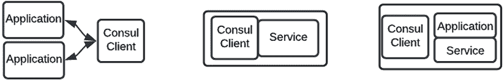
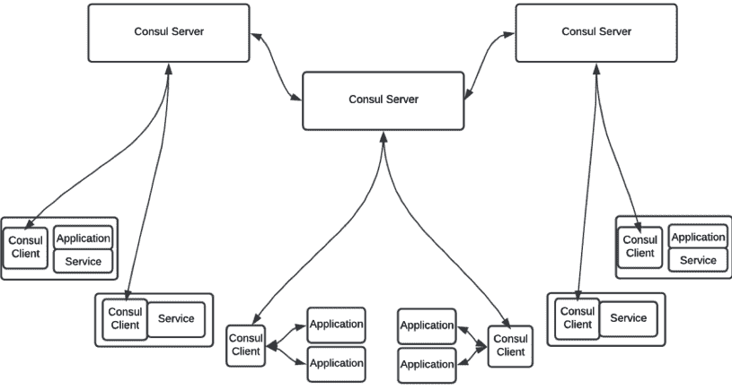
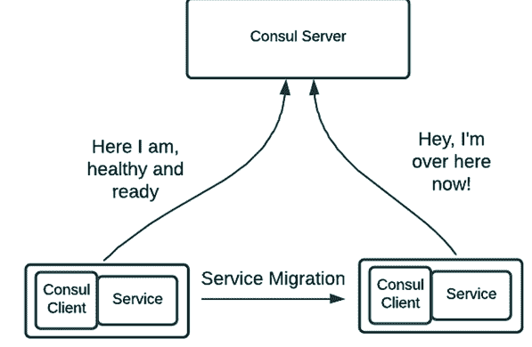
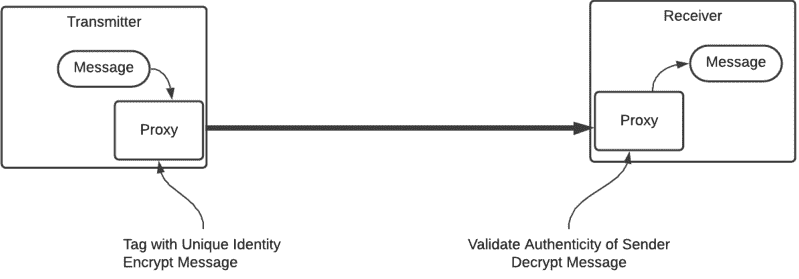
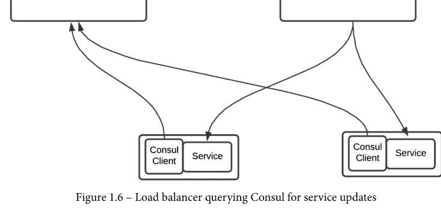
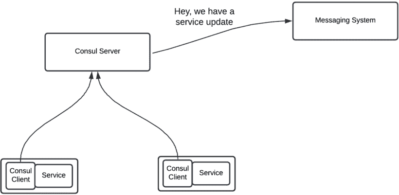
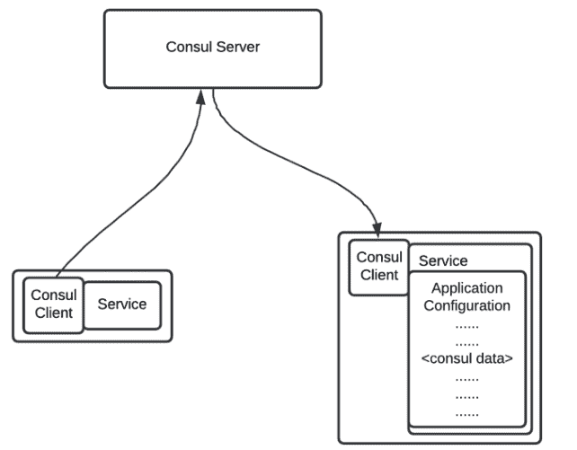

## 1
Consul 概览——操作与用例

欢迎来到 HashiCorp Consul 的精彩世界，这是一个用于管理、自动化并安全连接网络中所有服务的多功能工具。感谢您与我一起踏上这段旅程，希望我们都能在这个过程中学到很多。在本章中，我们将从高层次回顾 Consul，以了解其基础知识和应用；本质上，我们将挖掘地基并浇筑混凝土，以创建一个稳定的基础，在此基础上构建您的 Consul 结构。如果您曾经看过比萨斜塔，您就会知道坚实的地基对任何重要结构都至关重要！在本章中，我们将了解以下内容：

- Consul 系统——组件有哪些，它们如何和谐共处？
- Consul 服务发现——触及所有其他 Consul 功能所构建的基础用例
- Consul 服务网格——Consul 服务网格的基础知识，以安全地实现服务到服务的通信
- 网络自动化——利用服务发现自动化网络基础设施的高层视图

我们现在还不会深入任何代码片段，但请放心，它们很快就会到来。如果您已经熟悉 Consul 的概念和用例，可以直接跳到那些章节——我保证我不会受伤（太多）。不过，当您的经理问起 *你到底在用这个新奇发明做什么？* 时，这一章是交给他们的绝佳选择。

## Consul 系统——服务器与客户端

有时候，为了确切理解某件事物是如何运作的，我们需要了解所涉及的组件。毕竟，在每一种通信形式中，都有发送者和接收者，如果我们对其中任何一方不熟悉，就很难理解信息。Consul 本质上是一个通信引擎。它提供了一种新的结构，以促进网络服务（而不仅仅是网络设备）之间的通信。如果您在网络领域待过一段时间，就一定听说过 IP 地址、子网掩码和网关地址等术语。这些都是网络设备通信中涉及的关键组件。然而，在云、微服务和网络动态调整的辉煌世界里，这些组件会随着网络的兴衰而改变。在这个痛苦的过程中，我们认识到，我们所熟知并喜爱的寻址系统不过是一种达到目的的手段。这个目的就是服务的连接和高效通信。那么 Consul 是如何做到这一点的呢？我们马上就会揭晓！

## Consul 服务器——其领域的主宰

几乎在任何操作系统或结构中，都有一个大脑。这可能不是那个与搭档 Pinky 一起日复一日试图统治世界的 Brain。我们这里关注的是做出决策的大脑。那个决定晚餐吃印度菜还是泰国菜的大脑。那个决定某天穿什么衣服的大脑。那个决定哪位员工获得最大加薪的大脑。现在，您可能会说 *计算机和应用程序没有大脑；它们只做我们告诉它们做的事情。* 您完全正确，但这并不意味着机器没有逻辑和智能（即使是人工的）来做决策。在某些方面，它们更为优越，因为机器和应用程序能够专注于逻辑，而不是自我和情感。对吧，Spock 先生？*没错，你这个顺从的原始哺乳动物。*

在思考 Consul 的大脑时，我们必须关注 **Consul 服务器集群**。查看 *服务器*（server）的同义词，我们会发现 *仆人*（servant），而这正是 Consul 服务器为分布式 Consul 客户端（我们稍后会讨论）所做的事情。服务器之间也协同工作，由选举产生的服务器做出主要决策，并将这些决策分发给整个集群中的其他服务器。那么，这些我网络中的仆人们会做出什么样的决策呢？

首先，Consul 服务器做出的最有用的决策之一就是找到服务所在的位置。Consul 所做的一切都基于这样一个前提：不仅需要发现网络上的服务及其位置，还需要将这些信息共享给任何有权请求该信息的实体。如果你回想旧式电话交换台，有人（应用程序）拿起电话，立刻接通中央接线员（服务器）。呼叫者（应用程序）会请求连接某个特定号码（服务），比如 *特兰西瓦尼亚 6-5000*。接线员（服务器）随后移动那些巨大的插头，将呼叫者（应用程序）与目的地方（服务）连接起来。

图 1.1 – 1945 年左右的人工电话交换台

但如果我有一些应用程序，我不想让它们找到特定的服务呢？好吧，很高兴你问到这个问题！在某些情况下，你可能会遇到一些人或机器想要联系其他人，与他们谈论延长汽车保修期的事。也许我不想收到这些消息。那么，我会告诉那个中央接线员，不让那些呼叫者联系我，这有点像史前的 *勿扰电话登记处*。这些决策也由 Consul 服务器根据你的指令来管理。

好的，听起来 Consul 可以自动做出很多炫酷而智能的决策，但它从哪里获取做出这些决策所需的信息呢？嗯，任何决策都是怎么做出的？员工的加薪可能基于他们的工作表现，同时还要考虑他们是否也在写一本书。我们决定穿什么衣服是基于场合和环境。晚餐吃什么可能基于……嗯，变量太多，无法在此一一列举！我们做出的每一个决策，其质量都取决于我们拥有的数据。Consul 客户端正提供了这些数据。

> **重要说明**
>
> 在官方 Consul 文档中，有一个 *代理*（agent），可以配置为客户端模式或服务器模式。在本文中，我们将服务器代理简称为 *服务器*，将客户端代理简称为 *客户端*。

## 集群的构成要素

正如大脑是任何系统中的决策者，也必须有实体来提供数据，并根据决策执行工作。例如，当经理做出决策时，数据很可能由董事会成员、高级管理人员，当然还有团队成员提供。话虽如此，我们都知道真正做所有工作的是团队成员！

为 Consul 服务器结构做出决策而提供的大量数据分为两类：

- Consul 配置
- 网络数据

当然，配置是由运行 Consul 系统的人员决定的，希望这些配置经过深思熟虑、以代码形式定义并经过同行评审。而数据则由分布在整个网络中的 Consul 客户端提供。这些客户端可能与应用程序同驻一台机器，也可能伴随应用程序运行，注视着它的一举一动。无论位于何处，客户端不仅是服务器的客户端，同时也是应用程序的客户端，代表应用程序并向服务器报告有关应用程序的信息。这使得 Consul 可以在网络中部署，而无需修改现有的应用程序或服务。此外，单个客户端可以代表多个服务和应用程序。

图 1.2 – 代理部署选项

> **重要说明**
>
> 将外部服务监控器与 Consul 客户端一起使用时，应格外小心。在这种配置下，客户端可用的数据会减少，并且在迁移服务方面灵活性较低。

Consul 客户端不仅监控与其关联的应用程序，还收集自身与网络中其他客户端之间距离的信息。这使得服务器能够更智能地决定哪个应用程序或服务实例最适合服务于即将到来的请求。这个概念与紧急服务非常相似，比如你拨打报警电话或火警电话时。有一个你可以拨打的集中号码（即美国的 911），但这个集中号码会将你连接到离你当前位置最近的调度中心。随着 IP 语音服务的普及，这是一个艰难的挑战，而不断增强的网络智能帮助我们克服了它。

## 服务器与客户端的结合

好的，现在我们知道了服务器的职责，也知道了客户端的职责，那么整个系统是如何协同工作的呢？正如我之前提到的，Consul 的一切都关乎通信。Consul 服务器之间需要相互通信，所有客户端都需要与服务器集群通信。

图 1.3 – Consul 服务器与代理和谐共处

服务器之间的通信相当容易管理。那是一场只有 3、5 或 7 人的小型晚宴。然而，当客户端规模从几十扩展到几百，甚至可能几千时，让所有这些客户端都向相对较小的服务器集群汇报，可能会让人不堪重负。我们私密的小型晚宴已经扩展成一场拥有几十、几百甚至上千位宾客的大型派对。你能想象所有宾客都同时想要与主桌交谈吗！但是，如果宾客们能够互相聊天，他们就可以分享自己的信息，发现新事物，并且只将相关且重要的信息汇报给主桌。在某些情况下，我们可能会称这种聊天为“八卦闲聊”。奇怪的是，这正是 Consul 用于这种交互的协议，但我们将在后面的章节中深入探讨。

好了，现在我们了解了服务器的用途、客户端的用途，以及它们之间如何交互和通信。但这个惊人而美妙的系统到底能为我们做些什么呢？我为什么要在意它呢？

## 哦，在哪儿，哦，我的服务都去哪儿了？

如前所述，与私有云和公有云基础设施实施相关的最大问题之一就是网络的流动性。在我那个年代，对网络进行任何更改都需要无数个步骤。让我们聚焦于部署一个新应用这一简单需求。假设我们的应用已经编写并测试完毕：

1. 审查所请求的机器需求。
2. 就所请求的机器获取多份报价。
3. 提交采购申请。
4. 根据成本，通过相应数量的管理层级为采购请求提供合理理由。
5. 向供应商提交采购订单。
6. 等待机器到货。
7. 决定我们要分配哪个 IP 地址。
8. 投票决定我们给这些机器起什么有创意的名字。
9. 确定在温暖而嘈杂的服务器机房中，我们要把机器安装在哪里。
10. 弄清楚我们如何连接这些机器。
11. 机器到货后，安装实际硬件并接通电源。
12. 与后勤部门争论纸板和剩余包装材料应该放在哪里。
13. 使用分配的网络参数（地址和名称）配置机器。
14. 排查路由和地址解析表的问题。
15. 向应用团队提供服务器的地址和凭据。

图 1.4 – 查找您的迁移服务

正如我们所见，网络基础设施的演进在基础设施的管理和部署速度方面带来了令人惊叹的好处。然而，它也引入了一些复杂性和或许一些不受欢迎的变异性，但借助 Consul 服务发现，我们能够拥抱这些变化，而不必费心去弄清楚谁动了我的奶酪。那么现在我们知道了服务在哪里，下一步我们该做什么？

## 这里有点网状

如果你在过去几年里读过任何技术文章，尤其是在微服务或 Kubernetes 的讨论中，你一定会频繁听到服务网格这个术语。就我个人而言，每当我想到网格时，很少会联想到机器之间干净的概念。通常，我会想到埋在波士顿下面的无数隧道，但那是另一个故事了。从网络角度来看，服务网格提供了一种安全连接各种服务的方式，而无需在应用程序本身中添加额外功能。但它听起来仍然有点网状，那我为什么要处理这个呢？

在上一节中，我们谈到了服务发现，以及确定不同应用程序和服务的位置及其健康状态是多么容易。凭借这些信息，恶意行为者可以针对服务发起各种攻击，甚至进行服务 *欺骗*。例如，如果我弄清楚某个特定应用程序正在连接到某个服务，某种数据存储或提供者，就有可能创建一个 rogue 服务，该应用程序会不知情地连接到它并可能泄露敏感信息。过去几年中，我们保护应用程序的能力确实有所提高，然而，在动态的云世界中，冒名顶替者、伪装者和窃听者的问题依然存在，甚至变得更糟。当这种情况发生时，通常都不是好事。

Consul 服务网格提供了一种网络模型，确保服务之间的所有通信不仅是加密的，而且还会验证发送方和接收方确实是他们声称的人。对这些通信系统的绝佳类比是邮政系统。

让我们逐步了解发送包裹的过程，一些我们想要安全并验证其到达最终目的地的重要物品：

- 1. 首先，我们会用某种盒子或信封包裹要发送的物品。在那个包裹上，我们会贴上标签。通常，该标签会包括包裹的收件人姓名和地址。请注意，这是固定地址。
- 2. 我们会把那个包裹交给一名邮递员……为了便于说明，我们就叫他 *Proxy*。Proxy 会确保我们就是我们所说的人，并且由于这个包裹很重要，我们会告诉 Proxy 我们需要确保它送到正确的人手中。
- 3. Proxy 可能会在包裹上再贴上另一个标签并开始在时空中移动包裹。由于 Proxy 位于您所在地区，他们不会随包裹一起走，但可以信任包裹在旅途中会得到保护。

包裹在旅途中可能会遇到各种有趣的事情，但最终，它会到达您预期的姓名和地址。Proxy 的远亲 *Envoy* 将验证包裹是否到达了基于所附标签的正确位置。如果我们想做得更精致，甚至可以收到确认（例如 ACK）表明它已送达。

这个简单的类比描述了服务网格内的通信。有需要传达的消息，但应用程序本身既没有资源也没有智能来安全地将其送达预期目的地。尤其是当预期目的地可能发生变化时，与我们的家庭地址不同，我们已经确定可能没有目的地址的详细信息。因此，应用程序会将该消息交给同一台机器上的本地代理，以消除外部窥探的可能性。该代理已配置证书，原因有两个。首先，验证其自身的真实性。其次，加密消息，以便只有 *内部圈子* 中的人才能获取它。当消息到达另一端时，接收代理可以验证发送方的证书并解密消息。从那里，代理会将消息交给接收应用程序，同样在同一台机器上，以消除任何外部窥探。

正如我们所见，将服务网格添加到 Consul 架构中使我们不仅能够发现服务，还可以安全地、经过验证地连接到这些服务。然而，我们可能在网络中使用相同的证书来验证和加密消息。这种做法并不罕见，因此也为网格内的 rogue 应用程序与任何它想要的东西交谈提供了可能性。好吧，我们不能允许这种情况发生，因此通过 Consul，我们可以创建所谓的 *intention*。当你在 Consul 中创建意图时，你就是在告诉关联的 Consul 客户端它可以从谁接收消息，更重要的是不能从谁接收消息。这为服务网格提供了又一层安全性。

好吧，那个服务网格的东西有点令人困惑，但我明白了。现在我不用处理 IP 地址了，我可以设置应用程序和服务之间的连接，这些连接不仅能保护消息，还能验证发送者。我甚至可以通过创建谁可以与谁通信的规则来控制我自己的网络中的通信。但仍然有所有这些其他网络东西拖慢我的速度。即使在云中，我也会遇到防火墙、负载均衡器和其他通信设备的延迟。为什么我们不能自动化这些部分呢？好吧，当然可以！

## 自动化我！

因此，我们已经确定，能够在没有繁琐静态寻址的情况下发现网络上可用的服务是多么好，以及如何利用它来确保服务之间消息的安全传递。难道不能把这些动态信息与网络中的其他组件共享就更好吗？那么我们为什么要这样做呢？为了理解这种功能如何改善这么多人的生活，让我们跳进时光机，再次回忆我们过去的做法，以及在进行网络调整时我们经常仍然在做的事情：

- 1. 耶！我们的应用程序已部署到网络中，我可以与之通信。然而，我无法访问我的应用程序需要访问的服务。最好打电话给网络团队。
- 2. 网络团队告诉我问题一定出在我这边，因为目标服务是 *alive* 并且正在响应他们的监控工具。
- 3. 在经过几天故障排除后，我们了解到路径中有一个防火墙，正在保护该服务免受邪恶生物的侵害。
- 4. 因此，接下来，我们向防火墙团队提交工单，要求配置一条规则以允许来自……你猜对了，我的 IP 地址的流量。
- 5. 当然，防火墙团队不仅被请求淹没，而且他们知道防火墙规则列表上一个错误的举动，工单数量将是他们最少的问题，所以必须格外小心。
- 6. 最终，团队能够安全地添加并测试新规则，我们就可以开始运行了。

现在在所有这些之后，让我们希望我们没有在工单中忘记包含任何重要信息（例如额外的端口）。更不用说当地址发生变化时（不是如果），我们需要再次进入这个流程。即使在云自动化下，这个流程今天仍然继续，原因有很多。在我个人的经验中，这些变化往往会在任何项目中造成最多的混乱和延迟，而在动态世界中，变化并没有放缓。

希望你能看到，Consul 所感知到的信息在此场景中扮演着如此关键的角色。当服务被添加、更新和移除时，Consul 服务器集群都能感知到这些变化，这要归功于分布式代理。现在的主要挑战是如何将 Consul 中的信息传递给网络设备，解决这个问题有几种方法。

对于网络设备而言，了解服务变化的最直接方法之一，就是让设备通过 Consul 的 API 直接从 Consul 获知这些变化。这一功能已经体现在 Consul 与 F5 Big-IP 负载均衡器的集成中，使用了 F5 Application Services 接口。每当 Consul 发现网络更新时，负载均衡器都能获知这些更新，并自动调整负载均衡池。尽管这种集成确实需要网络组件为 Consul API 专门开发功能，但负载均衡器本身并不需要部署 Consul 代理。

图 1.6 – 负载均衡器向 Consul 查询服务更新

这种集成级别的另一种替代方案是让 Consul 将服务可用性的更新发布到消息服务，如 ActiveMQ 或 RabbitMQ。任何能够接收 HTTP 消息的消息服务或其他应用程序，都可以从 Consul 接收服务更新，而无需直接查询 Consul。

图 1.7 – Consul 动态更新消息总线

一种更常见的集成方法是利用 Consul 的模板功能。顾名思义，你可以创建一个配置文件模板，以匹配你需要管理的任何设备。在该模板中，你可以指定需要从 Consul 获取输入的位置，例如某个端点的 IP 地址。如果你还记得，Consul 会根据它接收到的数据做出智能决策。Consul 服务器从客户端接收到的所有数据，都是构建智能动态网络这个拼图中的一块。一个非常简化的类比就是设置收款人来支付账单。我想我们很多人都做过这种事，肯定比开支票更常见。在我们的银行网站上，我们设置一个收款人——我们每月向其付款的公司或个人。例如，看看我们每月的电费账单，我们支付的金额会随着我的孩子们当月用电量而变化。他们怎么就学不会关灯呢？所以，我们设置好了收款人，我们知道我们要付钱给电力公司。这就是我们的模板。我们所需要的就是应付金额这个数据点。一旦电力公司（客户端）告诉我们（服务器）应付金额，我们就可以填入金额并完成电子支付。希望这会发生在停电之前！

图 1.8 – 出色的模板功能

不过，模板功能不仅适用于配置文件。除了 Consul 之外，HashiCorp 还有其他几个产品，其中之一就是 Terraform。如果你不熟悉 Terraform，它提供了一种标准化的方法，可以为多个云提供商将系统基础设施定义为代码，同时它也有适用于多个应用程序的 provider，包括防火墙、负载均衡器、监控系统等。现在，想象一下将 Consul 服务发现的动态特性与 Terraform 的基础设施即代码平台结合起来！

> **重要提示**
> Consul 与 Terraform 的同步功能（称为 Consul-Terraform-Sync）在撰写本文时仍处于公开测试阶段，并且仅支持有限的一组合作伙伴模块用于自动化。以 HashiCorp 的开发速度，当你读到本文时，该功能很可能已得到全面支持。
