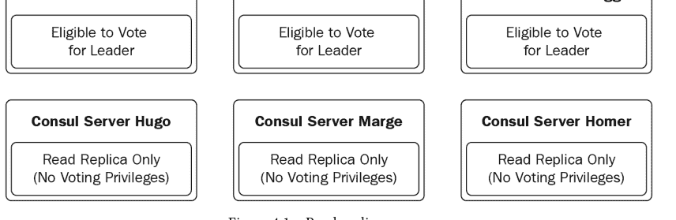
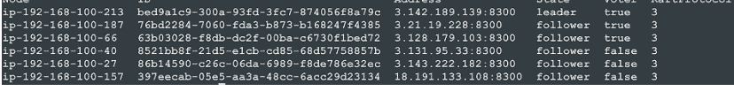
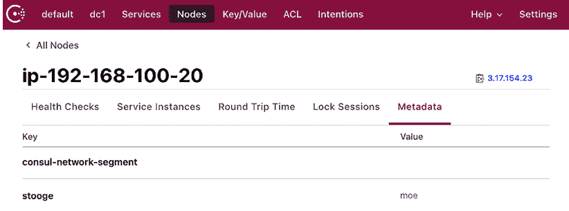
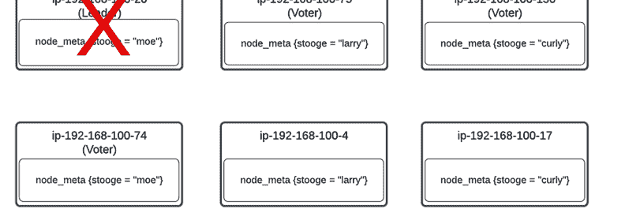
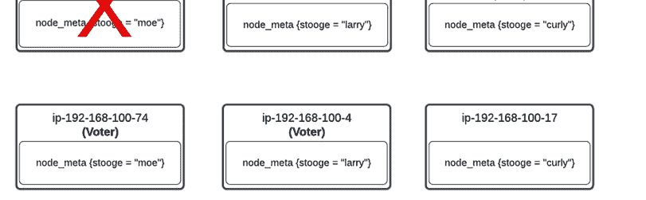
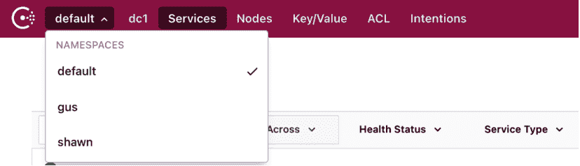
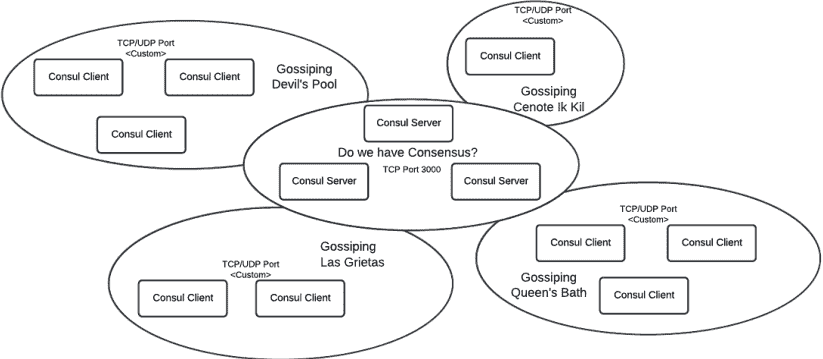
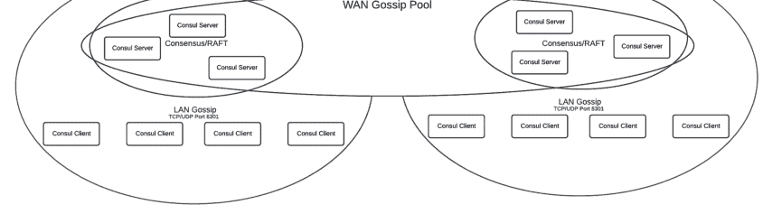

# 4
数据中心（非贸易）联合

我很高兴地告诉你（和我自己），在经历了关于 Consul 安全性的那章颇具挑战性的内容之后，我们关于扩展 Consul 集群的讨论将会轻松得多。事实上，由于我们将在本节中讨论的许多功能都是 Consul Enterprise 特有的，因此不会有什么练习！

在前几章中，我们主要关注于设置和保护我们的 Consul 集群。然而，由于 Consul 是在企业环境中实施的，我们希望了解如何扩展 Consul 系统本身，并将 Consul 功能扩展到多个数据中心或区域。为了理解 Consul 的扩展，我们将回顾以下主题：

-   规模扩展——不，我们不会讨论爬行动物或音乐上的音阶，而是讨论如何扩展 Consul 系统。我们在前面的章节中已经看到，增加服务器集群会如何对达成共识所需的时间产生负面影响。那么，当我们增加客户端数量时，如何确保我们有足够的服务器结构来管理集群？我们又如何在如此庞大的系统中管理升级？
-   细分——在了解了如何将 Consul 扩展到不同区域并管理这种扩展规模之后，我们将研究如何最佳利用这种扩展后的系统。这一操作的主要结果是，在企业环境中提供自治的 Consul 系统，同时不放弃集中控制。
-   联合——在这个全球化的世界中，服务很少只存在于一个区域或数据中心。在本节中，我们将了解如何跨多个区域连接服务器集群，以确保我们的服务无论位于何处都能通信。

虽然我们不会直接应用本章学到的知识，但我将提供代码示例，以帮助进一步解释这些概念的实现。那么，让我们开始练习我们的“音阶”吧！

## 保护与规模扩展

尽管 Consul 代理可以与外部节点上的服务协同工作，但最佳实践（以及最大的灵活性）建议在运行所连接服务的节点上共同驻留一个 Consul 代理。在许多企业中，Consul 连接着成千上万（甚至更多）的服务，这意味着 Consul 集群拥有数千或数万个节点。当然，我们不希望只有三到五个服务器节点来管理这样一个规模的集群，所以让我们从扩展 Consul 服务器集群开始。

正如我们在第 2 章“架构——它是如何工作的？”中所了解到的，对于共识池的大小而言，越大并不总是越好。我们需要至少三台服务器才能获得法定人数，但随着服务器数量的增加，该池选举领导者所需的时间将大大延长。为了解决这个问题，Consul 提供了将 Consul 服务器代理配置为只读副本的能力。当设置此标志时，该代理不参与任何法定人数选举，但它仍然有助于处理节点和服务注册，就像集群中的任何其他服务器一样。



图 4.1 – 只读副本服务器

使用前面的示例，让我们再次查看我们的服务器集群。我们最初将 Bart、Lisa 和 Maggie 作为三个主要的 Consul 服务器节点。我们能够快速达成共识，但随着斯普林菲尔德的成长，我们需要开始用更多服务扩展我们的 Consul 网络。因此，我们最终向集群中添加了三台服务器：Hugo、Marge 和 Homer。为了确保 Hugo、Marge 或 Homer 都无法投票选举服务器集群领导者，它们通过配置中的布尔参数被指定为只读副本：

```
server = true
bootstrap_expect = 3
retry_join = ["provider=aws tag_key=Name tag_value=${server_name_tag}"]
bind_addr = "$(curl -s http://169.254.169.254/latest/meta-data/local-ipv4)"
advertise_addr = "$(curl -s http://169.254.169.254/latest/meta-data/public-ipv4)"
client_addr = "$(curl -s http://169.254.169.254/latest/meta-data/local-ipv4)"
ui = true
read_replica = false
```

当我们将此值设置为 `true` 时，Consul 会将该节点视为只读副本节点，并在 `consul operator raft list-peers` 命令的输出中反映该配置：



图 4.2 – Raft 对等节点列表

## Consul Autopilot

Consul Autopilot 本身是一个开源功能；然而，它主要在后台运行。事实上，你已经在使用 Autopilot 了！Consul 服务器在创建和维护法定人数方面的许多功能都是由 Autopilot 执行的。让我们来看一下 Autopilot 的配置参数，以理解为什么它是一个如此有用的小引擎。

要查看集群中默认存在哪些配置，只需运行以下命令：

```
```bash
# consul operator autopilot get-config
```
```

假设你使用的是相同的 Consul 版本，输出应该与以下内容相同，因为这些是默认参数：

```
```text
CleanupDeadServers = true
LastContactThreshold = 200ms
MaxTrailingLogs = 250
MinQuorum = 0
ServerStabilizationTime = 10s
RedundancyZoneTag = ""
DisableUpgradeMigration = false
UpgradeVersionTag = ""
```
```

在大多数情况下，这些默认参数就足够了，但如果你需要或想要更改它们，最好了解它们控制的内容：

- `CleanupDeadServers` – 在服务器故障不可避免的情况下，你会希望尽快替换该故障服务器。这可以通过手动流程或某种自动化方法来完成。然而，在 Consul 成员列表中，如果一台故障服务器在离开前没有“道别”，它可能会在列表中停留一段时间。这可能会围绕服务器法定人数和领导者选举造成一些混乱。将该值设置为 `true` 后，Consul 会在有新的服务器可用并接管时，立即从服务器集群中移除任何故障服务器。
- `LastContactThreshold` – 正如名称所示，如果领导者在此时段内未收到某个特定服务器节点的消息，领导者将假定该节点已故障。
- **MaxTrailingLogs** – 回想一下，数据是通过日志在 Consul 服务器节点之间同步的，这些日志指示服务目录状态以及其他有用信息。领导者维护这些日志并将其分发给对等节点，但如果某个节点落后太多会怎样？此参数指示服务器与领导者之间允许落后的程度，以日志条目（而非日志）的数量来定义，超过该数量后节点将被视为不健康。
- **MinQuorum** – 该值定义了在 Autopilot 可以开始修剪已被标记为死亡或不健康的服务器之前，集群中必须存在的最少服务器数量。这直接对应于清理死服务器的参数。
- **ServerStabilizationTime** – 我们都需要一些时间才能被视为社会中稳定且有价值的成员。我的治疗师仍在试图弄清楚我需要的时间；然而，我们的集群服务器节点比人脑可预测得多。该值指示集群领导者在将集群中的新成员视为健康之前应等待多长时间。

在这五个参数的基础上，为企业系统添加了三个参数：

- **RedundancyZoneTag** – 每台服务器都可以配置元数据，以帮助执行任意数量的操作。其中一项操作是定义该服务器所在的冗余区域。此参数指示使用哪个标签进行该指定。
- **DisableUpgradeMigration** – 此布尔参数直接影响 Consul 在升级过程中的表现。不过，我们不会在本书中讨论升级 Consul；升级任何分布式系统（如 Consul）都应由单个节点的滚动更新组成。这消除了对整个集群进行下线、升级所有节点然后一次性全部重新启动（这会导致相当严重的服务中断）的需要。使用 Consul 时，当我们开始升级服务器时，一旦有足够多的服务器运行新版本以支持法定人数，Autopilot 就会开始将它们提升为投票者。如果我们将此值设置为 `true`，Autopilot 将不会自动将新服务器提升为投票者。


+   - UpgradeVersionTag – 如果你想要手动覆盖某个 Consul agent 的版本，例如在集群中调整配置参数时，该参数定义了要用什么元数据来指示服务器版本。若未设置此值，Autopilot 只会查看 Consul 软件自身报告的版本。

我们不打算真正去修改这些参数，除了 RedundancyZoneTag。这也将帮助我们理解 Consul agent 配置中元数据的用法。那么，让我们看一下为服务器节点配置了元数据和冗余区域的新配置：

## 配置了冗余区域的 Consul 服务器配置

```
server = true
bootstrap_expect = 3
retry_join = ["provider=aws tag_key=Name tag_value=rjackson-consul-server-instance"]
bind_addr = "192.168.100.20"
advertise_addr = "3.17.154.23"
client_addr = "192.168.100.20"
ui = true
read_replica = false
node_meta {
    stooge = "moe"
}
autopilot {
    redundancy_zone_tag = "stooge"
}
```

这里我们有两个新的配置块，一个是 node_meta，另一个是 autopilot。这些块中输入的内容并不多，但这就是设置冗余区域所需的全部内容。首先，我为每个节点定义了一些元数据。我将该元数据的键命名为 stooge，值可以是 moe、larry 或 curly，用来表示我如何对服务器进行分组。如果元数据能根据你自己的网络结构指示实际区域，那也不错，但我使用 stooge 参数是为了好玩，并展示这些键实际上几乎可以是任何内容。我们可以在 UI 中看到为每个节点配置的元数据，如下图所示：



图 4.4 – Consul agent 元数据

你还可以根据元数据过滤 CLI 的输出：

```
# consul catalog nodes -node-meta=stooge=moe
```

| 节点 | ID | 地址 | DC |
|---|---|---|---|
| ip-192-168-100-20 | 8a1da666 | 3.17.154.23 | dc1 |
| ip-192-168-100-74 | d80b81de | 3.135.205.26 | dc1 |

请注意，在这些配置中，所有服务器的只读副本标志都设置为 false。当我们把某个服务器指定为只读副本时，本质上是在告诉 Consul：我们将自行管理只读副本的存在，不需要 Autopilot 替我们管理。当我们使用冗余区域时，Autopilot 会确保每个冗余区域中至少有一个投票成员。加入特定区域的任何额外服务器将自动被识别为只读副本。为了让你看到实际效果，我想提供来自测试系统的新示意图，其中包含适当的服务器名称和相关元数据：

## 图 4.5 – Consul 冗余区域设置

在此图中，顶行是所有的投票成员，第一个节点被选为领导者。我们还可以看到为每个节点配置的元数据。我们还可以通过 consul operator raft list-peers 命令查看投票者状态：

```
Node                ID                                 Address            State    Voter  RaftProtocol
ip-192-168-100-130  b48c7778-bf22-d37a-d11a-54b4f6368342  18.222.179.118:8300 follower true   3
ip-192-168-100-75   e211c429-9b12-00cf-f15a-2f03a13cdbd2  3.139.238.20:8300   follower true   3
ip-192-168-100-20   8a1da666-1df7-74ed-6477-536017fae610  3.17.154.23:8300    leader   true   3
ip-192-168-100-74   d80b81de-4acb-ba2e-d23c-fc7a02037163f 3.135.205.26:8300   follower false  3
ip-192-168-100-17   43c87a94-4eb0-ba2c-d4d4-17c4a9532f6a  3.142.173.170:8300 follower false  3
ip-192-168-100-4    0babb7ce-a1ed-8be2-7ad4-d0182cc2e0a0 3.16.139.57:8300    follower false  3
```

## 图 4.6 – Raft 投票者状态

在 Consul 领导者节点 ip-192-168-100-20 上，我将使用 sudo ifconfig eth0 down 命令关闭网络接口，使其失去与集群中其他节点的所有通信。

> 重要说明
> 如果你在自己环境中尝试此操作，你将失去与服务器的连接，并且需要通过 AWS 管理控制台重启服务器。

如果我操作正确，节点 ip-192-168-100-74 将从非投票者（voter = false）转换为集群内的投票者。我们的冗余区域配置为基于 stooge 元数据键进行匹配，而 ip-192-168-100-20 和 ip-192-168-100-74 都属于 stooge 类型的 moe：



图 4.7 – 冗余区域 Autopilot 调整

这个结果同样可以通过 consul operator raft list-peers 命令查看：

```
Node                     ID                                   Address            State    Voter  RaftProtocol
ip-192-168-100-130       b48c7778-fb22-d37a-d11a-54b4f6368342  18.222.179.118:8300 leader   true   3
ip-192-168-100-75        e21c429-9b12-00cf-f15a-2f03a13cdbd2  3.139.238.20:8300   follower false  3
ip-192-168-100-74        d80b1de-a4cb-ba2e-d23c-fc7d2037163f  3.135.205.26:8300   follower true   3
ip-192-168-100-4         0babb7ce-aled-8b2e-f4d4-d018cc2e0a0  3.16.139.57:8300    follower true   3
ip-192-168-100-17        43c87a94-4eb0-0ac2-da4d-17c4a9532f6a  3.142.173.170:8300  follower false  3
```

图 4.8 – 缩减到五个 Raft 节点

请注意，ip-192-168-100-74 的晋升并不是投票者分配的唯一调整。当 Autopilot 介入并重新调整集群时，主要目标是确保每个冗余区域中有一个投票者。



图 4.9 – Autopilot 的结果

在本节中，我们了解了如何以可扩展的方式扩展 Consul 服务器集群，同时了解了 Autopilot 如何帮助维护集群自身的某种健康状态。既然我们已经完善了有效扩展 Consul 集群的能力，就可以开始向所有同事展示 Consul 的妙处了！毕竟，一旦我们发现并学会使用一个如此强大且有用的产品，难道不想与他人分享这些信息吗？

## 子分区

利用 **Consul 命名空间** 功能，我们能够有效地将整个 Consul 系统细分为多个迷你系统，每个系统都有自己的自主权。这为更大的企业组织带来了多重好处：

- 它利用一个集中的团队在企业规模上运营和管理 Consul。这不仅使服务管理方式保持一致，还减少了管理多个独立 Consul 系统的开销。
- 它使各个团队能够管理和保护自己的应用程序，而无需依赖多层管理和控制。尽管 Consul 的集中运营者拥有完全控制权，但可以在一定范围内授予团队自主权，让他们自行管理服务。
- 拆分 Consul 不仅细分了系统的操作，还细分了服务目录本身。这使组织能够创建与 Consul 目录其他方面完全隔离的服务。这不仅增强了服务管理的安全态势，还防止了具有重复服务名称的团队之间相互干扰。

创建命名空间本身只需要一个简单的 `write` 命令。另外，我们还将查看已创建的命名空间：

```
```text
# consul namespace write shawn.hcl
Name: shawn
Description:
    Shawns namespace for his funny antics and visions
# consul namespace write gus.hcl
Name: gus
Description:
    Gus' namespace to track his pharmaceutical distribution
# consul namespace list
default:
    Description:
        Builtin Default Namespace
gus:
    Description:
        Gus' namespace to track his pharmaceutical distribution
shawn:
    Description:
        Shawns namespace for his funny antics and visions
```
```

请注意，有一个默认命名空间值，它将捕获所有未显式关联到某个命名空间的数据。

现在已经创建了命名空间，我们可以在 Consul UI 中看到它们：



图 4.11 – 在 Consul UI 中选择命名空间


如果我们想要将服务注册到特定命名空间（不是默认命名空间），只需在服务自身的配置中指定所需的命名空间即可。在之前的章节中，我们观察到了一个由 Consul 管理的 httpd 服务。我稍微修改了那个 JSON 文件，只是为了表明该服务将在 gus 命名空间中运行。

## httpd.json 服务定义

```
{
    "service": {
        "name": "httpd",
        "namespace": "gus",
        "tags": [
            "python-server"
        ],
        "port": 8080,
        "check": {
            "args": [
                "curl",
                "localhost:8080"
            ],
            "interval": "10s"
        }
    }
}
```

当我们像配置 httpd 服务一样，将服务配置并指定到特定命名空间后，只有该命名空间的成员才能与该服务交互并获取与其关联的信息。接着上面的例子，如果我查询与我的 Consul 系统关联的服务，最终只会得到一个服务：

```
$ consul catalog services
consul
```

哦，不！我的 `httpd` 服务难道没有在运行吗？我可以向你保证，该服务正在运行，只不过它位于一个独立且不同的命名空间中：

```bash
$ consul catalog services -namespace gus
httpd
```

现在，能够将这些服务分开会大有帮助；然而，如果我们没有以独特的方式保护这些命名空间，那么我们就没有真正从这些细分中获益。如果想到 ACL 工作时的经历让你神经紧张，那么你需要相信你的直觉。当我们开始在 Consul 系统中创建命名空间时，这有点像在构建一个管理层次结构。

如果你还记得，在用 ACL 引导系统时，我们需要创建一个引导 ACL 令牌，它赋予我们对整个 Consul 系统的完全管理权限。用一个极其简化的类比，我们可以把这个管理员或管理组看作是 Consul 系统的州长。我们称他为**勒佩托曼州长**。凭借以唯一令牌为代表的凭证，他能够为他的辖区制定规则，辖区内所有城镇和社区都必须遵守这些规则。不过，每个城镇仍然保持一定程度的自治。**约翰逊市长**拥有自己的凭证（令牌），能够为 Rock Ridge 镇制定自己的规章制度，只要这些规则符合勒佩托曼州长制定的规则。Consul 命名空间结构的管理方式几乎完全相同。

当我们在 Consul 中引导 ACL 功能时，我们会创建一个遵循默认全局管理策略的令牌。利用这个令牌，我们能够创建新的策略和相应的令牌，从而对 Consul 能做的所有事情进行非常细粒度的管理。当我们创建命名空间时，需要为这些操作员提供他们自己的管理策略，但不能让他们对相邻的命名空间行使权力。因此，每个命名空间都有自己的*操作员*级令牌，这些命名空间的管理员可以使用该令牌创建他们自己的策略、规则、服务等等。那么这两个默认策略有何不同？

> **重要说明**
>
> 命名空间允许我们对服务和策略进行细分；但是，Consul 集群节点对所有命名空间都是可见的。

让我们先从为 Shawn 的命名空间创建一个*命名空间管理级*策略开始：

```
consul acl token create -namespace shawn -description "Shawn's Management Token" -policy-name "namespace-management"
```

现在，我们有了一个分配给 shawn 命名空间的默认操作级令牌。利用 Consul CLI，我们可以观察到这两个策略的存在。请注意，为了看到*命名空间管理*策略，我需要包含相应命名空间的标志：

```
$ consul acl policy list
global-management:
  ID:             00000000-0000-0000-0000-000000000001
  Namespace:      default
  Description:    Builtin Policy that grants unlimited access
  Datacenters:

$ consul acl policy list -namespace=shawn
namespace-management:
  ID:             2226f072-68ae-9082-6d8d-7c9bdb1a987c
  Namespace:      shawn
  Description:    Default policy that grants all available privileges within a single namespace
  Datacenters:
```

利用 consul acl policy read 命令，我可以查看这两个策略的详细信息。同样，对于 shawn 命名空间，我需要在命令中包含命名空间标志。图 4.12 提供了策略差异的并排视图：

| global-management | namespace-management |
|---|---|
| <pre>ID: 00000000-0000-0000-0000-000000000001&#10;Name: global-management&#10;Namespace: default&#10;Description: Builtin Policy that grants unlimited access&#10;Datacenters:&#10;Rules:</pre> | <pre>ID: 2226f072-68ae-9082-6d8d-7c9bdb1a987c&#10;Name: namespace-management&#10;Namespace: shawn&#10;Description: Default policy that grants all available privileges within a single namespace&#10;Datacenters:</pre> |
| acl = "write" | acl = "write" |
| <pre>agent_prefix "" {&#10;  policy = "write"&#10;}&#10;event_prefix "" {&#10;  policy = "write"&#10;}</pre> | |
| <pre>key_prefix "" {&#10;  policy = "write"&#10;}</pre> | <pre>key_prefix "" {&#10;  policy = "write"&#10;}</pre> |
| keyring = "write" | |
| <pre>node_prefix "" {&#10;  policy = "write"&#10;}</pre> | <pre>node_prefix "" {&#10;  # node policy is restricted to read within a namespace&#10;  policy = "read"&#10;}</pre> |
| <pre>operator = "write"&#10;query_prefix "" {&#10;  policy = "write"&#10;}</pre> | |
| <pre>service_prefix "" {&#10;  policy = "write"&#10;  intentions = "write"&#10;}&#10;session_prefix "" {&#10;  policy = "write"&#10;}</pre> | <pre>service_prefix "" {&#10;  policy = "write"&#10;  intentions = "write"&#10;}&#10;session_prefix "" {&#10;  policy = "write"&#10;}</pre> |
| <pre>namespace_prefix "" {&#10;  acl = "write"&#10;  key_prefix "" {&#10;    policy = "write"&#10;  }&#10;  node_prefix "" {&#10;    policy = "read"&#10;  }&#10;  session_prefix "" {&#10;    policy = "write"&#10;  }&#10;  service_prefix "" {&#10;    policy = "write"&#10;    intentions = "write"&#10;  }&#10;}</pre> | |

图 4.12 – 引导策略和命名空间策略

请注意，引导策略中有整整一节与命名空间管理直接相关。因此，拥有这种特权策略的人能够管理每个命名空间中的 ACL、键、节点、会话和服务。换句话说，我们的州长有能力在城镇层面管理和控制事务，但城镇中的市长对其他城镇没有管辖权。此外，虽然在引导级别我们能够对集群中的节点进行写入，但在命名空间级别，由于命名空间可以访问所有节点，它只能读取。

正如我们所看到的，命名空间能够将整个 Consul 系统分割成独立的迷你系统，为这些系统的操作员提供自主权。然而，在一些高度安全的环境中，可能需要在网络层真正划分 Consul，而不仅仅是在应用层。

我们整个 Consul 集群，也就是每个命名空间中的每个节点，都通过很久以前讨论过的 gossip 协议进行通信。我们不打算深入探讨这个主题，因为它相当高级。不过，考虑一下这种情况：我们可能有数千个 Consul 节点分布在整个数据中心网络中，这种情况在生产环境中并不少见。如果你还记得，当我们开始用树示例（图 4.10）讨论命名空间时，分离发生在 Consul 节点之上的一层。当我们对 Consul 网络进行分段时，实际上是在把这些 gossip 池划分为更小的池，每个池都在自己的网络端口上进行通信。



我试图在图 4.13 中用不同类型的池来展示这种分段。在此示例中，所有网段（或池）都能够与核心集中式服务器集群通信。然而，由于防火墙或其他基于网络的划分，各池之间无法相互通信。通过利用 Consul 网络分段，我们仍然可以在被分割的网络中管理整个 Consul 集群、服务和命名空间。

现在，我们已经成功用 Consul 服务征服了整个数据中心，是时候继续实施 Brain 统治世界的目标了。所以，跟我来吧，Pinky，让我们开始讨论如何连接我们的 Consul 集群。

## 连接集群

认为我们所有的服务都会驻留在单个数据中心内，这种想法在 20 年前我刚开始写这本书时或许还行得通（似乎如此）。世界已经真正演变成一个持续连接的移动环境，尽管有些人可能认为这实际上是一种倒退。无论如何，在这个世界上真正维护我们服务之间通信的唯一方法，就是确保可以从多个地理区域发现它们的可用性和位置。无论我是在波士顿、柏林还是墨尔本，我所依赖的应用程序和服务都必须可用！我们在本章所做的这一切，都是为了走到这一步！

在整个书中，我们已经讨论了很多关于 gossip 和池的内容，我们将继续这一讨论。然而，你可以想象，在单个 Consul 集群内我们通信的数据量可能相当庞大，尤其是当我们接入所有服务时。如果我们愿意，我们可以简单地将 Consul 节点部署到不同的数据中心和区域，然后就完事了。不幸的是，这会导致大量流量在整个网络上广播。此外，将 Consul 服务器节点分散到多个数据中心可能会影响服务器集群的可用性，即使有出色的 Autopilot 也是如此。

当你在广域网（WAN）上加入 Consul 集群时，集群之间不会共享目录信息。每个服务器集群只能感知到其他集群的存在，因此当某个服务请求发出时，该请求可以被传输到另一个数据中心以检查服务的可用性。


到目前为止，我们只在默认的数据中心工作，形象地命名为 dc1。在本示例中，我将创建两个数据中心，Jake 和 Elwood。特定 Consul 代理的数据中心在配置中通过一个简单的 datacenter 参数定义。例如：

```
server = true
datacenter = "Elwood"
bootstrap_expect = 3
```

我已在两个数据中心 Jake 和 Elwood 中各设置了三台服务器节点。连接这两个数据中心在配置中以及通过命令行都非常简单。在配置中，我们使用 retry_join_wan 命令，与我们已用于 Consul 节点相互发现的 retry_join 命令类似。此外，你只需要每个数据中心之间的一台服务器连接，因为它们随后会相互了解。然而，我强烈建议包含多台服务器，以防在两个数据中心需要连接时其中一台不可用：



图 4.14 – Jake 和 Elwood 组建乐队

一旦数据中心连接起来，你可以使用 consul members -wan 命令查看所有服务器：

| Node | Address | Status | Type | Build | Protocol | DC | Segment |
| ip-192-168-100-140.elwood | 3.133.92.242:8302 | alive | server | 1.9.4+ent | 2 | elwood | <all> |
| ip-192-168-100-180.elwood | 18.216.77.187:8302 | alive | server | 1.9.4+ent | 2 | elwood | <all> |
| ip-192-168-100-203.jake | 18.188.194.17:8302 | alive | server | 1.9.4+ent | 2 | jake | <all> |
| ip-192-168-100-60.jake | 3.140.201.212:8302 | alive | server | 1.9.4+ent | 2 | jake | <all> |
| ip-192-168-100-81.elwood | 3.140.252.128:8302 | alive | server | 1.9.4+ent | 2 | elwood | <all> |
| ip-192-168-100-97.jake | 3.135.63.108:8302 | alive | server | 1.9.4+ent | 2 | jake | <all> |

图 4.15 – 集群组建在一起

## Summary

好吧，我真心希望你喜欢这一章。我们已经看到 Consul 如何能够在许多现实场景中扩展到惊人的大量节点。我们看到了 *read replicas* 以及更重要的是 *Autopilot* 的使用如何使我们能够扩展服务器集群，以支持拥有数万个节点的网络。我相信我最近听说过一家公司在生产环境中运行 Consul，节点超过 100,000 个！在如此庞大的系统上集中管理所有服务的操作无疑具有挑战性，因此启用命名空间不仅有助于在 Consul 内部扩展应用程序使用，还能随着系统的增长扩展对人类操作的依赖。最后，我们研究了以几种方式联合我们的 Consul 集群，以帮助跨数据中心扩展我们的服务可用性。正如我从一开始所说的，Consul 实现了组件和服务之间的通信。现在，这些通信路径不再受规模或地理位置的限制。

到目前为止，我们应该对 Consul 的操作以及集群中各个组件如何相互协作有相当好的理解。在接下来的几章中，我们将更深入地研究 Consul 的用例，以便你开始将所有这些知识应用于价值创造型服务！第一个用例涉及 Consul 服务发现，这是 Consul 服务提供的最基础部分。
