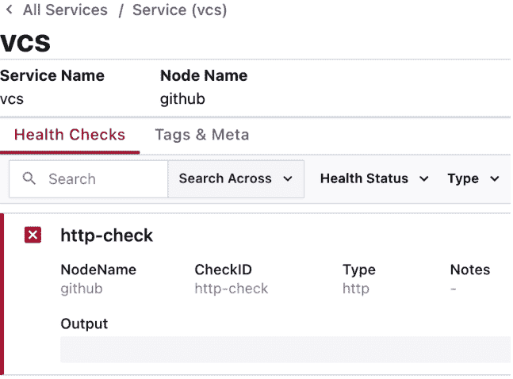
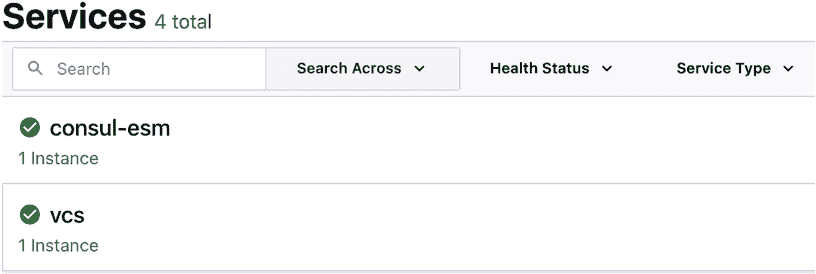
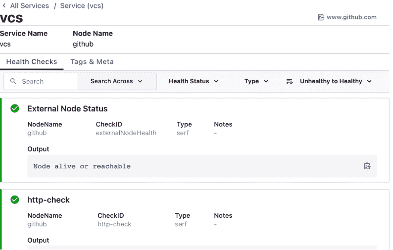

## 5
Little Bo Peep
Lost Her Service

就是现在！我们所有人都在等待的时刻！所有那些可怕的冷笑话和双关语即将得到回报，因为我们实际上开始将所有这些巨大的知识付诸实践！在每个 Consul 用例的最基础部分都是服务信息的发现和共享。我们准备将精力更多地集中在 *为什么使用 Consul*，而不是 *什么是 Consul*。为了理解这个初始用例的为什么，让我们看看古老的童谣 *Little Bo Peep who lost her sheep*。不过，正如你可能猜到的那样，我们失去的不是羊，而是我们的服务！

Little Bo Peep 在照看她的羊群，它们自由地在山坡上。只要羊群被限制在羊圈里，她很容易监控它们。它们只能游荡到一定范围，只要她控制羊圈的那些门，就没有问题！随着时间的推移，她开始了解到她的羊群如果被放任游荡，不仅能为她，还能为他人提供更丰厚的羊毛。此外，随着她允许那些羊游牧式地游荡，她发现为羊提供食物和水变得高效得多。那么，她需要管理这些羊而不把它们赶回羊圈，需要什么呢？

- **Location:** 当然，她需要某种方法来追踪和定位羊。她可以通过在每只羊上安装 **Global Positioning System (GPS)** 追踪器来解决这个问题，以便在必要时定位它们。
- **Health:** 她需要知道她的羊是健康的！如果其中一只感觉不舒服，她需要照顾它，而且同样重要的是，确保没有人给那只羊剪毛！
- **Discovery:** 所以她知道它们在哪里以及感觉如何，但她将如何让其他人找到羊呢？她会定期宣布，举起一个牌子，还是也许提供一个有名人嘉宾的热线？

随着我们深入本章，我们将看到 Consul 如何解决 Little Bo Peep 及其迷路的羊，我的意思是服务，这三个关键挑战。

### Technical requirements

在本节中，我们将在 **Amazon Web Services (AWS)** 上使用 Terraform 部署完整的 Consul 集群。如果你已经完成了 *Chapter 2, Architecture – How Does It Work?*，设置了你的 AWS 账户，下载了 Terraform，并克隆了仓库，你就准备得很充分！

本章中没有特定的步骤；然而，拥有一个简单的运行中 Consul 集群（例如来自 *Chapter 2, Architecture – How Does It Work?*）以及提供的服务，对于导航和操作服务可能会非常有用！

### Dude, where's my service?

我们要解决的 Little Bo Peep 的第一个挑战就是简单地确定她的羊，或在这种情况下，她的服务的位置。在我们的类比中，Little Bo Peep 在每只羊上安装了 GPS 追踪器。然而，GPS 从根本上只提供给定点的经度和纬度。它本身并不能提供关于该点的任何信息，只知道它存在。如果她仅仅停留在安装追踪器上，她真的解决了问题吗？在非常高的层面上，她可以看到特定位置存在一个 GPS 追踪器。然而，她还不知道哪个羊存在于该位置。她还需要某种接收器来维护所有这些 GPS 坐标的位置。这归结为服务定义和集中式服务注册。

每个网络中的每个服务都有某种定义。定义的某些方面可能非常高层次，例如名称或目的。定义的某些方面可能非常详细，例如服务可以在哪个地址访问以及它监听哪个端口。历史上，这些信息可以保存在数据库、电子表格或某人隔间里的便签上。无论保存在哪里，它都需要被完全定义。Consul 也不例外。


Consul 所感知的每个服务都是由，嗯，服务定义（service definition）来定义的。有人可能会说，等等，你说过这些是自动发现的——为什么还需要配置？这里要说的是，这些服务是自动发现，而不是自动定义。定义以文件形式存在，可以是 JSON 或 HCL，Consul 能够将其与其他配置文件一起读取。这些文件可以相当复杂，也可以极其简单，具体取决于服务及其功能。我们来看一个到目前为止在我们的工作中已经使用过的服务定义：

## httpd.json

```
{
    "service": {
        "name": "httpd",
        "tags": [
            "python-server"
        ],
        "port": 8080,
        "check": {
            "args": [
                "curl",
                "localhost:8080"
            ],
            "interval": "10s"
        }
    }
}
```

你可能会注意到，这是一个名为 httpd.json 的文件，其中包含部署在 Consul 中的 httpd 服务的定义。当 Consul agent 启动时，它会尝试读取配置文件夹中的每个文件。这些文件可以是实际的 agent 配置、安全配置（如访问控制列表（ACL））或服务定义。这使任何组织都能够让服务开发者编写，或至少深度参与编写其服务定义，并对其进行单独管理。

如果你不想为每个服务单独创建一个文件，Consul 确实提供了将多个服务合并到一个配置文件中的能力。不过，应当注意不要让这些文件过载。毕竟，你能想象一个 Consul agent 上运行着 100 个服务，却只有一个配置文件吗？

在典型的 Consul 系统中，服务的部署、移除或更新十分频繁。如果你考虑软件开发生命周期，新服务或应用程序的孕育期可能短至几周。在许多此类情况下，可能都需要针对新版本、标签等更新服务定义。理想情况下，每次发布新服务或应用程序时，都会有一个相应的 Consul 服务定义文件伴随该应用程序一起发布。

当新应用程序或现有应用程序的新版本被部署时，服务定义也会随之更新。如果你使用的是诸如 Nomad 这样简单的编排器，它可以将相应的服务定义作为应用程序定义的一部分进行管理，并自动部署。然而，在传统系统中，你通常需要主动选择应用程序运行在哪些节点上，那么用于推送应用程序的任何过程都应该同时推送相应的服务定义。

一旦新定义就绪，相关的 Consul agent 需要简单重载以识别调整后的配置。与大多数配置一样，服务的动态调整不会自动被识别。不过，重载 agent 非常简单，可以通过 `consul reload` 命令或 API 调用来完成：

```sh
$ curl --request PUT $CONSUL_HTTP_ADDR/v1/agent/reload
```

在更动态的环境中，Consul API 在这一过程中提供了大量功能。它不能帮助你部署应用程序；但是，所有的服务定义和检查都可以通过 Consul API 提供给 Consul agent。这对于那些需要在应用程序部署后对服务定义或该定义的任何方面（包括健康检查）进行修改的环境非常有用。不过，通过 API 注册服务确实需要一些额外的信息，以便确保 Consul 知道该服务预期位于哪个节点上。请注意下面用于 Consul API 的 `httpd-api.json` 与我们之前使用的原始 `httpd.json` 定义之间的区别。需要提供 Datacenter、Node 和 Address 字段，以便告知 Consul 该服务预期位于哪个节点上；同时需要提供 CheckId 和 ServiceId，以便将服务定义和检查定义关联起来。这样便可以单独推送服务和检查定义：

## httpd-api.json

```json
{
  "Datacenter": "dc1",
  "Node": "ip-192-168-100-118",
```

```
"Address": "192.168.100.118",
"Service": {
  "ID": "httpd2",
  "Service": "httpd2",
  "Tags": [
    "python-server"
  ],
  "Address": "192.168.100.118",
  "Port": 8080
},
"Check": {
  "CheckID": "httpd2",
  "Node": "ip-192-168-100-118",
  "ServiceID": "httpd2",
  "Status": "passing",
  "Definition": {
    "tcp": "localhost:8080",
    "interval": "10s"
  }
}
}
```

**重要提示**
尽管通过 API 定义和管理服务对于 Consul 的程序化管理非常有用，但必须注意，如果 Consul agent 重启，通过 API 执行的所有目录条目都不会持久化。

## 外部服务

但是，Rob，如果我想让 Consul 感知那些并未直接嵌入 Consul 系统的服务，该怎么办？这对 Consul 来说并不是问题；只不过，它确实需要一些额外的配置选项，类似于我们在 API 服务定义中所做的那样。让我们考虑这样一种情况：在整个生命周期中，我们希望为开发人员提供一个集中式的 GitHub Enterprise 服务，同时让他们能够利用 Consul 来发现 GitHub 服务。我将以 **GitHub** 托管的服务平台作为示例，但由于它只是一个 URL，这个定义可以很容易地适用于多种场景：

## github.json 外部服务定义

```json
{
  "Node": "github",
  "Address": "www.github.com",
  "NodeMeta": {
    "external-node": "true",
    "external-probe": "true"
  },
  "Service": {
    "ID": "vcs",
    "Service": "vcs",
    "Port": 80
  },
  "Checks": [{
    "Name": "http-check",
    "Definition": {
      "http": "https://www.github.com",
      "interval": "30s"
    }
  }]
}
```

请注意，在此服务定义中，我们同时包含了节点和检查信息。

这个定义与我们之前所见不同，其重要特点是存在 `external-node` 和 `external-probe` 参数，两者均设置为 `true`。该信息告知 Consul，此服务需要由某种外部服务管理器来监控。有趣的是，*外部服务管理器* 恰好是一个简单二进制守护进程的名字，它可以与所有 Consul agent 一起运行，以管理任何类型的外部查询。不过，在我们介绍它之前，先来注册我们的服务。

由于不仅服务位于 Consul 之外，承载该服务的节点也位于 Consul 之外，因此 Consul 需要通过 API 注册该节点、服务以及任何附加检查。我们可以使用 cURL 和前面代码中的 GitHub 服务定义 JSON 文件来完成此操作：

```bash
$ curl --request PUT --data @github.json http://<consul_http_address>:8500/v1/catalog/register
```

注册服务后，Consul 会认为 vcs 服务领域一切正常，并将其在服务目录中提供：



因此，我们可以看到我们的服务已经注册；然而，它还没有显示为健康状态。这是因为 Consul agent 正在寻找一个外部服务监视器来监视，嗯，那个外部服务。当 Consul **外部服务管理器**（ESM）运行时，它也会作为 Consul 目录中的一个服务出现。有了这个服务，我们现在可以看到外部 GitHub 服务开始报告为健康状态：



图 5.2 – Consul 外部服务监视器已注册

当我们查看服务详情时，不仅可以看到 GitHub 的 HTTP 检查返回健康，还可以看到一个 **外部节点状态** 检查也返回了愉快且健康的状态：



图 5.3 – 外部服务的服务检查


此时，我们已在 Consul 中定义了一个外部服务，它不仅注册在服务目录中，而且还会被监控，以确保在向任何消费者提供目录信息之前，服务处于健康状态。

如果你希望将 Consul ESM 下载到自己的系统上并试用该服务，只需登录到你选择的其中一个 Consul 客户端节点。在命令行 shell 中，执行以下命令：

```
$ curl -o https://releases.hashicorp.com/consul-esm/0.5.0/ consul-esm_0.5.0_linux_amd64.tgz
```

```
$ tar -zxvf consul-esm_0.5.0_linux_amd64.tgz
```

这为你提供了 consul-esm 二进制文件，它可以像标准 Consul 代理一样，使用 HCL 配置文件进行配置！我提供了一个非常简单的配置文件。如果你想试用 ESM，只需确保修改 `local_private_ip` 参数，并插入与你节点对应的正确参数：

```
# consul-esm.hcl Configuration File
log_level = "INFO"
instance_id = ""
consul_service = "consul-esm"
http_addr = "<local_private_ip>:8500"
datacenter = "dc1"
```

现在你已经有了配置文件，可以运行 consul-esm 并使用它：

```
$ sudo ./consul-esm -config-file=./consul-esm.hcl
```

如果你正在跟着操作（你当然应该这么做），那么你的 VCS 外部服务应该已在 Consul 集群中注册为健康状态。如果你想查看 Consul ESM 的源代码或其他文档，所有内容都在 GitHub 上开源提供！

https://github.com/hashicorp/consul-esm

既然我们已经知道了如何定义内部和外部服务，小波比也能够分辨哪些羊是她的，以及它们在哪里。她还需要一种方法来确保她的羊都健康。毕竟，生病的羊需要被照料！让我们来看看如何确保我们的羊——我是说服务——保持健康。

## 汤姆少校，你还好吗？

每当我们处理通信时，几乎总需要某种程度的反馈来确保接收方可用。这正是我们耳熟能详的短语的由来，比如*你现在能听到我吗？*。任何处理过网络负载均衡器或系统监控的人对*健康检查*一词都不会陌生。这正是 Consul 可以在每个服务定义中采用的机制。尽管健康检查并非服务定义的必需部分，但我无法想象为什么会有人想要定义和部署一个没有健康检查的服务！

在网络负载均衡器或系统监控领域，健康检查是由某种集中式智能定义和编排的。这意味着，如果一个负载均衡器管理着分布在 100 个不同节点上运行的 10 个服务，那么该负载均衡器需要跟踪 1,000 个健康检查。这不仅会在服务增长时导致一些扩展问题，而且还会（至少略微）增加网络流量。

如今许多监控系统利用远程代理进行健康检查，既解决了扩展问题，也减轻了网络影响。Consul 的运作方式与监控系统类似，利用与服务一起部署的 Consul 代理来管理和执行所有本地健康检查。然而，与集中式监控系统不同，如果 Consul 管理的服务或 Consul 节点/代理发生故障，负担并不完全落在服务器集群上。回想一下，由于我们所有的代理都在进行 gossip（八卦）通信，它们会了解对等节点的服务可用性并用于上报。因此，对于 Consul 而言，每个管理服务的代理也会管理和执行与相应服务健康相关的检查。让我们看看为了实现这一目的，我们可以实施哪些检查：

- **脚本**：顾名思义，脚本检查会执行一个预定义的自定义脚本，以执行某些功能来验证服务的健康状态。在我们使用 `httpd.json` 服务定义的示例中，我们使用了脚本检查，利用 Linux `curl` 工具以及一些相应参数（`localhost:8080`）。虽然我使用的是一个常见工具作为脚本，但在大多数情况下，脚本是非常自定义的，会对服务健康状态进行深入查询。除了脚本之外，你还可以指定脚本运行的间隔，以及为适应脚本失败而设置的必要超时。请注意，脚本检查默认未启用，因此代理的配置必须允许脚本检查。这可以通过 `enable_script_checks` 以及 `enable_local_script_checks` 布尔参数来实现。Consul 根据脚本返回的值来识别服务的健康状态：

  - 0：服务健康。
  - 1：服务处于警告状态。
  - 其他任何值：服务不可用。

> **注意**
> 
> `enable_script_checks` 字段允许通过任何方法（包括 API）定义的脚本。如果你尚未正确保护集群安全，这会使远程实体能够在 Consul 代理上执行脚本。强烈建议将所有脚本检查定义并实现于代理本地，并专门使用 `enable_local_script_checks`。

- **HTTP**：你可能已经猜到，基于 HTTP 的检查会发起一个 HTTP 请求，以确认相关服务的健康状态。默认情况下，这是一个 GET 请求；不过，该检查确实支持在配置中指定其他 HTTP 方法。如果需要特定的 HTTP 头，也可以通过配置中的 headers 字段指定。与基于脚本的检查类似，配置可以指定 Consul 等待 HTTP 请求响应的超时时间，以及发起请求的间隔。此外，正如我们已经看到的保护通信的重要性，HTTP 检查确实支持 TLS 配置，以防应用程序使用安全的 HTTP 端点。来自 HTTP 检查的任何 2xx 响应都被视为服务健康。

- **TCP**：如果你曾经使用过 Telnet 来检查应用程序是否在某个端口上监听，那么 TCP 检查非常适合你！TCP 检查只是尝试连接到应用程序应该监听的某个主机和 TCP 端口。当然，与基于 HTTP 和脚本的检查类似，配置可以指定 Consul 等待 HTTP 请求响应的超时时间，以及发起请求的间隔。你可能已经注意到这里的一个模式。如果 Consul 代理能够连接到主机和端口，则该服务被视为健康。

- **TTL**：此检查完全基于应用程序最后已知状态的**生存时间（TTL）**。在 HTTP 和 TCP 健康检查中，Consul 会查询服务以验证可用性。然而，对于 TTL 检查，Consul 会监听 HTTP 更新来判断服务是否健康。在大多数情况下，这仅在服务能够自我报告其状态时使用，状态可为**通过**、**警告**或**失败**。如果服务在 TTL 值内没有报告，Consul 将假定该服务不再可用。

- **Docker**：这对于确定运行在 Docker 容器内的服务或应用程序的健康状态非常有用，因为这些容器可能没有任何暴露的接口，无法使用 TCP、HTTP 或基于脚本的检查。对于基于 Docker 的检查，Consul 利用 Docker HTTP API 或直接套接字与 Docker 主机交互。Consul 指示 Docker 启动一个容器应用程序来检查服务健康状态，向 Consul 报告健康信息，然后终止该容器。作为配置的一部分，你可以指定运行此检查的间隔，但没有超时时间。请注意，与脚本检查类似，这确实需要 Consul 代理上的高级权限，因此 `enable_script_checks` 布尔配置必须设置为 `true`。

- **gRPC**：一些支持 **gRPC 远程过程调用**的应用程序可能也支持特定于 gRPC 的健康检查端点。这无疑是一种更具体的集成方式。不过，该检查支持对单个服务或多个服务进行健康验证，具体情况由 gRPC 服务器报告。基于 gRPC 的检查定义包含我们在其他检查中见过的 `timeout` 和 `interval` 参数。此外，与 HTTP 检查类似，gRPC 健康检查支持用于安全网络的 TLS 配置。

- **H2ping**：此检查提供与 HTTP 检查类似的功能；不过，它支持通过 HTTP2 协议定义的非常简单的 ping 帧传输。与 HTTP 检查一样，H2ping 检查可以配置检查执行的间隔，以及在宣布检查失败前等待的超时时间。然而，与 HTTP 检查不同，H2ping 默认依赖 TLS 连接，但可以通过将 `tls_skip_verify` 设置为 `true` 来禁用。


所有上述检查都支持可选字段，例如 notes（用于提供有关检查的人类可读信息）和 token（用于为检查提供特定的 ACL 令牌）。此外，在许多情况下，我们并不希望健康检查仅作为一次性的操作运行。识别在我们信任服务可用之前需要发生的通过检查次数通常很有用。此外，我们可能希望确保单次检查失败并不一定否定整个服务的可用性。对于这些场景，每个检查都支持 success_before_passing 字段以及 failures_before_critical 字段。最后，需要注意的是，Consul 支持在单个配置中定义多个检查。在很大程度上，我们的讨论一直围绕检查服务的健康状况展开。我们还应该检查 Consul 代理所在的节点的健康状况。多个检查的应用非常适合此目的，因为我们就可以检查内存、CPU、磁盘空间等。以下 uber-check 提供了多个节点级检查的示例（请注意，与检查关联的没有 service ID）：

`# node-check.json`

```json
{
  "checks": [
    {
      "name": "mem",
      "args": ["check_mem.sh", "-limit", "256MB"],
      "interval": "5s",
      "timeout": "2s"
    },
    {
      "name": "cpu",
      "args": ["check_cpu.sh", "-percent", "90"],
      "interval": "10s"
    },
    {
      "name": "disk",
      "args": ["check_disk.sh",
        "-path", "/",
        "-threshold", "80"
      ],
      "interval": "10s",
      "timeout": "5s",
    }
  ]
}
```

这假设我们创建了简单的脚本来评估资源，同时将限制和阈值作为变量来考虑。如果其中任何一个脚本的结果为 1，则节点将被视为处于警告状态。为了使节点被视为健康，所有脚本的输出都必须为 0。

就这样了。正如你所见，Consul 支持多种健康检查协议以确保服务可用性。Consul 功能的核心在于其服务目录；因此，准确了解与特定代理关联的服务的健康状况是系统的关键功能。

因此，在这一点上，我们拥有一个服务目录，并且能够验证我们的服务是否健康并准备好被使用。接下来，我们将看到我们的应用程序如何发现这些服务。

## 方法 of discovery – no lawyers required

每当我听到 discovery 这个词时，我就不禁想到所有律师节目和电影中引用的流程。幸运的是，我们不需要律师作为发现过程的一部分，但有几种方法可以发现我们的目录提供哪些服务。让我们在以下各节中看一些例子。

### DNS

任何应用程序发现服务位置的最简单方法与它们多年来一直使用的方法相同，利用 DNS。默认情况下，Consul 在 Consul 集群中的每个代理上端口 8600 上提供 DNS。每个节点和服务都可以使用 Consul 域进行查询。例如，如果我们想找到托管 httpd 服务的节点的地址，我们可以执行以下命令（当然使用 Consul 节点的 IP 地址）：

```
$ dig @192.168.100.20 -p 8600 httpd.service.consul
```

专注于查询的 answer 部分，我们可以验证已返回两个地址，可以在这些地址上找到 httpd 服务：

```
;; ANSWER SECTION:
httpd.service.consul. 0 IN A 3.20.237.142
httpd.service.consul. 0 IN A 13.59.70.71
```

*嘿 Rob，每个人都知道 DNS 使用端口 53，为什么你不直接用那个端口用于 Consul DNS？* 这是一个非常好的问题，并且与 Consul 运行的权限有关。为了将应用程序或服务附加到众所周知的端口 53，应用程序需要特权访问。我不建议在任何生产环境中以这种级别的访问权限运行 Consul（或大多数应用程序）。*那么我们现在如何使用它呢？* 别担心，小帕达万……这里有几个选项。

在大多数系统中，存在大量基于 DNS 的服务，可以部署不仅用于管理该特定节点的名称解析，还可帮助该节点在网络中找到其他节点。这包括 BIND、dnsmasq、Unbound 和 systemd-resolved 等实用程序。由于其中一些解决方案可能只解析 Consul 域，因此 Consul 代理配置中有一个名为 recursors 的参数。这使 Consul 能够将无法解析的任何 DNS 查询发送到另一个 DNS。

### API

与使用 DNS 相比，通过 API 访问服务非常简单。然而，从应用程序的角度来看，这确实需要一定程度的开发来进行服务发现。Consul 除了 API 外，还提供了一个广泛的过滤机制，以便管理用于发现服务的标准。我们可以过滤的属性包括服务的标签和节点、服务的元数据和节点、地址以及数据中心。在以下示例中，我们基于与我们的 httpd 服务关联的 ServiceTags 进行过滤：

```
curl http://18.189.17.157:8500/v1/catalog/service/httpd 'filter=ServiceTags == "python-server"' | jq
```

此类查询的结果相当广泛，但它全部以 JSON 格式提供，这已被证明对人类、机器（也许还有赛博格）解析都很容易：

`# Truncated output of Consul API Service Query`

```json
[
  {
    "ID": "c83108da-f84c-20cf-7882-386e91ee2b27",
    "Node": "ip-192-168-100-168",
    "Address": "13.59.70.71",
    "Datacenter": "dc1",
    "TaggedAddresses": {
      "lan": "13.59.70.71",
      "lan_ipv4": "13.59.70.71",
      "wan": "13.59.70.71",
      "wan_ipv4": "13.59.70.71"
    },
    "NodeMeta": {
      "consul-network-segment": ""
    },
    "ServiceKind": "",
    "ServiceID": "httpd",
    "ServiceName": "httpd",
    "ServiceTags": [
      "python-server"
    ],
    "ServiceAddress": "",
    "ServiceWeights": {
      "Passing": 1,
      "Warning": 1
    },
    "ServiceMeta": {},
    "ServicePort": 8080,
    "ServiceEnableTagOverride": false,
    "ServiceProxy": {
      "MeshGateway": {},
      "Expose": {}
```

如前所述，所有检查都可以在命令行上运行，这是一个了解检查操作和结果的好方法。检查的结果以 JSON 格式格式化以便于解析数据，这对于向服务可用性的其他组件发出警报很有用。对于诸如 Consul services watch 之类的东西，结果非常高级别，如以下示例所示：

```json
{
    "consul": [],
    "httpd": [
        "python-server"
    ]
}
```

与此同时，服务特定 watch 的输出要详细得多。以下示例结果已为简洁起见而截断。

```json
{
    "Node": {
        "ID": "494c2e14-5442-0339-6bbd-fa84254f5aa5",
        "Node": "ip-192-168-100-124",
        "Address": "3.128.24.217",
        "Datacenter": "dc1",
        "TaggedAddresses": {
...
```

如果我们想找到运行我们在示例中使用的 `httpd` 服务的节点，我们可以轻松解析查询的 JSON 结果。此外，我们可以添加一个 `passingonly` 布尔参数来指示我们只想检索托管 `httpd` 服务的健康实例的节点：

```bash
consul watch -type service -service httpd -passingonly true |
jq ".[] | .Node.Address"
```

当然，这些示例都与 Consul 服务交互，并且只提供 watch 的结果。以下示例指定了一个 checks 类型 watch，当检查执行时将调用 `check-handler.py` Python 脚本：

```text
watches = [
    {
        type = "checks"
        service = "httpd"
        args = ["/etc/consul/consul.d/check-handler.py"]
    }
]
```

为了通知外部应用程序或服务检查结果，包括我们健康服务的位置，处理程序能够将此信息发布到多种服务中。一个潜在的选项是更新服务订阅的消息队列，例如 **RabbitMQ** 或 **ActiveMQ**。一旦 Consul 发布服务信息，任何在相应队列上监听的组件都可以检索信息。

就这样了！在本节中，你学习了三种获取 Consul 目录中服务信息的方法，从看起来最直接的 DNS 开始，到直接的 API 集成，再到可以通知几乎任何人或任何事的通知机制！

## Summary

我希望你喜欢这一章……定义和管理我们的服务并不是一个极其复杂的话题，但对于任何动态网络的健康运行至关重要。我们多云世界的巨大优势不在于云计算的存在；而在于能够快速创建和删除资源如何改变我们的人类运营模式。不幸的是，这种灵活性确实意味着我们的服务有能力在云中迁移和漫游。使用我们的基本示例，我们能够在 Consul 系统中注册我们的 `httpd` 服务，确保服务健康，并查看可用于发现该服务的不同方法。现在是休息一下并玩转 Consul 系统的好时机，因为下一个主题，*service mesh*，有更多的工作部件要处理。坚持住……事情马上就要变得 meshy 了！


