## 6 连接四个或更多

就是它了！到目前为止你所读的一切都引向了这一点。我知道我之前说过，但这是真的。你在这本书中所读到的所有内容都引向了这一点。无论如何，欢迎来到服务网格的世界。任何具有路由和网络背景的工程师都欣赏服务网格的强大功能。多年来，我们一直专注于连接机器、分配或识别地址，并将它们分割成子网、交换机端口和路由表。当然，这些功能仍然是必需的；然而，其中很大一部分现在被定义为基础设施即代码，并由公共或私有云运营商以编程方式管理。现在我们有机会将对话提升一个层次，字面意义上的提升，这样我们就不再连接数字串，而是直接连接服务了。在本章中，我们将探讨以下主题：

- 在网格内连接我们的服务 – 在上一章中，我们学习了如何发现我们的服务。现在我们将学习如何通过服务网格让它们相互通信。
- 在网格外连接我们的服务 – 认为你能交互的一切都存在于服务网格内是不现实的。因此，我们需要研究如何启用和管理与外部实体的连接。
- 保护网格 – 如果网格只是允许服务到服务通信，那会很酷，但在我看来并不太有用。一旦启用了服务网格，你就可以唯一地保护，并且轻松地禁用和启用每个服务连接。
- 网格到网格 – 就像假设所有服务都将存在于一个网格中一样，假设只有一个网格统治一切也是不现实的！随着我们扩展网络和服务，我们将需要连接多个服务网格，提供一个网格的网格。是的，我们要变得很“网格”！

我们在这里规划的进展不仅对教育有益，而且为任何网络中的服务网格采用提供了一条合乎逻辑的路径。在没有进一步的拖延，或双关语的情况下，让我们连接四个，或更多！

### 技术要求

在本节中，我们将使用 Terraform 在 **Amazon Web Services (AWS)** 上部署一个完整的 Consul 集群。如果你已经阅读过 *Chapter 2, Architecture – How Does It Work?*，设置了你的 AWS 账户，下载了 Terraform，并克隆了仓库，你就准备得很充分了！

在仓库的 `ch6` 文件夹中，我们有与 `ch2` 文件夹类似的结构，提供创建镜像的代码，以及当然创建 Consul 集群的代码。如果你想跟随操作，使用 `ch6` 创建一个新的 Consul 集群，其中包含本章中你将使用的一些服务配置文件。

在我们在本章中讲解代码和功能之前，重温 *Chapter 2, Architecture – How Does It Work?* 并回顾部署和访问我们的基础设施所需的步骤可能会很有用。

### 连接服务，而非地址

无论你选择红药丸还是蓝药丸，我们所处的网络是不可否认的。媒介或底层连接并不总是被认可。毕竟，在 2020 年的大部分时间里，以及 2021 年的至少一半时间里，我们中的许多人一直生活在连接的机器中。今天几乎每部手机都存在于某种计算机网络上，由分配的地址标识。然而，作为消费者，我们并不真正关心那个地址，至少不是直接关心。提供和维护该地址的功能仅存在于允许我们的应用程序通信。全面看通信路径，除了分配的地址之外，还需要其他方面，例如某种物理连接和标识。这些方面中的每一个都作为 **Open Systems Interconnection (OSI)** 模型中的一层发挥作用。

除非你在过去几年一直在玩电缆和交换机，否则这可能是一个新概念。因此，在我们谈论更多关于服务网格之前，我想先建立一个网络的基础。别担心，我们不是在准备思科认证互联网专家考试。

### 理解网络连接

当我们的应用程序相互通信时，传输的消息需要在各种媒介中传输。当我们打开我们最喜欢的视频会议软件时，应用程序会连接到另一边的服务器。我想我们都能理解这一点。但是什么促进了这种通信？我们可以说它只是通过 Wi-Fi，但这到底意味着什么？嗯，应用程序软件和 Wi-Fi 只是通信路径中的层。感谢上天，我们不必处理洋葱或怪物那样的层数。而且我们也将为我们的讨论简化层数。

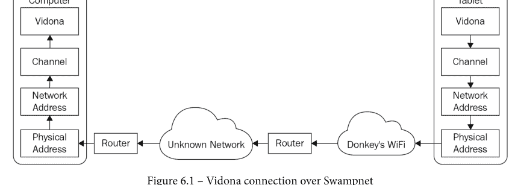

图 6.1 – Vidona 通过 Swampnet 的连接

请看图 6.1。由于沼泽地的疫情，舒렉和驴子已经很长时间没能见面了。然而，他们发现了一个名为 Vidona 的新应用程序，可以让他们虚拟地见面。当驴子呼叫舒렉时，消息起源于 Vidona，即使用的应用程序。该消息通过一个通道流动，并被包裹在一个写有舒렉地址和驴子回邮地址的信封中。然后消息流向物理层。虽然我们无法感受到 Wi-Fi 信号（如果我们能感受到那会多么疯狂？），但 Wi-Fi 无线电在物理上存在。为了在 Wi-Fi 无线电上发送消息，它被打包在另一个信封中，使用不同的地址代表驴子的物理平板。

现在我们有两个地址：**network** 地址和 **physical** 地址。**physical** 地址通常不会改变。它与驴子的平板相关联，并帮助平板与它 *物理* 连接的组件通信（即使是无线）。与此同时，**network** 地址将驴子的平板标识为全局唯一的实体，这是舒렉的计算机用来响应驴子平板的地址。请注意一个非常重要的区别；驴子的 **Vidona** 应用程序需要知道舒렉的网络地址才能连接，并且网络地址会随时间变化。此外，如果驴子和舒렉想让他们的通信不被法尔夸德勋爵窥探，**Vidona** 必须开发自己的安全机制。这对于 **Vidona** 的开发人员来说可能具有挑战性，而当其他应用程序需要参与这种安全通信时，难度会更大。最终，目标是在应用层提供安全连接，即 **Vidona** 层，如图 6.2 所示：

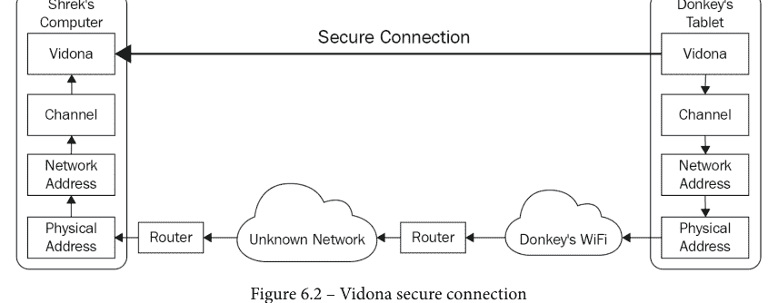

图 6.2 – Vidona 安全连接

图 6.1 和 6.2 之间的重要区别在于，尽管底层的网络流没有改变，**Vidona** 应用程序能够以看似直接和安全的方式在对等方之间通信。由于 **Vidona** 控制此特定示例的双方，利用其内置的安全机制可能就足够了。然而，一旦混合应用程序和服务，这种连续性就会被打破。

作为我们后续的对话，我们将参考网络世界中的各个层。在本章开头，我提到了 OSI 模型，它由七层组成，如图 6.3 所示：

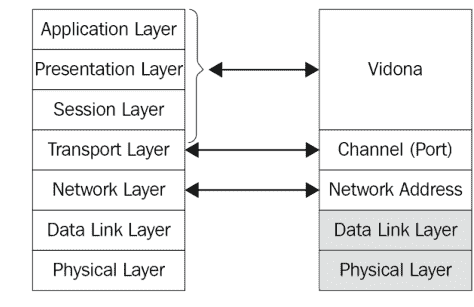

图 6.3 – 网络 OSI 模型

就我们的目的而言，我们将主要关注最上面的三层，即应用层、表示层和会话层，我们将它们统称为应用层。传输层以及网络层也会发挥作用，不过这些是在机器级别的通信。

有了对网络栈的基本理解，让我们来看看为什么仅仅依赖该栈对于当今的云世界来说是不够的。

### 为什么传统网络不够用

在零信任领域，我们不能仅仅隐含地假设在单台机器上运行的任何东西都是友好的。几乎每周我们都会听到一起安全事件，其起源于对某个实体受信任的假设，而该实体却被攻破了。零信任或最小权限安全概念专注于我们真正关心的身份和安全，即应用程序。如果我们的服务器或系统托管多个应用程序，我们需要一种标准化的方法来唯一标识并保护每个应用程序。为了说明这一点，我将重温常见的电话号码类比。


当我还是个少年时，我有时会参与一些时不时可能被认为有问题的事情。幸运的是，那时我们并不是所有人兜里都揣着带 GPS 跟踪器的电脑；不过，我父母有我所有朋友家的电话号码。如果我要去迈克家，我父母就能通过迈克家的电话号码联系到我。然而，当他们打电话时，无法控制是谁接听。在我们的朋友之间，我们可以利用这种模糊性找点乐子。比如，当我们的朋友吉娜给迈克家打电话时，可能是我接的。虽然我们都很亲近，但即使在现在，有时也很难通过电话里的声音辨认出某人。而那时（固定电话音质更差）就更有挑战性了！所以，我正和吉娜聊得热火朝天，但她却以为自己在和迈克通话。这种把戏今天也能玩，只是要拿起某人的手机比在他们家拿起电话听筒更难。在这个类比中，吉娜和我就是应用程序，迈克的家就是主机。吉娜试图通过迈克家的电话号码联系迈克，但我只要在那里，就能冒充迈克。电话号码也许可信，并且明确地与主机绑定，但并不能保证应用程序的身份或安全。

这个故事表明，仅仅假设 **第 4 层地址** 是任何应用的身份会带来风险。在私有数据中心，当房子被牢牢锁住、门口有守卫时，按地址识别并没有那么不合理。然而，在公有云环境中，存在合法和非法的地址伪装，尤其是在任何类型的迁移型工作负载环境（如 Kubernetes）中，仅靠地址是远远不够的。那么，让我们看看如何通过隧道来解决这个问题。

## 隧道通往安全

网络隧道和**虚拟专用网络（VPN）**的概念并不新鲜。然而，在所有这些实例中，连接都基于所涉及组件的第 4 层地址。我们可以通过一系列点对点 VPN 来连接应用机器，但这并不能缓解对**应用**进行识别和保护的需求。实际上，使用 VPN 反而增加了对应用身份的需求，而不是单纯依赖地址。不过，我们仍然可以把 VPN 视为我们想要达到目标的一个模型。

在大多数情况下，当你建立 VPN 时，会有一个软件应用程序连接到某个远程站点或服务。连接建立后，你的设备会获得一个新的 IP 地址，该地址在目标网络上有效，所有机器流量都经过该连接流动。VPN 的美妙之处在于，从 VPN 客户端到 VPN 服务器之间传输的信息都经过加密和安全保护。这过去是、现在依然是保护流量不被窥探的好方法。历史上，VPN 的使用主要面向企业网络。如今，许多人使用 VPN 不仅是为了加密流量，也是为了隐藏他们的第 4 层地址身份。我们已经确定，要实现真正安全的操作，需要验证应用程序的身份，因此使用 VPN 实际上可能阻碍而不是帮助这项工作。

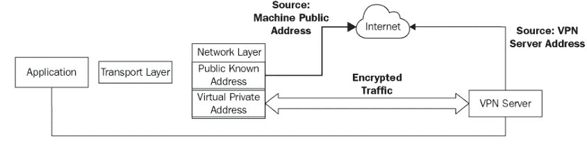

图 6.4 – VPN 流量模式

现在，我并不是说 VPN 在这个世界上没有用武之地。当你需要以安全的方式连接机器时，它们提供了至关重要的功能。然而，我们讨论的不是连接机器，而是连接我们的应用。话虽如此，如果我们能把连接向上提升一层到应用层，VPN 的概念就能很好地延伸。这正是 Consul Service Mesh 通过 Consul Connect 所提供的。

Consul Connect 功能将经过身份验证的应用连接起来，并加密这些应用之间的流量。我们已经看到，在第 3 章，保持安全，笨蛋，并保护好你的集群！中，Consul 服务器集群如何验证代理身份，并利用相互 TLS（mTLS）加密 RPC 流量。Consul Connect 使我们能够将同样的功能扩展到每个由 Consul 管理的服务。让我们花几分钟重新回顾一下 Consul 和 mTLS。

还记得那些旧日时光吗？我们在 *第 3 章，保持安全，笨蛋，并保护好你的集群！* 中玩转证书。在那过程中，我们使用 Consul 服务器作为**证书颁发机构（CA）** 来签发和管理证书（它是权威机构，还能做什么呢？）。为了降低复杂性，我们为三台服务器使用了通用证书。此外，所有客户端代理都使用一个通用证书。当时提到，在生产环境中，每个 Consul 代理都应该拥有自己唯一的证书。当一个代理收到另一个代理的公共证书时，该证书提供了发送者的**身份**。我们知道可以**信任**这个身份，因为证书是由某个权威来源签名的。这些证书不仅提供了身份，还提供了代理之间消息加解密所需的密钥。如果这种 mTLS 方法足以安全地验证 Consul 代理并加密流量，为什么不把它用于 Consul 管理的服务呢？

使用 Consul Connect，每个服务都会分配一个唯一证书。如你所见，证书的使用对于 Consul 工作至关重要。我们不仅有用于代理之间安全通信的证书，还有用于服务的证书。所有这些证书的管理可能相当具有挑战性，但真正的应用身份和加密所带来的好处远超这些挑战。幸运的是，与 *第 3 章，保持安全，笨蛋，并保护好你的集群！* 非常相似，我们可以使用 Consul 作为我们应用程序的 CA。Consul 也支持使用 Vault 作为 CA，但出于我们的目的，我们将专注于使用 Consul。无论 CA 是谁，Consul 都可以编排证书的轮换和分发，这能极大地简化 Consul 的运维工作。然而，与 *第 3 章，保持安全，笨蛋，并保护好你的集群！* 不同的是，我们希望应用程序利用这些证书来进行身份识别和加密。不幸的是，许多应用程序并不是为支持特殊证书和加密而开发的。有用于自定义应用集成的开发库，但代理服务器非常适合这一目的，并且不需要额外的开发。

这表明我们的基于 Python 的 Web 服务器正在监听 8080 端口，地址为 `0.0.0.0`。该值代表所有可用的地址和接口。在这种配置下，任何能够访问这台机器的设备都可以访问 8080 端口。为了增强安全性，我们要在本次练习中更改运行该 `httpd` 服务器的方式：

```bash
nohup python3 -m http.server 8080 --bind 127.0.0.1 &
```

通过额外的 `bind` 配置标志，我们告诉 Python `http` 服务器**只**监听 `127.0.0.1`，也就是机器的本地回环地址。为了验证这一点，我们可以再次运行我们得心应手的 `netstat` 命令，得到以下结果：

```text
tcp        0      0 127.0.0.1:8080        0.0.0.0:*
LISTEN     7954/python3
```

由于服务器只监听本地回环地址，任何外部应用程序都无法访问该服务器。当然，除非它们开始变得“网格化”。所以，现在我要问你，准备好和我一起“网格化”了吗？

在第 *6 章，连接四个或更多* 的存储库文件夹中，我放置了一个新的 `httpd.json` 文件，以及一个 `curl.json` 文件。它们将代表我们新的网格化服务，并且作为 Terraform 构建的一部分，这些文件将放在 Consul 客户端上。

`httpd.json` 服务定义与我们的原始定义相比变化不大，只有一个主要例外。我们现在有一个 connect 配置块，它标识该服务将利用一个 sidecar 进行连接。这个 sidecar 就是代理服务器。

## httpd.json

```json
{
    "service": {
        "name": "httpd",
        "id": "httpd-1",
        "tags": [
            "python-server"
        ],
        "port": 8080,
        "connect": {
            "sidecar_service": {}
        }
    },
}
```


请注意，此配置中的 connect 部分稍微更复杂一些。对于 sidecar 服务，我们需要一些额外的参数来告诉代理服务器 curl 将要连接的服务（httpd），以及代理服务器应侦听请求的本地端口。在我的系统中——我鼓励你一起实践——httpd 服务运行在一个 Consul 客户端上，而 curl 进程运行在另一个客户端上。然而，当我尝试在 Consul UI 中查看这些服务时，发现它们并不处于健康状态！

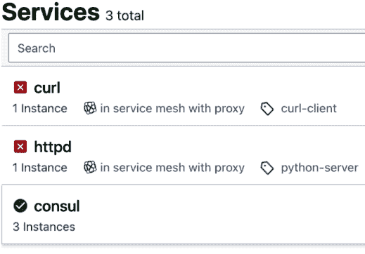

图 6.5 – 不健康的 httpd 和 curl 服务

然而，我们在图 6.5 中可以看到，这些服务已通过代理处于服务网格中。嗯，这是新情况！我想知道服务处于服务网格中是否与缺乏可用性有关。如果我们查看服务实例，可以看到一个名为 Connect Sidecar Listening 的东西，这也是我们以前从未见过的。这看起来就是问题所在，而且它显然与我们一直在研究的 sidecar 类似。

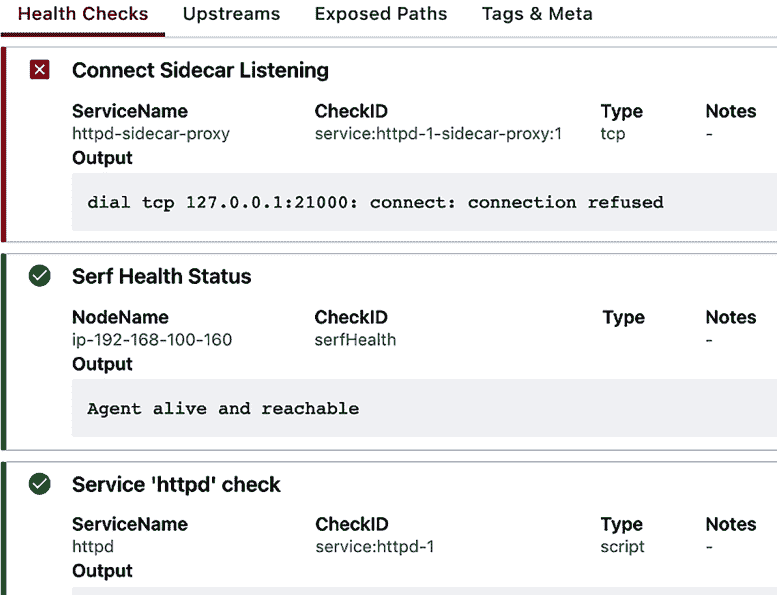

为了让此服务恢复健康，sidecar 需要一些关注。到目前为止，我们所做的只是在目录中注册了一个 httpd 服务，并告诉 Consul 该服务将通过代理访问。然而，我们还没有做任何事情来启动该代理！使用服务网格时，每个应用程序（除非原生支持网格）都需要自己的代理服务。因此，如果 Consul 不知道有任何与该服务配对的代理服务正在运行，该服务就不会处于健康状态。要启动 `httpd` 服务的代理服务器，我们只需要一条命令：

```
```bash
$ consul connect proxy -sidecar-for httpd-1 > ~/httpd-proxy.log
&
```
```

这里我们所做的是告诉 Consul 发出连接请求，利用内部代理，作为 `httpd-1` 服务的 sidecar 运行。*等等，我还以为只是 httpd 呢！* 你真是敏锐…… 我非常佩服！在创建代理服务时，我们使用的是服务的 **ID**，而不是服务的 **名称**。该请求的任何输出都被重定向到日志文件，并且我们在后台运行该命令。一旦运行该命令，服务在 Consul 系统中就健康快乐了。

现在，我们必须让 curl 服务启动并运行。我觉得把 curl 称为服务有点奇怪，因为它只是一个简单的命令行工具，但为了我们的目的，我们将设想 curl 是一个访问某个 Web 服务器的客户端应用程序。要让 curl 服务的代理服务器运行起来，我们将运行类似的命令：

```
$ consul connect proxy -sidecar-for curl > ~/curl-proxy.log &
```

现在，curl 和我们的 Web 服务器的代理服务器都已运行。在 Consul UI 中，两个服务都是健康的，我们甚至可以看到服务连接的拓扑。目前的拓扑并不令人兴奋（就像 curl 一样），但随着服务数量的增长，能够查看哪些服务已连接对于理解通信路径至关重要。我们建立的路径如图 6.7 所示：

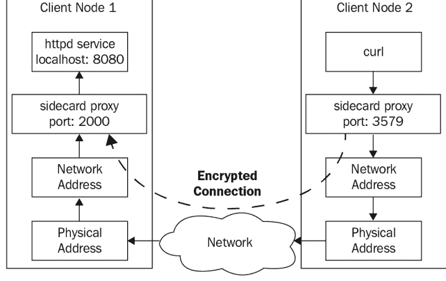

图 6.7 – 通过代理连接的服务

让我们从客户端的角度来稍微梳理一下这个流程。我们有一个代理服务器与我们称之为 curl 的服务一起运行。该服务的定义，特别是 local_bind_port，标识了代理应该监听消息的端口（3579）。代理在该端口上接收到的任何消息都将被发送到上游的 httpd 服务。请注意，我们没有为该服务配置任何端口或地址；我们只拥有用作目的地的服务名称。在服务器端，我们有另一个代理服务器与我们的 httpd 服务一起运行。我们未为该服务定义端口，代理服务器在启动时动态分配端口。在本示例中，代理服务器分配了端口 21000。由于 httpd 服务运行在内部 localhost 接口的 8080 端口上，代理服务器知道将请求转发到该端口。

为了证明服务网格正常工作，我们将假装自己是那个客户端应用程序。因此，模拟客户端请求时，我们将从客户端机器访问端口 3579。该消息将流经两个代理服务器到达 httpd 服务：

```
$ curl http://localhost:3579
```

响应是来自 /home/ubuntu（Python Web 服务器运行的位置）的服务器节点目录列表。如果你想再次核对，可以使用一个名为 tcpdump 的工具：

```
$ sudo tcpdump -nnvvXSs 1514 -i any port 21000
```

如果你在运行 httpd 服务的服务器节点上运行该命令，然后发出 curl 命令，你会看到接收和发送的数据包。别担心，我们并不指望你能读懂数据包信息。事实上，你也读不懂！代理服务器正在使用 Consul 提供的证书来加密该通信。虽然 Web 服务器或 curl 工具没有配置任何加密，但这两台设备之间的通信已成功加密。此外，我们所做的路由完全基于服务名称，没有任何地址配置！此时此刻，你值得获得一个祝贺性的虚拟拥抱。

此时有一点需要指出：Consul 服务器集群并未参与客户端和服务器之间的实际信息交换。这些应用程序之间的数据直接通过代理流向彼此。这条数据路径通常被称为数据平面。很有创意，我知道。然而，建立该数据连接所需的代理服务器信息由 Consul 管理。Consul 在此过程中执行的所有活动都发生在控制平面上。毕竟，这些是控制集群所必需的通信！有了这个集中控制点，我们就能够创建规则来允许或拒绝服务之间的通信。在 Consul 的世界里，我们称之为意图（intentions）。

## 表明你的意图

既然我们了解了应用程序将如何通过服务网格进行通信，就需要了解如何配置和管理这种通信。我们或许希望认为所有服务都会和谐共处，并且只有那些应该相互通信的服务才会通信。然而，尽管这个想法利他主义，但它并不太现实。因此，我们需要一种机制，以便在 Consul 系统中轻松定义哪些应用程序可以（更重要的是，不可以）相互访问。为此，我们使用所谓的 Consul 意图（Consul intention）。

Consul 服务的现状有一个好处：每个服务都由人类可理解的名称定义。我强烈建议在任何系统中使用清晰独特的服务名称，以避免歧义。然而，这种努力也带来了额外的好处，因为我们现在可以通过服务名称来指定意图。如果你曾经处理过任何基于 IP 的防火墙，你会觉得这非常令人安心。然而，与基于 IP 的防火墙类似，Consul 意图根据通信来源以及目标服务或应用来定义连接。不过，这种控制的粒度取决于服务被定义使用的协议。

服务定义使管理员能够定义应用程序所在的协议。协议有四个选项：tcp、http、http2 和 grpc。不过，对于意图，我们将重点讨论前两个：tcp 和 http。

`tcp` 协议定义比 `http` 协议具有更大的灵活性，因为它将支持范围扩展到 `http` 服务器之外。例如，如果你想将 Consul 用于数据库，那么将使用 `tcp` 协议。在这种情况下，mTLS 证书中编码的应用程序身份是 IP 地址和 TCP 端口的组合。管理这些连接的意图称为第 4 层意图。如果看应用层（第 7 层），我们可以根据通信中实际使用的 URL 来设置意图。这对于服务路由和服务拆分是必要的，我们之前讨论代理服务器时已经提到过。

第 4 层意图和第 7 层意图之间的另一个重要区别是意图更新的生效时机。无需深入探讨，当客户端和服务器之间存在 TCP 连接时，该连接一旦建立，就会在通信路径的生命周期内保持连接。然而，对于 HTTP，连接仅在请求和响应信息期间处于活动状态。因此，第 7 层意图生效的速度可能比第 4 层意图快得多。Consul 不会拆除现有连接，因此只有在发出新的连接请求时，意图才会产生影响。

无论在哪个层执行意图，配置过程都是相同的，并且只需要三部分信息：服务名称、通信请求的来源，以及允许还是拒绝该连接。在深入探讨意图的定义之前，我想回顾一下*第 4 章“数据中心（非贸易）联邦”*中的 ACL 部分。


如果你还记得，Consul 在 ACL 方面默认有两种运行方式。我们可以隐式拒绝所有请求，只指定允许访问的部分；或者隐式允许所有请求，并指定我们想要拒绝的连接。遵循零信任模型——这对任何安全姿态都至关重要——隐式拒绝应适用于任何生产环境。Consul 意图（Intentions）遵循同样的模型，我们可以隐式接受所有网络连接，也可以隐式拒绝所有网络连接。无论你为 ACL 配置了何种策略，相同的策略也会应用到你的意图上。例如，如果你的 ACL 策略是全部拒绝，那么默认情况下，任何允许的服务连接都需要显式定义。由于我们已经展示了流量通过网格传输，可以看到我们当前并没有启用全部拒绝的 ACL 策略。

因此，为了试验意图功能，我们将使用已经建立的同一个 curl 到 http 服务器的连接。利用 CLI，让我们查看 Consul 目录中注册的服务：

```
$ consul catalog services
consul
curl
curl-sidecar-proxy
httpd
httpd-sidecar-proxy
```

注意，我们实际上列出了每个 sidecar 代理服务器的服务。然而，我们的意图是管理实际服务，即 curl 和 httpd。如果我们想通过命令行阻止 curl 和 httpd 之间的通信，非常简单：

```
$ consul intention create -deny curl httpd
```

CLI 会响应，确认意图已创建：

```
Created: curl => httpd (deny)
```

有了这个意图后，让我们再次尝试发出之前那条 curl 命令：

```
$ curl http://localhost:3579
curl: (52) Empty reply from server
```

如你所见，我们无法再建立连接：`Empty reply from server.`
当我询问菜单项是否为素食时，我得到的也是同样的反应……来自服务器的空回复。
如果此时你观察 `httpd` 服务器的日志，会看到一个非常有趣的消息：

```text
[ERROR] proxy.connect: authz call denied: service=httpd
reason="Matched L4 intention: default/curl => default/httpd
(ID: a605dfa9-cdcc-b304-400d-3fe708b603c1, Precedence: 9,
Action: DENY)"
```

从结果中，我们可以清楚地看到，`default/curl` 尝试访问 `default/httpd`，但被拒绝了。我们在这里看到的 *default* 值指的是服务及意图所适用的命名空间。这使得我们可以为 Consul 系统中的各个命名空间配置并分配独特的意图。此外，我们已经知道，凭借适当的 ACL 令牌，我们可以确保只有获得授权的人才能在自己的命名空间中创建意图。我们还看到了一个返回的优先级值。任何规则中都会有优先级顺序。也可能存在通配符，用于概括某些规则并帮助管理。例如，我们可能希望确保系统中的某些服务 *只* 接收连接，而从不发起传输。比如，我们的 `httpd` 服务绝不应主动向任何其他服务发起连接。为此，我们可以使用通配意图来指示 Consul 拒绝任何源自 `httpd` 服务的请求：

```shell
$ consul intention create -deny httpd '*'
```

如果你没有在生产环境中隐式拒绝所有连接，这类规则对于管理应用可能遭受的任何潜在入侵会非常有用。例如，如果我们的 `httpd` 服务被入侵，并被用于向网格内的任何其他服务发送信息，这条意图将明确阻止此类事件的发生。还应注意，通配意图在优先级列表中非常靠后，如 *图 6.8* 所示。意图越精确，在评估中的优先级就越高。

| 源命名空间 | 源名称 | 目标命名空间 | 目标名称 | 优先级 |
| --- | --- | --- | --- | ---: |
| 精确 | 精确 | 精确 | 精确 | 9 |
| 精确 | * | 精确 | 精确 | 8 |
| * | * | 精确 | 精确 | 7 |
| 精确 | 精确 | 精确 | * | 6 |
| 精确 | * | 精确 | * | 5 |
| * | * | 精确 | * | 4 |
| 精确 | 精确 | * | * | 3 |
| 精确 | * | * | * | 2 |
| * | * | * | * | 1 |

图 6.8 – Consul 意图的优先级顺序

在我们的 Consul 系统中，现在已经创建了两条意图：一条阻止 `curl` 与 `httpd` 服务通信，另一条阻止 `httpd` 服务向任何其他服务发起对外通信。在 Consul UI 中，所有已配置的意图都是可见的，甚至可以按优先级顺序排序！随着服务数量以及随之而来的意图数量增长，这个视图会变得极为有用。

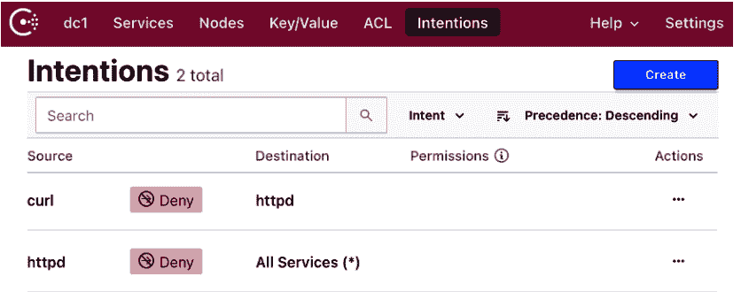

图 6.9 – UI 中的意图

在 UI 中管理意图非常简单，既可以创建新意图，也可以编辑现有意图。Consul 网格中的每个服务都会作为源和目标提供，我们可以选择允许、拒绝，或者创建一条**应用感知（Application Aware）**规则：

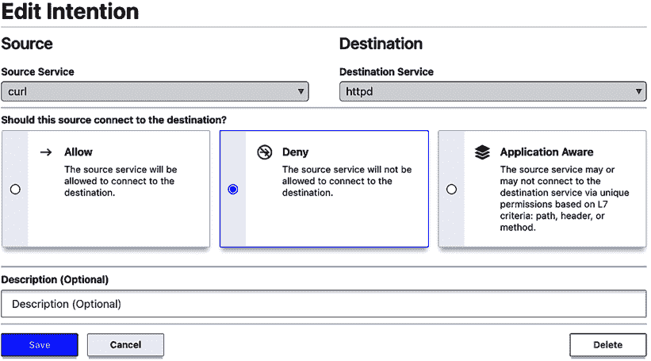

*图 6.10 – 在 UI 中编辑意图*

**应用感知**规则通过使用显式权限增加了复杂性。回想一下，第 7 层意图提供了额外的功能，可以基于 URL 路径甚至请求中的头部来定义意图。

到目前为止，我们讨论的每个场景都基于一个前提：每个应用和服务都存在于服务网格内。对于那些位于网格之外的服务，我们能做些什么呢？嗯，很高兴你问这个问题，因为这个问题为下一个主题提供了一个绝佳的切入点。

## 通向统治之门

哇，关于服务网格的信息真是精彩又有趣！但我有个问题：并不是我所有的服务都符合进入网格的条件。引用芬兰裔美国建筑师埃罗·沙里宁的话，*你试过网关吗？*

认为每个服务、每个应用都会驻留在单个服务网格中，对于任何企业部署来说都是相当不现实的。因此，Consul 提供了**网关**的概念。几乎所有现存的网关，无论是精神上的、哲学上的还是物理上的，都将两个存在领域连接起来。着眼于 Consul，我们可以将每个集群视为一个独立的领域，在其中服务可以被发现并安全地相互通信。然而，我们还需要考虑以下场景：

- **多数据中心** – 我们知道可以连接不同数据中心内的多个 Consul 集群。然而，一旦离开网格，我们就会失去身份和加密的安全性。
- **外部服务** – 并非我们需要的每个服务都会存在于服务网格内。正如我们所看到的，网格要求代理服务器与相关应用共置。许多服务（例如托管的数据库）并不提供符合网格要求的嵌入式代理服务器（至少目前还没有）。
- **外部客户端和应用** – 尤其是当我们向最终消费者提供服务时，网格需要接受来自外部实体的流量。必须有办法让外部实体进入网格，以访问它们有权使用的服务。

上述三种场景中的每一种，都需要一个专用于网关操作功能的 Consul agent。此外，Envoy 代理必须与该 agent 配对，以提供那种隧道般的连接。正如我们在上一节中看到的，Consul 利用 Envoy 代理服务器来管理网格内服务之间的连接。如果没有 Consul 与 Envoy 之间的紧密耦合，这种功能是不可能实现的，而这种耦合正是网格网关所必需的。因此，Envoy 目前是唯一支持用于此目的的代理服务器。让我们来看看 Consul 如何在这些场景中应用各种网关。


## 网格网关

我们已经了解了如何通过服务网格安全地连接服务。我喜欢将网格网关视为一种*超级网格*。利用我们在*第4章，数据中心（而非贸易）联邦*中玩过的WAN联邦，我们能够跨多个数据中心连接Consul集群。Consul网格网关不仅为这种连接增加了加密能力，还增加了控制哪些服务被允许穿越这些数据中心的能力。

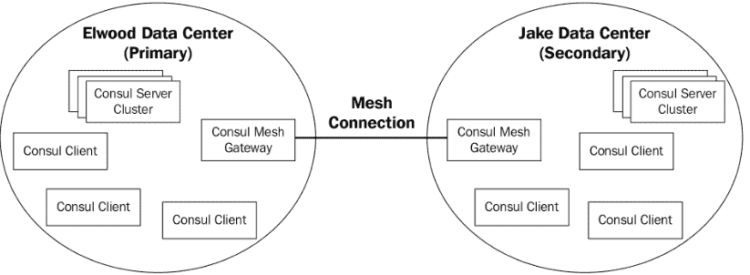

图6.11——连接数据中心的网格网关

每当我们连接Consul服务网格中的一个服务时，Consul服务器集群都会通过**connect**功能管理身份证书和加密。通过网格连接集群也不例外；但我们都知道，当老板不止一个时会发生什么（更别提六个老板，六个老板）。因此，每当我们通过网格网关连接数据中心时，必须指定一个主数据中心来管理和分发证书。这些证书会在网格网关对等体之间创建一个新的mTLS会话，用于身份验证。这里需要注意的重要一点是，流经网格网关的加密流量仍然是服务到服务之间加密的。换句话说，网格网关实体不会解密服务之间的消息；它们只保留服务端点已经执行的加密。

那么，如果我们不希望所有服务都穿过网关呢？没问题！当服务通过网格网关连接时，Consul集群能够识别这些服务，我们就可以编写意图（intentions）！这把巨大的权力交给了Consul管理员，他们不仅可以控制单个集群内的服务网格，还可以控制整个世界！此外，作为服务定义的一部分，我们可以告诉Consul，**上游服务**（我们想要发起连接的服务）可以通过网格网关访问。让我们看一个修改过的`curl`服务作为示例。

## 跨网格网关的Curl.json

```
{
    "service": {
        "name": "curl",
        "tags": [
            "curl-client"
        ],
        "connect": {
            "sidecar_service": {
                "proxy": {
                    "upstreams": [{
                        "destination_name": "httpd",
                        "datacenter": "secondary",
                        "local_bind_port": 3579
                    }]
                }
            }
        }
    }
}
```

在这个稍微修改过的服务定义中，我们告诉Consul，我们想要访问的`httpd`服务位于名为*secondary*的数据中心。这是一个连接另一个Consul数据中心以访问服务的绝佳示例，但如果目标服务不在网格内呢？

## 终止网关

随着**一切即服务（*aaS）**的普及，云提供商正在努力使自己脱颖而出并保持竞争力。至少，这是我的理论，我认为这导致了原本需要专用计算资源的托管服务的出现。即使这不完全正确，听起来也合乎逻辑，而且我相当确定我在互联网的某个地方读到过。托管数据库服务是这一功能的绝佳示例，不幸的是，我们无法在托管的AWS数据库服务上部署Consul代理。为此，我们有了终止网关的角色。

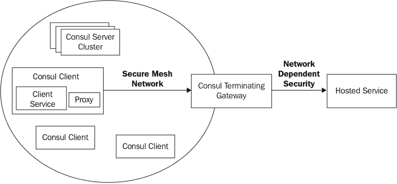

幸运的是，这个网关并没有在云中游荡寻找莎拉·康纳。然而，它终止的是Consul服务的安全和控制。但并非一切尽失，因为如果目标服务支持mTLS，终止网关将维持该安全连接。如果服务只支持单向TLS，网关也可以处理；但这可能会使终止网关面临潜在攻击。由于网关位于网格的边缘，与网格网关不同，它确实有能力解密它收到的流量。因此，始终建议严格控制充当网关的节点的访问权限。但有一个问题……Consul是如何知道那些甚至不在Consul集群内的服务的呢？

回想我们在*第5章，小波比丢失了她的服务*中讨论服务发现时，Consul能够在注册表中包含不受Consul管理的服务。这些是**外部**服务，这说得通，因为它们对Consul来说是**外部**的。任何希望通过终止网关访问的服务都必须在Consul中注册；毕竟，如果不注册，我们怎么能发现它们呢？当我们配置终止网关时，我们需要列出可通过该网关访问的服务。这是Consul管理从网格内部到这些外部服务的发现和连接的唯一方式。我们仍然可以使用ACL和安全措施直到网关节点；然而，一旦流量离开网关，我们就需要诉诸老式的网络方式，就像我们的祖母们所做的那样。

## 入口网关

接下来，我们必须考虑外部广阔而可怕的世界中那些想要访问我们提供的精彩服务的实体！这需要一种方法来打开服务网格并邀请其他人加入我们。然而，我们不想只是打开门让任何东西进入我们的网格。我们付出了巨大的努力，忍受了无数糟糕的笑话，来保护我们美丽的网格。我们最不希望的就是允许邪恶的流量通过大门，使网格陷入风险。

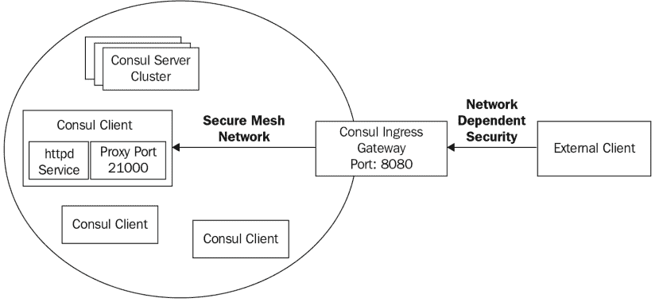

图6.13 – 入口网关

幸运的是，任何我们希望通过入口网关访问的服务都应该已经在Consul服务目录中注册了。然而，我们不想在这个过程中完全暴露自己。Consul允许我们在入口网关的配置中定义一个监听器。这个监听器告诉Consul代理（以及Envoy代理）要监听哪个端口，以及对应的服务是什么。通过这种配置，入口网关可以在指定端口接收流量，并将该流量转发到适当的目标服务。

现在我们了解了Consul如何将内部和外部服务连接到网格网络，让我们快速看看一个由渴望连接的独立网络组成的环境。

## 与Kubernetes构建网格

在整章中，我只提到过Kubernetes一次，而且只是一带而过。部分原因是我对Kubernetes的厌恶以及我在这项技术上挣扎的无数小时。然而，像Kubernetes（或Nomad）这样的服务编排器在服务网格领域绝对有一席之地。事实上，许多人只有在应用程序编排工具的领域内才会考虑服务网格。我们不会深入讨论Kubernetes的细节，原因有很多（其中一些我已经提到过）。不过，我确实想谈谈为什么服务网格在这个领域如此重要。

应用程序编排提供了一个完整的运行环境，我们的应用程序就驻留在其中。一旦部署到环境中，编排器的主要工作就是确保所需数量的实例正在运行，并确保资源得到管理。只要满足任何约束条件，应用程序可以位于集群机器中的任何位置。如果应用程序失败，编排器负责在集群内的某个位置重新启动该实例。此外，在执行机器升级时，编排器能够在集群中移动应用程序，以最好地实现预期目标。本质上，无论编排器是Kubernetes还是Nomad，它都完全控制着应用程序的位置，从而控制其寻址方式。应用程序的这种迁移性和短暂性极大地复杂化了我们之前讨论的IP寻址问题。


在 Kubernetes 中，我们有自己的服务器集群来管理所有被编排的**节点**（机器）和应用程序。如今，云提供商提供了他们自己的托管 Kubernetes 服务，极大地简化了管理集群的（通常很严峻的）负担。集群可以有任意数量的**节点**，它们为要部署的应用程序提供计算资源。每个被部署和管理的应用程序被打包为**容器**。这就引出了 Pod，它是一组一个或多个容器的集合，这些容器一起生存、运行和绑定。Kubernetes Pod 通常在其内的容器之间共享各种属性。这些属性包括存储，以及……等等……网络！

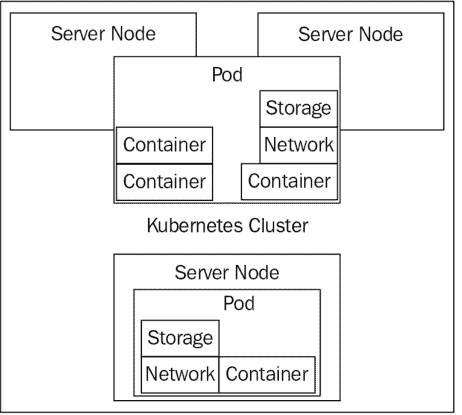

图 6.14 – Kubernetes 高层概览

向 Kubernetes 部署应用程序时，我们使用名为 `helm` 的命令，并配有一个 helm chart，用于定义应用程序的部署方式。Consul 为此提供了自己的 helm chart，并在 GitHub 上公开可用（`https://github.com/hashicorp/consul-k8s`）。利用这个 helm chart，Consul 可以安装在 Kubernetes 集群内相关 Pod 旁边，促进与 Pod 的安全网络连接。与 Kubernetes 之外的网格示例非常相似，在 Kubernetes 内部，Consul Connect 功能利用 Envoy 代理服务器作为应用程序的连接点。主要区别在于，Consul agent 不是作为独立进程运行，而是作为配置了 Kubernetes **注解**的集群内的 **边车（sidecar）** 进程运行。无论应用程序是网格连接的目标，还是与上游服务的网格连接的源，该进程都是相同的。

此外，每当提到服务网格这个话题时，通常都会与 Kubernetes 这类编排器概念联系在一起。然而，我希望我已经向您展示了其适用性远远超出了 Kubernetes 集群。Kubernetes 本身就是一个高级主题，在我看来，它可能非常令人困惑，正是这种复杂性才需要像 Consul 服务网格这样的技术。

## 总结

恭喜！如果你能读完本章并忍受我糟糕的笑话，你就对 Consul 服务网格有了基础性的认识。服务网格的主题非常冗长，我真心希望这能为你开启这段混乱旅程提供一个不错的起点！我们讨论了（好吧，我写，你读）一些关于传统网络的内容，以及为什么服务网格在当今多云世界中是如此宝贵的工具。我们看到了网格是如何运作的，如何安全地连接服务，以及如何确保某些服务*不*进行连接。我们简要了解了如何使用网格原则连接数据中心，以及如何支持网格之外的服务。最后，我们对 Consul 在 Kubernetes 世界中如何运作有了一个非常高层级的认识。

如果服务网格这个话题真的让你兴奋，我强烈建议你继续学习。HashiCorp 有几个关于这个主题的教程，随着对网格需求的增长，已经产生了无数博客和视频。这个主题太广泛，一章无法涵盖，但我确实希望我能提供一些清晰的见解。接下来，我们将看看 Consul 如何通过自动化帮助我们减少或消除那些可恶的网络变更工单！
