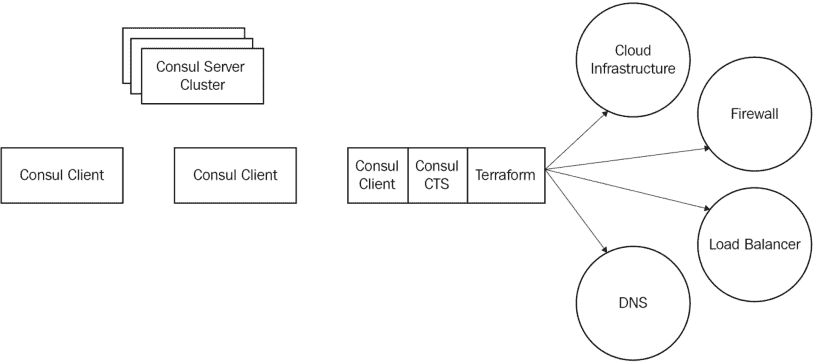
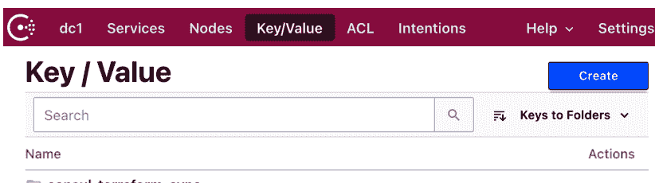
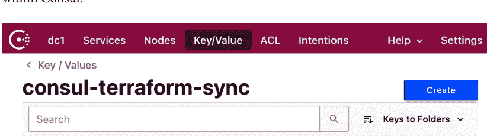
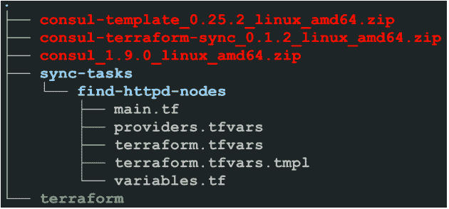
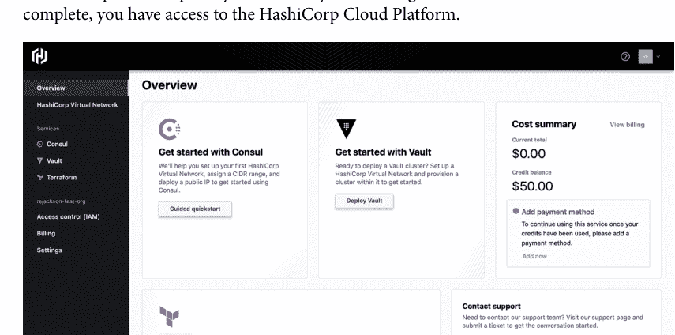
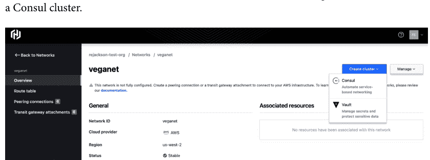
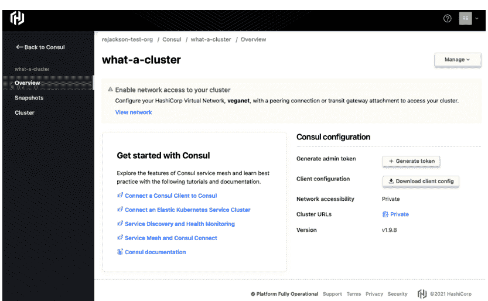
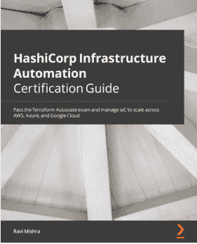

## 7 动起来

我们已经详细讨论了 Consul 集群对系统内部署的服务和应用程序及其相应健康状况的感知。为什么 Consul 要把所有这些信息留给自己？任何网络（无论是人的还是机器的）成功存在的一个重要部分是信息共享。在本章中，我们将探讨 Consul 能够将信息共享给第三方组件的一些方式，以便通过自动化改善我们的生活：

- 键/值（KV）存储 —— Consul 利用分布式 KV 存储在 Consul 节点之间共享信息，但这也可以被人类和机器用来在整个集群中共享数据和指令。
- 监视和处理器 —— 在第5章“小波比丢了她的服务”中，我们看到了 Consul 的监视和处理器如何发布服务状态的特定变化。在本章中，我们将看到这如何用于向第三方组件分发信息。
- Consul 和 Terraform —— 虽然这不是一本关于 Terraform 的书，但我们一直在使用它来创建和管理我们的基础设施。本章的最后一部分将展示 Consul 如何与 Terraform 协同工作，基于 Consul 的应用程序和服务感知，自动化几乎任何基础设施组件。

所以，无论本章标题让你想起奇点统治人类的恐惧，还是 Rush 乐队那首令人难以置信的歌曲的旋律，请和我一起踏上通往更智能、更自足的网络世界的旅程。

本章将涵盖以下主题：

- 自动化的必要性
- 使用 KV 存储进行分布式配置
- 监视你的处理器
- 与 Consul-Terraform-Sync 一同畅游

### 技术要求

在本节中，我们将使用 Terraform 向**亚马逊网络服务（AWS）**部署一个完整的 Consul 集群。如果你已经完成了*第2章，架构 – 它是如何工作的？*，设置了你的 AWS 账户，下载了 Terraform，并克隆了代码仓库，那你就万事俱备了！

在仓库的 `ch7` 文件夹中，我们有与 `ch2` 文件夹类似的结构，提供用于创建镜像的代码，当然还有创建 Consul 集群的代码。如果你想跟着操作，请使用 `ch7` 创建一个新的 Consul 集群，其中包含一些你将在本章中使用的服务配置文件。

### 自动化的必要性

在信息技术领域，我们靠工单为生。谢天谢地，不是超速罚单或其他违法行为的罚单，而是请求和解决工作的方式。整个产品线和组织都建立在这些流程之上，并且理所当然。我有一位同事经常对一本叫*《凤凰项目》*的书赞不绝口。如果你没读过或听过这本书，我强烈推荐。整个虚构故事聚焦于 IT 的流程问题，技术可能一切都很好，但进行变更的*流程*往往决定任何项目的成败。

当我们审视网络和安全设备时，遵循这套工单系统的重要性成倍增加。这不像订错虚拟机规格或操作系统。最微小的失误都可能扰乱整个组织，造成数百万美元的损失和收入流失。因此，对该设备的任何更改都需要在变更管理流程中正式请求、评估、测试和跟踪。你不必在这个领域工作，也能感受到 DNS 设置导致整个网络瘫痪、让孩子们无法参加虚拟课堂的挑战！

### 使用键/值存储进行分布式配置

正如我们所读到的，Consul 系统的基本协议之一是 gossip 协议，使系统内的每个 Consul agent 都能与所有其他 agent 共享信息。这些信息由 Consul 服务器集群集中存储和管理，但所有 agent（如果要求授权，则需正确授权）都可以访问这些数据。通过一个非常简单的 KV 接口，Consul 提供了向与系统交互的所有实体分发情报的能力。虽然这提供了一种非常简单的信息分发方式，但 Consul 并不是一个功能完备的分布式数据存储。KV 系统中的对象最大为 512 KB，并且数据仅保留在本地数据中心。然而，这并不妨碍我们用它来做一些非常酷的事情。

要了解应用 Consul KV 系统进行配置调整的好处，请考虑排查分布式应用程序的场景。毕竟，如今我们部署的几乎所有东西都由一组服务组成，而不是一个庞大的单体应用。当问题出现（它们总是会出现）时，我们会发现所需的日志数据只有在更高级别才可用。根据我过去做这件事的糟糕回忆，这个过程通常如下：

1. 获取需要调整的每台机器/组件的 IP 地址。
2. 在我的机器上打开一堆终端窗口。
3. SSH 进入第一台机器，通常使用团队中每个人都有的共享 PEM 密钥。
4. 编辑配置文件以更改日志级别。
5. 重新加载服务并检查日志，以确保服务以新的日志级别重新运行。
6. 注销机器，继续执行列表中的下一台。

一旦调试会话结束，我们不得不回到机器中并还原我们所做的更改。Ansible、Puppet 或 Chef 等配置管理工具也可以帮助进行这些更改，但这些更改通常需要更新大量脚本，这会带来额外的风险。


与 Consul KV 系统交互非常简单。就像我们使用 Consul 的其他所有功能一样，我们可以利用命令行、API 或 Web 界面。键和值的路径表示为，嗯，就是一个路径，不像我们所熟知和喜爱的目录和文件结构那样。这不仅非常适合数据的组织，而且还便于基于逻辑路径的 API 调用，而所有这些调用都是基于 REST 的。我们将逐步介绍这些操作，如果你想跟随操作，所有用于创建镜像和 Consul 系统的代码都位于我们一直使用的 GitHub 仓库中。当然，本章有一个新的文件夹位于 `https://github.com/PacktPublishing/Consul-Up-and-Running/tree/main/ch7`。

我们可以使用之前构建的镜像，不过，此次新构建包含了一些额外的功能，我们将在本章后面的部分使用这些功能。因此，我建议你创建一个更新后的镜像（`$github_root/ch7/Image-Creation`），就像我们在前几章中所做的那样。

在我们的新 Consul 系统构建完成并准备就绪后，让我们在 KV 存储中创建几个值。我们将使用环境变量来确保我们命中不同的 Consul 节点，因此请密切关注。举例来说，我将引用以下 Terraform 输出：

## Terraform output

```
Outputs:


CONSUL_HTTP_ADDR = "http://3.128.180.154:8500"
CTS_IP = "3.141.25.114"
Consul_Client_IPs = [
    "18.117.222.65",
    "3.17.161.19",
    "18.222.124.50",
    "18.118.47.132",
]
Consul_Server_IPs = [
    "18.222.216.65",
    "3.128.180.154",
    "18.117.157.22",
]
```

```
"LockIndex": 0,
"Key": "son/seventh/gift",
"Flags": 0,
"Value": "Y2hxaXJ2b3lhbmN1",
"CreateIndex": 194,
"ModifyIndex": 194
}
]
```

但等等，那个值不是我们输入的值！你是对的，这是我们在 Consul 的其他区域看到的 base64 编码值。这允许我们在 KV 存储的值中访问更复杂的数据。如果我们想在一个路径中返回多个值，我们可以在请求上设置递归标志：

```
$ curl http://18.222.124.50:8500/v1/kv/son/\?recurse=TRUE | jq
```

让我们看一下作为此输出一部分提供的一些其他值：

- **LockIndex** – 使用 Consul Sessions，我们能够锁定 KV 存储中特定参数的访问权限，以防止意外覆盖或冲突。
- **Key** – 这是从 KV 存储根目录到该键的完整路径。
- **Flags** – 默认值为 0，此参数提供将无符号整数分配给值条目的能力。该值对 Consul 来说是不透明的，但可能有助于为广泛的 KV 实现提供额外的信息（例如版本）。
- **Value** – 这是键的值，已编码为 base64。
- **CreateIndex** – 这里我们有一个数值，提供有关该值相对于其他键或更新的创建时间的一些信息。
- **ModifyIndex** – 这是输出中值得关注的一个值，因为智能状态机可以确定该值自上次查询以来是否已更改。

此信息始终通过 API 返回，不过，如果你想在命令行输出中看到此详细信息，我们可以使用 `detailed` 标志：

|  |  |
|---|---|
| `$ consul kv get -detailed son/seventh/gift` |  |
| CreateIndex | 194 |
| Flags | 0 |
| Key | son/seventh/gift |
| LockIndex | 0 |
| ModifyIndex | 327 |
| Session | - |
| Value | `clairvoyance2` |

请注意，我更新了该值，并且 ModifyIndex 参数识别了这一更改。

我们在这里应该注意，将密码和敏感信息写入存储可能不是最好的主意。对于密钥管理，我们确实应该利用世界级的密钥管理器，例如 HashiCorp Vault。话虽如此，可能仍有一些信息写入此存储，需要一定程度的访问控制。回想一下，通过我们的 ACL 系统，我们能够保护 Consul 中的路径和功能。通过将我们的 ACL 系统与 KV 存储结合，我们可以为每个应用程序创建一个分布式存储系统，并确保只有该应用程序（使用正确的 ACL 令牌）可以访问数据存储。

太棒了！使用 Consul 中的 KV 存储，我们可以将各种信息写入存储，并使其可供特定数据消费者或应用程序使用。*但 Rob，我的应用程序对 Consul API 或命令行一无所知，如果你认为我们会为此调整我们的开发路径，你就疯了。* 好吧，你是对的，我疯了，但这与 Consul 无关。让我向你介绍 Consul Template。

## Consul Template

Consul Template 的应用可能是我最喜欢的 Consul 功能之一了。然而，它并不仅限于 Consul，因为 Vault 实现也可以利用相同的功能。有了 Consul Template，配置文件可以直接由 Consul 填充，使用参数，就像它是一个模板一样。我想你大概已经猜到了。

Consul Template 的功能并未嵌入 Consul 本身，因此必须作为其自己的服务下载并执行。二进制文件（`consul-template`）可在 HashiCorp 发布网站上获得，如果你想自己下载它，不过，当我们为本章构建新镜像时，Consul Template 二进制文件的安装是该过程的一部分（`https://releases.hashicorp.com/consul-template/`）。

此外，作为此次构建的一部分，我创建了一个非常简单的模板文件并将其放在 `/tmp` 目录中。此模板文件是一个非常简单的文本文件，并利用了我们在 KV 存储中填充的信息，该信息标识了七个儿子中的第七个儿子的天赋：

### SeventhSon.tpl

```
Seventh Son of a Seventh Son is a story about a young boy born
with the gift of {{ key "/son/seventh/gift" }}. It has been
popularized in literary form by Orson Scott Card, and musically
by Iron Maiden through their epic album of the same title.
```

在模板中，我们可以看到 Consul 被指示插入 `son/seventh/gift` 键的值。

为了利用模板并创建文件，可以手动运行 consul-template。然而，我们正试图通过 Consul 的智能尽可能自动化。为什么我们现在要诉诸手动操作呢？因此，与其手动运行 consul-template，我们在创建基础设施时执行的 `remote-exec` 操作的一部分中将其作为后台操作启动：

```
nohup sudo consul-template -consul-addr=\"${self.private_ip}\"
-template \"/tmp/SeventhSon.tpl:/etc/consul/seventh_son.txt\",
```

此命令实例化 consul-template 应用程序，标识用于连接到 Consul 服务的 IP 地址。对于我们的基础设施，consul-template 函数在与 Consul 相同的机器上运行，但它可以位于其他地方并仍然使用 Consul 的数据。我们告诉 consul-template 加载模板文件 `tmp/SeventhSon.tpl` 并使用该模板创建一个新的文本文件（`/etc/consul/seventh_son.txt`）。由于应用程序在后台运行，consul-template 将监控已标识键的值，并在该值更改时更新目标文件。我们可以在自己的小环境中尝试一下。

如果你一直跟着做，你已经为 `son/seventh/gift` 键设置了 `clairvoyance` 值。如果 consul-template 按设计工作，我们应该已经创建了文件。要验证对可用客户端之一的 SSH，请执行以下命令：

```
$ cat /etc/consul/seventh_son.txt
```

我们应该会看到按模板指定的文本显示，其中插入了值 `clairvoyance`：

```
Seventh Son of a Seventh Son is a story about a young boy born
with the gift of clairvoyance. It has been popularized in
literary form by Orson Scott Card, and musically by Iron Maiden
through their epic album of the same title.
```

让我们看看当我们更改值时该文件会发生什么。更新 `son/seventh/gift` 键的值。随意通过我们之前练习的任何方法来完成。更新值后，再次检查 `seventh_son.txt` 文件，看看你的更新值是否已反映出来。现在，我们可以想象这个简单的文本文件是应用程序的配置文件。我们的模板可以根据需要在管理大量配置文件方面一样全面，所有这些都由 Consul KV 存储中的值动态管理并自动更新！

如果你因兴奋而神经元活跃，请继续保持！Consul Template 可以做的事情远不止我们在这里涵盖的范围。项目的完整文档和源代码也可在 GitHub 上获得，网址为 https://github.com/hashicorp/consul-template。

既然我们已经介绍了 KV 存储的使用以及 Consul Template 的使用，让我们继续并查看如何利用 Consul 监视和处理程序作为自动化第三方组件配置的另一种方法。

## Watching your handlers

早在 *Chapter 5, Little Bo Peep Lost Her Service* 中，小波比牧羊女丢失了她的服务，我们就触及了 Consul 监视和处理程序的功能。回想一下，Consul **watch** 会观察 Consul 中任意数量的参数，并基于值更改，可以执行 **handler** 来执行某些功能。在 *Chapter 5, Little Bo Peep Lost Her Service* 中，我们专注于能够监视服务的状态，以便通知第三方有关服务健康状况。我们可以使用相同的功能，但不是监视服务状态，而是监视 KV 存储中参数的状态。

例如，如果我们想监视我们的键，使用直接命令行，我们将执行以下操作：

```
$ consul watch -type=key -key=son/seventh/gift
{
    "Key": "son/seventh/gift",
    "CreateIndex": 194,
```


```json
"ModifyIndex": 237,
"LockIndex": 0,
"Flags": 0,
"Value": "Y2hxaXJ2b3lhbmN1",
"Session": ""
}
```

我们可以看到，该命令的输出为我们提供了与之前读取 key 值时从 API 获取的几乎相同的输出。然而，我们并不是在谈论手动操作；我们想要……跟我一起说……自动化！

在 Consul agent 配置中，我们可以定义希望在平台上运行的 watches 以及一个 handler。handler 根据 watch 的结果执行某些功能，可以调用 HTTP 接口或执行自定义脚本。因此，随着被监视 key 的值发生变化，Consul 将执行该 handler 以主动通知某个设备。例如，将以下 watch 部分添加到 agent 配置中将导致执行 update_configs.sh 脚本：

### Sample watches configuration

```hcl
watches = [
    {
        type = "key"
        key = "son/seventh/gift"
        handler_type = "script"
        args = ["/etc/consul/updates_configs.sh"]
    }
]
```

这个特定的 watch 特别关注一个特定的 key，不过请记住，我们可以使用 keyprefix 定义一个 watch，从而监视 Consul KV 存储中整个路径。这使我们能够为特定配置创建多个 key，并且当其中任何一个 key 发生变化时，watch 将执行 handler 并执行所需的操作。

正如我希望你能看到的，Consul watches 和 handlers 在动态调整组件配置方面所能实现的强大功能是相当巨大的。我们现在已经看到了多种利用 Consul KV 存储更新配置的方法。应用程序可以通过使用 API 的 pull 方法接收更新的配置值。我们可以利用 consul-template 函数自动调整配置文件。当然，我们也可以将 KV 信息推送到几乎任何可以通过脚本或 HTTP 接口控制的系统。接下来，我们将研究如何超越 KV 并利用 Consul 通过 Terraform 动态调整我们的基础设施组件！

## Floating with consul-terraform-sync

在本书中，我们一直在研究 Consul 如何帮助我们发现和连接服务，重点关注更高级别的连接性（记住那个模型，工作在第 4 层或以上）。虽然这正是我们服务到服务通信所需的，但整个网络世界仍然依赖 IP 地址来发现、路由和保护我们的系统这一事实并未消失。防火墙和负载均衡器仍然存在，主要基于地址运行，管理进入或离开我们受管网络的流量。这通常被称为 North/South 流量。历史上，这些组件会依赖无数健康检查来验证服务可用性，或庞大的配置文件，其中一个简单的拼写错误就可能导致整个网络瘫痪。因此，出于这些原因，由容易出错的人手工更改负载均衡和防火墙组件需要仔细审查。如果只有某种方法可以自动发现并以自动化且可追踪的方式实现对这些组件的更新呢？

我们已经熟悉一个用于管理基础设施的令人难以置信的工具 Terraform，我们在本书中构建和管理自己的基础设施时一直在使用它。通过使用 Terraform OSS 二进制文件，我们一直在创建和销毁为我们的学习所需的 Consul 系统。如果你不熟悉 Terraform，它可以做更多的事情。在撰写本文时，Terraform 提供了超过 1,100 个基础设施提供商的支持集成。这包括大型云厂商以及监控组件、负载均衡器、防火墙、内容分发系统、域名系统等等。对于自动化，许多组织将 Terraform 与流水线流程集成，然而，我们将研究如何利用 Consul 提供的海量数据来自动化 Terraform 基础设施调整。

> **Important note**
>
> 直到本章的这一点，我们的大部分讨论都围绕着在服务之间创建和共享配置参数。Consul 与 Terraform 的集成极大地扩展了该功能，因此作为变更控制流程的一部分也需要额外的审查。虽然我们的工作这里集中在 Consul 和 Terraform 的开源版本上，但企业集成使能够采用细粒度策略来指定自动化可以更改什么、不能更改什么，以及什么需要额外级别的批准。此外，Terraform Enterprise 在整个过程中记录状态更改，提供任何自动化或已批准更改的历史记录。

与 **consul-template** 类似，HashiCorp 提供了一个额外的独立二进制应用程序，称为 **Consul-Terraform-Sync**。为简单起见，我将继续称 Consul-Terraform-Sync 为 CTS。利用 CTS，Consul 监控服务目录中的更改，并基于这些更改，向 Terraform 发出请求以相应地调整基础设施：



Figure 7.2 – CTS managed infrastructure

作为当前部署的一部分，我们已为 CTS 创建了一台专用机器，其 IP 地址由 `terraform output` 中的变量 `CTS_IP` 提供。如果找不到 Terraform 运行的输出，也没问题。运行 `terraform output` 将再次为你提供所有必要的数据。所以，让我们获取该 IP 地址并 SSH 进入 CTS 机器：

```bash
$ ssh -i <username>-consul-key.pem ubuntu@<CTS_IP>
```

当我们为本章构建基础设施时，创建了一个新目录来保存我们的 CTS 配置文件。让我们查看一下该配置文件：

### cts-config.hcl

```hcl
log_level = "INFO"
port = 8558
syslog {}
buffer_period {
  enabled = true
  min = "5s"
  max = "20s"
}
consul {
  address = "192.168.100.65:8500"
}
driver "terraform" {
  log = false
  persist_log = false
  working_dir = ""
  backend "consul" {
    gzip = true
  }
}
task {
  name        = "find-httpd-nodes"
  description = "Example task with two services"
  source      = "findkim/print/cts"
  version     = "0.1.0"
  services    = ["httpd"]
}
service {
  name = "httpd"
  tag = "python-server"
  # namespace = "service-namespace"
  # datacenter = "dc1"
  description = "Filter for httpd services that have the python-server tag"
}
```

我们在此配置中有几个部分，让我们一次一个地来看。

前八行描述了 CTS 应用的通用参数。log_level、port 和 syslog 部分应该很容易理解，但这个 buffer 是什么？

我们在自动化此类更改时发现的一个挑战是，当存在任何不稳定性时，该不稳定性可能会产生连锁反应。作为人类，我们有时会花时间对情况做出反应，而到我们能够反应时，情况已经发生了变化。当然，我说有时是因为并非总是如此，我们都知道当我们不花时间时，问题就会发生。机器通常没有这种延迟问题。实际上，我们与机器和软件的问题通常恰恰相反，即应用程序响应太快，导致来回波动。我们的 buffer 配置有助于管理这种波动，并确保在进行调整之前有一定时间等待系统达到稳定状态。

下一个部分在 consul 配置块中标识了 Consul 相关配置参数；本质上告诉 CTS 它可以在哪里找到 Consul 服务。这里我们只有 address，然而，任何证书或令牌都将在此区域说明。正如我们已经看到的 ACL 和令牌可以有多细粒度，我们希望确保 CTS 服务使用的是具有读取服务目录访问权限的令牌。

我们知道 CTS 需要连接到 Terraform 才能启动基础设施更改。可选地，terraform 配置块可以指定要使用的预下载 Terraform 二进制文件和路径。然而，如果没有此指定，CTS 将下载 Terraform 二进制文件（遵循版本规范（如果包含））并将该二进制文件保存在 CTS 工作目录中。对 Terraform 操作的日志记录以及 Terraform 后端配置应特别注意。

在处理期间，Terraform 可以记录与所管理基础设施组件的交互。此日志输出可能包含敏感信息，如果存储在运行 CTS 的机器上，可能会带来安全问题。因此，除非你正在调试，否则建议不要记录 Terraform 交互。Terraform 状态中也会记录相同的敏感信息，而这不是可选的。Terraform 利用该状态文件来了解所管理基础设施的当前状态，并评估需要哪些更改。


那么，我们该如何处理这个不祥的状态文件呢？好吧，在本章的第一部分，我们谈到了分布式 Consul KV 存储可用的功能。只要我们能将该状态文件保持在可管理的大小，少于 512 KB，我们就可以将该状态文件保存在 Consul KV 存储中。这实际上就是我们在 terraform 块内的后端配置子块中所做的操作。这不仅为我们提供了一个可以使用 ACL 保护的分布式存储位置，还提供了对状态文件更改的指示（还记得 KV 响应中的 ModifyIndex 值吗）。这要求我们保持状态相对简单，但我们无论如何都应该这样做，将用于 CTS 的 Terraform 脚本仅聚焦于我们需要管理的特定基础设施。例如，如果我有 10 台虚拟机、一个 Kubernetes 集群和一个负载均衡器，我应该只将负载均衡器的基础设施代码作为 CTS 的一部分包含在内。

所有这些关于状态和 Terraform 配置的讨论可能看起来过分，但这里的细节不容低估。总结一下，仅将我们的 Terraform 代码聚焦于服务目录导致更改所需的内容，可以实现以下目标：

- 利用 Consul KV 存储实现集中且受保护的存储 – 我们已经可以使用 Consul，为什么不将其用于此目的呢？
- 状态文件中的敏感信息保持在最低限度，仅与 CTS 管理的基础设施相关。
- 通过 CTS 启动的更改更快。对于由于大型基础设施定义而导致的大型状态文件，Terraform 处理更改所需的时间会更长。

我们接下来要处理的块是 task 块。现在我们终于可以定义我们希望 CTS 实际做什么了！task 块标识了将作为服务目录更改结果而执行的 Terraform 模块。对于我们的目的，该模块非常简单，只打印出服务节点和相关信息。然而，Terraform 模块可以在基础设施管理的范围内做几乎任何事情！Terraform 模块可以类比为应用程序中的一个函数，为一个特定目的而构建。一些模块可能相当庞大（例如创建整个生产 HashiCorp Vault 系统），但我们已经看到我们希望保持 Terraform 操作的聚焦。因此，我们希望使用非常具体的模块，例如在负载均衡器中填充客户端节点。Terraform 仓库，https://registry.terraform.io/，提供了大量可供查阅的示例模块。

由于这是我们第一次运行 CTS，几项操作将在后台发生。首先，CTS 将为 Terraform 状态文件准备 Consul 后端。我们也可以在 Consul 系统 KV 存储中看到这一点：


**图 7.3 – KV 存储中的 CTS**

在 CTS 的文件夹中，我们可以看到，如图 7.4 所示，我们有一个特定于已配置的 `find-httpd-nodes` 任务的状态文件。请注意，每个任务，因此每个模块，都会创建自己的状态文件，并将这些文件存储在此处 Consul 中：


**图 7.4 – 任务状态文件存储**

如果我们查看我们的目录，我们还可以看到 CTS 已为我们下载了 Terraform 二进制文件，但我们也拥有这个名为 `sync-tasks` 的文件夹。这里就是魔法的发生之处。


**图 7.5 – CTS 创建的内容**

在 `sync-tasks` 文件夹中，我们将为 CTS 被命令的每个任务拥有一个文件夹。对于我们来说，我们只有 `find-httpd-nodes`，这是我们任务的名称。在该文件夹中，我们有一堆 Terraform 代码！更重要的是，我们有一个 `terraform.tfvars.tmpl` 文件。如果你观察该文件，你会发现它看起来很像一个 Consul Template 文件。如果你继续使用 HashiCorp 产品，请习惯这些模板文件。它们非常有用，并且无处不在！

当 CTS 运行 时，该模板文件用于创建一个新的 `terraform.tfvars` 文件，即实际保存用于 Terraform 代码的变量的文件。到目前为止，我们所做的只是一个检查操作；基本上，使用 CTS 的一个任务来查看它会做什么，但实际上并不执行它。这些由 CTS 创建的变量被输入到随后用于相应调整基础设施的 Terraform 代码中。

现在我们运行了命令，我们可以看到我们的 `httpd.txt` 文件已被创建。该文件是在任务的目录中创建的，我们可以通过发出以下命令查看结果：

```
$ cat /home/ubuntu/sync-tasks/find-httpd-nodes/httpd.txt
```

现在我们拥有了运行 httpd 服务的所有四个节点，以文本文件形式提供。这本身并不令人兴奋，直到我们看到使之特别的不是文件本身；而是它是用 Terraform 创建的！现在几乎可以在 Terraform 模块中执行的任何操作，都可以使用 Consul 提供的服务目录信息自动执行！当我们将服务作为守护进程运行（不是恶魔）时，CTS 将持续监控服务目录中 httpd 的更改，并利用 Terraform 相应地更新基础设施。

## 总结

让我们回顾一下我们在这里做了什么。Consul 系统有潜力保存有关您网络中服务的丰富信息。那信息就是力量！当然，这是安全连接的力量，但我希望通过本章，你已经看到 Consul 的力量可以远远超出其 gossip 角落的象征性围墙。我们已经看到 KV 系统如何用于存储和分发配置信息。我们学习了如何构建 Consul 监视，以使服务更改通知其他组件进行配置管理。最后，我们看到了 Consul 如何与 Terraform 互操作，使用 Consul-Terraform-Sync 能力，基于 Consul 的服务知识虚拟调整任何基础设施。现在是时候坐下来，拿起你喜欢的饮品，梦想 Consul 能为你做的一切！

## 8 我们接下来去哪里？

我想用最后一章来结束本书，希望能将你进一步推向利用 Consul 系统进行服务发现、服务网格和自动化的世界。这本书只是个开始，我希望它既有趣又富有信息量。

### Consul Associate 认证

如果你想继续提升，我推荐 **HashiCorp 认证计划**，特别是 Consul Associate 考试：https://www.hashicorp.com/certification/consul-associate。

在此页面上，你将找到考试的学习指南链接，以及关于注册考试的信息。虽然本书并非 intended 作为考试的学习指南，但它应该能让你达到大部分要求。

### HashiCorp Cloud Platform

如果你准备启动服务，但又不想承担 Consul 系统的运维管理，我强烈建议你注册 HashiCorp Cloud Platform。设置服务器和保护它所需的所有工作都已为你完成。入门非常容易，只需在以下网址注册即可：https://cloud.hashicorp.com/。

流程的一部分要求你创建自己的组织，一旦完成，你就可以访问 HashiCorp Cloud Platform。


**图 8.1 – HashiCorp Cloud Platform**

创建虚拟网络需要几分钟时间，但一旦完成，我们就有创建集群的选项。我们可以选择部署 Vault 集群或 Consul 集群。由于这是一本关于 Consul 而非 Vault 的书，让我们继续创建一个 Consul 集群。


**图 8.3 – HashiCorp Cloud Platform 部署 Consul 集群的选项**

现在我们需要填写创建 Consul 集群所需的参数。这里其实没什么好决定的，但从一个小型系统开始并使其公开可访问会更容易连接。在生产环境中，关于集群的外部连接应特别注意。


## 创建 Consul 集群

预配置一个基于 Consul 服务的集群实例。

**集群 ID**

what-a-cluster

**HashiCorp 虚拟网络**

您的集群将使用您的 HashiCorp 虚拟网络。这将把 HashiCorp 虚拟网络中的云提供商和区域与您的集群部署关联起来。

veganet aws 俄勒冈州（us-west-2）

**Consul 层级**

**开发**

用于测试和开发目的的非生产部署，可连接最多 50 个服务实例。开发层级集群拥有 1 个 Consul 服务器。

超小型
$0.027/小时
大小
2 vCPU / 1 GiB 内存
服务实例
1-50

准备好部署生产工作负载了吗？添加支付方式以启用标准层级 Consul 集群
用于生产部署，可连接最多 10,000 个服务实例。标准层级集群拥有 3 个 Consul 服务器，跨区域内的可用区复制以实现高可用性。
添加信用卡

**网络访问**

允许公共连接更便于测试，因为无需更多配置即可连接并与您的集群通信，但安全性较低。

允许从所选网络外部进行公共连接
不建议用于生产服务器

**Consul 版本**

请指定您希望在集群上安装的 Consul 版本（如果可用）。

**版本选择**

v1.9.8（推荐）

创建集群
取消

*图 8.4 – 配置 Consul 集群*

一旦您点击那个神奇的蓝色按钮，HashiCorp 云平台将开始创建您自己的 Consul 集群，并托管在云端！集群创建完成后，您将看到一个类似于以下截图的屏幕：



*图 8.5 – HashiCorp 云平台中的集群概览页面*

从这里，您可以生成管理员令牌，在 Web 浏览器中访问集群 URL，一切就绪！要添加客户端，请下载客户端配置并将其分发给您的 Consul 客户端。下载的软件包包含客户端访问系统所需的证书以及任何必要的额外配置，这就是您开始云端 HashiCorp Consul 之旅所需的全部内容！

## 结束

我美丽的朋友，希望不只是唯一的朋友，这就是结束。或者，也许并且希望，这是您 Consul 之旅的开始。如果您有 Consul 的历史，您可能注意到我们遗漏了大量信息，我同意。在创作本书的过程中，我继续从事日常工作，寻找更多需要涵盖的内容。Kubernetes 就是一个例子，可能值得单独写一整本书。然而，我确实希望我们为应用 HashiCorp Consul 的多种用途和应用程序奠定了基础。Consul 节点之间的通信路径，可以说是架构中最重要的方面之一，已经得到了一些详细的解释。我们经历了保护 Consul 集群的过程，不仅确保通信加密，还确保身份验证。我们不希望外人加入我们的群体并监听我们的八卦，对吗？将 Consul 扩展到多个数据中心和区域是架构的下一个合理步骤。当然，一旦我们有了稳定的基础，我们需要确保我们的运营和资本投资获得价值。Consul 通过在我们动态且不断变化的世界中进行服务发现来提供这种价值。在这个世界中简单地找到我们的服务往往并不那么简单！一旦我们能够定位我们的服务，我们利用 Consul 将它们连接到各种环境（内部和外部）到 Consul 的领域。当然，网络世界确实远远超出 Consul 的领域，但我们可以应用 Consul 的知识来自动化该网络基础设施。最后，尽管 Consul 几乎可以部署在任何系统上（有些人在树莓派上运行 Consul！），但我们通常不希望在不必要的情况下处理操作系统。HashiCorp 云平台上的 Consul 提供了快速启动托管 Consul 集群并接入您的服务的能力。

我确实希望您喜欢这本书并学到了一些关于 Consul 的知识。更重要的是，我希望我已经激起了您对许多话题的好奇心。永远不要停止学习！

## 您可能还喜欢的其他书籍

如果您喜欢这本书，您可能对 Packt 的其他书籍感兴趣：



### HashiCorp 基础设施自动化认证指南

Ravi Mishra

ISBN：978-1-80056-597-5

- 使用 Terraform 1.0 有效维护基础设施的生命周期
- 重用 Terraform 代码以预配任何云基础设施
- 在多个云提供商上编写 Terraform 模块
- 使用 Azure DevOps 管道使用 Terraform 工作流
- 为 AWS、Azure 和 Google Cloud 编写 Terraform 配置文件
- 发现安全存储 Terraform 状态文件的方法
- 使用 Terraform Sentinel 理解策略即代码
- 了解 Terraform Cloud 和 Terraform Enterprise 概述

## Packt 正在寻找像您这样的作者

如果您有兴趣成为 Packt 的作者，请访问 authors.packtpub.com 并立即申请。我们与成千上万的开发人员和技术专业人员（就像您一样）合作，帮助他们与全球技术社区分享见解。您可以进行一般申请，申请我们正在招募作者的特定热门主题，或提交您自己的想法。

## 分享您的想法

现在您已经读完了*使用 Consul 简化服务管理*，我们很乐意听到您的想法！如果您从 Amazon 购买了这本书，请单击此处直接转到这本书的 Amazon 评论页面并分享您的反馈，或在您购买它的网站上留下评论。

您的评论对我们和技术社区都很重要，并将帮助我们确保提供优质的内容。

## 索引

### A

- 访问控制列表（ACL）
  - 关于 135
  - 使用 93-105
- Consul 的访问控制系统
  - 控制 68-76
- ActiveMQ 152
- 管理员级别权限 75
- 一切即服务（XaaS）176
- API 148-150
- 应用层 157
- 自动化
  - 必要性 182, 183
- AWS 凭据
  - 获取 20-26

### B

- bart.private_key 证书 66
- bart.public_key 证书 66
- 绑定规则 78
- 引导策略 124

### C

- 证书颁发机构（CA）66, 160
  - 实现检查，服务
    - Docker 145
    - gRPC 145
    - H2ping 145
    - HTTP 144
    - 脚本 143
    - TCP 144
    - TTL 145
- 声明映射 77
- 集群组成 6, 7
- 通信路径
  - 保护调用 65-68
  - 保护八卦 63, 64
  - 保护 63
- 连接功能 174
- 共识
  - 关于 27
  - 服务器之间 28
  - Raft 30
- Consul
  - 访问控制系统 68
  - 实现身份验证 76-81
  - 实现授权 76-81
  - 下载链接 55
  - 延迟变化 35
  - 定义服务 134-137
- Consul Autopilot
  - 关于 111-117
  - 参数 111, 112
  - 企业版参数
    - 系统 112, 113
- Consul 客户端 8
- Consul 集群
  - 关于 27
  - 构建基础镜像 36-41
  - 构建 42-54, 84-93
  - 连接 125-129
  - 安全性 81
  - 设置 36
- Consul 配置块 195
- Consul Enterprise 129
- Consul ESM 源代码
  - 参考链接 142
- Consul 意图 168-172
- Consul KV 系统 185
- Consul 命名空间
  - 关于 117
  - 好处 117
  - 创建 118, 119
  - httpd 服务 120
  - 策略 124
  - 在 Consul UI 中选择 119
- Consul 服务器集群
  - 关于 5
  - 保护 108-110
  - 扩展 108-110
- Consul 服务器配置
  - 使用冗余区域 113
- Consul 服务器
  - 关于 5-8
  - 集群大小与同步时间的比较 29
- Consul 系统
  - 访问 54
  - 使用 CLI 访问 55, 56
  - 使用 HTTP Web 界面访问 56-58
  - 服务器和客户端 4
- Consul Template 188, 189
- Consul-Terraform-Sync
  - 关于 17, 193
  - 内容创建 199
  - 使用 192-195
  - 在 KV 存储中 198
- Consul 监视
  - 关于 150-152, 190
  - 检查 150
  - 服务 150
  - 服务 150
- 容器 179
- Consul 规则的控制级别
  - 拒绝 70
  - 列出 70
  - 读取 70
  - 写入 70
- 控制平面 167
- CTS 检查输出 200
- CTS 管理的基础设施 193
- cURL 140

### D

- 数据平面 167
- 数据共享
  - 在服务器对等集内 33, 34


## D

- 分布式配置
  - 键值存储 184-187
- Docker 检查
  - 执行 145
- 域名系统 (DNS)
  - 136, 147, 148

## E

- 弹性计算云 (EC2)
  - 基础设施 22
- enable_local_script_checks 144
- enable_script_checks 字段 144
- 加密密钥 64
- 熵 29
- 外部服务 139-142, 177
- 外部服务管理器 (ESM) 141

## F

- 有限状态机 (FSM) 34

## G

- 网关
  - 关于 173
  - 入站 177, 178
  - 网格 174, 175
  - 终止 176, 177
- GitHub 139
-  gossip
  - 关于 63
  - 连接 35
- gossip 池
  - 通过网络分段减少 125
- gossip 协议 28, 34, 184
- gRPC 检查
  - 执行 145
- gRPC 远程过程调用 145

## H

- H2ping 检查
  - 执行 145
- 处理程序 150, 190, 191
- HashiCorp 认证计划
  - 参考链接 203
- HashiCorp 云平台 (HCP)
  - 关于 36, 204-208
  - URL 204
- HashiCorp Vault 安全 Shell (SSH) 45
- HashiCorp 虚拟网络 205
- 健康检查 143
- HashiCorp 主机 Consul 服务
  - URL 36
- HTTP 检查
  - 执行 144
- httpd 服务 200
- HTTP Web 界面
  - 用于访问 Consul 系统 56-58

## I

- 身份 160
- 入站网关 177, 178

## K

- 键值存储
  - 分布式配置 184-187
- Kubernetes
  - 注解 179
  - 与之网格化 178, 179

## L

- 第四层地址 158
- 领导者选举 30-33
- 最小权限 73
- 最小权限安全 157
- lisa.private_key 证书 67
- lisa.public_key 证书 67

## M

- maggie.private_key 证书 67
- maggie.public_key 证书 67
- 网格网关 174, 175
- 服务发现方法
  - API 148-150
  - Consul 监视 150
  - DNS 147, 148
- 双向 TLS (mTLS) 159

## N

- 命名空间管理级别策略
  - 创建 122
- 网络地址 156
- 网络连接 155-157
- 网络服务
  - 发现 14-17
- 网络隧道 158-167
- 节点 179
- 北/南流量 192

## O

- 一次性操作 146
- OpenID Connect (OIDC) 76
- 开放系统互连 (OSI) 154

## P

- Packer
  - 下载链接 26
  - 安装 26
- 参数，服务定义
  - 地址 136
  - 元数据 136
  - 令牌 136
- Paxos
  - 参考链接 30
- 物理地址 156
- porkchop 证书 66
- 隐私增强邮件 (PEM) 文件 45
- 私有云基础设施
  - 实现 9-11
- 私钥 66
- 公有云基础设施
  - 实现 9-11
- 公钥 66

## Q

- 仲裁 30

## R

- RabbitMQ 152
- 只读副本 108-110
- 冗余区域 110
- 远程过程调用 (RPC) 63, 128
- 基于角色的访问控制 (RBAC) 76
- 往返时间 (RTT) 129
- 规则类型，Consul
  - ACL 资源 71
  - 代理 71
  - 事件 72
  - 密钥环 72
  - 键/值 72
  - 命名空间 72
  - 节点 72
  - 操作员 72
  - 预准备查询 72
  - Sentinel 72
  - 服务 72
  - 会话 72

## S

- salt 证书 66
- 脚本检查
  - 执行 143
- 安全哈希算法 256 (SHA256) 指纹 55
- 安全，Consul 集群
  - ACL，操作 93-105
  - 集群，构建 84-93
  - 镜像，创建 82-84
  - 实现 81
- Serf
  - URL 34
- 服务器对等集合
  - 数据共享 33, 34
- 服务
  - 检查，执行 143-147
  - 定义 134-137
  - 外部服务 139-142
  - 发现方法 147
  - 参数 136
  - 参考链接 136
- 服务目录 29
- 服务网格 11-13
- 侧车进程 179
- SWIM
  - 参考链接 34

## T

- 任务块 196
- TCP 检查
  - 执行 144
- Terraform
  - 下载链接 26
  - 安装 26
- terraform 配置块 195
- Terraform 计划输出 200
- Terraform 注册表
  - 参考链接 196
- 生存时间 (TTL) 145
- 传输层 161
- 传输层安全 (TLS) 66, 129
- 树类型
  - 通过命名空间分段 118
- 信任 160
- TTL 检查
  - 执行 145

## U

- 上游服务 175

## V

- 虚拟专用网络 (VPNs) 158, 159

## W

- 广域网 (WAN) 125

## Z

- 零信任 157

