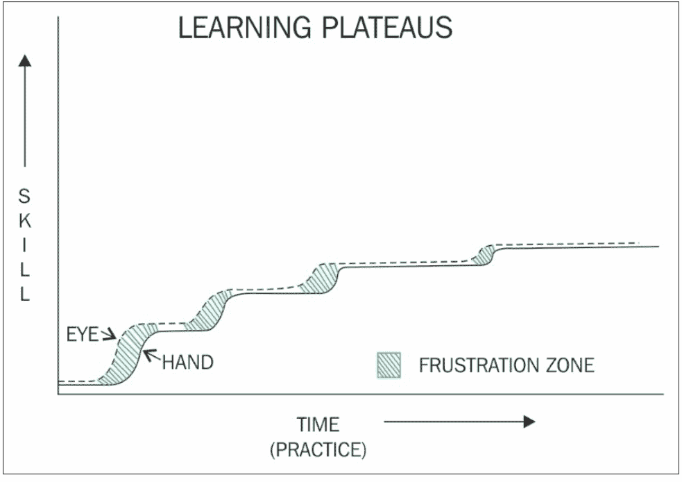

## 第 11 章　学习如何编程——跨越技能瓶颈期

我在学生学习编程时经常看到的一种模式是：

1. 快速掌握大量信息。
2. 然后遇到一堵看起来无法逾越的墙。在这个阶段，学生通常会觉得自己已经达到了开发能力的顶峰。

第二个阶段被称为瓶颈期。在本章中，我们将会讨论一些突破技能瓶颈期的策略。

重要的是要明白，在学习一项新技能时，每个人都遵循类似的模式。这意味着你会经历一些每天都能吸收大量新信息的时期；但也意味着你会遇到一些感觉自己的大脑限制了新知识进入的时期。

### 什么是学习瓶颈期？

当遇到学习瓶颈期时，重要的是找出其发生的潜在根本原因。根据我的经验，没有任何两个瓶颈期是完全相同的。如果你没有诊断出自己为什么学不进去，就无法进入下一个技能水平。

### 虚假的天花板

在继续之前，我想重申一点：*你的技能永远不可能达到完全饱和的状态。* 也许如果你是一名职业运动员并且年纪渐长，身体机能自然会下降。但就理解开发这样的概念而言，只要你继续全心投入，并且愿意倾听专家的意见，你的技能就永远不会登上顶峰。

当他们不再挑战自己时。如果你回忆一下自己最初学习开发的时光，你会发现自己的知识似乎每天都在突飞猛进。

这是因为你当时学习的每一个概念对你来说都是全新的。然而，一段时间之后，我们似乎自然而然就想要进入舒适区。我们不再每天尝试学习新事物，而只是重复自己已经会做的事情。

这种做法对脑力消耗较小，但它有一个坏副作用：限制我们进步。每当我感觉自己陷入一成不变的状态时，就会翻看一些热门网站，开始整理一份我想要学会如何构建的功能清单。然后，我就可以制定一个计划，明确自己需要学习哪些概念来实现这些功能。

### 挫败感 = 技能

关于突破技能瓶颈期，我最喜欢的例证之一出自书法家 Jamin Brown：

注意这幅插图，学习过程中充满了瓶颈期。这是任何技能进步过程中的自然组成部分。

但同样要注意，克服瓶颈期的关键被称为“挫败区”。我觉得这个名称起得非常好。学习复杂的主题并不轻松。你很可能已经无数次听人说过：“如果这事儿容易，那谁都能做到。”

成为开发者可能是一个人所能拥有的最有回报的经历之一。学习编程之所以如此令人满足，部分原因就在于你必须克服许多挑战才能成功。

### 小结

希望这份指南对你有帮助，也希望你现在掌握了一些突破技能瓶颈期的实用策略。祝编程顺利。
