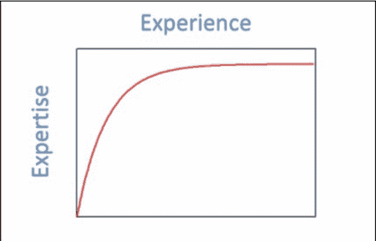
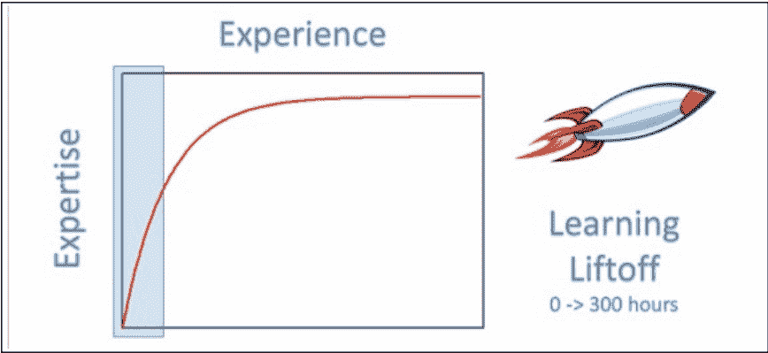
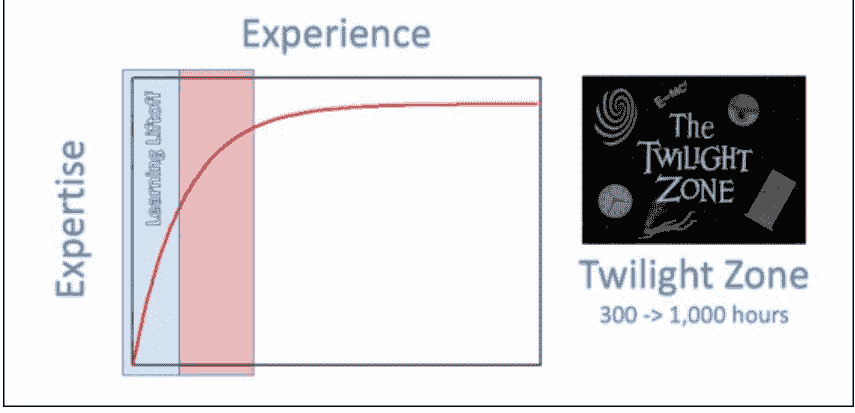

## 第 12 章　开发者学习曲线——为什么学习编程需要这么长时间

在成为开发者的过程中，我最常被问到的问题之一是：为什么学习编程需要这么长时间？我发现，答案可以在与学习曲线相关的研究中找到。

### 什么是学习曲线？

学习曲线的概念从 1885 年就存在了。相关研究通常是在心理学和认知科学中进行的。然而，这个概念完全可以应用到学习开发的过程中。

### 开发者学习曲线

下图展示了标准的学习曲线。它是由一个大数据分析算法生成的，该算法分析了多个行业中个体的学习模式。曲线之所以平滑，是因为它对学习过程取了平均。

在本章后面，我们会看到单个人的学习曲线是什么样子。多年来，我有幸教学生如何成为开发者，一次又一次地目睹这条学习曲线。在本章中，我想探讨所有开发者都会经历的三个阶段。此外，我还会讨论从一个阶段跨越到另一个阶段需要多长时间。我要讨论的三个阶段是：

- 起飞期
- 迷茫期
- 巅峰期

### 起飞期

让我们先来看看起飞期。这对新学生来说是一个激动人心的时期。在这段时间里，学生沉浸在学习从未见过的技能中：

由于学生在这一阶段学到的所有主题都是全新的，他们的专业水平会飞速提升。我喜欢把这一阶段称为起飞期，因为新学生的专业水平很容易被想象成火箭飞船，飞向从未到达过的天空。在这段时间里，学生将学习如何：

- 配置开发机器
- 学习一种编程语言
- 使用各种框架
- 构建可用的应用程序

这一阶段通常会在开发者学习编程的前 250-300 小时内经历。这一估计基于我在 DevCamp 训练营学生中观察到的结果，大约相当于 6-8 周的强化学习。

尽管这一阶段很有趣，但也有缺点。一个关键问题是它可能给学生带来虚假的自信。当他们看到自己能构建出真正可运行的应用程序时，自然会相信自己可以立刻上手为客户构建生产级应用。然而，他们没有意识到自己即将进入……学习编程的迷茫期。

### 迷茫期

在令人振奋的开发者学习曲线起飞期之后，有抱负的开发者将进入迷茫期：

这对学生来说是一个充满挑战的时期，许多学生正是在这一阶段决定彻底放弃编程。

那么，为什么这个时期如此艰难？在见证过无数学生经历这一阶段后，我发现有若干促成因素：

- 在这一阶段，许多核心概念和命令还没有固定在学生的长期记忆中。这导致他们不得不频繁查文档、到 Stack Overflow 上搜索，以及诸如此类的事情。
- 在这段时间里，“能跑起一个应用”的新鲜感已经消退。现在学生需要完成更高级的任务，例如：
  - 处理遗留应用
  - 排查缺陷
  - 提升性能
  - 构建没有分步教程的功能
- 此外，在度过迷茫期的过程中，学生会

预期开始实施最佳实践。在启动阶段，主要目标是让应用程序能够正常运行。

在接下来的这个阶段，学生开始学习如何构建可用于真实场景的应用程序。这意味着，学生构建一个与启动阶段所创建的应用程序功能相同的应用，可能需要花费五倍的时间。

这可能会让人感到沮丧；然而，花费更多时间实施最佳实践，能让应用程序具备足够的可扩展性和灵活性，从而可以投入生产环境。这与启动阶段创建的那些不符合行业标准的应用程序形成了鲜明对比。

无数次，学习对于开发者来说永无止境。不过，学习的方式确实会发生变化。在这一阶段，开发者主要关注以下主题：

-   渐进式性能优化
-   构建辅助代码库
-   优化应用程序代码流程

### 一段独特的旅程

在整章内容中，你可能已经注意到开发者学习曲线是平滑的。然而，这并不是现实。曲线之所以平滑，是因为它平均了大量个体的学习路径。对于单个学生来说，学习曲线更像是下图这样：

学习周期中会有起起落落。作为学生，你可能会在几年后决定更换编程语言（就像我大约 5 年前从 PHP 切换到 Ruby 那样）。

即使你不必从零开始，学习一门新语言或框架仍然需要时间。在你的开发之旅中，你会经历许多起伏。因此，如果你对自己的技能水平不满意，不要气馁，因为我要告诉你一个秘密：优秀的开发者从来不觉得自己已经学有所成、无需再学。

### 小结

我希望这份指南能帮助你理解开发者学习曲线，祝你在编码时好运。
