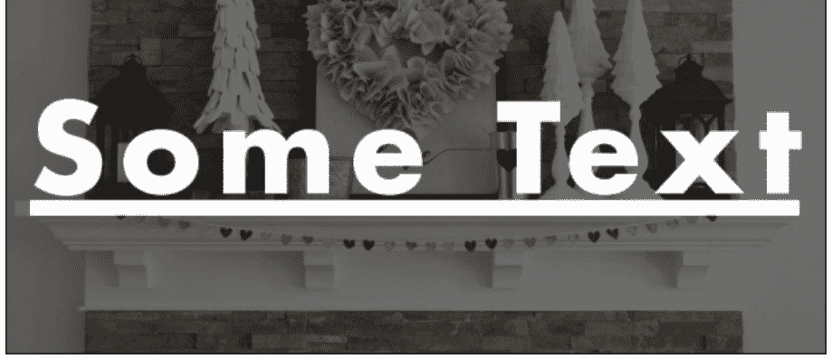

## Chapter 19. Learn How to Code – The Guide to Memorization

During a recent bootcamp teaching session where I was walking through a number of frontend development techniques, a student asked a great question. Referencing the CSS styles, she asked:

> "What is the best way to remember all of the specific style names and properties?"

This is a vital question to answer, especially for new students. For example, if you look at the CSS documentation you'll find thousands of potential style options. If you're learning these styles for the first time that list can be pretty intimidating. And that doesn't even bring in the idea of learning how the styles work together with applications as a whole!

Obviously, this issue does not only apply to CSS styles. When it comes to learning development, whether it's a programming language or framework, you will be greeted with a large amount of information that you'll need to memorize, or at least know where to reference it.

### The guide to memorization

At first glance, this may seem like a daunting task. And many aspiring developers have given up on their learning journey because it seems like an insurmountable challenge.

However, I'm here to tell you that it's completely realistic for you to learn how to work with a large number of complex concepts. And if you follow the system I outline in this chapter, you'll be amazed at how quickly you pick up on memorizing more information than you ever thought possible.

### Repetition

Before I go into the memorization system I have used over the years, it's important to say that repetition is the key to memorizing large amounts of information. None of the techniques I will give you are going to help if you don't take the time to work through them consistently.

#### Smarter, not harder

With that being said, it's important to know that, by itself, repetition is a slow and naive memory training technique. As a development student, imagine that I had a list of a few hundred method names and tell you to memorize them. If you were to simply stare at the sheet of paper and try to memorize the names, how do you think you'd do? If you're like me and the majority of the world, probably not very well.

The reason why dry repetition isn't a great way to memorize names is because it doesn't give you a frame of reference for the names.

#### Visual mental mapping

In the first memory technique, we're going to walk through visual mental mapping. Our minds are incredible at memorization. However, at the same time, our minds are also picky with how they store information. Let's run a quick test. If I show you 15 random digits, such as:
- 234
- 348532
- 984
- 234523
- 34534
- 35234
- 234
- 25345
- 234
- 985
- 553
- 37434
- 740
- 423
- 9812

And I give you 5 seconds to look at each number. How many of the numbers will you repeat back to me? Unless your name is Dustin Hoffman, you probably won't be able to name very many!

However, what if I showed you the pictures of 15 celebrities? Now if I give you the same test as with the numbers, do you think you'd do a better job remembering the list of celebrities or the random numbers? Assuming you know who the celebrities are, you'd be able to repeat back a significantly larger number of celebrities than numbers.

The reason for this difference is because you have a frame of reference for the celebrities and in this exercise, you had a visual reference. By combining these two things your brain was fully prepared to recite back a larger number of items from the second list.

With this knowledge in mind we can apply the same principles for memorizing anything.

### Short-term versus long-term memory

Because our brains are efficient machines they naturally sort information based on priority. You are most likely aware that you have short-term and long-term memory. This concept is the reason why you can instantly remember your second-grade teacher's name decades later, but may forget a new acquaintance's name 30 seconds after hearing it.

Typically, the brain doesn't log knowledge into our long-term memory bank unless it thinks we're going to need it in the future. This is kind of like how a computer works. If you add text to a document and save the file on the hard drive, that's like storing information in the mind's long-term memory.

However, if you run a calculation in the terminal the computer processes the information in memory and then discards it, which is like how our short-term memory system works.

### Implementing visual mental mapping

So, when it comes to implementing the visual mental mapping technique, we're essentially tricking our brain into thinking that it needs to move a piece of information into long-term memory. In this process, we associate a visual image with the term that we want to memorize. A key prerequisite for this to work is that the visualization needs to be relevant to the term (or the behavior of the term).

Getting back to the developer's initial question. Let's see how we can use visual mental mapping to memorize a CSS style. I'm going to use the `text-decoration` property as a case study. In the world of CSS, the `text-decoration` element allows you to add or remove an underline style to a piece of text. With this in mind, I would create an image in my mind that would look something like this:

So, in this example I have an image filled with decorations. And on top of the image, I have some text that is underlined. And it's sitting on the decorated fireplace mantle. By creating this visual image, I've mapped:
- Decoration to underlined text
- A familiar image to something abstract

And with this mental image in place, I don't have to think about the term `text-decoration`, instead I will think of a decorated fireplace with underlined text sitting on the mantle. This visual is much easier for my brain to accept into long term memory because it has a direct frame of reference.

- `border-bottom-color`
- `border-bottom-style`
- `border-bottom-width`
- `border-color`
- `border-left`
- `border-left-color`
- `border-left-style`
- `border-left-width`
- `border-radius`
- `border-right`
- `border-right-color`
- `border-right-style`
- `border-right-width`
- `border-style`
- `border-top`
- `border-top-color`
- `border-top-style`
- `border-top-width`
- `border-width`

如你所见，有21个可用属性。而这仅仅是为了管理网页上的边框样式！可以想象，要记住这个列表会相当令人生畏，尤其是当你意识到这只是开发所需CSS样式中很小的一部分。

然而，如果你开始分析这个列表，你会注意到一些规律。例如，有许多样式仅仅引用了 `top`、`bottom`、`left` 和 `right`。这些样式只是为元素的特定一边指定边框样式的方式。

此外，你可能还会注意到每一边也有一组关于颜色、样式和宽度的选项。所以实际上，如果你知道这些元素都可用于边框元素集，这个列表就可以缩减到5项：

- `border`
- `border-color`
- `border-radius`
- `border-style`
- `border-width`

这样就更易于管理了。

### 复制粘贴是学习的敌人

除了创建视觉思维导图和利用模式之外，我还要补充最后一条记忆技巧：不要复制粘贴你试图学习的新概念。

我第一次听到这个建议是从 *泽德·A·肖* 那里，他是 *《硬核学习》* 编程书系列的作者。他告诉读者，在编写代码时甚至不要同时看书。他认为，强迫自己在不参考文档的情况下敲代码，会迫使大脑真正思考每一次击键。

以我作为开发者和教师的个人经验来看，我发现那些复制粘贴代码或只是跟着教程走的学生，与那些尝试（即使失败了）自己实现代码的学生之间存在显著差异。

### 并非所有东西都需要记忆

最后，我想消除一个常见的误区。作为开发者，你不需要记住每个类和方法才能构建项目。

即使是专业程序员也会经常查阅文档。与其觉得必须记住所有东西，不如专注于记住你最常用的术语。这将使记忆过程更加实际和自然。
