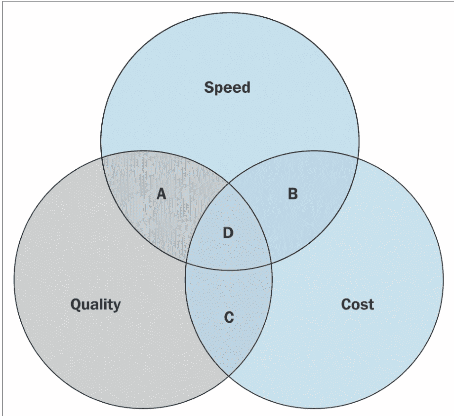
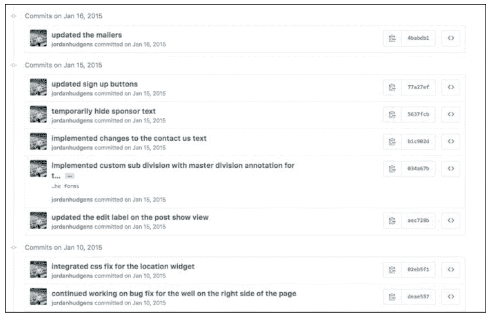

## 第29章。你应该在自由职业项目中使用 TDD 吗？——比较质量与速度

在着手一个新的自由职业项目时，许多开发者和设计师首先会问的问题是：

> *你想要它做得快……还是做得好？*

在本章中，我将专门讨论你是否应该在自由职业项目中使用 TDD。然而，我现在要讨论的概念适用于任何类型的质量控制系统。所以，这对任何开发者来说都是很好的建议。

### 质量与速度

有一条老牌的软件工程规则指出，在构建项目时你有三个选择：

- 质量
- 速度
- 成本

该图以韦恩图的形式表示了这一原则。其难以捉摸的中心是项目快速构建、价格低廉且采用行业最佳实践创建的地方。根据我的经验，很少有项目能位于这个甜蜜点内。相反，我会告诉客户，他们只能在三者中选择其二。例如：

- 你可以让项目以低成本妥善构建，但开发时间会相当长。这是因为项目需要放在一边，因为更高报酬的项目需要优先处理。
- 另外，项目可以以低成本快速构建。然而，这种方法不会留出遵循最佳实践所需的时间，例如在应用程序中构建自动化测试。

另外，你可以让客户决定他们希望你采取什么方法。在这种情况下，你提出构建完整的测试套件与仅构建应用程序本身的利弊。如果客户足够明智，他们很可能会看到包含测试的好处并选择价格更高的选项。

这是一种有效的策略，因为它允许你让客户参与决策过程，这会让他们感觉参与到工作中。而且如果客户仍在寻找其他自由职业者，这种方法可能有助于赢得他的青睐。

让客户决定的另一个好处是，他的回应可能会让你了解他的想法。如果他认为测试是毫无意义的奢侈品并说他只关心完成项目，他可能是一个噩梦客户。在这种情况下，你最好转向更明智的人合作。

### 使用常识

最后，确保你在使用常识。想象一下被要求构建一个简单的企业网站。在这种情况下，你只需要编写一些基本测试。最多这只会增加一小时左右的项目时间。

没有必要拖慢流程，编写测试来验证每个 CSS 类和 ID 是否都显示在页面上。就像自由职业和生活中的大多数概念一样，常识是你最强大的工具之一。

- 继续处理右侧页面上井的错误修复
- 更新城市页面上位置小部件的 CSS
- 集成城市特定展示页面上帖子的检查器
- 更新注册按钮
- 暂时隐藏赞助商文本
- 实现联系我们文本的更改
- 为表单实现自定义子分区与主分区注释
- 更新帖子展示视图上的编辑标签

注意这些更新是实用且信息丰富的。没有任何项目过于技术化，因为过于技术化的更新只会让客户感到困惑。

### 自动化客户更新

所以，我们已经确定客户更新很重要，我们也知道一个好的客户更新是什么样的。然而，如果我们每天为多个客户从头输入这些更新，会累计花费大量时间。我不喜欢浪费时间，我怀疑你也不喜欢，这就产生了一个困境：

1. 我们需要创建我们每天所做工作的详细更新。
2. 但我们不想浪费时间写报告（而且我们对写枯燥的报告的厌恶，不正是我们想成为自由职业者的原因吗？！）。

每当我遇到这种情况时，我都会尝试看看是否有办法自动化一个无聊的任务。幸运的是，有办法。

### 版本控制来救援

起初，我是手动编写所有日常更新的。然而，如果我在一天结束时写它们，我必须回顾所有 GitHub 提交信息来参考我所做的工作。

在经历了这个过程一段时间后，我意识到如果我只是给我的 GitHub 更新添加更多细节，我就可以每天复制粘贴它们，而不必从头再写。

这个过程最终为我每天节省了相当多的时间，因为出于最佳实践的原因，我已经为我实现的每个新功能编写了 GitHub 提交信息。所以，现在我可以消除我一直在做的重复工作。

以下是使用利用提交信息来自动化客户更新的技巧的 GitHub 项目截图：

