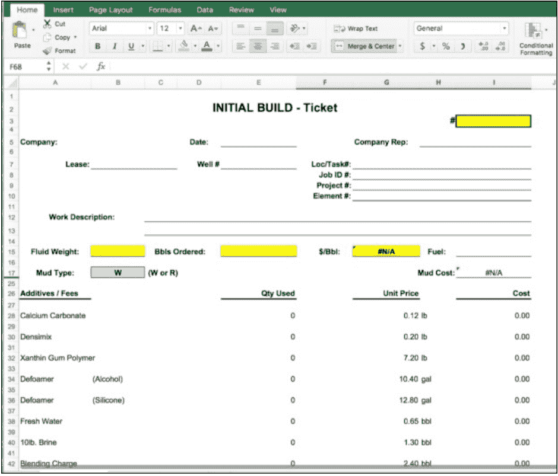

## 第31章。自由职业需求获取——功能开发指南

想象一下，你是一名自由职业开发者，客户交给你一个新功能来构建。然后想象你构建了一个优雅的功能，所有代码都完美运行。你遵循最佳实践并确保覆盖所有潜在的边缘情况场景。

现在想象你在向客户演示这个光鲜亮丽的新功能。但他们没有告诉你你是世界上最好的开发者并要以你的名字命名他们的第一个孩子，而是他们困惑地看着应用程序，因为你构建的东西完全不符合他们脑海中的预期。

这是在自由职业开发世界中经常上演的场景。在许多情况下，这是由于需求获取过程不佳造成的。我刚才提到的故事不是编造的寓言，它最近发生在我身上。而且当我说最近时，我的意思是昨天（在我写这篇文章时）。

> *我的名字是 Jordan，我写了一个糟糕的需求文档……“嗨，Jordan…”*

那么，我做错了什么？问题是我在需求获取阶段仓促进行。我已经为这个特定客户工作了超过 5 年，我在确认该功能所需的确切需求集时变得懒惰。

### 自由职业需求获取

让我们回顾一下发生了什么，这样你就可以避免同样的尴尬和浪费时间。

#### 如何开始

几周前，客户联系我并说我为他们构建的一个应用程序需要一个新功能。该应用程序是他们的司机用来为客户生成发票的发票系统：

在电子邮件中，客户附上了这张电子表格。他说应用程序必须生成此发票以交给客户。

#### 构建

收到电子邮件后，我花了几天时间对新功能进行建模。我列出了模块之间传递的所有消息。我构建了 UML 图表以确保数据被正确建模。之后

#### 更好的结局

如果我遵循了这两种步骤，从几分钟到几个小时就能确定实际需要的功能。正如你所想象的，这比浪费数周的开发时间要好得多。

### 总结

我希望本章对自由职业需求获取有所帮助，你能够从我的错误中学习并将其应用到自己的业务中。
