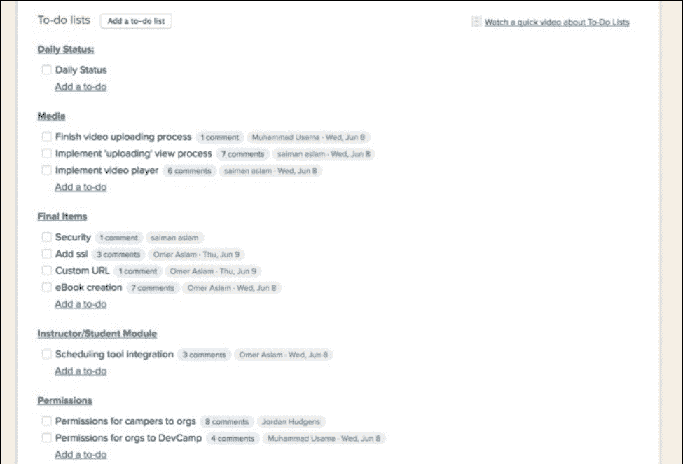
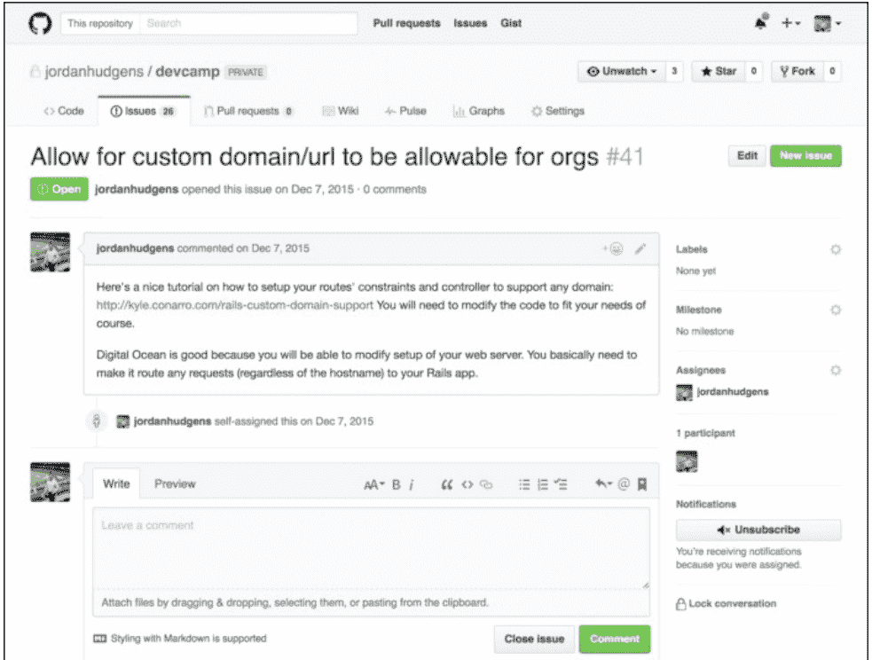

## 第34章。自由职业者顶级项目管理工具

在本章中，我将讨论我在编码项目中使用的顶级项目管理工具。在准备本章时，我浏览了一些目录，其中列出了市场上所有已知的项目管理软件应用程序。

说实话，我有点震惊。自由职业者可用的项目管理选项 literally 有数千种。值得庆幸的是，多年来我为多家客户工作，并使用过各种项目管理应用。

在本章中，我想为你提供一份顶级项目管理工具的清单，以及它们各自的优缺点。有了这些知识，你就可以决定哪一个最适合你的项目和自由职业业务。

以下是六款我使用过的顶级项目管理工具。我可能使用过大约十几种工具；然而，我只想列出我：
- 实际上在生产项目中使用的应用程序
- 我有良好体验并且会推荐给别人的

### 顶级项目管理工具

我们现在将逐一查看每个工具。

### Basecamp

我最喜欢的项目管理应用程序是 Basecamp。我可能对它有偏爱，因为它的创始人 David Heinemeier Hansen 也是

除了项目管理之外，我还将 Basecamp 用作我的日常计划器。基本上，我会将我的待办事项从一天移动到另一天。我喜欢我可以在一个页面上看到我的多个项目及其各自的待办事项列表，如下所示：

### 所有待办事项列表

### Camera Monitoring — Bandwidth Usage
- 尝试确定导致使用量激增的原因（高于预期）
- 调查压缩选项，包括 H.265 和谷歌的新方法
- 添加一个待办事项

### Camera Monitoring — Camera Configuration
- 在摄像机上测试运动检测
- 制定设置运动检测的最佳实践
- 添加一个待办事项

### Camera Monitoring — Compression
- 添加一个待办事项

### Camera Monitoring — TODOs
- 尝试使用 V2 POD 登录进行验证 Lynn Webber
- 添加一个待办事项

### Daily — DevCamp Final Requirements for MVP
- 到处添加悬停效果
- Curriculum exchange network cxr 商标

当我想查看分配给我的筛选列表时，我只能看到我被标记为所有者的项目：

### Jordan Hudgens
jordan@hudgens.com
上次活跃 2 分钟前

### 您在所有项目中的最新活动
- 下午 3:41 您将项目名称从 'SwingAway Living Project' 改为 'SwingAway' 在 SwingAway
- 下午 1:59 您将待办事项从 'Friday' 移至 'Monday': Work: Swingaway 在 Daily
- 下午 1:34 您将待办事项从 'Saturday' 移至 'Monday': Work: start filming Excel course 在 Daily
- 下午 1:34 您将待办事项从 'Saturday' 移至 'Monday': Education: Ruby Videos on Ruby Tapas 在 Daily
- 下午 1:34 您将待办事项从 'Saturday' 移至 'Monday': Education: Marketing course on udemy 在 Daily

查看您所有的活动

### 您的待办事项 截止时间：随时

### DevCamp — Permissions
- Permissions for campers to orgs 8 comments Jordan Hudgens

### DevCamp — Billing
- Finish implementing payments from students to orgs via stripe 20 comments Jordan Hudgens · Mon, May 16

关于使用 Basecamp 的缺点，根据你之前使用项目管理软件的经验，Basecamp 可能感觉不太自然。如果你习惯于基于甘特图的仪表板和类似的跟踪机制，Basecamp 需要一些适应时间。

它确实可以通过其附加模块拥有所有这些功能。然而，其核心 Basecamp 更专注于团队成员之间的消息传递、待办事项列表和调度。

Basecamp 的移动端选项也不是最好的，我的手机上安装了它的 iOS 应用。然而，它并不最直观，尤其是与 Trello 等一些竞争对手相比。

话虽如此，Basecamp 仍然是我的首选项目管理软件，因为它简单、快速，并且我被其待办事项列表结构所吸引。

### Trello

我在大量项目中使用的另一个很棒的工具是 Trello。Trello 使用 Kanban 风格的项目管理。Kanban 是精益制造倡导者推广的工作流程，在高层面上它使用将卡片通过项目开发的不同阶段移动直到完成的概念：

Trello 本质上为你提供了一个虚拟的 Kanban 看板，让你可以将任务通过产品开发生命周期的每个阶段移动。例如，在这里的图像中，我会将任务从 **To-Do** 移动到 **Assigned**，到 **Working**，到 **Under Review**，最后到 **Finished**：

然而，当我管理非常大规模的项目时，例如向 800 多名员工推出企业应用程序，它对我来说效果非常好。

与 Trello 类似，LeanKit 也利用了 Kanban 的项目管理策略。然而，它更专注于企业而不是小型团队。LeanKit 提供的移动和平板应用程序直观且帮助我在旅行时管理项目，这是一个不错的额外好处。

LeanKit 的优势在于它允许你嵌套和组织项目和子项目的能力。学习系统的工作方式后，管理大型团队相对直接。

LeanKit 最大的缺点之一是我认为非常奇怪。他们有一种相当古老且需要大量手工操作的付款方式。我记得有几次我被迫通过电子邮件联系公司只是为了向我们的账户计划添加新用户。这对我来说不是致命问题。然而，这使其成为自由职业者不佳的选择，因为他们希望从同一个账户中开展多个项目。

### ProWorkflow

ProWorkflow 是本顶级项目管理工具列表中较为标准的项目管理选项之一。它很好地结合了时间线、任务管理和团队协作等功能。我只做过一个使用 ProWorkflow 的项目。然而，这是一次很好的体验，我使用该软件时没有任何抱怨。

### Wrike

我对 Wrike 作为项目管理工具有一点爱恨交织的关系。如果你管理着一支开发团队，Wrike 是一个很棒的应用。作为项目经理，你可以使用它来查看每个项目的状态以及正在进行工作的每个任务的详细分析。

然而，如果你是使用 Wrike 的开发人员，学习曲线相当陡峭。我很想认为我对理解如何使用新软件相当熟练。然而，我在 Wrike 的仪表板中不断迷路，很难找到向客户发布更新的地方。最终，我要求客户进行屏幕共享会话，我们一起浏览了我将使用的每个仪表板。

话虽如此，如果你管理着多项目中的自由职业者团队，Wrike 是一个不错的选择，这就是为什么我把它列入此清单的原因。

### GitHub

这可能看起来是一个奇怪的选择，列入顶级项目管理工具清单，因为从技术上讲，GitHub 并没有将自己定位为项目管理软件。

然而，当我只与开发人员合作的项目时，我发现使用 GitHub 的问题跟踪模块可以充当项目管理工具：

正如你在特定问题的此屏幕截图中看到的，你能够：
- 创建问题，这也可以是功能
- 将用户分配给每个任务
- 通过 Markdown 语法添加链接和图像
- 将问题标记为已完成

此外，对于经验丰富的开发团队，使用 GitHub 管理项目还有额外的好处，即使任务管理高效。例如，开发人员可以根据 Git 提交自动关闭任务。而且你使软件更易于使用，开发团队就会更喜欢它。

