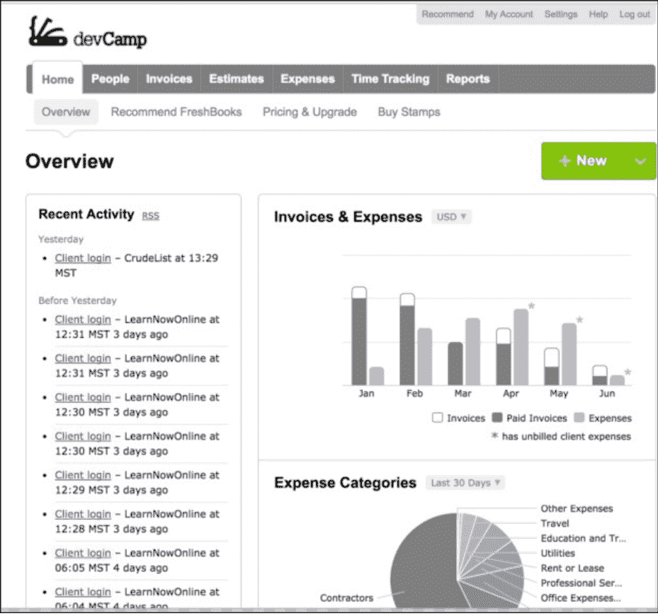

## 第35章 开发者最佳自由职业记账选项

在本章中，我将回顾最佳的自由职业记账选项。记账可能是我作为自由职业者最不喜欢的部分之一。要妥善管理自由职业业务，你必须管理各种各样的会计组件：

- 利润与亏损报告，用于掌握你的整体盈利情况
- 账龄报告，用于查看收款所需时间
- 费用记录，确保你捕捉到所有潜在扣除项
- 应收账款系统，以便你能收到款项
- 项目跟踪工具，如果你正在为客户处理大型项目

### 自由职业记账选项

多年来我用过许多记账解决方案，以下是我使用体验最好的一些。

### FreshBooks

FreshBooks 是我用于自己自由职业业务的系统。就会计软件而言，它覆盖了我100%的需求：

幸运的是，它也很容易使用，这意味着我不必花时间学习如何使用该软件。它拥有直观的界面，让我能够登录、完成必须执行的任务，然后继续回去工作。

### 工作原理

这是 FreshBooks 中对我来说很重要的一个界面：

### FreshBooks 附加功能

完整浏览整个系统需要花上好几个小时，所以我只简单介绍一下我觉得最有用的其他功能：

- **发票发送灵活性**：虽然电子发送发票很方便，但我仍有一些客户更喜欢纸质发票。幸运的是，FreshBooks 不仅允许我打印发票，他们还能直接替我把发票邮寄给客户。
- **费用跟踪**：跟踪业务费用是一件乏味的事。不过，借助 FreshBooks 移动应用，我可以用手机拍照、输入费用详情，费用就会被记录到系统中。
- **创建估算单**：过去，我会在 Excel 或 Word 里创建估算单，然后发给客户。如果他们批准了，我就必须把详细信息输入到发票中。然而，有了 FreshBooks，我可以创建估算单并直接通过电子邮件发送给客户。如果他们决定继续推进项目，估算单会自动转换为发票。

### 不足之处

尽管我非常喜欢 FreshBooks 系统，但它确实有一些缺点。首先，如果你的客户数量很多，费用可能会有点高。此外，如果你开始雇佣大量员工，管理起来会变得有些笨重。就个人而言，我建议任何员工少于20人的企业使用 FreshBooks。当你的业务增长超过这一规模时，你就需要转向一个更具可扩展性的系统。

### QuickBooks

如果你已经超出了 FreshBooks 的适用范围，QuickBooks 可能是你业务的不错选择。在我印象中，QuickBooks 一直是小型企业会计软件领域的行业领导者。尽管该公司因系统难以管理而闻名，但在过去几年中，他们在让系统更灵活方面做得很好。

当你列出小型企业会计软件可能需要的所有功能时，QuickBooks 应有尽有。此外，由于其普及程度，你雇用的任何管理员很可能已经拥有使用该系统的经验。

话虽如此，我个人不会选择为 DevCamp 或我合作的其他任何公司使用 QuickBooks。主要原因是，我见过太多次公司发展超出 QuickBooks 的能力范围后，发现迁移到新系统非常困难。我也不喜欢该软件使用的报表引擎。例如，如果你计划通过大数据分析报表引擎运行财务数据，QuickBooks 很难将数据导出为易于使用的格式。

### NetSuite

如果你的业务在客户和员工方面都在增长，NetSuite 是一个很棒的记账选项。严格来说，NetSuite 对于典型的自由职业业务来说可能有些大材小用。然而，如果你的开发团队开始转变为一家成熟的全方位数字代理机构，你就需要一个强大的 ERP 系统。ERP 系统与传统记账软件不同，它们会提供诸如以下工具：

- **资源规划**：这意味着你可以按项目分配开发人员的时间。
- **高级税务规划工具**：一旦你的业务达到一定规模，确保你利用所有可用的潜在税收扣除就变得很重要。ERP 系统这样的工具可以帮你做到这一点。
- **薪资集成**：随着业务增长，管理员工、跟踪离职率以及诸如此类的任务变得越来越重要。然而，这些很难手动跟踪。NetSuite 这样的系统会计算你所有的员工跟踪指标，这样你就可以用它们来管理你的团队。

### 总结

我希望这些自由职业记账选项能帮助你为业务选择合适的系统。
