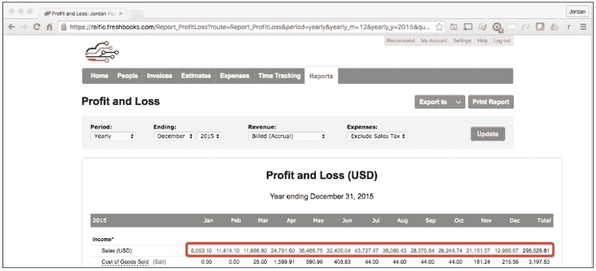

## 第36章 掌握自由职业者获取新客户的秘诀

如果你想要开展自由职业业务，最紧迫的挑战通常围绕如何获得新客户。当我最初启动自由职业业务时，我很努力地争取客户。

然而，在传统渠道中挣扎了几个月后，我发现了一个很棒的解决方案，去年带来了超过29万美元的收入。这正是我在本章想要讨论的内容。

### 去哪里寻找新客户

让我们先来看看自由职业者可以寻找新客户的选项清单。我读过无数关于这个主题的博客文章和多本书，以下是其中最受欢迎的建议：

- **朋友和家人**：这可能看起来是自然的起点；然而，根据我的经验，朋友和家人通常希望你免费或以极低的价格工作。如果你刚刚起步并且需要建立作品集，这个渠道可能不错；但它不可扩展，而且通常利润不高。
- **社交活动**：对于人脉拓展，你可以加入当地的商会，或寻找可以推广业务的社交群体。这种方法在某些情况下效果不错。然而，每次我尝试时都发现已经有好几位开发人员参加，他们也在为自己的自由职业业务寻找新客户。

我不会因为自己的经历而阻止你尝试这个选项，但请确保你准备好与他人竞争。我记得几年前参加过一次商会的“见面会”。当房间里每个人介绍自己和业务时，有六位自由职业开发人员都在提供相同的服务。

-   **外包服务**：这是我想在这里重点讨论的选项。有趣的是，许多自由职业“专家”告诉我这条路太难走。然而，我找到了一种很好的方式来利用它为自由职业者获取新客户。

### 自由职业者获取新客户

我有点固执，所以花了一段时间才承认，但最终我接受了一个事实：我没有以自由职业者的身份获得新客户，尤其是用我当时一直尝试的方法。于是，我制定了一个计划，其中涉及雇佣一些我自己的自由职业者。我组建了一个团队，帮助弥补我的薄弱领域。

为了开始以自由职业者身份获取新客户，我知道我必须拥有清晰编写的提案，描述我的服务。而且我也知道这些提案必须全天候地发送出去。

### 提案材料

带着这个想法，我在 Upwork 上研究了销售文案撰稿人，并雇佣了一位有才华的营销人员，他为我创作了三份不同的提案。

其中包括宣传我作为开发人员的经验、作品集和专业知识的销售文案。我制作了三个版本，因为我希望每个版本都能针对特定类型的项目。例如，其中一份提案专注于企业级项目。另一份提案针对 API 开发，而第三份的内容则面向初创公司。

### 持续发送提案

有了全套专业提案，我准备好实施计划的第二步：持续发送提案。为此，我从菲律宾雇佣了一位注重细节、英语流利的虚拟助理，名叫 Sy。

我以每小时6.50美元的价格雇佣了 Sy，而他第一周就为自己赚回了成本！我向他介绍了这些提案，并描述了我希望承接的项目类型。

在我确信 Sy 已经完全理解了我的目标之后，我就放手让他在 Elance 上大展拳脚。他审阅了市场上所有潜在的项目，并针对符合我标准的每个项目发送了我的定向提案。不到一周，我就开始收到客户的回复；不到两周，我就被多个项目雇佣了。三个月后，我不得不雇佣自己的开发人员，因为找我构建应用的客户太多了。

#### 结果

那么，我作为自由职业者获取新客户的策略效果如何？嗯，这是我的 FreshBooks 仪表盘截图。去年，我的自由职业业务创造了超过 29 万美元的收入：

有一个月甚至超过了 4 万美元：

我不会假装这很容易。这与快速致富的计划截然相反。然而，通过实施这一策略，我可以经济高效地将自由职业业务的营销外包出去，从而专注于实际的开发工作。

### 总结

我希望这是一份有用的指南，帮助你作为自由职业者获取新客户，并给你带来一些关于如何建立自己业务的想法。
