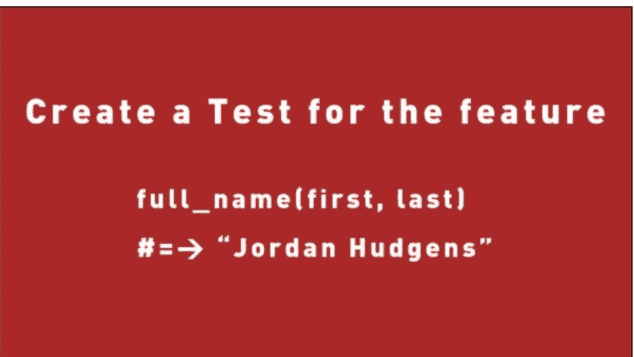

## 第 39 章 测试驱动开发对程序员的重要性

让我们来讨论**测试驱动开发**的重要性。首先，如果你对 TDD 或 BDD 这些术语感到陌生——它们分别是测试驱动开发和行为驱动开发的缩写——那么它们指的是为应用程序构建代码测试的做法。

更具体地说，TDD 和 BDD 是*软件开发流程，即在实现任何代码之前，先创建一个测试来设定预期结果。*

下面是一个使用 TDD 为用户类创建“返回全名”功能的示例：

1. 创建一个测试，调用名为 `full_name` 的新方法；该方法将用户的名和姓组合起来，并返回一个把两部分合并为单个值的字符串：



2. 然后运行测试，同时知道它会失败：

### 测试失败

3. 接着，添加一个最基本的代码实现：

### 实现代码

```ruby
def full_name(first, last)
  first + " " + last
end
```

这样测试就会通过：

### 测试通过

4. 然后回头重构实现，以确保其符合最佳实践，并且重构不会破坏任何东西：

### 重构代码

```ruby
def full_name(first, last)
  return "" unless first && last
  first + " " + last
end
```

这个过程被称为“红、绿、重构”工作流，是所有语言和框架中相当标准的实践。

在*极限编程*中，贝克（Beck）说，测试是让开发过程不偏离轨道、不超出预算的最大关键之一。

3. **文档**：当一个使用 TDD 构建的应用程序完成后，测试应该能够提供该软件 100% 的文档。某些测试框架（如 RSpec）甚至能够以文档形式输出测试，完整描述应用的行为，即使是非技术人员也能理解。

4. **引导开发过程**：编写优秀软件的最重要关键之一，是尽可能将代码拆分成许多小而易于管理的块。使用 TDD 时，你自然会写出小方法、高效的类定义，并且代码膨胀会降到最低。当你遵循 TDD 实践时，测试本身应当引领软件开发，最终结果应该是一个组织良好且可扩展的代码库。

TDD 有一个告诫：如果测试套件结构不佳，测试就毫无意义。如果你只是创建大量测试，而这些测试除了测试某个语言或框架的核心功能外没有任何作用，那么你的测试套件将不会带来任何好处。然而，如果你在构建应用时让测试驱动你的开发和代码结构，你最终会得到一个值得骄傲的优秀应用。

如需了解更多信息，我建议阅读*马丁·福勒*（Martin Fowler）的完整系列文章，这被视为有史以来对 TDD 最深入的讨论之一。

### 小结

希望本章能帮助你回答与 TDD 重要性相关的问题，祝你面试顺利！
