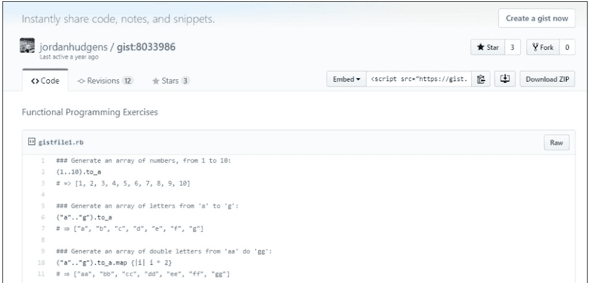

## 第59章 作为开发者如何保持敏锐？

当我想到**保持敏锐**这个概念时，脑海中浮现的是专注技能的画面。从编程的角度来看，一位敏锐的开发者是那种对处理具有挑战性的项目充满信心，并能冷静适应不断变化的需求的人。

我在前几章中提到过，开发者的技能水平永远不会停滞不前。作为一名程序员，你要么在进步，要么在失去你的专长，没有中间地带。那么，作为开发者，你该如何保持敏锐呢？

### 保持敏锐的开发者小贴士

以下是我关于保持开发者敏锐度的五个重要建议。如果你遵循这些建议，你总会感到准备好专注于职业生涯中的下一个目标或挑战。

#### #1 – 编码练习

我列表中的第一项是编码练习。归根结底，没有什么比直接深入代码更能帮助你提高编程能力了。

你可能会认为从事工作或业余项目就足以保持你的技能敏锐。然而，根据我的经验，我管理的许多工作项目并不会考验我作为开发者的技能。当然也有例外，但我在工作项目上做的很多编码都是围绕应用程序配置，而不是算法设计。

从小到大，我可以观看我父亲执教的棒球运动员。这些是处于职业巅峰的美国职业棒球大联盟运动员。我仍然记得他们是如何保持击球手状态的。参加比赛并不是他们提高的方式，比赛是他们展示

他们的技能。相反，他们通过练习和练习变得更好，这些练习和练习专注于提高他们游戏的特定组成部分。

同样，我们作为开发者，需要花时间提高编码技术的特定元素。

这张图片是我定期进行的编程练习的 GitHub gist（https://gist.github.com/jordanhudgens/8033986）。在每个代码片段上方都有一个任务，我的工作是将实现代码放在目标下方。这些编程练习迫使我不断完善我的技能，并为复杂问题找到新的更好的解决方案。

### 示例编程练习

一些示例问题可能包括：

- *从以 "system." 开头的数组中删除字符串：* 这要求我使用数组数据结构，集成正则表达式匹配器，并知道如何删除选定的元素。
- *将字符串数组转换为哈希，以字符串作为键，以字符串长度作为值：* 这个练习迫使我理解哈希数据结构如何工作，如何使用可枚举的 Map 方法，以及如何使用块。

清单还在继续。我不断添加新的问题来解决，我每天尝试花一些时间。花费大约 30 分钟到一个小时来完成这些练习。如果你正在寻找一个很棒的编程问题列表，请查看 Project Euler（https://projecteuler.net/）。在那里你会找到数百个很棒的挑战，你可以逐一完成。

### #2 – 教别人编程

接下来是教别人如何编程。我在家上学长大，大约 12 岁时我必须开始自学代数。我最初在学习新概念时很挣扎，我感到沮丧。我妈妈意识到当我独自学习时，我很难理解我在读什么。但当我向她解释课程时，我的理解力飙升。

她在教我所有的兄弟姐妹，所以她不能整天在我身边。所以，她拿来我姐姐的一个娃娃，把它放在我桌子旁边。她指示我阅读课程计划，然后向娃娃解释。

起初，我认为这是我听过的最愚蠢的想法。向一个娃娃解释代数，这个娃娃由于体型大而得名 *Big Dolly*，似乎就像一个无家可归的人在公交车站自言自语。所以，我做了每个 12 岁孩子都会做的事，我忽略了这个建议……直到我进行下一课时，我意识到我不知道我刚刚读了什么。所以，在盯着娃娃看了几秒钟尴尬的几秒钟后，我开始向她解释概念。令人震惊的是，通过与娃娃一起讲解课程，我开始理解它！而没有人比我自己更惊讶。所以，*Big Dolly* 帮助我完成了代数、三角和微积分。

#### 这如何适用于开发？

那么我关于教娃娃代数的奇怪故事如何适用于作为开发者保持敏锐？好吧，当我开始学习编程时，我并没有马上掌握。事实上，我真的很难理解如何构建应用程序。但后来我想起了高中数学时代。但我没有把 Big Dolly 从阁楼里带回来，而是开始创建编程教程。

正是通过教别人，我才开始比以往任何时候都更好地理解开发。事实上，*DevCamp* 和 *CronDose* 的起源可以追溯到我通过教别人来提高自己技能的愿望。所以，如果你想学习编程或作为开发者提高自己，我强烈建议你教别人，你自己的专业知识将会增长。

### #3 – 阅读

保持开发者敏锐的技巧列表中的下一个是阅读。我订阅了 Safari Books Online，这本质上是开发者的 Netflix。通过该订阅，我可以访问数千本编程书籍。在我的日常待办事项清单上，我有大约 7-8 本书要阅读。

有时我读几小节，有时我会读几章，这取决于我有多少时间。阅读开发书籍帮助我不断完善我的编程技能，我一直在寻找新的好书来阅读。

### #4 – 新闻通讯

名单上的第四项是开发新闻通讯。我试图让我的时间非常专注。因此，我限制了我订阅的新闻通讯数量，以便我可以在它们发布时花时间审阅每一份。

我最喜欢的一些是来自：*thoughtbot* 和 *Codeship* 的新闻通讯。这类资源包含全面的指南，将帮助你对开发以及如何实现新功能有一个独特的视角。

### #5 – 教程

保持开发者敏锐的技巧列表的最后一项是教程。每当我学习一种新语言或框架时，教程是我最喜欢的学习资源之一。

Screencasts 是你能得到的离有讲师在房间里与你在一起最近的东西。为你提供逐步指南，你可以按照这些指南从头开始构建应用程序。值得庆幸的是，随着在线教育行业的增长，几乎你想要学习的一切都有教程。

### # 总结

我希望这套技巧对你保持作为开发者的敏锐有所帮助，祝你编程顺利！
