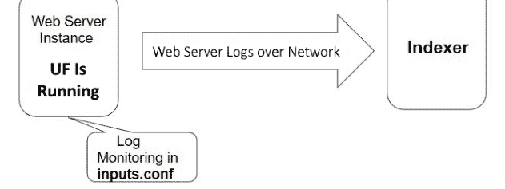
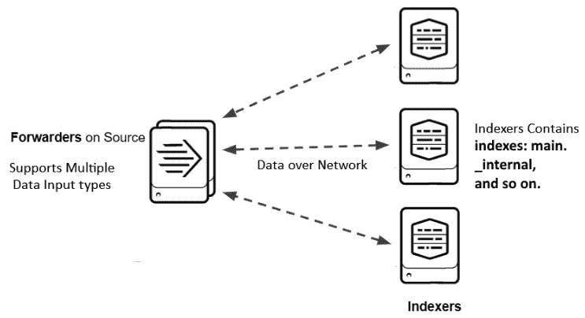
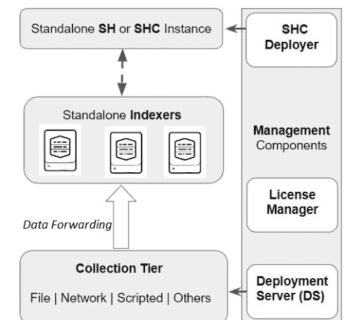
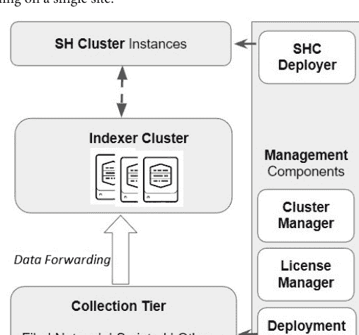
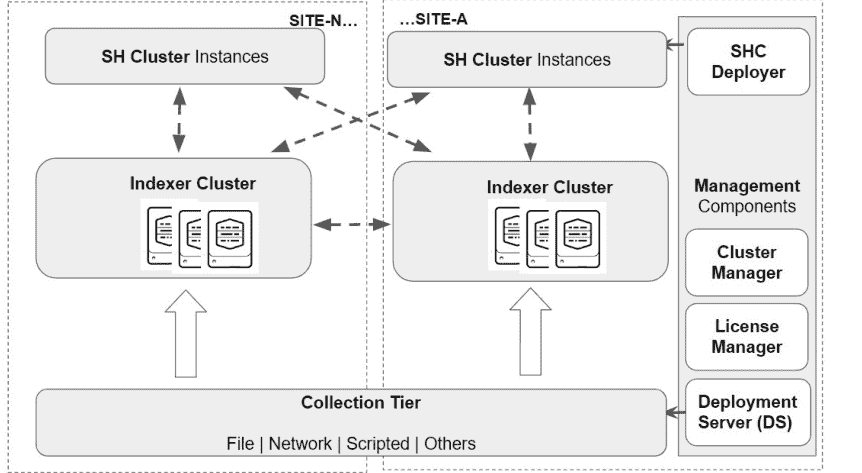
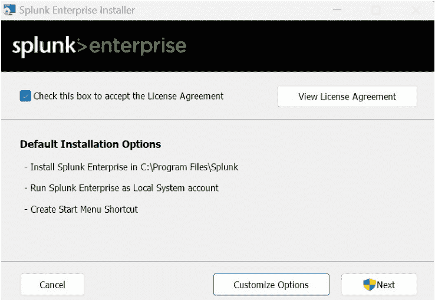
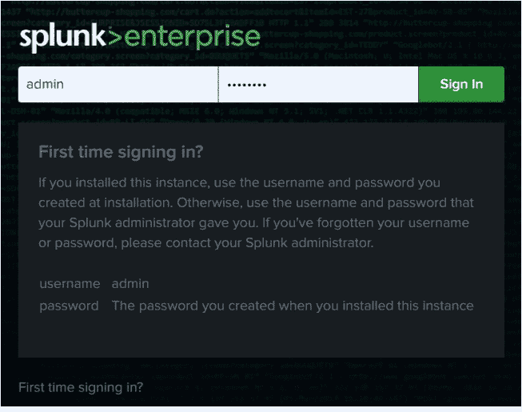

### Splunk Enterprise 认证管理员考试入门

让我们开始了解 Splunk Enterprise。学完本章后，您应该了解 Splunk Enterprise 是什么及其丰富的功能集，并能够列出协同工作以从数据中获取业务洞察的 Splunk 组件。您还将学习如何在 Windows 环境中安装独立的 Splunk Enterprise，以及涵盖所有 Splunk 组件的高级 Splunk 验证架构（SVA）。在本书中，您会经常发现我们交替使用 Splunk Enterprise 和 Splunk 这两个术语。它们都指产品本身。您很少会看到对 Splunk Inc. 的引用，该公司是开发和提供 Splunk Enterprise 产品的公司。

本章涵盖以下主题，帮助您入门：

- 介绍认证考试
- 考试中各主题的权重
- 介绍考试的测试模式
- 什么是 Splunk Enterprise？
- 介绍 Splunk 9.x Enterprise 功能
- 理解 Splunk 组件
- SVA
- Splunk 安装——独立安装
- 自我评估

不要被主题列表的长度吓到；这些主题将在本书其余部分详细深入介绍，让您充满信心地做好准备。

现在您已经了解了主题及其权重，让我们来了解考试的测试模式。

### 介绍考试的测试模式

考试包含 56 道题目，需在 57 分钟内完成。每道题最多有五个选项。有些题目有多个答案，属于*选择所有适用项*类别。其他题目则为*对或错*或*单项选择*。

以下是不同类别的示例问题及答案。

### 对或错类别

问：Splunk Enterprise 只能存储和检索基于文本的数据。

- A. 对
- B. 错

此处答案为选项 A。

### 单项选择类别

问：一个 UF 正在向 `index=linux_os` 发送数据，但该索引在索引器层不存在。在这种情况下，数据会发生什么？

- A. 由于尚未配置此类索引，数据将被索引器忽略
- B. 索引器向 UF 抛出错误消息
- C. 由于之前不存在，会自动创建一个 linux_os 索引
- D. 数据存储在 lostandfound 索引中

此处答案为选项 A。

### 多项选择类别

问：Splunk 管理员用户默认拥有哪些功能？（选择所有适用项）

- A. 管理员可以远程安装 UF
- B. 管理员可以创建另一个管理员用户
- C. 管理员可以为非管理员用户组创建自定义角色
- D. 管理员可以通过 GUI 重启 Splunk SH 实例

此处答案为选项 B、C 和 D。

让我们在下一节中开始学习 Splunk Enterprise。

### 什么是 Splunk Enterprise？

Splunk Enterprise 是一款软件，可从异构来源收集数据，并提供分析机器数据的接口。了解 Splunk Enterprise 有助于您在实际项目工作中根据出现的需求选择合适的功能。作为管理员，您需要充分了解 Splunk 的这些功能。该产品的主要功能如下：

- **收集文本数据**：Splunk Enterprise 只能收集和搜索文本数据。非文本数据不应存储在 Splunk Enterprise 中。
- **无模式**：Splunk 接受结构化、半结构化和非结构化数据，无需严格检查模式合规性。
- **Web、命令行界面（CLI）和 REST 应用程序编程接口（API）**：Splunk 提供三种标准接口——用于搜索、报告、告警和配置管理的 Web 界面；通过编程方式实现所有 Web 功能的 REST API；以及用于执行系统命令、配置 Splunk 和运行搜索的 Splunk CLI。一般来说，Splunk 管理员使用此界面。
- **搜索、报告和告警**：为了查询 Splunk Enterprise，它引入了专有的 SPL，该语言在其提供的每个界面中均用于检索数据。搜索支持数据检索，可以是临时搜索，也可以安排在一天中的特定时间运行。报告涉及存储可重复使用的搜索查询，可以安排或按需运行。最后，告警是一种计划搜索，当满足给定条件时会触发一组定义的操作——告警操作可能包括发送电子邮件或执行脚本等任务。
- **数据匿名化**：数据可能包含敏感信息，例如**个人身份信息（PII）**和**支付卡行业（PCI）**数据。例如，信用卡号和用户电话号码属于高度机密信息，仅限于特定员工群体可见或访问，这通常称为数据主权。为了符合组织的数据标准，Splunk 提供在索引期间屏蔽或隐藏这些数据的功能。这可以防止查询 Splunk Enterprise 的用户发现这些敏感信息。我们将在*第 10 章，数据解析和转换*中进一步研究这一点，特别是在*数据匿名化*部分。
- **从单一部署扩展到分布式部署**：Splunk Enterprise 旨在适应各种部署规模，从单个服务器配置到大规模分布式设置。即使处理 PB 级数据量，它也能高效处理大量数据处理任务和用户支持。
- **高可用性（HA）和灾难恢复（DR）**：集群是指一组协同工作的 Splunk 实例，以实现 HA。多站点集群是指地理上冗余的集群协同工作以实现 DR。所有集群实例通过复制共享通用配置。
- **数据收集机制**：将数据导入 Splunk 是至关重要的一步，在包含各种数据源的大型企业中，这是一个持续的过程。Splunk 提供用于文件监控、网络输入、脚本输入和**HTTP 事件收集器（HEC）**的 UF 代理，以支持无代理场景。同样，它还提供用于从 Linux、Windows、云、CRM 和网络设备等收集数据的 TA。附加组件可在 Splunk 网站（`https://splunkbase.splunk.com`）上获取。
- **监控**：MC 应用程序是有效监督 Splunk 平台的工具。它提供对独立和分布式 Splunk 部署性能的洞察。该应用程序包括预配置的告警和仪表板，可启用这些功能以确保对平台整体健康状况和性能进行主动监控。

让我们在下一节中看看 Splunk 9.x 版本中新增的功能。

### 介绍 Splunk Enterprise 9.x 功能

Splunk Enterprise 多年来不断发展，在撰写本书时目前版本为 9.0.3。随着它变得越来越先进，一些功能被弃用，并添加或增强了新功能。旧版本通常达到**生命周期终止（EOL）**，这意味着 Splunk 不再提供支持或修复错误，而是建议升级到最新版本。

本节涵盖 Splunk 8.x 版本中沿用至最新 9.0 产品版本的重要功能，以及 9.x 版本中引入的新功能。了解这些功能是有益的，但考试不涉及这些内容。如果您愿意，可以跳过本节：

- **Dashboard Studio**：这提供了创建可视化所需的工具，例如图形、图表和统计表，并支持颜色和图像。它补充了 Splunk 之前版本中存在的经典简单 XML 仪表板，但截至 8.2.6 版本并未取代它。
- **联合搜索**：用于搜索本地 Splunk 部署之外的外部 Splunk 部署。本地 SH 向远程 SH 发起搜索请求，远程 SH 充当联合提供方。远程部署可以包含单个 SH 或集群。
- **健康报告**：Splunk Web 有一个便捷的 *Splunk 运行状况状态* 报告，以绿色、红色和黄色状态显示 Splunk 进程的运行状况。选择每个进程可进一步深入了解详细信息。健康报告帮助管理员快速了解平台状态，例如 I/O 等待、摄取延迟、数据持久性、搜索延迟、磁盘空间和跳过的搜索。

在下一节中，我们将学习 Splunk Enterprise 组件。

## 了解 Splunk 组件

Splunk Enterprise 拥有多个相互协作的核心组件，主要按其功能划分。列表非常全面。独立的 Splunk 部署不需要所有组件；然而，分布式和高可用部署几乎需要所有组件。

关于独立部署与分布式部署的详细理解将在本章的下一节 *Splunk Validated Architectures (SVAs)* 中介绍。到本节结束时，你将熟悉两种类型的 Splunk 组件——即处理组件和管理组件。

## 处理组件

以下是处理组件：

- Forwarder
- SH
- Indexer

让我们详细了解这些组件的作用以及它们与管理组件的关联。

### Forwarder

顾名思义，它主要将数据从源转发到目标 indexer。有两种类型的 forwarder：

- **Universal Forwarder (UF)**
- **Heavy Forwarder (HF)**

UF 通常是安装在数据产生源系统上的软件代理。它包含一个输入配置（即 `inputs.conf` 文件），其中列出了绝对文件路径以及诸如 index 和 sourcetype 之类的元数据字段。UF 是监控和将文件内容转发到指定 indexers 的首选方法。默认情况下，UF 使用 fishbucket 进程来确保数据仅被索引一次，并通过 **cyclic redundancy checks (CRCs)** 和 seek 指针避免数据重复。你将在 *Chapter 9, Configuring Splunk Data Inputs.* 中找到有关额外支持的数据输入的更多信息以及关于 fishbucket 概念的详细解释。

下图说明了 UF 安装在 Web 服务器上，配置为监控 Web 服务器日志并在日志更新时持续将其转发到 indexer：

Figure 1.1: UF forwarding web server logs to indexer

让我们现在来看 SH，它是分布式部署中一个关键的用户[content]

在下一节中，我们将学习 Splunk Enterprise 组件。

## 了解 Splunk 组件

Splunk Enterprise 拥有多个相互协作的核心组件，主要按其功能划分。列表非常全面。独立的 Splunk 部署不需要所有组件；然而，分布式和高可用部署几乎需要所有组件。

关于独立部署与分布式部署的详细理解将在本章的下一节 *Splunk Validated Architectures (SVAs)* 中介绍。到本节结束时，你将熟悉两种类型的 Splunk 组件——即处理组件和管理组件。

## 处理组件

以下是处理组件：

- Forwarder
- SH
- Indexer

让我们详细了解这些组件的作用以及它们与管理组件的关联。

### Forwarder

顾名思义，它主要将数据从源转发到目标 indexer。有两种类型的 forwarder：

- **Universal Forwarder (UF)**
- **Heavy Forwarder (HF)**

UF 通常是安装在数据产生源系统上的软件代理。它包含一个输入配置（即 `inputs.conf` 文件），其中列出了绝对文件路径以及诸如 index 和 sourcetype 之类的元数据字段。UF 是监控和将文件内容转发到指定 indexers 的首选方法。默认情况下，UF 使用 fishbucket 进程来确保数据仅被索引一次，并通过 **cyclic redundancy checks (CRCs)** 和 seek 指针避免数据重复。你将在 *Chapter 9, Configuring Splunk Data Inputs.* 中找到有关额外支持的数据输入的更多信息以及关于 fishbucket 概念的详细解释。

下图说明了 UF 安装在 Web 服务器上，配置为监控 Web 服务器日志并在日志更新时持续将其转发到 indexer：

Figure 1.1: UF forwarding web server logs to indexer

让我们现在来看 SH，它是分布式部署中一个关键的用户[content]

在下一节中，我们将学习 Splunk Enterprise 组件。

## 了解 Splunk 组件

Splunk Enterprise 拥有多个相互协作的核心组件，主要按其功能划分。列表非常全面。独立的 Splunk 部署不需要所有组件；然而，分布式和高可用部署几乎需要所有组件。

关于独立部署与分布式部署的详细理解将在本章的下一节 *Splunk Validated Architectures (SVAs)* 中介绍。到本节结束时，你将熟悉两种类型的 Splunk 组件——即处理组件和管理组件。

## 处理组件

以下是处理组件：

- Forwarder
- SH
- Indexer

让我们详细了解这些组件的作用以及它们与管理组件的关联。

### Forwarder

顾名思义，它主要将数据从源转发到目标 indexer。有两种类型的 forwarder：

- **Universal Forwarder (UF)**
- **Heavy Forwarder (HF)**

UF 通常是安装在数据产生源系统上的软件代理。它包含一个输入配置（即 `inputs.conf` 文件），其中列出了绝对文件路径以及诸如 index 和 sourcetype 之类的元数据字段。UF 是监控和将文件内容转发到指定 indexers 的首选方法。默认情况下，UF 使用 fishbucket 进程来确保数据仅被索引一次，并通过 **cyclic redundancy checks (CRCs)** 和 seek 指针避免数据重复。你将在 *Chapter 9, Configuring Splunk Data Inputs.* 中找到有关额外支持的数据输入的更多信息以及关于 fishbucket 概念的详细解释。

下图说明了 UF 安装在 Web 服务器上，配置为监控 Web 服务器日志并在日志更新时持续将其转发到 indexer：

Figure 1.1: UF forwarding web server logs to indexer

让我们现在来看 SH，它是分布式部署中一个关键的用户面向的处理组件。

HF 是一个 Splunk Enterprise 实例，不需要单独的二进制文件进行安装。与 UF 相比，它提供了扩展的功能集。它不仅收集和转发数据，还包括用于配置和管理的 Splunk 用户界面。要运行 HF，需要 forwarder 许可证。通常，HF 配置为转发模式，通过禁用本地数据存储来实现。可在 Splunkbase 上获得的 Splunk Add-ons 可以安装在 HF 上以便于从各种来源收集数据。这种功能组合使 HF 成为在受益于用户友好界面的同时进行数据预处理和转发数据的多功能选择。

### SH

SH 组件是一个专用于搜索管理的 Splunk Enterprise 实例，并为用户交互提供多种接口。它向用户提供的流行接口是 web、CLI 和 RESTful API。

多个 SH 可以组合在一起形成一个集群，称为 SH 集群（SHC）。SHC 的成员共享相同的基线配置，作业由 SH captain 分配给可用成员。

在独立部署中，单个 Splunk Enterprise 实例（即同一实例）同时充当 SH 和 indexer。在分布式部署模型中，SH 或 SHC 可以向多个 indexers 提交搜索并汇总返回的结果。结果存储在本地的 dispatch 目录中，位于 $SPLUNK_HOME/var/run/splunk/dispatch 以便稍后检索，作业过期后结果将被删除。$SPLUNK_HOME 指的是 Splunk 软件安装的安装目录。例如，临时搜索结果（即搜索作业结果）在 dispatch 目录中保留 10 分钟，作业过期后将被一个名为 dispatch reaper 的进程删除，该进程每 30 秒运行一次。

Figure 1.3: Indexers receiving data from forwarders and storing it in indexes

到目前为止，我们已经了解了处理组件及其在 Splunk Enterprise 部署中的作用。让我们在下一节中了解管理组件。

## 管理组件

这些是支持处理组件的管理组件：

- Deployment Server (DS)
- SHC Deployer (SHC-D)
- Indexer CM
- License Manager (LM)
- MC

我们将在以下小节中讨论它们。

### DS

使用独立的 Splunk Enterprise 实例来管理 forwarders。位于数据源（通常是 UF）的 forwarders 通常需要新的配置来监控新文件或对现有配置进行更改，然后可选地重启。手动更改它们在大规模基础设施中是一项非常耗时的任务。这就是 DS 发挥作用的地方，它以 apps 的形式维护配置的中央存储库。除了 UF 之外，HFs 也可以使用 DS 进行集中管理。

## 分布式非集群部署

分布式非集群部署比单服务器部署更适合额外的负载和索引容量。SH 和索引职责的分离增加了总拥有成本（TCO）。

下图显示了具有独立 SH 和索引层的非集群部署架构：

Figure 1.5: Distributed non-clustered architecture

在所示架构中，独立的搜索层包含一个 SHC，索引层包含多个独立的 indexers。SHC-D 是一个强制性的管理组件，负责使用 apps 将配置部署到 SHC。它通过从 SHC-D 向 SHC 推送配置更新的 apps 来促进部署过程。DS 用于管理 forwarders，而 LM 存储许可证信息。DS 确保有效的 forwarder 管理，而 LM 作为许可证详细信息的中央存储库，所有其他实例都连接到它以获取许可证信息。让我们看看这种部署相对于单服务器部署的优势：

- 用户数量将高于单服务器部署，并有额外的 indexer 支持
- 独立的 indexers 将每日索引容量提高到超过 300 GB

现在，让我们看看这种部署的局限性：

- 无 HA 和 DR
- 每次添加新的搜索 peer/indexer 时都需要重新配置 SH
- 当其中一个 indexer 停机时，搜索结果可能不完整，数据摄取也可能受到影响
- 在独立的单 SH 部署场景中，存在 **single point of failure (SPOF)**

让我们看看分布式集群部署，这是一种比分布式非集群部署更先进的设置。

## 分布式集群部署和 SHC – 单站点

单站点分布式集群 SH 和 indexer 部署是一种高可用、 resilient 架构。站点是一个特定区域/地理位置的经典数据中心。

下图显示了具有独立 SHC 和在单站点上运行的集群索引层的集群部署架构：

Figure 1.6: Distributed clustered deployment and SHC – single-site

Figure 1.7: Distributed clustered deployment and SHC – multi-site

如 Figure 1.6 所示，每个站点的组件保持相同。然而，收集层在两个站点之间是通用的。每个站点都有一个专用的 SHC。

让我们了解局限性：

- Indexer 集群在站点之间复制数据，这称为跨站点复制，需要较低的网络延迟。100 毫秒或更少是首选。
- SHC 独立工作，不共享工件和通用配置。
- SHC 每个站点有 100 个节点的限制。
- 每个站点都需要一个专用的 SHC-D。
- 一个 CM 节点足以用于跨站点的整个 indexer 集群。

我们已经了解了非常基本的单服务器架构（最好用于测试或开发）和先进的多站点集群部署架构。每种都有其优势、局限性和成本影响。在此阶段，你已经相当熟悉 Splunk 组件和架构。在下一节中，我们将安装一个独立/单服务器部署，我们在这一节的开头就谈到了它。

# Splunk 安装 – 独立部署

如前文所述，单服务器部署由单个 Splunk 实例组成，同时兼具搜索头（SH）和索引器功能。实际上，安装并不属于管理员考试大纲的一部分；但亲自动手通过 Splunk Web、配置文件（.conf）以及我们将在后续章节中讨论的 CLI 选项来体验 Splunk，会非常有帮助。本节提供在 Windows 操作系统上安装 Splunk Enterprise 9.0.3 的说明。让我们开始吧。

## 安装系统要求

让我们看一下计算环境的系统要求。Splunk Enterprise 支持多种操作系统环境。支持的选项完整列表可在此处查看：https://tinyurl.com/2tuudjwr。Splunk 有以下硬件要求：

- 64 位 Linux 或 Windows 发行版
- 12 个物理 CPU 核心或 24 个 vCPU，每个核心主频 2 GHz 或更高
- 12 GB **随机存取存储器（RAM）**
- x86 64 位芯片架构
- 1 GB 以太网**网络接口卡（NIC）**
- 至少 3 GB 可用磁盘空间用于安装，并根据索引需求预留更多空间

我将安装 Splunk 9.0.3 版本的系统规格如下：

- 64 位 Windows 11 专业版操作系统
- 6 个物理 CPU 核心（或 12 个 vCPU），主频 2.1 GHz，16 GB RAM
- x86 64 位 AMD 芯片
- 充足的磁盘空间

你可能已经注意到，我电脑的物理 CPU 核心数少于建议值，这完全没问题，因为我们不会在 Splunk 实例上运行生产工作负载。接下来，让我们进入安装步骤。

## 安装步骤

作为前提条件，你需要一条高速互联网连接，从以下位置下载 Splunk Enterprise 免费软件包：https://www.splunk.com/en_us/download.html。如果你没有 Splunk 账户，请注册并登录以继续。根据操作系统选择安装包，并下载最新版本，在撰写本书时最新版本为 9.0.3。

让我们开始安装：

1. 下载名为 splunk-9.0.3-dd0128b1f8cd-x64-release.msi 的 .msi 文件。双击它开始安装。系统会提示你接受许可协议并使用默认安装选项。参考图 1.8，点击“下一步”按钮：

图 1.8：安装 – 许可协议

2. 系统会提示你输入管理员账户凭据。输入详细信息。确保你记住这些信息，因为首次登录 Splunk 实例时会用到。点击“下一步”按钮（参考图 1.9）：

图 1.12：Splunk Enterprise – 首次登录页面

安装已成功完成。现在，让我们在下一节总结本章所学内容。

## 总结

第一章到此结束。确实有很多内容需要消化。让我们简要总结一下目前所学的内容。

在本章中，我们首先了解了 Splunk 认证管理员（Splunk Certified Admin）认证的先决条件、考试主题及其权重。与考试主题一致，本书分为两个部分：Splunk Enterprise 系统管理和数据管理。我们还讨论了考试模式，包括单选、多选以及判断题。

我们了解了 Splunk Enterprise 的基本功能以及它作为数据分析产品的主要亮点。接着我们探讨了 Splunk Enterprise 9.x 产品系列的功能，然后是组件及其在部署中的作用。

我们还了解了重要的 SVA。我们涵盖了单服务器、分布式非集群、分布式集群单站点和分布式集群多站点的架构。我们讨论了它们的优势和局限性，并展示了处理和管理组件。最后，我们在 Windows 系统上成功安装了一个 Splunk Enterprise 单实例。

本章是本书其余部分的基础。我们提到的 Splunk 组件将在后续章节中详细介绍。你需要了解它们会在什么场景下使用，以及它们如何在整体 Splunk 部署架构中发挥作用。虽然 SVA 不属于考试指南的一部分，但书中包含它们是为了让你更好地理解后续章节。

在下一章中，我们将深入探讨许可证管理。许可证管理包括许可证类型、它们的工作原理以及许可证配置。

在下一节中，你将练习涵盖目前所学主题的考试风格问题。

## 自我评估

本自我评估部分旨在帮助你更好地了解在章节涵盖的主题中，你擅长哪些部分，哪些部分需要改进。我建议你仔细阅读问题和答案，并花时间重新阅读你认为需要更多理解的部分。或者，你也可以参考 Splunk 文档。祝你好运！

你将会看到 10 道问题，每道都有可选择的答案。问题模式与“*介绍考试测试模式*”部分中讨论的相同。本节末尾提供了问题的答案。让我们开始吧：

1. 以下哪些是 Splunk Enterprise 的功能？（选择所有适用的选项）
   - A. 告警
   - B. 搜索和报告
   - C. 文件监控
   - D. 在文件末尾将已监控的文件更新为已完成

2. Splunk 是否支持监控二进制文件？
   - A. 是
   - B. 否

3. UF 和 Splunk Enterprise 利用哪个概念来防止冗余数据索引？
   - A. Bucket ID
   - B. Fishbucket
   - C. Finbucket
   - D. HashBucket

10. 哪个配置文件（.conf）包含转发器上的文件监控详细信息？
   - A. outputs.conf
   - B. inputs.conf
   - C. server.conf
   - D. source.conf

我希望你能够通过这些问题回忆起我们学过的主题。让我们回顾一下答案。

## 回顾答案

1. 选项 A、B 和 C 是正确答案。选项 D 不是 Splunk 功能。
2. 选项 B，否。Splunk 无法监控二进制文件。它只能监控文本数据。
3. 选项 B，Fishbucket，是正确答案。Splunk Enterprise 和 UF 使用查找指针和 CRC 来跟踪文件监控进度，并避免重复数据索引。
4. 选项 A、B、C 和 D 都是 SH 的功能。
5. 选项 A 正确（True）。索引器存储原始事件、索引文件和其他元数据文件，用于搜索处理。
6. 选项 A 正确（True）。数据一旦写入索引，就不可更改。
7. 选项 B、C 和 D 是正确答案。UF 是数据收集组件。
8. 选项 C 是正确答案。SHC-D 通过 captain 将应用部署到所有集群成员。
9. 选项 A、B 和 D 是正确答案。LM 在添加许可证时存储许可证文件。可选地，许可证可以堆叠，并且可以在 LM 上创建池。许可证报告可在 LM 实例中的 MC 应用中查看。
10. 选项 B 是正确答案。outputs.conf 和 server.conf 是用于不同目的的 Splunk 配置文件。Splunk 中没有 source.conf 文件。
