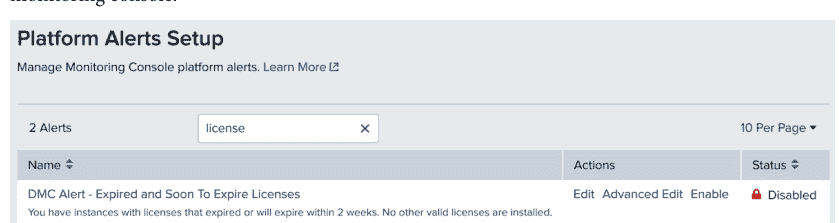
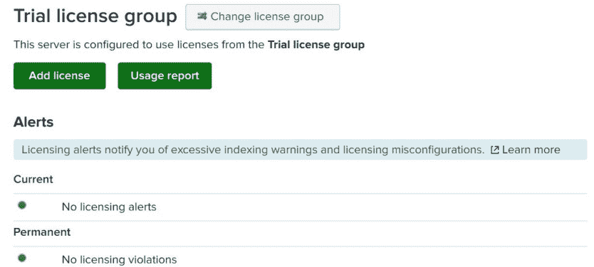
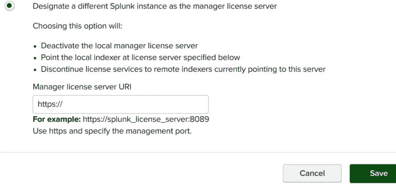
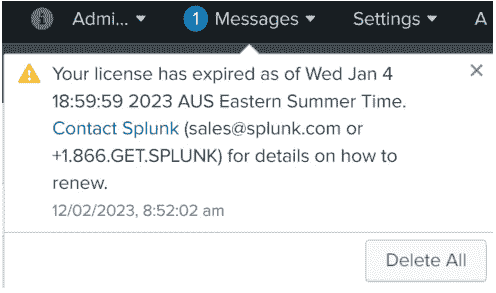
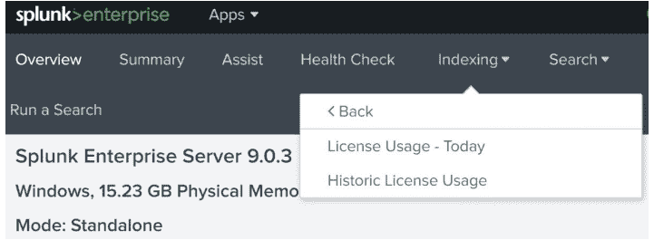

# Splunk 许可证管理

Splunk 系统管理员的关键职责之一是许可证管理。当你首次安装 Splunk Enterprise 时，无论是个人使用还是商业使用，都需要配置许可证以启用其功能；否则，其默认许可证的有效期将在 60 天后到期。到本章结束时，你应该了解许可证类型、安装、Splunk 许可的工作方式、许可证分配和许可证违规，最后我们将介绍监控控制台中的许可证使用报告。

本章的总体目标是让你熟悉 Splunk 许可，以便你能够选择正确的许可证类型，如果你拥有多种类型，可以堆叠许可证文件，并配置和分配正确的容量给对等节点。在本章中，我们将涵盖以下主题：

- 介绍许可证类型
- 理解许可证警告和违规
- 许可如何运作
- 安装、管理和监控许可证

## 介绍许可证类型

在直接进入类型主题之前，让我们讨论一下许可证的需求。Splunk Enterprise 是付费专有软件，为需要符合其业务目标的数据平台的组织提供服务。Splunk 以许可证的形式向组织销售这些服务，以激活 Splunk Enterprise 产品。如果你在选择适合你的用例的正确许可证时需要帮助，可以联系 Splunk 销售团队（sales@splunk.com）。

我们将在以下部分讨论 Splunk 许可证的类型。


## Splunk Enterprise 试用许可证

首次安装 Splunk Enterprise 时，默认启用试用许可证。试用许可证具有以下特性：

- 它仅在 60 天内有效。超过此期限后，必须选择其他许可证类型才能继续使用该产品。
- 它允许您使用 Splunk Enterprise 的全部功能。
- 它仅适用于单个/独立的 Splunk Enterprise 实例。
- 该许可证将每日数据摄入量限制为 500 MB。超过此限制，Splunk 将发出许可证警告。*理解许可证警告和违规*一节详细解释了许可证违规。

## Splunk 免费许可证

免费许可证永久有效，并且仅支持 Splunk Enterprise 功能的子集：

- 它禁用告警、身份验证、集群、分布式搜索、摘要以及向非 Splunk 服务器的转发。
- 每日数据摄入限制为 500 MB。许可证违规会阻止搜索功能。下一节*理解许可证警告和违规*将提供更多详细信息。
- 它仅适用于单个/独立的 Splunk 实例。

## 转发器许可证

Splunk 提供多种转发器。最常用的是**通用转发器（UF）**和**重型转发器（HF）**。让我们看看该许可证如何应用于这两种主要的转发器类型：

- UF 默认已嵌入许可证，因此无需显式安装/配置许可证。
- UF 是独立的二进制软件，消耗的资源比 HF 少。UF 可以将数据通过身份验证转发到索引器。
- HF 是一个完整的 Splunk Enterprise 实例二进制文件，需要转发器许可证或 Enterprise 许可证。
- 转发器许可证默认嵌入在 Splunk Enterprise 软件包中。
- 带有转发器许可证的 HF 不允许进行索引。但是，允许进行身份验证。
- 需要索引、高级身份验证和 KV Store 的 HF 需要 Enterprise 许可证。

开发者许可证纯粹面向应用程序开发者，并启用 Splunk Enterprise 的所有功能。每个许可证都会强制执行限制——例如，许可证受限于天数、数据量、vCPU 数量等。下一节将详细说明许可证警告的产生、如何转变为违规，以及随后详细介绍 Splunk Enterprise 针对每种许可证类型限制的具体功能。

## 理解许可证警告和违规

如果系统管理员希望维护平台的连续性，那么理解许可证限制及其对 Splunk Enterprise 平台的影响非常重要。许可证类型（无论是从 Splunk 购买的还是免费的）都会强制执行限制，但基础设施许可证除外，它计算 vCPU 的数量，并且不强制执行许可证违规限制。其余许可证类型对每日数据量或索引数据量强制执行限制。

如果许可证超出了每日允许的数据量，Splunk Enterprise 将发出许可证警告。当警告数量超过某个阈值时，即称为许可证违规。每种许可证类型的阈值都不同。许可证违规会禁用 Splunk Enterprise 的重要功能。

许可证警告会出现在 Splunk Web 的管理消息中。它们会保留数天，以便系统管理员解决。可以在监控控制台中启用许可证使用情况告警。



图 2.1：监控控制台告警——许可证使用情况和到期时间

图 2.1 显示了您在监控控制台中可能收到的告警。这些告警默认处于禁用状态；您可以启用它们，并了解当使用量接近每日配额和/或许可证即将到期时它们的工作方式。

许可证违规会禁用重要的 Splunk 功能，这意味着在违规期间只有部分功能可用。让我们看看在违规期间搜索和索引会发生什么：

- 搜索功能（包括报表和告警）将被阻止，但内部索引除外，例如 _internal、_audit 和 _introspection
- 索引器将继续对数据进行索引

下面讨论每种许可证类型的警告和违规阈值：

- **Splunk Enterprise 试用许可证：** 在滚动 30 天周期内出现 5 次或以上警告即构成违规。许可证警告会保留 14 天。在违规期间，搜索会被阻止，索引会继续。如果您希望修复许可证违规以恢复搜索功能，没有重置选项。建议的方法是重新安装整个 Splunk Enterprise 实例。
- **Splunk 免费许可证：** 在滚动 30 天周期内出现 3 次或以上警告即构成违规。许可证警告会保留 14 天。在违规期间，搜索会被阻止，索引会继续。与试用许可证类似，免费许可证无法重置，重新安装是唯一的选择。
- **Splunk Enterprise 许可证：** 每日数据量为 100 GB 或以上的许可证堆栈不会强制执行许可证警告和违规。每日数据量低于 100 GB 的许可证堆栈会发出许可证警告。在滚动 60 天周期内出现 45 次或以上警告即构成违规，此时搜索会被阻止，而索引会继续。要重置 Enterprise 许可证，请联系 Splunk 销售团队；他们将能够解锁所需的搜索功能。
- **Splunk Enterprise 基础设施许可证：** 此许可证类型不会产生违规。
- **Splunk 开发者许可证：** 在滚动 30 天周期内出现 5 次或以上警告即构成违规。许可证警告会保留 14 天。在违规期间，搜索会被阻止，索引会继续。开发者许可证可以通过联系 Splunk 开发者计划团队（devinfo@splunk.com）进行重置以解锁搜索功能。
- **Splunk 转发器许可证：** 转发器许可证不适用任何违规规则。它是 Splunk Enterprise 软件包中的嵌入式许可证。在转发器许可证上进行索引需要 Enterprise 许可证或基础设施许可证。

总之，Splunk 许可证警告会提前告知管理员整体许可证使用情况，以便他们在违规发生之前采取必要的行动。在一段时间内，警告序列超过规定阈值将导致违规。在违规期间，除内部索引外，搜索会被阻止，索引会继续。超过 100 GB 的 Enterprise 堆栈许可证和 Enterprise 基础设施许可证都不会强制执行违规，但其余许可证类型会强制执行违规规则。除免费许可证和试用许可证外，违规的许可证可以重置。

我们已经介绍了很多关于许可证警告和违规的信息；不过，您可能想知道 Splunk Enterprise 在哪个阶段跟踪许可证使用情况，以及在分布式部署架构中哪个组件跟踪使用情况。接下来的两节将重点介绍许可证管理器组件中的许可证安装，我们将详细讨论许可证在许可证使用量计算方面究竟是如何工作的。

## 许可证的工作原理

Splunk Enterprise 许可证按许可证堆栈或单个池跟踪每天的索引数据量。要深入了解许可证组、堆栈和池，请参阅 Splunk 文档：

`https://docs.splunk.com/Documentation/Splunk/9.0.3/Admin/`

组、堆栈、池和其他术语。本文档的内容将在下一节“安装、管理和监控许可证”中介绍。

在分布式基础架构中，一个专用的 Splunk Enterprise 实例将被分配许可证管理器角色，负责跟踪整个部署的许可证使用情况。其余实例充当许可证对等节点，向管理器报告。

许可证配额每天从午夜到午夜进行计量，这意味着它会重置为次日的完整配额，这是一个与管理器系统时钟协同工作的持续过程。Splunk 支持两种类型的索引，称为事件索引和指标索引。它们将在第 5 章“Splunk 索引管理”中介绍。对于指标索引，许可证使用量计算上限为每个指标事件固定 150 字节；对于事件索引，则按事件的完整数据大小计算。

来自源头的原始数据在被索引到索引器之前会经历多个阶段。数据大小在索引阶段进行计量。各阶段将在第 8 章“数据接入”中解释。到目前为止，我们讨论了从外部源索引数据。每个正在运行的 Splunk Enterprise 实例本地都会生成大量数据。这些数据存储在以 _（下划线）开头的内部索引中，即 _internal、_audit、_introspection、_metrics 和 _telemetry。

让我们看看哪些数据不计入许可证配额：

- Splunk 内部日志不计入
- 为高可用性而存储在索引器集群中的复制副本
- 具有 stash 源类型的摘要索引
- 已索引的数据，因为它包含 tsidx 文件、元数据等，以实现更快的检索

总之，许可证配额每天从午夜到午夜进行计量。数据大小在索引阶段计算。指标索引数据上限为每个事件 150 字节，事件索引数据则根据事件的完整大小计算。内部日志、摘要索引和复制数据不计入许可证。在分布式部署中，专用实例充当许可证管理器，在其中安装和配置许可证文件；其余实例充当许可证对等节点，并向许可证管理器报告。

## 安装、管理和监控许可证

既然您已经全面了解了许可证类型以及许可证使用量如何根据许可证配额进行计算，我们将讨论添加、配置和管理许可证。作为系统管理员，这些任务非常重要。我们将以 Splunk Enterprise 许可证类型为例，讨论以下主题：

- 添加许可证
- 许可证堆叠和池


- License manager and license peer
- License usage and alerting

让我们在以下各节中详细讨论这些内容。

## 添加许可证

Splunk Enterprise 许可证是一个文件，其扩展名为 .license，通常从 Splunk 购买。以下步骤也适用于其他类型的许可证，例如开发者许可证。

许可证文件可以通过以下两种方法之一添加到 Splunk：

- 在 Splunk Web 主页（https://<hostname>:8000）上，转到窗口右上角的菜单并导航到 Settings | Licensing。点击 Add license 按钮，在下一个屏幕上，选择 Choose File 上传从 Splunk 销售处获得的 .license 文件。然后，点击 Install 按钮。此时，您需要重启 Splunk 实例。以下截图显示了许可 Web 页面，您可以看到用于上传许可证文件的 Add license 按钮。

  

  Figure 2.2: The Licensing web page

- 第二种方法是 在 Splunk 实例运行的主机上执行 CLI 命令。您应具有 Splunk 许可证管理器已安装的主机的访问和执行权限。成功执行命令后需要重启：

  ```
  splunk add licenses <path_to_license_file_required>
  ```

Figure 2.4: The license group, stack, and pool layering

## 许可证堆栈

许可证堆栈包含一个或多个相关许可证，其许可证配额可以相加，共同计入每天允许的数据量。

例如，初始购买的 50 GB 企业许可证可以与后来购买的 40 GB 许可证堆叠在一起，共同允许每天 90 GB 的索引量。让我们来看一下堆叠许可证时需要记住的关键点：

- Enterprise licenses and sales licenses can be stacked together
- A license that is already part of one stack cannot be part of another stack
- License warnings and violations will be raised against stacks and pools

## 许可证池

许可证池是堆栈许可证量的一个部分，可以分配给不同的索引器。它允许对许可证分配进行精细控制。

例如，总共需要为开发和生产索引器分配 100 GB 的许可证量。然而，开发环境可能会因为

在 Adding a license 部分，我们学习了如何在充当许可证存储库的 Splunk 实例上安装许可证，该实例称为许可证管理器。登录已安装许可证的许可证管理器，转到窗口右上角，然后转到 Settings | Licensing。参考 Figure 2.5 查看许可 Web 页面，其中包含有关许可证、容量、到期时间和许可证池的信息。在分布式部署中，其他 Splunk 实例称为许可证对等体。所有对等体都需要指向许可证管理器实例以获取许可证信息。

要配置许可证对等体，请登录分布式部署中的剩余实例，例如搜索头、索引器和转发器，并将它们指向许可证管理器。登录到各个实例的 Web 界面并通过 Settings | Licensing 导航，如 Figure 2.2 所示，然后点击 Change to Peer 按钮，该按钮显示两个单选按钮选项，Designate this Splunk instance <instance_name> as the manager license server 和 Designate a different Splunk instance as the manager license server。如 Figure 2.6 所示，选择第二个选项，这将显示一个文本框供您输入管理器许可证服务器 URI 及其管理端口（8089）。输入管理器许可证服务器 URI 并点击 Save 按钮以将许可证对等体连接到许可证管理器。



Figure 2.6: Configuring a license peer with the license manager URI

下图显示了 Messages 部分，其中 Splunk Web 中会出现许可证警告和违规消息。许可证警告和违规消息会出现在许可证管理器的 Splunk Web 主页的 Messages 菜单栏中。



Figure 2.7: License warnings in Splunk Web

如果许可证对等体无法访问许可证管理器，则在对等体被判定为许可证违规之前会有 72 小时的宽限期。在此情况下，搜索功能将被阻止，但索引会继续进行，直到对等体恢复与管理器实例的连接。

## 许可证使用和警报

监控控制台默认包含在 Splunk Enterprise 软件中。但是，它必须在独立或分布式模式下进行配置以使用。配置监控控制台不在本书的讨论范围之内，但是，如果您想探索该主题，我建议您遵循 Splunk 文档（https://tinyurl.com/msxtcmkj）。要访问监控控制台应用程序，请登录独立 Splunk 实例的 Web 界面并通过 Settings 菜单导航，然后点击菜单项左侧的 Monitoring Console 选项。它提供了两个可视化仪表板，可以在监控控制台的 Indexing | License Usage 菜单中找到。

Figure 2.8 显示了 Indexing 菜单下的两个仪表板。License Usage - Today 仪表板显示了今日许可证使用的全面详细信息。要检查过去的使用情况，请打开 Historic License Usage 仪表板。



Figure 2.8: License usage dashboards in the monitoring console

同样，监控控制台包含两个用于许可证使用跟踪的警报。参考 Figure 2.1 了解警报详情。警报默认处于禁用状态。要监控许可证使用信息，必须手动启用警报，以便在许可证到期 2 周时发送通知，以及当每日许可证配额超过 90% 时。通知消息会出现在 Splunk Web 主页的 **Messages** 菜单栏中。

在 Splunk Web 主页上记录警告和违规警报的还有一个地方——在 **Settings | Licensing** 菜单下（参考 Figure 2.2）。在此处触发的警报将对当前或永久许可证违规的池和堆栈提供更精细的可视性。

总之，许可证可以通过 Splunk Web、Splunk CLI 或配置文件安装。许可证管理器是所有许可证的存储库，其余 Splunk 实例向管理器报告并称为许可证对等体。如果许可证对等体无法报告 72 小时，它将被判定为许可证违规，其搜索功能将被阻止（尽管索引继续进行），直到它重新连接到许可证管理器实例。

许可证组、堆栈和池有助于在安装多个许可证时有效管理许可证，并将一部分容量分配给特定索引器。任何时候只有一个许可证组处于活动状态。只有某些类型的许可证可以堆叠——例如，企业许可证和销售许可证可以堆叠，但基础设施许可证不能与企业许可证堆叠。监控控制台提供许可证使用报告和警报以跟踪使用情况。警报默认处于禁用状态。许可证警告和违规消息会出现在 Splunk Web 的两个位置——一个是在 Splunk Web 主页的 **Messages** 栏中，另一个是在 **Settings | Licensing** 下。

在 Summary 部分之后，有一些练习考试题目涵盖了我们迄今为止学到的主题。

## 总结

我们已经结束了许可证管理章节的学习，该章节非常全面。许可原生于 Splunk Enterprise，其命名约定需要一些时间来消化。

我们首先介绍了 Splunk 提供的许可类型，然后探讨了它们之间的差异，以检查不同许可证对不同部署选项的适用性。Splunk 提供 Enterprise Free 和 Trial 许可证以及具有某些限制的开发者许可证。要启用 Splunk Enterprise 的所有功能，您需要一个有效的许可证文件。如果许可证超出其限制使用，将会发出许可证警告，并在发出一定数量的警告后，许可证将被视为违规。基础设施许可证没有违规，企业许可证的配额为 100 GB 或更多。许可证违规会阻止重要功能，例如搜索，但索引会继续进行。Free 和 Trial 许可证无法从违规状态重置，但其他许可证可以通过联系 Splunk Sales 重置。


