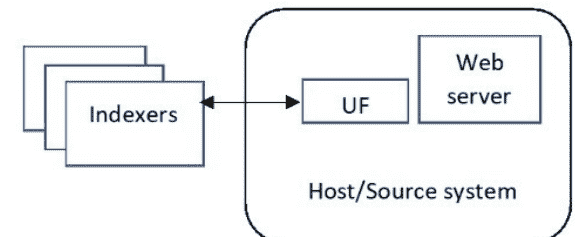
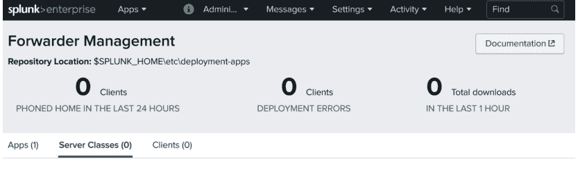
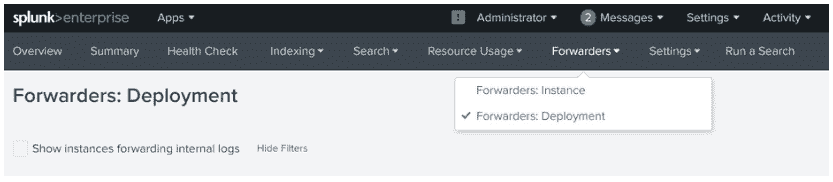

## Splunk Forwarder 管理

*forwarder* 名称在此时应该很熟悉，因为您已经阅读过两种类型的 forwarder：**通用 forwarder（UF）** 和 **重型 forwarder（HF）**。它们是为特定用例构建的两种不同的软件二进制文件。在本章中，您将了解更多关于 UFs 的信息，它们在大规模和复杂的 Splunk Enterprise 环境中通过 **部署服务器（DS）** 集中管理。

我们将首先了解 UFs 在整体 Splunk 部署架构中的目的，然后配置 DS，以及 UF 的安装和配置。配置包括将 UF 连接到外部索引器以转发数据，并使用 `deploymentclient.conf` 配置来从 DS 下载应用程序。最后，您将通过监控控制台应用程序了解监控转发器。

本章不仅对系统管理员很重要，对数据管理员也很重要。它涉及两种类型管理员之间的共同责任，包括安装 UF、DS 和索引器连接配置，这些都是数据管理员创建转发器上必要的数据输入以将数据摄取到索引器的先决条件。

在本章中，我们将涵盖以下主题：

- 介绍通用 forwarder
- 配置部署服务器
- 安装通用 forwarder
- 在通用 forwarder 上配置转发
- 配置 `deploymentclient`
- Forwarder 监控



图 4.1：源主机中的 UF 存在

在前面的图中，UF 安装在运行 Web 服务器的主机上。UF 旨在读取 Web 服务器日志并将其转发到索引器。

让我们通过 DS 的配置，然后安装和配置 UF。

## 配置部署服务器

DS 顾名思义，集中管理对转发器的部署。它可以部署到 UFs 和 HFs，并且在应用程序部署后可以选择性地重新启动它们。在本节中，您将了解 DS 的功能以及管理转发器所需的配置。

让我们回顾一下 DS 设置要求：

- DS 是 Splunk Enterprise 软件的实例，需要 Splunk Enterprise 许可证。
- 转发器，无论是 UFs 还是 HFs，都需要配置 deploymentclient.conf 文件以与 Splunk DS 建立连接。此配置文件使转发器能够“回拨”并与 DS 通信。通过手动编辑 deploymentclient.conf 文件或使用 Splunk CLI，转发器可以与 DS 建立所需的连接。
- 用于管理服务器类的 serverclass.conf 配置文件可以通过导航到设置 | 转发器管理菜单的 Splunk Web 界面进行设置。Splunk DS 上 serverclass.conf 文件的典型位置是 $SPLUNK_HOME/etc/system/local。有关 Splunk Web 界面的更多详细信息，请参阅图 4.2 和 4.3。
- Splunk 应用程序/插件可以按照 Splunk 应用程序结构自定义构建，也可以从 splunkbase.com 下载，在那里有数百个预构建的应用程序/插件。
- 需要部署到转发器的应用程序/插件放置在 `$SPLUNK_HOME/etc/deployment-apps` 目录中。
- 通过 DS 部署的应用程序存储在转发器客户端的 `$SPLUNK_HOME/etc/apps` 目录中。

让我们在下一节中查看 `serverclass` 的配置。

## 配置 serverclass

要通过 Splunk Web 转发器管理方法配置 DS，至少必须将一个应用程序复制到 `$SPLUNK_HOME/etc/deployment-apps` 目录；您可以从 splunkbase.com 下载任何示例应用程序。使用您的 Splunk 帐户登录 splunkbase.com 以下载应用程序。

复制应用程序到 `deployment-apps` 目录后，请按照以下步骤操作：

1. 复制应用程序后，以管理员身份登录 Splunk Web 并导航到 **设置 | 转发器管理**：



图 4.2：Splunk Web – 转发器管理

2. *图 4.2* 显示 **转发器管理** 和三个选项卡：**应用程序**、**服务器类** 和 **客户端**。第一次访问此区域时，不会存在服务器类（正如选项卡名称后的零所示），因此单击 **create one** 链接。
3. 该链接将带您进入一个页面，您可以在其中输入类的名称并选择要映射应用程序以进行部署的应用程序和客户端。*图 4.3* 显示了两个服务器类，**AppsForLinux** 和 **AppsForWindows**，并且 **应用程序** 计数为每个显示 **1**：


```text
# Deploying Windows App to matching IP address 10.9.8.*
# and reloads client after installation
# and restarts if necessary
[serverClass:AppsForWindows]
whitelist.0=10.9.8.*
issueReload=true
restartIfNeeded=true

# App 'Windows_App' mapping to serverClass defined
[serverClass:AppsForWindows:app:Windows_App]
```

根据特定类别转发器客户端需要添加或排除的应用，通常需要对 serverclass 进行更改。当组织内部署任何新的转发器客户端时，可能需要进行集中管理，这要求调整转发器的主机名、DNS 或 IP 地址，同时安装新的应用或转发器插件。这些是一些众所周知的场景，还可能出现许多类似的情况。

在此阶段，DS 已准备好接受来自转发器或部署客户端的传入连接。在下一节中，我们将安装 UF 并配置 deploymentclient.conf 文件。

## 安装通用转发器

UF 的安装步骤因操作系统而异，UF 软件包也会根据操作系统和计算架构的不同而有所差异。在本节中，您将看到仅适用于 Windows 和 Linux 的 UF 安装说明。

要查看按操作系统分类的 UF 软件包列表，请访问 https://www.splunk.com/en_us/download/universal-forwarder.html。

在直接开始安装之前，Splunk 建议检查硬件先决条件。以下 CPU、内存和磁盘要求适用于所有操作系统上的 UF 8.2.x 至 9.x：

- **CPU**：1.5 GHz 时钟速度
- **主内存**：512 MB
- **磁盘**：5 GB 空间

让我们来看看 Windows 的安装说明。

### 在 Windows 操作系统中安装

为了演示，我已从上述下载链接下载了与 Windows 11 64 位架构兼容的 .msi 转发器包。该包可以通过命令行/PowerShell、交互式图形用户界面（GUI）方式安装，或者如果 Windows 机器已启用用户帐户控制，也可以通过静默方式安装。



图 4.6：转发器监控仪表板

如果 UF 和 DS 的设置（包括 deploymentclient 配置）已正确完成，15 分钟后，您将能够看到 Forwarders: Instance 和 Forwarders: Deployment 仪表板面板已填充正确的详细信息，例如按状态统计的转发器、转发器数量以及随时间变化的转发器连接数等。

## 总结

总而言之，Splunk UF 是一个不需要任何许可证的软件二进制文件，通常安装在源系统上。UF 轻量级且消耗较少的资源。UF 监控数据并将其转发到索引器进行索引，并使用 fishbucket 概念仅读取文件中的数据一次。诸如 CSV、XML、JSON 等结构化数据可以使用 INDEXED_EXTRACTIONS 进行解析。UF 上的转发在 outputs.conf 文件中配置，该文件包含索引器主机和管理端口详细信息。

UF 可以安装在各受支持的操作系统和硬件规格上；我们已经了解了它在 Windows（通过交互式 GUI）和 Linux（通过 CLI/静默模式）上的安装。默认情况下，UF 安装在 Linux 环境中的 /opt/splunkforwarder/ 目录下，该目录通过 $SPLUNK_HOME 环境变量引用。

之后，我们探讨了 DS，它是一个 Splunk Enterprise 实例，用于管理大型 Splunk 环境中的众多转发器。应用存储在 $SPLUNK_HOME/etc/deployment-apps 中，DS 的位置和 serverclass.conf 文件包含应用与部署客户端（即转发器）的映射关系。部署到客户端的应用通常存储在 $SPLUNK_HOME/etc/apps 目录中。要从 DS 获取应用，转发器需要 deploymentclient.conf 文件，其中包含 DS 主机和端口详细信息。成功连接到 DS 后，默认情况下，客户端每 60 秒回连一次。

最后，我们了解了 MC 应用中的转发器管理，它基于 UF 和 DS 的内部日志提供仪表板。默认情况下，转发器管理处于禁用状态，可以在分布式 Splunk 架构中专用于 MC 应用的 Splunk 实例上启用。在下一章中，我们将详细了解 Splunk 配置文件。

在下一节中，将为您提供一些问题和答案，以测试您对本章知识的掌握情况。

5. 哪个文件包含转发器上的 DS 详细信息，以帮助建立与 DS 的连接？

- A. `server.conf`。
- B. `web.conf`。
- C. `deploymentclient.conf`。
- D. `serverclass.conf`。

6. 转发器是否需要与索引器建立连接？如果是，哪些说法是正确的？

- A. 不需要；转发器独立运行，不需要与索引器建立连接。
- B. 需要；转发器需要与索引器建立网络连接以发送数据。
- C. 需要；通过 `outputs.conf` 文件在转发器上启用转发以进行索引。
- D. 需要；转发器通过默认的 9997 接收端口将数据发送到索引器。

7. 关于 UF 和 HF，哪个说法是正确的？

- A. HF 无法连接到 DS。
- B. UF 仅兼容与 DS 配合使用。
- C. HF 和 UF 都能够连接到 DS 并获取最新的应用。
- D. 通过 `restartSplunkd` 设置进行更改后，可以通过 DS 重新启动转发器。

8. 监控转发器的方法有哪些？（选择所有适用的选项）

- A. 通过编写脚本轮询管理端口 8089。
- B. 通过 Splunk Web 中的**转发器管理**。
- C. 通过 MC 应用。
- D. 通过 DS 和转发器内部日志。

9. 转发器上默认的“回连”内部设置是什么？

- A. 60 分钟。
- B. 60 秒。
- C. 300 秒。
- D. 600 秒。

10. 如果您有一个专用于 Linux 转发器的应用，并且需要阻止 Windows 转发器获取它，您应该在 serverclass.conf 中选择哪些设置？

- A. 允许/拒绝设置。
- B. 白名单/黑名单。
- C. 在同一个服务器类中，对 Linux 主机使用白名单，对 Windows 主机使用黑名单。
- D. 无需操作——转发器足够智能，能够自行选择正确的应用。

希望您在回答这些问题的过程中能够回忆起我们所讨论的主题。我们将在下一节中回顾答案。

## 答案回顾

以下是本章问题的答案：

- **1.** 错误——UF 无法存储、搜索和索引数据。它也没有任何用户界面可供配置。
- **2.** 选项 A 和 C 是正确答案。默认情况下，UF 附带嵌入式许可证，因此无需额外许可证。UF 可以通过在本地 props.conf 中设置 INDEXED_EXTRACTIONS 来解析结构化数据。UF 将利用包含查找指针的 fishbucket 索引，从文件的最后读取位置继续读取。
- **3.** 选项 A 和 B 是正确答案。默认情况下，DS 在所有 Splunk 实例上启用。应用存储在 $SPLUNK_HOME/etc/deployment-apps 中。DS 和转发器始终需要连接，并按照定义的间隔进行通信。
- **4.** 选项 B 正确。serverclass.conf 是包含应用与转发器客户端映射以及其他设置（如白名单、黑名单、restartSplunkd 等）的文件。
- **5.** 选项 C 正确。deploymentclient.conf 是包含 DS 主机和端口详细信息以建立连接的文件。
- **6.** 选项 B、C 和 D 是正确答案。
- **7.** 选项 C 和 D 是正确答案。UF 和 HF 都可以通过 DS 进行管理。restartSplunkd 设置有助于在部署应用后重新启动远程转发器。
- **8.** 选项 B、C 和 D 是正确答案。转发器和 DS 的内部日志用于 MC 应用仪表板。
- **9.** 选项 B 正确。60 秒是默认的回连间隔。
- **10.** 选项 C 正确。在这种情况下，白名单和黑名单是两个有用的设置。


