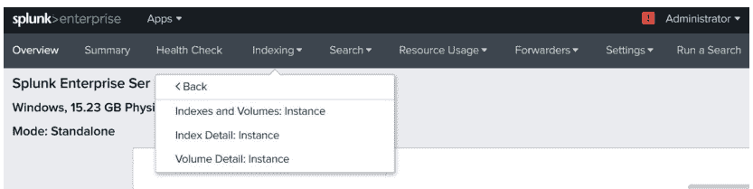

## 理解 Splunk 索引

索引是 Splunk Enterprise 内部一种特定类型的数据存储；换句话说，简单来说，索引就是数据的存储库。例如，你在网上表单中搜索自己的地址并输入地址详情：你提供门牌号、街道和邮政编码，这些信息对你来说是唯一的。类似地，如果你想在 Splunk 中搜索特定数据，可以通过使用其索引来找到它。

Splunk 索引有两种类型，分别称为**事件**索引和**指标**索引。事件索引存储任何类型的文本数据，这是默认的索引类型。指标索引只存储必须符合特定结构的指标数据。Splunk 中有一些专门用于处理指标数据的特殊命令，通常以 `m` 开头，例如 `mstats`、`mpreview` 和 `mcatalog`。指标索引是一个完全不同的主题，超出了本书的范围。如果你想了解更多相关信息，请访问 https://tinyurl.com/5n8jb6c。在本章中，我们将重点关注事件索引。从现在开始，如果没有明确说明索引类型，请假定它是事件索引。

Splunk 允许你创建自己的索引，同时它也会附带一些事件索引，每个都有特定的用途。让我们来看看这些索引：

- `main`：如果没有在外部输入源中指定索引，则这是 Splunk 的默认索引。
- `summary`：用于存储摘要数据的默认摘要索引。
- `_internal`：存储来自各种内部源的 Splunk 内部日志，例如 splunkd 守护进程日志、Web 访问日志、调度器日志、Python 日志等。
- `_audit`：存储 Splunk 内部审计日志，例如登录、搜索、数据访问和管理活动。
- `_introspection`：存储 Splunk 资源消耗和性能数据。监控控制台应用仪表板高度依赖此索引。
- `_fishbucket`：存储文件监控输入源的检查点信息。
- `_telemetry`：如果通过 `telemetry.conf` 启用了检测信息，则存储这些信息。

创建 Splunk 索引的方法不止一种，具体取决于 Splunk 部署架构的类型。无论采用哪种方法，都需要在索引器中配置 `indexes.conf` 文件。

索引器是 Splunk Enterprise 的一个实例，负责在将传入数据存储到索引中之前进行处理，并响应由搜索头发出的搜索查询。在前面的章节中，我们已经简要概述了 Splunk 组件，例如索引器和搜索头。

让我们来看一下索引的重要特性：

- Splunk 允许管理员根据需要和需求创建自定义索引，以存储和组织特定类型的数据。
- 每个索引都有数据大小和保留时间的限制。要查看配置设置，请参阅 `$SPLUNK_HOME/etc/system/default` 目录中 `_internal` 索引的 indexes.conf 定义。
- 索引以压缩格式包含最初接收的数据，这称为原始数据。它们还包含称为 tsidx 文件的索引文件和元数据文件。
- 索引以桶的形式在文件系统上组织数据。
- 索引默认存储在 `$SPLUNK_HOME/var/lib/splunk`。该路径通过 `$SPLUNK_DB` 环境变量引用。
- 一旦数据写入索引，它就是最终的，不能被修改。
- 具有 can_delete 角色的授权用户可以发出 delete 命令，以防止数据参与搜索。此命令会对数据应用删除标记。这意味着它不会永久从存储中删除数据。要永久删除事件数据，请谨慎执行 splunk clean 命令。
- 索引的隔离取决于数据大小、数据保留策略、访问策略以及其中存储的数据类型。

我希望你现在对索引有了足够的了解。在下一节中，我们将介绍 Splunk 如何以桶的形式组织数据。

## 理解桶

桶是索引不可分割的一部分；它们包含原始数据和索引文件。它们以文件夹的形式组织在文件系统上，并具有特定的命名模式。这些文件夹由 Splunk 索引器专门用于数据存储和搜索处理。

为了进一步了解它们，让我们看看默认的 _introspection 索引文件夹结构：

```
C:\Program Files\Splunk\var\lib\splunk\_introspection>tree
Folder PATH listing for volume Windows
Volume serial number is 6676-C13F
C:.
├── colddb
├── datamodel_summary
├── db
│   ├── db_1663851317_1661686760_13
│   │   └── rawdata
│   ├── GlobalMetaData
│   └── hot_v1_14
│       └── rawdata
└── thaweddb
```

图 5.1：Splunk 非集群索引文件夹结构

我们现在已经了解了事件索引桶。数据会根据情况从热桶滚动到暖桶、冷桶、冻结桶和解冻桶。既然你已经熟悉了索引及其内部结构，让我们继续学习索引的创建。

## 创建 Splunk 索引

创建自定义索引是 Splunk 管理员的责任。如你所见，数据会一直保留在索引中，直到数据达到一定年龄或索引达到一定大小，因此在创建索引之前估算索引大小是关键的一步。准确的估算可以确保数据保留所需的时间，同时也有助于提前确定所需的存储容量。

为了估算索引的大小，我们必须知道以下问题的答案：

- *问题：* 数据需要保留多少天？
  *答案：* 例如，100 天
- *问题：* 每天预计有多少 GB 的数据量？
  *答案：* 例如，1 GB

索引大小估算公式如下：

*保留天数 X 每日数据量 X 1/2（原始数据压缩 + 索引文件）*

如果我们将示例值代入，索引大小变为 100 X 1 X ½ = 50 GB。

既然你已经知道如何估算索引大小并决定为其命名，让我们来看看索引创建过程。

在“*理解桶*”一节中，我们看到 `$SPLUNK_HOME/etc/system/default` 目录中的 `indexes.conf` 文件有一个 `_introspection` 索引的条目。类似地，Splunk 自带许多内部索引，你可以在同一文件中找到。Splunk 允许我们创建自定义索引，而且创建索引的方法不止一种，这完全取决于部署架构的类型。通常，管理员会选择最合适的方法。在本节中，我们选择了一个单独的 Splunk 实例，它同时充当搜索头和索引器。让我们来看看创建事件索引的不同方法。

## Splunk Web

以管理员身份登录 Splunk Web。转到右上角的**设置**菜单，单击**索引**。打开页面后，右上角会出现一个**新建索引**按钮。在同一页面上，你可以看到默认索引以 `_` 开头，例如 `_internal` 和 `_audit`。

如果你希望查看某个默认索引的配置，请单击该索引名称。否则，请单击**新建索引**按钮并填写**索引名称**和**整个索引的最大大小**字段，继续创建新索引。默认的**索引数据类型**设置为**事件**。指标应该

- **参数：** homePath、coldPath、thawedPath、app 等
- **示例：** $SPLUNK_HOME\bin\splunk add index windows-event-logs -app search

CLI 和 Splunk Web 两种方式都会写入文件系统上的 indexes.conf 文件。如果你熟悉 indexes.conf 规范，那么直接创建 indexes.conf 文件也能达到同样的目的。

## indexes.conf 详解

让我们深入了解一下我们通过 Splunk Web 创建的 windows-event-logs 索引对应的 indexes.conf 文件。正如我们在 Splunk Web 一节中所了解的，该索引默认保存到名为 search 的 Search & Reporting 应用文件夹中，因此我可以在 $SPLUNK_HOME/etc/apps/search/local 找到它：

```
[windows-event-logs]
coldPath = $SPLUNK_DB\windows-event-logs\colddb
enableDataIntegrityControl = 0
enableTsidxReduction = 0
homePath = $SPLUNK_DB\windows-event-logs\db
maxTotalDataSizeMB = 500
thawedPath = $SPLUNK_DB\windows-event-logs\thaweddb
```

这种方法的一个优点是，可以为高级索引配置设置一系列选项。但是，通过这种基于文件的方式创建新索引需要重启 Splunk 实例。

有多种方法可以控制数据大小，从桶目录级别到整个索引大小。让我们看看以下高级选项以及需要备份的内容：

- homePath.maxDataSizeMB 限制 homePath 目录中热桶和暖桶的大小。
- coldPath.maxDataSizeMB 限制 coldPath 目录中冷桶的大小。
- 要限制可创建的热桶和暖桶数量，请分别设置 maxHotBuckets 和 maxWarmDBCount。对于高容量索引（索引数据量超过 10 GB/天），Splunk 建议将 maxHotBuckets 从默认值 3 增加到 10。
- 默认情况下，Splunk 通过 maxDataSize = auto 将热桶大小限制为 750 MB；如果每天索引大小估算为 10 GB，请将此选项设置为 maxDataSize = auto_high_volume，以便 Splunk 在 64 位系统上创建 10 GB 的热桶。使用此选项是为了避免为大型索引创建过多的小桶。过多的小桶会影响 Splunk 的性能。热桶一旦达到最大大小，就会滚动为暖桶，然后会创建新的热桶。


- `maxTotalDataSizeMB` 是总索引大小限制。如果查看示例索引 `windows-event-logs`，我们已将此值设置为 500 MB。
- 全局设置适用于 `indexes.conf` 中指定的每个索引。完整列表请参考 Splunk 文档中的 `indexes.conf.spec` 文件。在全局级别，可以配置 `lastChanceIndex` 选项。它作为任何未指明有效索引的外部输入的最终选项。如果此值留空，Splunk 将简单地丢弃这些事件。

如果移动到冷存储桶的数据搜索频率不高，因此分配与热/温存储桶类似的昂贵硬件存储就不具成本效益怎么办？Splunk 建议对热/温存储桶使用低延迟高吞吐量的存储，因为它们保存的是经常被搜索的最新数据。冷存储桶可以驻留在标准延迟存储上，该存储速度慢且便宜。为实现此目的，可以使用卷来配置索引。让我们在下一节中查看卷。

## 索引卷

卷是文件系统上的特定目录，分配给索引以有效管理存储空间。让我们看一下在 UNIX 基于的操作系统上为我们在上一节中通过 Splunk Web 创建的 `windows-event-logs` 索引的卷配置：

```
[volume:hot_storage]
path = /mnt/fast_disk
# Optional limits the volume size to 60 GB
maxVolumeDataSizeMB = 61440

[volume:cold_storage]
path = /mnt/slow_disk
#Optional limits the volume size to 50 GB
maxVolumeDataSizeMB = 51200

#index definition
[windows-event-logs]
homePath = volume:hot_storage/windows-event-logs
coldPath = volume:cold_storage/windows-event-logs
maxTotalDataSizeMB = 51200
thawedPath = $SPLUNK_DB/windows-event-logs/thawedDb
```

此配置在 `homePath` 和 `coldPath` 中包含 `volume` 关键字。`thawedPath` 设置为标准位置，因为它不能位于卷上。如果您想了解一些更高级的选项，请查看 `$SPLUNK_HOME/etc/system/README` 目录中的 `indexes.conf.spec` 文件。

在下一节中，我们将介绍备份索引。

## 备份索引

到目前为止，我们已创建索引并将信息存储在存储桶中，并在 .conf 文件中修改了其配置。如果底层硬件出现故障，并且您有无法丢失的关键数据和文件怎么办？要将 Splunk 实例恢复到原始状态，必须设置备份程序。对于认证考试，了解需要备份 Splunk 安装的哪些文件夹非常重要。以下两个基本文件夹需要备份：

- $SPLUNK_DB 目录：$SPLUNK_HOME/var/lib/splunk/
  热存储桶在 Splunk 运行期间无法备份；相反，可以增量地拍摄快照，并可以备份快照
- $SPLUNK_HOME/etc 目录：此目录包含 apps、用户配置、系统配置文件和许可证

在 Splunk 中，$SPLUNK_HOME/etc 目录是一个关键目录，其中包含控制整个 Splunk 部署行为的配置文件和设置。备份此目录对于确保所有配置和自定义得到保护，并在出现任何意外问题或系统故障时能够恢复至关重要。

这就是我们将要介绍的关于索引创建的全部内容；我们以需要备份的内容结束。在此阶段，您应该熟悉核心索引概念和高级配置选项。让我们在下一节中查看监控索引。

## 监控 Splunk 索引

作为管理员，监控随着数量增长的多个索引可能会让人不知所措。为了解决这个问题，Splunk 通过默认的监控控制台应用来监控索引。它具有许多监控功能，监控索引是其中之一。让我们看一下其菜单选项。

以管理员身份登录并导航到右上角的设置。单击监控控制台。控制台在以下网络视图中打开。单击索引并选择索引详细信息：实例。



图 5.4：监控控制台中的索引仪表板

我们还探讨了 Splunk 索引器作为 Splunk 架构的关键组件的作用。索引器负责处理和索引数据、高效存储数据，并响应来自用户和外部应用程序的搜索请求。数据在索引中组织成存储桶，称为热、温、冷、冻结和解冻。这些存储桶默认存储在 $SPLUNK_DB 位置。我们讨论了当满足条件时从热到温到冷到冻结（可选）的转换。冻结存储桶不可搜索；解冻存储桶用于从冻结存储桶恢复数据以进行搜索。我们还介绍了通过 Web、CLI 和 indexes.conf 文件创建索引。我们查看了数据老化、性能、用于存储管理的卷等高级设置。全局设置之一是 lastChanceIndex，用于存储提供无效索引的外部输入。

我们讨论了备份索引数据和其他用于恢复的有用配置。我们以讨论监控控制台应用结束，该应用包含用于监控索引和卷的仪表板。在下一章中，我们将深入探讨 Splunk 配置文件。

## 自我评估

您将获得 10 道多项选择题。问题模式与第 1 章《开始使用 Splunk Enterprise 认证管理员考试》中介绍的考试测试模式部分所讨论的相同。完成后，请参考您有困难的部分。或者，您也可以参考 Splunk 文档。祝你好运！让我们开始吧。

- 1. 索引是数据的存储库，并且有一个名称。此说法是否正确？
  A. 正确
  B. 错误

- 2. 索引器是一个 Splunk 实例。它在 Splunk 部署中的作用是什么？（多选）
  A. 索引器存储数据。
  B. 索引器将数据存储在 $SPLUNK_HOME 位置。
  C. 索引器响应搜索头发出的搜索请求。
  D. 存储在索引器中的数据无法删除。
  E. 索引器默认带有内部索引。您也可以创建自定义索引。

- 3. 度量索引是否存储任何类型的文本数据？
  A. 是
  B. 否

9. 关于 indexes.conf 中的卷，哪个说法是正确的？（多选）

- A. 卷是文件系统上的目录。
- B. 卷复杂难以管理，因此需要 Splunk 支持协助。
- C. 卷有助于有效管理存储。
- D. 卷使用以 volume : 为前缀的节进行配置。

10. 您能否找到需要定期备份的目录？

- A. $SPLUNK_HOME/var/etc
- B. $SPLUNK_DB/etc
- C. $SPLUNK_HOME/etc
- D. $SPLUNK_DB/var/lib/splunk/fishbucket

我希望您能够回忆起这些主题！让我们在下一节中查看答案。

## 复查答案

- 1. 正确，索引是数据的存储库，并且它们确实有名称。
- 2. 选项 A、C 和 E 是正确答案。索引器数据默认存储在 $SPLUNK_DB 位置。索引数据可以通过 delete 和 clean 命令删除。
- 3. 否，度量索引仅以文本形式存储度量数据。
- 4. 选项 B、C、D 和 E 是正确答案。
- 5. 选项 B 正确。maxDataSize = auto 将热存储桶大小设置为 750 MB。您还可以设置的另一个选项是 maxDataSize = <integer> | auto | auto_high_volume。只需指定整数（maxDataSize = 1000）或 auto_high_volume 将存储桶大小设置为 10 GB，这对于日数据量超过 10 GB 的高容量索引是首选。
- 6. 选项 D 是正确答案。数据从热到温到冷到冻结（可选）滚动。解冻存储桶用于恢复冻结数据。
- 7. 所有选项均正确。
- 8. 选项 C 正确。例如，index=web-logs | delete 将删除标记应用于匹配搜索条件的数据，并且不会永久从磁盘中删除索引数据。
- 9. 选项 A、C 和 D 是正确答案。
- 10. 选项 C 是正确答案。$SPLUNK_HOME/etc 目录包含有关用户、应用和其他系统配置详细信息的关键信息。


