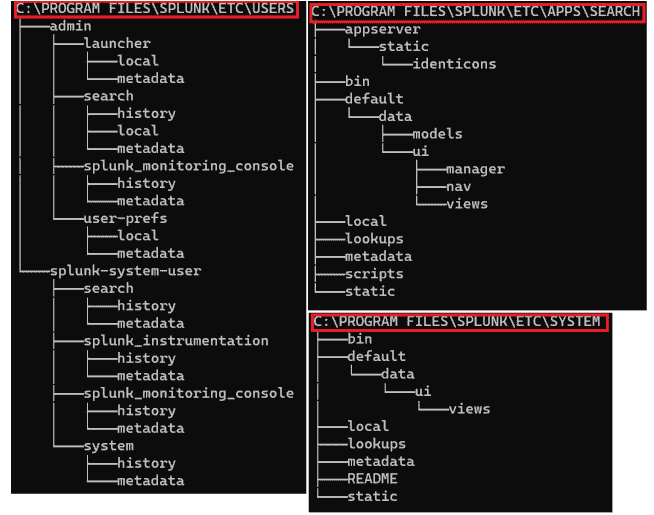
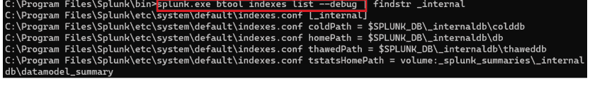
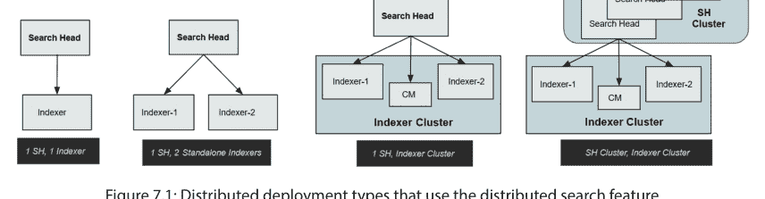
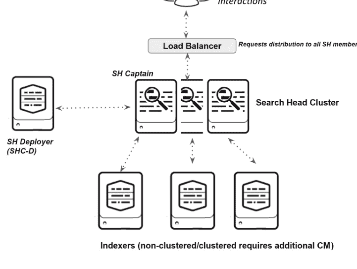
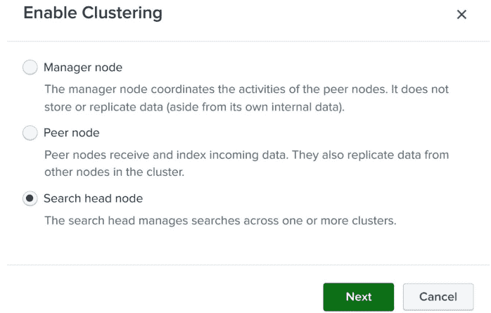

## Splunk 配置文件

配置文件是 Splunk Enterprise 不可或缺的一部分。你通过 Splunk Web、CLI 或 RESTful 接口所做的任何配置更改，都会在后台直接更新到 conf 文件中。因此，凡是遇到 “.conf”、“conf”、“config” 或 “configuration file” 等术语，都应理解为同一概念。存在许多这样的 conf 文件，各自用于满足特定目的。在本章中，你将看到跨 Splunk 组件（如搜索头、索引器和转发器）常用文件的使用示例。这些文件可以存储在多个位置，例如用户目录、系统目录和应用目录。你将了解这些文件如何在内存中合并以进行处理。当你熟悉了可以存储 .conf 文件的目录结构后，你将理解它们的优先级、处理顺序，并使用 btool 命令查找它们。

你将了解到 .conf 文件对 Splunk 系统管理员和数据管理员都至关重要。系统管理员通常需要调整或重新配置系统级设置，而数据管理员则负责数据摄取、搜索时和索引时的知识对象创建，以及数据索引的故障排除。了解 conf 文件如何协同工作，并通过 btool 和 RESTful 接口查看合并后的 conf 文件，对于每个人更深入地了解 Splunk 都是必要的。

在本章中，我们将涵盖以下主题：
- 理解 conf 文件
- 理解 conf 文件的优先级
- 排查 conf 文件问题

## 理解 conf 文件

Splunk Enterprise 中的 .conf 文件是在数据转发、解析、索引和搜索运行时发挥特定功能的配置文件。这些文件包含重要设置，可以通过文件系统直接或间接（通过 Splunk Web、CLI 或 REST API）进行修改。

让我们探索有关 .conf 文件的关键信息。

## 文件格式和访问

要修改或创建新的 .conf 文件，你需要访问 Splunk 组件的文件系统。这通常需要在安装 Splunk 的机器上具有适当的权限或管理员权限。通过访问文件系统，你可以使用文本编辑器或其他工具编辑 .conf 文件。

## 结构和语法

.conf 文件使用 <key/attribute> = <value> 格式来定义设置。每个键都有其自身的含义，并且键区分大小写。设置被组织成唯一的 [<stanza>] 节。遵循每个 .conf 文件的定义规范非常重要，这些规范可以在 Splunk 的在线文档或安装目录下的 $SPLUNK_HOME/etc/system/README 中以 .spec 扩展名找到。

例如，在 props.conf 文件中，KV_MODE 是正确的属性，而 kv_mode 被视为不同且不正确的属性。在 .conf 文件中定义属性时，请确保按照相应 conf 文件的规范使用正确的大小写。以下是一个 props.conf 文件的示例结构，包含 [default] 节和其他自定义节：

```
# This is a comment in .conf files
# Global settings applied to all stanzas in props.conf
[default]
TIME_FORMAT = %Y-%m-%d %H:%M:%S
TRUNCATE = 20000
CHARSET = UTF-8

# Specific settings for a sourcetype
[access_logs]
EXTRACT-field_name = "^\[(\d{4}-\d{2}-\d{2} \d{2}:\d{2}:\d{2})\]"

# Settings for a host
[host::server1]
TRANSFORMS-sethost = sethost_server1
LINE_BREAKER = ([\r\n]+)(\d{4}-\d{2}-\d{2})
EXTRACT-myfield1 = myregex1
EXTRACT-myfield2 = myregex2
```

以下是关于此示例的一些说明：
- 可以使用行首的 # 符号添加注释
- [default] 节设置应用于所有源类型的全局设置，除非被覆盖
- [access_logs] 节为 access_logs 源类型定义特定设置
- [host::server1] 节为名为 server1 的特定主机指定设置



图 6.1：conf 文件的目录结构和位置

图 6.1 显示了位于 SPLUNK_HOME 下的 etc\users\<user_name>\<app_name>、etc\apps\<app_name>\ 和 etc\system 目录中的 conf 文件。其中的子目录 \default 和 \local 是 .conf 文件的典型位置：
- 图中的 <user_name> 显示了内置的 admin 和 splunk-system-user 用户
- 图中的 <app_name> 显示了开箱即用的 search 应用及其子目录结构

Splunk 建议不要更改 etc\system\default 目录中的 conf 文件。相反，应创建一个 etc\system\local\ 目录，并将自定义配置放在其中。

## 需要记住的要点

Splunk 定义了多个配置文件，这些文件附带相应的 .spec 扩展名规范。这些资源可以在 $SPLUNK_HOME/etc/system/README 目录中找到，同时还有说明性示例。

每个 conf 文件都有一个基本结构，即 [<stanza>] 节以及下层的 <key> = <value> 键值对设置。键区分大小写。

Splunk 在 $SPLUNK_HOME/etc/system/default 目录下提供默认的 conf 文件，不建议编辑此目录中的文件。因此，优先使用 /local 目录来覆盖设置。

不同目录中 .conf 文件的优先级决定了哪些设置优先。让我们探讨这些配置文件的考虑顺序。

## 理解 conf 文件的优先级

$SPLUNK_HOME/etc 是典型 Splunk Enterprise 安装中所有 conf 文件所在的父目录。在此父目录下，配置文件可以在多个位置创建。你可能想知道为什么需要在多个位置存放相同类型的文件。

在 Splunk 内在各个级别配置设置的能力，为管理员、开发者和用户提供了灵活性，使其能够根据特定需求定制平台。这种灵活性允许对单个应用和用户体验进行精确控制。在多个目录中具有相同节名称的文件的优先级由 Splunk 决定。本节后面将介绍优先级。

默认情况下，Splunk Enterprise 在 $SPLUNK_HOME/etc/system/default 目录下提供所有系统级配置，该目录不应被更改。因此，如果需要对 /default 目录下的 conf 文件进行更改，建议在 $SPLUNK_HOME/etc/system/local 目录下创建，该目录优先于 /default 目录。同样，conf 文件也可能存在于以下目录下：
- $SPLUNK_HOME/etc/users：此目录包含由每个单独用户拥有的私有、特定于用户的更改。这种所有权确保了用户特定更改的隔离，并且默认不与其他用户共享。
- $SPLUNK_HOME/etc/apps/<app_name>/[default|local]：在应用（app）的 <app_name> 目录内创建的配置存储在此处。这些配置对任何有权访问该应用的用户可用。通过为用户分配特定角色，你可以控制他们对应用的访问，包括查看和修改 <app_name> 目录中配置的能力。
- $SPLUNK_HOME/etc/system/local：存储在此 Splunk 目录中的配置被视为全局配置。这些配置对于 Splunk 实例中的每个用户都是可访问的。

至此，你已了解配置文件目录的列表。让我们理解 Splunk 如何决定不同目录中相同 conf 文件的优先级（参见图 6.1）。优先级根据 conf 类型输入（如 props、indexes 等）及其上下文来决定。

配置设置使用的上下文也会影响优先级顺序。例如，某些配置设置可能仅适用于特定的应用或数据源，而其他设置可能全局应用于整个 Splunk 环境。两种上下文类型如下：
- **全局**：独立于用户和应用上下文的配置文件包括与索引、监控、部署、服务器配置等相关的设置。这些配置独立于用户和应用上下文，并全局应用于 Splunk 实例中的所有用户。


## 场景 2

在本场景中，我们将考察在两个不同应用中创建的相同设置。

应用名称可以包含小写字母、大写字母、数字、空格和特殊字符。如果两个不同的应用中存在相同的设置，那么 Splunk 决定在运行时执行它们的顺序，是通过对应用名称进行反向字典序排序来确定的。

例如，对于我们在场景 1 中看到的相同宏，[high_response_time] 被定义并与可访问 WebApp 和 ITOpsApp 这两个应用的用户共享。

在这种情况下，如果 WebApp 和 ITOpsApp 都有一个同名为 [high_response_time] 的宏，那么 WebApp 应用中的宏定义将优先于 ITOpsApp 应用中的定义。这种优先级由应用名称的反向字典序决定。

这意味着当 Splunk 解析 [high_response_time] 宏时，它会首先在 WebApp 应用中查找，如果在那里找到定义，就会使用该定义。如果在 WebApp 应用中未找到定义，那么 Splunk 将查找 ITOpsApp 应用：

```
## ITOpsApp 宏用于检查超过 2000 毫秒的请求响应时间
[high_response_time]
definition = index=web_logs sourcetype=access_log response_time_ms>=2000
```

如果你对字典序和逆序感到好奇，Splunk Lantern 上有一篇非常好的文章进行了更详细的说明：https://tinyurl.com/22hjs8am。

为了避免手动检查每个配置文件中的每项设置以了解 Splunk 在运行时如何确定优先级，Splunk 提供了诸如 btool 命令和 REST API 接口等有用的工具。这些工具允许你轻松查看配置设置及其优先级。

然而，在深入了解这些工具之前，让我们先重点关注索引期间的优先级。

## 索引时优先级

索引时优先级指的是适用于整个系统整体的配置设置，而不是针对单个用户。这些设置在全局系统级别运行，并参与诸如在输入阶段索引数据和监控文件等活动。

在索引期间，各种配置文件都会发挥作用，包括 indexes.conf、server.conf、serverclass.conf 和 inputs.conf。这些文件包含影响索引活动执行方式、服务器配置方式以及数据输入监控方式的基本配置。

让我们了解这些组件：

- `--debug`：此选项显示 conf 文件在系统、应用或用户目录中位置的绝对路径。与 `--debug` 选项类似，还有许多有用的选项。要查看完整列表，请执行以下命令 – `$SPLUNK_HOME/bin/splunk help btool`。
- `--user`：此选项显示给定用户可见的配置数据。
- `--app`：此选项显示给定应用可见的配置数据。
- `<conf_file_prefix>`：这指的是各种配置文件名中使用的前缀——例如，props、inputs、indexes 和 transforms。

让我们看一个针对 indexes.conf 文件使用 --debug 选项的 btool 命令示例：

```
./splunk btool indexes list --debug
```

在给定的示例中，使用 btool 命令以调试模式列出索引。我们将获得以下输出——正如你在下图中看到的，indexes list --debug 选项显示了 conf 文件的绝对路径以及与索引名称 _internal 关联的每项设置。



图 6.3：indexes.conf 的 btool 命令结果

另一个有用的 btool 命令是检查 conf 文件中是否有任何拼写错误。它通常在每次 Splunk 实例启动时运行。语法如下：

```
./splunk btool check
```

请记住关于 btool 的以下事实：

- btool 生成的输出可能无法反映已加载内存的当前状态。如果对配置文件进行了需要重启服务的更改，即使该更改尚未在活动系统状态中生效，btool 报告也可能反映此更改。
- btool 不受 Splunk 官方支持；但它非常强大且有用。在处理 Splunk 支持案例时，他们可能会要求提供 Splunk diag 报告，该报告包含 btool 报告输出。
- 使用 btool 查看 inputs.conf 文件时，输出中不会显示 [default] 节中的设置。
- 你可以在无需 Splunk 进程处于运行状态的情况下执行 btool 命令。

## 自我评估

你将获得 10 个问题和可供选择的答案。问题模式与我们在第 1 章中讨论的相同。评估结束后，请参阅与你难以回答的问题相关的章节。或者，你也可以参阅 Splunk 文档。祝一切顺利！让我们开始吧。

- 1. 哪个 conf 文件是定义换行解析设置所必需的？
  A. outputs.conf
  B. line_breaker.conf
  C. props.conf
  D. server.conf

- 2. 直接在文件系统上创建 conf 文件会自动重新加载 Splunk 配置吗？
  A. 会
  B. 不会

- 3. 如何在独立 Splunk 实例上重新加载 conf 文件更改？（选择所有适用项）：
  A. 在 conf 文件末尾添加 restart = true 设置。
  B. 使用 debug/refresh 端点。
  C. 重启 Splunk 实例。
  D. 什么都不做——Splunk 会自动重新加载。

- 4. 作为数据管理员，你需要在通用转发器（UF）上的 /opt/splunkforwarder/etc/apps/MyApp 目录中调整名为 MyApp 的应用的 INDEXED_EXTRACTIONS 设置。MyApp 默认在 default/ 目录下包含了 props.conf。你将采取什么行动？
  A. 登录 UF 并更新 props.conf，因为该更改仅在单个主机上需要。
  B. 登录 UF，在 MyApp 下创建 /local 目录，并使用所需设置创建 props.conf 文件。
  C. 什么都不做——props.conf 解析在 UF 上不起作用。
  D. 什么都不做——这是系统管理员的工作，所以通知系统管理员。

- 5. 你能确定 conf 文件可以在 Splunk 上创建或预存在的位置吗？其中 $SPLUNK_HOME = /opt/splunk？（选择所有适用项）：
  A. 位置 – etc/apps/users/<user-name>/<app-name>/local/
  B. 位置 – etc/apps/<app-name>/default/
  C. 位置 - etc/apps/<app-name>/system/
  D. 位置 - etc/system/default/
  E. 位置 - etc/system/local/

6. 在搜索时和索引时，Splunk 会考虑哪些配置文件来确定优先级？（选择所有适用项）：

- A. 搜索时 - savedsearches.conf、macros.conf 和 server.conf
- B. 搜索时 - savedsearches.conf、macro.conf 和 tags.conf
- C. 索引时 - inputs.conf、server.conf、indexes.conf 和 savedsearches.conf
- D. 索引时 - inputs.conf、serverclass.conf、indexes.conf 和 server.conf

7. 使用哪个 CLI 命令来排查 conf 文件错误？（选择所有适用项）：

- A. ./splunk check errors
- B. ./splunk btool check
- C. ./splunk btool <conf-file-name> list --debug
- D. ./splunk btool check-typos

8. 用户 A 具有 power user 角色，并在搜索应用下创建了一个具有私有权限的警报。它将被存储在 Splunk 上的什么位置？

- A. $SPLNUK_HOME/etc/users/local/
- B. $SPLNUK_HOME/etc/apps/search/users
- C. $SPLNUK_HOME/etc/users/User-A/search/local
- D. $SPLUNK_HOME/etc/users/search/local

9. 用户 A 具有 power user 角色，创建了一个警报，并与一个名为 search 的应用共享。它将被存储在 Splunk 上的什么位置？

- A. $SPLNUK_HOME/etc/users/search/local
- B. $SPLNUK_HOME/etc/apps/search/local
- C. $SPLNUK_HOME/etc/apps/users/User-A/search/local/
- D. $SPLUNK_HOME/etc/apps/search/default/


索引器并汇总从它们接收到的结果。然后将汇总后的结果呈现给用户。

另一方面，索引器负责数据索引。它从搜索头接收搜索请求，并通过搜索索引数据来处理这些请求。索引器将相关结果（基于用户的搜索查询）返回给搜索头，搜索头随后进行汇总并将其呈现给用户。

Splunk 中的 **分布式搜索** 功能通过将搜索工作负载分发到多个索引器来实现可扩展性和性能优化。这使得搜索查询能够并行处理，从而加快搜索结果并提高资源利用率。

让我们探索 Splunk 在独立、非集群和集群部署中的分布式搜索的一些关键事实：

- 独立的 Splunk 部署不使用分布式搜索。在独立部署中，整个搜索和索引功能由单个 Splunk 实例执行。
- 要使用分布式搜索功能，Splunk 实例（搜索头和索引器）不需要在集群中。换句话说，集群是可选的。具有单个索引器和搜索头的简单部署也可以连接以使用此功能。参考图 7.1。
- 当您拥有中小型到大规模的 Splunk 部署且具有高数据量和搜索需求时，分布式搜索就会发挥作用。它允许您将搜索工作负载分发到多个 Splunk 实例，这些实例可能在集群中，也可能不在集群中。
- 在集群环境中，分布式搜索可以与集群结合使用以增强搜索功能。集群中的每个索引器都可以参与分布式搜索，从而使搜索查询能够在集群内的索引器之间分发。

例如，以下是一些使用分布式搜索功能的分布式部署类型：



图 7.1：使用分布式搜索功能的分布式部署类型

如需了解更多信息，请查看以下搜索头集群架构：



图 7.2：搜索头集群架构

在图 7.2 中，有一个由三个搜索头实例组成的集群。这些实例前面有一个负载均衡器，它在集群中的搜索头成员之间均匀分配负载。在搜索头实例中，其中一个被选为执行搜索头队长角色，负责协调集群内的各种任务。

搜索头队长实例处理诸如作业调度、配置复制、工件复制、警报跟踪以及在搜索头成员之间复制知识包等任务。然而，队长角色并非固定在特定实例上。相反，搜索头成员之间会进行持续的选举过程，以确定将接管队长角色的获胜成员。这确保了职责能够动态分配并根据需要重新分配。

如果有必要手动将队长身份从一个实例转移到另一个实例，可以通过 CLI 命令启动转移。这提供了对集群内队长分配的灵活性和控制。

除了搜索头实例集群和队长功能外，所提供的设置还包括一个名为 **搜索头部署器** 的单独实例。搜索头部署器充当推送到搜索头集群的部署应用的集中枢纽，由管理员在需要时进行推送。

搜索头部署器实例包含部署应用，这些应用是需要在搜索头集群中分发的配置、设置和自定义。这些应用可能包括保存的搜索、仪表板、报告、字段提取以及增强搜索头实例功能和自定义的其他对象。

管理员可以在搜索头部署器上对部署应用进行更改，然后将这些更改推送到搜索头集群。这种集中化方法简化了跨多个搜索头实例的配置管理和分发，确保在部署和维护应用时的一致性。

## 索引器集群

索引器集群包含一组配置为作为索引器（搜索对等体）工作的 Splunk Enterprise 实例，它们共享相同的索引配置和应用。需要一个单独的实例来管理索引器集群活动；它被称为 **集群管理器**。

当处理大量数据量和并发搜索查询时，索引器集群是满足高可用性、容错性和可扩展性需求所必需的。通过利用索引器集群，组织可以保证不间断的数据访问，减轻索引器故障的影响，并实现优化的数据索引和搜索性能。

索引器集群提供以下几个关键优势：

- **数据可用性**：通过在多个索引器之间分发和复制数据，索引器集群可确保即使某个索引器宕机或不可用，数据仍然可访问。
- **数据恢复**：在索引器发生故障的情况下，集群在其他索引器上保留索引数据的副本。这种冗余使得在发出搜索请求时能够从剩余的索引器中自动检索相关数据。
- **数据保真度**：索引器集群通过在多个索引器之间复制和分发数据来维护数据保真度。这种复制策略可保护数据完整性和一致性，降低数据丢失风险，并确保索引数据保持准确可靠。

让我们了解索引器的搜索工作原理。当用户发出搜索查询时，搜索头会将查询分发到集群中的索引器。每个索引器在其本地存储中对其本地可搜索的数据副本执行本地搜索。然后搜索头汇总和合并来自所有索引器的结果以生成最终的搜索结果集。

### Tip

如果不需要使用 Splunk Web 用户界面，Splunk 建议在索引器上禁用 Web 服务器。要禁用 Web 服务器，请在索引器上执行 ./splunk disable webserver CLI 命令。

## 配置分布式搜索

分布式搜索功能需要配置以建立从搜索头到索引器或搜索对等体的连接。从独立的搜索头和索引器架构到大规模的多站点集群设置，所有实现都使用分布式搜索功能。参考图 7.2 中的部署类型，其中有三个搜索头组成集群，使分布式搜索能够与三个独立的索引器交互。索引器从各种来源接收数据，例如通用转发器、syslog 输入和用于索引的技术插件。以下是关于分布式搜索需要了解的几个基本要点：

- 搜索头预先配置为在用户请求时向搜索对等体发送查询。
- 搜索头汇总参与搜索的对等体返回的结果。
- 搜索头将结果呈现给用户。
- 一个名为知识包复制的持续后台进程在搜索头队长上运行（您将在本章后面学习），它会不断与搜索对等体共享信息。在非集群搜索头环境中，独立的搜索头会将包与所有连接的搜索对等体共享。
- Splunk 建议为每个角色专门分配一个 Splunk Enterprise 实例，例如用于转发器管理的部署服务器、用于搜索头集群的搜索头部署器、用于许可的许可管理器以及用于整体部署监控的监控控制台。然而，在资源利用率较低的部署中，管理组件可以根据 https://tinyurl.com/26f9n5zf 提供的矩阵进行共置。

### Tip

在分布式部署中，最佳做法是避免在搜索头上本地索引内部日志并在搜索头上启用转发。因此，内部日志和汇总索引数据将集中存储在索引器上。

分布式搜索可以通过 Splunk Web、CLI 或直接修改 server.conf 和 distsearch.conf 文件进行配置。在下一节中，我们将学习通过 CLI 和 Splunk Web 方法将索引器添加到搜索头。


要在搜索头上添加单站点集群索引器，请在搜索头的 $SPLUNK_HOME/bin 目录下执行以下命令。幕后配置设置将被添加到 $SPLUNK_HOME/etc/system/local 目录下的 server.conf 文件中：

```
./splunk add cluster-manager <scheme>://<host>:<port> -secret <indexers-pass4symmkey> -multisite false
```

对于每个集群管理器，都必须重复执行此命令。

让我们看看此命令的各个要素：

- `<scheme>://<cluster-manager-servername>:<management-port>` 是集群管理器的详细信息
- `<indexer-pass4symmkey>` 是索引器集群的 pass4SymmKey/机密/安全密钥

举例来说，假设您之前已执行过添加集群管理器地址 SplunkManager01.example.com 的命令，则 server.conf 文件现在显示以下内容：

```
[clustering]
mode = searchhead
manager_uri = https://SplunkManager01.example.com:8089
pass4SymmKey= encrypted-secreteast
```

如需更多选项（例如列出、编辑或删除集群管理器），您可以使用帮助命令。例如，在 $SPLUNK_HOME 的 /bin 目录下执行 ./splunk help cluster-manager。

同样，如果您想了解如何编辑和/或删除搜索服务器，可以按如下方式使用帮助命令：./splunk help search-server。此操作应在 $SPLUNK_HOME 的 /bin 目录下完成。

我们现在已经了解了如何在搜索头中同时包含集群和非集群索引器，以配置分布式搜索。接下来，下一节将指导我们使用 Splunk Web 界面配置分布式搜索的过程。

## Splunk Web

使用 Splunk Web，我们可以创建与上一节中使用 CLI 所做的相同配置。让我们看看图 7.3 中的菜单选项。

以管理员用户身份登录 Splunk Web，导航到右上角的“设置”并单击它。然后，您将在“分布式环境”下找到以下菜单项：

图 7.4 包含以下文本字段：对等 URI（peer-URI:mgmt_port 格式）、远程用户名和远程密码，您可以在其中手动输入需要添加到搜索头的索引器的详细信息。填写这些字段并单击“保存”。对于每个搜索对等体，重复图 7.3 和图 7.4 中所示的相同步骤，将它们添加到搜索头。

在下一节中，我们将向搜索头添加集群索引器。

## 添加集群索引器

在 Splunk Web 中，单击“设置”菜单，然后单击“索引器集群”，如图 7.3 所示，这将打开一个新页面，其中包含“启用索引器集群”按钮。单击该按钮并选择“搜索头节点”单选按钮，如图 7.5 所示。



图 7.5：分布式搜索 – 在搜索头上启用集群

图 7.5 显示了在搜索头上启用索引器集群的选项。最后，单击“下一步”按钮。将打开一个表单，如图 7.6 所示。

- 要查看知识包中包含的允许配置的完整列表，请参阅搜索头的 distsearch.conf 文件中的 [replicationAllowlist] 和 [replicationSettings:refineConf]。要检查包复制状态，可以在搜索头上执行 splunk show bundle-replication-status 命令，或者使用监控控制台，其搜索菜单下有一个仪表板。

如果公共知识包版本无法在所有搜索对等体之间复制，可能会导致搜索暂时中断。当搜索进程尝试跨对等体同步知识包时，可能会暂停几秒钟。如果建立公共包失败，搜索进程最终将放弃并继续，而不会实现同步。在这种情况下，Splunk 管理员将采取必要措施，识别缓慢的搜索对等体并将其隔离在搜索头上，以防止该对等体参与未来的搜索。隔离后，搜索对等体确保已正在运行的搜索完成。隔离操作仅暂停向该对等体复制知识包。

可以通过 Splunk Web 单击“设置 | 分布式搜索 | 搜索对等体”来实现隔离。也可以通过 CLI 完成。成功恢复后，请解除对该对等体的隔离，以便其参与未来的搜索。

以下是 CLI 隔离和解除隔离命令：

```
./splunk edit search-server -auth <user>:<password> <host>:<port> -action [quarantine|unquarantine]
```

让我们更详细地了解一下：

- <user>:<password> 是搜索头的管理员级凭据
- <host>:<port> 是搜索对等体的主机和管理端口
- -action 的值为 quarantine 或 unquarantine

最后总结一下；知识包是一个存档文件，由搜索头通过后台复制过程与搜索对等体共享。知识包包含知识对象，搜索对等体在将搜索结果返回给搜索头之前会将这些知识对象应用于搜索结果。默认情况下，包大小限制适用，为了减小其大小，可以将某些知识对象添加到搜索头的 replicationDenyList 设置中。要暂停向特定对等体复制包，可以隔离该搜索对等体。

让我们在下一节中总结我们所学到的内容。

3. 在搜索头集群中，搜索头首领组件是否是必需的？
A. 是
B. 否

4. 您被分配到一个关键项目，其中配置了搜索头集群来搜索多个非集群索引器。这是否利用了分布式搜索概念？
A. 是
B. 否

5. 找出搜索头上包含索引器详细信息的配置文件。
A. serverclass.conf
B. server.conf
C. distsearch.conf
D. distributedpeers.conf

6. 知识包包含什么？（选择所有适用项。）
A. 用户、知识对象和应用
B. 知识对象，如事件类型、标签和已保存搜索
C. Splunk 二进制文件
D. 有关搜索过程的 Splunk 内部日志

7. 知识包的默认复制策略是什么？
A. 级联
B. RFS
C. 经典
D. 挂载

8. 知识包已经变得太大，超过了 maxBundleSize。您是一名系统管理员；您会怎么做？
A. 增加 maxBundleSize
B. 从搜索头删除较大的应用
C. 将不需要的文件/应用添加到 replicationDenyList
D. 什么都不做；搜索头仅共享 .delta 文件
