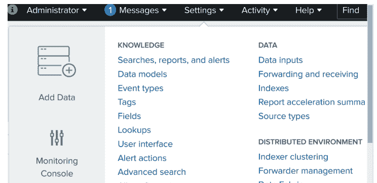
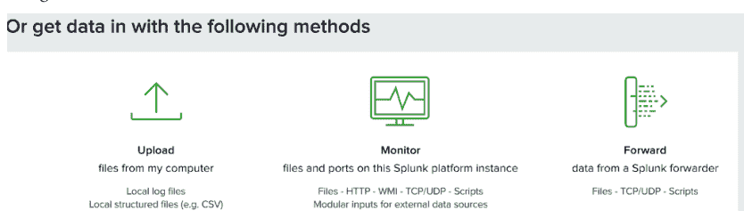

# 第 2 部分：
Splunk 数据管理

本 Splunk 9.x Enterprise 认证管理员指南的第 2 部分深入探讨 Splunk 数据管理的世界。它将使您具备高效地将数据导入 Splunk、配置数据输入、执行解析和转换、提取有意义的字段以及使用查找来增强数据所需的技能。自评估模拟考试确保您可以有效地应用所学知识。

此部分包含以下章节：

- 第 8 章，数据导入
- 第 9 章，配置 Splunk 数据输入
- 第 10 章，数据解析与转换
- 第 11 章，字段提取与查找
- 第 12 章，自评估模拟考试

如果您想深入了解这些阶段的详细概述，以及队列和管道，请查看 https://tinyurl.com/bdzb cetp。请注意，这对于认证考试来说完全是可选的。

我们现在已经研究了主要的数据摄取阶段和元数据字段。接下来，我们将探索 Splunk Web 中可用的 Splunk Enterprise 的“添加数据”功能。

## Splunk Web – 添加数据功能

“添加数据”功能位于 Splunk Web 的“设置”菜单下。只需打开此菜单并单击“添加数据”，如图 8.3 所示。



图 8.3：Splunk Web – 添加数据

单击“添加数据”将打开一个新的网页，提供三种将数据导入 Splunk 的方法，如图 8.4 所示。



图 8.4：将数据导入 Splunk 的方法


如你所见，第一种方法是一次性的**上传**方法，用于将数据一次性添加到 Splunk。上传的最大文件大小为 500 MB。

第二个**监视**选项通过监视安装 Splunk 的机器上的文件和端口来获取数据。此方法允许使用多种数据输入选项，例如将实例转换为 HEC 接收器、启用网络端口监听 TCP/UDP 流量，以及配置脚本按定义的时间间隔从 API 拉取数据负载。

上图中的第三个选项是**转发**，它专为 Splunk Enterprise 的单实例部署而设计，此时 Splunk 实例同时充当索引器和部署服务器。选择**转发**选项时，你可以从已连接的转发器客户端列表中进行选择。后续步骤允许你配置可在转发器上设置的具体数据输入。

让我们快速了解一下**上传**选项。**上传**选项是一个有用的功能，可用于快速测试数据样本并识别事件换行。它允许你将数据文件上传到 Splunk 进行分析，从而识别数据中事件是如何被分解的。这在排查问题以及在进行输入或解析设置之前理解数据结构时尤其有帮助。在此过程中，你还可以从合适的预训练源类型中进行选择，并可通过修改 `<Key> = <value>` 设置并观察结果来实时自定义源类型。

出于演示目的，我使用以下访问日志信息，将其保存到本地系统并命名为 web-access.log。文件内容如下：

```
127.0.0.1 - - [23/Apr/2023:10:28:12 -0400] "GET /index.html HTTP/1.1" 200 1240
127.0.0.1 - - [23/Apr/2023:10:28:13 -0400] "GET /styles.css HTTP/1.1" 200 876
127.0.0.1 - - [23/Apr/2023:10:28:15 -0400] "GET /scripts.js HTTP/1.1" 200 432
192.168.0.1 - - [23/Apr/2023:10:28:17 -0400] "GET /images/logo.png HTTP/1.1" 200 34012
192.168.0.1 - - [23/Apr/2023:10:28:19 -0400] "GET /about.html HTTP/1.1" 404 345
127.0.0.1 - - [23/Apr/2023:10:28:21 -0400] "GET /contact.html HTTP/1.1" 200 2089
```

现在，让我们点击*图 8.4* 中显示的**上传**按钮。这将打开一个带有**选择文件**按钮的**选择源**网页。点击该按钮并从本地系统上传 web-access.log 文件。然后你将进入*图 8.5* 所示的**设置源类型**页面。

*图 8.5：添加数据 – 设置源类型*

图 8.5 有三个主要部分需要查看。

在左侧，你可以看到我选择了源类型：access_combined。这是一种预训练的源类型，非常适合访问日志的结构。在右侧，显示了一个事件列表及其检测到的时间戳。要查看源类型配置设置，请展开高级部分，其中显示 CHARSET、TIME_PREFIX、LINE_BREAKER 等及其对应的值。

点击下一步按钮将进入输入设置。此页面用于设置主机和索引元数据字段，或将其保留为默认值。继续并点击审查按钮以查看元数据字段信息的摘要（见图 8.6）。如果你对详细信息满意，则点击提交；否则，点击返回并编辑必要的部分。

*图 8.6：添加数据 – 审查阶段*

如果一切顺利，点击**提交**按钮将把上传的 `web-access.log` 文件索引到你的 Splunk 实例上，并在下一页显示**文件已成功上传**的消息。此页面还提供许多其他选项，包括**开始搜索**、**提取字段**和**添加更多数据**。点击**开始搜索**按钮将打开搜索应用并显示上传的 `web-access.log` 文件事件。

让我们结束本章并回顾一下目前学到的内容摘要。

## 摘要

本书*第 2 部分*的第一章旨在帮助你开始使用 Splunk 数据管理。我们首先介绍了数据输入类型，包括基于文件的、网络、无代理（HEC）和基于脚本的选项。还有一种特殊类型的输入，可以通过从 https://splunkbase.com 获取的 TA 进行安装。我们还了解到，这些输入要么通过创建 `inputs.conf` 文件，要么通过 Splunk CLI 进行配置。

之后，我们了解了 Splunk 分配的默认元数据字段及其在搜索数据时的重要性。`sourcetype` 字段在 Splunk 中起着至关重要的作用，因为它有助于按源类型对数据进行分类和归类。Splunk 使用预训练的源类型列表，如果在输入阶段未指定 sourcetype，则会自动检测并分配适当的 sourcetype。`sourcetype` 定义在 `props.conf` 文件中配置，数据管理员根据所处理的数据类型创建自定义定义。`sourcetype` 配置包含重要设置，如换行边界、时间戳提取和字符集编码。这些设置在输入、解析和索引阶段应用，我们已对这些阶段进行了简要了解。

Splunk Web 的**添加数据**功能是通过上传少量数据并应用 sourcetype 设置来测试数据输入的绝佳方式。我们了解了将访问日志数据文件上传到 Splunk 实例所涉及的步骤。我们还了解了添加数据功能如何通过转发器以及监视 Splunk 实例上的本地文件来提供其他索引数据的方式。

在下一章中，我们将深入探讨本章开头简要介绍的 Splunk 数据输入。

## 自我评估

本节提供的问题和选项与认证考试中的问题模式相似。如果你在回答任何问题时遇到困难，请随时重新阅读本章中的相应部分。祝你好运！

- 1. 选择数据索引阶段（选择所有适用项）。
  - A. 索引
  - B. 解析
  - C. 输入
  - D. 摄取

- 2. 哪个阶段涉及数据收集并包含各种用于索引的数据输入选项？
  - A. 解析
  - B. 输入
  - C. 摄取
  - D. 索引

- 3. 在哪个阶段计算许可证？
  - A. 输入
  - B. 解析
  - C. 索引
  - D. 摄取

- 4. 你是一名数据管理员，正在处理存储在运行最新版本 Linux 操作系统的源系统文件中的数据。你会选择以下哪种 Splunk 数据输入方法？
  - A. 编写脚本监视文件并将其直接转发到索引器
  - B. 安装 UF 并配置基于文件的监视
  - C. 将文件传输到 FTP，索引器轮询要摄取的文件
  - D. 编写脚本读取每一行并将其发送到 HEC

- 5. Splunk 中哪种数据输入类型公开 RESTful API 以接受数据进行索引？
  - A. 网络数据输入通过 API 发送事件
  - B. HEC 公开 RESTful API 以进行数据索引
  - C. 脚本化输入集成 Splunk RESTful 数据输入 API
  - D. 文件监视可以读取 RESTful API 并与之集成以进行索引

- 6. 识别元数据字段。（选择所有适用项）
  - A. time
  - B. host
  - C. sourcetype
  - D. source
  - E. index

- 7. 在索引数据时，是否可以在后续阶段覆盖输入阶段设置的元数据字段？
  - A. 可以
  - B. 不可以

- 8. 一旦在输入阶段设置了索引，就无法覆盖。正确还是错误？
  - A. 错误
  - B. 正确

- 9. Splunk 的哪个功能允许你通过上传数据样本测试 sourcetype 设置？
  - A. 添加数据
  - B. 上传数据
  - C. 批量上传
  - D. 输入数据

- 10. 哪个官方网站包含由 Splunk 构建的加载项和应用？
  - A. splunkapps.com
  - B. splunkbase.com
  - C. splunkappstore.com
  - D. splunkappaddon.com


安装完成后，以管理员身份登录到 *第 1 章* 的 *独立* 部分中安装的 Splunk Enterprise 实例。登录后，导航到 **设置 | 转发和接收 | 配置接收 | 新接收端口**，然后在监听端口字段中输入 9997，并单击 **保存**。

然后，配置 UF 以连接到接收索引器（在本例中为 Splunk Enterprise），可以通过直接编辑 `outputs.conf` 文件或通过命令行进行配置，就像我们在 *第 4 章 Splunk Forwarder 管理* 的 *配置转发* 部分中所看到的那样。有关更多详细信息，您可以参考 Splunk 文档：https://tinyurl.com/2p8h9nuc。

下图详细说明了我们试图创建的 UF 和索引器（Splunk Enterprise 实例）设置。


图 9.1：UF 将日志发送到接收索引器

太好了！您现在有一个 UF 代理，可以为您配置输入。让我们从文件和目录监控数据输入开始。

## 文件和目录监控

顾名思义，此输入类型监控数据文件及其存储的目录。这是引入数据最有效的方式，也是 Splunk 推荐的处理文件最佳方法之一。监控设置在 `inputs.conf` 文件中配置。要启用此输入，需要在源机器上安装 UF 代理，相同的设置也适用于 **重型转发器 (HFs)** 和 Splunk Enterprise。让我们来看一下此输入类型的显著特点：

- 适用于所有基于文本的文件，包括结构化格式（XML、CSV、JSON 等）和 .gzip 压缩文件。
- 通过在 `$SPLUNK_HOME/var/lib/splunk/` 下的 `fishbucket` 目录中维护的检查点来跟踪正在监控的文件。
- 在转发器重启的情况下，从上次位置恢复文件和目录监控。
- 递归发现目录中的所有文件，包括新创建的文件。

在网络问题或索引器不可用的情况下，我们可以通过设置 `queueSize` 和 `persistentQueueSize` 来防止数据丢失。`queueSize` 设置指的是在转发器上的输出队列空闲之前保存数据的内存队列。`persistentQueueSize` 设置可在内存队列已满时启用将数据存储到磁盘。`persistentQueueSize` 必须大于 `queueSize`。数据将写入转发器上的 `$SPLUNK_HOME/var/run/splunk/` 目录。

UDP 输入规范与 TCP 相同，只是它监听 UDP 端口——其余设置和语法保持不变。UDP 的 `inputs.conf` 配置示例如下：

```
# inputs.conf listening on UDP port 514
[udp://514]
connection_host = ip
acceptFrom = 192.0.2.10, !external.example.host.com
index = main
sourcetype = access_common
queueSize = 1MB
persistentQueueSize = 100MB
```

网络输入在 *nix 和 Windows 主机上可能存在限制，因为它们需要访问某些端口以监听 TCP/UDP。您可以自行尝试在 UF/Splunk Enterprise 实例上配置这些输入并检查端口的监听状态（在 Linux 和 Windows 主机上使用 `netstat` 命令）。

我们已到达网络输入部分的末尾。在下一节中，我们将介绍脚本化输入的配置。

## 讨论脚本化输入

脚本化输入对于索引无法通过文件/目录监控或使用网络输入监控的瞬态/临时数据非常有用。脚本化输入从瞬态源收集数据，然后将收集到的数据写入文件或直接转发到索引器。让我们了解一下有关此输入类型的一些事实：

- 脚本化输入需要 UF 代理或 Splunk Enterprise 实例（HF）来执行脚本。
- 可以从瞬态源收集数据，例如操作系统命令。`top`、`vmstat`、`netstat` 和 `iostat` 命令都利用这种类型的输入，该输入在可从 http://splunkbase.splunk.com 下载的 Splunk Unix 和 Linux 插件中配置。Windows **技术插件 (TA)** 依赖于此输入类型来收集 Windows **活动目录 (AD)** 日志、注册表日志、WinEventLogs 等。也可以使用脚本从远程 API 拉取日志。
- 支持流行的脚本类型，包括 `.py`（Python）、`.sh`（shell）、`.ps1`（PowerShell）和 `.bat`（Windows 批处理）。
- 脚本化输入必须安排在特定间隔运行。脚本运行的频率通过指定以秒为单位的间隔数或设置 cron 表达式来设置。
- Splunk Enterprise 和 UF 将脚本执行消息记录在本地 splunkd.log 文件中。您可以在 _internal 索引中访问这些日志。
- 脚本化输入可通过 Splunk Web 中的 设置 | 数据输入 | 脚本 菜单进行配置。另一种选择是在 inputs.conf 文件中创建它们，可选择将其打包到应用程序中，并使用部署服务器将其部署到转发器。参考第 4 章，Splunk Forwarder 管理。

考虑以下脚本化输入规范：

```
# inputs.conf scripted input settings
[script://<script path or cmd>]
source = <source to set>
sourcetype = <sourcetype to set>
index = <index name to forward logs>
interval = <in seconds. default 60 sec or cron expression. Set -1 to run once, 0 to continuously>
passAuth = <username to run the script as the OS user>
queueSize = <in-memory queue size>
persistentQueueSize = <queue to store on disk when in-memory is full>
```

前述规范的节名称以 script:// 为前缀，后跟通常的通用元数据字段 source、sourcetype 和 index，以及队列设置。特定于脚本化输入的设置是 interval 和身份验证信息。

interval 设置安排脚本每 x 秒运行一次。如果此处未指定任何内容，脚本将默认安排每分钟运行一次。或者，我们可以指定 cron 表达式。

queueSize 和 persistentQueueSize 的工作原理与 处理网络数据输入 部分中解释的类似——在索引器不可用的情况下，这两个设置都会将脚本生成的数据保存在内存和磁盘中。

passAuth 设置可确保脚本由分配的用户名运行，通过为该用户创建身份验证令牌。在 Splunk 中设置脚本化输入之前，您需要创建脚本并确保它位于 Splunk 可以访问的文件系统路径中。然后 [script://<script path>] 节将能够从该指定位置执行脚本。出于安全原因，脚本必须放在以下位置之一：

- $SPLUNK_HOME/etc/apps/<app name>/bin
- $SPLUNK_HOME/etc/system/bin
- $SPLUNK_HOME/bin/scripts

但是，对于具有 .path 扩展名的脚本存在一个例外，它可以引用主机上任何位置的脚本（.py、.sh、.ps1 和 .bat）。.path 脚本文件本身必须位于上述位置之一，但它引用的脚本可以位于这些目录之外。

让我们看一下以下调用 *nix top 命令以获取进程信息的脚本化输入。在这里，脚本路径相对于 inputs.conf 文件。脚本具有 .sh 扩展名，并安排每 60 秒运行一次。sourcetype 和 source 都设置为 top。此脚本生成的日志将被转发到名为 os（代表操作系统）的自定义索引：

```
[script://./bin/top.sh]
interval = 60
sourcetype = top
source = top
index = os
disabled = 0
```

如果您想参考更多此类示例，请从 https://splunkbase.splunk.com/app/833 下载 Splunk_TA_nix 插件并检查 /default/inputs.conf 和 /bin 目录。

> **提示**
> 最佳做法是将脚本放在靠近 inputs.conf 文件的位置。例如，如果文件位于 $SPLUNK_HOME/etc/system/local/ 目录中，则将脚本放在 $SPLUNK_HOME/etc/system/bin/ 目录中。同样，如果 inputs.conf 位于 $SPLUNK_HOME/etc/apps/<app name>/local 目录中，则将脚本放在 $SPLUNK_HOME/etc/apps/<app name>/bin 目录中。

就目前而言，关于脚本化输入的内容就这些——尝试从 Splunkbase 安装一个使用脚本化输入的插件来测试此功能。在下一节中，我们将介绍 HEC 输入。

## 了解 HEC 输入

HEC 是一种无代理输入类型，不需要在源机器上安装转发器。此输入类型适用于能够通过 HTTP(S) 发送事件的源，例如通过 JavaScript 库的 Web 应用、移动应用和自动化脚本。HEC 在 Splunk Enterprise 实例上公开 RESTful API 端点以接受用于索引的数据。该实例可以在分布式部署中为 HF/索引器。让我们来看一下 HEC 输入的关键事实：

- HEC 默认在 Splunk 实例上处于禁用状态，用户必须手动启用它才能开始使用。它可以通过在多个 Splunk 实例上配置它并选择性地在前面使用负载均衡器来进行扩展。


- 对 HEC API 的身份验证是通过源发送的 HTTP 请求中提供的令牌来完成的。令牌配置由管理员设置，并与应用程序/源团队共享，以便他们发送事件。
- HEC 提供了两个重要的 RESTful 端点用于数据索引——一个用于访问仅限 JSON 格式的事件，另一个用于接受任何原始类型的数据。JSON RESTful 端点专为接受仅以 JSON 格式化的数据而设计。在向此端点发送数据时，应确保载荷（数据）以 JSON 结构正确格式化，并根据需要包含额外的元数据字段。封装在 JSON 载荷中的原始数据事件可以是原始事件。
- 为每个应用程序/源创建的每个令牌都必须是唯一标识符。最佳实践是使用 32 个字符的**全局唯一标识符（GUID）**作为令牌，例如 `CD1E753F-5BB2-4F5C-AE22-FE0381A0D916`。源应用程序在将事件作为载荷发送到收集器端点时，会在 HTTP 请求中提供此令牌。
- HEC 会自动解析接收到的 JSON 事件，因为其事件时间戳和其他元数据遵循预定义的结构。对于原始数据，如果包含时间戳，则应用断行策略；或者，可以在 `props.conf` 中配置 `sourcetype` 设置，以相应覆盖此行为。
- HEC 通过 `useAck` 索引器确认设置提供事件索引确认功能。索引器确认在节级别为单个令牌启用；一个单独的端点提供事件索引的状态。
- 要允许/限制某些地址通过 HEC 发送数据，可以在 `inputs.conf` 文件的 `[http]` 节级别配置 `acceptFrom` 设置。

## 配置 HEC

现在，我们将逐步完成配置 HEC 的过程。

**步骤 1：** 让我们为通过 HEC 发送数据做好准备。第一步是在 Splunk Web 中启用 HEC。导航至 **设置 | 数据输入 | HTTP 事件收集器**，然后点击右上角的**全局设置**按钮。这将打开一个包含**所有令牌**选项的表单。将此选项设置为**已启用**，然后点击**保存**。

在**全局设置**中启用 HEC 时，您应该已经注意到几件事，其中之一是**启用 SSL** 默认处于选中状态，另一件事是收集器端点监听接收事件的 HTTP 端口号是 8088。

HEC 全局设置也可以通过 `[http]` 节进行配置，该节默认位于 `$SPLUNK_HOME/etc/apps/splunk_httpinput/default/inputs.conf`。要使用此方法启用 HEC，请将以下设置添加到 `$SPLUNK_HOME/etc/apps/splunk_httpinput/`

- https://<splunk-hostname>:8088/services/collector/ack：用于查询事件索引状态。它适用于已启用索引器确认的令牌。
- 完整列表可在 https://tinyurl.com/j53xmynj 获取。

为了展示如何向这些 HEC 端点发送数据，我们将在 Linux 环境中使用 curl 命令。我们可以看到有两个标头值——一个带有承载令牌值的 Authorization，另一个带有特定于客户端的唯一 GUID 的 X-Splunk-Request-Channel。

这里我们以 JSON 格式的载荷发送数据——一个收集器/事件请求：

```
curl -k -H "Authorization: Splunk 09776ade-cf23-42c0-9138-89ad8388516a" -H "X-Splunk-Request-Channel: FE0ECFAD-13D5-401B-847D-77833BD77131" https://mysplunk.example.com:8088/services/collector/event -d '{"sourcetype": "signaling_data", "event": "stable signal!"}'
```

以下是收集器/事件响应：

```
{"text":"Success","code":0,"ackId":0}
```

这里我们以原始事件发送数据——一个收集器/原始请求：

```
curl -k -H "Authorization: Splunk 09776ade-cf23-42c0-9138-89ad8388516a" -H "X-Splunk-Request-Channel: FE0ECFAD-13D5-401B-847D-77833BD77131" https://mysplunk.example.com:8088/services/collector/raw -d 'stable signal!'
```

我们得到如下收集器/原始响应：

```
{"text":"Success","code":0,"ackId":1}
```

由于我们在令牌级别设置了 useACK = 1（true），客户端必须在发送给 HEC 的请求中携带唯一的通道标识符。作为回报，客户端会收到 HEC 以 JSON 格式返回的 ackID（请参阅前面收集器/原始事件示例中的响应载荷）。客户端进一步使用这些 ack 查询 HEC 的 /ack 端点，以了解事件索引状态，如下所示。

查找事件索引状态——/ack 端点请求——需要前面两个 JSON 和原始事件请求中返回给客户端的通道标识符和 ack：

```
curl -H "Authorization: Splunk 09776ade-cf23-42c0-9138-89ad8388516a" -H "X-Splunk-Request-Channel: FE0ECFAD-13D5-401B-847D-77833BD77131" https://mysplunk.example.com:8088/services/collector/ack -d '{"acks":[0,1]}'
```

上述 ack 端点请求的 JSON 响应载荷如下所示：
`{"acks": {"0": true, "1": false}}` — 其中，`true` 表示索引成功，`false` 表示该事件索引失败。一旦特定事件的 `acks` 返回 `true`，其索引状态将从内存中消失，如果客户端之后再次发送请求，它将返回 `false`。

我们已经讲完了 HEC 输入——它很有技术含量，不是吗？不要被这些技术术语所困扰。您需要记住，将 HEC 视为一个普通的 API，每个请求都需要提供令牌进行身份验证。索引器确认本质上与包裹投递跟踪功能相同——例如，您下单后（比如通过 `/raw` 或 `/events` 端点），您会得到一个跟踪号（`ackID`），然后在门户（`/ack` 端点）中输入跟踪号（`acks`），即可跟踪包裹的位置。最后，在送达后，您会从跟踪门户收到一个*成功送达*状态。

在下一节中，我们将介绍 Windows 输入。

## 探索 Windows 输入

到目前为止，我们介绍过的输入类型既不针对特定技术，也不针对特定操作系统。但正如其名称所示，Windows 输入仅适用于 Windows 主机。主机至少需要 UF 或 Splunk Enterprise 实例才能收集 Windows 特定的日志。Windows 原生日志以二进制格式存储，Windows 输入通过与操作系统 API 交互来获取这些日志。

在 Windows 主机上安装 UF 时，您可以选择启用 Windows 输入。对于 Splunk Enterprise 实例，可以通过 Splunk Web 中的**设置 | 数据输入**，然后选择**本地事件日志收集**和**远程事件日志收集**来配置 Windows 输入。远程事件日志收集需要 Windows 域帐户才能从远程主机收集日志。

在已配置 UF 的大规模 Windows 主机环境中，使用部署服务器集中管理输入。在应用程序中创建并配置 `inputs.conf`。将应用程序部署到转发器，以实现高效且集中的输入配置。让我们了解一些关于 Windows 输入的关键事实：

- Windows 输入能够收集 Windows 事件、AD、性能监控、注册表、打印机、主机和网络日志。
- **Windows 管理规范（WMI）** 用于从网络中的远程主机收集事件日志，通常在具有域帐户的 Windows 服务器上。
- 远程事件日志收集在 `wmi.conf` 文件中配置。完整规范可在 `https://tinyurl.com/37mdekpe` 获取。
- 启用 Windows 日志可能会导致数据量显著增加，可能消耗我们 Enterprise 许可证的很大一部分。Splunk 提供了两个设置，`whitelist` 和 `blacklist`，用于在不需要的事件日志被索引之前过滤掉它们。这有助于减少许可证使用量，并仅索引所需事件。


最后，我们考察了 HEC 和 Windows 输入类型。HEC 为 JSON 格式和原始事件以及索引状态查询提供了 RESTful API。我们了解到 HEC 默认是禁用的，并通过逐步操作（从启用 HEC 到通过 API 发送数据）进行了实践。最后我们介绍了 Windows 输入，它专为仅限 Windows 的主机设计，用于在本地和远程收集各种日志事件。

请注意，在所有输入类型中，HEC 不需要在源机器上安装转发器，因此它也被称为无代理输入。HEC 可以在 Splunk Enterprise 实例（如 HF）上启用，也可以在分布式部署中的索引器上启用，以接收来自应用程序客户端的日志事件。文件和目录监控、脚本化输入以及 Windows 输入至少需要在源主机上安装 UF。网络输入可以在 UF 和 Splunk 实例（通常是 HF）上启用。

本章讨论了输入收集阶段，这是第 8 章“数据接入”中概述的第一阶段。在接下来的章节中，我们将深入探讨解析阶段，该阶段涉及处理通过这些数据输入收集到的数据。

现在是时候通过回答以下关于本章所涵盖数据输入主题的问题来测试你的知识了。

### 自我评估

1. 选择 Splunk 默认提供的常用数据输入类型。（选择所有适用项）：
   - A. 二进制文件监控
   - B. 文件和目录监控
   - C. 网络数据输入
   - D. 脚本化输入
   - E. 网络端口监控

2. 你即将配置一个文件监控输入，并注意到该目录包含五年以上的数据，这些数据无需建立索引。哪个设置用于强制转发器忽略旧文件？
   - A. skipHistoricalFiles
   - B. ignoreOldData
   - C. ignoreOlderThan
   - D. deletePastData
