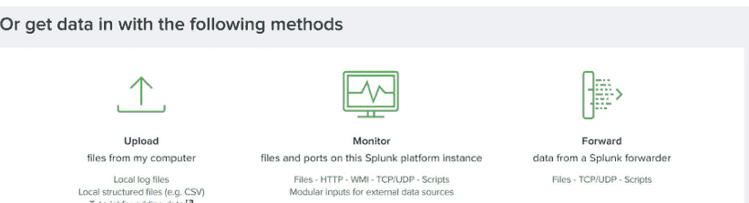
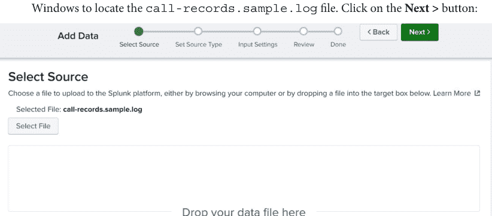
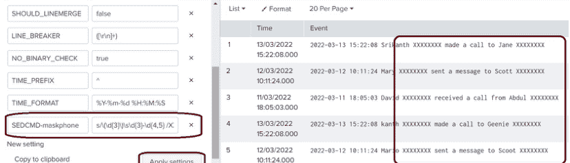

# 10 数据解析与转换

数据旅程的第一阶段是输入阶段，我们在第 9 章“配置 Splunk 数据输入”中已详细讨论。数据解析是第二阶段，之后数据被索引到磁盘上。本章讨论解析阶段，该阶段紧随输入阶段之后，并以将数据交给索引阶段进行存储和搜索准备而结束。

可能产生的问题是，既然所有数据都已经收集完毕，元数据字段已在输入阶段设置，最终数据被转发到索引器进行索引，那么解析阶段有什么必要呢？解析阶段的主要特性包括：将整个数据流拆分为单个事件，提取并应用时间戳，为单个事件设置元数据字段，在索引前操作元数据，以及根据需要转换数据。在输入阶段，诸如索引、主机、源类型、来源和字符集等元数据字段应用于整个数据，而非单个事件。数据流作为一个整体被处理，在输入阶段不进行换行拆分或时间戳提取。

事件在解析阶段被转换。示例用例可能包括覆盖源类型、主机元数据、将数据路由到不同的索引、提取索引时字段，以及屏蔽或匿名化敏感信息，如个人身份信息（PII）、银行账户、社会安全号码（SSN）和电话号码。

在本章中，我们将通过应用 props.conf 和 transforms.conf 文件来学习解析和转换设置。作为 Splunk 数据管理员，了解此阶段对于在数据接入时或之后的某个时间点可能出现的用例应用正确解决方案至关重要。例如，你可能会被要求屏蔽信用卡信息、覆盖源类型、更改事件拆分边界，或将特定事件完全重新路由到不同的索引。我们将在本章中学习以下主题：

- 理解解析阶段
- 解析阶段设置 – props.conf

再举一个例子，当你针对特定来源（如 /var/log/web-server/access.log）将 TRUNCATE 设置为 1000 时，这意味着与该来源模式匹配的数据中的任何行都将被截断为最大长度 1,000 字节。将 TRUNCATE 设置为 1000 会限制匹配指定模式的来源的最大行长度（以字节为单位）：

```
[source::/var/log/web-server/access.log]
TRUNCATE = 1000
```

- **主机字段：** [host::<主机或主机模式>] 节适用于为来自给定主机或主机模式的数据定义自定义配置设置。这些设置可能涉及数据格式化、提取规则以及根据 props.conf 规范在解析阶段的其他许多内容：

```
[host::< host or host pattern >]
<key> = <value>
```

例如，当你针对特定主机名（如 myhost.com）将 TRUNCATE 设置为 1000 时，这意味着源自 myhost.com 主机的数据中的任何行都将被截断为最大长度 1,000 字节：

```
[host::myhost.com]
TRUNCATE = 1000
```

- **节优先级：** 当多个节匹配给定事件时，定义在更具体节中的设置优先于定义在较不具体节中的设置。具体来说，定义在 [host::<主机或主机模式>] 节中的设置覆盖 [<源类型名称>] 节中的设置，而定义在 [source::<来源或来源模式>] 节中的设置优先于 [host::<主机或主机模式>] 和 [<源类型名称>] 节。这种设置层次结构允许对 Splunk 中的数据处理进行细粒度控制，确保将最相关的设置应用于每个事件。

至此，我们已经了解了在各种场景中有用的节。接下来让我们看看关于换行拆分、时间戳识别、行合并等的解析设置规范。我将使用源类型节来描述这些设置。例如，我们的源类型名称是 web_access。请注意，设置键名区分大小写：

```
## web_access 源类型的解析设置
[web_access]
LINE_BREAKER = < 正则表达式：默认设置为换行符或回车符的数量（[\r\n]+）>
SHOULD_LINEMERGE = <true | false - 是否将多个多行事件合并为一个事件。如果设置为 true，则取决于其他设置的数量。阅读完整规范>
BREAK_ONLY_BEFORE = <仅当 SHOULD_LINEMERGE 设置为 true 时适用>
BREAK_ONLY_BEFORE_DATE = <仅当 SHOULD_LINEMERGE 设置为 true 时适用>
TIME_PREFIX = < 正则表达式：如果设置，Splunk 软件会在尝试提取时间戳之前扫描事件文本以查找此正则表达式的第一个匹配项。>
TIME_FORMAT = <strptime 风格格式>
MAX_TIMESTAMP_LOOKAHEAD = < 整数：Splunk 软件在事件中查找时间戳时应查看的字符数。默认情况下，查找前 128 个字符>
TZ = <事件的时区，如 UTC、AEDT、AST 等。如果未设置，则默认考虑 splunkd 进程的时区。>
TRANSFORMS-<类名> = <transforms.conf 节1>, <transforms.conf 节2>
```

虽然上述设置对于优化 Splunk 的数据处理很有用，但值得注意的是，Splunk 会尽可能尝试使用默认值。这些默认值旨在为大多数用例提供合理的性能和功能水平。TRANSFORMS-<类名> 设置与 transforms.conf 相关，我们将在下一节中讨论。让我们按功能对这些设置进行分类：

- **换行拆分：** LINE_BREAKER 设置将数据流拆分为单独的事件行。默认情况下，它通过查找换行符或回车符的数量来确定事件边界。如果设置了 LINE_BREAKER，则必须将 SHOULD_LINEMERGE 设置为 false，出于性能原因，这也是可取的。
- **行合并：** SHOULD_LINEMERGE 将多个事件合并为单个事件。你可以将其设置为 true 或 false；默认情况下为 true。当我们将其设置为 true 时，必须设置其他设置（如 BREAK_ONLY_BEFORE_DATE 和 BREAK_ONLY_BEFORE）以识别事件边界。
- **时间戳识别：** 在解析阶段正确配置应用于每个事件的时间戳非常重要。Splunk 有一组预定义的日期时间格式（$SPLUNK_HOME/etc/datetime.xml），这些格式是常用且标准的。默认情况下，如果未显式设置 TIME_FORMAT，Splunk 会扫描事件的前 128 个字符以查找时间戳。如果事件包含超出 128 个字符的时间戳，或者希望限制从事件中 TIME_PREFIX 位置开始的时间戳扫描，可以使用 MAX_TIMESTAMP_LOOKAHEAD 或 TIME_PREFIX 设置。TIME_FORMAT 是一种 strptime 标准风格格式，可以在时间戳采用非标准格式时设置。请参阅此处的日期时间格式变量 - https://tinyurl.com/3kaddz23。TZ 标识数据来源的时区。要查看所有时区（TZ）ID 的列表，请参阅 https://en.wikipedia.org/wiki/List_of_tz_database_time_zones。

在某些场景下，事件可能没有日期、时间或年份值，或者这些值都没有。Splunk 会尝试根据自身的规则来确定这些值，以便在异常情况下识别时间戳。关于时间戳分配如何工作的 Splunk 文档可在此处获取 - https://tinyurl.com/4tjaaerb。


让我们来看一下 web_access 日志的以下示例来定义 props.conf 解析设置。日志中包含时间戳信息；每条日志行中的 -0500 代表美国东部标准时间（EST）时区，并且日志中的每一行都代表事件边界。让我们为此 web_access 日志样本编写 props.conf 信息：

```
127.0.0.1 - - [10/Feb/2023:10:34:56 -0500] "GET /example-page.html HTTP/1.1" 200 2345 "https://www.example.com/" "Mozilla/5.0 (Windows NT 10.0; Win64; x64) AppleWebKit/537.36 (KHTML, like Gecko) Chrome/96.0.4664.110 Safari/537.36"
127.0.0.1 - - [10/Feb/2023:10:37:56 -0500] "GET /example-page.html HTTP/1.1" 400 2345 "https://www.example.com/" "Mozilla/5.0 (Windows NT 10.0; Win64; x64) AppleWebKit/537.36 (KHTML, like Gecko) Chrome/96.0.4664.110 Safari/537.36"
127.0.0.1 - - [10/Feb/2023:10:39:56 -0500] "GET /example-page.html HTTP/1.1" 500 2345 "https://www.example.com/" "Mozilla/5.0 (Windows NT 10.0; Win64; x64) AppleWebKit/537.36 (KHTML, like Gecko) Chrome/96.0.4664.110 Safari/537.36"
```

以下 props.conf 配置通过每一行新行将访问日志拆分为单独的事件（默认行为），并应用正确的时间戳和时区。主要目标是正确解析访问日志：

```
#props.conf for preceding web_access logs
[web_access]
LINE_BREAKER = ([\r\n]+)
SHOULD_LINEMERGE = false
TIME_PREFIX = \[
TIME_FORMAT = %d/%b/%Y:%H:%M:%S %z
TZ = EST
MAX_TIMESTAMP_LOOKAHEAD = 26
```

提供的 [web_access] 段是 Splunk 中 props.conf 文件配置的一个示例。以下是每个设置的作用：

- LINE_BREAKER = ([\r\n]+): 此设置指定用于识别数据中换行符的正则表达式模式。在此情况下，它设置为 ([\r\n]+)，匹配一个或多个回车或换行字符的出现。
- SHOULD_LINEMERGE = false: 此设置控制 Splunk 是否应尝试将连续的数据行合并为单个事件。将此设置为 false，即表示告诉 Splunk 将每行数据视为单独的事件。
- TIME_PREFIX = \[: 此设置指定用于识别数据中时间戳开头的正则表达式模式。在此情况下，它设置为 \[，匹配字面上的左方括号字符。

- 创建新的索引时间字段提取。
- 创建高级搜索时间字段提取。
- 设置查找表，从外部源查找字段。

在下一节中，我们将学习数据操作用例，例如数据匿名化、将数据重新路由到不同的索引、过滤事件以及覆盖源类型。我们将在第 11 章《字段提取和查找》中学习剩余的字段提取和查找。让我们从数据匿名化开始。

## 数据匿名化

数据匿名化是将 PII 转换为无法用于识别信息最初链接到的个人的格式的过程。数据匿名化的目的是保护敏感数据的隐私和保密性。

数据匿名化有多种方法，其中之一是掩码，我们将在本节中学习。

**掩码**涉及用非敏感的占位符值替换敏感数据——例如，用 XXXX 替换个人的电话号码，或用随机值替换其出生日期。请注意，一旦数据在解析和索引阶段被掩码，就无法撤销。

Splunk 具有以下两种方法来掩码数据。正如我之前提到的，强烈建议事先了解正则表达式以理解本节内容：

- 仅 props.conf 中的 SEDCMD 设置
- 同时使用 props.conf 和 transforms.conf

### 在 props.conf 中使用 SEDCMD

通过 props.conf 直接应用 SEDCMD 设置在原始单个事件上工作。您可以使用此设置用于 sourcetype、source 和 host 段，如下所示。如果您熟悉 Linux 中的 sed，它的工作方式与 Linux 中的 sed 命令类似。其规范如下：

```
# props.conf SEDCMD setting specification
[<sourcetype-name> | source::<source name> | host::<hostname>]
SEDCMD-<class> = <sed like command>
```

<sed like command> 语法解释如下：

- sed like command - s/regex/replacement/flags.
- <class> 是一个唯一的字面字符串。
- s – 用于替换。
- sed 中的正则表达式是 PERL 兼容的正则表达式样式（可选包含捕获组）。
- replacement 是用于替换正则表达式匹配的字符串。使用 \n 进行反向引用，其中 n 为单个数字。
- Flags 可以是 g 以替换所有匹配项，或一个数字以替换特定匹配项。

为了更清楚，让我们通过以下包含电话号码的呼叫日志数据示例来说明：

- **示例：** 公司 A 是一家电信公司，将呼叫记录数据编入 Splunk Enterprise 索引，索引集设置为 carrier_records，sourcetype 设置为 call_records。call_records 数据包含电话号码等 PII，出于隐私原因必须进行掩码。作为数据管理员，我们的任务是使用我们刚刚学习过的 SEDCMD 设置在 sourcetype 级别用 XXXXXXXX 符号掩码电话号码。我们可以为此示例使用我们在第 1 章 Splunk 安装 – 独立版部分中安装的独立 Splunk 实例。
- **日志样本：** 在以下呼叫记录样本中，您可以找到格式为 (555) 555-1234 的电话号码，我们将使用 SEDCMD 对其进行掩码，如下所示。

以下是 call_records 日志样本：

```
2022-03-13 15:22:08 Srikanth (555) 555-1234 made a call to Jane (555) 555-5678
2022-03-12 10:11:24 Mary (555) 555-4321 sent a message to Scott (555) 555-8765
2022-03-11 18:05:03 David (555) 555-2345 received a call from Abdul (555) 555-9876
```

props.conf 文件的 SEDCMD 设置用于掩码呼叫记录中的电话号码，如下所示：

```
## props.conf masking phone numbers in call records
[call_records]
SEDCMD-maskphonenumber = s/\(\d{3}\)\s\d{3}-\d{4} /XXXXXXXX /g
```

在提供的 props.conf 文件中，SEDCMD 指定了电话号码的正则表达式模式以及用于替换它们的字符串。g 标志表示日志中电话号码的所有出现都应被指定的替换字符串（XXXXXXXX）替换。

一旦此配置部署到独立 Splunk 实例，任何被摄取并匹配指定正则表达式的日志都将被相应地转换，并在转换后的状态下编入索引。然而，值得注意的是，在此配置更改之前已编入索引的日志将不会受到此转换的影响。

如果您需要掩码先前已编入索引日志中的电话号码，您需要在配置更改部署后重新摄取这些日志。

以下是掩码后的 call_records 日志：

```
2022-03-13 16:22:18 Chuppa XXXXXXXX made a call to Chand XXXXXXXX
2022-03-13 11:19:54 Garry XXXXXXXX sent a message to Bill XXXXXXXX
2022-03-13 22:55:23 Dan XXXXXXXX received a call from Ahmad XXXXXXXX
```

您可以看到电话号码已通过在 Splunk 中发出搜索请求 - index=carrier-records sourcetype=call_records 被掩码为 XXXXXXXX。

在下一节中，我们将学习使用 transforms.conf 和 props.conf 设置进行数据掩码。

### 使用 transforms 和 props

我们将在此处使用相同的 call_records 日志样本，并使用 transforms.conf 和 props.conf 文件应用掩码设置。让我们看一下规范：

```
# transforms.conf specification
[<transforms-stanza-name>]
SOURCE_KEY = <_raw by default, _MetaData:Index, MetaData:Sourcetype, MetaData:Host, MetaData:Source and so on>
REGEX = <regular expression to operate on field contents specified in SOURCE_KEY>
FORMAT = <specifies the format of the event works in accordance with REGEX, for fields format is fieldname::fieldvalue>
DEST_KEY = <_raw for masking in data event, can set other keys as described in Spec>

## props.conf specification
[<sourcetype-name> | source::<source name> | host::<hostname>]
TRANSFORMS-<class> = <transforms stanza name 1>, <transforms stanza name 2>.. <transforms stanza name N>
```

transforms.conf 规范看起来很简单；然而，它支持超出本书范围的多种用例。可以使用来操作诸如 host、sourcetype、source 和 queue 等元数据字段的键组合都描述在此处 - https://tinyurl.com/27sxf94z 的规范文件中。

props.conf 规范具有 TRANSFORMS-<class> 设置。这里，<class> 是一个唯一的字面字符串。我们可以指定多个 transforms 段并用逗号分隔它们，以便按相同顺序应用它们。

我们将对以下各节中描述的其余用例使用前述 transforms.conf 和 props.conf 规范，这些用例涉及覆盖源类型、将数据重新路由到不同的索引、过滤不需要的事件并将它们发送到 nullQueue。


如果你想尝试一下，可以用所需的主机名值覆盖 host 字段。在这种情况下，DEST_KEY 将为 MetaData:Host。在下一节中，我们将学习索引路由。

## 索引重新路由

索引是在输入阶段设置的数据存储库。在某些情况下，数据流中的一些事件应被过滤并通过不同的索引重新路由。这可以在解析阶段实现，并且仅适用于 HF/索引器。

以下是一些适用的场景：

- 数据流包含需要被过滤并存储在单独索引中的安全数据。将其存储在单独索引中，在访问控制和保留方面提供了更大的灵活性。
- 如果数据量足够大，单个索引可能无法高效地进行搜索处理。在这种情况下，将经常访问的部分数据路由到高性能索引，并将不常使用的数据保留在低性能索引中，将提高搜索性能。
- 出于合规性要求，某些事件应存储在单独的索引中。

为了实现索引路由，我们将依赖 transforms.conf。其规范与我们在前面章节中看到的一致。

我在这里考虑的示例场景是我们在“数据匿名化”一节中使用的 call_records 日志样本。如果你仔细观察日志样本，它包含客户之间的通话以及短信（SMS）记录。

要求是将短信记录分开并路由到索引：sms-conversations。日志中的 message 和 sent 关键字将是用于识别短信记录的 REGEX 匹配：

```
## Log sample
2022-03-13 15:22:08 Srikanth (555) 555-1234 made a call to Jane (555) 555-5678
2022-03-12 10:11:24 Mary (555) 555-4321 sent a message to Scott (555) 555-8765
2022-03-11 18:05:03 David (555) 555-2345 received a call from Abdul (555) 555-9876
```

让我们来看看 transforms.conf 的设置，如下所示：

```
## transforms.conf stanza for index routing
[sms-index-routing]
SOURCE_KEY = _raw
REGEX = (message|sent)
FORMAT = sms-conversations
```

2. 滚动到页面底部，你会看到“上传”选项：



图 10.2：用于导入数据的“上传”选项

图 10.2 显示了将数据导入 Splunk 的三种不同选项。选择第一个选项“上传”，以上传 call-records 示例数据。点击后将会进入图 10.3 所示的屏幕。

3. 如图 10.3 所示，你可以使用“选择文件”按钮，或者拖放 call-records 示例数据。我点击了“选择文件”，然后在 Windows 中打开文件资源管理器以定位 call-records.sample.log 文件。点击“下一步 >”按钮：



图 10.3：添加数据 | 选择文件以上传文件

图 10.3 显示了所选文件：call-records.sample.log。可上传的最大文件大小为 500 MB。

4. 点击“下一步 >”按钮将进入“设置源类型”屏幕，如图 10.4 所示。

```
NO_BINARY_CHECK=true
CHARSET=AUTO
TIME_PREFIX=^
TIME_FORMAT=%Y-%m-%d %H:%M:%S
SEDCMD-maskphone  = s/\(\d{3}\)\s\d{3}-\d{4}/XXXXXXXX/g
```

我们会看到以下屏幕：



## 总结

整个这一章直到最后都围绕 props.conf 和 transforms.conf 设置展开，内容纯粹是技术性的。我们首先了解了紧随输入阶段之后的解析阶段及其重要性。在三个组件中，完整的解析管道存在于 HF 和索引器上，而不在 UF 上；然而，UF 能够通过 INDEXED_EXTRACTIONS 设置解析结构化文件。我们了解到，如果索引器前面有 HF，则必须在 HF 上部署解析设置。

之后，我们查看了与 sourcetype、source 和 host 相关的 props.conf 配置块，并详细了解了用于换行符分割、行合并和时间戳标识的源类型定义规范。接下来，我们了解了与 props.conf 配合使用的 transforms.conf 配置块。我们进一步深入研究了通过 props.conf 应用 SEDCMD 设置进行数据脱敏，以及使用 transforms.conf 设置覆盖源类型、索引路由和使用 nullQueue 过滤不需要的事件。

最后，我们使用 Splunk 数据预览功能测试了新的源类型定义设置和数据脱敏设置 SEDCMD。

在下一章中，我们将深入探讨字段的主题，并探索如何创建搜索时和索引时字段。此外，我们还将重点关注查找表以及如何使用 Splunk Web 和用于查找文件编辑的 Splunk 应用来创建它们。

6. 在 Splunk Web 中，“设置源类型”/数据预览功能的文件上传大小限制是多少？
A. 5 GB 限制
B. 1 GB 限制
C. 500 MB 限制
D. 1,500 MB 限制

7. 源类型创建是否保存到 props.conf 文件中？
A. 是
B. 否

8. 在 props.conf 文件中，使用什么设置来引用 transforms 配置块？
A. TRANSFORMS-<class_name>
B. TRANSPOSE-<class_name>
C. TRANSFORMATION-<class_name>
D. PROPS-<class+name>

9. 今天部署的脱敏设置是否适用于先前已索引的数据？
A. 是
B. 否

10. 在解析阶段，哪个设置会将数据流按换行符作为行终止符拆分为单个事件？
A. LINE_BREAKER
B. TRUNCATE
C. BREAK_EVENTS
D. BREAK_ONLY_NEW_LINE

## 答案回顾

希望你通过这些题目回忆起了本章学到的概念。让我们回顾一下答案：

- 1. *选项 B* 是正确答案。数据索引过程中的三个主要阶段是输入、解析和索引。
- 2. *选项 B、C 和 E* 是正确答案。你可以通过 `[sourcetype_name]`、`[source::<source_name_or_pattern>]` 或 `[host::<hostname_or_pattern>]` 配置块语法应用 `props.conf` 设置。
- 3. *所有选项* 都是正确的。在解析阶段，可以覆盖 `sourcetype`、`host` 和 `source` 等元数据字段，并且可以更改索引以重新路由符合特定条件的事件以及进行数据脱敏。此外，你可以过滤满足特定条件的事件，然后将这些事件从索引中丢弃。
- 4. *选项 C* 是正确的。其余选项均不正确；Splunk 中不存在这样的队列。
- 5. 答案是错误的。`SEDCMD-<class> = "<sed style regular expression>"` 设置属于 `props.conf` 文件。
- 6. *选项 C* 是正确的。通过 Splunk Web 中的 **设置源类型**/数据预览功能上传文件的文件大小限制为 500 MB。
- 7. *是的，没错。* 源类型定义将保存到 `props.conf` 文件中。
- 8. *选项 A* 是正确的。在 `props.file` 设置中，`TRANSFORMS-<class_name> = <transform_stanza_1>,< transform_stanza_2>,...<transform_stanza_n>` 是正确语法。`<class_name>` 是唯一的字面字符串。可以分配多个 transforms 配置块；如果使用逗号 (,) 分隔，它们将按指定顺序执行。
- 9. *否。* 数据脱敏是解析阶段的操作，并且只适用于 Splunk 中新增的数据。过去已经摄入的数据不会受到影响。要将相同的解析阶段设置应用于历史数据，必须删除并重新摄入。
- 10. *选项 A* 是正确的。`LINE_BREAKER` 允许你指定如何将原始数据流拆分为单个事件。默认情况下，Splunk 会根据换行符（`\n`）将原始数据流拆分为事件。


