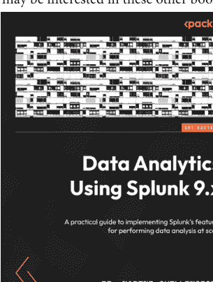

## D

配置文件优先级，
  搜索时优先级
  场景 95-97
CSV 查找 187, 201-203
循环冗余校验（CRC）143
数据匿名化 166
  在 props.conf 中使用 SEDCMD 166, 167
  使用 transforms 和 props 168, 169
数据索引阶段
  索引阶段 130
  输入阶段 129
  解析阶段 130
数据掩蔽 177
Debian (deb) 66
分隔数据提取 188-192
部署客户端
  配置 68
部署服务器（DS）160
  配置 61
  serverclass 配置 62-64
分布式集群部署
  与 SHC 的多站点
  多站点的局限性 18, 19
  单站点的优缺点 17, 18
分布式部署 105
分布式非集群部署 16
  优势 16
分布式搜索 105-07
  配置 111
  关键事实 106
  Splunk CLI 112
  Splunk Web 113

## E

东部标准时间（EST）164
企业安全（ES）107
事件索引 34, 76
外部查找 187

## F

字段 183-186
文件和目录监控 140
  数据输入 140-144
转发器
  HF 9
  监控 69, 70
  UF 9
转发器许可证 30
转发 66
  配置 66-68
冻结存储桶 79

## G

地理空间查找 186
全局 94
全局唯一标识符（GUID）149
谷歌云平台（GCP）8
谷歌云存储（GCS）8
图形用户界面（GUI）64

## H

重型转发器（HF）9, 30, 160, 197
HEC 输入 148
  配置 149, 150
  发送数据 150-152
  关键事实 148, 149
高可用性（HA）9
热存储桶 79
HTTP 事件收集器（HEC）7, 170

## I

身份提供者（IdP）52
索引器集群 109
  优势 109
索引器集群化 109, 110
索引器/搜索对等节点 105
索引
  备份 84
索引阶段 130
索引时字段提取 196
  创建 196, 197
  结构化数据提取 197-199
  非结构化数据提取 199, 200
索引时优先级 97-99
信息技术服务智能（ITSI）107
输入阶段 129

## K

键值（KV）对 185
键值存储（KV 存储）查找 183
知识包 116, 117
  复制 117, 118
KV 存储查找 187, 204-207

## L

将 LDAP 配置为认证方案
  参考链接 53
字典序 99
许可证
  使用情况和告警 40, 41
  警告和违规 32, 33
许可证组 36
许可证管理器 39, 40
许可证对等节点 38-41
许可证池 37
许可证堆栈 37
许可证类型 29
  转发器许可证 30
  Splunk 开发者许可证 31, 32
  Splunk Enterprise 基础设施许可证 31
  Splunk Enterprise 许可证 31
  Splunk Enterprise 试用许可证 30
  Splunk 免费许可证 30
许可证违规 32
许可证管理
  添加 35, 36
  安装 34
  管理和监控 34
  工作原理 33, 34
轻量级目录访问协议（LDAP）52, 53
Linux 操作系统
  安装通用转发器（UF）65
Linux 操作系统安装
  用于 .deb 的命令 66
  用于 .rpm 的命令 66
  用于 .tgz（TAR 文件）的命令 66
查找 186, 187
  创建 201
  CSV 查找 201-204
  KV 存储查找 204-207

## M

管理组件 12
  部署服务器 12
  索引器集群管理器（CM）13
  许可证管理器 13
  监控控制台（MC）13, 14
  SHC 部署器 13

## N

掩蔽 166
指标 76
指标索引 34
监控控制台（MC）4, 69
多因素认证（MFA）52, 54
使用 Duo Security 的多因素认证
  参考链接 54
多站点索引器集群化 110
原生 Splunk 53
网络数据输入
  处理 144, 145
  TCP 和 UDP 输入 145, 146
非集群索引器
  添加到 Splunk CLI 112
  添加到 Splunk Web 114, 115
不可搜索数据 110

## P

解析阶段 130
数据匿名化 166
索引重新路由 171, 172
props.conf 设置 161-165
设置 160
覆盖源类型 169, 170
transforms.conf 设置 165
删除不需要的事件 172, 173
Perl 兼容正则表达式（PCRE）63, 161
个人身份信息（PII）6, 159
管道分隔值（PSV）188
可插拔认证模块（PAM）54
处理组件
  转发器 9, 10
  索引器 11, 12
  搜索头（SH）10, 11

## Q

隔离 118

## R

红帽包管理器（rpm）66
正则表达式（regex）161
远程认证拨入用户服务（RADIUS）54
复制因子（RF）110
REST 应用程序编程接口（API）6
基于角色的访问控制（RBAC）45
角色 48, 49
  管理员 49
  can_delete 49
  创建 50, 51
  高级用户 49
  用户 49

## S

脚本化认证 54
脚本化输入
  讨论 146-148
脚本化查找 187
可搜索副本 110
搜索因子（SF）110
搜索头 105
搜索头主节点 108
搜索头集群部署器 13
搜索头集群化
  概述 107-109
搜索头集群（SHC）10
搜索头部署器 109
搜索头（SH）组件 10, 11
搜索对等节点 105
搜索处理语言（SPL）4, 186
搜索时字段提取
  创建 187, 188
  分隔数据提取 188-192
  非结构化数据提取 192-196
搜索时优先级 95
安全断言标记语言（SAML）53, 54
职责分离（SoD）49
serverclass
  配置 62-64
短消息服务（SMS）171
简单网络管理协议（SNMP）144
单服务器部署
  优缺点 15
使用 SAML 配置单点登录
  参考链接 54
单点登录（SSO）52
站点 17
站点 RF 110
站点 SF 110
社会安全号码（SSN）159
安全套接层（SSL）144
规范（spec）51, 161
Splunk
  URL 129
Splunk CLI 112
  添加集群索引器 112, 113
  添加非集群索引器 112
Splunk CLI 命令
  用于添加索引 81
Splunk 组件 9
  管理组件 12
  处理组件 9
Splunk 开发者许可证 31, 32
  警告和违规 33
Splunk Enterprise 6
  功能 6, 7
Splunk Enterprise 9.X 功能 7
  集群管理器（CM）冗余 8
  配置跟踪器 8
  Dashboard Studio 7
  持久搜索 8
  联合搜索 7
  健康报告 7
  Ingest Actions 8
  SmartStore Azure Blob 支持 8
  Splunk Assist 8
Splunk Enterprise 基础设施许可证 31
  警告和违规 33
Splunk Enterprise 许可证 31
  警告和违规 33
Splunk Enterprise 试用许可证 30
  警告和违规 33
Splunk Forwarder 许可证
  警告和违规 33
Splunk 免费许可证 30
  警告和违规 33
Splunk 索引 76
  特性 76
  CLI 81, 82
  创建 80
  事件索引 76
  indexes.conf 82
  监控 84, 85
  Splunk Web 80, 81
  卷 83


## S

- Splunk 安装 20
  - 步骤 21-24
  - 系统要求 20
- Splunk 平台功能
  - 参考链接 51
- Splunk 验证架构 (SVAs) 14
  - 分布式集群部署和 SHC，多站点 18, 19
  - 分布式集群部署和 SHC，单站点 17, 18
  - 分布式非集群部署 16, 17
  - 参考链接 14
  - 单服务器部署 15
- Splunk Web 80, 81, 113
  - Add Data 功能 131-134
  - 集群索引器，添加 115, 116
  - 非集群索引器，添加 114, 115
- Splunk Web 数据
  - 屏蔽 177
  - 预览 173, 174
  - 源类型定义，创建 174-177
- SSL 用户数据报协议 (UDP) 144
- stanza 51
- 结构化数据提取 197-199

## T

- 制表符分隔值 (TSV) 188
- 技术插件 (TAs) 4
- 解冻桶 79
- 传输控制协议 (TCP) 144

## U

- 通用转发器 (UF) 4, 139, 197
  - 安装 64
  - 在 Linux OS 中安装 65
  - 在 Windows OS 中安装 64, 65
- 解除隔离 118
- 非结构化数据提取 192-200
- 用户 45, 46
  - 创建 46, 48
- 用户，使用 CLI 配置
  - 参考链接 48

## W

- 温桶 79
- Web，命令行界面 (CLI) 6
- Windows 输入
  - 探索 152-154
- Windows OS
  - 通用转发器 (UF)，安装 64, 65


packtpub.com

订阅我们的在线数字图书馆，即可完全访问超过 7,000 本书籍和视频，以及帮助您规划个人发展并推进职业生涯的行业领先工具。更多信息，请访问我们的网站。

## 为什么订阅？

- 花更少时间学习，花更多时间编码，使用来自 4,000 多名行业专业人士的实用电子书和视频
- 使用专为你打造的技能计划改善学习
- 每月免费获得一本电子书或视频
- 完全可搜索，便于轻松访问重要信息
- 复制粘贴、打印和书签内容

您知道 Packt 为每本出版的书籍提供电子书版本，文件格式为 PDF 和 ePub 吗？您可以在 packtpub.com 升级到电子书版本，作为印刷书籍客户，您有权享受电子书折扣。请通过 customercare@packtpub.com 与我们联系以获取更多详情。

在 www.packtpub.com，您还可以阅读大量免费技术文章，订阅一系列免费通讯，并获得 Packt 书籍和电子书的独家折扣和优惠。

## 您可能喜欢的其他书籍

如果您喜欢这本书，您可能对 Packt 的这些其他书籍感兴趣：



### 使用 Splunk 9.x 进行数据分析

Dr. Nadine Shillingford

ISBN: 978-1-80324-941-4

- 安装和配置 Splunk 9 环境
- 使用 Dashboard Studio 中的灵活布局选项创建高级仪表板
- 了解 Splunk 许可模式
- 创建表格并使用 Splunk 9.x 中可用的各种图表类型
- 探索新的配置管理功能
- 实施 Splunk 9.x 中引入的性能改进
- 将 Splunk 与 Kubernetes 集成以优化 CI/CD 管理

## Packt 正在寻找像您这样的作者

如果您有兴趣成为 Packt 的作者，请访问 authors.packtpub.com 并立即申请。我们已与数千名开发人员和技术专业人士合作，就像您一样，帮助他们与全球技术社区分享他们的见解。您可以提交通用申请，申请我们正在招聘作者的特定热门主题，或提交您自己的想法。

## 分享您的想法

现在您已完成 *Splunk 9.x Enterprise Certified Admin Guide*，我们很想听听您的想法！如果您从 Amazon 购买了本书，请点击此处直接前往本书在 Amazon 的评论页面并分享您的反馈，或在您购买的网站上留下评论。

您的评论对我们和技术社区非常重要，将帮助我们确保提供优质内容。

## 下载本书的免费 PDF 副本

感谢您购买本书！

您喜欢随时阅读但无法随身携带印刷书籍吗？

您的电子书购买与您选择的设备不兼容？

不用担心，现在每本 Packt 书籍您都可以免费获得该书的 DRM-free PDF 版本。

在任何地方、任何地点、在任何设备上阅读。直接从您喜爱的 technical 书籍中搜索、复制和粘贴代码到您的应用程序中。

福利还不止于此，您可以每天通过电子邮件获得独家折扣、通讯和优质免费内容。

按照以下简单步骤获取福利：

1. 扫描二维码或访问下方链接
2. 提交您的购买证明
3. 就是这样！我们会直接将您的免费 PDF 和其他福利发送到您的电子邮件


```
https://packt.link/free-ebook/9781803230238
```

