# 1 使用 Spring Python 入门

Spring Python 采用了 Spring Framework 和 Spring Security 的概念，并将其带入 Python 世界。它并不是代码逐行移植。相反，它汲取了在 Java 领域发现的一些强大思想，并在 Python 世界中务实地应用它们。

Spring（Java）提供许多简单易用的功能部件来组装应用程序，而不是一个用于扩展的单体框架。Spring Python 使用相同的方法。这意味着我们可以根据每个 Python 应用程序的需求使用尽可能少或多的 Spring Python 来完成工作。

在本章中，我们将学习：

- 了解 Spring Python 的非侵入式 API，它使使用其他库变得容易，而无需对自己的代码库进行重大更改
- Spring Python 如何使用控制反转来解耦对象的创建与使用，从而赋能开发者
- Spring Python 如何通过提供非侵入式 API 来帮助专业 Python 开发者轻松访问高级服务
- Spring Python 为专业 Java 开发者提供通过 Python/Jython/Java 组合轻松混合 Python 和 Java 的方式
- 如何从二进制和源代码安装库
- Spring Python 的可扩展性如何，以及一些指向 Spring Python 社区的链接

### 面向 Python 开发者的 Spring Python

您已经选择了最受欢迎且技术上功能强大的动态语言之一 Python 来开发软件。Spring Python 使解决 Python 开发者每天遇到的常见问题变得更加容易。

### 探索 Spring Python 的非侵入式特性

Spring Python 具有非侵入式特性，这意味着可以轻松采用满足需求的部分，而无需重写大量代码。例如，Pyro (http://pyro.sourceforge.net) 是一个第三方库，可轻松进行远程过程调用。

为了演示 Spring 的非侵入式方法，让我们编写一个简单的服务，使用 Pyro 的 API 将其发布为 Web 服务，然后使用 Spring Python 对 Pyro 的封装将其发布。这将展示 Spring Python 如何简化我们的 API 访问，以及它如何使第三方库更容易使用，而无需对自己的代码进行太多重构。

- 1. 首先，让我们编写一个简单的服务，从 Web 请求字符串中解析参数：
```python
class ParamParser(object):
    def parse_web_parms(self, parm):
        return [tuple(p.split("=")) for p in parm.split("&")]
```
- 2. 现在我们可以编写一段简单、功能性的代码，使用我们的服务以获得可工作的版本。
```python
parser = ParamParser()
parser.parse_web_parms("pages=5&article=Spring_Python")
```
这只是实例化 `ParamParser` 并访问函数。要使其成为有用的互联网服务，它需要在中央服务器上实例化，并应配置为监听来自客户端的调用。
- 3. 下一步是使用 Pyro 的 API 将其作为 Web 服务发布。这将使其可被多个 Pyro 客户端访问。为此，我们定义一个守护进程，在端口 9000 上托管我们的服务并对其进行初始化。
```python
import Pyro

daemon = Pyro.core.Daemon(host="localhost", port="9000")
Pyro.core.initServer()
```
- 4. 接下来，我们创建一个 `Pyro` 对象实例作为我们服务的代理，以及我们 `ParamParser` 的一个实例。我们配置代理将所有方法调用委托给我们的服务。
```
pyro_proxy = Pyro.core.ObjBase()
parser = ParamParser()
pyro_proxy.delegateTo(parser)
```
- 5. 最后，我们将 `pyro_proxy` 对象注册到 `daemon`，并启动监听-分发循环，使其准备好处理请求：
```
daemon.connect(pyro_proxy, "mywebservice")
daemon.requestLoop(True)
```
当我们运行此服务器代码时，我们的 `ParamParser` 的一个实例将被创建并在 `PYROLOC://localhost:9000/mywebservice` 上发布。

为了使此服务完整，我们需要创建一个 `Pyro` 客户端来调用我们的服务。代理使用 `Pyro` 库无缝地在有线上传输 Python 对象，在本例中为请求参数的元组。
```
import Pyro

url_base = "PYROLOC://localhost:9000"
client_proxy = Pyro.core.getProxyForURI( \
    url_base + "/mywebservice")
print client_proxy.parse_web_parms( \
    "pages=5&article=Spring_Python")
```
`Pyro` 库易于使用。一个关键因素是我们的 `ParamParser` 从未与用于将其提供给远程客户端的 `Pyro` 机制紧密耦合。然而，它非常侵入性。

如果我们已经在单台机器上开发了一个简单的应用程序，其中大量方法使用我们的实用程序？为了将我们的应用程序转换为客户端-服务器应用程序，我们必须在每次调用时重写它以使用 `Pyro` 客户端代理模式。如果我们遗漏任何实例，我们将会有需要清理的错误。如果我们编写了自动化测试，它们也必须重写。将简单的单机应用程序转换为多节点应用程序会迅速产生大量工作。

这就是 Spring Python 发挥作用的地方。它提供了一种不同的创建对象的方式，使我们能够轻松地用远程机制（如 `Pyro`）替换本地对象。稍后，我们将更详细地探讨 Spring Python 容器的概念。


让我们利用 Spring Python 的容器来创建我们的解析器，并通过 Pyro 提供服务。

```
from springpython.config import PythonConfig
from springpython.config import Object
from springpython.remoting.pyro import PyroServiceExporter
from springpython.remoting.pyro import PyroProxyFactory

class WebServiceContainer(PythonConfig):
    def __init__(self):
        super(WebServiceContainer, self).__init__()

    @Object(lazy_init=True)
    def my_web_server(self):
        return PyroServiceExporter(service=ParamParser(),
                                    service_name="mywebservice",
                                    service_port=9000)

    @Object(lazy_init=True)
    def my_web_client(self):
        myService = PyroProxyFactory()
        myService.service_url="PYROLOC://localhost:9000/mywebservice"
        return myService
```

借助此容器定义，很容易同时编写服务器应用程序和客户端应用程序。要启动我们 Pyro 服务器的一个实例，我们使用以下代码：

```
from springpython.context import ApplicationContext
container = ApplicationContext(WebServiceContainer())
container.get_object("my_web_server")
```

客户端应用程序看起来非常相似。

```
from springpython.context import ApplicationContext
container = ApplicationContext(WebServiceContainer())
myService = container.get_object("my_web_client")
myService.parse_web_parms("pages=5&article=Spring_Python")
```

Spring Python 容器通过包含创建关键对象的全部定义来工作。我们创建容器的一个实例，向其请求特定对象，然后使用它。

这看起来很容易就和直接使用 Pyro API 一样多（如果不是更多）的代码。那么为什么它被认为侵入性更小呢？

看看最后的代码块，我们可以看到我们不再创建解析器或 Pyro 代理。相反，我们依赖容器为我们创建它。Spring Python 容器解耦了我们解析器的创建，无论是用于本地应用程序，还是使用 Pyro 远程连接它们。服务器应用程序不知道它被导出为 Pyro 服务，因为所有这些信息都存储在 WebServiceContainer 中。对容器定义所做的任何更改都不会被服务器应用程序代码感知。

对于客户端也是如此。通过将客户端的创建放在容器内部，我们不必知道我们获取的是服务实例还是代理。这意味着可以在 Spring Python 容器的定义内部进行额外的更改，而不会影响我们的客户端和服务器应用程序。这使得将服务器和客户端调用拆分为单独的脚本变得容易，以便在 Python 的单独实例或企业中的单独节点上运行。

这演示了如何将远程调用混合到现有应用程序中。通过使用将关键对象的创建委托给容器的这种模式，可以轻松地从简单的对象创建开始，然后再添加诸如远程调用之类的有用服务。本书后面我们还将看到，这如何使添加事务和安全等其他服务变得容易。由于 Spring Python 开放式的设计，我们可以轻松创建新服务并添加它们，而无需更改原始框架。

## 添加一些有用的模板

除了以非侵入性的方式混合服务的能力之外，Spring Python 还提供了多个实用工具，通过模板模式简化了低级 API 的使用。模板模式涉及捕获一系列逻辑步骤。在每个步骤中发生的事情可以由开发人员自定义，同时仍保持相同的整体顺序。

模板在编写 SQL 查询时非常有用。使用 Python 的数据库 API（http://www.python.org/dev/peps/pep-0249）手工编写 SQL 查询非常繁琐。我们必须妥善处理错误并收集结果。将事物连接起来并处理问题所涉及的额外代码通常被称为样板代码。让我们看看以下代码，了解 Python 的数据库 API 如何工作。

我们需要维护的样板代码越多，成本就越高。拥有包含数十或数百个查询的应用程序可能会变得难以管理，甚至维护成本过高。

- 1. 使用 Python 的数据库 API，我们只需为设置编写一次以下代码。
- 2. 现在让我们使用 Python 的数据库 API 执行单个查询。

```
### One time setup
import MySQLdb
conn = MySQLdb.connect(username="me",
    password="secret",
    hostname="localhost",
    db="springpython")
```

```
### Repeated for every query
cursor = conn.cursor()
results = []
try:
    cursor.execute("""select title, air_date, episode_number, writer
        from tv_shows where name = %s""",
        ("Monty Python",))
    for row in cursor.fetchall():
        tvShow = TvShow(title=row[0],
            airDate=row[1],
            episodeNumber=row[2],
            writer=row[3])
        results.append(tvShow)
finally:
    try:
        cursor.close()
    except Exception:
        pass
conn.close()
return results
```

我们编写的用于查找 TV 节目的专用代码包含在 execute 语句中，以及创建 TvShow 实例的部分。其余的只是处理错误、管理数据库游标以及遍历结果所需的样板代码。

这可能看起来不多，但你是否曾经开发过只有一个 SQL 查询的应用程序？我们可能有数十甚至数百个查询，反复编写这些步骤会变得难以承受。Spring Python 的 DatabaseTemplate 让我们只需注入查询字符串和行映射器即可减少需要编写的总代码量。

- 3. 我们需要比之前稍微不同的设置。

```
"""One time setup"""
from springpython.database.core import *
from springpython.database.factory import *
connectionFactory = MySQLConnectionFactory(username="me",
                                          password="secret",
                                          hostname="localhost",
                                          db="springpython")
```

- 4. 我们还需要定义一个映射来生成我们的 TvShow 对象。

```
class TvShowMapper(RowMapper):
    def map_row(self, row, metadata=None):
        return TvShow(title=row[0],
                      airDate=row[1],
                      episodeNumber=row[2],
                      writer=row[3])
```

- 5. 完成所有这些设置后，我们现在可以创建一个 DatabaseTemplate 实例并使用它以更低的占用空间执行相同的查询。

```
dt = DatabaseTemplate(connectionFactory)
```

```
"""Repeated for each query"""
results = dt.query("""select title, air_date, episode_number, writer from tv_shows where name = %s""",
                   ("Monty Python",), TvShowMapper())
```

此示例展示了我们如何使用 Spring Python 的模板解决方案用单条语句替换 19 行代码。

对象关系映射器（ORMs）应运而生，以应对 ANSI SQL 协议的低级特性。许多应用程序具有简单的对象持久化需求，我们中的许多人更愿意在代码上工作，而不是数据库设计。通过拥有一个帮助进行模式管理工作的工具，这些 ORM 已成为巨大的生产力提升。

但它们不一定是每种用例的答案。一些查询非常复杂，涉及查找分散在多个表中的信息，或涉及进行复杂计算和解码特定值。此外，许多遗留系统是去规范化的，不符合 ORM 最初设计的处理范式。这些查询的复杂性可能需要绕过，甚至违背基于 ORM 的解决方案，使其不值得付出努力。

为缓解使用 SQL 的挫败感，Spring Python 的 DatabaseTemplate 大大简化了 SQL 的编写，同时让你完全自由地将结果映射到对象、字典和元组中。DatabaseTemplate 可以轻松增强你的应用程序，无论你是否已在使用 ORM。这样，简单的对象持久化可以用 ORM 管理，而复杂查询可以交给 Spring Python 的 DatabaseTemplate，从而实现富有成效、功能性的代码的良好融合。

其他模板，例如 TransactionTemplate，免除了你处理编码事务所需的低级习惯用法负担，这些习惯用法使其正确集成具有挑战性。本书后面我们将学习如何以编程方式和声明方式轻松地向代码添加事务。

应用所需的服务并抽象掉低级 API 是 Spring 之道的关键部分，让我们可以将时间和精力集中在客户的业务需求上，而不是我们自己的技术需求上。

通过使用我们刚刚查看的各种组件，开发一个从关系数据库提供 TV 节目的简单 Pyro 服务并不困难。

```
from springpython.database.factory import *
from springpython.config import *
from springpython.remoting.pyro import *

class TvShowMapper(RowMapper):
    def map_row(self, row, metadata=None):
        return (title=row[0],
                airDate=row[1],
                episodeNumber=row[2],
                writer=row[3])

class TvShowService(object):
    def __init__(self):
        self.connFactory = MySQLConnectionFactory(username="me",
                                                password="secret",
                                                hostname="localhost",
                                                db="springpython")
        self.dt = DatabaseTemplate(connFactory)

    def get_tv_shows(self):
        return dt.query("""select title, air_date, episode_number,
                            writer
                        from tv_shows where name = %s""",
                        ("Monty Python",), TvShowMapper())
```

```
class TvShowContainer(PythonConfig):
    def __init__(self):
        super(TvShowContainer, self).__init__()

    @Object(lazy_init=True)
    def web_server(self):
        return PyroServiceExporter(service=TvShowService(),
                                    service_name="tvshows",
                                    service_port=9000)

    @Object(lazy_init=True)
    def web_client(self):
        myService = PyroProxyFactory()
        myService.service_url="PYROLOC://localhost:9000/tvshows"
        return myService

if __name__ == "__main__":
    container = ApplicationContext(TvShowContainer())
    container.get_object("web_server")
```

通过查询数据库中的电视节目并通过 Pyro 提供服务，这段代码演示了在不将它们混合在一起的情况下使用这些强大模块是多么容易。当事物保持简单和分离时，随着时间的推移维护软件会容易得多。

我们刚刚快速浏览了 SQL 和 Pyro 并检查了它们的低级 API。许多低级 API 需要按特定顺序执行步骤才能正确使用它们。我们刚刚看了一个 SQL 查询。模板的需求也存在于数据库事务和 LDAP 调用中。通过在 Spring Python 模板中捕获 API 的流程并允许你插入自定义代码，你可以摆脱编写管道代码，转而专注于应用程序的业务逻辑。

## 面向 Java 开发者的 Spring Python

Java 开发者经常寻求提高生产力的方法。随着 Java 虚拟机 (JVM) 上替代语言的惊人增长，开发者探索 Jython (http://www.jython.org) 作为编写脚本、片段和子系统的替代方式也就不足为奇了。虽然使用你已知的 Java 库很方便，但有时与库的 Java 习惯用法交互会很粗糙。

Spring Python 用纯 Python 编写，这使得它在 Jython 中也很容易使用。你可能会发现使用 Spring Python 的 Pythonic API 比 Spring Framework 的 Java 习惯用法更容易、更有吸引力。最终选择权在你，而且这不是非此即彼的决定；你可以在 Java 和 Python 段中同时使用这两个库。

下图展示了 Python、Jython 和纯 Java 的组合作为一个栈。

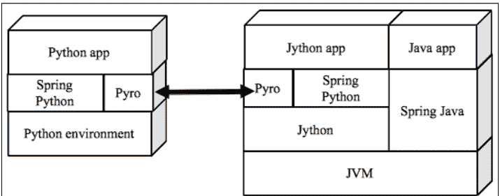

使用 Spring Python，很容易将 Java 和 Python 混合在一起。让我们编写一个简单的示例，在其中编写一个与上一节所示的 TV 服务通信的 Jython 客户端。通过重用该代码，我们可以轻松编写客户端。为了真正展示 Python/Jython/Java 集成的威力，让我们将我们的 Jython 客户端暴露给纯 Java 消费者。

- 1. 首先，我们需要一个纯 Java 接口，让我们的 Jython 代码可以扩展它。
- 2. 接下来，我们编写 Jython 类来扩展此接口。

```
import org.python.core.PyList;

public interface JavaTvShowService {
    public PyList getTvShows();
}
```

```
class JythonTvShowService(JavaTvShowService):
    def __init__(self):
        self.container = ApplicationContext(TvShowContainer())
        self.client = container.get_object("web_client")

    def getTvShows(self):
        return self.client.get_tv_shows()
```

- 3. 为了让 Java 客户端调用 Jython，我们需要创建一个工厂来创建嵌入式 Jython 解释器。

```java
import org.python.core.PyObject;
import org.python.util.PythonInterpreter;

public class TvShowServiceFactory {
    private PyObject clazz;

    public TvShowServiceFactory() {
        PythonInterpreter interp = new PythonInterpreter();
        interp.exec("import JythonTvShowService");
        clazz = interp.get("JythonTvShowService");
    }

    public JavaTvShowService createTvShowService() {
        PyObject tvShowService = clazz.__call__();
        return (JavaTvShowService)
        tvShowService.__tojava__(JavaTvShowService.class);
    }
}
```

- 4. 最后，我们可以编写一个 main 函数，先调用工厂，然后调用 JavaTvShowService。

```java
public class Main {
    public static void main(String[] args) {
        TvShowServiceFactory factory =
            new TvShowServiceFactory();
        JavaTvShowService service =
            factory.createTvShowService();
        PyList tvShows = service.getTvShows();
        for (int i = 0; i < tvShows.__len__(); i++) {
            PyObject obj = tvShows.__getitem__(i);
            PyTuple tvShow =
                (PyTuple)obj.__tojava__(PyTuple.class);
            System.out.println("Tv show title=" + tvShow.get(0) +
                " airDate=" + tvShow.get(1) +
                " episode=" + tvShow.get(2) +
                " writer=" + tvShow.get(3));
        }
    }
}
```

我们定义了一个接口，为同时针对 Java 消费者和 Jython 服务进行编码提供了一个良好的边界。我们的 Jython 类扩展了该接口，并在创建时创建了一个 IoC 容器，该容器请求一个 `web_client` 对象。这就是我们的 `PyroProxyFactory`，它使用 Pyro 通过线路调用我们的纯 Python 服务。通过实现接口，我们方便地将远程过程调用暴露给 Java 消费者。我们的 Java 应用程序需要一个 `factory` 类来创建 Jython 解释器，进而创建我们 Jython 类的实例。我们在应用程序 main 中使用它来获取 TV 服务的实例。使用该服务，我们调用暴露的方法，这会进行 Pyro 远程调用。我们遍历接收到的列表并提取元组以打印结果。

在瞥见如何将纯 Python 服务暴露给纯 Java 消费者之后，从这里开始的选项是无穷无尽的。我们可以使用 Spring Java 的 `RmiServiceExporter` 或 `HessianServiceExporter` 将我们的 Python 服务暴露给其他协议。该服务可以集成到 Spring Integration 工作流中或成为 Spring Batch 作业的一部分。真的没有限制。我们将在 *第 10 章* 中通过案例研究更详细地探讨这一点。

我们已经了解了将 Python 服务暴露给 Java 消费者是多么容易。如果你已经熟悉 Spring Java，希望在阅读本书时，你会注意到 *Spring 方式* 不仅适用于 Java，也适用于 Python。Spring Python 使用与 Spring Java 相同的概念，与 Spring Java 共享一些类名，甚至有一个 XML 解析器可以读取 Spring Java 的格式。所有这些都增加了在对配置文件进行少量更改的同时将某些部分重写为 Python 的能力。所有这些方面都使我们更容易逐步将应用程序迁移到我们为提高生产力所需的最佳位置。

## 扩展 Spring Python

Spring Python 通过其整洁分段的模块集提供对服务、库和 API 的便捷访问。Spring Python 的灵活性源于其模块化特性。提供给你一组易于组合的小块，比提供一组单体类以供扩展更具可重用性。这些技术为轻松集成当前技术和未来技术打开了大门。

在本章中，我们已经查看了各种功能，包括 remoting、`DatabaseTemplate` 和 Python 与 Java 的集成。随着我们探索 Spring Python 的其他功能，我希望你能意识到使用 *Spring 方式* 编写有用的抽象并将对象创建委托给 Spring Python 容器，使得编写尚未成为此项目一部分的更多模块变得容易。

随着你的需求增长，该项目也会随之增长。Spring Python 使编写自己的模板和模块变得容易。你可以像 Spring Python 的预构建服务一样轻松地编写和注入自定义服务。如果你有关于新功能的想法，认为它们属于 Spring Python，你可以访问网站 http://springpython.webfactional.com 了解如何提交想法、补丁，或许加入团队帮助 Spring Python 发展。

## 安装 Spring Python

Spring Python 安装很容易。它附带两个可安装的 tar 包。一个是核心库本身。另一个是一组可选安装的示例，可帮助你更好地理解 Spring Python。由于它是用纯 Python 编写的，已安装的文件也是源代码，因此你可以了解 Spring Python 的工作原理。


> 本安装部分不展示安装开发 Spring Python 项目补丁所需的所有部分。如需了解设置开发环境方面的更多信息，请加入 Spring Python 邮件列表 http://lists.springsource.com/listmanager/listinfo/springpython-users，在那里你可以询问当前开发要求。

## 为 Spring Python 设置环境

安装 Spring Python 目前需要 Python 2.4、2.5 或 2.6。它也可以在 Jython 2.5 上运行。在撰写本文时，由于缺乏向后兼容性和成熟度，它尚未扩展以支持 Python 3。然而，随着 Python 3 在用户社区中获得认可，Spring Python 也将迁移以支持它。

Spring Python 使与某些第三方库的集成变得更容易。本书不涵盖这些第三方库的安装。例如，要针对 Oracle 数据库编写查询，你需要安装 **cxora** 包。


## 从预构建的二进制下载安装

二进制文件由 SpringSource 以 tar 包的形式托管在社区部分。它们是非操作系统特定的，应该可以在任何平台上运行。

1. 访问 http://www.springsource.org/download/community。你可以填写注册信息，或直接点击链接前往下载站点

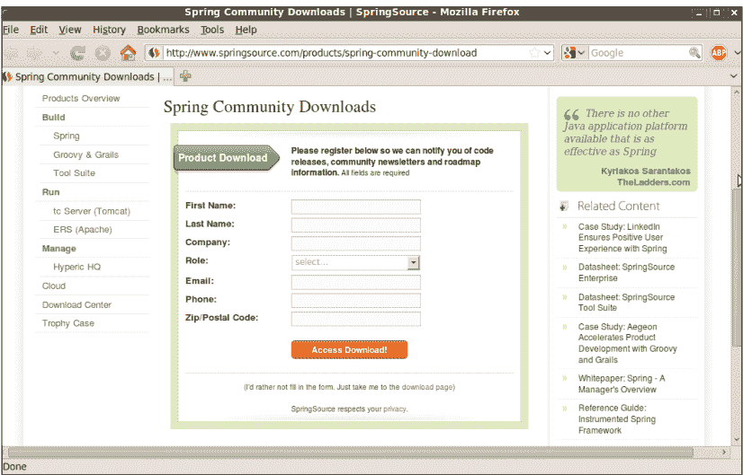

2. 点击 Spring Python 查看最新版本：

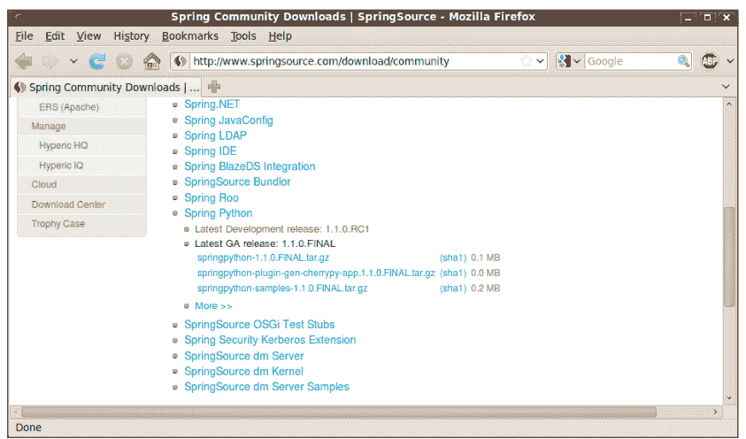

3. 下载 `springpython-<release>.tar.gz` 以获取核心库

4. 解压 tar 包，并进入包含 `setup.py` 的目录

5. 输入以下命令安装 Spring Python

> 注意：此步骤可能需要管理员权限！
> $ python setup.py install

6. 现在你应该能够测试安装。

```
$ python
>>> import springpython
>>> dir()
['__builtins__', '__doc__', '__name__', 'springpython']
```

## 从源代码安装

Spring Python 可以像许多其他开源项目一样从源代码安装。代码托管在 Subversion 仓库中。以下步骤将帮助你下载代码并在机器上安装：

1. 输入以下命令检出最新的 trunk 仓库：
```bash
$ svn checkout https://src.springframework.org/svn/se-springpython-py/trunk/springpython springpython
```
这将在本地创建包含最新更改的目录 `springpython`。

2. 进入包含 `build.py` 的目录。该脚本是构建、打包和测试 Spring Python 的关键工具。输入以下命令生成可安装的 Spring Python 包：
```bash
$ ./build.py -package
```

3. 进入 `target/artifacts`，该目录包含新生成的 tar 包。

4. 解压 tar 包 `springpython-<release>.tar.gz`，并进入包含 `setup.py` 的目录，然后输入以下命令安装 Spring Python：
```bash
$ python setup.py install
```

5. 现在你应该能够测试安装。
```bash
$ python
>>> import springpython
>>> dir()
['__builtins__', '__doc__', '__name__', 'springpython']
```

6. 使用 Subversion 仓库获取源代码可让你轻松安装新更新。

7. 输入以下命令更新你的检出。
```bash
$ svn update /path/for/springpython
```

8. 使用 `build.py`、`target/artifacts` 和 `setup.py` 重复上述步骤。

> 注意：此步骤可能需要管理员权限。
> $ python setup.py install

> 正式发布版本位于 Subversion 仓库的 tags 部分，紧邻 trunk。

> 你也可以使用 SpringSource 的 Fisheye 查看器在 https://fisheye.springframework.org/browse/se-springpython-py 可视化检查代码。这提供了一种查看代码、变更集和变更日志的方式。

## Spring Python 社区

Spring Python 重视其用户社区，并在关键功能上以用户请求为依据。Spring Python 中目前的许多功能都是基于用户请求、提交的补丁和反馈添加的。

- `http://springpython.webfactional.com`—项目网站，包括参考文档的链接

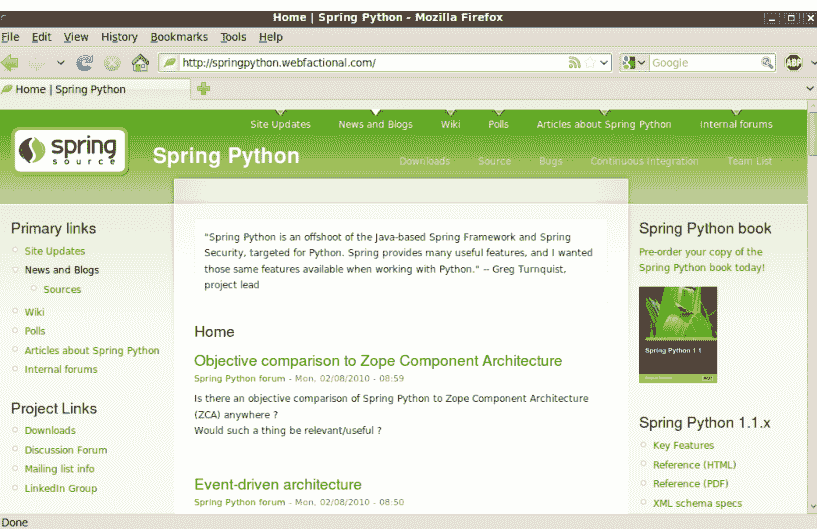

- `http://forum.springsource.org/forumdisplay.php?f=45`—社区讨论论坛
- `http://blog.springpython.webfactional.com`—Spring Python 作者的博客网站
- http://lists.springsource.com/archives/springpython-users — Spring Python 用户的邮件列表
- http://www.linkedin.com/groups?gid=1525237 — Spring Python 用户的 LinkedIn 群组

## 摘要

我们对 Spring Python 的各个部分进行了快速浏览。示例展示了 Spring Python 如何让 Python 和 Java 开发者都更轻松。

在本章中，我们了解到：

- Spring Python 具有非侵入式 API，使你无需对自己的代码库进行重大更改即可轻松使用其他库
- Spring Python 具有一个容器，将对象创建与对象使用解耦，从而赋能开发者
- Spring Python 通过提供非侵入式 API 来帮助专业 Python 开发者轻松访问高级服务
- Spring Python 为专业 Java 开发者提供了一种简单的方式，通过 Python/Jython/Java 的组合将 Python 和 Java 混合使用
- Spring Python 可以从二进制和源代码安装
- Spring Python 非常可扩展，并且很容易让我们添加新组件
- 有一个用户社区，我们可以在其中发布问题、答案、想法和补丁

在下一章中，我们将深入 Spring Python 的核心，即其 `Inversion of Control` 容器。

# 2 Spring Python 的核心——控制反转

# Spring Python 的核心——控制反转

许多软件团队寻求在不牺牲质量的情况下提高生产力的方法。这导致自动化测试增加，进而引发了使应用程序更易于测试的兴趣。许多自动化测试框架通过用测试替身交换协作对象来提供罐装响应，从而促进对象隔离。这要求开发者以尽可能少的更改插入测试替身。

有时，管理者通过削减开发和集成硬件来压缩预算。这使开发者面临在比生产环境更小的环境中开发的困境。软件开发者需要能够在不同的测试配置和部署场景之间切换的能力。

销售给客户的软件产品通常需要在现场进行灵活调整，无论是通过公司代表还是客户本人。

在本章中，我们将探讨 Spring Python 的 **控制反转 (IoC)** 容器如何通过将关键对象的创建移入容器定义来满足所有这些需求，从而在不影响核心业务代码的情况下实现灵活调整。

本章将涵盖：

- IoC 容器如何使隔离测试对象变得容易，以便进行自动化测试。
- 对 IoC 的详细解释，附带高层图表。我们将学习依赖注入是如何一种 IoC 类型，并使用好莱坞原则 *别叫我们，我们会叫你！*
- Spring Python 的 IoC 容器，处理依赖解析、设置属性和延迟初始化。它还为开发者按需使用提供扩展点。
- Spring Python 对动态语言中 IoC 的社区争论的回应。
- 如何轻松地将 Python 和 Java 组件混合使用，可以有多种方式，并为开发者提供选择最适合其需求的好方法。

### 用测试替身交换生产代码

作为开发者，我们需要能够用模拟对象和存根交换生产对象的能力。


> 模拟对象和存根是生成用于测试代码的罐装响应的两种方式。**模拟对象** 用于生成罐装方法调用。**存根** 用于生成罐装数据。这两者都是模拟代码必须工作的外部组件的有用工具。更多详情请参阅 http://martinfowler.com/articles/mocksArentStubs.html

在此示例中，我们将探讨 IoC 容器如何使交换生产对象与模拟实例变得容易。我们从为 wiki 引擎开发一个简单服务以及一些自动化测试开始。

1. 首先，让我们为 wiki 引擎定义一个简单服务。下面的 `WikiService` 有一个函数，它查询 MySQL 数据库并返回页面的点击次数以及每次编辑的读取比率。

```
class WikiService(object):

    def __init__(self):
        self.data_access = MySqlDataAccess()
```


```python
def statistics(self, page_name):
"""Return tuple containing (num hits, hits per edit)"""
hits = self.data_access.hits(page_name)
return (hits, hits / len(self.data_access.edits(page_name)))
```

在这种情况下，WikiService 直接将 data_access 定义为使用 MySqlDataAccess。statistics 方法调用 MySqlDataAccess 获取一些信息，并返回一个包含页面命中次数以及每次编辑的读取比率的元组。

> 需要指出的是，我们当前版本的 WikiService 对 MySQL 具有强依赖性，这是由直接创建 MySqlDataAccess 实例所暗示的。

- 2. 接下来，我们将编写一些用于运行 wiki Web 服务器的启动代码。

```python
if __name__ == "__main__":
    service = WikiService()
    WikiWebApp(service).run()
```

启动代码创建了一个 WikiService 实例，进而创建了一个 MySqlDataAccess 实例。我们创建了主 Web 应用程序组件 WikiWebApp 的实例并启动它，将其服务句柄传递给它。

> 我们尚未定义 WikiWebApp 或 MySqlDataAccess。相反，我们将重点关注 WikiService 提供的功能以及如何隔离和测试它。

让我们更仔细地查看我们编写的代码的测试。 一个好的测试用例将涉及对 statistics 的测试。考虑到它使用来自 MySqlDataAccess 的 hits 和 edits，它直接依赖于连接到实时 MySQL 数据库。测试的一种选择是预先加载数据库中的固定内容。然而，设置和拆除的成本会迅速失控。如果团队中有多个开发人员，您也不希望出现一个开发人员正在设置而另一个开发人员正在拆除相同表的竞争情况。

3. 由于我们不想持续设置和拆除实时的数据库表，我们将改为编写数据访问对象的存根版本。

```python
class StubDataAccess(object):
    def hits(self):
        return 10.0

    def edits(self, page_name):
        return 2.0
```

> 注意我们的存根版本返回的是易于测试的固定值。

4. 现在让我们编写一个测试用例来测试我们的 WikiService。为了用测试替身替换 data_access 属性，测试用例必须直接覆盖该属性。

```python
class WikiServiceTestCase(unittest.TestCase):
    def testHittingWikiService(self):
        service = WikiService()
        service.data_access = StubDataAccess()

        results = service.statistics("stub page")
        self.assertEquals(10.0, results[0])
        self.assertEquals(5.0, results[1])
```

此解决方案通过插入我们的数据访问层的存根版本，很好地消除了处理 MySQL 数据库的需求。这些依赖关系在下面的图表中显示。

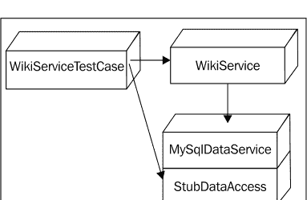

WikiServiceTestCase 依赖于 WikiService 和 StubDataAccess，以及对 MySqlDataAccess 的继承依赖。任何这些依赖关系的更改都可能影响我们的测试代码。

如果我们构建一个包含数百个测试方法的庞大测试套件，所有测试方法都使用实例化 `WikiService` 然后用测试替身覆盖 `data_access` 的模式，我们就为自己设置了很大的风险。例如，`WikiService` 或 `StubDataAccess` 可能添加了一些新的初始化参数。如果我们以后需要更改创建可测试 `WikiService` 的这种模式，我们可能必须更新每个测试方法！我们需要确保每次更改都是正确的。这就是 Spring Python 的控制反转可以提供帮助的地方。

## 更多关于控制反转的内容

在深入我们的解决方案之前，让我们更深入地了解控制反转的含义。

控制反转是一种范式，我们改变创建对象的方式。在简单的对象创建场景中，如果我们有模块 X 和 Y，且 X 需要 Y 的实例，我们会让 X 直接创建它。这会在 X 和 Y 之间引入直接依赖关系，如下图所示。

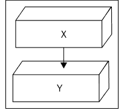

这是有依赖性的，因为 Y 的任何更改都可能影响 X 并导致必要的更新。这种依赖关系不仅仅存在于 X 和 Y 之间。X 现在依赖于 Y 以及 Y 的所有 *依赖项*（如下所示）。Y 或其任何依赖项的任何更新都可能影响 X。

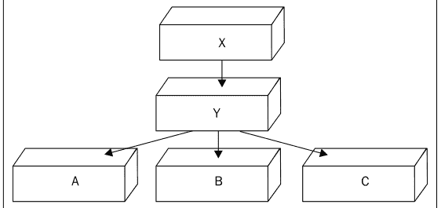

通过控制反转，我们通过将 Y 实例的创建委托给单独的容器，从而打破 Y 及其依赖项对 X 造成潜在影响的风险，如下所示。

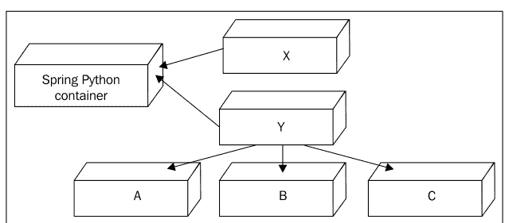

这将 X 和 Y 之间的依赖关系转移到容器上，减少了耦合。

> 需要注意的是，依赖关系并未完全消除。因为 X 仍然被赋予 Y 的实例，所以仍然存在对其 API 的依赖，但 Y 及其任何依赖项都不必导入到 X 中这一事实使得 X 成为一个更小、更易于管理的代码块。

我们在 wiki 引擎代码中看到 `WikiService` 如何依赖于 `MySqlDataAccess`。`MySqlDataAccess` 依赖于 `MySQLdb`，这是一个用于与 MySQL 通信的 python 库。使用容器并针对定义良好的接口进行编码，为更改注入到 `WikiService` 中的数据访问版本提供了机会。

在下一节继续我们的示例时，我们将看到 IoC 如何帮助我们使测试代码的管理变得更容易，从而降低长期维护成本。

## 将控制反转添加到我们的应用程序中

我们已经通过使用测试存根消除对 MySQL 的依赖，迈出了降低维护成本的第一步。然而，我们使用的机制由于违反了 DRY（不要重复自己）原则而带来了很大的风险。

对于我们当前的问题，我们希望 Spring Python 以一种允许我们在一个地方进行更改的方式来管理 `WikiService` 的创建，这样我们就不必编辑每个测试方法。为此，我们将定义一个 IoC 容器，让它为我们处理对象的创建。以下代码显示了一个简单的容器定义。

- 1. 首先，让我们使用 Spring Python 创建一个 IoC 容器，并让它创建我们的 `WikiService` 实例。

```python
from springpython.config import PythonConfig
from springpython.config import Object

class WikiProductionAppConfig(PythonConfig):
    def __init__(self):
        super(WikiProductionAppConfig, self).__init__()

    @Object
    def wiki_service(self):
        return WikiService()
```

您可以通过注意 Spring Python 的 `@Object` 装饰器来识别容器中定义的 objects。

- 2. 现在我们希望更改启动代码，使其使用容器而不是直接创建 `WikiService` 对象。

```python
if __name__ == "__main__":
    from springpython.context import ApplicationContext
    container = ApplicationContext(WikiProductionAppConfig())
    service = container.get_object("wiki_service")
    WikiWebApp(service).run()
```

在我们 wiki Web 应用程序的这个版本中，服务对象是通过向容器请求 `wiki_service` 获得的。Spring Python 将此请求分派到 `WikiProductionAppConfig`，在那里它调用 `wiki_service()` 方法。现在容器负责创建 `WikiService` 的实例并将其返回给我们。

依赖关系如下图所示：

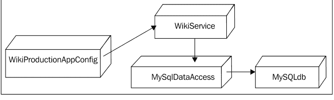

在此中间阶段，请注意 WikiService 仍然依赖于 MySqlDataAccess。我们只修改了应用程序获取 WikiService 副本的方式。在后面的步骤中，我们将完全移除对 MySqlDataAccess 的依赖。

- 3. 让我们看看当我们使用 IoC 容器检索 WikiService 时我们的测试用例是什么样的。

```python
from springpython.context import ApplicationContext

class WikiServiceTestCase(unittest.TestCase):
    def testHittingWikiService(self):
        container = ApplicationContext(WikiProductionAppConfig())
        service = container.get_object("wiki_service")
        service.data_access = StubDataAccess()

        results = service.statistics("stub page")
        self.assertEquals(10.0, results[0])
        self.assertEquals(5.0, results[1])
```

通过此更改，我们现在从容器获取 WikiService，然后用 StubDataAccess 覆盖它。你可能会想“这有什么意义？”关键点是我们将可测试 wiki_service 对象的创建转移到了容器。为了完成过渡，我们需要从 WikiService 中移除所有对 MySqlDataAccess 的依赖。在这样做之前，让我们讨论依赖注入。


## 依赖注入 又名 好莱坞原则

到目前为止，我们已经成功将 WikiService 对象的创建委托给了 Spring Python 的控制反转容器。然而，WikiService 仍然对 MySqlDataAccess 存在硬编码依赖。

IoC 的本质是将对象创建推入第三方位置。迄今为止，我们一直使用“控制反转”这一术语。Spring Python 实现 IoC 的方式是通过依赖注入机制。依赖注入，或 DI，是指通过初始化代码将依赖项推送到对象中，或让容器直接分配属性。这有时被好莱坞的陈词滥调“不要打电话给我们，我们会打电话给你”所描述。其含义是需要特定依赖的对象不应直接创建它，而应等待外部容器在需要时提供它。

> 因为 Spring Python 仅使用依赖注入，因此本书中，控制反转、IoC、依赖注入和 DI 这些术语可以互换使用，以传达相同的概念。

下面这个版本的 WikiService 显示了对 MySqlDataAccess 依赖的完全移除。

```
class WikiService(object):
    def __init__(self, data_access):
        self.data_access = data_access

    def statistics(self, page_name):
        """Return tuple containing (num hits, hits per edit)"""
        hits = self.data_access.hits(page_name)
        return (hits, hits / len(self.data_access.edits(page_name)))
```

采用这个修改后的 WikiService 版本后，提供 data_access 的具体实例现在由 WikiService 的创建者负责。对我们的 IoC 容器所做的相应更改如下所示。

```
from springpython.config import PythonConfig
from springpython.config import Object

class WikiProductionAppConfig(PythonConfig):
    def __init__(self):
        super(WikiProductionAppConfig, self).__init__()

    @Object
    def data_access(self):
        return MySqlDataAccess()

    @Object
    def wiki_service(self):
        return WikiService(self.data_access())
```

我们添加了 MySqlDataAccess 的定义，以便在创建 WikiService 实例时将其注入。我们的依赖图现在显示了 WikiService 与 MySqlDataAccess 之间依赖关系的完全断开。

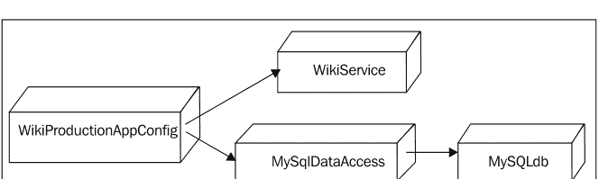

如前所述，这类似于好莱坞的格言“不要打电话给我们，我们会打电话给你”。它使我们的代码能够注入任何变体成为可能，在无需重写系统其他部分的情况下提供了更大的灵活性。

## 将控制反转添加到我们的测试中

通过对 WikiService 和 WikiProductionAppConfig 的此项调整，我们现在可以编写设置测试用例的替代方法。

- 1. 首先，我们对生产容器配置进行子类化以创建测试版本。然后我们重写 data_access 对象，使其返回我们的存根替代品。
- 2. 现在，我们可以修改测试套件以像生产主代码一样获取 WikiService，只是使用我们的替代容器。

```
class WikiTestAppConfig(WikiProductionAppConfig):
    def __init__(self):
        super(WikiTestAppConfig, self).__init__()

    @Object
    def data_access(self):
        return StubDataAccess()
```

使用这种技术，我们继承了所有生产定义。然后我们只需覆盖测试情况所需的部分。在这种情况下，我们返回一个略微修改的 WikiService 版本，适合我们的测试需求。

```
from springpython.context import ApplicationContext

class WikiServiceTestCase(unittest.TestCase):
    def testHittingWikiService(self):
        container = ApplicationContext(WikiTestAppConfig())
        service = container.get_object("wiki_service")

        results = service.statistics("stub page")
        self.assertEquals(10.0, results[0])
        self.assertEquals(5.0, results[1])
```

WikiService 与 StubDataAccess 之间的依赖关系（或缺乏依赖！）在以下图表中显示：

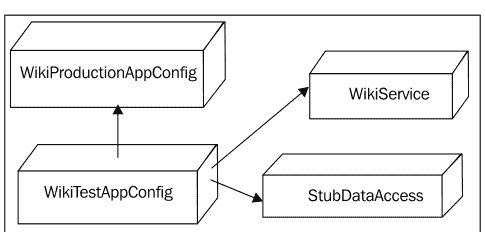

这使得插入我们的替代 `StubDataAccess` 变得很容易。需要注意的重要一点是，我们的测试代码不再覆盖 `data_access` 属性，也不再在创建 `WikiService` 时执行任何其他特殊步骤。相反，此创建逻辑已完全交由 IoC 容器处理。我们现在可以轻松编写任意多的测试，而无需担心对 `WikiService` 或 `data_access` 的更改，只要我们继续依赖 IoC 容器处理对象创建即可。我们只需访问 `WikiTestAppConfig` 的蓝图以进行任何未来的修改。

在本示例的结论中，下图显示了我们当前的 objects 以及系统潜在的增强。在这种可能的情况下，我们定义了多个数据访问组件。要了解哪个组件被注入到 `WikiService` 中，我们只需查看相关容器的定义，无论是生产环境还是特定测试场景。我们的当前系统可能使用 **MySQL**，但如果新客户想要使用 **PostGreSQL**，我们只需创建容器的另一个变体，并注入替代的数据访问对象。**Sqlite** 也是如此。所有这些都可以在不影响 `WikiService` 的情况下完成。

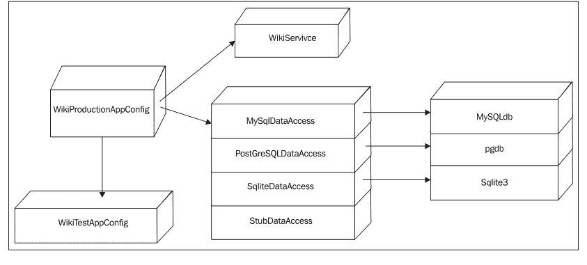

## 容器与上下文

你可能已经注意到在本章示例中，我们一直将包含对象定义的代码称为容器，而用于创建它的类却称为 `ApplicationContext`。本章将阐明 **上下文** 与 **容器** 之间的区别。

Spring Python 有一个名为 `ObjectContainer` 的基类，它负责管理对象定义、基于这些定义创建对象实例，并且在很大程度上负责我们迄今为止所看到的功能。从面向对象的角度来看，该类的任何实例都是容器。事实上，我们可以在之前的示例中将该类替换为所有出现的 `ApplicationContext`，它的大部分行为都相同。

`ObjectContainer` 有一个名为 `ApplicationContext` 的子类。`ApplicationContext` 的实例是上下文。然而，从 OOP 角度来看，上下文就是容器。因此，通常将两者中的任何一个实例称为 IoC 容器是常见做法。

`ApplicationContext` 与 `ObjectContainer` 在行为上存在一些差异，并且还涉及生命周期管理和对象管理的额外功能。这些差异首先将在下面的功能表中显示，并将在后面更详细地介绍。

| 类 | 功能 |
|---|---|
| `ObjectContainer` | - 启动时延迟实例化对象，可选择覆盖
- 对象默认按单例作用域 |
| `ApplicationContext` | - 启动时急切实例化对象，可选择覆盖
- 对象默认按单例作用域
- 支持属性驱动对象
- 支持后处理器
- 支持上下文感知对象 |

## 惰性对象

我之前说过，如果我们用 `ObjectContainer` 替换 `ApplicationContext`，本章示例的大部分行为都将相同。一个区别是，`ObjectContainer` 在容器首次创建时不会实例化任何对象。相反，它会等待对象被请求时才实际创建它。`ApplicationContext` 在容器启动时立即自动实例化所有对象。


> 在迄今为止的示例中，这种差异影响不大，因为在创建容器后，我们立即请求主要对象。在本书后面的一些示例中则不会如此。

可以通过在对象定义中将 lazy_init 设置为 True 来覆盖此行为。这将延迟对象创建，直到第一次请求。

```
class WikiTestAppConfig(WikiProductionAppConfig):
    def __init__(self):
        super(WikiTestAppConfig, self).__init__()

    @Object(lazy_init=True)
    def data_access(self):
        return StubDataAccess()
```

使用此方法的一个原因是，如果我们有一些仅在特定场合需要的对象，并且在创建时可能产生大量开销。将 lazy_init 设置为 True 将推迟其创建，使其表现得像按需服务。

此覆盖适用于 ObjectContainer 和 ApplicationContext。

## 作用域对象

容器的另一个关键职责是管理对象的范围。这意味着对象在何时创建、实例存储在哪里以及在何时销毁。

Spring Python 目前支持两种作用域：singleton 和 prototype。singleton 作用域的对象在关闭前会被缓存在容器中。prototype 作用域的对象永远不会被存储，因此每次从容器请求对象时，对象工厂都需要创建一个新实例。


> 当 singleton 对象包含 prototype 对象作为其初始化属性之一时，重要的是要意识到每次使用缓存的 singleton 时，prototype 并不会被重新创建。

容器的默认策略是将所有内容设为 singleton。每个对象的范围可以单独覆盖，如下所示。

```
class WikiTestAppConfig(WikiProductionAppConfig):
    def __init__(self):
        super(WikiTestAppConfig, self).__init__()

    @Object(scope=scope.PROTOTYPE)
    def data_access(self):
        return StubDataAccess()
```

每次请求 data_access 都会产生不同的实例。无论请求来自容器外部，还是来自另一个注入 data_access 的容器对象，情况都如此。


此覆盖同时适用于 `ObjectContainer` 和 `ApplicationContext`。

## 属性驱动对象

ApplicationContext 会在对象创建并设置完所有容器定义的属性后，对任何具有此方法的对象调用 `after_properties_set()`。以下是一些此功能可能有用的示例：

- 在类定义中包含验证逻辑。如果某些属性是可选的而其他属性不是（或某些属性组合需要设置），这就是我们定义它的机会，并让容器验证对象是否被正确定义。
- 启动后台服务。例如，`PyroServiceExporter` 在所有属性设置后在后台启动一个守护线程。

## 后处理器对象

ApplicationContext 将搜索 **后处理器**。这些是操作容器中其他对象的类。它们扩展了 Spring Python 的 `ObjectPostProcessor` 类。

```
class ObjectPostProcessor(object):
    def post_process_before_initialization(self, obj, obj_name):
        return obj
    def post_process_after_initialization(self, obj, obj_name):
        return obj
```

当上下文启动时，所有非后处理器对象会一次一个地喂给每个后处理器两次：在初始化之前和之后。默认情况下，对象会原样传递而不做任何更改。通过编写自定义后处理器，我们可以覆盖任一阶段并应用任何我们想要的更改。这可能包括修改对象本身，或替换为不同的对象。

```
class RemoteService(ObjectPostProcessor):
    def post_process_after_initialization(self, obj, obj_name):
        if obj_name.endswith("Service"):
            return PyroServiceExporter(service=obj,
                                        service_name=obj_name,
                                        service_port=9000)
        else:
            return obj
```

此后处理器会查看对象的名称，如果名称以 `Service` 结尾，则返回一个代理，将对象作为 Pyro 服务导出，并使用对象的名称作为 URL 的一部分。否则，它只是返回该对象。

此示例展示了如何仅通过使用 Spring Python 的 IoC 容器和一些自定义后处理器，就能轻松开发一种约定优于配置的客户端-服务器机制。

## 上下文感知对象

我们可以通过扩展 `ApplicationContextAware` 来定义类，将 `ApplicationContext` 的副本注入到属性 `app_context` 中。


> 这*仅*推荐用于需要以某种方式操作上下文的对象。*不*建议使用此钩子仅仅为了获取对象，因为这会将我们的代码直接绑定到容器。

相反，请使用本章前面所示的依赖注入原则。

## 关于动态语言中 IoC 的争论

技术社区中关于 IoC 在 Python、Ruby 等动态语言中是否有价值存在激烈争论。本节讨论了其中的几个论点，并展示了 IoC 在任何语言中都具有明确价值。如果你已经认同 IoC 的理念，可以跳过本节并了解 Spring Python 提供的更多配置 IoC 定义的选项。

一个论点是 IoC 是作为一种范式发明的，用以促进静态语言，特别是 Java。在动态世界中，传递带有句柄的对象要流畅得多，可以理解 IoC 可能不会像在 Java 等静态语言中那样解决许多问题。虽然许多使用 IoC 框架的 Java 开发者确实在生产力上获得了显著提升，但将动态语言排除在外也是可信的。

跨越动态/静态分界并由 IoC 处理的最强原则是 **DRY (不要重复自己)**。在一个地方定义对象的创建并能够重复使用该定义非常有用，并且使调整对象的创建方式变得容易。

一位精通 Ruby 的开发者经历了开发 Ruby IoC 解决方案的几个阶段。第一轮涉及非常类似于 XML 选项的静态配置文件。后来他意识到编写 Ruby DSL 更简单、更易读，更符合 Ruby 的风格。最后，他意识到在代码中直接使用 Ruby 而不使用框架实际上更容易也更突出。在他的博客文章结尾，他暗示他每天都在使用 DI。他只是不需要框架来实现它。

作为回应，我是第一个说系统中创建的每个对象都不需要由 IoC 容器提供的人；只需要那些可以从使用测试替身、环境变化以及为不同客户连接不同配置中受益的关键对象。例如，编写小型脚本和简单应用可能根本不需要 IoC。然而，随着应用的增长，管理依赖和对象创建的需求也在增长，在这些情况下，Spring Python 的 IoC 容器可以满足这些需求。IoC 还为需要远程调用、事务、安全等情况提供了简单解决方案。

动态 IoC 解决方案的反对者认为这些解决方案只是简单的移植工作，实际上更适合不熟悉动态语言环境的人。本质上，喜欢在 C# 或 Java 等静态语言中编码时使用 IoC 的人，希望在 Python 中获得同样的温暖舒适感。虽然 Spring Python 使用了一些与 Spring Java 相同的类名，但它绝不是简单的移植工作。Spring Python 移植了许多概念但不是代码。其中最好的例子之一是 Spring Python 的安全模块。Spring Security（最初称为 Acegi Security）的架构已成为 Java 行业的事实上的安全标准。它们的架构概念涉及使用一组通用接口链接到无数安全系统，如数据库、X.509、LDAP、CAS、kerberos、OpenID、OpenSSO 等，而无需绑定到特定 API。相反，认证和授权的概念已被抽象到合适的层级，使得在系统开发完成后可以轻松添加安全功能而无需大规模重构。对此的功劳很大程度上归功于 IoC 的强大功能及其将此关键服务包装在已编写业务逻辑周围的能力。基于简单的静态与动态论点放弃这种强大的安全架构将是愚蠢的。

另一个论点往往基于 Spring Java 及其历史上对 XML 配置文件的使用。虽然 XML 常用于许多基于 Java 的框架，但 Python 社区倾向于避免使用 XML，除非客户要求另行规定。一些开发者批评 Spring Python 是一个基于 XML 的容器。然而，本书已经展示了纯 Python 容器定义。开发者完全不必使用 XML 即可利用控制反转的强大功能。通过直接使用 Python 进行容器定义，可以获得以下强大选项：

- 我们可以编写可切换的上下文，其中容器读取主机名并推断其是在开发、测试还是生产环境中运行
- 我们可以编写集群上下文，根据我们在集群中的哪一侧运行来改变对象配置
- 我们可以编写代码从外部源读取额外属性，例如 Apache Web 服务器的 `httpd.conf` 文件，从而保持良好集成
- 我们可以在数据库中查找对象属性

坦白说，鉴于 Python 的强大功能以及 Spring Python 提供的额外实用工具，选项是无限的。

## 将 Spring Java 应用迁移到 Python

在上一节中，我指出 Spring Python 不要求我们使用 XML。然而，除了我们尚未查看的其他格式外，还支持 XML。提供其他格式是为了让 Spring Java 开发者更容易使用他们已知的东西迁移到 Python。

Spring Python 有两个文件解析器可读取包含对象定义的 XML 文件。`SpringJavaConfig` 读取 Spring Java XML 配置文件，而 `XMLConfig` 读取类似的格式，但专门定义以提供 Python 导向的选项，例如对字典、元组、集合和冻结集合的支持。


> SpringJavaConfig 不支持 Spring Java XML 规范中的所有功能，包括专用命名空间、Spring 表达式语言以及属性。此时，它旨在成为一个方便的工具，用于演示 Python 与 Java 之间简单的集成。


让我们探索如果我们的 wiki 引擎软件最初是用 Java 编写的，并且我们正在探索迁移到 Python 的选项时所采取的步骤。为了尽可能平滑地进行，我们将使用 Jython 运行 Python 部分。


> Jython 是一个用 Java 编写的 Python 编译器，设计用于在 JVM 上运行。Jython 脚本可以访问 Python 和基于 Java 的库。然而，Jython 无法访问用 C 编写的 Python 扩展。Spring Python 1.1 运行在 Jython 2.5.1 上。关于 Jython 的下载、安装和其他文档的信息可以在 http://jython.org 找到。

1. 假设 Java 代码有一个定义良好的数据访问接口。

```
public interface DataAccess {

    public int hits(String pageName);

    public int edits(String pageName);
}
```

2. 为了演示目的，让我们创建该接口的具体 Java 实现。

```
public class MySqlDataAccess implements DataAccess {

    private JdbcTemplate jt;

    public MySqlDataAccess(DataSource ds) {
        this.jt = new JdbcTemplate(ds);
    }

    public int hits(String pageName) {
        return jt.queryForInt(
            "select HITS from METRICS " +
            "where PAGE = ?", pageName);
    }

    public int edits(String pageName) {
        return jt.queryForInt(
            "select count(*) from VERSIONS " +
            "where PAGE = ?", pageName);
    }
}
```


> 这段 Java 代码看起来可能有些牵强，考虑到 MySqlDataAccess  supposed to be dependent on MySQL。这是为演示目的而创建的过度简化的版本。

3. 最后，让我们看一下 WikiService 的 Java 版本。

```
public class WikiService {

    private DataAccess dataAccess;

    public DataAccess getDataAccess() {
        return this.dataAccess;
    }

    public void setDataAccess(DataAccess dataAccess) {
        this.dataAccess = dataAccess;
    }

    public double[] statistics(String pageName) {
        double hits = dataAccess.hits(pageName);
        double ratio = hits / dataAccess.edits(pageName);
        return new double[]{hits, ratio};
    }
}
```

4. 使用 Spring Java 将其连接起来的常见方式可以在 javaBeans.xml 中找到。

```
<?xml version="1.0" encoding="UTF-8"?>
<beans xmlns="http://www.springframework.org/schema/beans"
       xmlns:xsi="http://www.w3.org/2001/XMLSchema-instance"
       xsi:schemaLocation="http://www.springframework.org/schema/
       http://www.springframework.org/schema/beans/spring-beans-2.5.xsd">

    <bean id="dataAccess" class="MySqlDataAccess"/>

    <bean id="wikiService" class="WikiService">
        <property name="dataAccess" ref="dataAccess"/>
    </bean>
</beans>
```


请注意，此 XML 格式由 Spring Java 定义和管理，而不是 Spring Python。

5. 现在我们可以看到这个纯 Java 应用的所有部分，下一步是使用 Spring Python 和 Jython 启动它。

```
if __name__ == "__main__":
    from springpython.context import ApplicationContext
    from springpython.config import SpringJavaConfig
    ctx = ApplicationContext(SpringJavaConfig("javaBeans.xml"))
    service = ctx.get_object("wikiService")
    service.calculateWikiStats()
```

得益于 Jython 透明创建 Python 和 Java 对象的能力，我们的 Spring Python 容器可以解析 javaBeans.xml 中的对象定义。

6. 随着开发周期的继续，我们找到了时间将 MySqlDataAccess 移植到 Python。

7. 完成之后，我们决定想要利用更多 Python 的特性，比如元组、集合和冻结集合。Spring Java 格式不支持这些。让我们将 javaBeans.xml 转换为 Spring Python 的 XML 格式并保存为 production.xml。

```
<?xml version="1.0" encoding="UTF-8"?>
<objects xmlns="http://www.springframework.org/springpython/schema/objects"
    xmlns:xsi="http://www.w3.org/2001/XMLSchema-instance"
    xsi:schemaLocation="http://www.springframework.org/springpython/schema/objects
    http://springpython.webfactional.com/schema/context/spring-python-context-1.0.xsd">

    <object id="data_access" class="Py.MySqlDataAccess"/>
    <object id="wiki_service" class="WikiService">
        <property name="dataAccess" ref="data_access"/>
    </object>
</objects>
```

这与 Spring Java 格式非常相似，这正是目的所在。通过更改头部并将 'bean' 替换为 'object'，我们现在可以使用 XMLConfig。

```
if __name__ == "__main__":
    from springpython.context import ApplicationContext
    from springpython.config import XMLConfig
    ctx = ApplicationContext(XMLConfig("production.xml"))
    service = ctx.get_object("wiki_service")
    service.calculateWikiStats()
```

我们现在可以使用以下等更多选项：

```
<property name="some_set">
    <set>
        <value>Hello, world!</value>
        <ref object="SingletonString"/>
        <value>Spring Python</value>
    </set>
</property>
```

```
<property name="some_frozen_set">
    <frozenset>
        <value>Hello, world!</value>
        <ref object="SingletonString"/>
        <value>Spring Python</value>
    </frozenset>
</property>
```

```
<property name="some_tuple">
    <tuple>
        <value>Hello, world!</value>
        <ref object="SingletonString"/>
        <value>Spring Python</value>
    </tuple>
</property>
```

8. 迁移到这种程度后，我们决定开始编写一些测试。我们希望使用本章开头所示的风格，使用替代配置将 MySqlDataAccess 替换为 StubDataAccess。为了避免更改 production.xml，我们创建了一个替代配置文件 test.xml。

```
<?xml version="1.0" encoding="UTF-8"?>
<objects xmlns="http://www.springframework.org/springpython/
schema/objects"
    xmlns:xsi="http://www.w3.org/2001/XMLSchema-instance"
    xsi:schemaLocation="http://www.springframework.org/
springpython/schema/objects
        http://springpython.webfactional.com/schema/
context/spring-python-context-1.0.xsd">

    <object id="data_access" class="Py.StubDataAccess"/>
</objects>
```

9. 现在让我们使用这两个文件为专用容器编写一个测试用例。为此，我们向 ApplicationContext 提供一个配置列表。

```
import unittest
from springpython.context import ApplicationContext
from springpython.config import XMLConfig

class WikiServiceTestCase(unittest.TestCase):
    def testHittingWikiService(self):
        ctx = ApplicationContext([XMLConfig("production.xml"),
                                XMLConfig("test.xml")])
        service = ctx.get_object("wiki_service")
        results = service.statistics("stub page")
        self.assertEquals(10.0, results[0])
        self.assertEquals(2.0, results[1])
```

文件名的顺序很重要。首先，从 production.xml 读取一组定义。接下来，从 test.xml 读取更多定义。任何与之前定义同名的新定义都会覆盖之前的定义。在我们的例子中，我们用对 stub 对象的引用覆盖 data_access。

10. 在 Python 平台取得所有成功之后，我们决定将容器定义迁移到纯 Python。首先，让我们将 `production.xml` 转换为 `WikiProductionAppConfig`。

```
from springpython.config import PythonConfig, Object
from Py import MySqlDataAccess
import WikiService

class WikiProductionAppConfig(PythonConfig):
    def __init__(self):
        PythonConfig.__init__(self)

    @Object
    def data_access(self):
        return MySqlDataAccess()

    @Object
    def wiki_service(self):
        results = WikiService()
        results.dataAccess = self.data_access()
        return results
```

11. 让我们将它与 `test.xml` 混合使用。

```
import unittest
from springpython.context import ApplicationContext
from springpython.config import XMLConfig

class WikiServiceTestCase(unittest.TestCase):
    def testHittingWikiService(self):
        ctx = ApplicationContext([WikiProductionAppConfig(),
                                  XMLConfig("test.xml")])
        service = ctx.get_object("wiki_service")
        results = service.statistics("stub page")
        self.assertEquals(10.0, results[0])
        self.assertEquals(2.0, results[1])
```

我们只需将 `XMLConfig("production.xml")` 替换为 `WikiProductionAppConfig()`。ApplicationContext 能够舒适地接受以不同格式存储的任何组合定义。Spring Python 的灵活容器为我们提供了对如何存储所有定义进行精细控制的能力。

我们可以继续并轻松地将 `test.xml` 替换为用纯 Python 编写的类似 `WikiTestAppConfig` 的内容。


这演示了逐件转换事物是多么容易。我们本可以根据希望保留在 Java 中的内容以及希望迁移到 Python 的内容更早地停止。如果我们将剩余的 Java 部分迁移到 Python 解决方案，那么我们可以选择使用 Python 或 Jython。关键在于 XML 支持使得从 Java 迁移到 Python 变得容易且影响最小。


> 必须认识到，仅因为我们从 Spring Java 应用开始，并不意味着这种技术仅适用于基于 Spring 的 Java 项目。在之前的示例中，我们迅速跳过了 javaBeans.xml，并使用 Spring Python 的 XML 格式连接了 Java 组件。

## Summary

在本章中，我们探讨了使用控制反转 (IoC) 交换测试替身。这并不是 IoC 的唯一用例。能够在不影响核心业务逻辑的情况下轻松重新配置事物，具有难以置信的价值。

IoC 允许我们将对象创建移动到集中位置。这使我们的应用程序更容易注入替代方案。这使得诸如测试、远程调用、事务和安全之类的事情变得容易得多。

Spring Python 支持多种格式，包括纯 Python、Spring Python XML 和 Spring Java XML。这为用户提供了基于其需求的广泛选择。通过使用 Jython，混合 Python 和 Java 代码变得容易得多。

用另一个对象定义交换一个对象定义构成了一个有用的服务。在整本书中，将会探讨其他服务。只要记住，这些服务的核心是 Spring Python 的 IoC 容器。

在本章中，我们学习了：

- IoC 容器通过用测试替身替换生产协作对象，使隔离被测对象变得容易
- IoC 和依赖注入的详细定义
- IoC 容器通过将对象的创建与其使用分离，对我们的应用程序产生积极影响，这有助于模块化我们的应用程序
- 依赖注入的好莱坞原则意味着我们的对象不会创建它们的协作对象，而是等待容器创建它们并将它们注入到我们的对象中
- Spring Python 具有 `ObjectContainer`，它包含 IoC 容器的基本部分。该容器处理依赖解析、设置属性和延迟初始化
- Spring Python 具有 `ApplicationContext`，它继承自容器，并为开发人员提供扩展点以操作对象的创建
- 虽然关于在动态语言中使用 IoC 可能存在争议，但将对象创建委托给单独容器的好处并不仅限于静态语言
- 通过使用 Jython 中的 Spring Python 容器，很容易将 Python 和 Java 组件混合在一起。对于已经使用 Spring Java 构建的应用程序来说，这种策略甚至更有效

在下一章中，我们将研究使用 **面向切面编程 (AOP)** 向现有代码添加服务。

# 3 Adding Services to APIs

# Adding Services to APIs

在上一章中，我们研究了 Spring Python 的控制反转容器，并用它来交换生产对象和测试替身。当今使用最广泛的范式之一是使用类的 **面向对象编程 (OOP)**。类作为我们解决的领域和业务问题的表示。但这还不够！

我们还需要诸如缓存、存储和检索、事务、安全和日志记录等强大的功能。这些服务与我们必须解决的业务问题正交。

将类与这些正交服务混合在一起，很快就会变得难以正确编码和维护。**面向切面编程 (AOP)** 通过一种称为 **切面** 的新型模块化来解决这些正交问题。

在本章中，我们将学习：

- 从 10,000 英尺高度看 AOP
- 为 Spring Python 对象添加缓存
- 通过添加性能和安全顾问扩展示例
- AOP 如何是一种范式而不仅仅是一个库
- Spring Python 的 AOP 与其他库以及 Python 语言特性相比的独特功能
- AOP 的风险以及如何通过展示如何测试我们的切面来缓解这些风险
- 关于应用 `Advice` 的一些建议

### AOP from 10,000 feet

在本章中，我们将探索 AOP 的示例以及如何使用它们。为此，学习一些基本定义很重要。


> 横切问题会影响一个以上的类层次结构。AOP 高效地解决了这些问题。

常见的横切问题示例包括安全、事务、跟踪、审计和日志记录。你认为是什么使这些关注点成为横切的？

### Crosscutting versus hierarchical

工作中常见的循环通常从一个单一问题开始。你会如何解决一个单一、具体、定义良好的问题？通过编写单一、具体的解决方案！我们通常此时不会考虑重用。我们更有可能在需要使用已编写的代码块解决新问题时考虑重用。

当我们解决另一个问题并尝试重用代码块时，我们开始看到如何进行调整和抽象。我们不仅仅是为了减少代码重复而抽象事物。我们还在用更精炼、更高层次的概念调整业务解决方案的定义。随着新需求的到来，我们的业务解决方案层次结构不断演进。

当我们继续解决业务问题时，遇到基础设施问题并不罕见。例如，可能出现需要用事务包装操作的需求，即使客户没有要求。

基础设施问题很容易横切类层次结构。SQL 事务是完美的例子。在每个需要它的方法中手动编码事务模式会导致大量代码重复。那当事务需求发生变化时我们该怎么办？重写所有受影响的方法？需求中不可预见的变化很容易在我们维护代码时累积大量工作。更不用说，我们在每个方法中都能正确编码事务模式的几率有多大？

AOP 提供了一种无需使用复制粘贴技巧来解决此问题的方法。我们将在本章中更详细地探讨这一点。

### Crosscutting elements

下列术语描述了构成面向切面编程的横切元素：

| 术语 | 描述 |
|---|---|
| 连接点 | 连接点是程序执行中可识别的点。这是横切操作被织入的地方。 |
| 切点 | 切点是选择连接点并在该点收集上下文的程序构造。 |
| 通知 | 通知是要在由切点选择的连接点处执行的代码。 |
| 切面 | 切面在 AOP 中相当于 OOP 中的类。它是定义一组切点和通知的核心编程构造。 |
| 顾问/拦截器 | 顾问或拦截器是 Spring Python 实现切面的机制。 |

在定义了这些术语后，我们将深入本章的其余部分，探索横切问题及其解决方案。

### Weaving crosscutting behavior

如前所述，切面包含切点及其关联的通知。将切面应用于我们的代码称为编织。

不同系统提供各种编织方式。AspectJ 是一种基于 Java 的 AOP 解决方案，具有静态和动态编织功能。


> AspectJ 是 AOP 的先驱，目标是 Java 平台。Spring Python 不一定与 AspectJ 集成，也不试图模仿 AspectJ 的所有功能。相反，Spring Python 将 AspectJ 视为实现 AOP 的成熟示例。
> 
> 有关 AspectJ 的更多信息，你可以阅读 *Ramnivas Laddad* 所著的 *《AspectJ 实战》*。虽然该书侧重于 AspectJ 和 Java，但它也对 AOP 的概念有更详细的介绍。

静态编织在代码编译时同时应用。动态编织应用于已编译的代码。


Spring Python 通过使用 **代理** 提供 **动态编织**。代理使用 IoC 容器进行配置。原本针对对象的调用现在改为通过代理路由。代理会评估可能的切点并应用 `Advice`。这也被称为 **intercepting.**

## 向 Spring Python 对象添加缓存

在本示例中，我们将通过编写一个从数据库检索 wiki 文本并将其转换为 HTML 的服务来增强我们一直在开发的 wiki 引擎。然后，为了限制对我们基础设施的负载，我们将添加缓存支持。

- 1. 首先，我们需要编写我们的服务。该服务将调用数据访问组件以检索存储在我们数据库中的 wiki 文本。然后我们将其转换为 HTML 并交还给调用方。

```python
class WikiService(object):
    def __init__(self, data_access):
        self.data_access = data_access

    def get_article(self, article):
        return self.data_access.retrieve_wiki_text(article)

    def store_article(self, article):
        self.data_access.store_wiki_text(article)

    def html(self, text):
        pass # return wiki text converted to HTML

    def statistics(self, article):
        hits = self.data_access.hits(article)
        return (hits, hits /
            len(self.data_access.edits(article)))
```

这里我们有一个 `WikiService`，与我们在 IoC 示例中使用的类似。除了具有 `statistics` 方法外，此版本能够从数据库检索 wiki 文本并将其格式化为 HTML。它还可以将编辑过的 wiki 文章存储到数据库中。在本示例中，我们对将 wiki 文本转换为 HTML 的代码并不特别关心，因此我们省略了它。

- 2. 让我们将我们的 WikiService 放入 Spring Python IoC 容器中，以便它可以作为我们 wiki 应用程序的一部分使用。

```python
from springpython.config import PythonConfig
from springpython.config import Object

class WikiProductionAppConfig(PythonConfig):
    def __init__(self):
        super(WikiProductionAppConfig, self).__init__()

    @Object
    def data_access(self):
        return MysqlDataAccess()

    @Object
    def wiki_service(self):
        return WikiService(self.data_access())
```

这应该看起来很熟悉。它是我们上一章中使用的相同的 IoC 容器定义。下面的框图显示了我们应用程序的组件，其中 Wiki 的视图层调用 WikiService，而 WikiService 又调用 data_access，最终到达数据库。

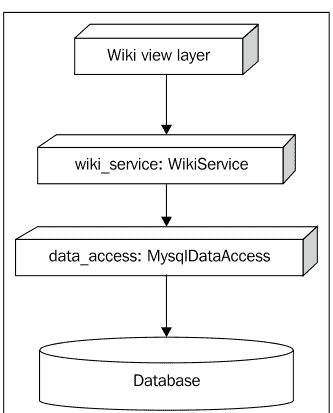

- 3. 假设我们的 wiki 引擎现在被用于一个非常受欢迎的网站，拥有大量文章和用户。在编辑之间对同一篇文章的多次请求很可能很常见，并且每次检索文章时都会对数据库服务器进行数据库查询，从而使其不堪重负。为了限制这种性能损失，让我们编写一个简单的缓存解决方案。

```python
class WikiServiceWithCaching(object):
    def __init__(self, data_access):
        self.data_access = data_access
        self.cache = {}

    def get_article(self, article):
        if article not in self.cache:
            self.cache[article] =
                self.data_access.retrieve_wiki_text(article)
        return self.cache[article]

    def store_article(self, article):
        del self.cache[article]
        self.data_access.store_wiki_text(article)

    def html(self, text):
        pass # return wiki text converted to HTML

    def statistics(self, article):
        hits = self.data_access.hits(article)
        return (hits, hits /
            len(self.data_access.edits(article)))
```

为了处理对同一篇文章的多次请求，WikiServiceWithCaching 将 wiki 文本存储在名为 cache 的内部字典中。然后在文章不在缓存中的情况下回退到数据库之前，会检查缓存中是否存在请求的文章。每当进行新的编辑时，缓存就会被清除。最后，statistics 完全没有任何缓存。

要引入我们的新缓存 wiki 服务，我们只需更改 IoC 容器定义中的 wiki_service 声明即可。

```python
class WikiProductionAppConfig(PythonConfig):
    def __init__(self):
        super(WikiProductionAppConfig, self).__init__()

    @Object
    def data_access(self):
        return MysqlDataAccess()

    @Object
    def wiki_service(self):
        return WikiServiceWithCaching(self.data_access())
```

这个想法相当简单，应该可以减轻我们数据库服务器的负载。然而，通过将缓存与 wiki 服务混合，我们违反了单一职责原则（SRP）：一个类应该有（且只有一个）更改原因。对其中一个功能的更改可能会破坏另一个功能。它也更难将这些功能隔离进行测试，最终使代码更难阅读和理解。

- 4. 让我们通过将缓存机制提取到一个单独的类中，然后委托给原始的 WikiService，来解耦这两个关注点，即维护 wiki 和缓存。

```python
class CachedService(object):
    def __init__(self, delegate):
        self.cache = {}
        self.delegate = delegate

    def get_article(self, article):
        if article in self.cache:
            return self.cache[article]
        else:
            return self.delegate.get_article(article)

    def store_article(self, article):
        del self.cache[article]
        self.delegate.store_article(article)

    def html(self, text):
        return self.delegate.html(text)

    def statistics(self, article):
        return self.delegate.statistics(article)
```

现在我们需要更新我们的 IoC 配置。

```python
class WikiProductionAppConfig(PythonConfig):
    def __init__(self):
        super(WikiProductionAppConfig, self).__init__()

    @Object
    def data_access(self):
        return MysqlDataAccess()

    @Object
    def wiki_service(self):
        return CachedService(WikiService(self.data_access()))
```

我们的架构略有变化，Wiki 视图层现在调用我们的 CachedService。

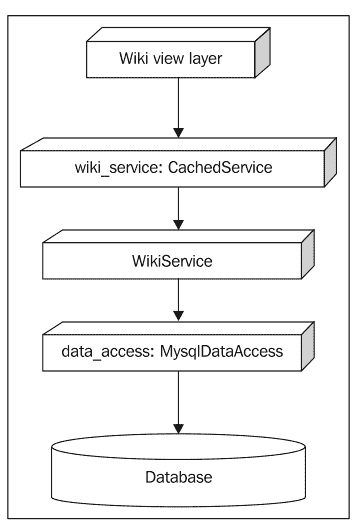

现在 SRP 得到遵守，因为每个类只有一个职责。一个类通过将所有必要的 WikiService 调用传递给 delegate 来处理缓存。然而，这并不实用。虽然 CachedService（代码中文本）将缓存逻辑与 WikiService 分离，但我们对适配器的使用引入了一些丑陋的限制。CachedService 必须具有与 WikiService 相同的接口才能处理其请求，我们甚至不得不为 statistics 编写一个直通。CachedService 也过于专门化，不适用于任何通用解决方案。每当我们在 WikiService 中添加另一个方法时，我们都必须更改 CachedService，这给我们带来了一对紧密耦合的类。让我们现在修复这个问题。

- 5. 让我们使用 Spring Python 编写一个 Interceptor，它不仅将缓存与 wiki 文本管理分离，而且足够通用，可以在其他地方重用。

```python
from springpython.aop import *

class CachingInterceptor(MethodInterceptor):
    def __init__(self):
        self.cache = {}

    def invoke(self, invocation):
        if invocation.method_name.startswith("get"):
            if invocation.args not in self.cache:
                self.cache[invocation.args] =
                    invocation.proceed()
            return self.cache[invocation.args]

        elif invocation.method_name.startswith("store"):
            del self.cache[invocation.args]
            invocation.proceed()
```


> CachingInterceptor 定义了一个 Spring Python 切面，它具有所有缓存功能而没有任何 wiki 功能。它包含 Advice（缓存功能）和切点（仅适用于以 get 开头的方法）。

- 6. 要使用 CachingInterceptor，我们必须使用我们的切面实例以及 WikiService 实例创建一个 Spring Python AOP 代理。

```python
class WikiProductionAppConfig(PythonConfig):
    def __init__(self):
        super(WikiProductionAppConfig, self).__init__()

    @Object
    def data_access(self):
        return MysqlDataAccess()

    @Object
    def wiki_service(self):
        return ProxyFactoryObject(
            target=WikiService(self.data_access()),
            interceptors=CachingInterceptor())
```

通过创建代理并将其与我们的切面进行[content]
通过创建代理并将其与我们的切面进行 wiring，我们已将切面动态地编织到代码中。在我们的情况下，我们创建了 Spring Python 的 ProxyFactoryObject 的一个实例来将 WikiService 与 CachingInterceptor 结合起来。

将 Spring Python 对象 wiki_service 从 WikiService 移动到 ProxyFactoryObject 后，我们的调用序列现在会流经新的拦截器，如下图所示。

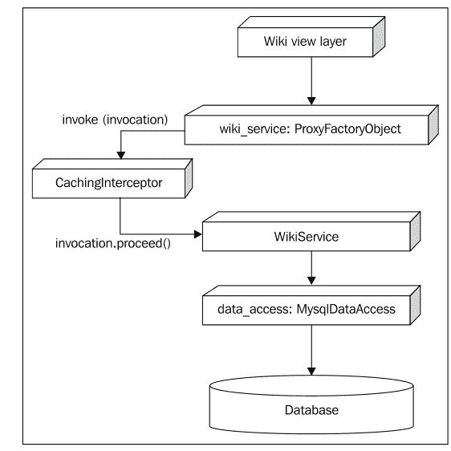

现在，我们不再拥有专门的缓存处理器，而是有了一个链接到通用缓存切面的代理。每当视图层向 wiki_service 提交请求时，调用就会被路由到 CachingInterceptor。

CachingInterceptor 与之前的 CachedService 之间的关键区别在于 Spring Python 如何将原始方法调用的所有信息打包到 invocation 参数中并将其分派到 CachingInterceptor 的 invoke 方法。这使我们能够在一个地方管理进入和退出 WikiService 的任何方法。这种行为被称为对目标进行通知。

在我们的示例中，CachingInterceptor 检查目标方法名是否以 get 开头。如果是，则会检查缓存，使用目标方法的参数作为键（在我们的例子中为文章名称）。如果缓存中找不到参数，CachingInterceptor 会通过 invocation.proceed() 调用 WikiService，就像我们直接调用它一样。结果会被存储到缓存中，然后返回给视图层。如果目标方法名以 store 开头，则会先删除缓存条目，然后执行 invocation.proceed()。

7. ProxyFactoryObject 将所有方法请求路由通过我们的切面。然而，CachingInterceptor 无法处理对 statistics 的调用，因为它既不以 get 开头也不以 store 开头。为了解决这个问题，让我们插入另一条建议，只将 get 和 store 调用发送到 CachingInterceptor，而将其他所有调用直接发送到 WikiService。

```python
class WikiProductionAppConfig(PythonConfig):
    def __init__(self):
        super(WikiProductionAppConfig, self).__init__()

    @Object
    def data_access(self):
        return MysqlDataAccess()

    @Object
    def wiki_service(self):
        advisor = RegexpMethodPointcutAdvisor(
            advice=[CachingInterceptor()],
            patterns=[".*get.*", ".*store.*"])
        return ProxyFactoryObject(
            target=WikiService(self.data_access()),
            interceptors=advisor)
```

Spring Python 的 RegexpMethodPointcutAdvisor 是一个开箱即用的顾问，它使用一组正则表达式来定义其 pointcuts。

> 如前所述，advisor 是 Spring Python 对 aspect 的实现。pointcut 是定义在何处应用 aspect 的 Advice 的定义。在这种情况下，pointcut 被定义为正则表达式。但并非所有 pointcuts 都需要正则表达式。

每个模式都会与调用栈的完整规范方法名（<package>.<class>.<method>）进行检查，直到找到匹配项（或用尽模式）。如果有匹配，则应用顾问列表。否则，它会绕过顾问列表并直接调用目标。下面的图表显示了这些组件如何链接在一起；第一个图表描绘了首次请求特定文章的序列：

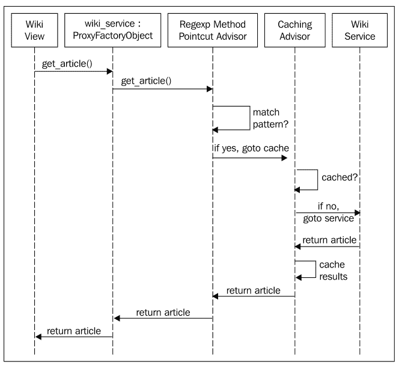

在之前的步骤序列中，会检查方法名是否与缓存模式匹配。假设匹配，则会转发到缓存拦截器。然后检查缓存。如果尚未缓存，则会转发到 WikiService。到达 WikiService 后，结果会被缓存然后返回。下一个图表显示了再次请求该文章时的步骤序列：

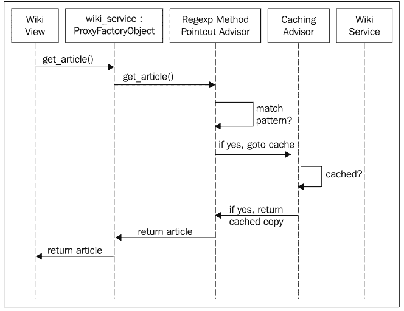

在这种情况下，我们再次检查相同的正则表达式模式，以查看该方法是否符合缓存条件。由于符合，我们接下来检查缓存。因为它已存在，所以我们不必调用 WikiService，从而节省了数据库调用。

最终的序列显示了如果我们调用一个与缓存模式不匹配的方法会发生什么。

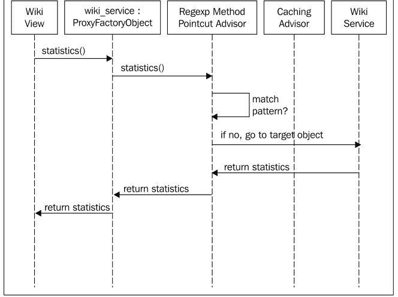

在这种情况下，我们再次执行模式匹配。但由于不匹配，RegexpMethodPointcutAdvisor 会回退到目标对象，绕过缓存顾问。我们可以直接进入 WikiService 并找到最新的统计信息。

> 必须认识到，虽然缓存拦截器减少了对数据库的访问，但对方法名进行模式匹配仍存在一定的开销成本。这种类型的开销成本必须包含在任何端到端性能分析中。

这解决了在不破坏 SRP 的情况下将缓存服务干净地应用到 wiki 引擎 API 的问题。通过使用 Spring Python 的 AOP 模块，我们能够编写一个通用、可重用的缓存模块并将其插入，而对 wiki API 没有任何影响。

## 将多个顾问应用于服务

在编写缓存解决方案的后期，我们使用了 RegexpMethodPointcutAdvisor 根据正则表达式模式有条件地应用顾问列表。Spring Python 的 AOP 解决方案支持将一个以上的顾问应用于对象。这使得可以轻松地为不同对象混合多个服务，例如缓存、事务、安全和日志。

Spring Python 使在 API 之上添加服务变得容易。对建议的重新应用次数没有限制。下面显示了一个更复杂、更现实的配置示例：

```python
class WikiProductionAppConfig(PythonConfig):
    def __init__(self):
        super(WikiProductionAppConfig, self).__init__()

    @Object
    def data_access(self):
        return MysqlDataAccess()

    @Object
    def security_advisor(self):
        return RegexpMethodPointcutAdvisor(
            advice=[SecurityInterceptor()],
            patterns=[".*store.*"])

    @Object
    def perf_advisor(self):
        return RegexpMethodPointcutAdvisor(
            advice=[PerformanceInterceptor()],
            patterns=[".*get.*"])

    @Object
    def caching_advisor(self):
        return RegexpMethodPointcutAdvisor(
            advice=[CachingInterceptor()],
            patterns=[".*get.*", ".*store.*"])

    @Object
    def wiki_service(self):
        return ProxyFactoryObject(
            target=WikiService(self.data_access()),
            interceptors=[self.security_advisor(),
                          self.perf_advisor(),
                          self.caching_advisor(),
                          self.perf_advisor()])
```

在此示例中，wiki_service 有多个顾问：security_advisor、perf_advisor 和 caching_advisor。它们以栈的形式链接在一起，其中 perf_advisor 被使用了两次。下面的图表显示了顾问及其拦截器的调用栈，然后详细解释了每个顾问的作用。

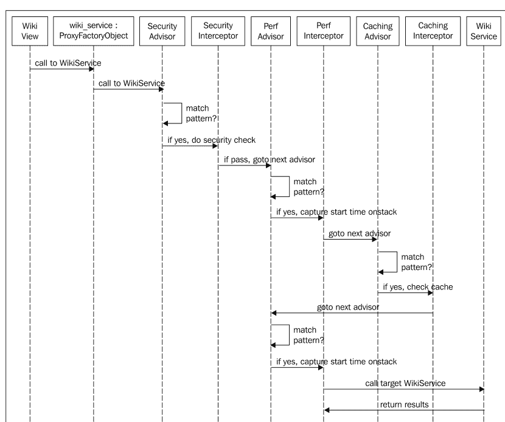

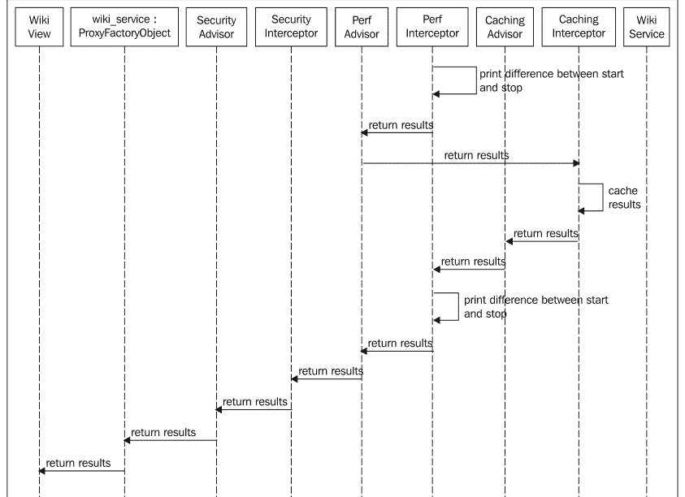

security_advisor 是 RegexpMethodPointcutAdvisor 的一个实例，它对以 store 开头的任何方法应用 SecurityInterceptor。

```python
class SecurityInterceptor(MethodInterceptor):
    def invoke(self, invocation):
        if user.has_access(invocation):
            return invocation.proceed()
        else:
            raise SecurityException("Unauthorized Access")
```

SecurityInterceptor 检查用户的凭据是否足以完成此操作。如果访问被授予，它会调用 invocation.proceed()，该调用会流向 perf_advisor 的第一个实例。如果访问被拒绝，它会引发安全异常，跳出整个调用栈，让调用方处理异常。在此示例中，user 被假定为包含当前用户资料的全局变量。

perf_advisor 是 RegexpMethodPointcutAdvisor 的一个实例，它对以 get 开头的任何方法应用 PerformanceInterceptor。虽然 perf_advisor 只有一个实例，但在顾问链中被使用了两次。这意味着它在进入 WikiService 的正常流程中会被使用两次。

```python
import time
class PerformanceInterceptor(MethodInterceptor):
    def invoke(self, invocation):
        start = time.time()
        results = invocation.proceed()
        stop = time.time()
        print "Method took %2f seconds" % (stop-start)
        return results
```

PerformanceInterceptor 通过捕获系统时间、调用 invocation.proceed()，然后在调用完成时再次捕获系统时间来衡量方法性能。然后它会在屏幕上打印出时间差，最后返回给调用的顾问。它第一次使用是在 caching_advisor 之前，第二次使用是在 caching_advisor 之后。这允许衡量缓存和未缓存的调用，衡量缓存提供的缓解。

我们已经看到了 CachingInterceptor 的工作原理。

虽然对 WikiService 进行调用所涉及的整个流程比我们之前的示例复杂得多，但快速定义额外的服务并将其应用于 WikiService API 却很容易。每个拦截器都很整洁干净，易于理解。这有助于降低维护成本。拦截器彼此之间以及与 WikiService 都很好地解耦，使得更容易混合和匹配切面以满足我们的需求。所有内容连接在一起的确切顺序方便地保存在一个地方，即我们的 IoC 容器定义。这通过我们两次使用 perf_advisor 来说明，即在有缓存和无缓存的情况下衡量性能。这共同证明了构建新服务并将其应用于现有 API 是多么容易。

## AOP 的性能成本

AOP 不是免费的。使用 Spring Python AOP 代理包装目标对象并对方法调用执行检查会产生一定的开销成本。这显然取决于你使用多少建议以及你的 pointcuts 是什么。使用大量正则表达式可能会很昂贵，而简单地对所有方法应用拦截器而不进行条件检查则成本较小。


There is also a different impact on whether or not the advised target object is inside a tight loop.

> 在优化之前测量成本非常重要。过早优化可能导致付出大量努力却收益甚微。使用 Python 分析器（或使用 Jython 时使用 Java 分析器）是识别性能瓶颈的关键。

## AOP 是一种范式，而非库

关于 AOP 的文章很多。开发者们讨论过 Python 是否需要一个 AOP 库。

> 面向方面编程不仅仅是一个库。它是一种范式，就像面向对象编程和函数式编程一样。

AOP 努力解决的关键目标是在 OOP 无法胜任的地方编写横切解决方案。OOP 解决的是解决方案可以通过继承实现的问题。AOP 是横向的，而 OOP 是纵向的。无论如何，目标是相同的："DRY（不要重复自己）" 和 "遵守 SRP"。这也由 1:1 原则描述，该原则指出一个需求在已实现代码中只有一个且仅有一个体现。这是对 DRY 和 SRP 原则的结合。

在添加日志、缓存、事务等功能时，开发者会诉诸复制粘贴式的编码。这种跨多个服务类的代码是重复的，并且代表单一策略。每当有变更时，变更必须在各处重复，这既有风险又昂贵。

在我们的示例中，我们使用 Spring Python 编写了一个拦截器并通过切点应用它。这使我们能够避免重复代码，同时保持简单和良好的封装。这具有以下好处。

- 只要向 WikiService 添加新方法，我们就可以检查 IoC 配置以查看 CachingInterceptor 是否适用。只有一个地方需要检查，这意味着检查切点很容易
- 我们可以轻松调整切点，而无需触及 CachingInterceptor。这展示了 advice 如何与切点干净地解耦
- 在我们更复杂的配置中，我们引入了 `PerformanceInterceptor`，在其中我们观察哪些方法耗时最长并评估它们是否适合缓存。由于它不需要干扰其他拦截器或其切点，因此相对容易添加。这表明未来的更新应该相对容易进行

当 advice 与切点解耦时，添加新的切点和新的 advice 变得很容易，从而更新我们的横切行为。并且所有这些都可以在不影响我们增强的核心 API 的情况下完成。

我们已经展示了 AOP 支持松耦合解决方案。我们还研究了如何精确地应用 advice，提供高内聚。这些因素将帮助我们轻松应对我们已知即将到来的变化。

下图显示了组件如何连接在一起的高级视图。

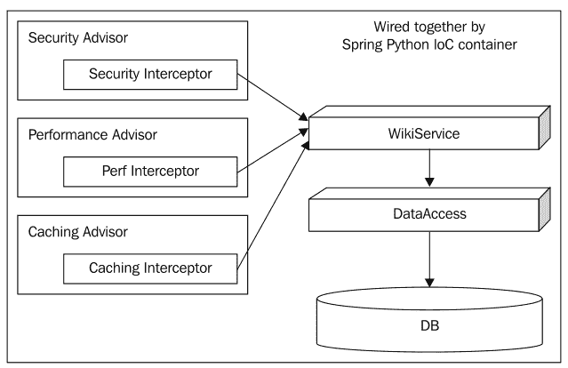

每个拦截器的代码都由其切点与顾问干净地包装，形成定义良好的方面。每个方面也与 `WikiService` 的业务逻辑分离。通过这种关注点分离，可以在最小风险的情况下轻松进行更改。添加新的顾问并更改执行顺序也很简单。

## Spring Python AOP 模块的独特特性

Spring Python 并不是编写 AOP 解决方案的唯一手段。还有其他可用的库，例如 `Aspyct` 和 `aspects.py`。Python 丰富的特性集也提供了以类似 AOP 的方式编码的能力，使用诸如元类编程和装饰器等技术。

需要注意的是 Spring Python 的 AOP 解决方案的独特之处。虽然我尝试包含了一些与 `Aspyct` 和 `aspects.py` 的高层次比较，但建议读者访问这些项目并更详细地比较功能。

| 差异 | 描述 |
|---|---|
| 适用于对象实例的 Advice。 | Spring Python 为开发者提供了将 advice 应用于对象的单个实例的选项，而无需所有实例都采用该行为。这为开发者提供了最大灵活性。权衡在于，如果希望所有实例都具有此行为，则开发者有责任将其应用于所有实例。`Aspyct` 允许你定义方面并将其应用于函数。该行为永久修改函数，并影响所有实例。`aspects.py` 提供了将函数包装在方法周围的能力。这将适用于所有实例。它也支持以这种方式包装部分实例。 |
| 无需元类编程。 | 对于某些问题，元类编程可能是最简单的解决方案。对于其他问题，元类编程并不是所需的方法。它是标准 OOP 和过程式开发实践的替代范式。在 OOP 中，类是创建对象的模板。元类是创建类的模板。这意味着某些横切问题可能很容易适应元类编程，而其他问题则不然。Spring Python 的 AOP 解决方案不需要学习复杂概念。相反，它基于创建类并使用 IoC 定义应用 advice 的切点。 |
| 无需访问源代码。 | 元类编程需要访问源代码。在 AOP 库中应用装饰器也需要访问源代码。这两种选项都使向第三方库应用 advice 变得更加困难，因为开发者不太可能承担维护补丁的工作。Aspyct 和 aspects.py 不需要修改源代码。然而，Aspyct 的主要应用方式涉及使用装饰器，这需要访问源代码。考虑到 Spring Python 利用其 IoC 容器来应用 advice，很容易使用任何库中的类并应用独立的顾问。 |
| 无猴子补丁。 | 猴子补丁是指在运行时向对象的函数添加、删除或替换。尽管有些人认为猴子补丁是有价值的工具，但必须谨慎使用。修改库的类定义存在一定程度的相关风险，可能导致不可预测的错误。Spring Python 利用代理将目标对象与拦截器合并。这使得添加和删除 advice 变得容易，同时保持服务与目标 API 之间良好的分离。本章后面将讨论方面的自动化测试。 |

## AOP 的风险

AOP 也有其自身风险。当某些功能（在我们的例子中是缓存）从核心代码移出并进入拦截器时，缓存逻辑何时处于活动状态可能并不明显。我们甚至可能不知道系统中存在缓存。但同样的话也可以说 OOP 实践，其中常用功能被移动到继承层次结构上或下的其他类中。所有这些编码风格都更适合于正确的一套工具、开发者培训、文档、自动化测试套件以及开发团队之间的沟通。由于与 OOP 相比 AOP 相对较新，工具集并不成熟，开发者也不熟悉这些概念。

但这并不意味着 AOP 应该被放弃。相反，它应该像团队使用的任何其他技术、语言和工具套件一样进行评估。

## AOP 是 Spring 三角形的一部分

下图——称为 Spring 三角形——涵盖了 Spring Python 使用的关键原则：

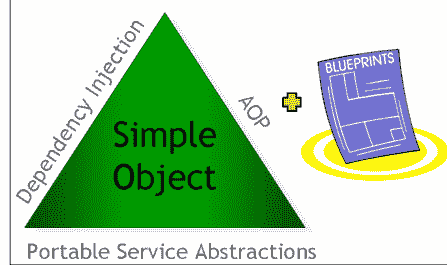

使用 Spring Python 的 IoC 容器，我们能够取一个简单的 WikiService 对象并通过 AOP 在其上层叠 CachingService。通过使用依赖注入，我们使 WikiService 免于任何 Spring Python 依赖。要阅读此内容的细节，我们只需在 WikiProductionAppConfig 中查找 IoC 容器的蓝图。Spring 还利用了便携式服务抽象，例如 DatabaseTemplate，以减少使用低级 API 的需求。本书后面我们将重新审视 Spring 三角形以更详细地讨论这一点。

## 测试我们的方面

如果你是一名专业软件开发者，此时你会感到有点紧张。我们在多个方面编写了相当多的代码，而且事情“只是起作用了”。我们都知道这种情况很少见。

方面就像代码的任何其他部分一样，需要进行测试。为了降低风险并保持最佳实践，我们应该为我们的方面编写自动化测试。有不同类型的测试可以进行。对于我们的缓存示例，将缓存功能隔离以确保其满足我们的要求会很有用；通常称为单元测试。此外，确保正确的 advice 应用于正确的函数对于确认 AOP 正在工作至关重要，这可以通过集成测试来验证。


## 将服务与建议解耦

在本章中，我们开发了一个泛化缓存的切面。我们展示了包含多个切面的后续增强。在本示例的剩余部分，我们将恢复到仅插入了我们的 CachingInterceptor 的早期配置。

我们的切面恰好与其缓存服务紧密耦合。尽管我们编写的缓存解决方案很简单，假设我们计划用更复杂的方案替换它。为了更轻松地编写和测试缓存服务的增强功能，让我们将其拆分为单独的模块。

- 1. 首先，让我们重写建议，使其使用缓存服务，而不是自行处理缓存。
- 2. 接下来，让我们将缓存逻辑移入一个单独的类。

```
class CachingInterceptor(MethodInterceptor):
    def __init__(self, caching_service=None):
        self.caching_service = caching_service

    def invoke(self, invocation):
        if invocation.method_name.startswith("get"):
            if invocation.args not in self.caching_service.keys():
                self.caching_service.store(invocation.args,
                    invocation.proceed())
            return self.caching_service.get(invocation.args)

        elif invocation.method_name.startswith("store"):
            self.caching_service.del(invocation.args)
            invocation.proceed()
```

```
class CachingService(object):
    def __init__(self):
        self.cache = {}

    def keys(self):
        return self.cache.keys

    def store(self, key, value):
        self.cache[key] = value

    def get(self, key):
        return self.cache[key]

    def del(self, key):
        del self.cache[key]
```

- 3. 这需要更新我们的 IoC 蓝图，以便将 CachingService 的实例注入到 CachingInterceptor 中。

```
class WikiProductionAppConfig(PythonConfig):
    def __init__(self):
        super(WikiProductionAppConfig, self).__init__()

    @Object
    def data_access(self):
        return MysqlDataAccess()

    @Object
    def caching_service(self):
        return CachingService()

    @Object
    def interceptor(self):
        return CachingInterceptor(self.caching_service())

    @Object
    def wiki_service(self):
        advisor = RegexpMethodPointcutAdvisor(
            advice=[self.interceptor()],
            patterns=[".*get.*", ".*store.*"])
        return ProxyFactoryObject(
            target=WikiService(self.data_access()),
            interceptors=advisor)
```

下图展示了我们如何将 CachingService 提取到单独的组件中，并将其与 CachingInterceptor 一起提升为完全命名的 Spring Python 对象。

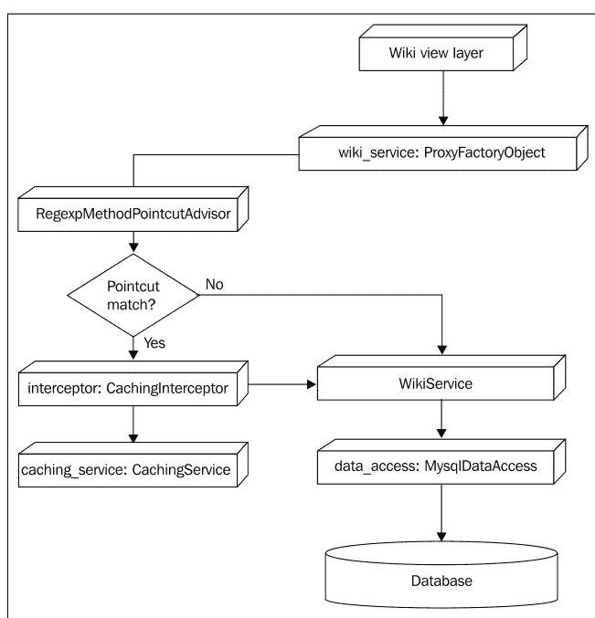

## 测试我们的服务

现在我们已将缓存服务提取到单独的模块中，编写一些自动化测试变得很容易。

- 1. 在编写任何测试之前，让我们创建一个可测试的 IoC 容器版本，使其与 WikiService 以及包含我们切面的 ProxyFactoryObject 上下层的任何层隔离。

```
class WikiTestAppConfig(WikiProductionAppConfig):
    def __init__(self):
        super(WikiTestAppConfig, self).__init__()

    @Object
    def data_access(self):
        return StubDataAccess()
```

- 2. 这用 StubDataAccess 替换了 MysqlDataAccess，后者运行更快，避免与其他开发人员争夺数据库，并且对每个方法都有预格式化的响应。借助 Python 的单元测试框架取代视图层作为调用者，我们已将代码库隔离用于测试。

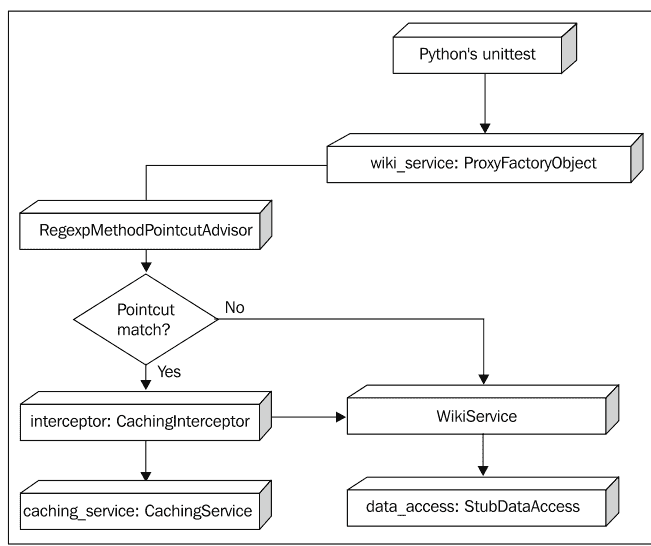

- 3. 让我们编写一个测试来验证缓存服务的值。

```
class CachedWikiTest(unittest.TestCase):
    def testCachingService(self):
        context = ApplicationContext(WikiTestAppConfig())
        caching_service = context.get_object("caching_service")
        self.assertEquals(len(caching_service.keys()), 0)
        caching_service.store("key", "value")
        self.assertEquals(len(caching_service.keys()), 1)
        self.assertEquals(caching_service.get("key"), "value")
        caching_service.del("key")
        self.assertEquals(len(caching_service.keys()), 0)
```

在此测试方法中，我们从 IoC 容器中获取 caching_service 的副本。然后，我们验证它是否为空。接下来，我们存储一个简单的键/值对，并验证缓存的大小和内容。最后，我们调用 caching_service 的 del() 方法，并验证缓存是否已正确清空。

我承认 CachingService 有点过度设计，考虑到它只是一个 Python 字典。我通常不会为这种语言级结构编写单元测试。然而，本示例的目的是展示我们可以将解决方案移入单独的模块，摆脱任何 AOP 机制，然后用更复杂的功能增强它。我们可以将其修改为分布式缓存，使其在多个节点间持久存在，而不会影响 WikiService 或 CachingInterceptor。

测试缓存服务很有价值，因为它可以防止错误重新潜入代码库。但我们也需要知道我们的切面是否已正确地与我们编写的 Wiki API 编织在一起。

## 确认我们的服务已正确编织到 API 中

我们已通过隔离缓存服务并编写自动化测试来确认其正常工作。我们需要完成的最后任务是验证我们是否已将缓存服务正确地连线到我们的 API 中。

让我们在 CachedWikiTest 中添加另一个测试方法，展示 WikiService 是否被正确建议。

```python
def testWikiServiceWithCaching(self):
    context = ApplicationContext(WikiTestAppConfig())
    caching_service = context.get("caching_service")
    self.assertEquals(len(caching_service.keys()), 0)
    wiki_service = context.get_object("wiki_service")
    wiki_service.statistics("Spring Python")
    self.assertEquals(len(caching_service.keys()), 0)
    html = wiki_service.get_article("Spring Python")
    self.assertEquals(len(caching_service.keys()), 1)
    wiki_service.store_article("Spring Python")
    self.assertEquals(len(caching_service.keys()), 0)
```

在此测试中，我们从 IoC 容器中获取 `caching_service` 的副本并验证其为空。接下来，我们从 IoC 容器中获取 `wiki_service` 的副本。在我们的 IoC 容器内部，我们知道 `caching_service` 是通过某些 AOP 建议链接到 `wiki_service` 的。我们调用 `statistics`，并断言缓存仍然为空，因为建议不适用于该方法。接下来，我们调用 `get_article`，并验证缓存中已新增条目。最后，我们调用 `store_article`，并验证其已清空缓存。

将此测试与之前的测试结合，我们清楚地表明我们的 `CachingInterceptor` 建议按预期工作。使用了 IoC 容器后，我们已很好地解耦了事物，现在可以轻松调整一个类而不影响另一个。

## 摘要

我们探讨了如何使用面向方面编程解决横切问题。这些问题包括缓存、安全性和性能测量；如果诉诸标准 OOP 实践，所有这些问题都需要丑陋的复制粘贴解决方案。

Spring Python 的 AOP 模块帮助我们坚持 DRY 和 SRP 原则。这降低了维护成本，并帮助我们处理不断到来的未来变化。

在本章中，我们学习了：

- 如何向 Spring Python 对象添加缓存
- 如何通过添加性能和安全顾问来扩展示例
- AOP 是一种范式，而不仅仅是一个库
- Spring Python 的 AOP 与其他库以及 Python 语言特性相比的独特功能
- AOP 的风险以及如何通过自动化测试来缓解
- 关于应用 `Advice` 的一些提示

在下一章中，我们将研究如何使用 Spring Python 的 `DatabaseTemplate` 轻松编写 SQL 查询。


# 4 轻松编写 SQL 查询

# 轻松编写 SQL 查询
使用 Spring Python

我们的许多应用程序都包含需要从关系数据库中提取并存储其中的动态数据。即使存在基于键/值的数据存储，生产环境中绝大多数数据存储都托管在基于 SQL 的关系数据库中。

鉴于这一事实上的要求，如果我们可以专注于 SQL 查询本身，而不是花费大量时间编写样板代码并使每个查询都具有容错性，那么开发者的效率就会提高。

在本章中，我们将学习：

-   影响许多现代编程语言 API 的经典 SQL 查询问题
-   使用 Spring Python 的 `DatabaseTemplate` 来减少查询管理代码
-   将 `DatabaseTemplate` 与 **对象关系映射器 (ORMs)** 进行比较
-   将 `DatabaseTemplate` 与 ORM 结合以构建健壮的应用程序
-   使用模拟测试查询

## 经典的 SQL 问题

SQL 是一种长期存在的标准，它与许多现代编程语言（包括 Python）共享编写查询的通用范式。由此产生的效果是，手写查询很繁琐。让我们通过使用 Python 的数据库 API 编写一个简单的 SQL 查询来探索这一困境。

1.  首先，让我们为 wiki 引擎创建一个数据库模式，以便存储和检索 wiki 上下文。
2.  现在，让我们使用数据库的 shell 编写一个 SQL 语句来统计系统中的 wiki 文章数量。

```sql
DROP TABLE IF EXISTS article;

CREATE TABLE article (
    id serial PRIMARY KEY,
    title VARCHAR(11),
    wiki_text VARCHAR(10000)
);

INSERT INTO article
(id, title, wiki_text
VALUES
(1,
'Spring Python Book',
'Welcome to the [http://springpythonbook.com Spring Python] book,
where you can learn more about [[Spring Python]].');
INSERT INTO article
(id, title, wiki_text
VALUES
(2,
'Spring Python',
'\'\\\'\'Spring Python\'\\\'\' takes the concepts of Spring and
applies them to world of [http://python.org Python].');
```

```sql
SELECT COUNT(*) FROM ARTICLE
```

3.  现在让我们编写一些 Python 代码，使用 Python 的官方数据库 API (http://www.python.org/dev/peps/pep-0249) 在 sqlite3 数据库上运行相同的查询。

```python
import sqlite3

db = sqlite3.connect("/path/to/sqlite3db")

cursor = db.cursor()
results = None
try:
    try:
        cursor.execute("SELECT COUNT(*) FROM ARTICLE")
        results = cursor.fetchall()
    except Exception, e:
        print "execute: Trapped %s" % e
finally:
    try:
        cursor.close()
    except Exception, e:
        print "close: Trapped %s, and throwing away" % e

return results[0][0]
```

这是一段相当大的代码块，用于执行如此简单的查询。让我们更详细地检查它。

4.  首先，我们连接到数据库。对于 sqlite3，我们只需要一个路径。其他数据库引擎通常需要用户名和密码。
5.  接下来，我们创建一个用于保存结果集的游标。
6.  然后我们执行查询。为了保护自己免受任何异常的影响，我们需要用一些异常处理器将其包装起来。
7.  完成查询后，我们获取结果。
8.  将结果从结果集提取到变量后，我们关闭游标。
9.  最后，我们可以返回响应。Python 将结果打包成元组数组。由于我们只需要一行和第一列，因此我们进行双重索引查找。

这段代码试图在数据库中找到什么？关键语句在一行中。

```python
cursor.execute("SELECT COUNT(*) FROM ARTICLE")
```

如果我们正在编写脚本呢？找到一个信息会是一项大量工作。当然，快速退出的脚本可能也可以跳过一些错误处理以及关闭游标。但仅为了获取一个用于运行查询的游标，仍然有相当多的样板代码。

但如果这是长时间运行应用程序的一部分呢？我们需要在每次查询后关闭游标，以避免泄漏数据库资源。大型应用程序也有许多不同的查询需要维护。反复编码这种模式会耗尽开发团队的精力。

## 参数化代码

这段样板代码是一个反复出现的模式。你认为我们可以参数化它并使其可重用吗？我们已经确定了 SQL 语句的关键部分。让我们尝试将其重写为一个仅执行此操作的函数。

```python
import sqlite3

def query(sql_statement):
    db = sqlite3.connect("/path/to/sqlite3db")

    cursor = db.cursor()
    results = None
    try:
        try:
            cursor.execute(sql_statement)
            results = cursor.fetchall()
        except Exception, e:
            print "execute: Trapped %s" % e
    finally:
        try:
            cursor.close()
        except Exception, e:
            print "close: Trapped %s, and throwing away" % e

    return results[0][0]
```

我们的第一步很好地参数化了 SQL 语句，但这还不够。返回语句被硬编码为返回第一行的第一个条目。对于计数文章，我们编写的内容是可以的。但这对于其他查询来说不够灵活。我们需要能够插入我们自己的结果处理器。

```python
import sqlite3

def query(sql_statement, row_handler):
    db = sqlite3.connect("/path/to/sqlite3db")

    cursor = db.cursor()
    results = None
    try:
        try:
            cursor.execute(sql_statement)
            results = cursor.fetchall()
        except Exception, e:
            print "execute: Trapped %s" % e
    finally:
        try:
            cursor.close()
        except Exception, e:
            print "close: Trapped %s, and throwing away" % e

    return row_handler(results)
```

我们现在可以编写一个自定义处理器。

```python
def count_handler(results):
    return results[0][0]

query("select COUNT(*) from ARTICLES", count_handler)
```

有了这个自定义结果处理器，我们现在可以调用我们的查询函数，并同时提供查询和处理器。剩下的唯一事情是处理创建数据库连接。将 sqlite3 连接代码与工厂解决方案包装起来留给读者作为练习。

我们在这里编写的代码本质上是 DatabaseTemplate 的核心功能。这种将算法参数化以便重用的方法被称为模板模式。还进行了一些额外的检查以保护查询免受 SQL 注入攻击。

## 用 Spring Python 的一行代码替换多行查询代码

Spring Python 有一个方便的实用类 DatabaseTemplate，可大大简化此问题。

1.  让我们用一些 Spring Python 设置代码替换之前示例中的两行导入和连接代码。

```python
from springpython.database.factory import Sqlite3ConnectionFactory
from springpython.database.core import DatabaseTemplate

conn_factory = Sqlite3ConnectionFactory("/path/to/sqlite3db")
dt = DatabaseTemplate(conn_factory)
```

乍一看，我们似乎退了一步。我们只是用四行代码替换了之前的两行代码。然而，下一个代码块应该会显著改善情况。

2.  让我们用我们 DatabaseTemplate 实例的调用替换之前的编码查询。

```python
return dt.query_for_object("SELECT COUNT(*) FROM ARTICLE")
```

现在我们成功将复杂的 14 行代码块减少到 Spring Python 的一行代码。这使得我们的 Python 代码看起来与我们在数据库 shell 中输入的原始 SQL 语句一样简单。而且它也减少了噪音。

## Spring 三角形——可移植服务抽象

我们在书中前面看到过这张图，作为 Spring Python 背后关键原则的说明。

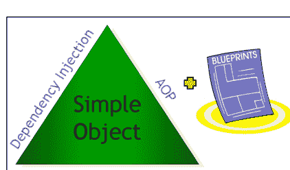

`DatabaseTemplate` 代表 **可移植服务抽象**，因为：

-   它是 **可移植的**，因为它使用 Python 的标准化 API，不将我们绑定到任何数据库厂商。相反，在我们的示例中，我们注入了一个 `Sqlite3ConnectionFactory` 实例
-   它提供了有用的 **服务**，即轻松访问关系数据库中存储的信息，但让我们专注于查询，而不是样板代码
-   它在 Python 的低级数据库 API 之上提供了良好的 **抽象**，代码噪音减少。这使我们避免了编写代码来管理游标和异常处理的成本和风险


> DatabaseTemplate 通过捕获并保存异常，然后正确关闭游标来处理异常。然后它将其包装在 Spring Python `DataAccessException` 中抛出。这样，数据库资源会被正确释放，而不会丢失异常堆栈跟踪。

## 使用 DatabaseTemplate 检索对象

我们的第一个示例展示了如何轻松减少代码量。但它实际上只适用于简单情况。一个真正有用的操作是执行查询并将结果转换为对象列表。

1.  首先，让我们定义一个简单的对象，我们希望用从数据库检索到的信息填充它。如 Spring 三角形图所示，使用简单对象是 'Spring 方式' 的核心方面。
2.  如果我们想使用 Python 的标准 API 编码，代码会相对冗长，如下所示：

```python
class Article(object):
    def __init__(self, id=None, title=None, wiki_text=None):
        self.id = id
        self.title = title
        self.wiki_text = wiki_text
```

```python
cursor = db.cursor()
results = []
try:
    try:
        cursor.execute("SELECT id, title, wiki_text FROM ARTICLE")
        temp = cursor.fetchall()
```


```
for row in temp:
    results.append(
        Article(id=temp[0],
                title=temp[1],
                wiki_text=temp[2]))
    except Exception, e:
        print "execute: Trapped %s" % e
finally:
    try:
        cursor.close()
    except Exception, e:
        print "close: Trapped %s, and throwing away" % e

return results
```

这与之前的示例并没有太大不同。关键区别在于，我们不是直接将 fetchall 分配给 results，而是对其进行迭代，生成一个 Article 对象列表。

3. 相反，让我们使用 DatabaseTemplate 来减少代码量。

```
return dt.query("SELECT id, title, wiki_text FROM ARTICLE",
                ArticleMapper())
```

4. 我们还没有完成。我们必须编写 ArticleMapper，这是用于迭代结果集的对象类。

```
from springpython.database.core import RowMapper
```

```
class ArticleMapper(RowMapper):
    def map_row(self, row, metadata=None):
        return Article(id=row[0], title=row[1], wiki_text=row[2])
```

RowMapper 定义了单个方法：map_row。该方法针对每一行数据调用，不仅包含信息，还包含数据库提供的元数据。ArticleMapper 可用于执行相同映射的每个查询。


> 这与之前所示的参数化示例略有不同，在该示例中我们定义了一个行处理函数。这里我们定义一个包含 map_row 函数的类。但概念是相同的：注入一个行处理器来转换数据。

## 通过约定优于配置进行查询映射

我们的类定义恰好具有与数据库中列相同的属性名称。Spring Python 提供了 `SimpleRowMapper` 作为方便的开箱即用映射器，利用了这一点。

不要编写专门的 `ArticleMapper`，让我们改用 Spring Python 的 `SimpleRowMapper`。

```python
return dt.query("SELECT id, title, wiki_text FROM ARTICLE",
    SimpleRowMapper(Article))
```

`SimpleRowMapper` 要求类具有默认构造函数，并且类的属性与查询相匹配。


> 需要记住，列到属性的匹配基于查询，而不是表。这意味着我们可以使用 SQL 别名将表列与对象关联起来。

## 将查询映射到字典

Spring Python 还提供了 `DictionaryRowMapper`，它方便地将查询映射到 Python 字典。

不要使用 `SimpleRowMapper`，让我们改用 Spring Python 的 `DictionaryRowMapper`。

```python
return dt.query("SELECT id, title, wiki_text FROM ARTICLE",
    DictionaryRowMapper())
```


> 这最后一步偏离了我们最初要求返回 `Article` 对象列表的要求。但它提供简单“数据窗口”场景的一种便捷方式，可能完全符合我们的需求。

## DatabaseTemplate 与 ORM

- `DatabaseTemplate` 专注于在不编写大量样板代码的情况下访问数据库
- ORM 专注于将表映射到对象

`DatabaseTemplate` 与 ORM 并无冲突。我们必须做出的选择是在使用 SQL 并处理结果集之间，还是使用 ORM。

> 在详细讨论 ORM 和 DatabaseTemplate 之前，查看一个流行的 Python ORM 的快速示例可能会有所帮助：**SQLAlchemy** (http://www.sqlalchemy.org)。我们本可以为此演示选择任意数量的 ORM。

```
from sqlalchemy import *

engine = create_engine("sqlite:///tmp/springpython.db", echo=True)
metadata = BoundMetaData(engine)
article_table = Table('Article', metadata,
    Column('id', Integer, primary_key=True),
    Column('title', String()),
    Column('wiki_text', String()))

article_mapper = mapper(Article, article_table)

session = create_session(bind_to=engine)
articles = session.query(Article)
```

这演示了我们如何使用 SQLAlchemy 来定义 ARTICLE 表与 Article 类之间的映射。ORM 还提供了许多其他查询选项，包括过滤器和条件。ORM 的主要目的是将数据库映射到对象。使用 ORM 与使用原始 SQL 一样存在样板代码。

## DatabaseTemplate 提供的解决方案

如果我们为数据需求选择 `DatabaseTemplate`，我们将使用纯 SQL 编写更新、插入、删除和查询。如果我们的团队由熟悉 SQL 的数据库设计师和软件开发人员组成，这将带来巨大的好处——更符合他们的技能。整个团队可以通过使用 SQL 这种通用语言来参与设计表、查询和数据管理的努力。

在这种情况下，DatabaseTemplate 绝对会让事情变得更容易，如前所述。这将使我们的团队能够将精力投入到设计和管理应用程序数据上。

DatabaseTemplate 提供的操作集在下表中列出。

| 操作 | 描述 |
|---|---|
| execute(sql_statement, args=None) | 执行任意语句，返回受影响的行数 |
| query(sql_query, args=None, rowhandler=None) | 查询，返回由 rowhandler 转换的列表 |
| query_for_list(sql_query, args=None) | 查询，返回 Python 元组列表 |
| query_for_int(sql_query, args=None) | 运行查询获取单行单列，并返回整数，否则抛出异常 |
| query_for_long(sql_query, args=None) | 查询单行单列，并返回长整数，否则抛出异常 |
| query_for_object(sql_query, args=None, required_type=None) | 查询单行单列，并返回对象，可选类型检查 |
| update(sql_statement, args=None) | 更新数据库，返回受影响的行数 |

这可能看起来不是很多操作，但 DatabaseTemplate 的目的是提供轻松编写 SQL 的访问方式。此 API 提供了编写插入、更新、删除和查询的能力，同时也能调用存储过程。

DatabaseTemplate 也能很好地与 Spring Python 事务配合使用。这个横切特性将在下一章详细探讨。

## DatabaseTemplate 与 ORM 如何协同工作

在构建应用程序时，我们往往倾向于从一种范式开始，然后发现它存在局限性。从纯 SQL 角度或 ORM 角度构建支持大量用户和复杂功能的企业级应用程序可能会超出两者能力。这时可能就需要同时在同一个应用程序中使用 DatabaseTemplate 和 ORM。

使用 ORM 来编码和管理简单实体和直接关系将是一个实用的解决方案。我们可以快速为应用程序构建持久性，然后转向真正的业务解决方案。

但生成复杂报告、详细结构和存储过程所需的查询可能更适合使用 `DatabaseTemplate` 管理。

如果我们能让团队摆脱为简单对象编写自定义 SQL 的工作，他们就可以专注于为复杂查询编写专门的 SQL。

使用 *合适的工具做合适的工作* 应该是我们软件开发流程的关键要素，而在工具箱中同时拥有 `DatabaseTemplate` 和 ORM 是务实的做法。

## 使用模拟测试数据访问层

在之前的章节中，我们编写了涉及对数据访问层进行 stub 的自动化测试。现在我们正处于编写数据访问层的核心阶段，需要寻找测试查询的方法。具体来说，我们需要确保正确使用 `DatabaseTemplate`，以及我们编写的任何自定义行映射器。

Mock 主要用于记录调用了哪些函数，并提供返回特定值的选项。其思路是创建一组预期操作，然后调用实际 API 并衡量是否发生了这些操作。这与 stub 相比，stub 是你自己编写的，提供固定答案，并且不一定关心调用了哪些方法。这两种工具都对自动化测试有用。


> Spring Python 使用 **pmock**，这是一个受 **jMock** (http://www.jmock.org/) 流畅 API 启发的 Python 库，来进行部分自动化测试。你不必使用这个特定的 mocking 库。周围还有很多其他选择。就我们的目的而言，我们将在此处使用它来展示为测试而模拟数据访问层的一般思路。
> 
> 由于 `pmock` 原始开发者的更新缺乏，该库的源代码已添加到 Spring Python 的托管代码集中，并进行了一些自定义更新。有关下载详情，请参阅 http://springpython.webfactional.com。


1. 首先，让我们编写一个简单的 DataAccess 类，使用 DatabaseTemplate 来获取我们拥有的文章数量。

```
class DataAccess(object):
    def __init__(self, conn_factory):
        self.dt = DatabaseTemplate(conn_factory)

    def count_wiki_articles(self):
        return self.dt.query_for_object("SELECT COUNT(*) FROM ARTICLE")
```

这个简单的數據訪問層只有一个方法：count_wiki_articles。它使用了我们之前编写的涉及 DatabaseTemplate 的代码。在此示例中，DataAccess 预计使用连接工厂进行初始化。

现在，为了测试它，我们需要 DatabaseTemplate 执行其工作，但我们希望在正确的位置捕获它，以便注入一些预先构建的值。执行繁重工作的代码部分是 Spring Python 的 cursor 对象，它由连接提供。这意味着我们需要编写一个特殊的存根连接工厂来保存一个模拟的游标。

2. 让我们编写一个专门的类来充当模拟连接。

```
class MockedConnection(object):
    def __init__(self):
        self.mockCursor = None
    def cursor(self):
        return self.mockCursor
```

该连接将为 DatabaseTemplate 提供一种特殊的模拟游标类型。稍后，我们将看到如何填充 mockCursor。

3. 为了使用它，让我们为 DatabaseTemplate 编写一个连接工厂来生成这种类型的连接。

```
class MockingDBFactory(ConnectionFactory):
    def __init__(self):
        ConnectionFactory.__init__(self, [types.TupleType])
        self.mockedConnection = MockedConnection()
    def connect(self):
        return self.mockedConnection
```

当此连接工厂被要求连接到数据库时，它将返回一个 MockedConnection。

4. 为了将这些装置连接起来，我们需要设置一个 MockTestCase。这是一种特殊的单元测试类型，它为 pmock 的库调用提供额外的钩子。

```
from pmock import *

class DataAccessMockTestCase(MockTestCase):
    def setUp(self):
        # Create a mock instance to record events
        self.mock = self.mock()
        conn_factory = MockingDBFactory()
        conn_factory.mockedConnection.mockCursor = self.mock
        self.data_access = DataAccess(conn_factory)
```

在这里，在我们的测试的 setUp 方法中，我们获取 mock() 的一个实例。此对象具有记录期望的 API。该对象旨在被注入，以便随后对其进行函数调用，并在 MockTestCase 测试方法结束时，将结果与期望进行比较。

在这种情况下，mockCursor 是 mock 的关键持有者。还有一个本地副本，以便 MockTestCase 能够处理检查结果。

5. 在完成所有这些设置后，让我们定义一个模拟的测试方法。

```
def testCountingArticles(self):
    self.mock.expects(once()).method("execute")
    self.mock.expects(once()).method("fetchall")
        .will(return_value([[(2,)]]))

    count = self.data_access.count_wiki_articles()
    self.assertEquals(count, 2)
```

此测试的前两个步骤使用 mock 对象来定义期望。预计 mock 将接收一次 execute 方法调用，以及一次 fetchall 方法调用。fetchall 将返回值为 [ (2,) ]。

我们不仅可以检查断言，而且 pmock 还会验证 DatabaseTemplate 是否调用了这些方法中的每一个。

## 测试多少才足够？

对于此测试场景，我们深入挖掘了。这种类型的测试如果不直接与实时数据库通信，就无法更接近数据库服务器的硬件。

可以认为我们实际上是在测试 DatabaseTemplate 的核心。在许多开发情况下，这是不需要的。测试第三方库可能超出了范围。

此示例测试场景在很大程度上基于用于确认 Spring Python 功能的自动化测试。针对您业务需求的充分测试可能涉及对数据访问层进行存根或模拟，如本书前面部分所示。

这应该让您了解模拟的概念，即测量方法调用和答案。这种类型的测试可能非常适合其他测试需求。如果 SQL 查询已在此层中很好地隔离，那么可以说唯一需要的测试就是查询本身在实时数据库上的测试，从而根本不需要任何模拟或存根。

## 摘要

本章展示了一种编写纯 SQL 而无需处理低级游标和连接管理的方法。这消除了大量样板代码和错误处理，非常适合框架处理。

我们还探讨了 DatabaseTemplate 和 ORM 如何协同工作，使开发人员的持久性管理变得更容易。

我们研究了模拟，以及我们如何深入查询过程以验证是否进行了正确的方法调用。然后我们退一步考虑测试多少才足够。

在本章中我们学到了：

- 影响许多现代编程语言 API 的经典 SQL 查询问题也延伸到了 Python
- 使用 Spring Python 的 DatabaseTemplate 可以让我们摆脱妨碍解决用例的查询样板代码
- DatabaseTemplate 对于在不处理游标管理的情况下编写 SQL 代码非常有用
- 与 ORM 结合的 DatabaseTemplate 可以帮助我们构建健壮的应用程序
- 模拟是自动化测试中的有价值工具，但我们必须为正确的情况选择正确的工具

在下一章中，我们将研究如何通过非侵入式事务增强我们的数据访问层。

# 5 使用事务为数据访问添加完整性

# 使用事务为数据访问添加完整性

SQL 操作在许多应用程序中用于提供数据。将应用程序扩展到企业规模的关键要素之一是事务。它们通过定义原子工作单元为数据管理添加完整性。

原子工作单元意味着当整个步骤序列完成后必须看起来像一个步骤。如果步骤链中出现任何故障，一切都必须回滚到事务开始前的状态。对于 SQL 事务，这意味着数据库的状态必须原子地更新或回滚。

本章将检查编码和使用 SQL 事务的模式，以及 Spring Python 如何使原本单调的模式变得易于编码。

在本章中，您将学习：

- SQL 事务的经典模式以及手工编码事务时带来的问题
- 使用 Spring Python 的 `@transactional` 装饰器可以轻松地向银行应用程序添加事务
- 您可以在以编程方式或通过装饰器编码事务之间进行选择
- 您可以选择使用或不使用 IoC 容器
- Spring Python 提供了将事务非侵入式地混合到非事务代码中的手段，而无需编辑源代码

## 经典事务问题

事务具有简单的执行模式，如以下伪 Python 代码块所示。

```
# Start transaction
try:
    #*********************************
    # Execute business logic that
    # contains database operations.
    #*********************************

    # Commit transaction
except:
    # Rollback transaction
```

让我们看看定义事务所涉及的步骤：

- 1. 首先，事务必须 *开始*。
- 2. 然后，执行一段业务代码，其中包含多个数据库操作，包括 `select`、`update` 和 `insert`。
- 3. 最后，事务将被 *提交*。如果出现任何类型的错误，异常处理程序将 *回滚* 事务，撤销所做的所有更改。

手工编写事务的问题与手工编写 SQL 操作的问题类似。必须编写大量样板代码。样板代码具有纠缠效应，因为它必须在业务代码之前和之后编写，以便正确处理事务。然后，此模式必须复制到需要将某些业务逻辑包装在事务中的每个位置。

这违反了 **DRY（不要重复自己）** 原则。它还使我们的代码不仅与业务逻辑纠缠在一起，还与事务逻辑纠缠在一起。而且它破坏了 **单一职责原则 (SRP)**，因为我们的代码同时依赖于业务和完整性要求。

违反这些原则会使我们面临风险。当需要对事务逻辑进行更改时，我们可能会引入错误，但未能在所有正确的位置重复这些更改。

这是一个横切问题，因为它超出了我们的类层次结构。工作单元中包含的步骤可以迅速跨越多个类。这正是本书前面讨论过的面向方面编程的完美用例。随着我们在本章中更详细地探讨这个问题，我们将看到如何使用 Spring Python 轻松解决它。


## 创建银行应用程序

直到现在，各章展示的示例代码都涉及设计 wiki 引擎。本章将以银行应用程序为代码示例的基础。银行必须能够移动资金且不丢失一分钱，保持高度完整性。这提供了一个简单的业务场景来演示事务代码的编写。

- 首先，让我们编写一个简单的转账操作，在没有任何事务概念的情况下将一定金额的资金从一个账户转移到另一个账户。
- 让我们将此操作与之前查看的事务模式结合起来，为我们的银行提供一定的完整性。

```
def transfer(transfer_amt, source_act, target_act):
    cursor = conn.cursor()
    cursor.execute("""
        update ACCOUNT
        set BALANCE = BALANCE - %s
        where ACCOUNT_NUM = %s""",
        (transfer_amt, source_act))
    cursor.execute("""
        update ACCOUNT
        set BALANCE = BALANCE + %s
        where ACCOUNT_NUM = %s""",
        (transfer_amt, target_act))
    cursor.close()
```

假设我们要从 SAVINGS 账户向 CHECKING 账户转账 10,000 美元。在我们的业务逻辑中，我们通过先从 SAVINGS 账户提取 10,000 美元，然后向 CHECKING 账户存入 10,000 美元来实现。

想象一下，如果在我们从 SAVINGS 账户提取资金之后发生了一些系统错误，导致系统重启。由于从未将转账金额存入 CHECKING 账户，银行就会将 10,000 美元泄露到无处。您会在这样的银行里存放钱多久？可能不会太久！

```
def transfer(transfer_amt, source_act, target_act):
    conn.commit()
    try:
        cursor = conn.cursor()
        cursor.execute("""
            update ACCOUNT
            set BALANCE = BALANCE - %s
            where ACCOUNT_NUM = %s""",
            (transfer_amt, source_act))
        cursor.execute("""
            update ACCOUNT
            set BALANCE = BALANCE + %s
            where ACCOUNT_NUM = %s""",
            (transfer_amt, target_act))
        cursor.close()
        conn.commit()
    except:
        conn.rollback()
```

在我们更新的示例中，我们现在以 conn.commit() 开始，以便开始一个新事务。


> 如果您使用兼容 Python DB API 的数据库模块，则在连接到数据库时事务可用。connection.commit() 和 connection.rollback() 完成现有事务并隐式启动一个新事务 (http://www.pubbs.net/python/200901/18953/)。这就是为什么这段代码块以 commit 语句开始的原因。

我们进入 try/except 块并开始执行之前编写的相同业务代码。最后，我们执行 conn.commit()，将结果提交到数据库。

在发生某些系统错误的情况下，commit 将永远不会被执行。这意味着从 SAVINGS 账户的提取将不会写入数据库。如果这真的是一个严重的系统故障，关系数据库将恢复到事务开始之前的状态。

对于较轻的故障，其中引发了某种应用程序级异常，将导致调用 conn.rollback()，将所有更改回滚到事务开始时。

该解决方案解决了问题，使得我们的银行不会因系统故障和错误而泄漏资金。但为了在银行应用程序的其他部分重用此事务模式，我们必须一遍又一遍地重复编码模式，从而增加了出现错误的风险。

## 事务及其属性

事务具有四个不同的属性：

- **原子性** – 我们需要保证所有步骤都完成，或没有任何步骤完成
- **一致性** – 这是确保我们的数据保持一致状态的概念
- **隔离性** – 当我们从银行取钱时，如果我们的业务伙伴同时取钱，导致我们出现负余额，那就很糟糕了
- **持久性** – 我们期望已完成的事务能够在硬件故障后存活

一致性和持久性往往与资源相关，例如数据库及其运行的服务器，通常不会影响我们编写代码的方式。然而，原子性和隔离性通常由开发人员代码处理。

为了保证原子性，我们必须启动一个事务，然后提交或回滚。在本章中，我们将探讨 Spring Python 如何使定义原子事务变得容易。

Python 的 DB API 规范 (http://www.python.org/dev/peps/pep-0249/) 未定义隔离级别。相反，每个厂商都以不同的方式实现这一点。为了更改隔离级别，我们必须调查正在使用的数据库引擎，然后访问连接或工厂提供的游标，以便将此设置从厂商默认值更改。

事务可以本地支持，也可以分布在多个数据库中。本地事务通常涉及单个数据库模式。为了扩展到其他系统，Python 规范利用了“两阶段提交”机制。

> 在撰写本文时，Spring Python 仅支持本地事务，但对未来扩展其功能持开放态度。

事务定义中的另一个因素是 **传播**。当我们有多个操作定义事务时，将它们以正确的方式组合在一起非常重要。这涉及处理在已有事务正在进行时遇到新事务的情况。我们将在本章后面更详细地讨论这个问题。

## 正确处理事务很困难

上面显示的事务模式非常简单且不完整。
可能出现许多问题，需要更详细的说明。

- 最重要的问题是底层数据库引擎是否支持事务，以及是否已正确配置以避免自动提交。如果没有适当设置，代码将无法按预期运行。自动提交通过在执行时提交每个 SQL 语句而不是等待 `conn.commit()` 来工作，因此不提供回滚的选项。
- 如果在调用 `transfer` 时已经有一个事务正在进行，可能需要特殊处理。在我们的示例中，我们突然提交之前的工作，然后使用初始的 `commit` 开始一个新事务。如果事务正在进行中，这可能不是正确的步骤。考虑到我们没有任何周围的业务上下文，很难判断。
- 异常处理并不是需要处理的唯一回滚场景。虽然我们的 transfer 没有任何替代返回路径，但更复杂的业务逻辑很容易编写守卫子句和其他返回语句，从而绕过 `commit` 和 `rollback`。使事务挂起且未提交到数据库将是非常粗糙且有风险的。

结果是，上面显示并用于我们简单示例的模式不足以处理最简单的风险。必须编写更复杂的模式。鉴于它必须为应用程序中的每个事务点重复，这使得我们的完整性问题更难解决。

执行事务时还有一个效率的副作用。因为使用相同的连接来执行事务，所以避免了打开和关闭连接的成本。

## 使用 @transactional 简化

Spring Python 使用其 `TransactionTemplate` 解决了这些问题。这个实用类使得用事务功能包装业务方法变得容易，从而解决了前面列出所有问题。Spring Python 使其易于使用其 `@transactional` 装饰器将现有的业务函数与 `TransactionTemplate` 包装起来。

- 首先，让我们将我们的简单 `transfer` 函数放入 `Bank` 类中。

```
from springpython.database.core import *
from springpython.database.factory import *
```

```
class Bank(object):
    def __init__(self, connectionFactory):
        self.factory = connectionFactory
        self.dt = DatabaseTemplate(self.factory)

    def transfer(self, transfer_amt, source_act, target_act):
        self.dt.execute("""
            update ACCOUNT
            set BALANCE = BALANCE - %s
            where ACCOUNT_NUM = %s""",
            (transfer_amt, source_act))
        self.dt.execute("""
            update ACCOUNT
            set BALANCE = BALANCE + %s
            where ACCOUNT_NUM = %s""",
            (transfer_amt, target_act))
```

在这种情况下，我们已剔除所有手工编写的事务代码。取而代之的是定义一个 `transfer` 操作的简单、简洁的业务逻辑。

请注意，此版本的 Bank 应用尚未 *NOT* 安全。

步骤可通过以下时序图轻松展示：

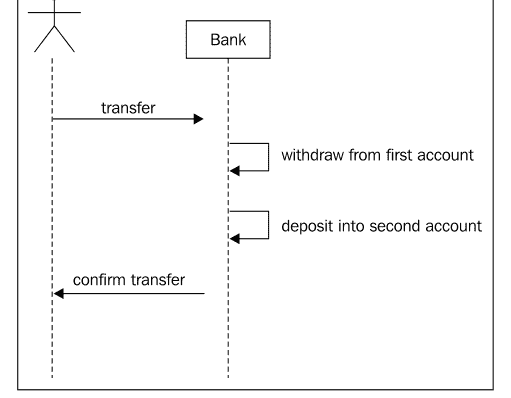

2. 现在让我们使用 Spring Python 的 @transactional 装饰器为 transfer 方法添加事务保护。

```python
from springpython.database.core import *
from springpython.database.factory import *
from springpython.database.transaction import *

class Bank(object):
    def __init__(self, connectionFactory):
        self.factory = connectionFactory
        self.dt = DatabaseTemplate(self.factory)

    @transactional
    def transfer(self, transfer_amt, source_act, target_act):
        self.dt.execute("""
            update ACCOUNT
            set BALANCE = BALANCE - %s
            where ACCOUNT_NUM = %s""",
            (transfer_amt, source_act))
        self.dt.execute("""
            update ACCOUNT
            set BALANCE = BALANCE + %s
            where ACCOUNT_NUM = %s""",
            (transfer_amt, target_act))
```

@transactional 是一个装饰器，它使用一个隐藏的 TransactionTemplate 实例在非常健壮的事务模式版本中执行我们的 transfer 函数。我们的交互在以下图表中展示得更好。

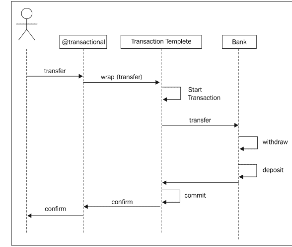

- 因为 `@transactional` 包裹了我们的 `transfer` 函数，当用户调用 `transfer` 时，他们首先命中的是装饰器
- `@transactional` 将请求的方法调用的所有上下文传递给其私有的 `TransactionTemplate` 实例
- `TransactionTemplate` 开始一个事务
- `TransactionTemplate` 然后调用原始的 `Bank transfer` 函数
- `Bank` 执行其业务，完全不知道它在事务内部
- 完成后，`Bank` 将控制权交还给 `TransactionTemplate`，后者发出一个 `commit`
- `TransactionTemplate` 将控制权交还给 `@transactional`，最终交还给调用者

> 此配置完全将事务逻辑与我们的 transfer 操作解耦。

- 由于 `TransactionTemplate` 是 `transfer` 的调用者，它可以轻松处理任意数量的 return 语句。如果在 `transfer` 内部任何位置引发异常，`TransactionTemplate` 将执行 `rollback` 而不是 `commit`。

有了这种清晰的关注点分离，我们可以在业务代码上工作，而无需担心事务的正确性。

## 关于 TransactionTemplate 的更多内容

我们第一个事务模式版本简单且天真。随后我们检查了该模式的问题列表。`TransactionTemplate` 具有更复杂的模式，可处理这些额外情况：

- 它通过捕获任何抛出的异常来处理简单情况，发出回滚，然后重新抛出异常
- 它通过捕获方法的返回值来处理所有 return 语句，发出必要的提交，然后最终返回结果
- `@transactional` 默认编码为：如果当前没有进行中的事务则启动新事务，如果已存在事务则加入该事务。我们将在本章后面查看其他事务选项

在我们的 `transfer` 代码中还存在另一个完整性缺口。它位于事务模式和业务逻辑之间。你能发现它吗？

没有检查来确保我们甚至有 $10,000 可转账！此外，也没有安全检查来确保我们拥有这两个账户中的任一个。我们将在填补事务细节时稍后解决这一缺陷。

我们还没完成。为了让 @transactional 发挥作用，我们需要通过一个 AutoTransactionalObject 将其与 Transaction Manager 链接。Transaction Manager 为 @transactional 提供进入数据库的句柄以发出必要的提交和回滚。它还跟踪现有事务的上下文并在何时启动新事务时做出适当决策。

1. 为了注入所有内容，让我们定义一个纯 Python IoC 容器，将 ConnectionFactoryTransactionManager 通过 AutoTransactionalObject 链接到 @transaction。

```python
from springpython.database.transaction import *
class BankAppConfig(PythonConfig):
    def __init__(self, factory):
        PythonConfig.__init__(self)
        self.factory = factory

    @Object
    def transactionalObject(self):
        return AutoTransactionalObject(self.tx_mgr())

    @Object
    def tx_mgr(self):
        return ConnectionFactoryTransactionManager(self.factory)

    @Object
    def bank(self):
        return Bank(self.factory)
```

- tx_mgr 定义了我们的 Transaction Manager，它使用注入的工厂来执行 SQL 事务 API。这与 DatabaseTemplate 使用的工厂类型相同。tx_mgr 跟踪事务开始和结束的时间，为 TransactionTemplate 和 @transactional 提供必要的服务。
- transactionalObject 定义了 AutoTransactionalObject 的一个实例，这是一个 IoC 后处理器。它的工作是找到所有 @transactional 的实例并将其与 tx_mgr 链接。这赋予了 @transactional 通过 SQL 事务确保数据完整性的能力。
- bank 类是我们的业务类。

2. 现在，让我们编写一些启动代码来执行转账。

```python
if __name__ == "__main__":
    from springpython.context import ApplicationContext
    ctx = ApplicationContext(BankAppConfig(
        Sqlite3ConnectionFactory("/path/to/sqlite3db")))
    service = ctx.get_object("bank")
    service.transfer(10000.0, "SAVINGS", "CHECKING")
```

## Spring 三角形——可移植服务抽象

我们在书中前面看到过此图，作为 Spring Python 背后关键原则的说明。

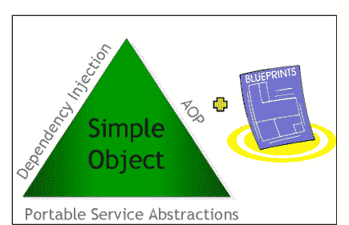

TransactionTemplate 代表一个可移植服务抽象。

- 它是可移植的，因为它使用 Python 的标准化 API 进行 SQL 事务，不将我们绑定到任何数据库厂商或自定义数据库连接库
- 它提供了有用的服务，让我们可以轻松地用复杂而强大的事务模式包装方法
- 它提供了一个编写事务代码的良好抽象，而无需直接处理 SQL 事务 API

## 编程式事务

我们的银行示例展示了如何使用 Spring Python 的 `@transactional` 装饰某些业务逻辑以使操作具有事务性。在整个示例中，我们反复提到了 `TransactionTemplate`。

在本节中，我们将直接使用 `TransactionTemplate` 而不是 `@transactional`。我们还将探讨如何有无 IoC 配置地执行此操作。

### 使用 IoC 容器配置

1. 首先，让我们重写 Bank，用 `TransactionTemplate` 替换 `@transactional`。

```python
class Bank(object):
    def __init__(self, connectionFactory):
        self.factory = connectionFactory
        self.dt = DatabaseTemplate(self.factory)
        self.tx_mgr = ConnectionFactoryTransactionManager(self.factory)
        self.tx_template = TransactionTemplate(self.tx_mgr)

    def transfer(self, transfer_amt, source_act, target_act):
        class TxDefinition(TransactionCallbackWithoutResult):
            def doInTransactionWithoutResult(self, status):
                self.dt.execute("""
                update ACCOUNT
                set BALANCE = BALANCE - %s
                where ACCOUNT_NUM = %s""",
                (transfer_amt, source_act))
                self.dt.execute("""
                update ACCOUNT
                set BALANCE = BALANCE + %s
                where ACCOUNT_NUM = %s""",
                (transfer_amt, target_act))
        self.tx_template.execute(TxDefinition())
```

此版本的 Bank 显示了另外两个属性：`tx_mgr` 和 `tx_template`。这些可以注入到我们的类中，但我们选择只注入连接工厂。


在 `transfer` 函数内部，我们定义了类 `TxDefinition`。然后在调用 `tx_template.execute()` 时实例化它。

- 此内部类定义了一个方法：
  `doInTransactionWithoutResult`，其中包含我们的业务逻辑。
- 为避免 `transfer` 中传入的 `self` 与 `TxDefinition` 中传入的 `self` 混淆，`doInTransactionWithoutResult` 将其第一个参数命名为 `s`。
- 因为 `transfer` 不期望返回任何内容，所以它使用 `TransactionCallbackWithoutResult` 作为基类。对于返回值，请改用 `TransactionCallback`/`doInTransaction`。

2. 接下来，让我们调整 IoC 配置以处理这些更改。

```
from springpython.database.transaction import *
class BankAppConfig(PythonConfig):
    def __init__(self, factory):
        PythonConfig.__init__(self)
        self.factory = factory

    @Object
    def bank(self):
        return Bank(self.factory)
```

3. 这不应影响用于运行我们的应用程序并执行相同转账的代码。

```
if __name__ == "__main__":
    from springpython.context import ApplicationContext
    ctx = ApplicationContext(BankAppConfig(
        Sqlite3ConnectionFactory("/path/to/sqlite3db")))
    service = ctx.get_object("bank")
    service.transfer(10000.0, "SAVINGS", "CHECKING")
```

## 不使用 IoC 容器进行配置

在这种情况下，我们的 IoC 配置相当简单。我们可以在没有它的情况下编写应用程序。只需记住：IoC 在测试、模拟以及能够替换关键对象等方面提供了有用的帮助。

我们首先重写启动脚本，使其不需要任何 IoC 容器。

```
if __name__ == "__main__":
    service = Bank(Sqlite3ConnectionFactory("/path/to/sqlite3db"))
    service.transfer(10000.0, "SAVINGS", "CHECKING")
```

因为我们的 Bank 是使用简单的构造函数注入编写的，所以为了在没有容器的情况下运行它，无需对其进行更改。由于我们以编程式的方式使用 TransactionTemplate，因此没有使用 IoC 容器的要求。这为开发人员提供了一个机会，可以纯粹为了事务功能而评估 Spring Python，而无需同时尝试 IoC 容器。

但重要的是要记住，本书中已经展示了 IoC 价值的多个示例，还有更多即将到来。

## @transactional 与 编程式

Spring 的方式包括为开发人员提供选择。为了选择合适的方法，以下是一些优缺点：

- @transactional
  - 优点：
    - 使用单行定义事务。
    - 清晰、简洁、易读。
  - 缺点：
    - 需要 IoC 来连接 AutoTransactionalObject。
    - 需要编辑现有代码。

- programmatic
  - 优点：
    - 明确显示事务行为发生的位置。
    - 不需要 IoC。
  - 缺点：
    - 重新引入代码纠缠。
    - 需要编辑现有代码。

如果这两种解决方案中的任何一种的缺点都是不可接受的，还有第三种选择：从 IoC 容器内部声明事务。这允许在不产生代码纠缠且无需编辑已有代码的情况下轻松地用事务包装业务代码。我们将在本章后面演示这一点。但首先让我们来看一下添加新函数。

## 使新函数与现有事务良好协作

到目前为止，我们已经成功构建了一个银行，它只做一件事：转账。如同任何软件项目一样，我们通常需要扩展功能。随着我们对 Bank 进行修改，我们希望在不危及现有事务的情况下添加新事务。Spring Python 的事务管理使这变得非常简单。

在本节中，我们将回到我们的 @transactional Bank 并添加一些新功能。

1. 让我们从 transfer 函数中提取 withdraw 函数和 deposit 函数。

```
class Bank(object):
    def __init__(self, connectionFactory):
        self.factory = connectionFactory
        self.dt = DatabaseTemplate(self.factory)

    def withdraw(self, amt, act):
        self.dt.execute("""
            update ACCOUNT
            set BALANCE = BALANCE - %s
            where ACCOUNT_NUM = %s""",
            (amt, act))

    def deposit(self, amt, act):
        self.dt.execute("""
            update ACCOUNT
            set BALANCE = BALANCE + %s
            where ACCOUNT_NUM = %s""",
            (amt, act))

    @transactional
    def transfer(self, transfer_amt, source_act, target_act):
        self.withdraw(transfer_amt, source_act)
        self.deposit(transfer_amt, target_act)
```

通过将两个 SQL 语句移入单独的函数中，我们已将 transfer 很好地定义为先 withdraw 后 deposit。我们现在准备将这两个新函数提供给我们的客户。你注意到这里有什么问题吗？这些函数本身在事务方面安全吗？如果另一个银行操作尝试重用这些原语会怎样？

2. 使用 @transactional 保护 withdraw 和 deposit 方法。

```
class Bank(object):
    def __init__(self, connectionFactory):
        self.factory = connectionFactory
        self.dt = DatabaseTemplate(self.factory)

    @transactional
    def withdraw(self, amt, act):
        self.dt.execute("""
            update ACCOUNT
            set BALANCE = BALANCE - %s
            where ACCOUNT_NUM = %s""",
            (amt, act))

    @transactional
    def deposit(self, amt, act):
        self.dt.execute("""
            update ACCOUNT
            set BALANCE = BALANCE + %s
            where ACCOUNT_NUM = %s""",
            (amt, act))

    @transactional
    def transfer(self, transfer_amt, source_act, target_act):
        self.withdraw(transfer_amt, source_act)
        self.deposit(transfer_amt, target_act)
```

我们代码中唯一的差异就是用 @transactional 标记 withdraw 和 deposit。

3. 现在让我们通过在执行 SQL 之前和之后进行一些检查，为我们的 Bank 增加一层完整性。

```
class Bank(object):
    def __init__(self, connectionFactory):
        self.factory = connectionFactory
        self.dt = DatabaseTemplate(self.factory)

    @transactional(["PROPAGATION_SUPPORTS"])
    def balance(self, act):
        return self.dt.queryForObject("""
            SELECT BALANCE
            FROM ACCOUNT
            WHERE ACCOUNT_NUM = ?""",
            (act,), types.FloatType)

    @transactional
    def withdraw(self, amt, act):
        if (self.balance(act) > amt):
            rows = self.dt.execute("""
                update ACCOUNT
                set BALANCE = BALANCE - %s
                where ACCOUNT_NUM = %s""",
                (amt, act))
            if (rows == 0):
                raise Exception("Account %s does not exist." % act)
            else:
                raise Exception("Account %s has insufficient funds." % act)

    @transactional
    def deposit(self, amt, act):
        rows = self.dt.execute("""
            update ACCOUNT
            set BALANCE = BALANCE + %s
            where ACCOUNT_NUM = %s""",
            (amt, act))
        if (rows == 0):
            raise Exception("Account %s does not exist." % act)

    @transactional
    def transfer(self, transfer_amt, source_act, target_act):
        self.withdraw(transfer_amt, source_act)
        self.deposit(transfer_amt, target_act)
```

我们做了一些更改，使我们的应用程序开始看起来像一个真正的银行。如下所示：

- 我们创建了一个 `balance` 函数，允许我们查询账户的余额
- `withdraw` 函数现在会检查余额，以确保有足够的金额可供提取
- `withdraw` 函数验证是否更新了一行数据，以确认被提取的账户是真实的
- `deposit` 函数验证是否更新了一行数据，以确认被存款的账户是真实的

## Spring Python 如何让我们定义事务的 ACID 属性

如前所述，事务的 ACID 属性如下：

- **Atomicity** – 我们需要保证所有步骤都完成，或者没有任何步骤完成。
- **Consistent** – 这是确保我们的数据保持一致状态的概念。


- **Isolated** – 当我们从银行取款时，如果业务伙伴同时取款，导致我们最终出现负余额，那就很糟糕了。
- **Durable** – 我们期望已完成的事务能够在硬件故障后仍然存活

关于原子性，我们已经通过使用 @transactional 和 TransactionTemplate 来练习定义事务的开始和结束点。

Spring Python 支持传播。之前我们提到，@transactional 的默认策略是如果不存在则启动新事务，如果已有事务正在进行则加入现有事务。Spring Python 方便地让我们将安全的原子操作 withdraw 和 deposit 组合成 transfer，而完全无需与 SQL 事务 API 交互。

我们还创建了另一个函数 balance，用于查询账户的当前余额。由于 balance 不执行任何更新，单独运行时不需要事务。然而，当它被现有事务调用时，我们希望它像事务的一部分一样加入进来。这是通过为 @transactional 提供传播覆盖来实现的：

```
@transactional(["PROPAGATION_SUPPORTS"])
def balance(self, act):
    return self.dt.queryForObject("""
        SELECT BALANCE
        FROM ACCOUNT
        WHERE ACCOUNT_NUM = ?""",
        (act,), types.FloatType)
```

@transactional 会扫描事务定义列表。目前，Spring Python 支持以下定义：

| 属性 | 描述 |
|---|---|
| PROPAGATION_REQUIRED | 一个事务是必需的。如果存在当前事务，则加入它。否则，启动一个新事务。这是 @transactional 的默认值。 |
| PROPAGATION_SUPPORTS | 一个事务不是必需的。此代码可在事务内或事务外运行。 |
| PROPAGATION_MANDATORY | 一个事务是必需的。如果存在当前事务，则加入它。否则，抛出异常。 |
| PROPAGATION_NEVER | 不允许事务。如果存在当前事务，则抛出异常。否则，运行代码。 |

Spring Python 提供了非常有用的事务上下文管理、事务 API 处理，并允许我们清晰地划分事务。

随着 Python 数据库规范中关于隔离等事物的更好定义被添加，Spring Python 将添加更多选项来支持它。这将提高我们清晰声明用于包装代码所需的确切事务类型的能力。

## 将事务应用于非事务代码

Spring Python 的一个重要方面是其非侵入性。这在介绍面向方面编程的章节中已详细演示。Spring Python 提供了一个方便的非侵入式方法拦截器，允许对现有代码进行划分。

这解决了前面提到的问题，即既不接受编辑现有源代码，也不接受将业务逻辑与事务管理纠缠在一起。

- 1. 让我们从一个没有事务划分的 Bank 类的替代版本开始。

```python
class Bank(object):
    def __init__(self, connectionFactory):
        self.factory = connectionFactory
        self.dt = DatabaseTemplate(self.factory)

    def balance(self, act):
        return self.dt.queryForObject("""
            SELECT BALANCE
            FROM ACCOUNT
            WHERE ACCOUNT_NUM = ?""",
            (act,), types.FloatType)

    def withdraw(self, amt, act):
        if (self.balance(act) > amt):
            rows = self.dt.execute("""
                update ACCOUNT
                set BALANCE = BALANCE - %s
                where ACCOUNT_NUM = %s""",
                (amt, act))
            if (rows == 0):
                raise Exception("Account %s does not exist." % act)
        else:
            raise Exception("Account %s has insufficient funds." % act)

    def deposit(self, amt, act):
        rows = self.dt.execute("""
            update ACCOUNT
            set BALANCE = BALANCE + %s
            where ACCOUNT_NUM = %s""",
            (amt, act))
        if (rows == 0):
            raise Exception("Account %s does not exist." % act)

    def transfer(self, transfer_amt, source_act, target_act):
        self.withdraw(transfer_amt, source_act)
        self.deposit(transfer_amt, target_act)
```

这个 Bank 类与之前的类相同，只是没有 @transactional 装饰器。

- 2. 让我们定义一个具有等效事务划分点的应用程序上下文。

```
class BankAppConfig(PythonConfig):
    def __init__(self, factory):
        PythonConfig.__init__(self)
        self.factory = factory

    @Object
    def bank_target(self):
        return Bank(self.factory)

    @Object
    def tx_mgr(self):
        return ConnectionFactoryTransactionManager(self.factory)

    @Object
    def bank(self):
        tx_attrs = []
        tx_attrs.append((".*transfer", ["PROPAGATION_REQUIRED"]))
        tx_attrs.append((".*withdraw", ["PROPAGATION_REQUIRED"]))
        tx_attrs.append((".*deposit", ["PROPAGATION_REQUIRED"]))
        tx_attrs.append((".*balance", ["PROPAGATION_SUPPORTS"]))
        return TransactionProxyFactoryObject(self.tx_mgr(),
            self.bank_target(),
            tx_attrs)
```

使用此替代配置，我们使用 `TransactionProxyFactoryObject`。这是一个开箱即用的 AOP 拦截器，Spring Python 提供它来自动将某些函数包装为 `TransactionTemplate`。它需要一个事务管理器以及目标对象，即我们的 `Bank`。它还需要一个元组列表，每个元组定义用于方法匹配的正则表达式以及事务属性列表，就像我们在本章前面将属性插入到 `@transactional` 中一样。

正确的选择是：`@transactional` 还是 `TransactionProxyFactoryObject`？

- `@transactional` 清晰、简洁且易于阅读。它的最大缺点是需要编辑现有代码。如果我们拥有代码，这不应该是个问题。
- 如果我们试图将事务包装在我们不直接控制的第三方库周围，`TransactionProxyFactoryObject` 是最佳选择。

## 测试你的事务

事务与数据库密不可分。尝试对其进行模拟或存根需要极大的努力，可能不值得。这是我通常同意针对实际数据库进行测试的领域之一。

可以使用轻量级数据库如 `sqlite` 来进行此工作，但如果这不是生产的目标平台，则可能存在风险。事实上，最佳的测试工作是使用与生产相同的数据库引擎版本正确设置测试床。重要的是，很容易针对像 `sqlite` 这样的小东西创建轻量级测试。这可以向开发人员确认事情按预期工作。更广泛的集成测试可以用生产级测试床完成。


> 轻松交换不同的数据库配置是使用 Spring Python 的主要优势之一。

## 总结

在本章中，我们利用了 Spring Python 方便的事务功能，将一些简单的银行 SQL 转变为一个有弹性的应用程序。能够在易于阅读的 `@transactional` 装饰器和基于 AOP 的 `TransactionProxyFactoryObject` 之间进行选择，为我们提供了灵活的选择。

在本章中我们学到：

- 经典的事务问题使得手工编写事务变得困难
- Spring Python 让我们可以轻松地使用 `@transactional` 装饰器向银行应用程序添加事务
- 我们可以有或没有 IoC 容器以编程方式轻松编写事务，从而获得最大的选择
- 借助 AOP 的强大功能，我们可以在不编辑源代码的情况下，非侵入式地将事务混合到非事务代码中

在下一章中，我们将探讨使用 Spring Python 安全模块保护 Web 应用程序的方法。


