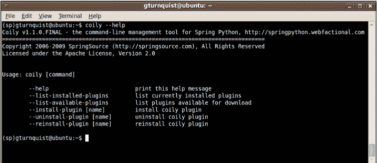
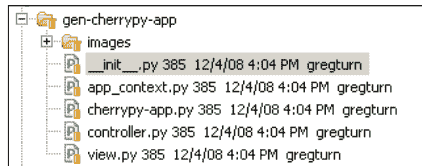
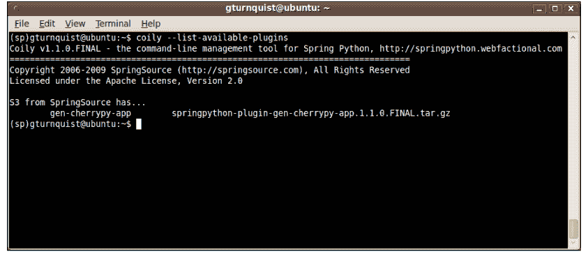
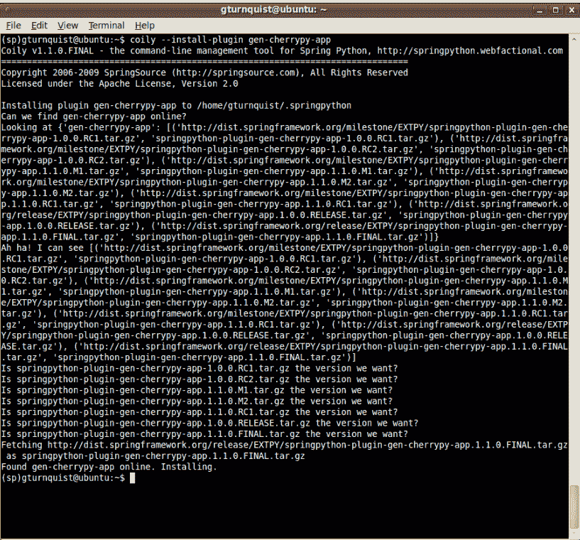
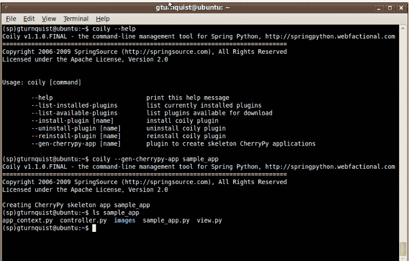
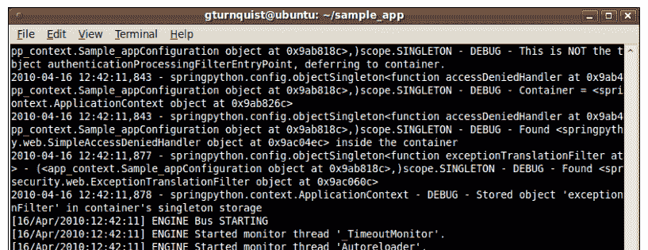
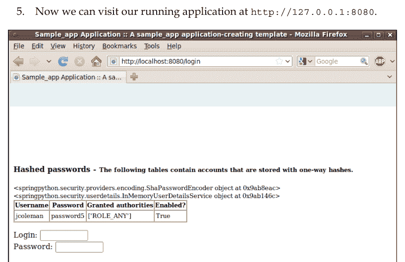
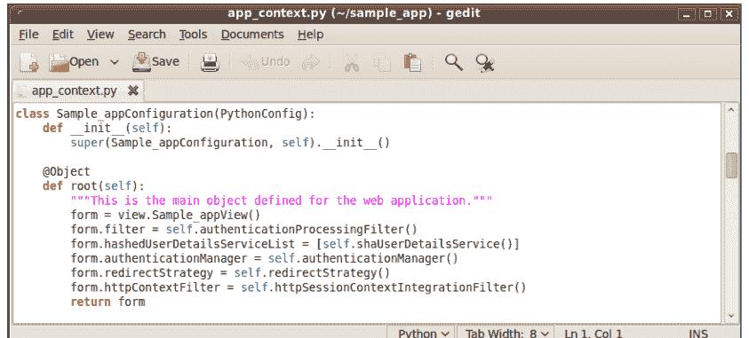
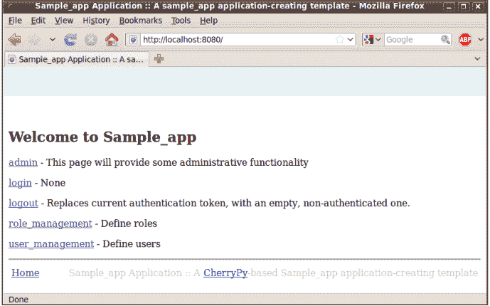

# 9 Creating Skeleton Apps with Coily

Spring Python has many useful building blocks. In the last chapter we used these features in concert to build a simple banking application. This illustrated the bottom line task for software developers: delivering runnable applications.

To speed up the process for building apps, Spring Python provides the Python script `coily`. This script is built to support extensible plugins. The first plugin provided by the Spring Python team is `gen-cherrypy-app`, which is based on creating a skeleton CherryPy application using Spring Python IoC and security.

In this chapter, we will learn:

- The plugin driven approach of `coily`, which allows us to utilize plugins written by other developers or to write our own
- The easy-to-code requirements of creating a plugin
- Building a CherryPy application from scratch, with fully configured security, using the template-based `gen-cherrypy-app` plugin

## Plugin approach of Coily

`coily` is a Python script designed from the beginning to provide a plugin based platform for building Spring Python apps. Another important feature is version control of the plugins. Developers should not have to worry about installing an out-of-date plugin that was designed for an older version of Spring Python. `coily` allows different users on a system to have different sets of plugins installed. It also requires no administrative privileges to install a plugin.

## Key functions of coily

coily is included in the standard installation of Spring Python, as documented earlier in this book. To see the available commands, just ask for help.



The following table elaborates these commands.

| Command | Description |
|---|---|
| `--help` | Prints out the help menu. It is worth noting that when plugins are installed, they will also be listed as well. |
| `--list-installed-plugins` | Lists the plug-ins already installed in this account. Each installed plugin exists in a sub-folder in `HOME/.springpython`. |
| `--list-available-plugins` | Lists the plugins available for installation. `coily` is currently configured to search SpringSource's S3 site where Spring Python downloads are found for officially supported plugins. It also looks in the current directory where `coily` is being run, so that you can develop plugins locally. |
| `--install-plugin` | Installs a plugin by copying its files into `HOME/.springpython`. |
| `--uninstall-plugin` | Uninstalls the plugin by deleting its directory from `HOME/.springpython`. |
| `--reinstall-plugin` | Shortcut command that uninstalls a plugin and then installs it again. This is very useful when developing a new plugin in an iterative fashion. |


## 插件的必需部分

一个 `coily` 插件与 Python 包非常相似，只是做了一些细微的调整。这并不意味着插件是要作为 Python 包安装的。它只是文件夹结构的一种描述。

让我们以 `gen-cherrypy-app` 插件的布局为例。



该布局中的某些部分是必需的，其他部分则不是。顶层文件夹是插件的名称。

- 一个插件需要在顶层目录内包含一个 `__init__.py` 文件。
- `__init__.py` 必须包含一个 `__description__` 变量。当我们运行 `coily --help` 命令时，该描述会显示出来。
- `__init__.py` 必须包含一个命令函数，该函数要么是 `create` 要么是 `apply` 函数。当插件需要用户提供一个参数时使用 `create`；当不需要用户提供参数时使用 `apply`。

让我们看看 `gen-cherrypy-app` 如何满足这些要求。

- 1. 我们可以从图中看出，顶层文件夹的名称与我们的插件相同。
- 2. 在 `__init__.py` 内部，我们可以看到以下帮助信息定义。
  `__description__ = "plugin to create skeleton CherryPy applications"`
- 3. `gen-cherrypy-app` 用于创建骨架应用程序。它需要用户提供将要创建的应用程序的名称。再次查看 `__init__.py` 内部，可以找到以下方法签名。
  `def create(plugin_path, name)`
- 4. `plugin_path` 是由 `coily` 提供给 `gen-cherrypy-app` 的参数，指向 `gen-cherrypy-app` 的基本目录。该参数也为使用 `apply` 命令函数的插件提供。
- 5. `name` 是用户提供的应用程序名称。

> 需要认识到，`create` 允许一个命令行参数，但还会从 `coily` 本身接收另一个参数 `plugin_path`，以便为插件提供足够的信息来完成工作。`apply` 不允许命令行参数，但仍会从 `coily` 接收 `plugin_path`。

其余文件不是插件的必需项，而是由 `gen-cherrypy-app` 使用，如下一节所示。

## 创建 CherryPy 骨架应用

上图中列出的其余文件构成了应用程序的模板。

|  |  |
|---|---|
| `app_context.py` | 用于使用基于装饰器的 `PythonConfig` 对生成的应用程序进行装配的 Spring Python 应用程序上下文 |
| `cherrypy-app.py` | 可运行的应用程序主体部分 |
| `controller.py` | 包含应用程序的业务逻辑 |
| `view.py` | 包含应用程序的部分 CherryPy 渲染部分 |
| `images` | 一个包含视图层使用的图像的子目录 |

- 1. 在创建 CherryPy 应用程序之前，我们缺少了一些东西。在之前的截图中，该插件未列出。我们需要找到它并安装它。首先，让我们看看如何查找现有插件。



- 2. 看到列出了 gen-cherrypy-app，让我们使用 coily 安装它，而无需打开浏览器。



## 使用 Coily 创建骨架应用

3. 让我们使用该插件创建一个名为 `sample_app` 的 CherryPy 应用程序。由于我们刚刚安装了它，插件现在会出现在 `coily` 的帮助菜单中。有了它，我们就可以运行命令来创建 `sample_app`。



`gen-cherrypy-app` 创建一个名为 `sample_app` 的目录，并将上面列出的文件复制到其中。它还会根据参数 `sample_app` 对文件进行一些转换。

- 它用 `sample_app` 替换每个文件中所有 `${name}` 的实例
- 它用 `Sample_app` 替换每个文件中所有 `${properName}` 的实例
- 它将 `cherrypy-app.py` 重命名为 `sample_app.py`

4. 要运行该应用，请切换到 sample_app 目录并运行主脚本。

```
./sample_app.py
```



5. 现在我们可以访问正在运行的应用程序 http://127.0.0.1:8080。



- 6. 让我们检查 `app_context.py` 并查看 `gen-cherrypy-app` 接线的一些关键特性。



这是正在接线的根对象。其余配置（此处未显示）主要是安全配置步骤。

> 在 *第 6 章，使用 Spring Python 保护您的应用程序* 中指出，使用 Spring Python 进行安全配置需要许多步骤。`gen-cherrypy-app` 通过预先接线大部分安全部分来提供帮助，使用户可以根据需要进行修改，而无需从头构建。

从这里，我们可以使用硬编码的凭据登录以查看我们的可扩展应用程序。



目前没有控制器对象。然而，添加这样一层的工作量不大，正如上一章案例研究中所示。

该插件足够简单，以至于改进该插件所花费的大部分工作都可以集中在模板文件上。这种策略对于为其他类型的应用程序构建其他模板非常有用。

## 摘要

`coily` 用于下载、安装和利用插件。`gen-cherrypy-app` 使用一组模板很好地创建了一个 Spring 化 CherryPy 应用程序。这种模式很容易复制到其他类型的应用程序。

在本章中，我们学习了：

- 用于安装和卸载插件的基本 `coily` 命令
- 插件的结构，包括在 `coily` 的帮助屏幕上显示的描述的定义以及处理命令所需的函数
- 使用模板文件和模式替换使得 `gen-cherrypy-app` 能够轻松生成 CherryPy 应用程序

在下一章中，我们将研究如何将 Spring Python 与 Java 应用程序集成。
