# 10 案例研究 II—将 Spring Python 与您的 Java 应用程序集成

在本书中，我们在检查代码示例的同时探索了 Spring Python 的许多方面。到目前为止，我们探索的所有代码都是使用 CPython 创建的，即 Python 语言的原始实现。

在当今时代，多语言编程在开发者社区中引起了越来越多的兴趣。Java 开发者正在寻找其他选择以提高开发人员生产力，同时仍保留对 Java 生态系统的访问。Python 开发者正在研究如何在可扩展的资源（如 Google App Engine）上运行系统。

Spring Python 用纯 Python 编写，使其易于在 Jython 中运行。这打开了集成的可能性，使开发人员能够轻松地将 Java 和 Python 组件与 Spring Python 的轻量级功能混合使用。

在本章中，我们将学习如何：

- 使用 Pythonic 的 CherryPy Web 应用程序框架构建航班预订系统前端
- 使用 Java 构建航班预订系统后端
- 使用 Spring Python、Jython 和 Pyro 将两者连接起来

## 构建航班预订系统

在本章中，我们将在构建航班预订系统的同时探索 Java 和 Python 的集成。构建此类系统的第一步是向客户展示现有航班并允许客户筛选数据。虽然实现可用系统需要更多功能，但此功能将是本次演示的重点。

我们已经探索过使用 CherryPy Web 应用程序框架，并将再次使用它来为该系统创建前端。对于后端，我们将使用 Java 组件开发持久层，同时使用 Spring Python 的 IoC 容器将所有内容连接起来，并在 Jython 内部运行所有内容。我们将探索的另一个关键特性是如何使用 Spring Python 和 Pyro 将纯 Java 与纯 Python 组件集成。

## 以最快的方式构建 Web 应用

您将如何构建我们的 Python 前端？一种流行的方法是构建小型、可测试且易于组合的块。从这个角度来看，用户界面将是最后一步。

另一种策略是专注于客户的视角并开发屏幕，然后再填充后端。由于我们的目标是测试 Spring Python 的功能，让我们采用这种更直观的方法。

为了加快我们的应用程序，让我们使用 Spring Python 的命令行 coily 工具，我们之前已经探索过它。

- 1. 使用 coily，让我们创建一个预订应用程序

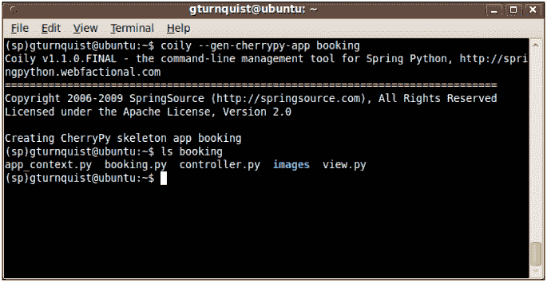


This command generates a set of files:

| 文件名 | 描述 |
|---|---|
| booking.py | 可运行的 CherryPy 应用程序。 |
| app_context.py | Spring Python 应用上下文，其中包含我们组件的 wiring。 |
| view.py | 包含所有网页部分，包括 HTML。 |
| controller.py | 包含视图访问以生成屏幕动态内容的函数。 |

此自动生成的应用程序包含预先连接的组件，包括安全机制、一些基本链接以及启动 CherryPy Web 服务器引擎所需的引导程序。在开始编写功能代码之前，它只需要进行一些小的修改。

- 2. 删除应用中嵌入的任何许可注释。虽然模板文件本身带有许可标记，但此应用程序可能不会以相同的许可发布
- 
- 3. 放宽 app_context.py 中定义的安全限制，允许匿名用户访问网站的主要部分，同时对 /customer/* 下的任何链接实施完整的安全限制并要求 ROLE_CUSTOMER

```
@Object
def filterChainProxy(self):
    return CP3FilterChainProxy(filterInvocationDefinitionSource =
    [
        ("/images.*", []),
        ("/html.*", []),
        ("/accessDenied.*", []),
        ("/login.*", ["httpSessionContextIntegrationFilter"]),
        ("/customer/.*", ["httpSessionContextIntegrationFilter",
            "exceptionTranslationFilter",
            "authenticationProcessingFilter",
            "filterSecurityInterceptor"])
    ])
```

```
@Object
def filterSecurityInterceptor(self):
    filter = FilterSecurityInterceptor()
    filter.auth_manager = self.authenticationManager()
    filter.access_decision_mgr = self.accessDecisionManager()
    filter.sessionStrategy = self.cherrypySessionStrategy()
    filter.obj_def_source = [
        ("/customer/.*", ["ROLE_CUSTOMER"])
    ]

    return filter
```

4. 删除图像和 CSS 代码并用更简单的页眉和页脚替换它们：

```
def header():
    return """
    <html>
    <head>
    <title>Spring Flight Reservation System</title>
    </head>

    <body>
    """

def footer():
    return """
    <hr>
    <table style="width:100%"><tr>
        <td><A href="/">Home</A></td>
    </tr></table>
    </body>
    """
```

5. 删除视图层中通过 @cherrypy.expose 暴露的所有方法（index、login 和 logout 除外）

6. 让我们使用 Python 启动此 Web 应用，然后通过在浏览器中打开 http://localhost:8080 来访问它

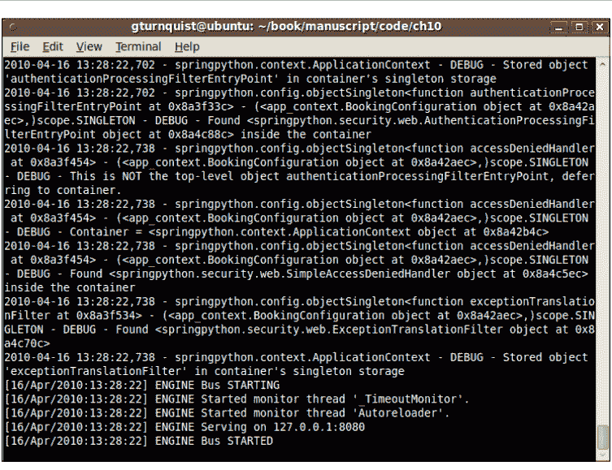

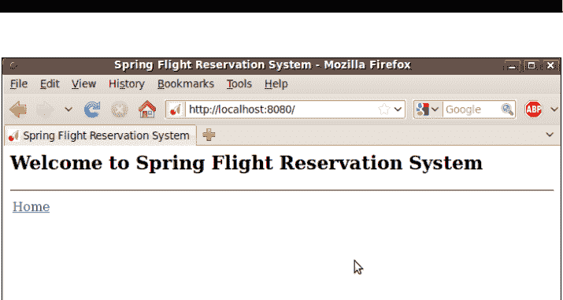

我们现在有一个干净的起点，可以开始完善系统的功能。

## 查找现有航班

对于航班预订系统，我们需要的数据第一件是什么？航班列表！由于客户通常需要根据日期或位置进行搜索，让我们获取一些航班数据，然后构建一些搜索功能。

- 1. 让我们在主页面上添加一个链接，带我们进入搜索页面。

```
@cherrypy.expose
def index(self):
    """This is the root page for your booking app. Its default
    includes links to all other exposed links automatically."""

    return header() + """
        <H2>Welcome to Spring Flight Reservation System</H2>
        <P>
        <ul>
            <li><a href="flight_listings">Search Flight
                Listings</a></li>
        </ul>
        <P>""" + footer()
```

我们现在创建了一个 HTML 项目符号列表，其中包含一个“搜索航班列表”条目。

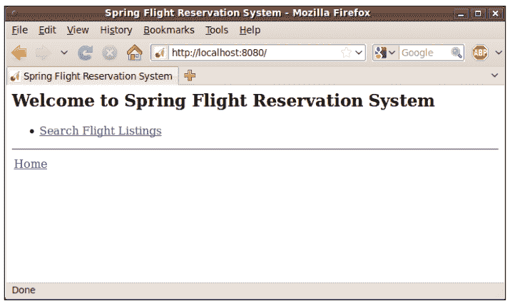

2. 在尝试显示任何航班信息之前，让我们定义一个简单的 Python 类来包含这些信息：

```
class Flight(object):
    def __init__(self, flight=None, departure=None, arrival=None):
        self.flight = flight
        self.departure = departure
        self.arrival = arrival
```

3. 现在我们已经为航班数据创建了一个简单模型，让我们在网页上显示它。为此，让我们添加一个 flight_listings 函数并使用 @cherrypy.expose 暴露它：

```
@cherrypy.expose
def flight_listings(self):
    page = header() + """
        <H2>Search Flight Listings</H2>
        <table border="1">
            <tr><th>Flight</th><th>Departure</th>
                <th>Arrival</th></tr>
    """

    for f in self.controller.flights():
        page += "<tr><td>%s</td><td>%s</td><td>%s</td></tr>" % \
                (f.flight, f.departure, f.arrival)

    page += "</table>" + footer()

    return page
```

我们还没有创建搜索框。在此之前，让我们要求控制器提供所有航班数据。

4. 我们目前还无法点击该链接，因为没有控制器，所以让我们构建一个控制器并让它提供一些示例数据

```
from model import *

class BookingController(object):
    def __init__(self):
        self.data = []
        self.data.append(Flight("SpringAir 14", "9:02am Melbourne", "10:45am Nashville"))
        self.data.append(Flight("Python Airways 28", "10:40am Orlando", "2:15pm San Francisco"))

    def flights(self):
        return self.data
```

## 案例研究 II – 将 Spring Python 与您的 Java 应用程序集成

那里没什么，只是包含一个 Flight 实例的简单 Python 数组。但我们希望从易于可视化的小型简单部分构建起来。有了所有这些部分，让我们再次查看网页。

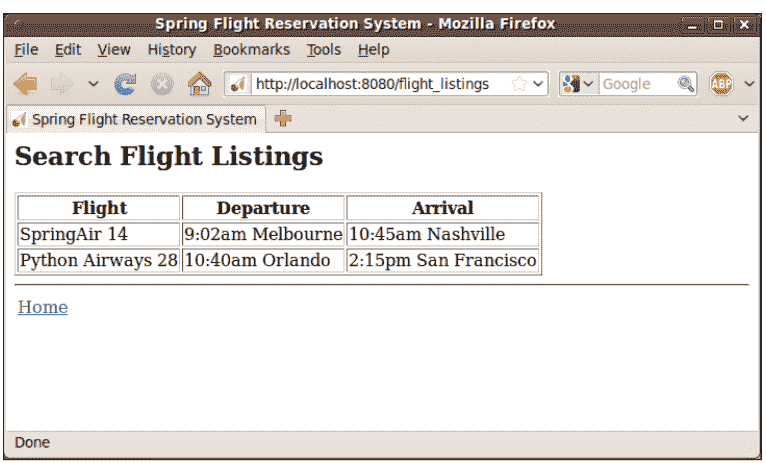

现在我们可以看到这小段示例航班数据。

- 5. 让我们添加一个搜索框以提供一些最小的过滤功能

```
@cherrypy.expose
def flight_listings(self, criteria=""):
    page = header() + """
        <H2>Search Flight Listings</H2>
        <form method="POST" action="/flight_listings">
            Search: <input type="text"
                        name="criteria"
                        value="%s"
                        size="10"/>
            <input type="submit"/>
        </form>
        <table border="1">
            <tr>
                <th>Flight</th>
                <th>Departure</th>
                <th>Arrival</th>
            </tr>
        """ % criteria

    for f in self.controller.flights(criteria):
        page += "<tr><td>%s</td><td>%s</td><td>%s</td></tr>" % \
            (f.flight, f.departure, f.arrival)

    page += "</table>" + footer()

    return page
```

我们在屏幕顶部添加了一个文本输入框和一个按钮。搜索条件现在会传递给控制器对象以进行任何过滤。

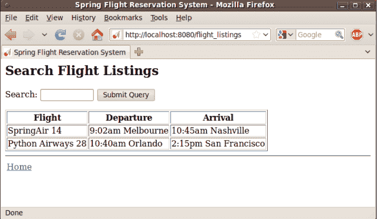

6. 你将如何利用用户输入的文本在控制器中进行过滤？我们应该区分大小写还是稍微放宽一点？如果你作为客户使用，你希望与哪些字段进行比较？这里有一个使用方法：

```
def flights(self, criteria):
    return [f for f in self.data \
        if criteria.lower() in str(f).lower()]
```

这会抓取示例数据并应用过滤列表推导式。过滤器会对 criteria 以及航班记录的字符串化版本同时应用 lower()。

7. 让客户搜索的一种方法是针对航班记录中的所有数据进行搜索

```
def __str__(self):
    return "%s %s %s" % \
        (self.flight, self.departure, self.arrival)
```

经过所有这些更改后，我们现在可以进行简单的航班搜索。

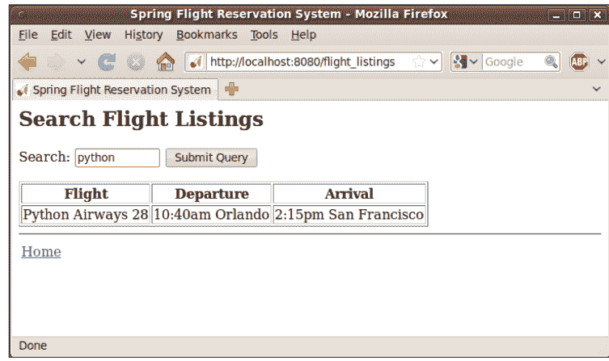

你会考虑哪些其他搜索选项来使其更复杂？

## 从示例 Python 数据迁移到真实 Java 数据

到目前为止，我们查看的是几行示例数据。更现实的场景将是接入某种实时系统，列出实时航班。如果数据存储在后端数据库中，并且服务已经用 Java 编写，你会怎么做？

- 你会尝试绕过 Java 系统直接与数据库通信吗？这种方法有哪些风险？
- 你会放弃我们刚刚构建的 Python 前端，转而启动一个基于 Java 的门户吗？如果这已经花费了几个月的时间努力呢？


让我们看看 Jython 如何将这两个世界整合在一起。Jython 是否支持我们迄今为止使用过的所有 Python 组件？

Jython 在 2009 年底追上了 Python 2.5 并具有许多有用的功能。但尽管有显著改进，许多第三方 Python 库仍然无法在 Jython 上运行。许多库利用了 Python 的 C 扩展能力，但 Jython 不支持这一点。还有一些平台假设涉及线程等事物，这些在 CPython 中与 Jython 运行所在的 JVM 相比有所不同。

> 在撰写本文时，CherryPy 在没有进行一些小调整的情况下在 Jython 上存在问题。Sqlite 支持也尚未可用。可以从 Jython 访问 Java 组件，但假设我们计划使用的所有 Python 组件都能运行是不现实的。

Spring Python 通过其与 Pyro 远程库的集成，使得弥合这一差距变得容易。

- 1. 要将我们的数据访问控制器迁移到 Java，我们也需要将 Flight 记录一起迁移。

```java
public class Flight {

    private long id;
    private String flight;
    private String departure;
    private String arrival;

    public long getId() {
        return this.id;
    }

    public void setId(long id) {
        this.id = id;
    }

    public String getFlight() {
        return this.flight;
    }

    public void setFlight(String flight) {
        this.flight = flight;
    }

    public String getDeparture() {
        return this.departure;
    }

    public void setDeparture(String departure) {
        this.departure = departure;
    }

    public String getArrival() {
        return this.arrival;
    }

    public void setArrival(String arrival) {
        this.arrival = arrival;
    }

    public String toString() {
        return flight + " " + departure + " " + arrival;
    }
}
```

- 2. 接下来，让我们用 Java 重写控制器。为了简化操作，我们将使用原始的 Spring Framework 来编写查询

```java
import java.sql.ResultSet;
import java.sql.SQLException;
import java.util.List;

import javax.sql.DataSource;

import org.springframework.jdbc.core.JdbcTemplate;
import org.springframework.jdbc.core.RowMapper;

public class FlightDataSystem {

    private JdbcTemplate jdbcTemplate;

    public FlightDataSystem(DataSource dataSource) {
        this.jdbcTemplate = new JdbcTemplate(dataSource);
    }

    public List<Flight> flights(String criteria) {
        return jdbcTemplate.query(
            "SELECT id, flight, departure, arrival " +
            "FROM flights",
            new RowMapper<FlightData>() {
                @Override
                public FlightData mapRow(final ResultSet rs, int row)
                    throws SQLException {
                    return new Flight() {{
                        setId(rs.getLong("id"));
                        setFlight(rs.getString("flight"));
                        setDeparture(rs.getString("departure"));
                        setArrival(rs.getString("arrival"));
                    }};
                }
            });
    }
}
```

> 注意这段 Java 代码中的双大括号吗？这是一个 Flight 的匿名子类，带有一个初始化代码块。这是一种方便的方式，可以减少填充 POJO（Plain Old Java Object，普通旧 Java 对象）的样板代码。

- 3. 为了让我们的控制器能够与 MySQL 数据库通信并利用 Spring Framework，我们需要一些额外的 jar 文件。包括：
- org.springframework.beans
- org.springframework.core
- org.springframework.jdbc
- org.springframework.transaction
- commons-dbcp
- commons-logging
- commons-pool
- mysql-connector-java

编写脚本重新构建 Java 部分，考虑到这些 jar 文件，是读者的练习。

- 4. 在测试此代码之前，我们需要设置数据库：

```sql
DROP DATABASE IF EXISTS booking;

CREATE DATABASE booking;

GRANT ALL ON booking.* TO booking@localhost IDENTIFIED BY 'booking';
```

```sql
USE booking;

CREATE TABLE flights (
    id INT(4) UNSIGNED NOT NULL AUTO_INCREMENT PRIMARY KEY,
    flight VARCHAR(30),
    departure VARCHAR(30),
    arrival VARCHAR(30)
);

INSERT INTO flights (flight, departure, arrival) values ('SpringAir 14', '9:02am Melbourne', '10:45am Nashville');
INSERT INTO flights (flight, departure, arrival) values ('Python Airways 28', '10:40am Orlando', '2:15pm San Francisco');
```

以下截图显示了运行此脚本以设置和加载数据的过程：

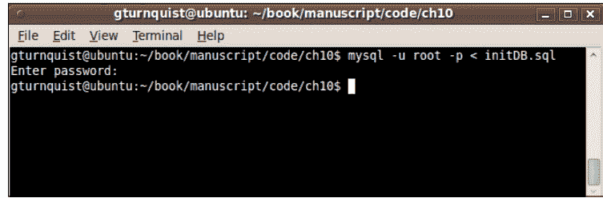

- 5. 现在我们已经将控制器代码迁移到 Java 并设置了模式，让我们编写一个简单的 Jython 脚本来打印出航班数据

```python
import FlightDataSystem
from org.apache.commons.dbcp import BasicDataSource

source = BasicDataSource()
source.driverClassName = "com.mysql.jdbc.Driver"
source.url = "jdbc:mysql://localhost/booking"
source.username = "booking"
source.password = "booking"

system = FlightDataSystem(source)

for f in system.getFlightData():
    print f
```

运行它时，我们需要包含几个 jar 文件。

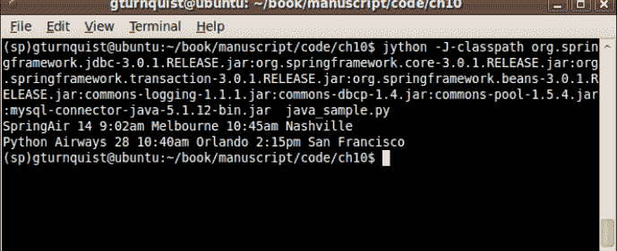

你可以看到输入的命令，以及将航班数据打印到控制台的输出。

在将事物连接起来之前，还有一个关键因素需要处理：数据的序列化。当我们的 Java 代码返回一个 Java 对象数组时，它必须由 Pyro 序列化，通过线路发送，然后由 CPython 反序列化。对于标量来说，这不是问题。Jython 可以轻松处理。但移动类对象需要在线路的两侧都有类定义。CPython 无法访问我们的 Java Flight 类，而 Java 代码也无法访问 CPython 类。我们需要在中间有一段薄代码，可以调用我们的 Java 服务并将 Java 对象列表转换为 Python 对象。Jython 包装器将是完美的。

```python
from model import *

class JythonFlightDataSystem(object):
    def __init__(self, java_system):
        self.java_system = java_system

    def flights(self, criteria):
        return [Flight(f.flight, f.departure, f.arrival) \
                for f in self.java_system.flights(criteria)]
```

这个包装类具有相同的签名。在 Jython 中运行它将使其能够访问 Java 类以及我们的 Python 类。

- 6. 让我们使用 Spring Python IoC 配置来连接我们的服务，然后使用 PyroServiceExporter 暴露它

```python
import logging
from springpython.config import *
from springpython.context import *
from springpython.remoting.pyro import *

import FlightDataSystem
from org.apache.commons.dbcp import BasicDataSource
from java_wrapper import *

class JavaSystemConfiguration(PythonConfig):
    def __init__(self):
        super(JavaSystemConfiguration, self).__init__()

    @Object
    def data_source(self):
        source = BasicDataSource()
        source.driverClassName = "com.mysql.jdbc.Driver"
        source.url = "jdbc:mysql://localhost/booking"
        source.username = "booking"
        source.password = "booking"
        return source

    @Object
    def exported_controller(self):
        exporter = PyroServiceExporter()
        exporter.service_name = "JavaFlightDataSystem"
        exporter.service = self.controller()
        return exporter

    @Object
    def controller(self):
        java_system = FlightDataSystem(self.data_source())
        wrapper = JythonFlightDataSystem(java_system)
        return wrapper
```

- 7. 使用此配置，我们使用 Apache Commons BasicDataSource 创建连接池来访问 MySQL 数据库

- 8. 我们创建了基于 Java 的 FlightDataSystem 的实例。但我们不会直接返回它，而是将其注入到我们的 JythonFlightDataSystem 中，以便它可以在 Java 和 Python 记录之间进行转换

- 9. 我们还创建了一个 PyroServiceExporter，并让它指向我们的 controller()。它以 JavaFlightDataSystem 的名称进行广告

- 10. 我们需要一个启动脚本来启动我们的 Jython 服务

```python
import logging
import os
import java_app_context
from springpython.context import ApplicationContext

if __name__ == '__main__':
    logger = logging.getLogger("springpython")
    loggingLevel = logging.DEBUG
    logger.setLevel(loggingLevel)
    ch = logging.StreamHandler()
    ch.setLevel(loggingLevel)
    formatter = logging.Formatter("%(asctime)s - %(name)s - %(levelname)s - %(message)s")
    ch.setFormatter(formatter)
    logger.addHandler(ch)

    applicationContext = ApplicationContext(\
        java_app_context.JavaSystemConfiguration())
    controller = applicationContext.get_object("controller")
```

- 11. 使用第三方库运行 Jython 脚本可能有点棘手。为了确保 JVM 可以从 jar 文件加载类，需要将 jar 文件作为类路径条目传递给 JVM

```
jython -J-classpath org.springframework.jdbc-3.0.1.RELEASE.jar:org.springframework.core-3.0.1.RELEASE.jar:org.springframework.transaction-3.0.1.RELEASE.jar:org.springframework.beans-3.0.1.RELEASE.jar:commons-logging-1.1.1.jar:commons-dbcp-1.4.jar:commons-pool-1.5.4.jar:mysql-connector-java-5.1.12-bin.jar java_system.py
```


12. -J 参数向 JVM 传递参数。这对于类加载器能够从 jar 文件中提取类是必要的

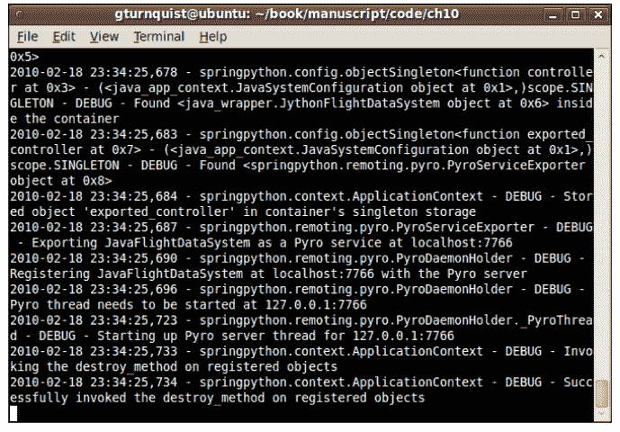

我们可以看到 Pyro 已启动并准备好为任何客户端提供数据。

13. 在我们的 Jython 数据源运行时，我们现在可以在应用程序上下文中用 PyroProxyFactory 替换原始的控制器定义

```
@Object
def controller(self):
    java_system = PyroProxyFactory()
    java_system.service_url = \
        "PYROLOC://localhost:7766/JavaFlightDataSystem"
    return java_system
```

14. 通过添加以下导入语句，我们现在可以在一个 shell 中重新启动预订应用程序，并在另一个 shell 中运行 Jython 服务

```
from springpython.remoting.pyro import *
```

15. 现在，让我们使用 CPython 重新启动 booking.py 应用程序，并查看屏幕

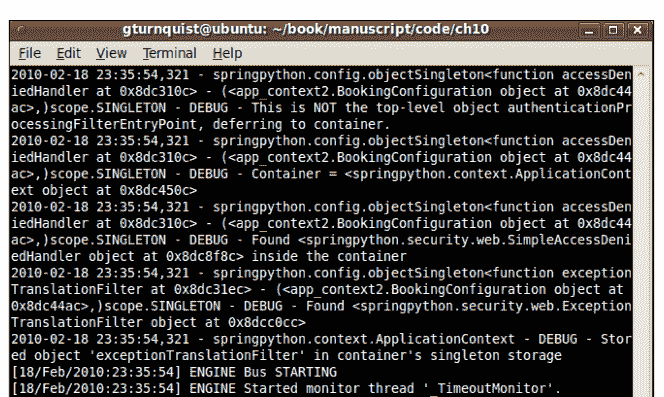

如果我们重新访问航班数据页面，它看起来一样：

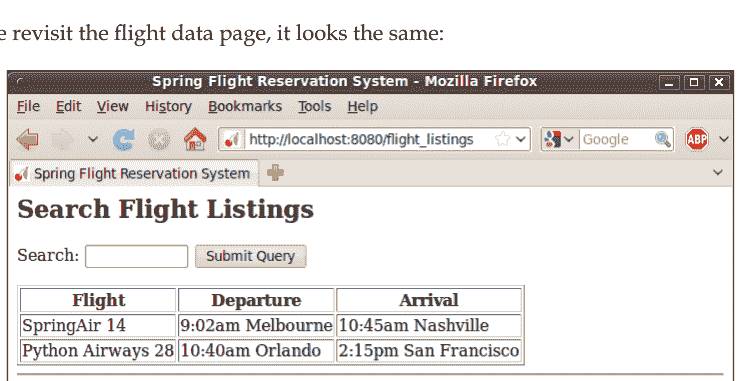

## 案例研究 II – 将 Spring Python 与您的 Java 应用程序集成

然而，更仔细地查看 Jython 脚本的控制台输出，我们看到一条消息表明我们的 Java 代码正在被调用。

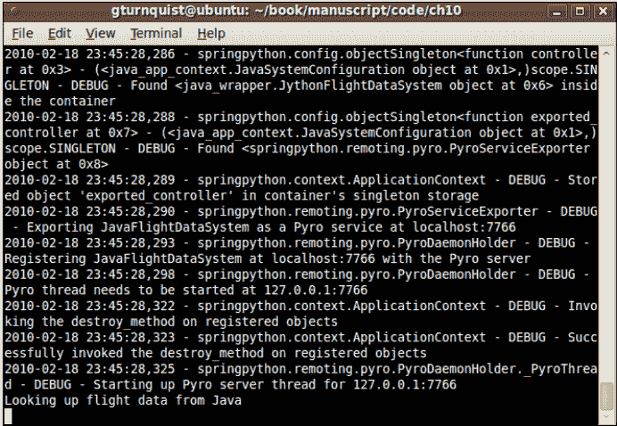

过滤逻辑也已移至 Java 服务，因此我们得到了响应。

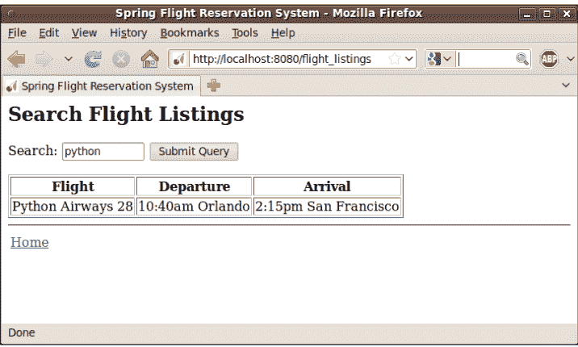

## 包装 Java 代码的问题

该解决方案中不太优雅的一部分是转换 CPython 与 Java 航班数据之间的包装代码。当将这些系统连接在一起时，将这些类型相互转换是必要的步骤。虽然包装代码解决了我们眼前的难题，但该代码的维护成本可能会增加。

由于很可能其他类也需要同样的关注，无论它们是输入参数还是结果，都需要一个更易于维护的解决方案。该行为涉及包装 Java 服务并检查输入和输出。这正是面向方面编程非常适合的用例类型。

将编写一个方面来扫描输入和输出并在 CPython 类型和 Java 类型之间应用某种映射，并将其连接起来以替换 Java 包装器，作为读者的练习留出。

## 摘要

我们现在在 Python 中运行前端 Web 服务器，后端运行在 JVM 上。虽然这个示例并不花哨或一定是动态的，但它展示了将这两个系统集成的能力。

由于 Jython 的全部意义在于能够运行编译后的类文件，因此可以把基于 Java 的数据库代码替换为更复杂的方案，例如使用其简洁的 xmlSlurper 模块的基于 Groovy 的源阅读器，或基于 Scala 的系统来监控多个航空公司的 RSS 源。

与此同时，我们可以在 CherryPy 中继续使用我们喜爱的 Python 技术进行编码，或者选择另一个 Web 框架。我们还可以编写有用的命令行脚本来访问相同的后端信息。

一个关键点是我们不必自己进行 wiring。Spring Python 为我们完成了这项工作，而不是管理 Pyro 的低级 API。

Spring Python 提供了我们在本书中介绍过的许多有价值的功能。有许多有用的抽象。但这些抽象与 Spring Java 提供的抽象并不是一一对应的。相反，它专注于 Python 库。例如，Spring Python 与 Pyro 集成，而 Spring Java 与 RMI 集成。这是有道理的，因为 Python 开发者不太可能与基于 RMI 的系统集成，而更可能将 Python 组件连接在一起。

本书还介绍了强大的依赖注入概念。Spring Python 和 Spring Java 共享这一理念。在本书的各个示例中，我们看到了如何将组件解耦并在容器中连接它们。这使得测试变得容易，以小的影响引入服务，并允许随着需求变化而重新接线。这为开发人员提供了适应不断变化需求所需的灵活性。

在本章中我们学习了如何：

- 使用 CherryPy 在 CPython 中构建前端，然后将其链接到用 Java 编写的后端
- 创建必要的适配器代码来处理 CPython 和 Java 之间的序列化
- 在不影响前端或后端的情况下，用 Python 到 Java 的调用替换 Python 到 Python 的调用
- 编译 Java 代码并使用第三方库从 Jython 运行它

我希望你喜欢这本书，并且它能以新的方式激发你设计、编码和维护更强大的系统。

## 索引

## 符号

## A

## B

## C

@transactional
  优点 110
  缺点 110
@transactional decorator 102, 104, 205

access_decision_mgr 138
access_decision_voters 138
AccessDecisionVoter 200
Acegi Security 119
ACID properties
  定义 113
AffirmativeBased policy 138
AOP
  关于 51, 52, 69
  横切 与 层级 对比 52
  横切行为，编织 53
  横切元素 53
  性能成本 68, 69
AOP module, Spring Python
  特性 71, 72
app_context.py file 216
application, scaling
  关于 164
  客户端配置，调整 167, 168
  轮询调度器，创建 166, 167
  单节点后端，转换为
    多个实例 164-166
ApplicationContext
  关于 37
  特性 37
application security
  测试 142, 143
Aspect Oriented Programming. See AOP
AspectJ 53

aspects, testing
  关于 73
  服务，解耦 74-76
  服务，测试 76-78
atomicity, ACID properties 101, 113
audit logs
  创建 209, 210
auth_manager 137
authenticate method 150
authenticationProcessingFilter 135
automated testing 94
AutoTransactionalObject 206

BadCredentialsException 151
Bank class 115
BankException class 204
banking application
  audit logs, creating 209, 210
  basic customer functions, building 182-188
  building 173, 174
  creating 99, 100
  customer features, coding 188
  issues, customer features 199
  logs, accessing remotely 206-208
  requisites 172
  securing 175-182
  transactions, adding 99, 100
BindAuthenticator 146

CachedWikiTest method 78
caching
  adding, to Spring Python objects 60-64
  advisors, applying to service 65-68

caching_advisor 68
CachingInterceptor 61, 68
caching service wiring in API
  confirming 78
Central Authentication Service (CAS) 119
cherrypy-app.py file 216
CherryPy framework 122
cherrypySessionStrategy() 134
classic SQL issue
  关于 82
  代码，参数化 84, 85
  用 Spring Python 的一行代码替换多行查询代码 86
classic transaction issue
  关于 98, 102
  简化，使用 @transactional 102-105
close_account operation 193
closeAccount operation 192
coily
  关于 213
  命令 214
  关键函数 214
  部分，需求 215
  插件方法 213
commands, coily
  --help 214
  --install-plugin 214
  --list-available-plugins 214
  --list-installed-plugins 214
  --reinstall-plugin 214
  --uninstall-plugin 214
connection.commit() 100
connection.rollback() 100
ConsensusBased policy 138
consistent, ACID properties 101, 113
context aware objects 40
controller.py file 216
controller object 186
convert_to_upper 146
CORBA 156
CPython 233
crosscutting elements, AOP
  关于 53
  Advice 53
  Advisor/interceptor 53
  Aspect 53
Join point 53
Pointcut 53
customer features, banking application
  account history, viewing 198
  closeAccount operation, adding 192, 193
  coding 188
  deposit operation, adding 195, 196
  main page, updating 189, 190
  openAccount operation, redefining 191
  transfer operation, adding 196, 197
  withdraw operation, adding 193, 194
customer functions, banking application
  building 182-188
custom security extension
  coding 150
  custom authentication provider, coding
    150, 152
D
data access layer
  testing, mocks used 92-94
DatabaseTemplate
  关于 87, 151
  ORMs，配合使用 91, 92
  Portable Service Abstraction 87
  queries，约定映射 89
  queries，映射到字典 89
  操作集 91
  解决方案 90
  使用 SQLAlchemy 90
  表映射 90
  用于检索对象 87, 88
DatabaseUserDetailsService 143
DefaultLdapAuthoritiesPopulator 146
Dependency Injection 33, 34
deposit function 111
deposit operation 195
DictionaryRowMapper 89
durable, ACID properties 101, 114
dynamic weaving 53
E
encoder attribute 146


## F
工厂对象 186
filter_security_interceptor 138
FilterChainProxy 176
flight_listings 函数 229
航班预订系统
- 构建预订应用程序 224-226
- 构建 224
- 搜索航班列表 228, 229
- 创建搜索框 229, 230
- 在主页面添加搜索页面链接 228
footer() 函数 126

## G
gen-cherrypy-app 213
group_role_attr 146
group_search_filter 146

## H
header() 函数 127
html() 函数 126

## I
图像 216
index 函数 182
InMemoryUserDetailsService 137
安装
- Spring Python 19
拦截 54
控制反转。参见 IoC
invocation.proceed() 68
IoC
- 关于 25, 29, 30
- 添加到应用程序 30-32
- 添加到测试 35, 36
- 在动态语言中的争论 40, 41
- 交换生产代码 26-29
隔离，ACID 属性 101, 114
问题
- Java 代码包装 243
问题，客户功能
- 关于 199
- 向取款添加透支保护 203-205
- 使转账具有事务性 205
- 保护用户账户 199-203

## J
Java 应用程序
- 与 Spring Python 集成 232
Java 身份验证和授权服务 (JAAS) 119
Jython 43, 233

## K
Kerberos 119
关键函数，coily 214

## L
延迟对象 37
LDAP 144
基于 LDAP 的安全
- 配置 144, 146
LdapAuthenticationProvider 144
log 方法 209

## M
消息参数 188
模拟 26
多个安全提供程序
- 优点 146
- 支持多个用户社区 148
- 提供冗余安全访问 148, 150
- 用户从旧登录系统迁移到新登录系统 147
- 使用 146

## N
新的安全需求
- 确认身份验证 131, 132
- 确认授权 132
- 处理 131

## O
ObjectContainer
- 关于 37
- ApplicationContext 37
- 功能 37
面向对象编程。参见 OOP
对象关系映射器 (ORMs) 13
OOP 51
open_account 操作 191
openAccount 函数 184
ORMs
- 关于 90
- 使用 DatabaseTemplate 91, 92
OwnerVoter 201

## P
parts，coily
- __init__.py 文件 215
- 名称，__init__.py 文件 215
- plugin_path，__init__.py 文件 215
- 必要条件 215
password_attr_name 属性 146
password_encoder 137
PasswordComparisonAuthenticator 146
perf_advisor 68
PerformanceInterceptor 68
后处理器对象 39
编程事务
- 关于 108
- 优点 110
- 缺点 110
- 使用 IoC 容器配置 108, 109
- 不使用 IoC 容器配置 109
事务属性
- 原子性 101
- 一致性 101
- 持久性 101
- 隔离性 101
属性驱动对象 39
prototype-scoped 对象 38
ProxyFactoryObject 61
Pyro 156
Pyro 库 9
PyroProxyFactory 162
PyroServiceExporter 168, 206
Python 远程对象。参见 Pyro

## R
raw_history 208
redirectStrategy() 135
RegexpMethodPointcutAdvisor 61
远程方法调用 (RMI) 156
ROLE_CUSTOMER 200
role_prefix 146
RoleVoter 203
RoundRobinDispatcher 类 167

## S
范围对象
- 关于 38
- prototype-scoped 对象 38
- singleton-scoped 对象 38
安全。另请参见 Spring Python Security
- 确认身份验证 131
- 确认授权 132
- 问题 121
- 必要条件 120, 121
- 测试 142, 143
security_advisor 67
SecurityContextHolder 132, 141, 142
安全数据
- 在应用程序内访问 141, 142
service_host 属性 160
service_port 属性 161
service 属性 160
service 方法 160
将简单应用程序转换为分布式应用程序
- 关于 157, 158
- 创建客户端 159
- 从 IoC 容器获取服务 158
- 不更改客户端 159-162
SimpleRowMapper 89
简单 SQL 查询
- 编写，使用 Python 的数据库 API 82, 84
单一职责原则 (SRP) 57
singleton-scoped 对象 38
skeleton CherryPy 应用
- 创建 216-221
银行应用程序的 skeleton Web 应用程序
- 构建 173
Spring Java 应用程序
- 迁移到 Python 42-49
SpringJavaConfig 42
Spring Python
- 关于 7
- 定义 ACID 属性 113-115
- 应用程序安全 119
- 测试方面 73
- 自动化测试 94
- 上下文感知对象 40
- 使用依赖注入机制 33
- 动态编织 53
- 扩展 18
- 面向 Java 开发人员 15-18
- 面向 Python 开发人员 8
- 安装 19
- 与 Java 应用程序集成 232-241
- IoC 25
- 延迟对象 37
- ObjectContainer 37
- 可移植服务抽象 107
- 后处理器对象 39
- 属性驱动对象 39
- 范围对象 38
- 用户社区 23, 24
Spring Python，面向 Java 开发人员 15-18
Spring Python，面向 Python 开发人员
- 关于 8
- 探索非侵入性本质 8-10
- 添加模板 11-15
Spring Python 的 AOP 模块
- 功能 71, 72
Spring Python 安装
- 关于 19
- 设置环境 19
- 从二进制安装 20, 21
- 从源代码安装 22
Spring Python 对象
- 添加缓存 60-64
Spring Python Security。另请参见安全
- 挑战 152
- 参考文献 152
Spring 三角形 86
SpringWikiController 133
SQL 82
基于 SQL 的安全
- 配置 143, 144
SQLAlchemy 90
statistics 方法 27
stubs 26

## T
threading.local() 142
TransactionManager 206
事务
- 关于 101
- 应用于非事务代码 115, 117
- 添加新功能 110-113
- 传播 101
- 属性 101
- 测试 117
TransactionTemplate 105, 106
transfer 函数 102
transfer 方法 104
transfer 操作 196

## U
UnanimousBased policy 138
user_details_service 137
Spring Python 用户社区 23, 24
userPassword 属性 146

## V
view.py 文件 216

## W
编织 53
Web 应用程序
- 构建 122-129
- 高层视图 130, 131
- 添加安全功能 133-140
wiki_service
- caching_advisor 66
- perf_advisor 66
- security_advisor 66
WikiService 26
withdraw 函数 111
withdraw 操作 193

## Thank you for buying
Spring Python 1.1

## About Packt Publishing

Packt，发音为 'packed'，于 2004 年 4 月出版了其第一本书 "*Mastering phpMyAdmin for Effective MySQL Management*"，随后继续专注于出版关于特定技术和解决方案的高度聚焦的书籍。

我们的书籍和出版物分享了您同行的 IT 专业人士在适应和定制当今系统、应用程序和框架方面的经验。我们的基于解决方案的书籍为您提供了定制您正在使用的软件和技术的知识和能力，以完成工作。与过去看到的 IT 书籍相比，Packt 的书籍更具体、更不通用。我们的独特商业模式使我们能够为您提供更集中的信息，让您了解更多所需的内容，而减少不需要的内容。

Packt 是一家现代而独特的出版公司，专注于为开发人员、管理员和新手社区生产高质量、最前沿的书籍。如需更多信息，请访问我们的网站：www.packtpub.com。

## About Packt Open Source

在 2010 年，Packt 推出了两个新品牌 Packt Open Source 和 Packt Enterprise，以继续其专业化重点。本书是 Packt Open Source 品牌的一部分，该品牌是围绕开源许可证构建的软件书籍的家园，并为从高级开发人员到初出茅庐的网页设计师的任何人提供信息。Open Source 品牌还运营着 Packt 的开源版税计划，通过该计划，Packt 会向其软件被出版书籍的每个开源项目支付版税。

## Writing for Packt

我们欢迎所有有兴趣撰写书籍的人的咨询。书稿提案应发送至 author@packtpub.com。如果您的书稿想法仍处于早期阶段，并且您希望在撰写正式书稿提案之前先进行讨论，请联系我们；我们的其中一位约稿编辑会与您联系。

我们不仅仅在寻找已出版的作者；如果您具有强大的技术技能但没有写作经验，我们经验丰富的编辑可以帮助您发展写作事业，或仅仅为您提供额外回报以表彰您的专业知识。


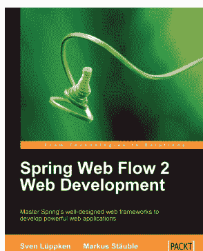

## Spring Web Flow 2
Web 开发

ISBN: 978-1-847195-42-5      平装版：200页

掌握 Spring 设计精良的 Web 框架以开发功能强大的 Web 应用

- 1. 使用 Spring Web Flow 2 框架设计、开发和测试你的 Web 应用
- 2. 通过渐进式 AJAX、Spring 安全集成和 Spring Faces 增强你的 Web 应用
- 3. 了解 Spring Web Flow 的最新版本，保持与时俱进
- 4. 通过清晰的解释逐步了解 bug 跟踪 Web 应用的创建过程


## Spring Persistence with Hibernate

ISBN: 978-1-849510-56-1      平装版：460页

为你的企业 Java 应用构建稳健可靠的持久化解决方案

- 1. 掌握 Hibernate 及其配置管理器、映射、类型、会话 API、查询等
- 2. 将 Hibernate 和 Spring 集成到你的企业 Java 技术栈开发中
- 3. 使用 Spring IoC（控制反转）、Spring AOP、事务管理、Web 开发以及单元测试的注意事项和特性
- 4. 以实用的方式涵盖 Hibernate 的高级且有用的特性

