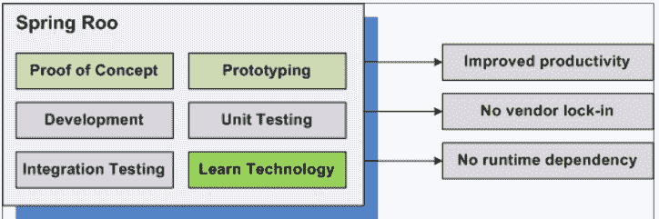
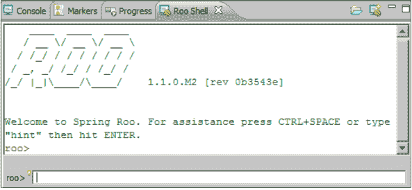
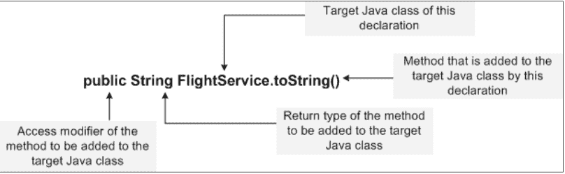
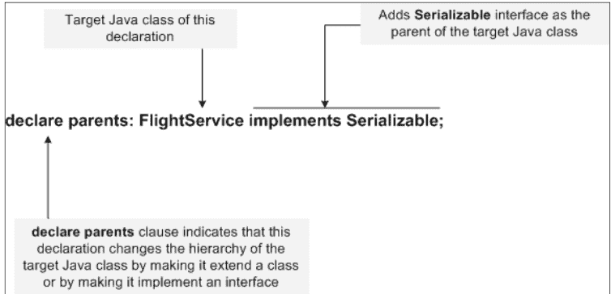
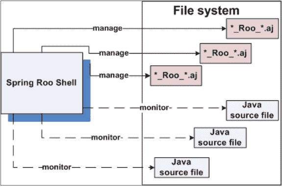

# Getting Started with Spring Roo

在本章中，我们将介绍以下主题：

- 设置 Roo
- 从 Roo 获取帮助和提示
- 创建 Roo 项目
- 将 Roo 项目导入 Eclipse 或 IntelliJ IDEA IDE
- 配置日志记录
- 查看属性文件中定义的属性
- 管理属性文件中定义的属性
- 创建 Java 类
- 向 Java 类添加属性
- 创建 Java 接口
- 从 Roo shell 引用类型
- 从 Roo 脚本创建应用程序工件

## Introduction

Java 为企业应用程序开发提供了优秀的平台，但往往受到生产力问题的拖累。例如，如果您想开发 Web 应用程序，则需要学习 Web 框架、创建 JSP 或视图、实现服务层、将服务与持久化框架集成、实现持久化逻辑、为不同应用程序层创建配置文件、编写单元和集成测试、编写构建脚本，等等。哎呀！即使是创建一个使用标准 Java 框架集的简单 Web 应用程序，似乎也是一项大量的工作。这就是许多组织转向提供快速开发简单或中等复杂度应用程序平台的原因。随着 Spring 和 Hibernate 等开源框架的出现，Java 平台在开发者生产力和简单性方面得到了巨大提升；但在与 Ruby on Rails 等平台相比时，它在生产力水平上仍未达到标准，直到 Spring Roo 的出现。

Spring Roo 是 Java 编程语言的下一代快速应用程序开发工具。它是一个开源工具，隶属于 SpringSource（http://www.springsource.org/）项目。使用 Spring Roo 开发的应用程序采用 Spring 编程模型，该模型已有交付可移植、可测试和可维护企业应用程序的成功记录。

Spring Roo 是一个易于使用的工具，用于快速使用 Spring、Hibernate、AspectJ、Spring Web Flow、Spring Security、GWT、Flex 等公认框架开发 Java 企业应用程序。Spring Roo 负责为您的企业应用程序创建项目结构，添加使用 Maven 构建和部署应用程序的支持，根据您选择的技术创建应用程序架构，根据您选择的测试框架创建单元和集成测试，等等。Spring Roo 提供了一个交互式、直观的文本界面，您可以通过分步输入应用程序的详细信息来在几分钟内创建一个可运行的应用程序。

> > 使用 Spring Roo 时，由企业应用程序开发人员选择要在应用程序开发中使用的技术或框架。例如，您可以为持久化选择 Hibernate 或 OpenJPA，为 Web 层选择 Spring Web Flow 或 GWT。

那么，使用 Spring Roo 开发应用程序需要学习什么？正如我们稍后将看到的，使用 Spring Roo 开发企业应用程序几乎不需要学习任何东西。Spring Roo 的关键目标一直是利用企业开发人员的现有知识，并自动化开发人员在典型企业应用程序开发项目中必须执行的大多数任务。这使开发人员的生产力大幅提高，几乎没有学习曲线。难道您不觉得很兴奋吗？您可以使用标准 Java 技术快速开发 Java 企业应用程序，而无需学习任何新东西。

在开始使用 Spring Roo 工具之前，让我们先了解一下使用 Spring Roo 的关键优势：

- 提高企业开发人员的生产力：Spring Roo 根据开发人员提供的指令或从 Spring Roo 已生成的代码中推断的内容自动生成代码，从而提高企业开发人员的生产力。
- 贯穿项目生命周期的生产力提升：Spring Roo 不仅能让您快速启动项目，而且在项目整个生命周期中都能提供生产力提升。
- 无额外的抽象层：Spring Roo 不试图向企业开发人员隐藏实现细节，使开发人员能够轻松理解代码并根据需要对其进行修改。
- 无运行时依赖：如果您使用 Spring Roo 开发应用程序，在运行时，您的应用程序代码仅依赖于您用于开发应用程序的框架，不多不少。
- 无供应商锁定：如果您决定不再使用 Spring Roo，您可以使用 Eclipse IDE 或 STS（Spring Tool Suite——SpringSource 的 Eclipse 变体）从应用程序中移除 Spring Roo 特定的细节。

下图展示了您可以使用 Spring Roo 做什么以及能获得的益处：



给定的图示表明，您也可以使用 Spring Roo 来创建概念验证、创建原型以及学习新技术。使用 Spring Roo，您可以在几分钟内快速创建一个可运行的应用程序，这使其成为开发原型和创建概念验证的理想选择。开发人员可以使用 Spring Roo 创建一个使用其想要学习的技术的简单应用程序，并对其进行试验，或者浏览 Roo 生成的源代码以快速了解该技术。


在本章中，我们将探讨一些帮助你开始使用 Spring Roo 开发企业应用程序的示例。本章中的示例重点演示如何设置 Roo、创建 Roo 项目、创建一些项目构件、从 Roo shell 获取各种 Roo 命令的帮助和提示，并在你喜爱的 IDE 中导入 Roo 项目。本章将为本书后面章节中将要介绍的更高级示例奠定基础。

## 设置 Roo

要开始使用 Spring Roo，首先需要做的是在你的笔记本电脑或台式机上设置 Roo 工具。

在本示例中，我们将探讨如何安装 Spring Roo 并验证它已准备就绪。

> **要有效地使用 Spring Roo，我需要学习什么？**
> 
> 如果你是一位经验丰富的 Java 企业级开发人员，那么使用 Spring Roo 几乎不需要学习任何新知识。如果你知道 AspectJ ITDs（类型间声明）的工作原理，那么了解 Spring Roo 在幕后所做的工作会很有帮助。随着你阅读本书中的各个示例，你将找到足够的细节来了解 Spring Roo 如何使用 AspectJ ITDs。

## 准备工作

由于你将要安装 Spring Roo，首先需要从 Spring Roo 官方主页（`http://www.springsource.org/roo/start`）下载 Spring Roo ZIP 归档文件。此外，请确保你的机器上已安装以下软件：

- Java SE 6 或更高版本（`http://java.sun.com/javase/downloads/index.jsp`）。
- Apache Maven 3.x 或更高版本（`http://maven.apache.org/download.html`）。
- 本书中的示例使用 Apache Maven 3.0.2

## 操作步骤...

要安装 Spring Roo，只需按照给定步骤操作即可：

- 1. 将下载的 Spring Roo ZIP 归档文件解压到一个目录中。解压 Spring Roo ZIP 文件后，你将看到如下截图所示的目录结构（不包括 `cache` 目录）：

| 项目 | 说明 |
| --- | --- |
| annotations | 包含用于启动 Roo shell 的 Roo 批处理文件和 shell 脚本。 |
| bin | 包含构成 Roo 的一部分的 OSGi bundle |
| cache | 包含已安装的 OSGi bundle |
| docs | 包含特定于已安装 Roo 版本的 Roo 文档 |
| samples | 包含示例 Roo 脚本 |
| readme.txt | |

- 2. 将 JAVA_HOME 环境变量设置为指向 Java SE 安装目录。

- 3. 将 ROO_HOME 环境变量设置为指向 Roo 安装目录。

- 4. 如果你使用的是 Windows，请将 ROO_HOME/bin 目录添加到 PATH 环境变量中。如果你使用的是 Linux 或 Mac OS X，请创建指向 ROO_HOME/bin/roo.sh shell 脚本的符号链接。

- 5. 除非验证安装，否则 Roo 安装不完整。因此，在 C:\roo-cookbook 目录中创建 ch01-recipe 子目录，打开命令提示符，并进入 ch01-recipe 目录。现在，执行 roo.bat 批处理文件，如以下命令所示：

> **下载示例代码**
> 
> 你可以从 http://www.PacktPub.com 的账户中下载已购买的所有 Packt 图书的示例代码文件。如果你在其他地方购买了本书，可以访问 http://www.PacktPub.com/support 并注册，以便将文件直接发送到你的电子邮箱。

```
C:>\cd roo-cookbook
C:\roo-cookbook>cd ch01-recipe
C:\roo-cookbook\ch01-recipe>roo

__   __   __
/  \_/  \_/  \
/  /  /  /  /  /  /  /
/  _,_  /  /  /  /  /
/ / | | / / / / / /
1.1.1.RELEASE [rev 156ccd6]
```

```
Welcome to Spring Roo. For assistance press TAB or type "hint"
then hit ENTER.
..
roo>
```

- 6. 如果你看到如所示的输出，则表示你已成功安装 Spring Roo。你会注意到，当你执行 `roo.bat` 或 `roo.sh` 时，命令提示符会更改为 `roo>>`。现在你可以开始使用 Spring Roo 了。

## 工作原理...

Spring Roo 构建在 Apache Felix（http://felix.apache.org/site/index.html）OSGi 容器之上，该容器促进应用程序的模块化和动态组装。bundle 目录包含构成 Spring Roo 发行版一部分的 OSGi bundle。这些 bundle 提供 Roo 所需的核心服务以及支持代码生成的附加组件。当你第一次通过执行 Roo 批处理文件或 shell 脚本启动 Spring Roo 时，这些 bundle 将被安装并复制到 Spring Roo 安装的 cache 目录中。

## 更多内容...

Spring Roo 随附某些作为 Spring Roo 发行版一部分的核心服务和基础附加组件。Roo shell、文件系统监视器、引导程序等核心服务为附加组件执行其预定职责提供了必要的基础设施。附加组件是 Spring Roo 的核心，它们提供代码生成功能。例如，电子邮件附加组件添加电子邮件支持，JPA（Java Persistence API）附加组件有助于设置 JPA 提供程序、创建 JPA 实体及其关系等。

由于 Roo 附加组件符合 OSGi 标准，你还可以创建自定义附加组件或下载第三方附加组件，并将其作为 Spring Roo 安装的一部分来安装，以扩展 Roo 的功能。

## 在 Eclipse/STS 中使用 Spring Roo

由于 Roo 是命令行驱动的工具，你可能希望将其与 Eclipse 或 STS 等功能丰富的 IDE 集成，以简化应用程序开发。如果你使用的是 STS，则无需担心将 Roo 与其集成，因为 STS 中内置了对 Roo 的支持。如果你想将 Roo 与 Eclipse 集成，可以像安装任何其他 Eclipse 插件一样在 Eclipse 中安装 STS 组件。

如果你使用的是任何其他 IDE，或者不希望将你的 Eclipse IDE 与 Spring Roo 集成，则可以在后台运行 Spring Roo 并使用你喜爱的 IDE 开发企业应用程序。当你使用 IDE 对企业应用程序进行修改时，Spring Roo 将在后台工作以管理企业应用程序。

以下截图显示了 Spring Roo 从 Eclipse IDE 内部启动。它显示 roo> 提示符现在显示在一个文本框旁边，你可以在其中输入 Roo 命令：



如果你将给定截图中显示的输出与你之前从命令提示符启动 Roo shell 时看到的输出进行比较，你会发现它们不相同。真的吗？是的，在 Eclipse 或 STS 的情况下，要使用 Roo 命令的自动完成功能（欢迎文本中建议），你需要使用 CTRL + SPACE 而不是 TAB。

## 另请参阅

- 下一个示例标题为"从 Roo 获取帮助和提示"，展示了 Spring Roo 如何提供有关使用 Roo shell 的上下文敏感提示以及如何随时访问帮助。

## 从 Roo 获取帮助和提示

Spring Roo shell 的关键功能之一是它能为开发人员提供上下文敏感的提示。Spring Roo 的提示功能能在几分钟内提供开发可用企业应用程序的逐步指导。例如，如果你还没有在运行 Roo shell 的目录中创建 Roo 项目，则发出 hint 命令将告诉你如何创建 Roo 项目。如果 Roo 发现执行 Roo shell 的目录中包含一个 Roo 项目，但尚未设置 JPA 持久性提供程序，则它会建议你为项目设置持久性提供程序（例如 OpenJPA 和 Hibernate）。

> **什么是 Roo 项目？**
> 
> Roo 项目只不过是一个源代码由 Java 源文件和 .aj（AspectJ）文件组成的 Java 项目。如果你决定摆脱 Roo，可以轻松做到这一点，因为生成的代码在运行时不依赖于任何 Roo 库。请参阅第 7 章中的"从你的项目中删除 Roo 特定详细信息"示例，以了解如何使用 Eclipse 和 STS 等 IDE 来删除 Roo。

`help` 命令提供特定版本的 Spring Roo 支持的命令列表，并附带每个命令用途的简短描述。`help` 命令列出的命令是你可以从 Roo shell 执行的唯一命令。

需要注意的是，如果 `help` 命令列出的某些 Roo 命令不适用于你的 Roo 项目，则可能无法执行它们。例如，如果你尚未为企业应用程序设置 JPA 持久性提供程序，Roo shell 不允许你执行创建 JPA 实体的命令。

## 准备工作

要执行本示例中定义的命令，首先创建一个空目录，你将从中启动 Roo shell。例如，你可以在 `C:` 驱动器的 `cookbook-recipe` 目录中创建名为 `ch01-recipe` 的子目录。进入 `ch01-recipe` 目录并执行 `roo.bat` 批处理文件以启动 Roo shell。

## 操作步骤...

要从 Roo 获取帮助和提示，请按照给定步骤操作：

- 1. 要从 Spring Roo 获取帮助，你只需要在 Roo shell 中输入 `help` 命令。但是，在我们的例子中，我们会稍有不同的做法。不要输入完整的命令名，而是输入字母 `h` 并按 `TAB`（如果你使用的是独立安装的 Spring Roo）或 `CTRL + SPACE`（如果你使用的是安装在 Eclipse IDE 或 STS 中的 Spring Roo）。你将从 Roo shell 获得以下输出：

```
roo> h
help hint
roo> h
```

如所示的代码中，Roo shell 提供它找到的匹配命令列表。在此例中，是 `help` 和 `hint`。现在，将 `he` 输入 Roo shell 并按 `TAB` 或 `CTRL + SPACE`。你会注意到，Roo shell 现在会自动为你完成命令，以反映匹配的 `help` 命令。

一旦你输入 `help` 命令，你将获得 Spring Roo 支持的命令列表，如下所示：

```
roo> help
......
* class - Creates a new Java class source file in any project path
* interface - Creates a new Java interface source file in any project path
* project - Creates a new project
```


- quit - 退出 shell
- version - 显示 shell 版本
- .....

如你所见，`help` 命令提供了 Spring Roo 支持的所有命令的简短描述。例如，它告诉你可以使用 `quit` 命令退出 Roo shell，并使用 `version` 命令了解当前正在使用的 Spring Roo 版本。

2. 既然你知道 `help` 命令很有用，让我们来试试 `hint` 命令，如下所示：

```
roo> hint
Welcome to Roo! We hope you enjoy your stay!
Before you can use many features of Roo, you need to start a new
project.
To do this, type 'project' (without the quotes) and then hit TAB.
Enter a --topLevelPackage like 'com.mycompany.projectname' (no
quotes).
When you've finished completing your --topLevelPackage, press
ENTER.
Your new project will then be created in the current working
directory.
.....
```

从给定输出可以看出，Spring Roo 显示了使用 `project` 命令创建项目的提示。我们将在后续示例中使用 `hint` 命令来发现它在创建完全功能项目中的有用性。

### 工作原理...

如前所述，Spring Roo 由核心服务和插件组成。插件旨在根据开发者执行的命令生成代码。在执行 `hint` 和 `help` 等命令时，Roo 不会生成任何代码。你可以说这些命令由核心服务处理，而不是由任何 Spring Roo 插件处理。

### 更多内容...

Spring Roo 还提供向 Roo 命令传递参数的选项，这将在后面的章节中介绍。另外，当你从 Roo shell 执行命令时，它会被记录在 Roo 脚本文件中，这将在 `Log file for executed Roo commands` 章节中说明。

## 向 Roo 命令传递参数

与大多数 Roo 命令一样，`help` 和 `hint` 命令接受参数。参数是传递给 Roo 命令以自定义命令行为的其他参数。例如，`help` 命令接受 `command` 参数，而 `hint` 命令接受 `topic` 参数。

此前，我们看到 `help` 命令提供了 Spring Roo 支持的命令的高级详细信息。`command` 参数用于指定需要详细帮助信息的命令名称，包括可传递给 Roo 命令的必需和可选参数的信息。同样，`hint` 命令的 `topic` 参数提供特定主题的详细信息。`command` 和 `hint` 参数是可选参数；Roo shell 不强制你指定它们。

在大多数情况下，Roo 期望你按照以下格式指定参数：

```
-- <argument-name> <argument-value>
```

为了简化 `hint` 和 `help` 命令的使用，Roo 允许你在没有不必要的花哨功能的情况下指定参数。例如，你可以输入 `help project` 命令以获取 `project` 命令的帮助信息，或者输入 `hint jpa` 命令以获取与 JPA 相关的提示。

Roo shell 的以下输出显示了执行 `help project` 和 `hint jpa` 命令的结果：

```
roo> help project
```

```
Keyword:         project
Description:     Creates a new project
Keyword:         ** default **
Keyword:         topLevelPackage
Help:            The uppermost package name (this becomes the
<groupId> in Maven and also the '~' value when using Roo's shell)
Mandatory:       true
.....
```

```
roo> hint jpa
```

Roo 需要安装 JPA 提供程序和关联数据库。

键入 'persistence setup' 然后按三次 TAB。

.....

从给定输出可以看出，help 命令提供了关于命令的确切详细信息。例如，help project 命令表明 project 命令接受名为 topLevelPackage 的必需参数。hint jpa 命令提供了关于 jpa 主题的高级详细信息。

那么问题来了，如何找到可用提示的主题呢？嗯，你可以通过执行 hint topics 命令从 Roo 中找到这些主题，如下所示：

```
roo> hint topics
```

```
The following hints are available to help you use Roo:
general, start, jpa, entities, fields, relationships,
controllers, finders, eclipse, logging
Just type 'hint topic_name' (without quotes) to view a specific hint.
```

给定的输出表明，Spring Roo 对以下主题提供提示：jpa、entities、fields、relationships 等等。

help 和 hint 命令是最常用的命令；建议在使用 Roo 项目时按需使用它们。

## 已执行 Roo 命令的日志文件

假设你使用 Spring Roo 创建了一个包含 Spring Web MVC 和 Hibernate 框架的企业应用程序。此外，你执行了 Roo 命令，为企业应用程序中创建的某些类添加了电子邮件和 JMS 消息发送支持。现在，假设你的组织需要创建一个类似的项目，该项目使用 Spring Web MVC、Hibernate 框架，并需要电子邮件和 JMS 消息发送功能。你可以重新执行之前企业应用程序中使用的所有 Roo 命令来创建新的企业应用程序，或者直接执行之前企业应用程序的 Roo 脚本。

当你从 Roo shell 执行命令时，它会被记录在名为 log.roo 的 Roo 脚本文件中。你会注意到在 ch01-recipe 目录中创建了一个 log.roo 脚本文件。log.roo 脚本包含你使用 Roo shell 执行的命令，以及启动或退出 Roo shell 时的详细信息。如果你想要回顾执行过的命令，或者想要使用 Spring Roo 的 script 命令执行同一组命令，Spring Roo 的此功能会很有用。稍后你将看到如何执行 Roo 脚本文件，这将在本章的“从 Roo 脚本创建应用程序工件”示例中说明。

### 另请参见

- 下一个示例“创建 Roo 项目”展示了如何使用 `help` 命令发现 `project` 命令的详细信息，该命令用于创建 Roo 项目。

## 创建 Roo 项目

这是你将看到 Spring Roo 进行实际工作以帮助你创建 Java 企业应用程序的第一个示例。此示例展示了如何使用 `project` 命令创建 Roo 项目。按照此示例操作的最终结果将是一个遵循标准 Maven 目录结构的项目。在此示例中创建的项目可以打包为 JAR 文件，因为它没有 Web 层。在 *第 4 章：使用 Spring Web MVC 进行 Web 应用程序开发* 和 *第 5 章：使用 GWT、Flex 和 Spring Web Flow 进行 Web 应用程序开发* 中，你将看到如何使用 Spring Roo 创建企业应用程序的 Web 层。你在此示例中创建的项目将充当本章其余示例的基础。

### 准备工作

首先要做的是创建一个空目录，你将在其中创建 Roo 项目。如果尚未创建，请在 `C:\roo-cookbook` 目录中创建 `ch01-recipe` 子目录。通过执行 Roo 批处理文件或 shell 脚本，从 `ch01-recipe` 目录启动 Roo shell，如下所示：

```
C:\roo-cookbook\ch01-recipe>roo
```

### 操作方法...

要创建 Roo 项目，请从 Roo shell 执行 `project` 命令，如下所示：

```
roo>project --topLevelPackage sample.roo.flightapp --java 6 --projectName flight-app
```

```
Created C:\roo-cookbook\ch01-recipe\pom.xml
......
Created SRC_MAIN_RESOURCES\META-INF\spring\applicationContext.xml
Created SRC_MAIN_RESOURCES\log4j.properties
```

```
sample.roo.flightapp roo>
```

执行 `project` 命令后，请注意 Roo 提示符的变化。提示符的变化表明你现在正在使用顶级包为 `sample.roo.flightapp` 的项目。如果从已包含 Roo 项目的目录启动 Roo shell，则 Roo 提示符不会改变。

### 工作原理...

下表描述了传递给 `project` 命令的每个参数的用途：

| Argument | Purpose |
| --- | --- |
| topLevelPackage | 这是一个必需参数，用于标识项目的基础或根包。你将在 Roo 命令中频繁使用波形符号 (~) 引用此包。此参数的值将成为 maven pom.xml 文件中 `<groupId>` 元素的值。 |
| java | 这是一个可选参数，用于指定 Java 版本（必须是 5、6 或 7），Roo 项目的源代码和编译类应与该版本兼容。如果未指定，Spring Roo 会自动检测 Java 版本。 |
| projectName | 这是一个可选参数，用于指定项目名称。此参数的值将成为 maven pom.xml 文件中 `<artifact-id>` 和 `<name>` 元素的值。如果未指定，则使用 `topLevelPackage` 参数值指定的包名的最后一部分。例如，如果 `topLevelPackage` 参数值为 `sample.roo.flightapp`，且未指定 `projectName` 参数，则假设 `projectName` 参数的值为 `flightapp`。 |

> ### 定期使用 TAB 或 CTRL + SPACE 来发现必需和可选属性及其预定义值
> 
> 由于很难记住不同 Roo 命令的所有必需和可选属性，因此建议你使用 TAB（如果你使用的是独立 Roo）或 CTRL + SPACE（如果你在 Eclipse 或 STS 中使用 Roo）来使用 Roo 的自动完成功能。Roo 不仅提供 Roo 命令的自动完成（如我们在之前的示例中所见），而且在你按下 TAB 或 CTRL + SPACE 时还会显示命令的必需参数。如果你想了解命令的可选参数，只需输入 -- 然后按 TAB 或 CTRL + SPACE。为防止用户输入任意值，命令参数可能只能接受该参数的一组预定义值中的某个特定值。预定义值由负责处理命令的插件定义。如果参数接受 Roo 的一组预定义值中的某个值，则在你按下 TAB 或 CTRL + SPACE 时会显示该值。


Spring Roo 分发版附带一个 **Maven 插件**，负责处理 `project` 命令。还有更多 Roo 命令由 Maven 插件处理，您将在本书后面看到。

`project` 命令的输出表明，它会创建名为 `SRC_MAIN_JAVA`、`SRC_MAIN_WEBAPP` 等的目录。这些名称是 Maven 插件创建的标准目录的逻辑名称。下表显示了在 `flight-app` 项目中，每个名称映射到的目录：

| Path value | 项目目录 |
|:---|:---|
| SRC_MAIN_JAVA | 指 Java 源目录的根目录，其中包含应用程序的 Java 源文件：ch01-recipe\src\main\java。 |
| SRC_MAIN_RESOURCES | 目录的根目录，其中包含 Java 企业应用程序所需的资源（Spring 的应用程序上下文 XML、数据库属性文件、log4j 属性文件、persistence.xml 文件等）：ch01-recipe\src\main\resources。 |
| SRC_TEST_JAVA | Java 源目录的根目录，其中包含单元测试和集成测试：ch01-recipe\src\test\java。 |
| SRC_TEST_RESOURCES | 目录的根目录，其中包含单元测试和集成测试期间所需的资源：ch01-recipe\src\test\resources。 |
| SRC_MAIN_WEBAPP | Web 应用程序目录，其中包含网页、图片、样式表和 Web 应用程序配置：ch01-recipe\src\main\webapp。 |
| ROOT | 指项目的根目录，在 flight-app 项目中为 ch01-recipe。 |
| SPRING_CONFIG_ROOT | 指包含 Spring 应用程序上下文 XML 文件的目录。在 flight-app 项目的上下文中，这指 ch01-recipe\src\main\resources\META-INF\spring。 |

从 `project` 命令的执行可以看出，它不仅创建了 Maven 化的项目，还创建了 Spring 的 `applicationContext.xml`、Maven 的 `pom.xml` 文件和 `log4j.properties` 文件。以下 XML 代码显示了 `applicationContext.xml` 文件的内容，其中包含一些有趣的细节：

```
<beans ...>

<context:property-placeholder
     location="classpath*:META-INF/spring/*.properties"/>

<context:spring-configured/>

<context:component-scan base-package="sample.roo.flightapp">
    <context:exclude-filter
         expression=".*_Roo_.*" type="regex"/>
    <context:exclude-filter expression=
        "org.springframework.stereotype.Controller"
        type="annotation"/>
</context:component-scan>
</beans>
```

从 applicationContext.xml 的内容可以得出的重要推论如下：

- Spring `context` 命名空间的 `<property-placeholder>` 元素定义表明，您必须将包含 Spring bean 配置信息的属性文件放在 META-INF/spring 目录中，以便 Spring 应用程序上下文可以读取它们。在下一章中，我们将看到 Roo 生成的应用程序如何使用此方法从外部属性文件读取数据库属性。

- Spring `context` 命名空间的 `<spring-configured>` 元素指定，使用 `@Configurable` 注解标注的对象将使用 Spring 进行配置，即使它们是在 Spring 容器之外创建的。在 Spring 容器之外创建的对象包括使用 `new` 运算符或通过反射以编程方式创建的对象。我们将在第 2 章“使用 JPA 持久化对象”中看到 `@Configurable` 注解的示例用法。

- Spring `context` 命名空间的 `<component-scan>` 元素指定，在 `sample.roo.flightapp` 包或其子包中找到的 Spring 组件（即使用 `@Service`、`@Repository` 和 `@Component` Spring 注解标注的组件）将自动注册到 Spring 应用程序上下文中。本章稍后，我们将使用此功能在 flight-app 项目中创建一个服务类，该类将自动注册到 Spring 应用程序上下文。

项目创建期间生成的另一个重要工件是 Maven 使用的 pom.xml 文件。以下 XML 代码展示了项目命令中指定的参数值如何用于创建 flight-app 项目的 pom.xml 文件：

```
<project >
......
<groupId>sample.roo.flightapp</groupId>
<artifactId>flight-app</artifactId>
<packaging>jar</packaging>
<version>0.1.0.BUILD-SNAPSHOT</version>
<name>flight-app</name>
</project>
```

您可能注意到 `<packaging>` 元素的值是 `jar` 而不是 `war`。其原因是我们尚未为 flight-app 应用程序添加 Web 层。我们将在第 4 章“使用 Spring Web MVC 开发 Web 应用程序”和第 5 章“使用 GWT、Flex 和 Spring Web Flow 开发 Web 应用程序”中了解如何使用 Spring Roo 创建 Web 应用程序。

pom.xml 还包含默认可用于 Roo 项目的 Maven 插件。下表总结了新创建的 flight-app 项目可用的一些重要 Maven 插件：

| Maven 插件 | 用途 |
|:---|:---|
| IDEA 插件 | 您可以使用此插件将 flight-app 项目转换为 IntelliJ IDEA 项目。 |
| Eclipse 插件 | 您可以使用此插件将 flight-app 项目转换为 Eclipse 项目。 |
| AspectJ 编译器插件 | 此插件将 AspectJ 切面织入您的项目类中。此插件由 Spring Roo 内部使用。我们将在第 2 章中看到 AspectJ 编译器的实际运作。 |
| Tomcat 和 Jetty 插件 | 开发期间可以使用这些插件以嵌入模式运行 Tomcat 或 Jetty 来测试 Web 应用程序。 |

### 更多内容...

您并不总是从头开始创建项目，并且可能会发现 Spring Roo 足够有吸引力（随着我们了解其各种功能，您会发现）可以用于您现有的基于 Spring 的 Java 项目。在这种情况下，您需要执行以下操作：

- 1. 将您现有的基于 Spring 的项目转换为由 Spring Roo 的 project 命令创建的标准 Maven 项目。
- 2. 将 AspectJ 编译器插件添加到项目的 pom.xml 文件中。
- 3. 将现有项目中的 bean 定义移动到 META-INF/spring 目录中的 applicationContext.xml 文件。
- 4. 将用于配置 Spring bean 的属性文件移动到 META-INF/spring/ 目录。

要将现有项目转换为 Roo 项目，您还需要执行其他操作，我们将在相关配方中讨论。

### 另请参阅

- “配置日志”配方讨论了如何在 Roo 项目中配置日志
- 请参阅“创建 Java 类”和“创建 Java 接口”配方，了解如何使用 Spring Roo 在应用程序中创建类/接口

## 将 Roo 项目导入 Eclipse 或 IntelliJ IDEA IDE

如“设置 Roo”配方中所述，您可以使用 STS 或安装了 STS 组件的 Eclipse 来处理 Roo 项目。或者，您可以创建必要的项目文件以将 Roo 项目导入 Eclipse 或 IntelliJ IDEA IDE（用于直接处理 Java 源文件和配置文件），并单独在独立模式下运行 Spring Roo shell 以执行 Roo 命令。

在本配方中，我们将了解如何通过执行 Spring Roo 提供的命令将 Roo 项目导入 Eclipse 或 IntelliJ IDEA。

### 准备工作

从包含 `flight-app` Roo 项目的 `C:\roo-cookbook\ch01-recipe` 目录启动 Roo shell。

### 操作步骤

要将 Roo 项目导入 Eclipse 或 IntelliJ IDEA，请执行以下步骤：

- 1. 要创建 Eclipse 特定的项目文件，请从 Roo shell 执行 `perform eclipse` 命令，如下所示：
  `roo> perform eclipse`

  或者，您可以使用 `perform` 命令执行 Maven Eclipse 插件的 `eclipse:eclipse` Maven 目标，如下所示：
  `roo> perform command --mavenCommand eclipse:eclipse`

- 2. 要创建 IntelliJ IDEA 特定的项目文件，请使用 `perform` 命令执行 Maven IDEA 插件的 `idea:idea` Maven 目标，如下所示：
  `roo> perform command --mavenCommand idea:idea`

### 工作原理

`perform eclipse` 和 `perform command` 命令由 Spring Roo 的 Maven 插件处理。`perform eclipse` 命令生成 Eclipse IDE 特定的配置文件，例如 `.project` 和 `.classpath` 文件。在幕后，`perform eclipse` 命令执行 Maven eclipse 插件的 `eclipse:eclipse` 目标。


perform 命令用于执行 Maven 命令。它接受一个单一的必需参数 mavenCommand，用于标识要执行的 Maven 目标。

Spring Roo 在项目创建时会在 pom.xml 文件中配置 Maven IDEA 和 Eclipse 插件；你无需将它们添加到 Roo 项目中即可使用本配方中展示的命令。

### 更多内容…

如果你使用的 IDE 不是 STS，请确保安装了 AJDT（AspectJ 开发工具），因为在使用包含 AspectJ 切面的项目时，它能提供更好的开发体验。例如，在安装了 AJDT 的 Eclipse IDE 中打开 Java 源文件时，“交叉引用”选项卡会显示适用于所选 Java 源文件的各种 AspectJ 声明，你可以选择这些声明以打开相应的 AspectJ ITD 文件。

### See also

- 请参阅“设置 Roo”配方，了解如何使用 STS 或 Eclipse（带有 STS 组件）进行 Spring Roo 开发
- 请参阅第 7 章“开发插件并从项目中移除 Roo”中的“从项目中移除 Roo 特定详细信息”配方，了解如何将 Roo 项目转换为普通 Java 项目

## Configuring logging

在“创建 Roo 项目”配方中，你了解到创建新项目时，会自动创建带有默认日志配置的 log4j.properties 文件。在大多数实际项目中，你可能希望自定义默认的日志配置。默认情况下，log4j.properties 文件将根日志记录器配置为 ERROR 级别，并且未为项目启用日志记录。

在本配方中，我们将介绍 logging setup 命令，用于修改日志配置。

### Getting ready

从 C:\roo-cookbook\ch01-recipe 目录启动 Roo shell，该目录包含 flight-app Roo 项目。

### How to do it...

使用 `logging setup` 命令可以指定日志级别及其适用的包，步骤如下：

- 1. 以下 `logging setup` 命令用于将 rootLogger 的日志级别更改为 `DEBUG`（默认值为 `ERROR`），并为 `flight-app` 应用程序中的所有类启用 `DEBUG` 级别日志记录：

```
roo> logging setup --level DEBUG --package ROOT
Updated SRC_MAIN_RESOURCES\log4j.properties
```

```
roo> logging setup --level DEBUG --package PROJECT
Updated SRC_MAIN_RESOURCES\log4j.properties
```

正如命令执行输出所示，Roo 对 `log4j.properties` 文件做了一些更改。

> **留意命令的输出**
> 执行 Roo 命令时，它会显示创建了哪些文件和目录或更新了哪些文件。如果你想查看命令执行时生成的代码，这将非常有用。

- 2. 要确认已对 `log4j.properties` 进行更改，可以直接打开文件查看，也可以使用 `properties list` 命令（将在下一配方中介绍）。

### How it works...

`logging setup` 命令由 Spring Roo 的 **Logging 插件** 处理。下表描述了 `logging setup` 命令接受的参数：

| 参数 | 用途 |
| :--- | :--- |
| `level` | 这是必需参数，用于标识日志级别。它只能采用预定义的值之一，如 `DEBUG`、`ERROR`、`INFO` 等。 |
| `package` | 这是可选参数，用于指定日志级别适用的包。它只能采用预定义的值之一，如 `PROJECT`、`ALL_SPRING`、`PERSISTENCE` 等。 |

### There's more...

从 Spring Roo 1.1.3 开始，使用 logging setup 命令无法将自定义包名称作为 `package` 参数的值；因此，你可以通过使用 `properties set` 命令（本章后面将介绍）或直接编辑 `log4j.properties` 文件来设置自定义包名称。

### See also

- “查看属性文件中定义的属性”、“从属性文件中删除属性”和“向属性文件添加属性”配方展示了如何在 Roo 项目中管理属性文件。

## Viewing properties defined in a properties file

如果项目包含属性文件，你可能想查看其内容。例如，在之前创建 flight-app Roo 项目时，还创建了包含日志配置的 log4j.properties 文件。在本配方中，我们将介绍 properties list 命令，用于查看 log4j.properties 文件的内容。

### Getting ready

从 C:\roo-cookbook\ch01-recipe 目录启动 Roo shell，该目录包含 flight-app Roo 项目。

### How to do it...

要查看属性文件的内容，properties list 命令需要属性文件的路径和名称。以下 properties list 命令显示 log4j.properties 文件的内容：

```
roo> properties list --name log4j.properties --path SRC_MAIN_RESOURCES
```

```
log4j.appender.R = org.apache.log4j.RollingFileAppender
log4j.appender.R.File = application.log
...
log4j.logger.sample.roo.flightapp = DEBUG
log4j.rootLogger = DEBUG, stdout
```

### How it works...

**属性文件插件** 负责处理 `properties list` 命令。下表描述了它接受的参数：

| 参数 | 用途 |
| :--- | :--- |
| path | 这是必需参数，用于标识属性文件的路径。它只接受 ROOT、SPRING_CONFIG_ROOT、SRC_MAIN_WEBAPP 等预定义值。 |
| name | 这是必需参数，用于指定要查看其内容的属性文件名称。 |

### See also

- 下一配方 *管理属性文件中定义的属性* 展示了如何在 Roo 项目的属性文件中添加、删除和修改属性。

## Managing properties defined in a properties file

在本配方中，我们将介绍可用于添加、删除和修改属性文件中定义的属性的 Roo 命令。我们将使用 flight-app 项目的 log4j.properties 文件来演示命令的使用。

下表展示了我们将添加、修改和从 log4j.properties 文件中删除的属性：

| 属性 | 操作 |
| :--- | :--- |
| log4j.appender.R.File = application.log | **已修改**为 log4j.appender.R.File = flightapp.log |
| log4j.rootLogger = debug, stdout | **已修改**为 log4j.rootLogger = ERROR |
| log4j.appender.stdout = org.apache.log4j.ConsoleAppender | 从 log4j.properties 中移除 |
| log4j.logger.sample.roo.flightapp.service = ERROR | 添加到 log4j.properties |

### Getting ready

从 C:\roo-cookbook\ch01-recipe 目录启动 Roo shell，该目录包含 flight-app Roo 项目。

### How to do it...

要管理属性文件中定义的属性，请按照以下步骤操作：

- 1. `properties set` 命令用于修改属性，如下所示：

```
roo> properties set --name log4j.properties --path SRC_MAIN_RESOURCES --key log4j.appender.R.File --value flightapp.log
......
roo> properties set --name log4j.properties --path SRC_MAIN_RESOURCES --key log4j.rootLogger --value ERROR
```

- 2. `properties remove` 命令用于删除属性，如下所示：

```
roo> properties remove --name log4j.properties --path SRC_MAIN_RESOURCES --key log4j.appender.stdout
```

- 3. `properties set` 还可用于添加新属性，如下所示：

```
roo> properties set --name log4j.properties --path SRC_MAIN_RESOURCES --key log4j.logger.sample.roo.flightapp.service --value DEBUG
```

### How it works...

与 `properties list` 命令一样，`properties set` 和 `properties remove` 命令由 **属性文件插件** 提供。下表描述了 `properties set` 和 `properties remove` 命令都接受的参数：

| 参数 | 用途 |
|---|---|
| path | 这是必需参数，用于标识属性文件的路径。有关其可接受值的详细信息，请参阅 *查看属性文件中定义的属性* 和 *创建 Roo 项目* 配方。 |
| name | 这是必需参数，用于指定要移除其属性的属性文件名称 |
| key | 这是必需参数，用于指定要从属性文件中移除的属性的键 |

`properties set` 命令接受 `properties remove` 命令接受的所有参数。此外，它还接受一个必需参数 `value`，用于指定由 `properties set` 命令设置的属性值。如果在属性文件中找到匹配的属性，则使用新值更新现有属性。如果未找到匹配的属性，则将新属性添加到属性文件中。


### 还有更多...

你也可以使用自己喜欢的 IDE 来更改属性文件。如果你正在创建一个作为其他项目模板的新 Roo 项目，使用属性命令向属性文件添加、修改和删除属性可能会很有价值。

如果你想修改日志配置，应该首先考虑使用 `logging` 设置命令（前面在 *配置日志* 配方中已介绍）。如果你想修改数据库属性，应该使用数据库命令（在 *第 2 章，使用 JPA 持久化对象* 中的 *管理数据库配置属性* 配方中有介绍）。

### 另请参见

- *配置日志* 配方介绍了如何使用 Spring Roo 命令配置日志
- *管理数据库配置属性* 配方介绍了如何使用 Spring Roo 命令配置数据库属性

## 创建 Java 类

你可以在 Roo 项目中创建 Java 类，可以使用自己选择的 IDE，也可以使用 `class` 命令。如果使用 Roo 创建类，样板代码（包括 `toString` 以及属性的 getter 和 setter 方法）会自动生成，并由 Spring Roo 管理，保存在单独的 AspectJ ITD 文件中。

### 准备工作

从 `C:\roo-cookbook\ch01-recipe` 目录启动 Roo shell，该目录包含 `flight-app` Roo 项目。

### 操作步骤...

你可以使用 `class` 命令创建 Java 类，如下所示：

```
roo> class --class sample.roo.flightapp.service.FlightService
--rooAnnotations

Created SRC_MAIN_JAVA\sample\roo\flightapp\service
Created SRC_MAIN_JAVA\sample\roo\flightapp\service\FlightService.java
Created SRC_MAIN_JAVA\sample\roo\flightapp\service\FlightService_Roo_Serializable.aj

~.service.FlightService roo>
```

执行 `class` 命令时，请注意 Roo 提示符会变为引用新创建的 Java 类。在下一个标题为“向 Java 类添加字段”的配方中，我们将看到更改后的 Roo 提示符如何简化对所引用类执行命令。此外，请注意，如果 service 目录不存在，Spring Roo 会自动创建它。

> 某些命令参数（如 `rooAnnotations`）充当命令处理器的标志，你无需指定其值。
> 仅将其作为命令的一部分指定，即表示该参数的值为 true 或 yes。

### 工作原理...

`class` 命令接受下表列出的参数：

| 参数 | 用途 |
| :--- | :--- |
| class | 它是一个必需参数，用于标识你要创建的 Java 类的完全限定名。你可以使用波浪号符号 `~` 指定完全限定类名，也可以多次使用 `TAB`（或 `CTRL` + `SPACE`）让 Spring Roo 为你补全包名。`~` 符号引用 Roo 项目的顶级包。例如，在 `flight-app` 项目中，它引用 `sample.roo.flightapp` 包。你可以使用此符号指定你想要在其中创建 Java 类的包（相对于顶级包）。 |
| rooAnnotations | 它是一个可选参数，用于指定常见的 Roo 注解，例如 @RooJavaBean、@RooToString 和 @RooSerializable，这些注解会添加到生成的 Java 类中。如果未指定，则不会将这些注解添加到生成的 Java 类中。 |
| path | 它是一个可选参数，用于指定创建类所在的源目录路径。默认情况下，路径为 SRC_MAIN_JAVA。 |
| extends | 它是一个可选参数，用于指定 Java 类所扩展的类的完全限定名。你可以使用此参数名创建扩展自超类的类。 |
| abstract | 它是一个可选参数，用于指示类是抽象类还是具体类。你可以使用此参数创建抽象类。 |
| permitReservedWords | 它是一个可选参数，用于指示 Roo 是否应允许创建名称是保留字的类。默认情况下，Roo 不允许创建名称使用保留字的 Java 类。例如，默认情况下你无法创建名为 New 的类。 |

从 `class` 命令接受的参数列表可以看出，Spring Roo 不提供任何参数来让你指定生成的 Java 类要实现的接口。如果你希望 Java 类实现一个或多个接口，则需要手动修改类定义。

如 `class` 命令的输出所示，除了 `FlightService.java`，Roo 还会创建一个 `FlightService_Roo_Serializable.aj` 文件——一个 AspectJ ITD，用于使 `FlightService` 类实现 `java.io.Serializable` 接口。

Roo 生成的 AspectJ ITD 遵循以下命名约定：

`<java-class-name>_Roo_<add-on-name>.aj`

其中 `<java-class-name>` 是 AspectJ ITD 适用的 Java 类名称。

`<add-on-name>` 是负责管理 AspectJ ITD 的 Spring Roo 插件名称。

`*_Roo_*.aj` 文件由 Roo 管理，你不应直接修改或删除它们。

以下代码展示了如何使用 `class` 命令通过 `FlightService.java` 文件生成 `FlightService` 类：

```
package sample.roo.flightapp.service;

import org.springframework.roo.addon.javabean.RooJavaBean;
import org.springframework.roo.addon.tostring.RooToString;
import org.springframework.roo.addon.serializable.RooSerializable;

@RooJavaBean
@RooToString
@RooSerializable
public class FlightService { }
```

在给定代码中，因为我们在 `class` 命令中指定了 `rooAnnotations` 参数，所以向生成的 `FlightService` 类添加了 Roo 注解。

为简化调试，开发人员通常会重写 `java.lang.Object` 类的 `toString` 方法，以输出包含类中所有属性值的字符串。使用 Spring Roo，你无需执行此任务，因为如果你的类使用了 @RooToString 注解，Spring Roo 会负责在你向 Java 类添加、修改或删除属性时创建和更新 `toString` 方法。

当你向 `FlightService` 类添加属性时，Roo 会创建一个 `FlightService_Roo_ToString.aj`——一个向 `FlightService` 类添加 `toString` 方法的 AspectJ ITD，以及一个 `FlightService_Roo_JavaBean.aj`——一个为 `FlightService` 类中定义的属性添加 getter 和 setter 方法的 AspectJ ITD。这些切面的创建是由 `FlightService` 类中 @RooToString 和 @RooJavaBean 注解的存在触发的。

要查看这两个 ITD 文件，向 FlightService 类添加以下属性：

```
private String origin;
```

如果你的 Roo shell 正在运行，一旦保存 FlightService 类，Roo 就会在与 FlightService 类相同的包中生成 FlightService_Roo_ToString.aj 文件和 FlightService_Roo_JavaBean.aj 文件。如果你观察 Roo shell，会发现 Roo 报告已创建 FlightService_Roo_ToString.aj 和 FlightService_Roo_JavaBean.aj 文件，如下所示：

```
Created SRC_MAIN_JAVA\sample\roo\flightapp\service\
FlightService_Roo_ToString.aj
```

```
Created SRC_MAIN_JAVA\sample\roo\flightapp\service\
FlightService_Roo_JavaBean.aj
```

以下代码展示了 FlightService_Roo_ToString.aj AspectJ ITD 如何向 FlightService 类添加 toString 方法：

```
package sample.roo.flightapp.service;

privileged aspect FlightService_Roo_ToString
{
    public String FlightService.toString()
    {
        StringBuilder sb = new StringBuilder();
        sb.append("Origin: ");
        sb.append(getOrigin());
        return sb.toString();
    }
}
```

给定代码显示 FlightService_Roo_ToString 是一个特权切面，即它可以访问其他切面和类中甚至 **私有** 成员。声明 public String FlightService.toString() 向 FlightService 类添加一个公共 toString 方法，该方法不接受任何参数并返回一个字符串。花括号内的所有内容都是 toString 方法的实现。AspectJ ITD 文件中的每个声明都标识该声明的目标。在代码中，声明中的 FlightService 表示 FlightService 类是目标；因此，它会将 toString 方法添加到 FlightService 类。在“向 Java 类添加字段”配方中，我们将看到当你向 FlightService 类添加更多属性时，Spring Roo 如何自动更新 toString 方法。


下图总结了前一节列表中的 FlightService_Roo_ToString.aj 文件如何为 Flight 类声明添加 toString 方法：



> 在 Spring Roo 中，AspectJ ITD 负责向 Java 类添加字段、方法和构造函数，并使其实现接口或扩展自父类。Spring Roo 负责管理这些 ITD，您不应直接修改或删除它们。

以下代码显示了 FlightService_Roo_JavaBean.aj AspectJ ITD 文件：

```
privileged aspect FlightService_Roo_JavaBean
{

public String FlightService.getOrigin()
{
    return this.origin;
}

public void FlightService.setOrigin
(String origin)
{
    this.origin = origin;
}
}
```

给定代码表明 FlightService_Roo_JavaBean.aj 也是一个 privileged aspect，它将两个方法引入 FlightService 类：getOrigin 和 setOrigin，用于获取和设置 origin 属性的值。

FlightService_Roo_Serializable.aj AspectJ ITD 定义 FlightService 类实现 java.io.Serializable 接口，如下所示：

```
package sample.roo.flightapp.service;

import java.io.Serializable;

privileged aspect FlightService_Roo_Serializable
{
    declare parents: FlightService implements Serializable;

private static final long FlightService.serialVersionUID = 5059552858884348572L;

}
```

在给定代码中，declare parents: FlightService implements Serializable 语句声明 FlightService 类实现 java.io.Serializable 接口。下图总结了此声明的含义：



语句 private static final long FlightService.serialVersionUID = 5059552858884348572L，为包含它的 FlightService 类添加了一个 serialVersionUID 字段（如果您的类实现 Serializable 接口，则定义的就是此字段）。

### 更多内容...

如果您希望 Roo 管理类中 `toString` 方法以及属性的 getter 和 setter 方法的创建，建议在 `class` 命令中使用 `rooAnnotations` 参数。

> Roo 注解具有源级保留策略，这意味着您的应用程序在运行时不依赖于 Roo 注解。

## 将现有 Spring 项目迁移至使用 Spring Roo

如果您正在将现有基于 Spring 的项目迁移至 Roo，从本示例中可以看出，您应执行以下操作：

- 1. 从所有现有类中移除 `toString` 方法，并添加 `@RooToString` 注解。
- 2. 从类中移除 `Serializable` 接口的实现，改为使用 `@RooSerializable` 注解对类进行注解。
- 3. 从 Java 类中移除 getter 和 setter 方法，改为使用 `@RooJavaBean` 注解对类进行注解。

> **将服务类注册到 Spring 应用程序上下文**
>
> 使用 Spring Roo 无法创建自动注册到 Spring 应用程序上下文的服务类；因此，如果您希望服务类被自动注册，请使用 `@Service` 注解对其进行注解。只要服务类位于顶层目录中，它就会注册到 Spring 应用程序上下文中（有关详细信息，请参阅*创建 Roo 项目*示例中描述的 `<component-scan>` 元素）。

### @RooToString—自定义 toString 方法的名称

我们看到，使用 `@RooToString` 注解会在相应的 AspectJ ITD 文件中创建一个名为 `toString` 的方法。您可以使用 `@RooToString` 注解的 `toStringMethod` 属性为 `toString` 方法指定自定义名称，如下所示：

```
`@RooToString(toStringMethod = "myToString")
public class MyCustomClass { private String myAttr; }`
```

在给定代码中，toStringMethod 属性将 myToString 指定为充当 MyCustomClass 的 toString 方法的方法名称。与 @RooToString 注解对应的 ITD 文件 MyCustomClass_Roo_ToString.aj 现在将创建一个类似于 toString 但名为 myToString 的方法，如下所示：

```
privileged aspect MyCustomClass_Roo_ToString
{
    public String MyCustomClass.myToString ()
    {
        StringBuilder sb = new StringBuilder();
        sb.append("MyAttr: " ).append(getMyAttr());
        return sb.toString();
    }
}
```

### @RooToString—从 toString 方法中排除属性

在某些情况下，您可能希望限制属性成为自动生成的 toString 方法的一部分。@RooToString 注解提供了 excludeFields 属性，可让您指定应从自动生成的 toString 方法中排除的属性数组，如下所示：

```
@RooToString(excludeFields={"someAttribute"})
public class MyCustomClass { ... }
```

在此代码中，@RooToString 注解指示 MyCustomClass 类的 toString 方法不得包含 someAttribute 属性。

### 另请参阅

- 《向 Java 类添加属性》示例解释了如何使用 roo 向 Java 类添加属性
- 《创建 Java 接口》示例解释了如何从 Roo shell 创建 Java 接口

## 向 Java 类添加属性

您可以从 IDE 或使用 Spring Roo 的 field 命令，向 Roo 项目中的 Java 类添加属性。与使用 IDE 相比，使用 Roo 添加属性具有优势，我们将在本示例中了解这些优势。下表显示了我们将添加到 flight-app 项目中 sample.roo.flightapp.domain 包下的 Passenger 类的属性名称和类型：

| 字段名称 | 类型 |
| :--- | :--- |
| firstName | java.lang.String |
| lastName | java.lang.String |
| age | java.lang.Integer |
| address | sample.roo.flightapp.domain.Address |

### 准备工作

从包含 flight-app 项目的 C:\roo-cookbook\ch01-recipe 目录启动 Roo shell。

### 操作步骤...

Roo 提供了 field 命令，您可以使用它们向 Java 类添加不同类型的字段，如下所示：

- 1. 创建 Address 类，它是 Passenger 类中的属性类型，如下所示：

  ```
  roo> class --class ~.domain.Address --rooAnnotations
  ```

- 2. 创建 Passenger 类，我们将使用 field 命令向其中添加属性，如下所示：

  ```
  sample.roo.flightapp.domain.Address roo> class --class ~.domain.Passenger --rooAnnotations
  ```

- 3. 使用 field string 命令向 Passenger 类添加 firstName 和 lastName 属性，如下所示：

  ```
  sample.roo.flightapp.domain.Passenger roo> field string
  --fieldName firstName

  Updated ..\Passenger.java
  Created ..\Passenger_Roo_JavaBean.aj
  Created ..\Passenger_Roo_ToString.aj

  .. roo> field string --fieldName lastName

  Updated ..\Passenger.java
  Updated ..\Passenger_Roo_JavaBean.aj
  Updated ..\Passenger_Roo_ToString.aj
  ```

- 4. 使用 field number 命令向 Passenger 类添加 age 属性，如下所示：

  ```
  .. roo> field number --fieldName age --type java.lang.Integer
  ```

  ```
  Updated ..\Passenger.java
  Updated ..\Passenger_Roo_JavaBean.aj
  Updated ..\Passenger_Roo_ToString.aj
  ```

- 5. 使用 field other 命令向 Passenger 类添加 Address 类型的 address 属性，如下所示：

  ```
  .. roo> field other --fieldName address --type sample.roo.flightapp.domain.Address
  ```

  ```
  Updated ..\Passenger.java
  Updated ..\Passenger_Roo_JavaBean.aj
  Updated ..\Passenger_Roo_ToString.aj
  ```

这些命令的给定输出表明，当首次向 Passenger 类添加属性时，将创建 Passenger_Roo_JavaBean.aj 和 Passenger_Roo_ToString.aj 文件。您可能会注意到，每次添加属性时，Passenger_Roo_JavaBean.aj 和 Passenger_Roo_ToString.aj AspectJ ITD 文件也会更新。

### 工作原理...

Spring Roo 提供多种 field 命令，用于向 Java 类添加不同类型的属性。例如，field string 用于添加 String 类型字段，field date 用于添加 java.util.Date 或 java.util.Calendar 类型字段，field other 用于添加自定义 Java 类型字段，依此类推。

> 有些 field 命令（如 field set 和 field reference）仅适用于 JPA 实体，因此不适用于您在 Roo 项目中创建的每个 Java 类。此外，field 命令接受某些参数，这些参数只有在目标 Java 类是 JPA 实体时才有意义。我们将在第 2 章中讨论特定于 JPA 实体的 field 命令。

field string、field other 和 field number 命令接受 name 参数，该参数标识要添加到 Java 类的属性名称。field other 和 field number 还需要指定属性的类型。

以下代码显示了 Passenger_Roo_JavaBean.aj AspectJ ITD，当我们向 Passenger 类添加字段时，Spring Roo 对其进行了修改：


privileged aspect Passenger_Roo_JavaBean
{
    public String Passenger.getFirstName()
    {
        return this.firstName;
    }

    public void Passenger.setFirstName(String firstName)
    {
        this.firstName = firstName;
    }

    ...
}
```

给定的代码显示，Passenger_Roo_JavaBean.aj 已被 Spring Roo 更新，以便为添加到 Passenger 类的每个字段引入 getter 和 setter 方法。之所以能实现此功能，是因为 Passenger 类中存在 @RooJavaBean 注解。

以下代码显示 Passenger_Roo_ToString.aj AspectJ ITD，当向 Passenger 类添加字段时，它也被 Spring Roo 修改了：

```
privileged aspect Passenger_Roo_ToString
{
    public String Passenger.toString()
    {
        StringBuilder sb = new StringBuilder();
        sb.append("FirstName: ").append(getFirstName()).append(", ");
        sb.append("LastName: ").append(getLastName()).append(", ");
        sb.append("Age: ").append(getAge()).append(", ");
        sb.append("Address: ").append(getAddress());
        return sb.toString();
    }
}
```

如给定代码所示，它为 Passenger 类引入了一个 toString 方法，该方法返回一个包含每个属性值的拼接字符串。之所以能实现此功能，是因为 Passenger 类使用了 @RooToString 注解。

### 如果使用 IDE 添加属性怎么办？

Spring Roo 会主动监视带有 Roo 注解的类的变化，任何类的变化都会触发 Spring Roo 更新相应的 AspectJ ITD 文件。因此，无论你是使用 Roo shell 还是 IDE 向 Java 类添加属性，都无关紧要。

以下图显示了 Spring Roo 如何管理 AspectJ ITD 文件：



给定的图显示，当你从某个目录启动 Spring Roo shell 时，它会主动监视文件系统中带有 Roo 注解（例如 @RooToString、@RooJavaBean 等）的 Java 类。当这些 Java 类中的任何一个使用 IDE 或其他编辑器修改时，Spring Roo 会检查与这些 Java 类对应的 AspectJ ITD 文件（遵循 *_Roo_*.aj 命名约定，如前所述）是否与 Java 类保持同步。如果不同步，它会相应地更新 AspectJ ITD 文件。Spring Roo 使用插件来对 AspectJ ITD 文件进行修改。

## 还有更多内容...

本示例表明，如果你希望 Roo 自动为所有属性生成 `toString` 方法以及 getter 和 setter 方法，则请使用 `@RooToString` 和 `@RooJavaBean` 注解对类进行注解。

> **如果 Spring Roo 未运行时添加了属性怎么办？**
> 
> 当你启动 Roo shell 时，它会检查 AspectJ ITD 是否与相应的 Java 类保持同步。如果存在差异，Roo 会更新 AspectJ ITD 文件以反映 Java 类的当前状态。此时，如果 Roo 发现某个 ITD 文件不再需要，它甚至可能会删除该 ITD 文件。例如，如果你从 `Passenger` 类中移除所有属性，那么相应的 `Passenger_Roo_JavaBean.aj` 和 `Passenger_Roo_ToString.aj` 文件会被 Roo 自动删除。

Spring Roo 不提供用于移除或修改属性的命令。因此，如果你想要移除或修改 Java 类中现有的属性，可以使用 IDE 来完成。Spring Roo 会负责在相应的 AspectJ ITD 文件中移除或修改该属性。

## @RooJavaBean—控制 getter 和 setter 方法的生成

我们看到，使用 @RooJavaBean 注解会为类中的所有字段引入 getter 和 setter 方法。在某些情况下，你可能希望控制这些 getter 和 setter 方法的生成。@RooJavaBean 允许你使用 gettersByDefault 和 settersByDefault 属性来实现这一点。这些属性指定是否应该默认生成 getter 和 setter 方法。这些属性的默认值为 true，这意味着 @RooJavaBean 注解会在相应的 *_Roo_JavaBean.aj ITD 为类中定义的所有字段创建 getter 和 setter 方法。

如果将 gettersByDefault 和 settersByDefault 元素的值都指定为 false，则 Spring Roo 会删除相应的 AspectJ ITD 文件。

### 另请参阅

- 创建 Java 接口示例展示了如何使用 Spring Roo 创建 Java 接口
- 第 2 章“使用 JPA 持久化对象”中的“向持久化实体添加字段”示例展示了 field 命令可用的其他参数

## 创建 Java 接口

你可以使用 Spring Roo 的 interface 命令或 IDE 来创建 Java 接口。在本示例中，我们将看到如何创建名为 FlightServiceIntf 的接口。

### 准备工作

从 C:\roo-cookbook\ch01-recipe 目录启动 Roo shell，该目录包含 flight-app Roo 项目。

### 操作步骤...

Spring Roo 提供了 interface 命令来创建 Java 接口，如下所示：

```
roo> interface --class sample.roo.flightapp.service.FlightServiceIntf
```

```
Created SRC_MAIN_JAVA\sample\roo\flightapp\service\FlightServiceIntf.java
```

```
sample.roo.flightapp.service.FlightServiceIntf roo>
```

### 工作原理...

以下表格描述了 interface 命令接受的参数：

| 参数 | 用途 |
| --- | --- |
| class | 这是必需参数，用于指定 Java 接口的完全限定名。 |
| path | 这是可选参数，用于标识创建接口的目录，默认为 SRC_MAIN_JAVA。 |
| permitReservedWords | 这是可选参数，指示 Spring Roo 允许在 Java 接口名称中使用保留字。 |

### 还有更多内容...

使用 Spring Roo，你可以在 Java 接口中添加常量或声明方法。要添加常量或方法，需要使用 IDE。你可能已经注意到，interface 命令中不提供 rooAnnotations 参数；因此，你可以安全地假设，当你对 Java 接口进行修改时，Spring Roo 不会生成任何相应的代码。

### 另请参阅

- 创建 Java 类示例展示了如何使用 Spring Roo 创建 Java 类

## 从 Roo shell 引用类型

在某些场景中，你可能希望将命令的焦点设置到特定的 Java 类型上。例如，你可能希望 Roo shell 在特定的 Java 类型上执行 field 命令，这样你就不需要在 field 命令中指定 class 参数了。

### 准备工作

从 C:\roo-cookbook\ch01-recipe 目录启动 Roo shell，该目录包含 flight-app Roo 项目。

### 操作步骤...

Spring Roo 提供了 focus 命令，允许你将命令的目标更改为不同的 Java 类型。以下步骤序列展示了如何使用 focus 命令在不同类型之间切换：

- 1. 执行以下 `focus` 命令以指定你要处理 `flight-app` 项目。这将更改 Roo 提示符以反映 Roo 项目的顶级包名：
  
  ```
  roo> focus --class ~
  ```
  
- 2. 使用 `class` 命令创建 `FlightDesc` 类。使用 ~ 表示你正在相对于项目顶级包名指定类的包名。这将更改 Roo 提示符以引用 `FlightDesc` 类型，如下所示：
  
  ```
  sample.roo.Flightapp roo> class --class ~.domain.FlightDesc
  --rooAnnotations
  
  Created SRC_MAIN_JAVA\sample\roo\flightapp\domain\FlightDesc.java
  ```
  
- 3. 使用 `class` 命令创建 `Flight` 类。这将更改 Roo 提示符，从引用 `FlightDesc` 类型改为引用新创建的 `Flight` 类型，如下所示：
  
  ```
  ~.domain.FlightDesc roo> class --class ~.domain.Flight
  --rooAnnotations
  
  Created SRC_MAIN_JAVA\sample\roo\flightapp\domain\Flight.java
  ```
  
- 4. 使用 `focus` 命令切换到 `FlightDesc` 类型。这将更改 Roo 提示符，从引用 `Flight` 类型改为引用 `FlightDesc` 类型，如下所示：
  
  ```
  ~.domain.Flight roo> focus --class ~.domain.FlightDesc
  ```
  
- 5. 如下所示，向 `FlightDesc` 类添加 `from_city` 和 `to_city` 属性。由于 Roo 提示符当前引用的类型是 `FlightDesc`，因此你不需要指定 `class` 参数：
  
  ```
  ~.domain.FlightDesc roo> field string from_city
  ~.domain.FlightDesc roo> field string to_city
  ```


- 6. 无需将焦点切换到 `Flight` 类，即可使用 `field` 命令结合 `class` 参数向 `Flight` 类添加 `flight_Id` 属性，如下所示。`class` 参数指定命令的目标是 `Flight` 类，而非当前引用的 `FlightDesc` 类：

```
~.domain.FlightDesc roo> field number --fieldName flight_Id --type java.lang.Integer --class ~.domain.Flight
```

### 工作原理...

`focus` 命令的 `class` 参数允许您指定要使用的 Java 类型的完全限定名。`~` 符号用于指示在创建 Roo 项目时所指定的 Roo 项目的顶级包。

> 在 Roo 项目中，使用 `~` 符号可以简化为任何需要 Java 类型完全限定名的参数提供值。

### 更多内容...

使用 `focus` 命令主要是为了简化针对特定 Java 类型编写命令。如果在某些情况下您不想使用 `focus` 命令，则始终可以使用命令的 `class` 参数来指定命令的目标 Java 类型。

### 另请参阅

- 创建 Java 类的配方展示了如何使用 Spring Roo 创建 Java 类
- 向 Java 类添加属性的配方展示了如何使用 Spring Roo 向 Java 类添加属性

## 从 Roo 脚本创建应用程序构件

在某些场景下，您可能希望通过从文本文件向 Spring Roo 输入一组 Roo 命令来生成完整的企业应用程序骨架。针对此类场景，Spring Roo 提供了 `script` 命令，允许您执行文本文件中包含的命令。惯例是将包含命令的脚本文件命名为带 `.roo` 扩展名的文件。

> Roo 脚本无非是包含 Roo 命令的文本文件。命令按其在文本文件中出现的顺序执行。

在本配方中，我们将了解如何执行随本书提供的 `ch01.roo` 文本文件中包含的命令。`ch01.roo` 文件包含命令，可让您创建一个全新的 `flight-app` 项目。

### 准备工作

如果 Roo shell 仍然打开，则退出它并删除 `C:\roo-cookbook\ch01-recipe` 目录中的所有文件。从本书的网站下载 `ch01.roo` 文件并将其复制到 `C:\roo-cookbook\ch01-recipe`。从 `C:\roo-cookbook\ch01-recipe` 目录启动 Roo shell。

### 操作步骤

要创建应用程序骨架，请执行 `script` 命令，指定包含 Roo 命令的文件，如下所示：

```
roo>script --file ch01.roo --lineNumbers
```

### 工作原理...

`script` 命令接受以下参数：

| 参数 | 用途 |
|---|---|
| `file` | 这是一个必需参数，指定包含 Roo 命令的文件名 |
| `lineNumbers` | 这是一个可选参数，指示 Roo shell 打印正在从文件中执行的命令的行号 |

### 更多内容...

在 Spring Roo 中您**不会**找到的功能之一是撤销前一条命令的执行。例如，如果您使用 `field` 命令添加了一个字段，而现在想要回滚其所做的更改，则无法实现。如果您错误地执行了 Roo 命令，可以从 `log.roo` 文件中将其删除，并使用 `script` 命令重新执行 `log.roo` 中的命令。

如果 Roo 命令因某些原因执行失败，则会在 `log.roo` 文件中将其注释掉。因此，您无需担心从 `log.roo` 文件中删除执行失败的命令。

### 另请参阅

- 设置 Roo 的配方展示了如何开始使用 Spring Roo。
