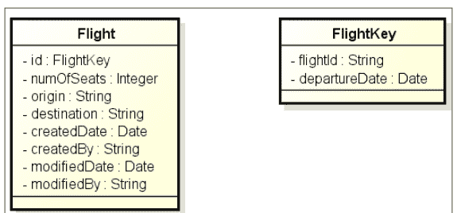
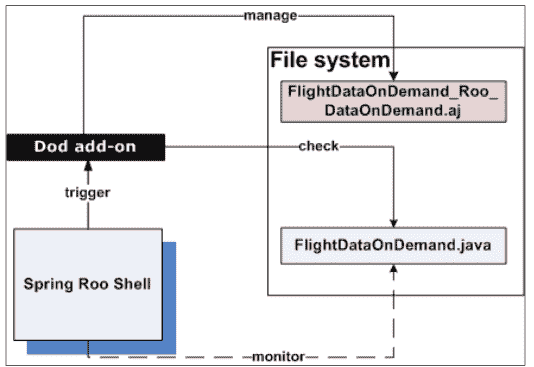
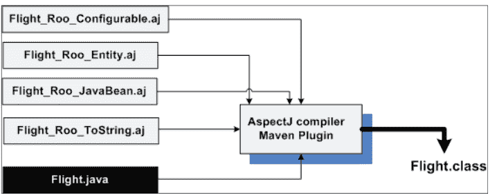

# 2 使用 JPA 持久化对象

在本章中，我们将介绍：

- 为您的项目设置 JPA 提供程序
- 查看数据库配置属性
- 管理数据库配置属性
- 创建持久实体
- 向持久字段添加 JSR 303 约束
- 为持久实体创建集成测试
- 为测试实体创建新的“按需数据”
- 为持久实体创建模拟测试
- 执行持久实体测试
- 控制持久实体的自动生成方法
- 创建与多个数据库交互的应用程序
- 打包您的 Roo 项目

## 简介

**Java 持久化 API (JPA)** 提供了一种用于将 Java 对象持久化到关系数据库的标准 API。本章中的配方探讨了配置数据源和 JPA 提供程序（例如 Hibernate 和 OpenJPA）的 Roo 命令，以及创建企业应用程序持久实体的 Roo 命令。

如果您仅在持久化层使用 Spring，本章将向您展示如何使用 Roo 快速开发应用程序的持久化层。您会注意到，使用 Roo 生成的应用程序没有 DAO（数据访问对象）层，因为 Roo 生成的领域实体本身就功能丰富，在持久实体中定义了查找器和 CRUD 方法。同样，使用 Roo 生成的应用程序没有用于抽象业务服务（而后者又可以访问持久实体）的服务层。如果您想为企业应用程序创建服务层，则由您自行创建服务。如果业务逻辑跨越多个持久实体，或者您希望在服务层中设置事务边界，或者您希望将业务逻辑封装在服务层中，等等，都应该为企业应用程序创建服务层。

在第 4 章“使用 Spring Web MVC 开发 Web 应用程序”和第 5 章“使用 GWT、Flex 和 Spring Web Flow 开发 Web 应用程序”中，我们将看到 Spring Roo 生成应用程序的 Web 层，该层直接与持久实体交互——留给服务层和数据访问层处理。

## 为项目设置 JPA 提供程序

在企业应用程序中，数据持久化在一个或多个数据存储中。JPA 提供了一种用于管理关系数据库中数据的标准 API。在本任务中，我们将了解 `persistence setup` 命令，以配置 Roo 项目的 JPA 持久化提供程序。

### 准备工作

在 `C:\roo-cookbook` 目录中创建一个子目录 `ch02-recipes`。

要设置 JPA 提供程序，我们首先需要创建一个 Roo 项目。要创建新的 Roo 项目，请从本书的网站下载 `ch02.roo` 文件并将其复制到 `ch02-recipes` 目录。

打开命令提示符并进入 `ch02-recipes` 目录。现在，启动 Roo shell 并使用 `script` 命令执行 `ch02.roo` 脚本中的命令，如第 1 章“从 Roo 脚本创建应用程序构件”配方中所述。成功执行 `ch02.roo` 脚本将创建一个 `flight-app` Eclipse 项目，您可以将其导入 Eclipse IDE。

### 操作步骤

以下步骤将演示如何设置 JPA 提供程序：

- 1. 要将 Hibernate 设置为应用程序的 JPA 提供程序，请执行 `persistence setup` 命令，如下所示：

```
roo> persistence setup --provider HIBERNATE --database MYSQL --databaseName myFlightAppDB
Updated SRC_MAIN_RESOURCES\META-INF\spring\applicationContext.xml
```

```
Created SRC_MAIN_RESOURCES\META-INF\persistence.xml
```

```
Created SRC_MAIN_RESOURCES\META-INF\spring\database.properties
```

```
Updated ROOT\pom.xml [Added dependencies mysql:mysql-connector-java:5.1.13, org.hibernate:hibernate-core:3.6.1.Final, ...]
```

- 2. 执行 perform eclipse Roo 命令，如下所示：

```
roo> perform eclipse
```

- 3. 将 flight-app Roo 项目导入您的 Eclipse IDE。

> 建议：每当发现 Roo 命令更新了 pom.xml 文件，然后执行 perform eclipse（针对 Eclipse IDE）或 perform command --mavenCommand idea:idea（针对 IntelliJ IDEA）时，都应更新项目的类路径设置。这之后应在 IDE 中刷新项目。

### 工作原理...

persistence setup 命令由 Spring Roo 的 JPA 插件处理。以下表格描述了 persistence setup 命令接受的参数：

| 参数 | 描述 |
| :--- | :--- |
| provider | 这是一个必需参数，指定要为企业应用程序使用的 JPA 提供程序。该参数接受预定义值，例如 HIBERNATE、OPENJPA 等。 |
| database | 这是一个必需参数，用于标识企业应用程序用于持久化应用程序数据的数据库产品。它接受预定义值，例如 MYSQL、DB2 等。 |
| databaseName | 标识企业应用程序交互的数据库名称。仅当企业应用程序不使用 JNDI 绑定的数据源时，此参数才有用。 |
| hostName | 标识远程数据库的位置。默认为 localhost。仅当企业应用程序不使用 JNDI 绑定的数据源时，此参数才有用。 |
| jndiDataSource | 指定应用程序使用的 JNDI 绑定数据源。 |


| 参数 | 描述 |
| :--- | :--- |
| username | 标识连接数据源所需的用户名。仅当企业应用程序未使用JNDI绑定的数据源时，此参数才有用。 |
| password | 标识连接数据源所需的密码。仅当企业应用程序未使用JNDI绑定的数据源时，此参数才有用。 |
| applicationId | 如果要将应用程序部署到Google App Engine，则标识应用程序标识符。我们将在第6章的“在GAE上部署GWT应用程序”配方中详细讨论此参数。 |
| persistenceUnit | 指定Roo生成的persistence.xml文件中要使用的持久化单元名称。如果您的应用程序与多个数据库交互，则必须使用此参数。 |
| transactionManager | **[自Spring Roo 1.1.5起支持]** 与持久化单元对应的事务管理器名称。如果您的应用程序与多个数据库交互，则必须使用此参数。 |

如`persistence setup`命令的输出所示，我们的flight-app Roo项目中以下文件被创建或修改：

- `persistence.xml`: 这是一个新创建的文件，由JPA提供程序用于发现持久化提供程序信息，在flight-app项目中，该提供程序是Hibernate。
- `database.properties`: 这是一个新创建的文件，包含数据源信息，例如用户名、密码、数据源URL和驱动程序类。
- `applicationContext.xml`: 此文件在我们创建Roo项目时创建。此文件现已修改，以包含数据源、事务管理器和JPA EntityManagerFactory定义。本节稍后将详细介绍这些定义。
- `pom.xml`: 此文件在我们创建Roo项目时创建。它现在已修改，以包含MySQL连接器、Hibernate、Hibernate Validator等的项目依赖项。这表明Roo仅在您为企业应用程序添加额外功能时才向项目添加依赖项。例如，如果您未使用JPA，则除非执行`persistence setup`命令，否则JPA相关依赖项不会添加到您的项目中。

以下XML片段显示了由Spring Roo创建的persistence.xml文件：

```
<persistence ...>
<persistence-unit name="persistenceUnit"
transaction-type="RESOURCE_LOCAL">
<provider>org.hibernate.ejb.HibernatePersistence</provider>
<properties>
<property name="hibernate.dialect"
value="org.hibernate.dialect.MySQL5InnoDBDialect"/>
<property name="hibernate.hbm2ddl.auto" value="create"/>
...
</properties>
</persistence-unit>
</persistence>
```

前面的清单显示，Roo根据您提供给persistence setup命令的JPA提供程序和数据库信息创建persistence.xml文件。<persistence-unit>元素的name属性指定持久化单元名称。如果未指定persistence setup的persistenceUnit参数，则默认情况下，Roo将name属性值设置为persistenceUnit。hibernate.hbm2ddl.auto属性的create值表示每次创建Hibernate SessionFactory时，都会重新创建数据库。您可能希望根据JPA实体中提供的映射来更改hibernate.hbm2ddl.auto属性的值，将其从create更改为validate或update或create-drop，具体取决于您希望Hibernate如何管理数据库架构。

此外，如果您的企业应用程序更新多个数据源，则应将persistence-unit元素的transaction-type属性值设置为JTA（Java事务API），而不是RESOURCE_LOCAL。

以下代码显示了执行persistence setup命令时添加到applicationContext.xml文件的元素：

```
<bean class="org.apache.commons.dbcp.BasicDataSource"
destroy-method="close" id="dataSource">
<property name="driverClassName"
value="${database.driverClassName}"/>
<property name="url" value="${database.url}"/>
<property name="username" value="${database.username}"/>
<property name="password" value="${database.password}"/>
...
</bean>

<bean
class="org.springframework.orm.jpa.JpaTransactionManager"
id="transactionManager">
<property name="entityManagerFactory"
              ref="entityManagerFactory"/>
</bean>
```

```
<tx:annotation-driven mode="aspectj"
              transaction-manager="transactionManager"/>
```

```
<bean
    class="org.springframework.orm.jpa.
    LocalContainerEntityManagerFactoryBean"
    id="entityManagerFactory">
    <property name="dataSource" ref="dataSource"/>
</bean>
```

如前面的XML所示，persistence setup命令添加的其他bean如下：

- dataSource: 指javax.sql.DataSource对象，表示应用程序的数据源。数据源的属性包含在persistence setup创建的database.properties文件中。由于applicationContext.xml文件中存在<property-placeholder>元素，Spring的应用程序上下文会读取database.properties文件（请参阅第1章中的“创建Roo项目”配方）。
- entityManagerFactory: 指Spring的工厂bean，负责创建JPA EntityManagerFactory。您应该使用LocalContainerEntityManagerFactoryBean，因为它对EntityManagerFactory的配置提供了最大控制权。
- transactionManager: 指JpaTransactionManager bean，如果您的应用程序使用单个EntityManagerFactory（即仅使用单个数据库或事务资源），则此bean非常合适。

Spring事务架构（spring-tx-3.0.xsd）的<annotation-driven>元素建议您使用Spring的@Transactional注解将方法标记为事务性。mode属性的值aspectj表示AspectJ事务切面在加载时或编译时被织入类中。如果您想使用Spring的AOP框架为@Transactional注解的bean（通常是您的服务类）创建代理，则请将mode属性的值指定为proxy，或者根本不指定mode属性。

如果保持mode属性值为aspectj（建议这样做），则应注意以下要求：

- 为您的应用程序启用编译时（或加载时）织入。您无需担心此问题，因为如果将Roo项目打包为WAR或JAR（请参阅本章中的“打包您的Roo项目”配方），则将使用AspectJ编译器Maven插件（请参阅第1章中的“创建Roo项目”配方）来将AspectJ事务切面（定义在spring-aspects.jar文件中）织入带有@Transactional注解的Roo方法中。
- 在具体类上使用@Transactional注解，而不是在接口上使用。

## 更多内容...

现在，让我们看看如何在Spring Roo生成的应用程序中使用JNDI绑定的数据源。

## JNDI绑定的数据源

在大多数实际应用程序中，javax.sql.DataSource对象是从JNDI获取的，而不是从属性文件中定义的属性创建的。要访问JNDI绑定的数据源，请不要依赖Spring为应用程序创建DataSource，而是使用persistence setup的jndiDataSource参数来指定DataSource的JNDI名称，如下所示：

```
persistence setup --provider HIBERNATE --database MYSQL --jndiDataSource jdbc/accountDB
```

如果指定了jndiDataSource参数，则Spring Roo将Spring的jee架构的jndi-lookup元素添加到applicationContext.xml文件中，如下所示：

```
<beans ... xmlns:jee="http://www.springframework.org/schema/jee" ...
xsi:schemaLocation="http://www.springframework.org/schema/jee http://
www.springframework.org/schema/jee/spring-jee-3.0.xsd">
.....
<jee:jndi-lookup id="dataSource" jndi-name="jdbc/accountDB" />
.....
```

如上所示，jndi-lookup元素负责访问名为jdbc/accountDB（由jndi-name属性引用）的JNDI中配置的DataSource，并使其作为bean id为dataSource在Spring的应用程序上下文中可用。

如果将前面的applicationContext.xml文件与先前显示的文件进行比较，您可以发现唯一的区别是dataSource bean如何提供给Spring的应用程序上下文。


## 另请参阅

- 请参阅“创建持久实体”配方，了解如何创建持久实体
- 请参阅“创建与多个数据库交互的应用程序”配方，了解如何开发与多个数据库交互的应用程序的详细信息

## 查看数据库配置属性

在本配方中，我们将了解 `database properties list` 命令如何让我们查看数据库属性列表及其值，这些值在 `database.properties` 文件中指定。

### 准备工作

请参阅 *为您的项目设置 JPA 提供程序* 配方，以创建 *flight-app* Roo 项目，并使用 *persistence setup* 命令设置持久性提供程序。

> 如果您在 Roo 项目中使用的是 JNDI 绑定的数据源，则不需要本配方。

### 操作方法

按照以下步骤查看数据库属性：

- 1. 从 C:\roo-cookbook\ch02-recipes 目录启动 Roo shell。
- 2. 要查看定义在 SRC_MAIN_RESOURCES\META-INF\spring\ 目录中的 database.properties 文件中的数据库属性，可以使用 database properties list 命令，如下所示：
  ```
  roo> database properties list
  ```

  ```
  database.driverClassName = com.mysql.jdbc.Driver
  database.password =
  database.url = jdbc:mysql://localhost:3306/myFlightAppDB
  database.username =
  ```

### 工作原理

database properties list 命令由 JPA 加载项处理。除了使用 database properties list 命令，您还可以使用 properties list 命令（请参阅第 1 章中的“查看属性文件中定义的属性”配方），该命令显示属性文件中包含的属性。使用任一命令的最终结果相同，唯一的区别是您需要在 properties list 命令中指定名称和路径参数来引用 database.properties 文件。

### 更多内容

除了使用 Spring Roo，您还可以使用 Eclipse 或 STS 等 IDE 查看 database.properties 文件。使用 Spring Roo 的 database properties list 命令的整体思路是让开发人员可以在不切换到 IDE 的情况下查看数据库属性。

### 另请参阅

- 下一个配方“管理数据库配置属性”展示了您如何添加、删除和修改 Roo 项目中 database.properties 文件中定义的属性。

## 管理数据库配置属性

在上一个配方中，我们了解了如何使用 database properties list 命令查看 database.properties 文件中定义的数据库配置属性。在本配方中，我们将了解如何使用 database properties set 和 database properties remove 命令从 database.properties 文件中添加、修改或删除属性。

以下表格显示了我们将从 database.properties 文件中添加、修改和删除的属性：

| 属性 | 操作 |
| --- | --- |
| database.username | 修改为 database.username = root |
| database.password | 修改为 database.password = asarin |
| database.url = jdbc:mysql://localhost:3306/myFlightAppDB | 从 database.properties 中移除 |
| database.modified.url = jdbc:mysql://localhost:3406/myFlightAppDB | 添加到 database.properties |
| database.initialPoolSize=10 | 添加到 database.properties |

### 准备工作

请参阅“为您的项目设置 JPA 提供程序”配方，以创建 flight-app Roo 项目，并使用 persistence setup 命令设置持久性提供程序。

从 C:\roo-cookbook\ch02-recipes 目录启动 Roo shell。

> 如果您在 Roo 项目中使用的是 JNDI 绑定的数据源，则不需要本配方。

### 操作方法

以下步骤将向您展示如何添加、修改或删除属性：

- 1. 如果您想要修改 database.properties 文件中定义的属性，database properties set 命令非常有用，如下所示：
  ```
  roo> database properties set --key database.username --value root
  roo> database properties set --key database.password --value asarin
  ```

- 2. database properties set 命令也可以用于向 database.properties 文件中添加新属性，如下所示：
  ```
  roo> database properties set --key database.modified.url --value jdbc:mysql://localhost:3406/myFlightAppDB
  roo> database properties set --key database.initialPoolSize --value 10
  ```

- 3. database properties remove 命令用于从 database.properties 文件中删除现有属性，如下所示：
  ```
  roo> database properties remove --key database.url
  ```

### 工作原理

database properties set 和 database properties remove 命令由 JPA 加载项处理。除了使用这些命令，您还可以使用 properties set 和 properties remove 命令，如第 1 章“Spring Roo 入门”中的“管理属性文件中定义的属性”配方所示。

需要注意的是，如果您修改了 database.properties 文件中的属性名称，则这些修改必须反映在 Roo 项目的 applicationContext.xml 文件中定义的 dataSource bean 中。

### 更多内容

除了使用 Spring Roo，您还可以使用 Eclipse 或 STS 等 IDE 修改 `database.properties` 文件。使用 Roo 命令修改 `database.properties` 文件允许开发人员使用 `script` 命令重播从 Roo shell 执行的操作。

### 另请参阅

- 请参阅本章前面描述的“查看数据库配置属性”配方，了解如何使用 Roo 命令查看 `database.properties` 文件中定义的属性。

## 创建持久实体

在本配方中，我们将了解 Spring Roo 如何使用 `entity` 和 `field` 命令简化 JPA 实体的创建。在本配方中，我们将创建一个具有复合主键的 `Flight` JPA 实体。请参阅第 3 章“Spring Roo 中的高级 JPA 支持”中的“在实体之间创建多对一关系”配方，了解如何创建带有代理键的持久实体。

以下图表显示了 `Flight` 实体及其复合主键 (`FlightKey`) 的属性：



### 准备工作

退出 Roo shell 并删除 `C:\roo-cookbook\ch02-recipes` 目录的内容。

执行 `ch02_jpa_setup.roo` 脚本。它会创建一个 `flight-app` Roo 项目，并使用 `persistence setup` 命令将 Hibernate 设置为持久性提供程序。如果您使用的数据库不是 MySQL，或者连接设置与脚本中指定的不同，请相应地修改脚本。

从 C:\roo-cookbook\ch02-recipes 目录启动 Roo shell。

随本书附带的 ch02_persistent_entities.roo 脚本会创建 flight-app 项目，将 Hibernate 设置为持久性提供程序，修改 database.properties 文件中的 database.username 和 database.password 属性，并执行本配方中所示的命令。

### 操作方法

以下步骤将演示如何创建持久实体：

- 1. 使用 `entity` 命令在 `sample.roo.flightapp.domain` 包中创建 Flight 实体：
  ```
  roo> entity --class ~.domain.Flight --identifierType ~.domain.FlightKey --table FLIGHT_TBL
  ```

- 2. 使用 `field` 命令向 `Flight` 实体添加字段：
  ```
  roo> field number --type java.lang.Integer --fieldName numOfSeats
  roo> field string --fieldName origin
  roo> field string --fieldName destination
  roo> field date --type java.util.Date --fieldName createdDate
  roo> field date --type java.util.Date --fieldName modifiedDate
  roo> field string --fieldName createdBy
  roo> field string --fieldName modifiedBy
  ```

- 3. 将焦点切换到 `FlightKey` 类（在步骤 1 中创建 Flight 实体时，该类在 `sample.roo.flightapp.domain` 包中自动生成）：
  ```
  roo> focus --class ~.domain.FlightKey
  ```

- 4. 向 `FlightKey` 类添加 `flightId` 和 `departureDate` 字段：
  ```
  roo> field string --fieldName flightId
  roo> field date --fieldName departureDate --type java.util.Date
  ```

出于简洁性考虑，`entity` 命令的输出未在上方显示。我们将在 *操作方法...* 部分讨论与 JPA 实体对应生成的重要 ITD 文件。


## 工作原理...

实体命令用于创建 JPA 持久化实体。它提供了一组参数，这些参数应足以满足您在开发企业应用持久层时遇到的大多数场景。例如，mappedSuperclass 参数使用 @MappedSuperclass JPA 注解标记类（请参阅第 3 章《Spring Roo 高级 JPA 支持》中的“创建映射超类”示例），inheritanceType 参数添加 @Inheritance JPA 注解，以便让您指定持久化继承层次结构中类所遵循的继承策略，等等。

接下来的表格描述了您可以传递给 entity 命令的参数：

| 参数 | 描述 |
| :--- | :--- |
| class | 这是一个必填参数，用于指定持久化实体类的完全限定名。指定完全限定名时，可以使用 '~' 符号。 |
| mappedSuperclass | 指示 Roo 该类是“映射超类”。如果指定，生成的类将使用 @MappedSuperclass JPA 注解进行标注。 |
| extends | 标识实体类的父类。 |
| abstract | 指定生成的实体是抽象实体。 |
| inheritanceType | 指定用于持久化实体的继承策略。它接受以下值之一：JOINED、SINGLE_TABLE 和 TABLE_PER_CLASS。如果指定，它会在实体类中添加 @Inheritance JPA 注解。 |
| table | 指定实体映射到的表名。 |
| identifierField | 指定实体中标识符字段的名称。默认情况下，标识符字段的名称为 id。 |
| identifierType | 指定标识符字段的 Java 类型。此参数可以接受 Roo 预定义的值，例如 java.lang.Long、java.lang.Double 等，也可以接受自定义 Java 类型。 |
| identifierColumn | 指定标识符字段映射到的表列。如果您的实体使用复合主键，则不得使用此参数。 |
| versionField | 指定实体中版本字段的名称。默认情况下，版本字段的名称为 version。 |
| versionColumn | 版本字段映射到的表列。 |
| testAutomatically | 指示 Roo 为实体自动生成集成测试。我们将在“为持久化实体创建集成测试”示例中详细讨论持久化实体的集成测试。 |
| schema, catalog | 用于指定数据库表名限定符的参数。这些参数转换为 @Table JPA 注解的 schema 和 catalog 属性。 |
| persistenceUnit | 持久化单元的名称，在 persistence.xml 文件中定义，持久化实体与此关联。 |
| transactionManager | [自 Spring Roo 1.1.5 起支持] 持久化实体使用的事务管理器的名称。 |

如果您的实体使用复合主键，则需要使用自定义 Java 类型。例如，Flight 实体将 FlightKey 指定为 identifierType，因为它是 Flight 实体的复合主键类。还要注意，当您执行 entity 命令时，复合主键类会自动生成。

您可能已经注意到，我们用于向 Flight JPA 实体添加字段的 field 命令，与我们在第 1 章《Spring Roo 入门》中的“向 Java 类添加属性”示例中用于向 Java 类添加属性的 field 命令是同一个。

```
@RooJavaBean
@RooToString
@RooEntity(identifierType = FlightKey.class, table= "FLIGHT_TBL")
public class Flight {
    private Integer numOfSeats;
    private String origin;
    private String destination;
    ...
}
```

在 Flight.java 代码中，@RooJavaBean 和 @RooToString 注解是最常用的 Roo 注解。有关 @RooJavaBean 和 @RooToString 的更多信息，请参阅第 1 章《Spring Roo 入门》中的“创建 Java 类”和“向 Java 类添加属性”示例。@RooEntity 注解提供了有关持久化实体（即前面代码中的 Flight 实体）的详细信息。identifierType 属性指定 Flight 实体的标识符类型，即 FlightKey——Flight 实体的复合主键类。table 属性指定 Flight JPA 实体映射到的数据库表。

> 您会注意到，实体的字段未使用 JPA @Column 注解来提供字段与相应 FLIGHT_TBL 表列之间的映射。稍后在本示例中，我们将了解如何使用 field 命令为字段指定表列映射。

@RooEntity 注解使用 ITD 文件 Flight_Roo_Entity.aj 引入了一些持久化相关方法和属性，如下所示：

```
privileged aspect Flight_Roo_Entity {
	declare @type: Flight: @Entity;

	declare @type: Flight: @Table(name = "FLIGHT_TBL");

	@PersistenceContext
	transient EntityManager Flight.entityManager;

	@EmbeddedId
	private FlightKey Flight.id;

	@Version
	@Column(name = "version")
	private Integer Flight.version;

	public FlightKey Flight.getId() {
		return this.id;
	}

	public void Flight.setId(FlightKey id) {
		this.id = id;
	}

	public Integer Flight.getVersion() {
		return this.version;
	}

	public void Flight.setVersion(Integer version) {
		this.version = version;
	}

	...
}
```

为简洁起见，前面代码清单中省略了持久化相关方法（例如 persist、remove 等）。自动生成的持久化相关方法将在“控制持久化实体的自动生成方法”示例中讨论。如您所见，Spring Roo 生成了创建功能齐全的 JPA 实体所需的代码。

Flight_Roo_Entity.aj 中的以下代码在 Flight 类中添加了 @Table 和 @Entity JPA 注解：

```
declare @type: Flight: @Entity;
declare @type: Flight: @Table(name = "FLIGHT_TBL");
```

在 Flight_Roo_Entity.aj 中，FlightKey 字段使用了 @EmbeddedId 注解，因为它是 Flight 实体的复合主键类。Roo 还在 Flight_Roo_Entity.aj 中创建了一个 version 字段，该字段映射到 Flight 实体映射表的 version 列。如果我们创建一个不使用复合主键的持久化实体，那么 Spring Roo 将使用 @Id 注解而非 @EmbeddedId 来标注主键。

在生成实体时，Spring Roo 还会生成一个 <entity-name>_Roo_Configurable.aj ITD 文件，用于向实体添加 Spring 的 @Configurable 注解。在此，<entity-name> 是持久化实体的名称。

实体实例通常由 JPA 提供程序或通过 new 运算符在 Spring 应用程序上下文之外创建。在实体中使用 @Configurable 注解特别有用，因为它允许将 Spring 应用程序上下文中配置的 Bean 注入到实体实例中。正因有 @Configurable 注解，Spring 才能将 EntityManager 实例注入到持久化实体中。

以下代码清单显示了 flight-app 应用程序的 FlightKey 类：

```
@RooToString
@RooIdentifier
public final class FlightKey {
    private String flightId;
    private Date departureDate;
}
```

在代码中，Spring Roo 的 @RooIdentifier 注解负责为字段添加构造函数、getter 和 setter 方法，并还为 FlightKey 复合主键类提供 hashCode 和 equals 方法的实现。Spring Roo 会生成一个与复合主键类上的 @RooIdentifier 注解对应的 <entity-name>_Roo_Identifier.aj ITD 文件。在此，<entity-name> 是持久化实体的名称。

以下代码显示了在 FlightKey_Roo_Identifier.aj ITD 文件中定义的方法和属性：

```
privileged aspect FlightKey_Roo_Identifier {
    declare @type: FlightKey: @Embeddable;

    public FlightKey.new(String flightId, Date departureDate) {}
}
```


```
private FlightKey() {}

public String FlightKey.getFlightId() {
    return this.flightId;
}

public Date FlightKey.getDepartureDate() {
    return this.departureDate;
}

public boolean FlightKey.equals(Object obj) {}

public int FlightKey.hashCode() {}

}
```

为简洁起见，代码中未显示方法和构造函数的实现细节。正如代码所示，FlightKey_Roo_Identifier.aj ITD 向 FlightKey 类添加了以下方法、构造函数、字段和注解：

- 向 FlightKey 类添加 @Embeddable JPA 注解，这是必需的，因为 FlightKey 类使用 @EmbeddedId JPA 注解添加到了 Flight 实体中
- 向 FlightKey 类添加无参构造函数
- 向 FlightKey 类添加接受 FlightKey 类中定义的字段作为参数的构造函数
- 为 FlightKey 类中定义的字段添加 getter 和 setter 方法
- 为 java.lang.Object 类的 equals 和 hashCode 方法添加实现

@RooIdentifier 注解接受两个属性——gettersByDefault 和 settersByDefault，它们允许你控制 FlightKey 类中定义的字段的 getter 和 setter 方法的创建。@RooIdentifier 还接受第三个属性 dbManaged，如果 JPA 实体是由 Roo 使用数据库逆向工程创建的，则该属性很有用。我们将在第 3 章“Spring Roo 中的高级 JPA 支持”的“从数据库创建实体”配方中详细讨论 dbManaged 属性。

### 还有更多...

我们现在将学习如何向持久实体添加字段，这些字段包含有关字段映射到的表列的信息。

## 在持久实体字段中添加表列信息

从 Flight.java 文件中删除 origin 字段，并确保 Spring Roo 在后台运行，以从 AspectJ ITD 文件中删除 origin 字段。

现在，使用 field 命令向 Flight 持久实体添加 origin 字段，并将 origin 字段映射到的表列名称 FLT_ORIGIN 指定为 column 参数的值：

```
~.domain.Flight roo> field string --fieldName origin --column FLT_ORIGIN
```

column 参数的存在表示该字段使用 @Column JPA 注解进行注解，其中 column 参数的值表示 @Column 注解的 name 属性的值，如下所示：

```
@RooJavaBean
@RooToString
@RooEntity(table = "FLIGHT_TBL")
public class Flight {

    @Column(name = "FLT_ORIGIN")
    private String origin;

}
```

随本书附带的 Roo 脚本 ch02_persistent_fields.roo 包含用于创建由 Flight 实体和 FlightKey 类组成的 flight-app 项目的命令。此外，该脚本还为 Flight 实体和 FlightKey 类中定义的所有持久字段添加数据库列映射。建议你退出 Roo shell，删除 ch02-recipes 目录中的所有文件，并通过执行 ch02_persistent_fields.roo 脚本重新创建 flight-app Roo 项目。

### Roo 命令中的 class 参数

我们在一些配方中看到，focus 命令用于将命令引用从 Roo 项目中的一个类或接口切换到另一个类或接口，随后是应用于该类或接口的 Roo 命令。与使用 focus 命令不同，你可以使用 roo 命令的 class 参数（如果 roo 命令支持）来显式指定命令适用的类或接口。例如，我们可以在不使用 focus 命令的情况下向 FlightKey 类添加 flightId 字段，如下所示：

```
...roo> field string --class ~.domain.Flight --fieldName origin --column FLT_ORIGIN
```

从 field 命令可以看出，我们可以指定命令适用的类的完全限定名。

### 另请参见

- 请参阅“控制持久实体自动生成的方法”配方，了解如何控制与持久实体对应的 Spring Roo 生成的方法

## 向持久字段添加 JSR 303 约束

JSR 303（Bean 验证）定义了一种基于注解的 JavaBeans 验证的标准方法。在本配方中，我们将探讨如何使用 Spring Roo 的 field 命令向实体的持久字段添加 JSR 303 验证约束。

下表显示了适用于我们 flight-app 项目中 Flight 实体和 FlightKey 类所定义字段的验证约束：

| 持久字段 | 约束 | JSR 303 注解 |
| --- | --- | --- |
| Flight -> createdDate | 非空 | @NotNull |
| Flight -> createdBy | 非空 | @NotNull |
| Flight -> numOfSeats | 非空 | @NotNull |
| | 最大座位数 200 | @DecimalMax ("200") |
| | 最小座位数 100 | @DecimalMin ("100") |
| Flight -> origin | 非空 | @NotNull |
| | origin 值的最大长度为 20，最小长度为 3 | @Size (min=3, max=20) |
| Flight -> destination | 非空 | @NotNull |
| | destination 值的最大长度为 20，最小长度为 3 | @Size (min=3, max=20) |
| FlightKey -> flightId | 非空 | @NotNull |
| FlightKey -> departureDate | 非空 | @NotNull |

### 准备工作

退出 Roo shell 并删除 C:\roo-cookbook\ch02-recipes 目录的内容。

执行 ch02_jpa_setup.roo 脚本。它将创建一个 flight-app Roo 项目，并使用 persistence setup 命令将 Hibernate 设置为持久化提供程序。如果你使用的数据库不是 MySQL，或者你的连接设置与脚本中指定的不同，请相应地修改脚本。

从 C:\roo-cookbook\ch02-recipes 目录启动 Roo shell。

### 操作步骤

按照以下步骤添加 JSR 303 约束：

- 1. 使用 entity 命令在 sample.roo.flightapp.domain 包中创建 Flight 实体：
  ..roo> entity --class ~.domain.Flight --identifierType ~.domain.FlightKey --table FLIGHT_TBL

- 2. 向 Flight 实体添加 numOfSeats、origin、destination、createdBy、modifiedBy、createdDate 和 modifiedDate 字段，如下所示：
  ..roo> field number --type java.lang.Integer --fieldName numOfSeats --column NUM_OF_SEATS --notNull --decimalMin 100 --decimalMax 200
  ..roo> field string --fieldName origin --column FLT_ORIGIN --notNull --sizeMin 3 --sizeMax 20
  ..roo> field string --fieldName destination --column FLT_DESTINATION --notNull --sizeMin 3 --sizeMax 20
  ..roo> field date --type java.util.Date --fieldName createdDate --column CREATED_DATE --notNull
  ..roo> field string --fieldName createdBy --column CREATED_BY --notNull

- 3. 使用 focus 命令将 Roo 提示符设置为 FlightKey 主键类：
  ..roo> focus --class ~.domain.FlightKey

- 4. 向 FlightKey 实体添加 flightId 和 departureDate 字段，如下所示：
  ..roo> field string --fieldName flightId --column FLIGHT_ID --notNull
  ..roo> field date --fieldName departureDate --type java.util.Date --notNull --column FLT_DEP_DATE

### 工作原理...

在 `field` 命令中，你可以使用 `notNull`、`nullRequired`、`decimalMax`、`decimalMin`、`regexp`、`sizeMax` 和 `sizeMin` 等参数来指定适用于字段的验证约束。使用这些参数将生成带有 JSR 303 注解的字段，如下所示为 `Flight` 实体：

```
public class Flight {
    @NotNull
    @DecimalMin("100")
    @DecimalMax("200")
    @Column(name="NUM_OF_SEATS")
    private Integer numOfSeats;

    @NotNull
    @Column(name = "FLT_ORIGIN")
    @Size(min = 3, max = 20)
    private String origin;

    @NotNull
    @Column(name = "FLT_DESTINATION")
    @Size(min = 3, max = 20)
    private String destination;
    .....
}
```

### 还有更多...

使用 JSR 303 约束并不局限于领域对象；你可以在任何类中使用 JSR 303 约束，无论该类用于哪个层。例如，你可以在 Web 层的命令对象或表单支撑对象中使用 JSR 303 约束。

### 另请参见

- 请参阅“创建持久实体”配方，了解如何创建持久实体并向其中添加字段


## 控制持久实体自动生成的方法

当使用 Roo 创建持久实体时，会自动生成多个方法以简化实体的使用和测试。例如，在“创建持久实体”配方中创建了 Flight 实体后，相应的 Flight_Roo_Entity.aj AspectJ ITD 文件将被创建，其中包含 persist、remove、merge、flush、findFlight 等方法。

在本配方中，我们将了解如何通过以下方式控制实体方法的生成：

- 指定方法所使用的前缀
- 指示 Roo 不生成特定方法

为了本配方的目的，我们将指示 Roo 对 Flight 实体执行以下操作：

- 将自动生成的 persist 方法名称更改为 save
- 将自动生成的 findFlight 方法名称更改为 finderForFlight
- 不要生成 countFlights 和 findFlightEntries 方法

### 准备工作

退出 Roo shell，删除 C:\roo-cookbook\ch02-recipes 目录的内容。

执行 ch02_jsr303_fields.roo 脚本。该脚本会创建 flight-app Roo 项目，并使用 persistence setup 命令将 Hibernate 设置为持久化提供程序。该脚本还会创建 Flight 实体（其复合主键类为 FlightKey），并向 Flight 和 FlightKey 类添加字段。如果您使用的数据库不是 MySQL，或者连接设置与脚本中指定的不同，请相应地修改脚本。

从 C:\roo-cookbook\ch02-recipes 目录启动 Roo shell。

### 具体步骤...

以下步骤将向您展示如何控制自动生成的方法：

- 1. 在您喜欢的 IDE 中打开 Flight.java 文件。
- 2. 将 @RooEntity 注释更改为：@RooEntity(identifierType = FlightKey.class, persistMethod="save", countMethod="",
findMethod="finderFor", findEntriesMethod="")

- 3. 您将在 Roo shell 中看到以下输出：

```
Updated SRC_MAIN_JAVA\\sample\\roo\\flightapp\\domain\\Flight_Roo_Entity.aj
```

### 工作原理...

Roo 的 @RooEntity 注释负责管理相应的 *_Roo_Entity.aj AspectJ ITD 文件中定义的方法。@RooEntity 注释定义了允许您指定 Roo 生成的方法前缀的属性，并可控制是否生成特定方法。@RooEntity 注释还定义了可用于指定实体标识符和版本字段名称、类型及表列信息的属性。

在前面的代码中，@RooEntity 注释指定了以下信息：

- identifierType = FlightKey.class：指定 Flight 实体的标识符类型为 FlightKey 类。默认值为 Long。
- persistMethod = "save"：值 'save' 表示 Roo 不会生成 persist 方法，而是生成名为 save 的方法。
- countMethod = ""：由于值为 ""，表示 Roo 不得生成 countFlights 方法。
- findEntriesMethod = ""：由于值为 ""，表示 Roo 不得生成 findFlightEntries 方法。
- findMethod = "finderFor"：由于值为 finderFor，Roo 不会生成 findFlight 方法，而是生成名为 finderForFlight 的方法。

下表描述了 @RooEntity 注释定义的所有属性：

| @RooEntity 属性 | 描述 |
| --- | --- |
| countMethod, findAllMethod, findEntriesMethod, findMethod, flushMethod, mergeMethod, persistMethod, removeMethod | 用于指定生成方法的前缀的属性。值为 "" 表示 Roo 不会生成该方法。 |
| identifierColumn, identifierField, identifierType | 用于指定 JPA 实体标识符信息的属性，包括标识符字段映射到的表列名称、AspectJ ITD 文件中的标识符字段名称以及标识符字段的 Java 类型。 |
| versionField, versionType, versionColumn | 用于指定版本字段信息的属性，包括版本字段映射到的表列名称、AspectJ ITD 文件中的版本字段名称以及版本字段的 Java 类型。 |
| finders | 指定 Roo 为其生成动态查找方法的方法名称的属性。 |
| mappedSuperclass | 指示 Roo 生成 @MappedSuperclass 注释而不是 @Entity。我们将在第 3 章“Spring Roo 中的高级 JPA 支持”中了解映射超类的用法。 |
| inheritanceType | 要用于 JPA 实体的继承类型。 |
| persistenceUnit | 实体关联的持久化单元的名称，在 persistence.xml 中定义。 |
| transactionManager | [自 Spring Roo 1.1.5 起支持] 与实体关联的事务管理器的名称。 |

> **另请参阅**
> 请参阅“创建持久实体”配方，了解如何使用 Roo 创建 JPA 实体

## 为持久实体创建集成测试

Spring Roo 提供了一个 test integration 命令，用于简化持久实体的集成测试创建。在本配方中，我们将了解如何为实体创建集成测试。

### 准备工作

退出 Roo shell，删除 C:\roo-cookbook\ch02-recipes 目录的内容。

执行 ch02_jsr303_fields.roo 脚本。该脚本会创建 flight-app Roo 项目，并使用 persistence setup 命令将 Hibernate 设置为持久化提供程序。该脚本还会创建 Flight 实体（其复合主键类为 FlightKey），并向 Flight 和 FlightKey 类添加字段。如果您使用的数据库不是 MySQL，或者连接设置与脚本中指定的不同，请相应地修改脚本。

从 C:\roo-cookbook\ch02-recipes 目录启动 Roo shell。

### 具体步骤...

以下步骤将向您展示如何创建集成测试：

- 1. 将 Roo 命令的焦点更改为 Flight 实体：
  ```
  roo> focus --class ~.domain.Flight
  ```

- 2. 执行 `test integration` 命令：
  ```
  ~.domain.Flight> test integration
  Created ...FlightDataOnDemand.java
  Created ...FlightIntegrationTest.java
  Created ...FlightDataOnDemand_Roo_DataOnDemand.aj
  Created ...FlightIntegrationTest_Roo_IntegrationTest.aj
  Created ... FlightDataOnDemand_Roo_Configurable.aj
  Created ... Flight_Roo_Configurable.aj
  ```

### 工作原理...

`test integration` 命令会在 src\test\java 文件夹中生成文件。`test integration` 命令的输出显示生成了以下文件：

`test integration` 命令的输出显示生成了以下文件：

- `FlightDataOnDemand.java`：表示一个“按需数据”类，为 `Flight` 实体的自动化集成测试提供必要数据。

- FlightDataOnDemand_Roo_DataOnDemand.aj：此 AspectJ ITD 文件定义在编译期间添加到 FlightDataOnDemand 类中的方法。此 AspectJ ITD 文件中定义的方法负责动态创建 10 个 Flight 实体实例并将其存储在数据库中（即种子数据）。在执行集成测试时会使用这些 Flight 实例。AspectJ ITD 创建的实体实例符合适用于实体持久字段的 JSR 303 约束。默认情况下，与测试方法关联的事务在测试方法完成后会回滚——这就是执行集成测试后您不会在数据库表中看到种子数据的原因。请参阅“执行持久实体测试”配方，了解 Spring 的 @Rollback 注释的示例用法，用于指定与测试方法关联的事务不得回滚。

- FlightIntegrationTest.java：表示 Flight 实体的 JUnit 集成测试类。

- FlightIntegrationTest_Roo_IntegrationTest.aj：负责为 Flight 实体定义集成测试方法的 AspectJ ITD。

- FlightDataOnDemand_Roo_Configurable.aj 和 Flight_Roo_Configurable.aj：分别向 FlightDataOnDemand 和 Flight 类添加 @Configurable 注释的 AspectJ ITD。

让我们现在详细查看每个文件。

以下清单显示了 FlightDataOnDemand.java 类：

```
import org.springframework.roo.addon.dod.RooDataOnDemand;
import sample.roo.flightapp.domain.Flight;

@RooDataOnDemand(entity = Flight.class)
public class FlightDataOnDemand { }
```

代码清单展示了 Roo 的 @RooDataOnDemand 注释的用法，该注释标识 FlightDataOnDemand 类为其创建集成测试种子数据的持久实体。@RooDataOnDemand 注释负责创建相应的 *_Roo_DataOnDemand.aj AspectJ ITD 文件。@RooDataOnDemand 接受两个属性来自定义种子数据生成的行为：

- entity：标识需要为其创建种子数据的持久实体。

- quantity：要为实体创建的记录数，默认值为 10。如果您想为实体的集成测试创建更多记录，请为此属性指定适当的值。


如果您使用 JMeter 等性能测试工具来测试企业应用 JPA 层的性能，可以在 JMeter 中创建测试计划时修改 FlightIntegrationTest JUnit 测试类，并将其用作 JUnit Request Sampler（或者可以为 FlightIntegrationTest 创建包装器并使用 Java Request Sampler）。这能让您快速开始测试数据访问代码的性能。基于持久实体的性能测试要求，您可以调整 @RooDataOnDemand 注解的 quantity 属性值。例如，如果您想在数据库中存在 n 条记录时测试数据访问层的性能，则将 quantity 属性值指定为 n。

下面的清单显示了 FlightDataOnDemand_Roo_DataOnDemand.aj AspectJ ITD 文件，该文件在编译时将方法、属性和注解织入 FlightDataOnDemand.java 类中：

```
privileged aspect FlightDataOnDemand_Roo_DataOnDemand {

    declare @type: FlightDataOnDemand: @Component;

    private Random FlightDataOnDemand.rnd =
        new java.security.SecureRandom();

    private List<Flight> FlightDataOnDemand.data;

    public Flight FlightDataOnDemand.getNewTransientFlight (int
    index) {...}

    public Flight FlightDataOnDemand.getSpecificFlight (int
    index) {...}

    public Flight FlightDataOnDemand.getRandomFlight () {...}

    public boolean FlightDataOnDemand.modifyFlight (Flight obj)
    {...}

    public void FlightDataOnDemand.init() {...}

}
```

代码清单显示 AspectJ ITD 执行以下操作：

- 将 @Component 注解添加到 FlightDataOnDemand 类，以便它自动注册到 Spring 的应用程序上下文中。这样您就可以创建自定义集成测试，在其中可以自动装配一个或多个 *DataOnDemand 类。
- 创建 java.security.SecureRandom 类的实例，用于生成随机数。
- 声明一个列表，用于保存由 "数据按需" 类生成的 `Flight` 实体。这些 `Flight` 实体实例代表由 "数据按需" 类生成的种子数据。
- 定义 `getNewTransientFlight(int index)` 方法，用于根据 `index` 参数的值生成一个 `unique` `Flight` 实例。`getNewTransientFlight` 方法创建符合实体持久字段所指定的 JSR 303 注解的持久实体实例。例如，`Flight` 实体为 `origin` 和 `destination` 字段指定了 `@Size(min = 3, max = 20)` JSR 303 注解（请参阅 `Flight.java` 类）；因此，`getNewTransientFlight` 方法会尝试（也就是说，不保证，我们稍后将看到）确保 `origin` 和 `destination` 字段的大小符合相应的 JSR 303 注解。
- 定义 `getSpecificFlight(int index)` 方法，它返回由 "数据按需" 类维护的种子数据集合中指定 `index` 处的 `Flight` 实体。
- 定义 `getRandomFlight()` 方法，它返回 "数据按需" 类维护的种子数据集合中由 `java.security.SecureRandom` 实例获取的随机索引处的 `Flight` 实体。
- 定义 `modifyFlight(Flight obj)` 方法，该方法应修改作为参数传递的 `Flight` 实体并返回修改的成功或失败。但它仅返回 `false`，也就是说，它永远不会修改传递的 `Flight` 实例。
- 定义 `init()` 方法，该方法负责为 `Flight` 实体的集成测试创建种子数据。它使用 `getNewTransientFlight(int index)` 方法在数据库中创建 `Flight` 实体。数据库中创建的 `Flight` 实体数量由 `@RooDataOnDemand` 注解的 `quantity` 属性值确定。

需要注意的是，`init()` 方法会被 `*_Roo_DataOnDemand.aj` 中定义的方法内部调用，以确保每次调用测试方法时都会在数据库中创建一组新的种子数据。

### JSR 303 注解和种子数据

Spring Roo 生成的 "数据按需" 类为创建符合 JSR 303 注解的实体实例提供了有限支持。截至 Spring Roo 1.1.3，它仅支持 `@NotNull`、`@Past` 和 `@Future` JSR 303 约束，并对最大和最小范围注解提供了一些支持。如果您的项目使用任何其他 JSR 303 注解，则建议在 `*DataOnDemand.java` 类中为实体字段创建自己的 setter 方法。

下面的清单显示了 FlightIntegrationTest.java 类：

```
import org.junit.Test;
import org.springframework.roo.addon.test.RooIntegrationTest;

@RooIntegrationTest(entity = Flight.class )
public class FlightIntegrationTest {
  @Test
  public void testMarkerMethod() {
  }
}
```

代码清单显示了 Roo 的 @RooIntegrationTest 注解的存在，该注解表示要为 Flight 实体创建集成测试 AspectJ ITD。testMarkerMethod 是一个示例 JUnit 测试方法。@RooIntegrationTest 注解接受 entity 属性，用于标识创建集成测试的持久实体——在 FlightIntegrationTest 类中即为 Flight。此外，@RooIntegrationTest 注解定义了属性，可让您控制 Roo 在相应的 *_Roo_IntegrationTest.aj AspectJ ITD 中自动生成的集成测试方法。

下面的清单显示了 Roo 为 FlightIntegrationTest 类生成的 FlightIntegrationTest_Roo_IntegrationTest.aj AspectJ ITD 文件：

```
import org.junit.Test;
import org.junit.runner.RunWith;
import org.springframework.test.context.ContextConfiguration;
import org.springframework.test.context.junit4.SpringJUnit4ClassRunner;

privileged aspect FlightIntegrationTest_Roo_IntegrationTest {
  declare @type: FlightIntegrationTest:
    @RunWith(SpringJUnit4ClassRunner.class);

  declare @type: FlightIntegrationTest:
    @ContextConfiguration(locations =
      "classpath:/META-INF/spring/applicationContext.xml");

  declare @type: FlightIntegrationTest:@Transactional;

  @Autowired
  private FlightDataOnDemand FlightIntegrationTest.dod;

  @Test
  public void FlightIntegrationTest.testFindAllFlights() {
    ...
  }

  @Test
  public void FlightIntegrationTest.testPersist() {
    ...
  }

  ...
}
```

前面的代码显示 AspectJ ITD 执行以下操作：

- 将 JUnit 的 @RunWith 注解添加到 FlightIntegrationTest 类，指示使用 Spring 的 SpringJUnit4ClassRunner 来运行 JUnit 测试。
- 将 Spring 的 @ContextConfiguration 注解添加到 FlightIntegrationTest 类，该注解指定用于执行测试的 Spring 应用程序上下文 XML 文件的位置。默认情况下，它设置为使用 META-INF/spring 文件夹中的 applicationContext.xml 文件。如果您想使用不同的应用程序上下文 XML 来运行测试，则在 FlightIntegrationTest 类中指定 @ContextConfiguration 注解。
- 将 Spring 的 @Transactional 注解添加到 FlightIntegrationTest 类，这意味着在 FlightIntegrationTest 中定义（或由 AspectJ ITD 织入）的所有测试方法都是事务性的。
- 声明集成测试方法，例如 testFindAllFlights、testPersist 等。测试方法使用 FlightDataOnDemand（一个 "数据按需" 类）实例来创建 Flight 实例（种子数据）以测试 Flight 实体，并从数据库中检索随机的 Flight 实例。

## 还有更多...

在某些场景中，您可能希望自定义由 *DataOnDemand*.java 类创建的种子数据，并控制 Spring Roo 自动生成的集成测试方法。

## 自定义种子数据创建

如果您使用 Spring Roo 不支持的 JSR 303 注解，则需要创建自定义 setter 方法（在 *._Roo_DataOnDemand.aj 中定义）来设置持久实体字段值。下面的清单显示了 Roo 为 Flight 实体自动生成的一些 setter 方法（setNumOfSeats 和 setOrigin）；下面是 FlightDataOnDemand_Roo_DataOnDemand.aj 方法：

```
public Flight FlightDataOnDemand.getNewTransientFlight(int index) {
  sample.roo.flightapp.domain.Flight obj = new sample.roo.flightapp.domain.Flight();
}
```


```
setEmbeddedId(obj, index);
setNumOfSeats(obj, index);
setOrigin(obj, index);
setDestination(obj, index);
...
return obj;
}
```

```
private void FlightDataOnDemand.setEmbeddedId(Flight obj,
int index) {
java.lang.String flightId = "flightId_" + index;
...
obj.setId(embeddedIdClass);
}
```

```
private void FlightDataOnDemand.setNumOfSeats(Flight obj,
int index) {
java.lang.Integer numOfSeats = new Integer(index);
obj.setNumOfSeats(numOfSeats);
}
```

```
private void FlightDataOnDemand.setOrigin(Flight obj,
int index) {
java.lang.String origin = "origin_" + index;
if (origin.length() > 20) {
origin = origin.substring(0, 20);
}
obj.setOrigin(origin);
}
...
```

在代码清单中，关于创建的 Flight 实体，有几点需要注意：

- 创建 Flight 实体时会处理 @NotNull JSR 303 注解，但 numOfSeats 字段上的 @DecimalMax 和 @DecimalMin JSR 303 注解被完全忽略（参考代码清单中的 setNumOfSeats 方法）。

- origin 和 destination 字段上的 @Size 注解只得到部分支持，因为该方法仅检查分配给 destination（或 origin）字段的值的最大长度是否为 20。它不检查最小长度是否为 3。（参考代码清单中的 setOrigin 方法。）

- 组合键是动态创建并设置的（参考上一个清单中的 setEmbeddedId 方法）。

要解决 FlightDataOnDemand_Roo_DataOnDemand.aj 自动生成的 Flight 实体实例中 JSR 303 支持的问题，可以在 FlightDataOnDemand.java 类中编写自定义的 setNumOfSeats、setOrigin 和 setDestination 方法，这些方法将执行以下操作：

- 检查 origin 和 destination 字段的长度在 @Size 定义的范围内

- 提供对 @DecimalMin 和 @DecimalMax JSR 303 注解的检查

需要注意的是，如果在 FlightDataOnDemand.java 类中创建 setNumOfSeats、setOrigin 和 setDestination 方法，则 Roo 会将这些方法从相应的 FlightDataOnDemand_Roo_DataOnDemand.aj AspectJ ITD 中删除。这要求 FlightDataOnDemand.java 类中方法的签名必须与相应的 FlightDataOnDemand_Roo_DataOnDemand.aj AspectJ ITD 文件中定义的方法签名相同。同样，你可以通过在 FlightDataOnDemand.java 类中编写方法来自定义 FlightDataOnDemand_Roo_DataOnDemand.aj 的任何方法。

下图显示了 Roo 如何从 FlightDataOnDemand_Roo_DataOnDemand.aj 文件中删除 setNumOfSeats、setOrigin 和 setDestination 方法：



图中显示，**Spring Roo Shell** 监视 **FlightDataOnDemand.java** 类（因为它标注了 Roo 的 **@RooDataOnDemand** 注解）。当对 **FlightDataOnDemand.java** 类进行任何更改时，Roo 会触发负责管理与 **FlightDataOnDemand.java** 类对应的 AspectJ ITD 文件的插件。对于 **FlightDataOnDemand**，Roo 会触发 **Dod add-on**（“数据按需”）来更新 **FlightDataOnDemand_Roo_DataOnDemand.aj** AspectJ ITD，以便 AspectJ ITD 与 **FlightDataOnDemand.java** 类保持同步。当你在 **FlightDataOnDemand.java** 类中添加 **setNumOfSeats**、**setOrigin** 和 **setDestination** 方法时，**Dod add-on** 会检查这些方法是否已经存在。如果存在，**Dod add-on** 会将这些方法从 **FlightDataOnDemand_Roo_DataOnDemand.aj** AspectJ ITD 中删除。

需要注意的是，修改标注了 Roo 注解的 Java 类可能会影响多个 AspectJ ITD。例如，如果从 **Flight_Roo_JavaBean.aj** 中删除 **modifiedBy** 字段，Roo 将更新 **Flight_Roo_ToString.aj** 和 **FlightDataOnDemand_Roo_DataOnDemand.aj** AspectJ ITD 文件，以反映 **modifiedBy** 字段的删除。

## 控制集成测试方法

如前所述，**\*IntegrationTest.java** 中的 **@RooIntegrationTest** 注解定义了属性，可让你控制 Roo 在 **\*_Roo_IntegrationTest.aj** AspectJ ITD 文件中自动生成的集成测试方法。**@RooIntegrationTest** 注解定义了以下属性来控制集成测试方法的自动生成：count、find、findAll、findAllMaximum、findEntries、flush、merge、persist 和 remove。如果任何属性的值指定为 false，则相应的测试方法将从 **\*_Roo_IntegrationTest.aj** AspectJ ITD 文件中删除。例如，**testFindAllFlights** 方法会在数据库中查找所有 **Flight** 实例，出于性能考虑，这可能并不可取。要指示 Spring Roo 从 **FlightIntegrationTest_Roo_IntegrationTest.aj** 文件中删除自动生成的 **testFindAllFlights** 方法，只需在 **@RooIntegrationTest** 注解中将 **findAll** 属性的值指定为 false，如下所示：

```
@RooIntegrationTest(entity = Flight.class, findAll=false)
public class FlightIntegrationTest {
    ...
}
```

## 在实体创建时生成集成测试

在本示例中，我们了解了如何使用 **test integration** 命令创建集成测试。你还可以使用 **entity** 命令的 **testAutomatically** 参数指示 Roo 在创建实体时生成集成测试，如下所示：

```
roo> entity --class ~.domain.Flight --testAutomatically --identifierType ~.domain.FlightKey --table FLIGHT_TBL
```

## 为集成测试提供自定义实现

与“数据按需”类一样，你可以在 *IntegrationTest.java 类中为集成测试方法提供自定义实现。例如，如果你想使用自定义的 testPersist 方法来修改 Roo 生成的 testPersist 测试方法，请在 FlightIntegrationTest.java 文件中创建 testPersist 方法。将 testPersist 方法添加到 *IntegrationTest.java 会导致 Roo 从相应的 *_Roo_IntegrationTest.aj 文件中删除 testPersist 方法。同样，你可以自定义 *_Roo_IntegrationTest.aj 文件中定义的任何其他测试方法。

## 另请参阅

- 参阅“为测试实体创建新的‘数据按需’”示例，了解如何为实体创建种子数据
- 参阅“执行持久化实体测试”示例，了解如何使用 Spring Roo 执行实体的集成测试和模拟测试
- 参阅“为持久化实体创建模拟测试”示例，创建实体中定义的模拟静态方法

## 为测试实体创建新的“数据按需”

在前面的示例中，我们了解到 test integration 命令和 entity 命令的 testAutomatically 参数会生成实体的集成测试和种子数据。在编写自己的集成测试的场景中，你可能仍希望使用 Roo 生成的实体种子数据。因此，你正在编写自定义集成测试类，但使用 Roo 生成的“数据按需”类。这时 Spring Roo 的 dod 命令就派上用场了。

## 准备工作

退出 Roo shell 并删除 C:\roo-cookbook\ch02-recipes 目录的内容。

执行 ch02_jsr303_fields.roo 脚本。该脚本创建 flight-app Roo 项目，并使用 persistence setup 命令将 Hibernate 设置为持久化提供程序。该脚本还创建一个 Flight 实体，其中 FlightKey 作为其组合主键类，并为 Flight 和 FlightKey 类添加字段。如果你使用的数据库不是 MySQL，或者连接设置与脚本中指定的不同，请相应地修改脚本。

从 C:\roo-cookbook\ch02-recipes 目录启动 Roo shell。

## 操作步骤...

- 1. 将 Roo 命令的焦点更改为 Flight 实体：
  roo> focus --class ~.domain.Flight

- 2. 执行 test integration 命令：
  ~.domain.Flight> test integration

- 3. 为 Flight 实体创建新的“数据按需”类，执行以下 dod 命令：
  ~.domain.Flight> dod --entity ~.domain.Flight --class MyFlightDod

Created SRC_TEST_JAVA\..MyFlightDod.java
Created SRC_TEST_JAVA\..MyFlightDod_Roo_Configurable.aj
Created SRC_TEST_JAVA\..MyFlightDod_Roo_DataOnDemand.aj

## 工作原理

dod 命令接受两个参数：

- entity: 需要创建“数据按需”类的实体的完全限定名。
- class: “数据按需”类的名称。该类标注了 @RooDataOnDemand 注解。如果未指定此参数，则默认类名为 <entity-name>DataOnDemand，其中 <entity-name> 是实体的简单名称。

dod 命令生成相应的“数据按需”Java 类、 *_Roo_DataOnDemand.aj 和 *_Roo_Configurable.aj。现在，你可以在集成测试类中使用新创建的“数据按需”Java 类（FlightIntegrationTest.java），如下所示：

```
package sample.roo.flightapp.domain;

public class FlightIntegrationTest {
	@Autowired
	private MyFlightDod myDod;

	@Test
	public void testMyCustomDodTest() {
	sample.roo.flightapp.domain.Flight obj =
```


```
myDog.getNewTransientFlight(Integer.MAX_VALUE);
..
obj.persist();
obj.flush();
..
}
}
```

## 另请参阅

有关如何为使用 Spring Roo 的实体创建集成测试的详细信息，请参阅“为持久实体创建集成测试”配方。

## 为持久实体创建模拟测试

在“为持久实体创建集成测试”配方中，我们了解到 Spring Roo 如何帮助创建集成测试。在本配方中，我们将探讨 Spring Roo 如何使用 test mock 命令简化实体的模拟测试生成。

### 准备工作

退出 Roo shell，删除 C:\roo-cookbook\ch02-recipes 目录的内容。

执行 ch02_jsr303_fields.roo 脚本。它会创建一个 flight-app Roo 项目，并使用 persistence setup 命令将 Hibernate 设置为持久化提供程序。该脚本还会创建一个 Flight 实体，该实体以 FlightKey 作为其复合主键类，并向 Flight 和 FlightKey 类添加字段。如果您使用的数据库不是 MySQL，或您的连接设置与脚本中指定的不同，请相应地修改脚本。

从 C:\roo-cookbook\ch02-recipes 目录启动 Roo shell。

### 操作步骤

按照以下步骤创建模拟测试：

- 1. 使用 focus 命令将 Roo 的焦点设置到 Flight 实体：
  roo> focus --class ~.domain.Flight

- 2. 要为 Flight 实体创建模拟测试，请执行以下 test mock 命令：
  ~.domain.Flight roo> test mock
  已创建 SRC_TEST_JAVA\sample\roo\flightapp\domain\FlightTest.java

### 工作原理

执行 `test mock` 命令会创建一个 JUnit 测试 `FlightTest.java`，用于对 `Flight` 实体进行模拟测试，如下所示：

```
package sample.roo.flightapp.domain;

@RunWith(JUnit4.class)
@MockStaticEntityMethods
public class FlightTest {

    @Test
    public void testMethod() {
        int expectedCount = 13;
        Flight.countFlights();

        ..AnnotationDrivenStaticEntityMockingControl.
            expectReturn(expectedCount);

        ..AnnotationDrivenStaticEntityMockingControl.playback();
        org.junit.Assert.assertEquals(expectedCount,
                Flight.countFlights() );
    }
}
```

如果您使用的是 Spring Roo 1.1.3，则需要在 Roo 生成的模拟测试中添加 `@MockStaticEntityMethods` 和 `@RunWith(JUnit4.class)` 注释，如所示。

在代码清单中，`@MockStaticEntityMethods` 注释是一种 Spring 注释，用于支持对实体静态方法（如 count 和 finder 方法）的模拟测试。Spring 定义了一个 `AnnotationDrivenStaticEntityMockingControl` 切面，该切面适用于使用 `@MockStaticEntityMethods` 注释的测试类中的方法，并模拟对持久实体静态方法的调用。此外，`AnnotationDrivenStaticEntityMockingControl` 切面定义了 `expectReturn` 和 `playback` 方法，以简化编写模拟测试。

由于 `AnnotationDrivenStaticEntityMockingControl` 切面适用于任何使用 `@MockStaticEntityMethods` 注释的类，因此可以使用任何测试框架（JUnit 或 TestNG）为实体编写模拟测试。对于在实体中定义的实例方法的测试，您将继续使用 **EasyMock**、**Mockito** 等常用的模拟测试方法。

## 另请参阅

有关 Spring Roo 对 JPA 实体集成测试自动生成的支持，请参阅“为持久实体创建集成测试”配方。

## 执行持久实体测试

在以前的配方中，我们了解了如何为持久实体创建模拟测试和集成测试。在本配方中，我们将探讨如何使用 Spring Roo 的 perform tests 命令执行这些测试。

### 准备工作

退出 Roo shell，删除 C:\roo-cookbook\ch02-recipes 目录的内容。

执行 ch02_jsr303_fields.roo 脚本。它会创建一个 flight-app Roo 项目，并使用 persistence setup 命令将 Hibernate 设置为持久化提供程序。该脚本还会创建一个 Flight 实体，该实体以 FlightKey 作为其复合主键类，并向 Flight 和 FlightKey 类添加字段。如果您使用的数据库不是 MySQL，或您的连接设置与脚本中指定的不同，请相应地修改脚本。

安装 MySQL 5.5.11 数据库——这是必需的，因为我们现在将执行集成测试。在 MySQL 服务器实例中创建名为 "myFlightAppDB" 的数据库，并确保 flight-app Roo 项目的 database.properties 文件中定义的连接属性可用于成功连接到 "myFlightAppDB"。

从 C:\roo-cookbook\ch02-recipes 目录启动 Roo shell。

### 操作步骤

按照以下步骤创建并执行测试：

- 1. 将 Roo 命令的焦点更改为 Flight 实体：
  roo> focus --class ~.domain.Flight

- 2. 执行 test integration 命令为 Flight 实体创建集成测试：
  ~.domain.Flight> test integration

- 3. 要执行 Roo 项目中定义的测试，请从 Roo 提示符发出 perform tests 命令，如下所示：
  roo> perform tests

目前，Flight 实体的集成测试将失败，因为：

- 自动生成的“数据按需”类对创建符合 JSR 303 注释的实体实例支持有限。如“为持久实体创建集成测试”配方中所述，您可以在 FlightDataOnDemand.java 实体中为持久字段编写自定义 setter 方法，以创建符合持久字段上指定的 JSR 303 注释的 Flight 实体。

- Flight_Roo_Entity.aj AspectJ ITD 文件中 countFlights 方法触发的查询与 MySQL 5.1.1 不兼容。您需要将 countFlights 方法从：

```
public static long countFlights() {
    return entityManager().createQuery("SELECT COUNT(o)
    FROM Flight o", Long.class).getSingleResult();
}
```

到：

```
public static long countFlights() {
    return entityManager().createQuery("SELECT COUNT(*)
    FROM Flight o", Long.class).getSingleResult();
}
```

由于 AspectJ ITD 文件由 Spring Roo 管理，您不应更改 Flight_Roo_Entity.aj 文件中的 countFlights 方法。相反，请执行 push-in 重构，或在 Flight.java 文件中创建一个 countFlights 方法。

在 push-in 重构中，您使用 IDE 将 AspectJ ITD 文件中定义的声明、方法、属性和构造函数推送到目标 Java 类。有关 push-in 重构的更多信息，请参阅第 7 章中的“使用 push-in 重构移除 Roo”配方。

> 在 Flight.java 中编写 countFlights 方法时，请确保 Roo 在后台运行，以便 Roo 可以从 Flight_Roo_Entity.aj 文件中删除 countFlights 方法。此外，请确保 countFlights 方法的签名与 Flight_Roo_Entity.aj 文件中定义的签名相同。

### 工作原理

perform tests 命令由 Roo 的 maven 插件处理，负责执行 Roo 项目中包含的所有测试。如果您想直接使用 maven 执行测试，请退出 Roo 提示符并使用 maven 的 mvn test 命令。测试执行结果保存在 <project_dir>/target/surefire-reports 目录中，其中 project_dir 是您的 Roo 项目目录。

## 更多内容

随本书提供的 ch02_flightapp_testing.zip 文件包含了我们在前一章和本章配方中看到的 flight-app Eclipse 项目。您可以将此项目导入 Eclipse IDE，查看我对 flight-app 项目所做的以下更改，以演示迄今为止学到的概念：

- 在 FlightDataOnDemand.java 中定义了 setNumOfSeats 方法，以创建满足 numOfSeats 字段上 JSR 303 @Size 注释指定的约束的 Flight 实体。在 FlightDataOnDemand.java 中定义 setNumOfSeats 方法会导致从 FlightDataOnDemand_Roo_DataOnDemand.aj 文件中删除具有相同签名的方法。

- 在 FlightDataOnDemand.java 中定义了 setOrigin 和 setDestination 方法，以创建满足 origin 和 destination 字段上 JSR 303 @DecimalMax 和 @DecimalMin 注释指定的约束的 Flight 实体。在 FlightDataOnDemand.java 中定义 setOrigin 和 setDestination 方法会导致从 FlightDataOnDemand_Roo_DataOnDemand.aj 文件中删除具有相同签名的方法。

- 更改了 FlightIntegrationTest.java 中的 @RooIntegrationTest 注释，以指示 Roo 不生成 findAll、findEntries 和 count 测试方法。

- 在 FlightIntegrationTest.java 中自动装配了 MyFlightDod 引用（一个自定义的“数据按需”类）并定义了一个自定义 testMyCustomDodTest 方法。

- 向 FlightIntegrationTest.java 中的 testPersist 方法添加了 @Rollback(false) Spring 注释，以便 testPersist 方法创建的数据在执行后不会回滚。如果您想要手动验证 testPersist 方法创建的数据，或希望保留数据以供进一步测试，此功能将特别有用。

您可以使用 perform tests 命令执行 flight-app 项目中定义的测试，并检查数据库以查看“数据按需”类和在 testPersist 方法测试期间创建的种子数据。

## 另请参阅

- 有关 Spring Roo 对 JPA 实体集成测试自动生成的支持，请参阅“为持久实体创建集成测试”配方

- 有关模拟实体中定义的静态方法，请参阅“为持久实体创建模拟测试”配方


## 创建与多个数据库交互的应用程序

Spring Roo 1.1.3 起，实体和持久化设置命令均支持 persistenceUnit 参数，可让你创建与多个数据库交互的企业级应用程序。在本示例中，我们将创建两个持久化单元：

- flight：flight 持久化单元由单个实体 Flight 组成。它使用 Hibernate 作为 JPA 提供程序，并映射到名为 "myFlightDB" 的 MySQL 数据库。
- payment：payment 持久化单元由单个实体 Payment 组成。它使用 Hibernate 作为 JPA 提供程序，并映射到名为 "myPaymentDB" 的 MySQL 数据库。

## 准备工作

退出 Roo shell，并删除 C:\roo-cookbook\ch02-recipes 目录的内容。

从 C:\roo-cookbook\ch02-recipes 目录启动 Roo shell。

## 操作步骤

以下步骤将演示如何创建与多个数据库交互的应用程序：

- 1. 创建 flight-app Roo 项目：
  roo> project --topLevelPackage sample.roo.flightapp --java 6 --projectName flight-app

- 2. 设置 flight 持久化单元：
  roo> persistence setup --provider HIBERNATE --database MYSQL --databaseName myFlightDB --persistenceUnit flight

- 3. 创建与 flight 持久化单元关联的 Flight 实体：
  roo> entity --class ~.domain.Flight --table FLIGHT_TBL --persistenceUnit flight

- 4. 为 Flight 实体添加一些字段：
  ~.domain.Flight roo> field string --fieldName origin --column FLT_ORIGIN --notNull
  ~.domain.Flight roo> field string --fieldName destination --column FLT_DESTINATION --notNull

- 5. 为 `Flight` 实体创建集成测试：
  `~.domain.Flight roo> test integration`

- 6. 设置 `payment` 持久化单元：
  roo> persistence setup --provider HIBERNATE --database MYSQL --databaseName myPaymentDB --persistenceUnit payment

- 7. 创建与 `payment` 持久化单元关联的 `Payment` 实体：
  roo> entity --class ~.domain.Payment --table PAYMENT_TBL --persistenceUnit payment

- 8. 为 `Payment` 实体添加字段：
  `~.domain.Payment roo> field string --fieldName paymentType --column PYMT_TYPE --notNull`

- 9. 为 `Payment` 实体创建集成测试：
  `~.domain.Payment roo> test integration`

- 10. 执行 `perform eclipse` 命令，将 `flight-app` 项目导入 Eclipse IDE：
  `~.domain.Payment roo> perform eclipse`

- 11. 执行集成测试：
  roo> perform tests

此时执行集成测试将导致失败。我们将很快了解在使用多个数据库时需要做什么才能使测试正常工作。

## 工作原理

持久化单元的概念不仅在企业级应用与多个数据库交互时有用，而且在你希望在应用程序中对实体进行逻辑分组时也很有用。如果你想为不同的逻辑实体组使用不同的持久化提供程序，使用不同的持久化单元也很有用。

使用 `persistence setup` 命令设置持久化提供程序时，可以通过指定 `persistenceUnit` 参数来指定持久化单元名称。同样，在使用 `entity` 命令创建实体时，可以使用 `persistenceUnit` 参数来指定实体所属的持久化单元。Spring Roo 利用 `persistence setup` 命令的 `persistenceUnit` 参数在 `/META-INF/persistence.xml` 文件中定义不同的持久化单元。以下清单显示了执行 `persistence setup` 命令后 `flight-app` 项目的 `persistence.xml` 文件：

```
<persistence ...>
<persistence-unit name="flight"
transaction-type="RESOURCE_LOCAL">
<provider>
org.hibernate.ejb.HibernatePersistence
</provider>
..
</persistence-unit>
<persistence-unit name="payment"
transaction-type="RESOURCE_LOCAL">
<provider>
org.hibernate.ejb.HibernatePersistence
</provider>
..
</persistence-unit>
</persistence>
```

在代码中，`<persistence-unit>` 元素的 name 属性反映了你在 persistence setup 命令中指定的 persistenceUnit 参数值。由于我们为 flight 和 payment 持久化单元都指定了 Hibernate 作为 JPA 提供程序，因此 `<provider>` 元素包含 org.hibernate.ejb.HibernatePersistence 作为 JPA 提供程序。如果你想为持久化单元使用不同的 JPA 提供程序，请使用 persistence setup 命令的 provider 参数进行指定。

由于我们使用不同的持久化单元，使用 entity 命令创建的实体使用 persistenceUnit 属性来标识实体关联的持久化单元。以下代码清单显示，persistenceUnit 参数值在 Flight 类的 @RooEntity 注解中被使用：

```
@RooJavaBean
@RooToString
@RooEntity(persistenceUnit = "flight", table = "FLIGHT_TBL")
public class Flight {...}
```

在代码中，@RooEntity 的 persistenceUnit 属性值为 flight，这会影响 Roo 生成相应 *_Roo_Entity.aj AspectJ ITD 文件的方式。以下代码清单显示了 @RooEntity 注解的 persistenceUnit 属性对 Flight_Roo_Entity.aj ITD 文件的影响：

```
privileged aspect Flight_Roo_Entity {
@PersistenceContext(unitName = "flight")
transient EntityManager Flight.entityManager;
...
@Transactional("flight")
public void Flight.persist() {...}
@Transactional("flight")
public void Flight.remove() {...}
...
}
```

在代码中，@PersistenceContext 注解使用 unitName 属性来指定 EntityManager 持久化上下文关联的持久化单元。另外，请注意，@Transactional 注解现在使用 flight 限定词来指定管理事务所需的事务管理器。

从 Spring Roo 1.1.3 开始，你需要确保每个持久化单元的事务管理器、实体管理器工厂和数据源 bean 定义已在 /META-INF/spring/applicationContext.xml 文件中配置，如下所示：

```
<bean class="org.apache.commons.dbcp.BasicDataSource"
 destroy-method="close" id="flightDataSource">
 ...
</bean>
<bean class="org.apache.commons.dbcp.BasicDataSource"
 destroy-method="close" id="paymentDataSource">
 ...
</bean>

<bean
 class="org.springframework.orm.jpa.JpaTransactionManager"
 id="flightTransactionManager">
 <qualifier value="flight"/>
 <property name="entityManagerFactory"
 ref="flightEntityManagerFactory"/>
</bean>

<bean
 class="org.springframework.orm.jpa.JpaTransactionManager"
 id="paymentTransactionManager">
 <qualifier value="payment"/>
 <property name="entityManagerFactory"
 ref="paymentEntityManagerFactory"/>
</bean>

<tx:annotation-driven mode="aspectj"
 transaction-manager="flightTransactionManager"/>
<tx:annotation-driven mode="aspectj"
 transaction-manager="paymentTransactionManager"/>

<bean
    class="org.springframework.orm.jpa.LocalContainerEntityManagerFactoryBean"
    id="flightEntityManagerFactory">
    <property name="persistenceUnitName" value="flight"/>
    <property name="dataSource" ref="dataSource"/>
</bean>
<bean class="org.springframework.orm.jpa.LocalContainerEntityManagerFactoryBean"
    id="paymentEntityManagerFactory">
    <property name="persistenceUnitName" value="payment"/>
    <property name="dataSource" ref="dataSource"/>
</bean>
```

代码显示，为每个持久化单元配置了不同的事务管理器、实体管理器工厂和数据源 bean。事务管理器 bean 定义使用 <qualifier> 元素，以便 @Transactional 注解可以使用限定词来引用目标事务管理器。另外，LocalContainerEntityManagerFactoryBean 通过 persistenceUnitName 属性传递其关联的持久化单元名称。

为确保集成测试正常工作，你还需要为标注了 @Transactional 注解的测试方法指定要使用的事务管理器。要实现这一点，你只需在测试类中指定 @Transactional 注解即可，如 PaymentIntegrationTest 类所示：

```
@RooIntegrationTest(entity = Payment.class)
@Transactional("payment")
public class PaymentIntegrationTest {

    @Test
    public void testMarkerMethod() {
    }

}
```

## 另请参阅

- 请参阅“创建持久化实体”示例，了解如何创建属于单个持久化单元的持久化实体


## 打包您的 Roo 项目

如果您仅使用 Roo 来创建企业应用程序的持久化层，则可能希望将 Roo 项目打包为 JAR 文件并使用它。本示例展示了如何打包 Roo 项目，以及 Roo 如何确保打包的 JAR 文件独立于 Roo 特定的注解和 AspectJ ITDs。

### 准备工作

退出 Roo shell，并删除 `C:\roo-cookbook\ch02-recipes` 目录的内容。

执行 `ch02_jsr303_fields.roo` 脚本。它会创建一个 `flight-app` Roo 项目，并使用持久化设置命令将 Hibernate 设置为持久化提供程序。该脚本还会创建一个 `Flight` 实体，该实体将 `FlightKey` 作为其复合主键类，并向 `Flight` 和 `FlightKey` 类添加字段。如果您使用的数据库不是 MySQL，或您的连接设置与脚本中指定的不同，请相应地修改脚本。

从 `C:\roo-cookbook\ch02-recipes` 目录启动 Roo shell。

### 操作步骤...

要将 Roo 项目打包为 JAR 文件，请从 Roo shell 执行 `perform package` 命令：

```
roo> perform package
```

```
[INFO] -----------------------------------------------------------
[INFO] Building flight-app 0.1.0.BUILD-SNAPSHOT
[INFO] -----------------------------------------------------------
...
[INFO] --- aspectj-maven-plugin:1.2:compile (default) @ flight-app ---
...
[INFO] --- aspectj-maven-plugin:1.2:test-compile (default) @ flight-app ---
...
[INFO] Building jar: ...\target\flight-app-0.1.0.BUILD-SNAPSHOT.jar
[INFO] -----------------------------------------------------------
[INFO] BUILD SUCCESS
[INFO] -----------------------------------------------------------
[INFO]
```

### 工作原理...

perform package 命令使用 Maven 打包 Roo 项目。或者，您也可以使用 Maven 的 mvn package 命令来打包 Roo 项目。需要注意的是，使用 perform package 命令时，Roo 项目中定义的测试不会被执行。

执行 perform package 的输出显示，AspectJ 编译器 Maven 插件用于编译 flight-app 项目的主 Java 类和测试 Java 类。AspectJ 编译器 Maven 插件的 compile 目标会将 spring-aspects.jar 文件中定义的 AspectJ ITDs 和方面织入项目的主 Java 类中。test-compile 目标会将 spring-aspects.jar 文件中定义的 AspectJ ITDs 和方面织入项目的测试类中。

perform package 命令在 target 目录中创建 flight-app 项目的 JAR 文件。

下图展示了 AspectJ 编译器 Maven 插件如何通过织入适用于 Flight.java 类的 AspectJ ITDs 来创建 Flight.class 的示例：



图示表明，AspectJ 编译器 Maven 插件将 Flight_Roo_Configurable.aj、Flight_Roo_Entity.aj、Flight_Roo_JavaBean.aj 和 Flight_Roo_ToString.aj AspectJ ITDs 织入 Flight.java 以创建 Flight.class。

### 更多内容...

要验证生成的类文件是否包含相应 AspectJ ITDs 的声明，也可以使用 javap 命令。javap 命令会检查 .class 文件，并输出构成类一部分的属性、方法和构造函数。

要使用 javap，您需要先将 PATH 环境变量设置为指向 Java SE 安装目录的 bin 目录，如下所示：

```
C:\> set PATH=%PATH%;C:\Program Files\Java\jdk1.6.0_23\bin
```

现在，转到包含 Roo 项目的目录（在我们的示例中为 ch02-recipes），并执行 javap 命令以查看编译后的 Flight 类的详细信息，如下所示：

```
C:\roo-cookbook\ch02-recipes> javap -classpath target\classes sample.roo.flightapp.domain.Flight
```

```
public class sample.roo.flightapp.domain.Flight ...
{
transient javax.persistence.EntityManager entityManager;
...
public void clear();
public static long countFlights();
public static final javax.persistence.EntityManager
entityManager();
public static java.util.List findAllFlights();
...
public void flush();
public java.lang.String getCreatedBy();
public java.util.Date getCreatedDate();
public java.lang.String getDestination();
public sample.roo.flightapp.domain.FlightKey getId();
public java.lang.String getModifiedBy();
public java.util.Date getModifiedDate();
public java.lang.Integer getNumOfSeats();
public java.lang.String getOrigin();
public java.lang.Integer getVersion();
public sample.roo.flightapp.domain.Flight merge();
public void persist();
public void remove();
...
}
```

输出显示，AspectJ ITDs 中定义的方法现在已成为编译后的 *Flight* 类文件的一部分。

### 另请参阅

- 请参阅 *为持久化实体创建集成测试* 示例，以了解 Spring Roo 对 JPA 实体集成测试自动生成的支持。
