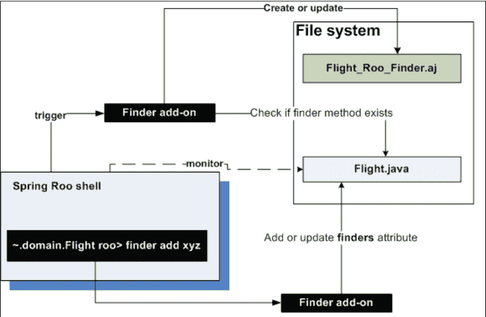
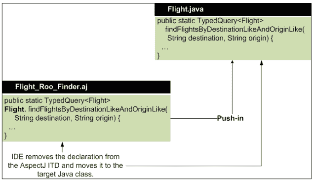
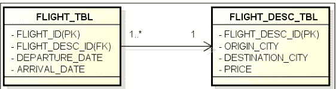
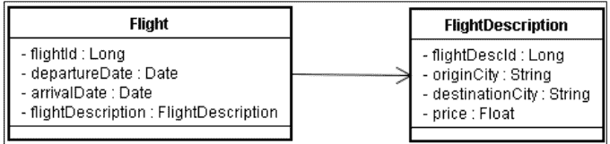
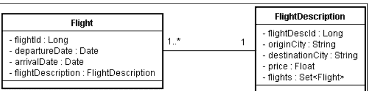
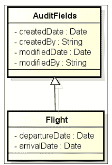
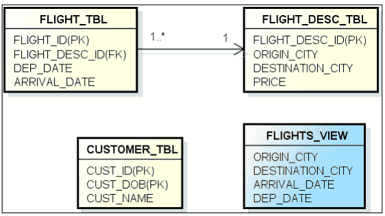
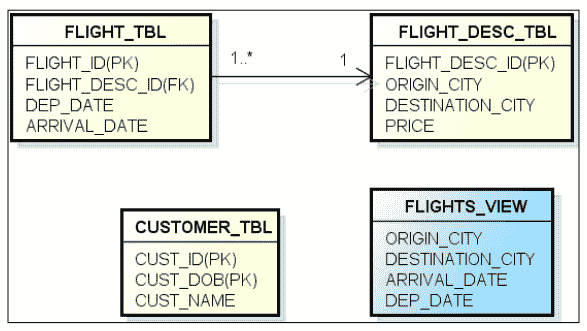

# 3 Spring Roo 中的高级 JPA 支持

在本章中，我们将涵盖以下内容：

- 查看候选动态查找器方法
- 向实体添加动态查找器方法
- 在实体之间创建多对一（或一对一）关系
- 在实体之间创建一对多（或多对多）关系
- 创建映射超类
- 自定义 Roo 生成的标识符定义
- 生成数据库元数据
- 从数据库创建实体

## 简介

在上一章中，我们了解了 Spring Roo 如何简化使用 JPA 进行持久化的企业应用程序的开发。在本章中，我们将继续讨论 JPA，并探讨允许我们添加动态查找器方法、在实体之间创建关系以及执行数据库反向工程以自动生成 JPA 实体的示例。

## 查看候选动态查找器方法

动态查找器方法是一种无需编写 JPA 查询的查找器方法。它根据实体类的一个或多个持久化字段从数据库中获取实例。当您将动态查找器方法的名称添加到持久化实体时，Roo 会自动生成这些方法的实现。由于 Roo 不会为应用程序创建 DAO 层，因此动态查找器方法定义在实体类中。在本示例中，我们将探讨 finder list 命令，该命令会内省持久化实体，并建议可以添加到给定持久化实体的可能动态查找器方法的名称。

### 准备工作

在 C:\roo-cookbook 目录内创建一个名为 ch03-recipes 的子目录。

执行 ch03_persistent_entities.roo 脚本以创建 flight-app Roo 项目。该脚本将 Hibernate 设置为持久化提供程序，并创建一个 Flight 实体，该实体将 FlightKey 作为其复合主键类。此外，该脚本还会向 Flight 和 FlightKey 类添加字段。如果您使用的数据库不是 MySQL，或您的连接设置与脚本中指定的不同，请相应地修改脚本。

从 C:\roo-cookbook\ch03-recipes 目录启动 Roo shell。

### 操作步骤...

要使用 finder list 命令查看动态查找器方法，请按照以下步骤操作：

- 1. 使用 focus 命令将后续命令的焦点设置在 Flight 实体上：
  ```
  roo> focus --class ~.domain.Flight
  ```

- 2. 执行 finder list 命令以查看 Flight 实体的候选动态查找器方法列表，如下所示：
  ```
  ~.domain.Flight roo> finder list
  .....
  findFlightsByCreatedDateBetween(Date minCreatedDate, Date maxCreatedDate)
  findFlightsByCreatedDateGreaterThan(Date createdDate)
  .....
  findFlightsByDestination(String destination)
  findFlightsByDestinationEquals(String destination)
  findFlightsByDestinationIsNotNull()
  findFlightsByDestinationIsNull()
  findFlightsByDestinationLike(String destination)
  findFlightsByDestinationNotEquals(String destination)
  ```

### 工作原理...

finder list 命令显示实体的候选动态查找器方法名称。默认情况下，finder list 命令建议的动态查找器方法仅根据实体的一个持久化字段搜索实例。例如，在 finder list 命令的输出中，您不会找到一个动态查找器方法名称，该方法同时根据 createdDate 和 modifiedDate 字段查找 Flight 实体实例。如果实体继承自映射超类，则 Roo 也会显示与继承字段对应的动态查找器方法。

finder list 命令建议的动态查找器方法取决于字段的类型。例如，createdDate 是 java.util.Date 类型，可以参与大于、小于和范围比较；因此，findFlightsByCreatedDateBetween、findFlightsByCreatedDateGreaterThan 等显示为候选动态查找器方法，这些方法接受 createdDate 字段作为参数。另一方面，destination 字段是 String 类型，不参与大于、小于和范围比较；因此，Roo 不会建议基于 destination 字段的大于、小于和范围比较来查找 Flight 实例的动态查找器方法。

### 更多内容...

现在让我们来看看如何指示 Roo：

- 提供基于多个持久化字段获取实体的候选动态查找器方法列表
- 根据筛选条件限制建议的动态查找器方法名称

## 列出多个持久化字段的动态查找器方法

如果您希望 Roo 列出基于多个持久化字段获取实体的查找器方法名称，则应使用 finder list 命令的 depth 参数。depth 参数接受一个数值，该数值决定动态查找器方法用于在数据库中搜索实体的持久化字段数量。例如，如果您希望根据 origin 和 destination 字段两者来搜索 Flight 实例，则 depth 参数的值必须为 2。depth 参数的默认值为 1，因此，当我们执行 finder list 命令而未指定 depth 参数时，它列出了仅基于一个持久化字段获取实体的动态查找器方法名称。以下 finder list 命令展示了 depth 参数对建议的动态查找器方法名称列表的影响：

```
~.domain.Flight roo> finder list --depth 2
findFlightsByDestinationAndOrigin(String destination, String origin)
```


findFlightsByDestinationAndOriginEquals(String destination, String origin)
.....

正如输出所示，两个持久字段现在构成列出的候选动态查找器方法名称的一部分。同样，如果您希望查找器跨越多个持久字段，请将 n 指定为 depth 参数的值。

## 基于过滤条件限制动态查找器方法列表

随着 depth 参数值的增加，Roo 列出的候选动态查找器方法名称数量会因方法参数的可能组合而呈指数级增长。在这种情况下，需要根据过滤条件筛选候选动态查找器方法名称。finder list 命令提供一个 filter 参数，它接受一个逗号分隔的字符串列表，这些字符串必须出现在动态查找器方法名称中。不包含 filter 参数指定字符串的动态查找器方法名称将从显示的候选动态查找器方法名称列表中省略。这使您能够轻松定位想要添加到持久实体的动态查找器方法。

> 请注意，作为 filter 参数值指定的逗号分隔字符串列表中不应包含空格。

以下 finder list 命令展示了 filter 参数的用法：

```
~.domain.Flight roo> finder list --depth 2 --filter destinationlike,originlike
```

```
findFlightsByDestinationLikeAndOriginLike(...)
findFlightsByDestinationLikeOrOriginLike(...)
findFlightsByOriginLikeAndDestinationLike(...)
findFlightsByOriginLikeOrDestinationLike(...)
```

输出现在仅显示包含 filter 参数中指定文本的四个方法。同样，您可以向 filter 参数添加更多文本，以缩小 finder list 命令显示的候选动态查找器方法名称列表。

## 另请参阅

- 请参阅下方的“将动态查找器方法添加到实体”教程，了解 Spring Roo 如何简化将动态查找器方法添加到实体。

## 将动态查找器方法添加到实体

finder list 命令显示 Roo 可以自动生成其实现的候选动态查找器方法名称。在本教程中，我们将学习如何使用 finder add 命令将动态查找器方法添加到持久实体。作为示例，我们将向 Flight 实体添加 findFlightsByDestinationLikeAndOriginLike 方法。

### 准备工作

请参阅“查看候选动态查找器方法”教程，以创建 flight-app Roo 项目。

从 C:\\roo-cookbook\\ch03-recipes 目录启动 Roo shell。

### 具体操作...

要添加动态查找器方法，请按照给定步骤操作：

- 1. 使用 focus 命令将后续命令的焦点设置为 Flight 实体：
  
  roo> focus --class ~.domain.Flight

- 2. 使用 finder add 命令将 findFlightsByDestinationLikeAndOriginLike 动态查找器方法添加到 Flight 实体：
  
  roo> finder add findFlightsByDestinationLikeAndOriginLike
  
  Updated SRC_MAIN_JAVA\\sample\\roo\\flightapp\\domain\\Flight.java
  Created SRC_MAIN_JAVA\\sample\\roo\\flightapp\\domain\\Flight_Roo_Finder.aj

### 工作原理...

finder add 命令将动态查找器方法实现添加到持久实体。此功能省去了为查找器方法编写 JPA-QL 查询的工作。finder add 命令将查找器方法名称添加到 @RooEntity 注解的 finders 属性中（有关详细信息，请参阅第 2 章）。@RooEntity 注解中 finders 属性的存在将触发 *_Roo_Finder.aj ITD 文件的创建（如果实体中尚未存在该文件），并在 *_Roo_Finder.aj ITD 文件中自动生成查找器方法实现。 *_Roo_Finder.aj 将查找器方法实现添加到相应的 JPA 实体类中。

以下图展示了执行 finder add 命令时 Roo 如何将动态查找器方法添加到 JPA 实体中：



给出的图显示，当执行 `finder add xyz` 命令时，Roo 的 **查找器插件** 将 `xyz` 方法名称添加到 `Flight.java` 文件中 `@RooEntity` 注解的 `finders` 属性。由于 Spring Roo 会监视带有 Roo 注解的 Java 文件，Roo 使用查找器插件将 `xyz` 动态查找器方法实现添加到 `Flight_Roo_Finder.aj` 文件中。如果 `Flight_Roo_Finder.aj` 不存在，查找器插件将创建它。现在，如果您在 `Flight.java` 文件中定义了 `xyz` 方法（因为您可能希望自定义 Roo 生成的 `xyz` 方法的实现），查找器插件会将其从 `Flight_Roo_Finder.aj` 文件中删除。

执行 `finder add` 命令后，以下代码显示了 `Flight` 实体的修改后的 `@RooEntity` 注解：

```
@RooEntity(identifierType = FlightKey.class,
table = "FLIGHT_TBL",
finders = { "findFlightsByDestinationLikeAndOriginLike"})
public class Flight { ... }
```

以下代码显示了 `Flight_Roo_Finder.aj` 文件中 `findFlightsByDestinationLikeAndOriginLike` 查找器方法的自动生成实现：

```
import javax.persistence.EntityManager;
import javax.persistence.TypedQuery;
...
public static TypedQuery<Flight>
Flight.findFlightsByDestinationLikeAndOriginLike(
String destination, String origin)
{
if (destination == null || destination.length() == 0)
throw new IllegalArgumentException("The destination
argument is required");
...
if (origin == null || origin.length() == 0)
throw new IllegalArgumentException("The origin argument
is required");
...
EntityManager em = Flight.entityManager();
TypedQuery<Flight> q = em.createQuery("SELECT Flight FROM
Flight AS flight WHERE LOWER(flight.destination) LIKE
LOWER(:destination) AND LOWER(flight.origin) LIKE
LOWER(:origin)", Flight.class);
q.setParameter("destination", destination);
q.setParameter("origin", origin);
return q;
}
```

给出的代码显示以下内容：

- 查找器方法期望 `origin` 和 `destination` 参数都必须提供给查找器方法，否则会抛出异常。一般来说，Roo 生成的动态查找器方法实现要求传递给方法的参数不是 `null`。如果参数类型是 `String`，则动态查找器方法实现要求该参数不能是 `null` 或空白，如本代码所示。
- 查找器方法的 JPA-QL 是自动生成的。
- 查找器方法的返回类型是 `javax.persistence.TypedQuery<Flight>`。您可以从 Web 控制器类调用 `TypedQuery` 对象的 `getResultList` 方法来执行 `SELECT` 查询并获取结果。

### 更多内容...

现在让我们来看看如何将自定义查找器方法添加到实体、对动态查找器方法进行集成测试，以及使用 @RooEntity 注解触发动态查找器方法实现的自动生成：

## 添加自定义查找器方法

如果 Roo 提供的动态查找器方法无法满足您的应用程序要求，您可能需要添加自定义查找器方法。在这种情况下，您可以执行 Roo 生成的动态查找器方法的 push-in 重构，并在相应的持久实体 Java 类中修改其实现（而不是名称或签名）；也可以在持久实体 Java 类中定义该方法（这会导致该方法从 *_Roo_Finder.aj AspectJ ITD 中被删除）；或者您可以创建自己的 AspectJ ITD，将自定义查找器方法引入持久实体 Java 类中。

如果要更改动态查找器方法的实现，可以使用 push-in 重构，也可以在持久实体 Java 类中定义该方法。使用 push-in 重构或在持久实体 Java 类中定义方法的效果是相同的。在 push-in 重构中，您使用 IDE 将 AspectJ ITD 文件中的声明移动到目标 Java 类，然后对其进行修改。如果您决定在 Java 类本身中定义该方法，则可能会将 AspectJ ITD 中的方法复制粘贴到 Java 类，并让 Roo 从 AspectJ ITD 中删除该方法声明。

以下图展示了使用 push-in 重构将 AspectJ ITD 中的方法声明移动到目标 Java 类时发生的情况：



给出的图显示，当您对 findFlightsByDestinationLikeAndOriginLike 方法执行 push-in 重构时，IDE 会简单地将该方法从 AspectJ ITD 文件移动到目标 Flight.java 类。因此，如果您需要通过在 Flight.java 类中编写来自定义 findFlightsByDestinationLikeAndOriginLike 等方法，那么执行 push-in 重构或简单地将该方法从 AspectJ ITD 文件复制并粘贴到 Flight.java 类中（随后删除方法名前缀的 Flight.）会更加简单。如果您打算将所有 AspectJ ITD 中的所有声明移动到目标 Java 类中，那么从 AspectJ ITD 复制粘贴到目标 Java 类并不高效。这时 push-in 重构就非常有用，我们将在第 7 章“开发插件和从项目中移除 Roo”中看到。


如果要添加自定义查找器方法，且其名称或签名与 Roo 提供的动态查找器方法不同，则可以在持久实体 Java 类中定义该方法，也可以创建新的 AspectJ ITD 并在其中声明你的方法。这两种方法都可以，具体取决于你编写 AspectJ ITD 的熟悉程度。Roo 生成 AspectJ ITD，以便将横切关注点与 Java 类分离。因此，如果你觉得在持久实体 Java 类中编写查找器方法会污染该类，则应该考虑编写 AspectJ ITD。需要注意的是，你在项目中创建的自定义 AspectJ ITD 不由 Roo 管理。

以下代码展示了 Flight_MyCustom_Finder.aj AspectJ ITD 的示例，它将 searchFlights(SearchCriteria criteria) 查找器方法引入 Flight.java 中：

```
import javax.persistence.EntityManager;
import javax.persistence.TypedQuery;

privileged aspect Flight_MyCustom_Finder {

    public static TypedQuery<Flight> Flight.searchFlight (
            SearchCriteria criteria) {
        EntityManager em = Flight.entityManager();
        TypedQuery<Flight> q = em.createQuery("SELECT Flight ..",
                Flight.class);
        q.setParameter("destination", criteria.getDestination());
        q.setParameter("origin", criteria.getOrigin());
        return q;
    }

}
```

如给定代码所示，你可以创建自己的 AspectJ ITD 并向 JPA 实体添加自定义查找器方法。由于自定义 AspectJ ITD 不由 Roo 管理，如果在 Flight.java 类中创建 searchFlight 方法，Roo 不会从 Flight_MyCustom_Finder.aj 文件中将其移除。

## 动态查找器方法的集成测试

Roo 不会为自动生成的动态查找器方法创建集成测试。要测试查找器方法，请在持久实体对应的 *IntegrationTest.java 文件中编写测试方法。

## 通过 @RooEntity 注释添加动态查找器

@RooEntity 注释接受 finders 属性，该属性包含字符串值数组，用于标识必须为持久实体生成的动态查找器方法名称。finders add 命令将查找器方法名称添加到 finders 属性中，从而导致 Roo 生成动态查找器方法。由于将查找器方法名称添加到 finders 属性会触发动态查找器方法实现的生成，因此不使用 finder add 命令，你可以直接使用 IDE 将查找器方法名称添加到 finders 属性中，这将触发 Roo 生成查找器方法实现。

## 另请参阅

- 请参阅第 2 章（使用 JPA 持久化对象）中“控制持久实体自动生成的方法”配方，了解 @RooEntity 注释支持的更多元素
- 请参阅“查看候选动态查找器方法”配方，了解如何使用 finder list 命令显示候选动态查找器方法的名称

## 在实体之间创建多对一（或一对一）关系

在实际应用中，域实体之间存在关系。在本节中，我们将探讨 Roo 如何简化在 JPA 实体之间创建多对一（或一对一）关系。

以下图示展示了 FLIGHT_TBL 和 FLIGHT_DESC_TBL 表之间的关系，我们将以此作为建模多对一关系的参考：



在给定的图中，FLIGHT_TBL 表包含计划航班详细信息，FLIGHT_DESC_TBL 表包含航空公司提供的所有航班详细信息。FLIGHT_TBL 表中的每条记录都指向恰好一条 FLIGHT_DESC_TBL 记录。由于一个城市到另一个城市可能有多个航班，因此 FLIGHT_TBL 和 FLIGHT_DESC_TBL 之间的关系是多对一。FLIGHT_TBL 表通过 FLIGHT_DESC_ID 外键映射到 FLIGHT_DESC_TBL 表。预期如果删除 FLIGHT_TBL 记录，则删除仅限于 FLIGHT_TBL。

以下图示展示了与 FLIGHT_TBL 和 FLIGHT_DESC_TBL 表对应的 JPA 实体：



在给定的图中，flightId 和 flightDescId 属性分别表示 Flight 和 FlightDescription JPA 实体的主键。

## 准备工作

退出 Roo shell，删除 C:\roo-cookbook\ch03-recipes 目录的内容。

从 C:\roo-cookbook\ch03-recipes 目录启动 Roo shell。

执行 ch03_jpa_setup.roo 脚本，该脚本创建 flight-app Roo 项目，将 Hibernate 设置为持久化提供程序，并将 MySQL 配置为应用程序的数据库。如果你使用的数据库不是 MySQL，或者连接设置与脚本中指定的不同，则相应地修改脚本。

## 操作步骤

要创建具有多对一关系的 Flight 和 FlightDescription JPA 实体，请执行以下步骤：

- 1. 创建与 FLIGHT_TBL 表对应的 Flight JPA 实体（包括集成测试）：
  ```
  roo> entity --class ~.domain.Flight --identifierColumn FLIGHT_ID
  --identifierField flightId --identifierType java.lang.Long
  --table FLIGHT_TBL --testAutomatically
  ```

- 2. 向 Flight 实体添加属性：
  ```
  roo> field date --type java.util.Date --fieldName departureDate --column DEPARTURE_DATE
  roo> field date --type java.util.Date --fieldName arrivalDate --column ARRIVAL_DATE
  ```

- 3. 创建与 FLIGHT_DESC_TBL 表对应的 FlightDescription 实体（包括集成测试）：
  ```
  roo> entity --class ~.domain.FlightDescription
  --identifierColumn FLIGHT_DESC_ID --identifierField flightDescId
  --identifierType java.lang.Long --table FLIGHT_DESC_TBL
  --testAutomatically
  ```

- 4. 向 FlightDescription 实体添加属性：
  ```
  roo> field string --fieldName origin --column ORIGIN_CITY --notNull
  roo> field string --fieldName destination --column DESTINATION_CITY --notNull
  roo> field number --type java.lang.Float --fieldName price --column PRICE --notNull
  ```

- 5. 将 Roo 命令的焦点设置到 Flight 实体，并使用 field reference 命令在 Flight 和 FlightDescription 实体之间创建多对一关系，如下所示：
  ```
  roo> focus --class ~.domain.Flight
  roo> field reference --fieldName flightDescription --type ~.domain.FlightDescription --joinColumnName FLIGHT_DESC_ID --notNull
  ```

## 工作原理

由于我们未为实体使用复合主键，在使用用于创建 Flight 和 FlightDescription 实体的实体命令时，你会注意到以下几点：

- identifierField：使用了一个可选参数，为实体的标识符字段指定自定义名称。例如，Flight 实体的标识符字段名为 flightId，FlightDescription 实体的标识符字段名为 flightDescId。如果未使用 identifierField 参数，则默认情况下 Roo 会将 id 分配为实体的标识符字段名。

- identifierColumn：使用了一个可选参数，用于设置标识符字段映射到的表列名称。该参数指示 Roo 向标识符字段添加 @Column JPA 注释。如果未指定 identifierColumn，默认情况下，映射列的名称是通过拆分驼峰命名并添加下划线作为分隔符来得出的。例如，如果为名为 myOwnIdField 的标识符字段未指定 identifierColumn 参数，则表列名默认为 my_own_id_field。在本配方的上下文中，identifierColumn 不会产生任何影响，因为从标识符字段名得出的表列名与 identifierColumn 参数指定的名称相同。


以下代码片段来自 `Flight.java` 文件，展示了在本示例中创建的 `Flight` 实体：

```
@RooJavaBean
@RooToString
@RooEntity(identifierField = "flightId", identifierColumn = "FLIGHT_ID", table = "FLIGHT_TBL")
public class Flight {
    ...
}
```

给定代码显示，`@RooEntity` 注解包含了我们在 entity 命令中为这些参数指定的值的 `identifierField`、`identifierColumn` 和 `table` 属性。如在 *第 2 章，使用 JPA 持久化对象* 中 *使用 JPA 创建持久化实体* 示例所述，`@RooEntity` 注解的元素用于生成相应的 `*_Roo_Entity.aj` AspectJ ITD。以下代码展示了在 `Flight_Roo_Entity.aj` AspectJ ITD 中定义的标识符字段：

```
privileged aspect Flight_Roo_Entity
{
    .....
    @Id
    @GeneratedValue(strategy = GenerationType.AUTO)
    @Column(name = "FLIGHT_ID")
    private Long Flight.flightId;
    .....
}
```

在此代码中，标识符字段带有 `@Column` 注解，因为 `@RooEntity` 注解中存在 `identifierColumn` 参数。标识符字段的名称 `flightId` 源自 `@RooEntity` 注解中 `identifierField` 参数的值。

现在，我们来看看 `field reference` 命令，该命令用于添加引用关系中另一个对象的属性。在下一个示例中，`field reference` 命令为 `Flight` 类添加了对 `FlightDescription` 对象的引用。由于 `field reference` 仅定义对相关对象的引用，您可以认为它定义了 *多对一* 关系中的 *多* 端。

`field reference` 命令与 `field other`（如 *第 1 章，Spring Roo 入门* 中 *为 Java 类添加属性* 示例所述）命令相似，因为这两个命令都用于定义对自定义 Java 对象的引用。唯一的区别在于，`field reference` 命令专门用于定义实体之间的 JPA 关系。以下来自 `Flight.java` 的代码展示了执行 `field reference` 命令后引入的代码：

```
@NotNull
@ManyToOne
@JoinColumn(name = "FLIGHT_DESC_ID")
private FlightDescription flightDescription;
```

从给定代码可以看出，field reference 命令已在 Flight 和 FlightDescription 实体之间添加了多对一 JPA 关系。

下表描述了可以传递给 field reference 命令的参数：

| 参数 | 描述 |
|---|---|
| fieldName (必填) | 引用相关实体的属性名称。在我们的示例中，flightDescription 是属性的名称。 |
| type (必填) | 相关实体的类型。在我们的示例中，FlightDescription 是相关实体的类型。 |
| joinColumnName | 作为相关实体 *外键* 的列。在我们的示例中，FLIGHT_DESC_ID 是 FLIGHT_TBL（由 Flight JPA 实体表示）中的列，它充当指向 FLIGHT_DESCRIPTION_TBL 表（由 FlightDescription JPA 实体表示）的外键。 |
| cardinality | JPA 实体之间关系的基数。默认情况下，基数为 MANY_TO_ONE。如果要创建一对一关系，则将 cardinality 参数的值指定为 ONE_TO_ONE。 |
| fetch | 相关实体的 JPA 获取策略。可能的值为 EAGER 和 LAZY。*获取* 参数的值转换为 @ManyToOne 或 @OneToOne 注解中 *获取* 元素的值。 |
| referencedColumnName | 标识此连接列关联到的相关实体表中的列。此参数的值用作 @JoinColumn JPA 注解中 *引用列名* 属性的值。 |

> 尽管 Roo shell 将 MANY_TO_ONE、MANY_TO_MANY、ONE_TO_MANY 和 ONE_TO_ONE 显示为 field reference 命令中 cardinality 参数的可能值，但它只接受 MANY_TO_ONE 和 ONE_TO_ONE。这样做的原因是，field reference 仅在一对一关系或实体位于多对一关系的多一端时才有意义。

## 更多内容...

### 测试参与关系的 JPA 实体

测试参与关系的实体有时会变得棘手，因为集成测试可能无法检查关系约束。例如，FlightDescriptionIntegrationTest 的 testRemove 方法（请参阅 FlightDescriptionIntegrationTest_Roo_IntegrationTest.aj AspectJ ITD）不测试一个或多个 Flight 实体实例与正在移除的 FlightDescription 实例相关联的场景。

要有效地测试参与关系的实体，您可能需要修改自动生成的测试方法和按需数据类。例如，在我们的示例场景中，FlightDescription 的按需数据类（请参阅在 FlightDescriptionDataOnDemand_Roo_DataOnDemand.aj AspectJ ITD 中定义的 getNewTransientFlightDescription 方法）仅创建 FlightDescription 实例，而不创建任何关联的 Flight 实例。因此，testRemove 方法将永远无法测试一个或多个 Flight 实例与正在移除的 FlightDescription 实例相关联的场景。因此，要对 FlightDescription 实例进行有效测试，您需要执行以下操作：

- 在 FlightDescriptionDataOnDemand.java 类中定义 getNewTransientFlightDescription 方法，该方法创建与一个或多个 Flight 实例关联的 FlightDescription 对象
- 在 FlightDescriptionIntegrationTesting 类中定义 testRemove 方法，在尝试移除 FlightDescription 实例之前先移除所有相关的 Flight 实例

如果实体不相关，则按需数据类相互独立。但是，如果实体相关，则创建测试数据会变得有些复杂。例如，Flight 实体与 FlightDescription 具有多对一关系；这意味着 Flight 实体的按需数据类应在 FLIGHT_TBL 表中创建记录，这些记录对 FLIGHT_DESC_TBL 表记录具有外键引用。必须为 FLIGHT_TBL 表中的 Flight 记录分配外键引用，因为 FlightDescription 关系带有 @NotNull 注解。

现在问题在于，`Flight` 实体的按需数据类如何发现 `FlightDescription` 实例（这些实例由 `FlightDescriptionDataOnDemand_Roo_DataOnDemand.aj` AspectJ ITD 的 `getNewTransientFlightDescription` 方法在 `FLIGHT_DESC_TBL` 表中创建），以便 `FLIGHT_TBL` 中的 `Flight` 实例（由 `FlightDataOnDemand_Roo_DataOnDemand.aj` AspectJ ITD 的 `getNewTransientFlight` 方法创建）可以指定对 `FlightDescription` 实例的外键引用？很简单！可以通过使用 `FlightDescription` 实体的按需数据类来实现，因为它维护了在 `FLIGHT_DESC_TBL` 表中创建的记录列表。Spring Roo 在生成按需数据类时正是如此——它在相关实体的按需数据类之间创建依赖关系以创建测试数据。

以下来自 `FlightDataOnDemand_Roo_DataOnDemand.aj` 文件的代码展示了 `Flight` 按需数据类：

```
privileged aspect FlightDataOnDemand_Roo_DataOnDemand
{
    ...

    @Autowired
    private FlightDescriptionDataOnDemand flightDescriptionDataOnDemand;

    public Flight getNewTransientFlight(int index)
    {
        sample.roo.flightapp.domain.Flight obj =
            new sample.roo.flightapp.domain.Flight();

        obj.setArrivalDate(obj, index);
        obj.setDepartureDate(obj, index);
        obj.setFlightDescription(obj, index);
        return obj;
    }

    private void setFlightDescription(Flight obj, int index) {
        sample.roo.flightapp.domain.FlightDescription flightDescription = flightDescriptionDataOnDemand.getRandomFlightDescription();
        obj.setFlightDescription(flightDescription);
    }

    ...
}
```


> 在给定的代码中，`FlightDescriptionDataOnDemand` 对象被自动注入到 `FlightDataOnDemand` 对象中。由于 `Flight` 实体与 `FlightDescription` 实体具有多对一关系，`Flight` 实体的按需数据类使用 `FlightDescription` 的按需数据类来获取现有 `FlightDescription` 实例的引用，并将其设置在 `Flight` 实例中。这确保了在多对一关系的集成测试期间创建的测试数据与相关实体之间存在的关系一致。

需要注意的是，`@NotNull` 和 `@ManyToOne(..., optional=false)` 具有相同的含义。可以通过使用 `@NotNull`（JSR 303：Bean Validation 注解）或将 `@ManyToOne` JPA 注解的 `optional` 元素的值指定为 `false`，来指定实体之间必须存在关系。在这两种情况下，实体的按需数据类都将确保使用相关实体的按需数据类，对集成测试中创建的测试数据强制执行外键约束。

### 多对一关系字段的动态查找器方法

与其他持久字段一样，你可以使用 `finder list` 和 `finder add` 命令来查看和添加与关系字段对应的查找器方法。例如，如果针对 `Flight` 实体执行 `finder list` 命令，则其中一个查找器是针对 `flightDescription` 关系字段的，如下所示：

```
~.domain.Flight roo> finder list
```

```
..
```

```
findFlightsByFlightDescription(FlightDescription flightDescription)
```

此外，你可以使用 `finder list` 命令的 `depth` 参数，查看基于实体的关系字段和其他持久字段的动态查找器方法。

### 另请参阅

- 后续的“在实体之间创建一对多（或多对多）关系”示例

## 在实体之间创建一对多（或多对多）关系

在上一个示例中，我们了解了如何使用 `field reference` 命令在实体之间建立多对一（或一对一）关系。在本示例中，我们将扩展相同的示例，展示如何使用 `field set` 命令创建一对多（或多对多）关系。以下类图显示了 `FlightDescription` 和 `Flight` 实体之间的一对多关系：



在给定的图中，你会注意到我们已将类型为 `Set<Flight>` 的 `flights` 字段添加到 `FlightDescription` 实体，反映了 `FlightDescription` 和 `Flight` 实体之间的一对多关系。

### 准备工作

退出 Roo shell 并删除 `C:\roo-cookbook\ch03-recipes` 目录的内容。

从 `C:\roo-cookbook\ch03-recipes` 目录启动 Roo shell。

执行 `ch03_relationship_many_to_one.roo` 脚本，该脚本将创建 `flight-app` Roo 项目，设置 Hibernate 作为持久化提供程序，将 MySQL 配置为应用程序的数据库，创建 `Flight` 和 `FlightDescription` JPA 实体，并定义 `Flight` 和 `FlightDescription` 实体之间的多对一关系。如果你使用的数据库不是 MySQL 或你的连接设置与脚本中指定的不同，则相应地修改脚本。

### 操作步骤

要在 `FlightDescription` 和 `Flight` 实体之间创建一对多（或多对多）关系，请按照此处给出的步骤操作：

- 1. 将 Roo 命令的焦点设置在 `FlightDescription` 实体上：

```
.. roo> focus --class ~.domain.FlightDescription
```

- 2. 使用 field set 命令在 FlightDescription 和 Flight 实体之间创建一对多关系：

```
~.domain.FlightDescription roo> field set --fieldName flights --type ~.domain.Flight --cardinality ONE_TO_MANY --mappedBy flightDescription
```

### 工作原理

field set 命令用于在实体内创建一对多 JPA 关系的多方。如果两个实体之间的关系是多对多，则 field set 命令用于关系中的两个实体。以下表格描述了可以为 field set 命令指定的一些重要参数：

| 参数 | 说明 |
| :--- | :--- |
| fieldName (必填) | 要添加到实体的关系字段的名称。该字段的类型为 `java.util.Set`。在我们的示例中，fieldName 参数指定为 `flights`，这会在 `FlightDescription` 实体中添加一个名为 `flights` 的字段。 |
| type (必填) | 标识 fieldName 参数所定义的 Set 中包含的相关实体（即一对多关系中多方）的类型。在我们的示例中，type 值指定为 `~.domain.Flight`，这意味着 Set（由 fieldName 参数定义）包含类型为 `Flight` 的元素，如下所示：`private Set<Flight> flights = new HashSet<Flight>()`； |
| mappedBy | mappedBy 参数的值指的是关系的所有者。它转换为 JPA `@OneToMany` 或 `@ManyToMany` 注解的 mappedBy 元素的值。在我们的示例中，mappedBy 参数的值是 `flightDescription`；因此，field set 命令创建的 `flights` 字段带有 `@OneToMany` 注解，其 mappedBy 属性值为 `flightDescription`。 |
| cardinality | JPA 实体之间关系的基数。默认情况下，基数为 `MANY_TO_MANY`。由于我们希望在 `FlightDescription` 和 `Flight` 实体之间创建一对多关系，因此 cardinality 参数的值指定为 `ONE_TO_MANY`。 |
| fetch | 相关实体的 JPA 获取策略。可能的值为 `EAGER` 和 `LAZY`。fetch 参数的值转换为 `@ManyToMany` 或 `@OneToMany` 注解的 fetch 元素的值。 |

> 尽管 Roo shell 将 `MANY_TO_ONE`、`MANY_TO_MANY`、`ONE_TO_MANY` 和 `ONE_TO_ONE` 显示为 field set 命令的 cardinality 参数的可能值，但它仅接受 `MANY_TO_MANY` 和 `ONE_TO_MANY`。原因是：field set 仅在多对多关系的情况或实体位于一对多关系的一方时才有意义。

在 `FlightDescription` 实体上执行 field set 命令后，会向其添加以下字段：

```
@OneToMany(cascade = CascadeType.ALL,
       mappedBy="flightDescription")
private Set<Flight> flights = new HashSet<Flight>() ;
```

给定的代码显示，field set 命令只是向实体添加一个关系字段。

### 更多内容

field set 和 field reference 命令不提供指定应用于相关实体的级联效果的选项。命令的行为如下所述：

- 使用 field set 命令创建的带有 `@ManyToMany` 或 `@OneToMany` 注解的 JPA 关系字段，其 cascade 元素的值为 `CascadeType.ALL`，这意味着 refresh、persist、merge 等实体操作会被传播到相关实体。
- 使用 field reference 命令创建的带有 `@ManyToOne` 和 `@OneToOne` 注解的 JPA 关系字段未指定 cascade 元素，这意味着 refresh、persist、merge 等实体操作不会被传播到关联实体。

在需要指定级联效果的场景中，你可以修改 Java 源文件中的相应 JPA 注解。

### 另请参阅

- 请参阅“在实体之间创建多对一（或一对一）关系”示例，了解如何使用 field reference 命令来创建多对一（或一对一）关系

## 创建映射超类

在本示例中，我们将了解如何创建继承 *映射超类* 的实体。映射超类的字段存储到继承实体所映射的表中。映射超类本身 *不* 映射到任何表。在本示例中，我们将创建 *Flight* 实体，它扩展 *AuditFields* 类。*AuditFields* 类代表一个 *映射超类*；*AuditFields* 的字段存储到 *Flight* 实体所映射的表中。

以下图显示了 *Flight* 实体与 *AuditFields* 映射超类之间的关系：



### 准备工作

退出 Roo shell 并删除 `C:\roo-cookbook\ch03-recipes` 目录的内容。

从 `C:\roo-cookbook\ch03-recipes` 目录启动 Roo shell。

执行 `ch03_jpa_setup.roo` 脚本，该脚本将创建 *flight-app* Roo 项目，设置 Hibernate 作为持久化提供程序，并将 MySQL 配置为应用程序的数据库。如果你使用的数据库不是 MySQL 或你的连接设置与脚本中指定的不同，则相应地修改脚本。

### 操作步骤

要创建继承 *映射超类* 的实体，请按照给定步骤操作：

- 1. 使用 `entity` 命令创建 *AuditFields* 类并向其添加字段：

```
.. roo> entity --class ~.domain.AuditFields --mappedSuperclass
```


~.domain.AuditFields roo> field date --type java.util.Date --fieldName createdDate
~.domain.AuditFields roo> field date --type java.util.Date --fieldName modifiedDate
~.domain.AuditFields roo> field string --fieldName createdBy
~.domain.AuditFields roo> field string --fieldName modifiedBy

- 2. 使用 entity 命令创建 Flight 实体并向其添加字段：

```
.. roo> entity --class ~.domain.Flight --extends ~.domain.AuditFields --table FLIGHT_TBL
~.domain.Flight roo> field date --type java.util.Date --fieldName departureDate --column DEPARTURE_DATE
~.domain.Flight roo> field date --type java.util.Date --fieldName arrivalDate --column ARRIVAL_DATE
```

## 工作原理...

entity 命令的 mappedSuperclass 参数负责创建映射超类。它是一个标志类型参数；如果存在，表示生成的类必须使用 @MappedSuperclass JPA 注解进行标注。以下代码显示了由 entity 命令生成的 AuditFields 映射超类的相关注解：

```java
@RooJavaBean
@RooToString
@RooEntity(mappedSuperclass = true)
public class AuditFields { ... }
```

如本代码所示，AuditFields 类使用了 @RooEntity 注解。如前所述，@RooEntity 注解会触发 Roo 为 AuditFields 类生成对应的 *_Roo_Entity.aj AspectJ ITD 文件。@RooEntity 注解的 mappedSuperclass 属性指示 Roo 在相应的 *_Roo_Entity.aj 中添加一条声明，使用 @MappedSuperclass 注解（而非 @Entity JPA 注解）来标注 AuditFields 类。

当实体类继承映射超类时，Roo 会生成对应映射超类的 *_Roo_Entity.aj AspectJ ITD 文件，并定义一个标识字段（使用 @Id JPA 注解标注），以及 persist、merge、refresh 等方法（我们在第 2 章的“创建持久化实体”示例中见过）。在这种情况下，继承实体的 *_Roo_Entity.aj 文件仅定义该实体的静态计数和查找方法。

以下代码清单显示了 AuditFields_Roo_Entity.aj 文件：

```java
privileged aspect AuditFields_Roo_Entity
{
    declare @type: AuditFields: @MappedSuperclass;
    @PersistenceContext
    transient EntityManager AuditFields.entityManager;
    @Id
    @GeneratedValue(strategy = GenerationType.AUTO)
    @Column(name = "id")
    private Long AuditFields.id;
    @Version
    @Column(name = "version")
    private Integer AuditFields.version;
    @Transactional
    public void AuditFields.persist()
    {
        if (this.entityManager == null)
        this.entityManager = entityManager();
        this.entityManager.persist(this);
    }
    @Transactional
    public void AuditFields.remove() {...}
    public static final EntityManager
    AuditFields.entityManager() {...}
    ...
}
```

给定代码表明，AuditFields_Roo_Entity.aj ITD 使用 @MappedSuperclass 注解标注 AuditFields 类。同时，请注意 ITD 未使用 @Entity 和 @Table 注解标注 AuditFields 类。此代码表明，映射超类的 *_Roo_Entity.aj ITD 与实体的相同——包含标识和版本定义、persist、remove 等方法，以及获取 JPA EntityManager 实例的方法。

由于 Flight 实体继承自 AuditFields 类，Roo 生成的 Flight_Roo_Entity.aj ITD 不包含标识和版本定义，也不包含用于持久化、刷新和合并 Flight 实体的持久化方法，如以下代码清单所示：

```java
privileged aspect Flight_Roo_Entity
{
    declare @type: Flight: @Entity;
    declare @type: Flight: @Table(name = "FLIGHT_TBL");
    public static long Flight.countFlights () {...}
    public static List<Flight> Flight.findAllFlights () {...}
    public static Flight Flight.findFlight(Long id) {...}
    public static List<Flight> Flight.findFlightEntries (
        int firstResult, int maxResults) {...}
}
```

给定代码表明，Flight 实体仅包含查找和计数方法，并从 AuditFields 映射超类继承标识、版本定义以及持久化相关方法。与任何其他 JPA 实体一样，ITD 使用 @Entity 和 @Table 注解标注 Flight 类。

## 更多内容...

尽管映射超类包含标识定义，但您可以通过使用 @AttributeOverride 或 @AttributeOverrides JPA 注解在继承实体中对其进行覆盖。以下代码展示了 Flight 实体如何覆盖 AuditFields 类中的标识定义，以将标识字段映射到 FLIGHT_TBL 表的 FLT_ID 列：

```java
@RooJavaBean
@RooToString
@RooEntity(table="FLIGHT_TBL")
@AttributeOverride(name="id", column=@Column(name="FLT_ID"))
public class Flight extends AuditFields {..}
```

## 创建标注 @Embeddable 的类

在上一示例中，我们了解到 Flight 实体继承了 AuditFields 映射超类。您本可以将 Flight 实体建模为直接包含 AuditFields 实例，而不是继承它。为此，您需要创建一个使用 @Embeddable JPA 注解标注的 AuditFields 类，在 Flight 实体中定义对 AuditFields 类的引用，并使用 @Embedded JPA 注解标注引用字段。让我们看看如何在 Roo 中完成此操作：

- 1. 使用 entity 命令创建 AuditFields 类并向其添加字段，如下所示：

```
.. roo> embeddable --class ~.domain.AuditFields

~.domain.AuditFields roo> field date --type java.util.Date --fieldName createdDate

~.domain.AuditFields roo> field date --type java.util.Date --fieldName modifiedDate

~.domain.AuditFields roo> field string --fieldName createdBy

~.domain.AuditFields roo> field string --fieldName modifiedBy
```

- 2. 使用 entity 命令创建 Flight 实体并向其添加字段，如下所示：

```
.. roo> entity --class ~.domain.Flight --table FLIGHT_TBL
~.domain.Flight roo> field date --type java.util.Date --fieldName departureDate --column DEPARTURE_DATE
~.domain.Flight roo> field date --type java.util.Date --fieldName arrivalDate --column ARRIVAL_DATE
```

- 3. 使用 field embedded 命令，将 AuditFields 定义为 Flight 实体中的嵌入对象，如下所示：

```
~.domain.Flight roo> field embedded --fieldName auditFields --type ~.domain.AuditFields
```

以下代码显示了由 embeddable 命令生成的 AuditFields 类：

```java
@RooJavaBean
@RooToString
@Embeddable
public class AuditFields
{
@Temporal(TemporalType.TIMESTAMP)
@DateTimeFormat(style = "S-")
private Date createdDate;
@Temporal(TemporalType.TIMESTAMP)
@DateTimeFormat(style = "S-")
private Date modifiedDate;
private String createdBy;
private String modifiedBy;
}
```

给定代码表明，AuditFields 类使用了 JPA @Embeddable 注解。它未使用 @RooEntity 注解，这意味着它不包含标识和版本定义，也不包含持久化相关方法。

以下代码显示了 Flight 实体：

```java
@RooJavaBean
@RooToString
@RooEntity(table = "FLIGHT_TBL")
public class Flight
{
...
@Embedded
private AuditFields auditFields;
}
```

此代码表明，Flight 实体包含对 AuditFields 类的引用。AuditFields 引用由 field embedded 命令添加，并使用 @Embedded JPA 注解标注。

如果您想覆盖 AuditFields 类中定义的字段映射，可以使用 @AttributeOverrides 和 @AttributeOverride JPA 注解。以下代码片段展示了如何在 Flight 实体中使用这些注解，将 AuditFields 类的 createdDate 和 modifiedDate 字段映射到 Flight 实体映射表的 C_DATE 和 M_DATE 列：

```java
@Embedded
@AttributeOverrides({
    @AttributeOverride(name="createdDate",
        column=@Column(name="C_DATE")) ,
    @AttributeOverride(name="modifiedDate",
        column=@Column(name="M_DATE"))
})
private AuditFields auditFields;
```

## 另请参阅

- 参阅第 2 章“创建持久化实体”示例，了解如何创建不继承映射超类的持久化实体

## 自定义 Roo 生成的标识定义

迄今为止，我们已了解由 Spring Roo 生成 JPA 实体标识符的示例。默认情况下，Roo 创建的实体指定标识生成策略为 GenerationType.AUTO，这意味着持久化提供程序将为数据库选择合适的策略。您可能希望根据应用程序的要求自定义此标识生成策略。

在本示例中，我们将探讨如何修改 Roo 生成的标识定义，以使用数据库表生成标识符值。

## 准备工作

退出 Roo shell，删除 C:\roo-cookbook\ch03-recipes 目录的内容。

从 C:\roo-cookbook\ch03-recipes 目录启动 Roo shell。


执行 ch03_jpa_setup.roo 脚本，该脚本会创建 flight-app Roo 项目，将 Hibernate 设置为持久化提供程序，并将 MySQL 配置为应用程序的数据库。如果您使用的数据库不是 MySQL，或者连接设置与脚本中指定的不同，请相应地修改脚本。

现在，创建一个带有 Long 类型标识符字段的新 Flight 实体，如下所示：

```
roo> entity --class ~.domain.Flight --identifierColumn FLIGHT_ID
--identifierField flightId --identifierType java.lang.Long --table
FLIGHT_TBL
```

Flight_Roo_Entity.aj 文件中的以下代码显示了 Spring Roo 为 Flight 实体生成的标识符定义：

```
privileged aspect Flight_Roo_Entity
{
    ...

    @Id
    @GeneratedValue(strategy = GenerationType.AUTO)
    @Column(name = "FLIGHT_ID")
    private Long Flight.flightId;
    public Long Flight.getFlightId()
    {
        return this.flightId;
    }

    public void Flight.setFlightId(Long id)
    {
        this.flightId = id;
    }

    ...
}
```

现在，假设我们希望使用名为 ID_GENERATOR 的数据库表来生成 Flight 实体的标识符值。这意味着我们需要使用 @TableGenerator 注解 flightId 字段，并将标识符生成策略更改为 GenerationType.TABLE。

### 如何操作...

您可以通过在实体的 Java 源文件中（而不是在 *_Roo_Entity.aj 文件中）定义同名标识符，来覆盖 Roo 生成的标识符定义。以下代码显示了包含 flightId 标识符定义的修改后的 Flight.java 文件：

```
...
public class Flight
{
    ...
    @Id
    @TableGenerator(name = "Flight_Gen", table = "ID_GENERATOR",
    pkColumnName = "ID_COLUMN", valueColumnName = "ID_VALUE",
    pkColumnValue = "FLIGHT_ID_VALUE", initialValue = 10,
    allocationSize=100)
    @GeneratedValue(strategy = GenerationType.TABLE,
    generator = "Flight_Gen")
    private Long flightId;

    public Long getFlightId()
    {
    return this.flightId;
    }
    public void setFlightId(Long flightId)
    {
    this.flightId = flightId;
    }
    ...
    }
```

### 工作原理...

@TableGenerator JPA 注解指定了用于主键生成的表的详细信息。@GeneratedValue JPA 注解指定了用于生成主键值的策略。GenerationType.TABLE 表示 flightId 主键的值是从 @GeneratedValue 注解的 generator 元素所标识的数据库表中获取的。

当您在实体的 Java 源文件中定义标识符时，Roo 会自动从相应的 *_Roo_Entity.aj AspectJ ITD 文件中删除标识符定义。如果您现在检查 Flight_Roo_Entity.aj 文件，会发现 flightId 定义已从中删除。

### 更多内容...

Roo 的 entity 命令对创建不同类型的标识符定义提供了有限的支持。在大多数场景中，您可能会发现有必要通过在实体的 Java 源文件中定义实体标识符来自定义 Roo 生成的标识符定义。

### 另请参阅

- 请参阅第 2 章中的“创建持久化实体”配方，以了解有关使用 Spring Roo 创建 JPA 实体的更多信息。

## 生成数据库元数据

Roo 支持通过内省现有数据库来创建 JPA 实体。如果您希望 Roo 为现有数据库创建 JPA 实体，那么您可能想了解 Roo 用作输入以创建与数据库表对应的 JPA 实体的数据库元数据。在本配方中，我们将介绍 database introspect 命令，该命令允许我们以 XML 格式查看数据库元数据。在下一个配方“从数据库创建实体”中，我们将了解 Roo 如何使用此元数据来创建 JPA 实体。

以下图显示了我们将使用 database introspect 命令内省的数据库的表和视图：



在给定的图中，FLIGHT_TBL、FLIGHT_DESC_TBL 和 CUSTOMER_TBL 表示数据库表，而 FLIGHTS_VIEW 表示数据库视图。FLIGHT_TBL 和 FLIGHT_DESC_TBL 表之间的关系是多对一。CUSTOMER_TBL 使用复合主键（由 CUST_ID 和 CUST_DOB 列组成）来唯一标识客户。FLIGHTS_VIEW 数据库视图基于 FLIGHT_DESC_ID 列合并 FLIGHT_TBL 和 FLIGHT_DESC_TBL 表的数据。

### 准备工作

退出 Roo shell 并删除 C:\roo-cookbook\ch03-recipes 目录的内容。

从 C:\roo-cookbook\ch03-recipes 目录启动 Roo shell。

执行 ch03_jpa_setup.roo 脚本，该脚本会创建 flight-app Roo 项目，将 Hibernate 设置为持久化提供程序，并将 MySQL 配置为应用程序的数据库。如果您使用的数据库不是 MySQL，或者连接设置与脚本中指定的不同，请相应地修改脚本。

在 MySQL 数据库上执行 myflightappdb.sql SQL 脚本（随本书附带）。myflightappdb.sql 创建一个名为 myflightappdb 的数据库，包含 FLIGHT_TBL、FLIGHT_DESC_TBL 和 CUSTOMER_TBL 表以及 FLIGHT_VIEW 数据库视图，如本配方前面所示。请确保 Roo 项目的 database.properties 文件包含连接到此新创建的 myflightappdb 数据库的设置。

出于本配方的目的，我们将使用 database introspect 命令查看在 MySQL 数据库中创建的 myflightappdb 数据库的元数据。现在，您已准备好查看与 Roo 项目 database.properties 文件中配置的数据库相关的元数据。

### 如何操作...

要使用 database introspect 命令查看数据库元数据，请按以下步骤操作：

- 为即将内省的数据库启用驱动程序下载，请执行 download accept terms of use 命令，如下所示：

```
roo> download accept terms of use
```

已找到可能提供此 JDBC 驱动程序的外接程序
1 个已找到，按排名排序；T = 可信开发者；R = Roo 1.1 兼容

ID T R DESCRIPTION ----
01 Y Y 5.1.13.0001 #jdbcDriver driverclass:com.mysql.jdbc.Driver.
This...
--------------------------------------------
[提示] 使用 'addon info id --searchResultId ..' 查看搜索结果的详细信息
[提示] 使用 'addon install id --searchResultId ..' 安装特定的搜索结果，或
[提示] 使用 'addon install bundle --bundleSymbolicName TAB' 安装特定的外接程序版本

- 第一次执行 `database introspect` 命令时，会建议下载在 MySQL 中对 `myflightappdb` 数据库执行内省所需的数据库驱动程序。因此，请使用 `addon install` 命令下载建议的驱动程序，如下所示：

```
roo> addon install id --searchResultId 01
Target resource(s):
------------------
Spring Roo - Wrapping - mysql-connector-java (5.1.13.0001)
Deploying...done.

Successfully installed add-on: Spring Roo - Wrapping - mysql-connector-java [version: 5.1.13.0001]
```

- 重新执行 `database introspect` 命令，如下所示：

```
roo> database introspect --schema no-schema-required --file mydb.xml --enableViews
Database metadata written to file C:\roo-cookbook\ch03-recipes\mydb.xml
```

- 现在，打开生成的 `mydb.xml` 文件以查看数据库元数据。

### 工作原理...

`database introspect` 命令使用 Roo 项目 `database.properties` 文件中定义的连接属性来创建元数据信息。这意味着您不能使用 `database introspect` 命令同时内省多个数据库。该命令接受以下参数：

- `schema` **(必填)**: 您要内省的数据库架构。如果您希望 Roo 连接到数据库并提供可用架构列表，则在命令行中输入 `--schema` 参数后直接按 `TAB` 键即可。由于 MySQL 和 Firebird 等某些数据库不支持架构概念，因此在命令行中输入 `--schema` 参数后按 `TAB` 键会将 `schema` 参数的值替换为 `no-schema-required`。

- `file` **(可选)**: 您要保存数据库元数据的文件。如果您未指定此参数，元数据将直接在 Roo 控制台中显示。

- `enableViews` **(可选)**: 一个标志，用于指示是否在生成的元数据中包含数据库视图。默认情况下，生成的元数据不包含数据库视图。


数据库 introspect 命令的输出是一个 XML 文件（假设指定了文件参数），其中包含数据库表的详细信息，包括字段及其类型、主键、外键等。如果指定 enableViews 参数，生成的元数据还包括数据库视图。

以下 XML 片段显示了数据库元数据在 mydb.xml 文件中的呈现方式：

```xml
<database name="no-schema-required">
    <table name="customer_tbl">
        <column name="cust_id" primaryKey="true"
                required="true" scale="0" size="10" type="4,INT"/>
        ...
        <unique name="PRIMARY">
            <unique-column name="cust_id"/>
            <unique-column name="cust_dob"/>
        </unique>
    </table>
    <table name="flight_desc_tbl">
        <column name="flight_desc_id" primaryKey="true"
                required="true" scale="0" size="19" type="-5,BIGINT"/>
        ...
        <foreign-key foreignTable="flight_tbl"
                name="FKT7E26BB6F365DD59" onDelete="none"
                onUpdate="none">
            <option key="exported" value="true"/>
            <reference foreign="flight_desc_id"
                    local="flight_desc_id"/>
        </foreign-key>
        <unique name="PRIMARY">
            <unique-column name="flight_desc_id"/>
        </unique>
    </table>
    <table name="flight_tbl">
        ...
    </table>
    <table name="flights_view">
        <column name="origin_city" primaryKey="false"
                required="true" scale="0" size="255" type="12,VARCHAR"/>
        ...
    </table>
</database>
```

以下表格描述了给定 XML 中元素的含义：

| XML 元素 | 描述 |
| :--- | :--- |
| `<table>` | 描述数据库表或数据库视图。`name` 属性指定 `<table>` 元素所描述的表或视图的名称。 |
| `<column>` | `<table>` 的子元素 `<column>` 描述数据库表或视图中列的详细信息。`name` 属性标识列名。`primaryKey` 属性指示该列是否为表或视图的主键之一。 |
| `<foreignKey>` | 指定表的导入或导出外键的详细信息。`foreignTable` 属性指定包含导入或导出外键的表的名称。`<option>` 子元素指定外键是由表导入还是导出。`<reference>` 子元素指定外键列以及导入或导出外键映射到的本地列。 |
| `<unique>` | 描述适用于表或视图的唯一约束。如果 `name` 属性值为 `PRIMARY`，则表示唯一约束描述表的主键。 |

## 还有更多...

Roo 生成的元数据用于生成 JPA 实体，如我们将在 *从数据库创建实体* 配方中所见。如果找不到 `META-INF/spring/database.properties` 文件或 `database.properties` 中定义的连接属性不正确，则使用 `database introspect` 命令时可能会报告错误。以下表格显示了 `database introspect` 可能报告的错误消息及相应的解决方案：

| 错误消息 | 解决方案 |
| :--- | :--- |
| Connection properties must not be null or empty | 表示在 `META-INF/spring` 文件夹中找不到 `database.properties` 文件 |
| Unable to get connection from driver | 表示找到了 `database.properties` 文件，但它未正确定义连接属性。检查用户名、密码和其他连接属性是否指定正确。 |

> **测试数据库连接**
> 
> 由于 `database introspect` 命令连接到数据库以生成元数据，您也可以在执行 `persistenceXsetup` 命令后使用此命令来验证数据库连接。

- **另请参阅**
- * 参阅《从数据库创建实体》配方，了解数据库元数据如何用于自动生成 JPA 实体

## 从数据库创建实体

在许多应用程序开发场景中，应用程序需要针对现有数据库进行设计，或者应用程序开发在数据库创建后开始。为支持此类场景，Roo 提供了 `database reverse engineer` 命令，用于从数据库元数据自动生成 JPA 实体。如我们将在本配方后面看到的，Roo 提供了 `incremental` 数据库逆向工程，也就是说，每当数据库发生更改时，您都可以执行 `database reverse engineer` 命令，并让 Roo 根据数据库中的更改更新 JPA 实体定义。

以下图显示了我们将使用 `database reverse engineer` 命令逆向工程的数据库中的表：



## 准备工作

参阅“生成数据库元数据”配方，以创建 Roo 项目，在 MySQL 中创建 myflightappdb 数据库、表和视图，并安装 MySQL 的 JDBC 驱动程序。

## 操作步骤

要从数据库创建实体，请执行如下所示的 `database reverse engineer` 命令：

```
.. roo> database reverse engineer --package ~.domain.entity.autogen
--schema no-schema-required --enableViews --testAutomatically

Created SRC_MAIN_RESOURCES\dbre.xml
Updated SRC_MAIN_RESOURCES\META-INF\persistence.xml

Created ..\domain\entity\autogen\FlightDescTbl.java
...
Created ..\domain\entity\autogen\CustomerTbl.java
Created ..\domain\entity\autogen\CustomerTblPK_Roo_Identifier.aj
Created ..\domain\entity\autogen\CustomerTblPK.java
...
Created ..\domain\entity\autogen\FlightTbl.java
Created ..\domain\entity\autogen\FlightTbl_Roo_Entity.aj
Created ..\domain\entity\autogen\FlightTbl_Roo_DbManaged.aj
Created ..\domain\entity\autogen\FlightTbl_Roo_Configurable.aj
Created ..\domain\entity\autogen\FlightTbl_Roo_ToString.aj
...
Created ..\domain\entity\autogen\FlightsView.java
Created ..\domain\entity\autogen\FlightsViewPK.java
Created ..\domain\entity\autogen\FlightsViewPK_Roo_Identifier.aj
...
```

从输出中可见，JPA 实体由 Spring Roo 自动生成。

## 工作原理

`database reverse engineer` 命令接受以下参数：

- package: 这是一个 _可选_ 参数，指定 Roo 创建 JPA 实体的包。如果未指定此属性，JPA 实体将在 Roo 项目的顶级包中创建。

- schema: 这是一个 _强制_ 参数，用于指定数据库架构名称。由于 MySQL 和 Firebird 等一些数据库不支持架构概念，因此在命令行中输入 `--schema` 后按 `TAB` 键会将 `no-schema-required` 替换为 `schema` 参数的值。

- testAutomatically: 这是一个可选参数，指示 Roo 为通过数据库逆向工程命令创建的 JPA 实体创建集成测试。

- enableViews: 这是一个可选参数，指示 Roo 在逆向工程数据库表的同时逆向工程数据库视图。如果指定，Roo 会为每个数据库视图创建相应的 JPA 实体。

- includeTables: 这是一个可选参数，指定 Roo 为其创建 JPA 实体的表。默认情况下，Roo 会为数据库中的所有表创建相应的 JPA 实体。includeTables 参数的值指定用双引号括起来的空格分隔的表列表，如下所示：

  .. roo> database reverse engineer --schema no-schema-required
  --includeTables "FLIGHT_TBL FLIGHT_DESC_TBL"

- excludeTables: 这是一个可选参数，指定 Roo 不得为其创建 JPA 实体的表。excludeTables 参数的值指定用双引号括起来的空格分隔的表列表，如下所示：

  .. roo> database reverse engineer --schema no-schema-required
  --excludeTables "FLIGHT_TBL FLIGHT_DESC_TBL"

现在让我们看看执行数据库逆向工程命令时发生的一些有趣的事情：

- 在 Roo 项目的 SRC_MAIN_RESOURCES 目录中生成 dbre.xml 文件。该文件包含 XML 格式的数据库元数据，如“生成数据库元数据”配方中所述。

- 数据库中的每个表和视图都会生成相应的 Java 类。Java 源文件的名称为 <table-name>.java，其中 table-name 是数据库表的名称（采用驼峰命名法，并删除表名中的下划线）。每个 Java 类都代表与数据库表或视图相对应的 JPA 实体。

- 更新 META-INF/persistence.xml 文件。Roo 会修改（如果您使用 Hibernate 作为 JPA 提供程序）属性 hibernate.hbm2ddl.auto 的值，将其从 create 改为 validate，以便在创建 Hibernate SessionFactory 时不会修改数据库。这是有道理的，因为应用程序中的 JPA 实体是从数据库创建的，而不是反之。

- 为 Roo 创建的每个 JPA 实体创建一个相应的 *.Roo_Db_Managed.aj ITD 文件。它定义了从数据库元数据派生的 JPA 实体的字段和关系。由于此 ITD 文件包含字段和关系信息，如果多次逆向工程数据库，则与数据库相关的更改将限制在此 ITD 文件中，从而使 Roo 应用程序能够实现增量数据库逆向工程。


- 如果数据库表的主键由多个列组成，Roo 会创建一个复合主键类和一个 *_Roo_Identifier.aj AspectJ ITD。例如，对于 CUSTOMER_TBL，Roo 会生成 CustomerTblPK.java 和 CustomerTblPK_Roo_Identifier.aj AspectJ ITD 文件。

- 如果数据库表或视图未定义主键，Roo 会创建一个由数据库表或视图中的所有字段组成的复合主键类。例如，FLIGHTS_VIEW 未定义主键；因此，Roo 会创建 FlightsViewPK.java 复合主键类。

以下代码显示了 FlightDescTbl_Roo_DbManaged.aj ITD，它对应 FLIGHT_DESC_TBL 表：

```java
privileged aspect FlightDescTbl_Roo_DbManaged
{
    @OneToMany(mappedBy = "flightDescId")
    private Set<FlightTbl> FlightDescTbl.flightTbls;
    @Column(name = "destination_city",
    columnDefinition = "VARCHAR" length = 255)
    @NotNull
    private String FlightDescTbl.destinationCity;
    @Column(name = "origin_city", length = 255)
    @NotNull
    private String FlightDescTbl.originCity;
    ...
}
```

给定的代码显示，*_Roo_DbManaged.aj AspectJ ITD 包含从数据库元数据派生的字段和关系信息。这与我们在先前示例中看到的情况不同，在那些示例中，JPA 字段和关系包含在 Java 源文件中，而不在 AspectJ ITD 文件中。另外，请注意 @NotNull JSR 303 注释的存在，它源于相应的数据库列定义为非空。

与其他 AspectJ ITD 一样，*_Roo_DbManaged.aj 的创建由 Roo 注释 @RooDbManaged 管理，如 FlightDescTbl.java 类所示：

```java
@RooJavaBean
@RooToString
@RooEntity(table = "flight_desc_tbl")
@RooDbManaged(automaticallyDelete = true)
public class FlightDescTbl {
}
```

在给定的代码中，@RooDbManaged 注释表示 FlightDescTbl 实体由 Roo 的数据库逆向工程过程管理。如本代码所示，FlightDescTbl 类为空且仅包含类级别注释。@RooDbManaged 注释控制 *_Roo_DbManaged.aj ITD 的创建。@RooDbManaged 注释的 automaticallyDelete 属性指定如果从数据库中删除表，是否应移除该实体。默认值为 true，这意味着如果你删除相应的数据库表然后执行数据库逆向工程命令，JPA 实体将从 Roo 项目中移除。

### 还有更多...

现在让我们看看如何为 Oracle 和 DB2 数据库安装 JDBC 驱动程序，覆盖由数据库逆向工程过程生成的 JPA 字段和关系，执行增量数据库逆向工程，以及 Roo 如何处理复合主键情况。

### 为 Oracle 和 DB2 安装 JDBC 驱动程序

Roo 的数据库逆向工程过程要求 JDBC 驱动程序作为 OSGi bundle 可用。Roo 提供了 addon create wrapper 命令，你可以使用它将 JDBC 驱动程序包装在 OSGi 合规的 bundle 中，以用于数据库逆向工程过程。Roo 为大多数 JDBC 驱动程序提供了 OSGi 合规的 bundle，可以通过 addon install 命令进行安装。由于 Oracle 和 DB2 没有开源的 JDBC 驱动程序，要对这些数据库使用 Roo 的数据库逆向工程过程，你首先需要将这些数据库的非 OSGi JDBC 驱动程序 JAR 文件转换为 OSGi 合规的 bundle。

在第 7 章中，我们将了解如何使用 addon create wrapper 命令将非 OSGi JDBC 驱动程序 JAR 或任何其他 Maven artifact 转换为 OSGi 合规的 bundle。

### 修改自动生成的 JPA 字段/关系

如果你想修改由数据库逆向工程过程生成的 JPA 字段和关系，请在 JPA 实体类本身中定义它们。你在 JPA 实体类中定义的字段和关系将由 Roo 从相应的 *_Roo_DbManaged.aj ITD 文件中自动移除。

> 如果你在实体类中定义所有 JPA 字段和关系，Roo 将自动删除相应的 *_Roo_DbManaged.aj ITD 文件。

### 增量数据库逆向工程

你可以在项目生命周期中使用数据库逆向工程过程。如果对数据库进行了修改，请执行 `database reverse engineer` 命令，而不使用 `schema` 和 `package` 参数。数据库逆向工程过程会更新 `dbre.xml` 文件，从而导致 JPA 实体及其字段和关系的添加、删除和修改。

`dbre.xml` 文件由 Roo 管理，但在修改数据库之前，你可以修改它，以查看对 Roo 生成的 JPA 实体的更改的影响。需要注意的是，当你重新执行 `database reverse engineer` 命令时，你对 `dbre.xml` 文件的自定义更改将被覆盖。

### 具有复合主键的数据库表

如果你的数据库表具有复合主键，则数据库逆向工程过程会负责创建一个主键类，该类通过 *_Roo_Identifier.aj ITD 被 JPA @Embeddable 注释标注。然后，主键类通过 *_Roo_Entity.aj ITD 引入 JPA 实体类，并被 JPA @EmbeddedId 注释标注。

### 另请参阅

- 参阅“生成数据库元数据”示例，了解如何查看数据库表的元数据信息
