# 4 使用 Spring Web MVC 进行 Web 应用程序开发

在本章中，我们将介绍：

- 从 JPA 实体自动生成 Spring MVC 控制器和 JSPX 视图
- 打包、部署和使用 Roo 生成的 Spring MVC 应用程序
- 修改 Roo 生成的视图
- Spring Roo 对 Web 控制器和视图的往返支持
- 为特定 JPA 实体创建 Spring MVC 控制器
- 为 JPA 实体手动创建 Spring MVC 控制器
- 向 Roo 生成的 Web 应用程序添加静态视图
- 国际化 Roo 生成的 Web 应用程序
- 添加或修改 Roo 生成的主题
- 为域对象和控制器添加 JSON 支持
- 为 Web 控制器创建和执行 Selenium 测试

## 简介

在第 2 章“使用 JPA 持久化对象”和第 3 章“Spring Roo 中的高级 JPA 支持”中，我们探讨了如何使用 Spring Roo 的 JPA 插件快速开发应用程序的领域层。在本章中，我们将了解 Spring Roo 如何使用 Spring Web MVC 简化企业应用程序 Web 层的开发。我们还将了解 Spring Roo 如何让你在本地快速测试 Web 应用程序。

> > 即使你想使用的 Web 框架未被 Roo 支持，你也可以使用 Roo 开发企业应用程序的持久层。例如，如果你使用 Wicket 开发 Web 应用程序，仍可以使用 Roo 生成应用程序的持久层。同样，如果你正在开发 Swing 应用程序，可以使用 Roo 创建持久层。

## 从 JPA 实体自动生成 Spring MVC 控制器和 JSPX 视图

Spring Roo 自带 Web MVC 插件，支持从 Roo 管理的 JPA 实体创建 Spring MVC 控制器和 JSPX 视图。Spring Roo 提供由 Web MVC 插件处理的多个命令，以帮助自动生成 Spring MVC 控制器和 JSPX 视图。默认情况下，Roo 生成的控制器支持从数据存储中创建、读取、更新和删除 JPA 实体。

Roo 提供以下命令用于创建控制器：

- `controller all`: 用于为应用程序中尚不存在控制器的每个 JPA 实体脚手架一个 Spring Web MVC 控制器。`controller all` 命令不会让你对生成的控制器所支持的应用程序功能进行任何控制。
- `controller scaffold`: 用于为 JPA 实体脚手架一个 Spring Web MVC 控制器。与 `controller all` 命令不同，`controller scaffold` 命令提供可选参数，允许你控制生成的控制器所支持的某些应用程序功能。例如，你可以指定不为控制器生成用于创建、更新和删除 JPA 实体的方法。
- `controller class`: 用于手动创建控制器。`controller class` 命令生成控制器的骨架，将控制器的实现留给开发人员。


在本示例中，我们将了解 `controller all` 命令，并详细讨论执行 `controller all` 命令时幕后发生的情况。为特定 JPA 实体创建 Spring MVC 控制器示例展示了控制器脚手架命令的用法，以及手动为 JPA 实体创建 Spring MVC 控制器示例展示了如何使用控制器类命令手动实现控制器。

### 准备工作

在 `C:\roo-cookbook` 目录中创建子目录 `ch04-recipe`。

将 `ch04_web-app.roo` 脚本复制到 `ch04-recipe` 目录中。

执行 `ch04_web-app.roo` 脚本，该脚本将创建 `flight-app` Roo 项目，将 Hibernate 设置为持久化提供程序，将 MySQL 配置为应用程序的数据库，创建 Flight 和 FlightDescription JPA 实体，并定义 Flight 与 FlightDescription 实体之间的多对一关系。如果使用的数据库不是 MySQL，或者连接设置与脚本中指定的不同，则相应地修改脚本。

从 `C:\roo-cookbook\ch04-recipe` 目录启动 Roo shell。

### 操作步骤

要使用 `controller all` 命令创建视图，请按照给定步骤操作：

- 1. 执行 `controller all` 命令，将 `~.web` 指定为 package 参数的值，如下所示：

```
roo> controller all --package ~.web
Created SRC_MAIN_JAVA\..\web
Created SRC_MAIN_JAVA\..\web\FlightDescriptionController.java
Created SRC_MAIN_WEBAPP\WEB-INF\spring
Created SRC_MAIN_WEBAPP\WEB-INF\spring\webmvc-config.xml
Created SRC_MAIN_JAVA\..\web\ApplicationConversionServiceFactoryBean.java
Created SRC_MAIN_JAVA\..\web\FlightDescriptionController_Roo_Controller.aj
Created SRC_MAIN_JAVA\..\web\
ApplicationConversionServiceFactoryBean_Roo_ConversionService.aj
Created SRC_MAIN_JAVA\..\web\FlightDescriptionController_Roo_Controller_Finder.aj
..
Created SRC_MAIN_WEBAPP\images
Created SRC_MAIN_WEBAPP\styles
Created SRC_MAIN_WEBAPP\WEB-INF\classes
Created SRC_MAIN_WEBAPP\WEB-INF\classes\alt.properties
Created SRC_MAIN_WEBAPP\WEB-INF\classes\standard.properties
Created SRC_MAIN_WEBAPP\WEB-INF\layouts
Created SRC_MAIN_WEBAPP\WEB-INF\layouts\default.jspx
Created SRC_MAIN_WEBAPP\WEB-INF\layouts\layouts.xml
Created SRC_MAIN_WEBAPP\WEB-INF\views
Created SRC_MAIN_WEBAPP\WEB-INF\views\flightdescriptions
Created SRC_MAIN_WEBAPP\WEB-INF\views\flights
```

controller all 命令的输出显示创建了 JSPX 视图、控制器、图像和样式等目录。出于简洁考虑，给定代码中仅显示了部分输出。

- 2. 在处理 controller all 命令期间，许多依赖项会添加到 flight-app 项目的 pom.xml 文件中，因此请执行 Roo 的 perform eclipse 命令以更新 Eclipse 项目的 .classpath 文件：

```
roo> perform eclipse
```

- 3. 将 flight-app 项目导入 Eclipse IDE，以查看构成应用程序的文件和目录。

### 工作原理

执行 controller all 命令的输出显示，已创建控制器、视图等。为进行总结，下表描述了 flight-app Roo 项目中创建的各个目录：

| 目录 | 说明 |
|---|---|
| SRC_MAIN_JAVA 中的 sample\roo\flightapp\web 文件夹 | 包含与应用程序中每个 JPA 实体对应的脚手架控制器（及其 ITD）。该文件夹根据 controller all 命令的 package 参数值创建。 |
| SRC_MAIN_WEBAPP\WEB-INF\spring | 包含由 Spring 的 DispatcherServlet 加载的 flight-app 应用程序的 Web 应用程序上下文 XML 文件。该 Web 应用程序上下文 XML 文件的名称为 webmvc-config.xml。 |
| SRC_MAIN_WEBAPP\images | 包含 Roo 生成的 JSPX 视图使用的图像。 |
| SRC_MAIN_WEBAPP\styles | 包含 Roo 生成的 JSPX 视图使用的 CSS 样式表。默认情况下，它包含两个 CSS 样式表：standard.css 和 alt.css。 |
| SRC_MAIN_WEBAPP\WEB-INF\classes | Roo 创建以下两个属性文件，用于标识构成主题的资源：`standard.properties` 和 `alt.properties`。 |
| SRC_MAIN_WEBAPP\WEB-INF\layouts | 包含 tiles 配置 XML 文件 `layouts.xml`，其中包含 tiles 定义。它还包含布局模板 JSPX 文件 `default.jspx`，该文件由 `layouts.xml` 文件中的 tiles 定义用作模板。 |
| SRC_MAIN_WEBAPP\WEB-INF\views | 包含 Roo 生成的 Web 应用程序中非 JPA 实体特定的 JSPX 视图。例如，它包含一个 `index.jspx` 文件，用于显示 `flight-app` 应用程序的主页，以及一个 `uncaughtException.jspx` 文件，当 Web 应用程序中发生意外异常时会渲染该文件。为简化创建 Web 应用程序的自定义主页，该目录还包含一个 `index-template.jspx` 文件。该目录还包含一个 tiles 配置 XML 文件 `views.xml`，它扩展了在 `layouts.xml` 文件中定义的 tiles 定义。`views.xml` 文件中的 tiles 定义用于显示非 JPA 实体特定的 JSPX 页面，例如主页以及请求处理期间发生意外异常时的页面。应注意，Roo 生成的 Web 应用程序使用 Apache Tiles 2 框架来简化用户界面开发。 |
| SRC_MAIN_WEBAPP\WEB-INF\views\flightdescriptions 和 SRC_MAIN_WEBAPP\WEB-INF\views\flights | `flightDescriptions` 和 `flights` 目录分别包含与 `FlightDescription` 和 `Flight` JPA 实体对应的 JSPX 视图。每个目录还包含一个 tiles 配置 XML 文件 `views.xml`，其中包含用于显示 JPA 实体特定 Web 页面的 tiles 定义。默认情况下，Roo 会创建用于对 JPA 实体执行 CRUD 操作的 JSPX 视图。 |
| SRC_MAIN_WEBAPP\WEB-INF\tags | 包含 Roo 安装以简化 JSP 开发的标签。这些标签的性质是仅 XML 的，即它们没有 Java 源代码支持，因此可以轻松修改这些标签的行为。我们将在 Spring Roo 中 Web 控制器和视图的往返支持示例中看到，这些标签的 `id` 属性如何帮助实现 Roo 生成的 Web 应用程序中的往返支持。 |
| SRC_MAIN_WEBAPP\WEB-INF\i18n | 包含用于支持国际化的 Web 用户界面资源包。默认情况下，Roo 生成 messages.properties 和 application.properties 文件。messages.properties 文件包含适用于 Roo 生成的所有 Web 用户界面的翻译。application.properties 文件包含特定于应用程序的翻译。这就是为什么你只会在 application.properties 文件中找到包含 Flight 和 Flight Description 等词汇的翻译。修改 Roo 生成的视图和国际化 Roo 生成的 Web 应用程序示例详细描述了 Roo 如何管理这些属性文件以及它们在国际化 Roo 生成的 Web 应用程序中所起的作用。 |

除了创建目录和文件之外，首次执行 `controller all` 命令还会将 Roo 项目的性质从普通 Java 项目转换为 Web 项目。项目性质的变化体现在 flight-app 项目的 `pom.xml` 文件的 `<packaging>` 元素中，如下所示：

```
<project xmlns="http://maven.apache.org/POM/4.0.0" ..>
  ..
  <artifactId>flight-app</artifactId>
  <packaging>war</packaging>
  <version>0.1.0.0.BUILD-SNAPSHOT</version>
  <name>flight-app</name>
</project>
```

`<packaging>` 元素的值 war 表明该项目是 Web 项目，而不是普通 Java 项目。普通 Java 项目的 `<packaging>` 元素值为 `jar`。我们将在 *为 Web 应用程序打包* 示例中了解 `<packaging>` 元素的值如何影响 `perform package` Roo 命令的输出。

首次执行 `controller all` 命令还会创建 `web.xml` 文件（即 Web 应用程序部署描述符）。

现在我们将详细了解 `controller all` 命令生成的各种工件。首先，让我们来看看 Roo 生成的 `web.xml` 文件中包含的配置信息。

## web.xml 中定义的配置信息

`web.xml` 文件配置 DispatcherServlet、根 Web 应用程序上下文、异常页面等。在本节中，我们将了解 flight-app 项目的 `web.xml` 文件中定义的配置：


## contextConfigLocation 初始化参数

The contextConfigLocation context initialization parameter identifies Spring's root web application context XML file(s), as shown here:

```
<context-param>
<param-name>contextConfigLocation</param-name>
<param-value>
classpath*:META-INF/spring/applicationContext*.xml
</param-value>
</context-param>
```

The META-INF/spring/applicationContext.xml file contains bean definitions that are shared by all servlets and filters defined in the flight-app web application. These bean definitions are available to application contexts loaded by DispatcherServlet. As we saw in the Creating a Roo project recipe of Chapter 1, Getting Started with Spring Roo and in Setting up a JPA provider for your project recipe of Chapter 2, Persisting Objects Using JPA, an applicationContext.xml file contains bean definitions for configuring data sources, services, transactions, and so on, and needs to be shared across the web application.

If you create additional application context XML files, which contain bean definitions that you want to share across the web application, then you can add them to the value of the contextConfigLocation parameter using commas or space separated values, as shown here:

```
<param-value>
classpath*:META-INF/spring/applicationContext*.xml,
META-INF/spring/mycontext.xml
</param-value>
```

## ContextLoaderListener

The root web application context, identified by the contextConfigLocation context initialization parameter, is loaded by the ContextLoaderListener, which implements javax.servlet.ServletContextListener, as shown here:

```
<listener>
<listener-class>
org.springframework.web.context.ContextLoaderListener
</listener-class>
</listener>
```

## DispatcherServlet

The webmvc-config.xml file created by Roo identifies the web application context of the Roo-generated web application. The webmvc-config.xml file contains tile definitions, handler (or controller) definitions, handler mappings, view and exception resolution strategies, and so on. The DispatcherServlet of Spring is responsible for loading the webmvc-config.xml file and dispatching requests to appropriate handlers, resolving views, exceptions, and so on. In the web.xml of the flight-app, DispatcherServlet is configured to load webmvc-config.xml, as shown here:

```
<servlet>
    <servlet-name>flight-app</servlet-name>
    <servlet-class>
        org.springframework.web.servlet.DispatcherServlet
    </servlet-class>
    <init-param>
        <param-name>contextConfigLocation</param-name>
        <param-value>
            /WEB-INF/spring/webmvc-config.xml
        </param-value>
    </init-param>
    <load-on-startup>1</load-on-startup>
</servlet>
```

As shown in the given code, the DispatcherServlet accepts the contextConfigLocation initialization parameter that identifies the Spring's web application context XML file. The scope of the application context loaded by the DispatcherServlet is limited to the requests that are mapped to the DispatcherServlet.

If you want to modularize your application, then consider creating a different web application context for each module and configure a DispatcherServlet for each module in the web.xml file.

## OpenEntityManagerInViewFilter

As you might be lazy about loading JPA entities in your web application, Roo configures the OpenEntityManagerInViewFilter servlet filter in web.xml to bind the JPA EntityManager to the thread in which a request is handled, as shown here:

```
<filter>
    <filter-name>
        Spring OpenEntityManagerInViewFilter
    </filter-name>
    <filter-class>org.springframework.orm.jpa.support.OpenEntityManagerInViewFilter
    </filter-class>
</filter>
```

The OpenEntityManagerInViewFilter assumes that the EntityManagerFactory for looking up the EntityManager instance is registered with the root web application context and has the name entityManagerFactory. If you change the id of the LocalContainerEntityManagerFactory bean defined in META-INF/spring/applicationContext.xml file, then add a entityManagerFactoryBeanName initialization parameter to the OpenEntityManagerInViewFilter definition in web.xml to inform it about the LocalContainerEntityManagerFactory bean.

## HiddenHttpMethodFilter

HTTP specification defines four methods: GET, POST, PUT, and DELETE, but HTML only supports GET and POST methods. As the semantics of different HTTP methods differ, in the REST approach it is recommended to use an appropriate HTTP method for sending an HTTP request. For instance, if you want to delete Flight instances from the database, then you should use the DELETE HTTP method and if you are updating Flight instances, then use a PUT HTTP method. The HTTP method with which the HTTP request was made is obtained using the getMethod() method of javax.servlet.HttpServletRequest.

So, to perform PUT and DELETE operations in your web application, you can do a normal POST and along with it send an additional request parameter with the name _method whose value is either PUT or DELETE. Spring provides a HiddenHttpMethodFilter servlet filter, which reads the value of the _method parameter, creates an HttpServletRequest Wrapper and overrides the getMethod method of HttpServletRequest to return the value of the _method parameter—making it possible to perform PUT and DELETE HTTP operations in your web application.

Spring Roo automatically configures HiddenHttpMethodFilter in the web.xml file generated for the web application, as shown here for the flight-app application:

```
<filter>
<filter-name>HttpMethodFilter</filter-name>
<filter-class>org.springframework.web.filter.HiddenHttpMethodFilter
</filter-class>
</filter>
```

The Spring Web MVC's form tag library provides built-in support for dealing with different HTTP methods. For instance, the following form tag will result in performing an HTTP POST and send an additional request parameter named _method whose value is PUT:

```
<form:form method="put">
<input type="submit" value="Delete Flight"/>
</form:form>
```

In the given code, the method attribute of the form tag identifies the value that needs to be set for the _method request parameter when the form is submitted.

> As Roo-generated JSPX files make heavy use of custom tags installed in the SRC_MAIN_WEBAPP\WEB-INF\tags folder, you will mainly find usage of the Spring MVC's form tag library in these custom tags.

## Exception pages

By default, Roo configures exception pages for situations when unexpected exceptions occur or a resource is not found (HTTP status code 404), as shown here for unexpected exceptions:

```
<error-page>
<exception-type>java.lang.Exception</exception-type>
<location>/uncaughtException</location>
</error-page>
```

As the Roo-generated application uses Apache Tiles 2 framework, the `<location>` element is not mapped to the actual HTML or JSPX view that is shown in response to the exception. Later in this recipe, we'll see how Spring's exception resolvers are used by Roo-generated web applications to resolve exceptions to logical views.

Now that we have seen configurations that form part of the `web.xml` file generated by Roo for the `flight-app` application, let's now look at the web application context XML file: `webmvc-config.xml`, which is loaded by `DispatcherServlet`. The web application context, loaded by `DispatcherServlet`, is the place where request handlers, exception resolvers, theme and locale change interceptors, and so on, are registered.

## Beans and configurations defined in webmvc-config.xml

The `webmvc-config.xml` file contains configurations and bean definitions that are loaded by `DispatcherServlet`. Let's now look at the `webmvc-config.xml` file in detail:

### Controller auto-detection

In Roo-generated web applications, controllers are auto-detected using the `<component-scan>` element of Spring's `context` schema, as shown here:

```
<context:component-scan base-package="sample.roo.flightapp"
use-default-filters="false">
<context:include-filter expression="org.springframework.stereotype.Controller"
type="annotation" />
</context:component-scan>
```

The `base-package` attribute specifies a comma separated list of packages, which are scanned by Spring for classes annotated with `@Repository`, `@Component`, `@Controller`, and `@Service` annotations. The `use-default-filters` attribute specifies if auto-detection of classes annotated with `@Repository`, `@Component`, `@Controller`, and `@Service` are enabled or disabled. By default, auto-detection is enabled. The value `false` indicates that auto-detection of these annotated classes are disabled. As the web application context loaded by `DispatcherServlet` should contain controller or handler components, the `<include-filter>` element specifies that only classes annotated with `@Controller` annotation are auto-detected by Spring.


如果你在不同的包中手动创建控制器，则将包含这些控制器的包添加到 base-package 属性的值中。

## 基于注解的开发支持与转换服务

Spring 的 mvc schema 提供一个 `<annotation-driven>` 元素，用于为 Spring MVC 应用程序配置基于注解的开发支持，如 flight-app Web 应用程序中所示：

```
<mvc:annotation-driven
   conversion-service="applicationConversionService"/>
<bean id="applicationConversionService" class="sample.roo.flightapp.web.ApplicationConversionServiceFactoryBean"
 />
```

这是一个 `<annotation-driven>` 元素，它确保传入请求映射到控制器（使用 `@Controller` 注解标注）以及控制器的特定 `@RequestMapping` 注解方法。`conversion-service` 属性配置 Spring 的 `ConversionService`，自定义转换器和格式化程序在其中注册。在深入了解 `<annotation-driven>` 元素配置的其他 Spring 功能详细信息之前，让我们快速看看 Spring 3 中引入的用于类型转换和格式化的 Converter 和 Formatter SPI。

在您的应用程序中，可以使用 Converter SPI 或 Formatter SPI 来执行类型转换。当您想要从一种 Java 类型执行通用类型转换到另一种 Java 类型时，Converter SPI 很合适。例如，当您想要将 `java.util.Number` 转换为 `java.util.Date` 时，可以使用 Converter SPI。Formatter SPI 解决 Web 应用程序典型的转换需求，即在提交 HTML 表单时需要将 String 值转换为特定 Java 类型，并在渲染表单以向用户显示时将 Java 类型转换为 String 值。可以认为 Formatter SPI 是 Converter SPI 的简化版本，更适合 Web 应用程序环境，其中还需要对 String 值进行本地化。

您可以使用 Spring 提供的统一 ConversionService API 来访问转换和格式化功能。ConversionService 由转换器和格式化程序的注册表支持，在使用 ConversionService 执行类型转换时会应用它们。GenericConversionService 是 ConversionService 的一个具体实现，适用于大多数应用程序。我们将在本示例中稍后看到，flight-app 应用程序如何使用 GenericConversionService API 在运行时执行通用类型转换。

如果未指定 conversion-service 属性，`<annotation-driven>` 元素会注册一个默认的 FormattingConversionService（它继承 GenericConversionService），用于执行 `java.lang.Number`、`java.util.Date`、`java.util.Calendar` 和 `java.lang.Long` 之间的转换。另外，如果应用程序的类路径中找到了 Joda Time (http://joda-time.sourceforge.net/) 库，还会安装完整的日期和时间格式化支持。

> 在 Roo 生成的 flight-app 应用程序中，您会在 pom.xml 文件中发现应用程序对 Joda Time 库的依赖；因此，为您的 Roo 生成的 Web 应用程序安装了 Joda Time 库的格式化支持。

`<annotation-driven>` 元素使用 `FormattingConversionServiceFactoryBean` 作为创建 `FormattingConversionService` 实例的工厂。使用 `FormattingConversionService` 可确保在将数据绑定到控制器模型对象的字段（也称为命令对象）时，会对数字和日期等常见类型应用类型转换和格式化。需要注意的是，正是 `FormattingConversionService` 为 `@DateTimeFormat`（指 `Flight.java`）和 `@NumberFormat` 注解提供支持。

要将自定义转换器和格式化程序连接到 `ConversionService` 实例，`<annotation-driven>` 元素的 `conversion-service` 属性会设置已配置自定义转换器和格式化程序的 `ConversionService` 实例，如下所示：

```
<mvc:annotation-driven
    conversion-service="myConversionService" />

<bean id="myConversionService" class="org.springframework.format.support.FormattingConversionServiceFactoryBean">
    <property name="converters">
        <list>
            <bean class="com.flight.myCustomConverter"/>
        </list>
    </property>
</bean>
```

给定配置表明，您可以使用 `FormattingConversionServiceFactoryBean` 类的 `converters` 属性设置自定义转换器。如果快速查看 `FormattingConversionServiceFactoryBean`，您会发现它不支持 `formatters` 属性来配置自定义格式化程序。那么，我们如何注册自定义格式化程序呢？要注册自定义格式化程序，您需要扩展 `FormattingConversionServiceFactoryBean` 类并覆盖其 `installFormatters` 方法来设置自定义格式化程序。

在我们的 Roo 生成的 flight-app 应用程序中，`conversion-service` 属性引用了 Roo 生成的 `ApplicationConversionServiceFactoryBean`，它扩展了 Spring 的 `FormattingConversionServiceFactoryBean`。`ApplicationConversionServiceFactoryBean` 定义了转换器，用于将 `Flight` 和 `FlightDescription` JPA 实体实例转换为由实体实例属性名称及其值组成的 `String` 值。

ApplicationConversionServiceFactoryBean.java 文件中的以下代码清单显示了 Roo 生成的 ApplicationConversionServiceFactoryBean 类：

```
import org.springframework.format.FormatterRegistry;
import org.springframework.format.support.FormattingConversionServiceFactoryBean;
import org.springframework.roo.addon.web.mvc.controller.RooConversionService;

@RooConversionService
public class ApplicationConversionServiceFactoryBean extends FormattingConversionServiceFactoryBean {
    @Override
    protected void installFormatters(FormatterRegistry registry) {
        super.installFormatters(registry);
    }
}
```

在给定代码中，ApplicationConversionServiceFactoryBean 表示一个应用程序级的 ConversionService，应用程序转换器和格式化程序在其中注册。您可以在 installFormatters 方法内注册自定义格式化程序和转换器。

@RooConversionService 触发生成 `*_Roo_ConversionService.aj` AspectJ ITD 文件。`*_Roo_ConversionService.aj` 为应用程序中的 JPA 实体定义转换器。这些转换器将 JPA 实体实例转换为由实体字段名称及其值组成的 String 表示形式。JPA 实体实例的 String 表示形式用于在 Roo 生成的 Web 页面上以字符串形式显示实体实例。以下代码清单显示了 flight-app 应用程序的 ApplicationConversionServiceFactoryBean_Roo_ConversionService.aj 文件：

```
privileged aspect ApplicationConversionServiceFactoryBean_Roo_ConversionService {
    static class ApplicationConversionServiceFactoryBean.FlightConverter implements Converter<Flight, String> {
        public String convert(Flight flight) {
            return new StringBuilder().append(flight.getDepartureDate()).append(" ").append(flight.getArrivalDate()).toString();
        }
    }

    static class ApplicationConversionServiceFactoryBean.FlightDescriptionConverter implements Converter<FlightDescription, java.lang.String> {
        public String convert(FlightDescription flightDescription) {
            ...
        }
    }

    public void installLabelConverters(FormatterRegistry registry) {
        registry.addConverter(getFlightConverter());
        registry.addConverter(getFlightDescriptionConverter());
    }

    public void afterPropertiesSet() {
        super.afterPropertiesSet();
        installLabelConverters(getObject());
    }
}
```

- FlightConverter 静态类：它是 Flight 实体的转换器。它实现 Spring 的 Converter 接口并提供其 convert 方法的实现。convert 方法将 Flight 实体实例转换为 String。
- FlightDescriptionConverter 静态类：它是 FlightDescription 实体的转换器。它实现 Spring 的 Converter 接口并提供其 convert 方法的实现。convert 方法将 FlightDescription 实体实例转换为 String。
- installLabelConverters：它使用 Spring 的 FormatterRegistry（用于注册转换器的扩展了 Spring 的 ConverterRegistry）为 Flight 和 FlightDescription JPA 实体注册转换器。
- afterPropertiesSet：这是用于初始化 ApplicationConversionServiceFactoryBean 的方法。该方法调用 installLabelConverters 为 JPA 实体注册转换器。


默认情况下，`<annotation-driven>` 元素还会在应用程序的类路径中发现 JSR 303 提供程序时配置 JSR 303 – Bean 验证。如本教程后面所述，JSR 303 验证用于验证 Spring MVC 控制器的模型对象（也称为命令对象）。

在 Roo 生成的 flight-app 应用程序中，你会发现应用程序在 pom.xml 文件中对 Hibernate Validator 库的依赖；因此，你可以确定你的应用程序已安装 JSR 303 支持。

如果你想使用基于 Spring Validation API 的自定义验证器来验证模型对象，而不是使用 JSR 303 验证，那么请使用 `<annotation-driven>` 元素的 validator 属性进行配置。

## ResourceHttpRequestHandler

由于 Web 应用程序需要提供图片、CSS 和 JS 文件等静态资源，Roo 通过 mvc schema 的 `<resources>` 元素配置 Spring 的 ResourceHttpRequestHandler，如下所示：

```
<mvc:resources location="/",
        classpath:"/META-INF/web-resources/"
        mapping="/resources/**" />
```

location 属性指定提供资源的位置。它接受逗号分隔的资源位置值。/ 值指 Web 应用程序根目录，而 classpath:/META-INF/web-resources 值表示静态资源也可以从类路径中任何 JAR 文件的 META-INF/web-resources 目录提供。需要注意的是，资源是按照 location 属性中指定的位置顺序进行搜索的。

mapping 属性指定 ResourceHttpRequestHandler 适用的传入资源请求的 URL 映射模式。

## DefaultServletHttpRequestHandler

Roo 将 DispatcherServlet 映射到 /（请参阅 flight-app 应用程序的 web.xml 文件），Servlet 容器的默认 Servlet 也映射到该路径。由于 Servlet 容器的默认 Servlet 负责提供静态资源，将 DispatcherServlet 映射到 / 会覆盖默认资源提供行为。为解决将 DispatcherServlet 映射到 / 所引起的静态资源提供问题，Roo 使用 mvc schema 的 `<default-servlet-handler>` 元素配置 Spring 的 DefaultServletHttpRequestHandler，它将资源提供委托给 Servlet 容器的默认 Servlet，如下所示：

```
<mvc:default-servlet-handler />
```

## Theme and locale change interceptors

由于大多数 Web 应用程序都需要支持多个 *区域设置* 和 *主题*，Roo 在 Web 应用程序上下文 XML 中配置 Spring 的 `LocaleChangeInterceptor` 和 `ThemeChangeInterceptor` bean，以简化更改 Web 应用程序的区域设置和主题，如下所示：

```
<mvc:interceptors>
    <bean class="org.springframework.web.servlet.theme.ThemeChangeInterceptor"/>
    <bean class="org.springframework.web.servlet.i18n.LocaleChangeInterceptor"
        p:paramName="lang" />
</mvc:interceptors>
```

在给定代码中，Spring mvc schema 的 `<interceptors>` 元素用于在控制器处理请求之前/之后配置拦截器，用于请求的前/后处理。默认情况下，`ThemeChangeInterceptor` 检查名为 `theme` 的请求参数以确定要应用的主题，而 `LocaleChangeInterceptor` 检查名为 `locale` 的请求参数以确定与传入请求关联的当前区域设置。

## ParameterizableViewController

在 Spring MVC 应用程序中，控制器负责处理传入请求并返回 *逻辑* 视图名称和视图数据。`DispatcherServlet` 将逻辑视图名称交给配置在 Web 应用程序上下文中 Spring 的 `ViewResolver`，它解析与逻辑视图名称对应的实际视图。然后 `DispatcherServlet` 渲染实际视图。那么，这是否意味着即使 Web 应用程序需要显示静态 Web 页面，也需要为其创建 Spring MVC 控制器呢？没错，这就是 Spring MVC 的 `ParameterizableViewController` 内置控制器派上用场的地方。`ParameterizableViewController` 只需返回一个 *预配置* 视图名称，该名称由 `ViewResolver` 解析并由 `DispatcherServlet` 渲染。这样就省去了创建自定义控制器的麻烦，该控制器除了返回要渲染的视图名称外什么也不做。你可以直接在 Web 应用程序上下文中配置 `ParameterizableViewController`，也可以使用 Spring mvc schema 的 `<view-controller>` 元素来完成此操作。

对于我们的 `flight-app` 应用程序，Roo 对静态视图（例如 `flight-app` 应用程序的主页和各种异常页面）使用了 `<view-controller>` 元素，如下所示：

```
<mvc:view-controller path="/" view-name="index" />
<mvc:view-controller path="/uncaughtException" />
```

在 `<view-controller>` 元素中，`view-name` 属性标识由 `path` 属性标识的 URL 路径映射的视图名称。因此，如果用于访问 `flight-app` 应用程序的 URL 是 `http://localhost:8080/flight-app/`，则该 URL 对应的视图名称为 `index`。

如果未为 view-controller 元素指定 view-name 属性（如用于未捕获异常的 <view-controller> 元素的给定代码所示），则将使用为 DispatcherServlet 配置的 RequestToViewNameTranslator 来解析视图名称。RequestToViewNameTranslator 在 Web 应用程序上下文中配置，并由 DispatcherServlet 用于在处理请求的控制器未返回视图名称时确定视图名称。由于 Roo 在 Web 应用程序上下文中未配置任何 RequestToViewNameTranslator，因此将使用默认实现 DefaultRequestToViewNameTranslator 来确定视图名称。DefaultRequestToViewNameTranslator 只需删除 URI 的前导和尾随斜杠以及任何文件扩展名，然后将结果值用作视图名称。因此，如果我们尝试使用以下 URL 调用对应于未捕获异常视图控制器元素的 ParameterizableViewController：http://localhost:8080/flight-app/uncaughtException，则 DefaultRequestToViewNameTranslator 将简单地返回 uncaughtException 作为应由 DispatcherServlet 渲染的视图名称。

## View resolution

Spring Web MVC 应用程序需要 ViewResolver 来从控制器返回的逻辑视图名称中解析实际视图。创建 Spring Web MVC 应用程序时，Roo 在 Web 应用程序上下文中配置 Spring 的 UrlBasedViewResolver（ViewResolver 接口的一个实现），它返回实际视图。由于 Spring Web MVC 中的每个视图都由实现 View 接口的类表示，UrlBasedViewResolver 必须了解它必须生成与逻辑视图名称对应的实际 View 类。以下片段显示了 Roo 为 flight-app 应用程序生成的 UrlBasedViewResolver 配置：

```
<bean class="org.springframework.web.servlet.view.UrlBasedViewResolver" id="tilesViewResolver">
<property name="viewClass"
value="org.springframework.web.servlet.view.tiles2.TilesView" />
</bean>
```

UrlBasedViewResolver 将视图名称解析为 URL，而无需你显式将每个视图名称映射到 URL。例如，如果视图名称为 mypage，则 UrlBasedViewResolver 可以使用前缀（使用 prefix 属性）/WEB-INF/jsp 和后缀（使用 suffix 属性）.jsp 将前缀和后缀附加到视图名称，以创建指向 Web 应用程序 /WEB-INF/jsp 文件夹中 mypage.jsp 页面的 URL。在这里，视图名称为 mypage，由 UrlBasedViewResolver 映射到的 URL 是 /WEB-INF/jsp/mypage.jsp。由于 Roo 配置的 UrlBasedViewResolver 未使用 suffix 和 prefix 属性，实际视图的 URL 与控制器返回的逻辑视图名称相同。


如果你想在 Spring MVC 控制器实现中将请求重定向或转发到另一个 URL，则不需要返回视图名称，而是可以返回带有 `redirect:` 或 `forward:` 前缀的字符串值。如果控制器返回重定向或转发 URL，则 `UrlBasedViewResolver` 不执行视图解析。相反，它将请求重定向或转发到控制器返回的 URL。

由于 Roo 使用 Apache Tiles 2 框架来简化 JSP 开发，`UrlBasedViewResolver` 的 `viewClass` 属性设置为 `TilesView`。Tiles 支持通过 Spring 的 `TilesConfigurer` 在 Web 应用程序上下文中配置，如我们稍后将看到。TilesView 对应的 Tile 定义名称是由 `UrlBasedViewResolver` 解析的 *实际视图 URL*。在 *飞行应用* 的示例中，我们讨论过，`UrlBasedViewResolver` 生成的 *实际视图* URL 与视图的逻辑名称相同；因此，Tile 定义的名称也与控制器返回的视图逻辑名称 *相同*。

要全面了解 Roo 生成的 Web 应用程序中视图是如何解析的，请考虑以下 `<view-controller>` 元素配置的控制器：

```
<mvc:view-controller path="/" view-name="index" />
```

如前所述，由给定 `view-controller` 元素配置的 `ParameterizableViewController` 将返回视图名称为 `index`。由于未配置 `UrlBasedViewResolver` 的 `suffix` 或 `prefix` 属性，实际视图 URL 也为 `index`。现在，TilesView 指向与 `UrlBasedViewResolver` 生成的 *实际视图* URL 值同名的 Tile 定义；因此，Tile 定义的名称也是 `index`。总结一下，我们之前看到的配置了的 `ParameterizableViewController` 将显示其 Tile 定义名称为 `index` 的视图（你可以在 `WEB-INF/views/views.xml` 文件中找到此 Tile 定义名称）。

## Tiles 定义

Tiles 定义在 XML 文件中定义，并通过 `TilesConfigurer` 在 Web 应用程序上下文中配置，如下所示：

```
<bean class="org.springframework.web.servlet.view.tiles2.TilesConfigurer" id="tilesConfigurer">
<property name="definitions">
<list>
<value>/WEB-INF/layouts/layouts.xml</value>
<value>/WEB-INF/views/**/views.xml</value>
</list>
</property>
</bean>
```

`TilesConfigurer` 的 `definitions` 属性指定 Tiles 定义 XML 文件。这些文件的路径也可以使用通配符。例如，`/WEB-INF/views/**/views.xml` 路径会加载 `/WEB-INF/views/` 目录中所有 `views.xml` 文件的 Tiles 定义。

## 异常处理

在典型的 Web 应用程序中，需要优雅地处理控制器抛出的异常。当控制器抛出异常时，DispatcherServlet 会使用 Spring 的 HandlerExceptionResolver 来解析异常。Roo 将 SimpleMappingExceptionResolver（HandlerExceptionResolver 的一个实现）配置为飞行应用程序的异常解析器，如下所示：

```
<bean
    class="org.springframework.web.servlet.handler.
    SimpleMappingExceptionResolver"
    p:defaultErrorView="uncaughtException">
    <property name="exceptionMappings">
        <props>
            <prop key=".DataAccessException">dataAccessFailure</prop>
            ...
        </props>
    </property>
</bean>
```

SimpleMappingExceptionResolver 将异常类名映射到错误视图名称。在给定的代码中，此映射通过 exceptionMappings 属性设置。你可以指定异常的完全限定类名，也可以使用子字符串将多个异常类名匹配到一个错误视图。例如，.DataAccessException 将映射到 my.custom.DataAccessException 以及 org.springframework.dao.EmptyResultDataAccessException，在这两种情况下，DispatcherServlet 都会尝试呈现 dataAccessFailure 视图。SimpleMappingExceptionResolver 的 defaultErrorView 属性用于标识当未找到异常映射时应解析到的视图。

## 其他配置

Spring Roo 还在 webmvc-config.xml 中配置了以下类：

- ReloadableResourceBundleMessageSource：Spring 的内置 MessageSource 实现，用于从 WEB-INF/i18n 文件夹加载资源包。
- ResourceBundleThemeSource：Spring 的内置 ThemeSource 实现，用于为 Web 应用程序支持的每个主题加载 ResourceBundle。在飞行应用程序的上下文中，此配置加载 alt.properties 和 standard.properties 文件。
- CookieThemeResolver：Spring 的内置 ThemeResolver 实现，用于在浏览器中存储 Cookie 以识别用户选择的主题。
- CookieLocaleResolver：Spring 的内置 LocaleResolver 实现，用于在浏览器中存储 Cookie 以识别用户选择的语言环境。
- CommonsMultipartResolver：Spring 的内置 MultipartResolver 实现，它使用 Jakarta Commons FileUpload 1.2 (http://commons.apache.org/fileupload/) 或更高版本来支持 Web 应用程序中的文件上传。

现在，既然我们知道 Spring Roo 在我们的飞行应用程序中创建的配置，让我们来看看 Roo 生成的控制器类。

## Roo 生成的控制器

Roo 为每个尚未有对应控制器的 JPA 实体生成一个控制器。例如，在飞行应用程序中，Roo 分别为 Flight 和 FlightDescription JPA 实体创建了 FlightController 和 FlightDescriptionController 控制器。FlightController.java 文件中的以下代码显示了由 Spring Roo 生成的 FlightController：

```java
@RooWebScaffold(path = "flights", formBackingObject = Flight.class)
@RequestMapping("/flights")
@Controller
public class FlightController {
}
```

@Controller 注解表示 FlightController 是一个 Spring MVC 控制器组件。

@RequestMapping 类级别注解将传入请求映射到控制器类。控制器映射的 URI 由 @RequestMapping 注解中指定的值确定。例如，FlightController 映射到 /flights URI。如我们很快将看到，@RequestMapping 注解也可以在方法级别使用，以缩小类级别指定的映射范围。

@RooWebScaffold Roo 注解指示 Roo 生成一个包含 Flight JPA 实体（由 formBackingObject 属性标识）CRUD 操作的 ITD，并为对 Flight JPA 执行 CRUD 操作创建 JSPX 视图。path 属性标识 /WEB-INF/views/ 中的子目录，FlightController 的视图工件（JSPX 视图和 Tiles 定义 XML）将在此子目录中创建。请参阅 "Creating a Spring MVC controller for a specific JPA entity" 配方，以查看 @RooWebScaffold 注解属性的详细列表。

以下代码显示为 FlightController 创建的 AspectJ ITD：

```java
import javax.validation.Valid;

privileged aspect FlightController_Roo_Controller
{

@RequestMapping(method = RequestMethod.POST)
public String FlightController.create(@Valid Flight flight,
...)
```

```java
{
    if (bindingResult.hasErrors())
    {
        ...
        return "flights/create";
    }
    ...
    flight.persist();
    return "redirect:/flights/" + ...;
}
...
```

关于给定代码，需要注意的重要点如下：

- `@RequestMapping` 方法级别注解的 `method` 属性指定，如果控制器接收到 HTTP POST 请求，则会调用 `FlightController` 的 `create` 方法。`create` 方法表示将 `Flight` 实体持久化到数据库中的控制器方法。
- `create` 方法的返回值可以是 `flight/create` 或 `redirect:/flights/...` 字符串值。如果返回值是 `flight/create`，则飞行应用程序显示映射到 `flight/create` Tiles 定义名称的网页。如果返回值是 `redirect:/flights/`，则将其解释为重定向 URL（如前所述），`DispatcherServlet` 会将请求重定向到该 URL。
- 你可能注意到，`create` 方法的 `Flight` 参数带有 `@Valid` JSR 303 Bean 验证注解。使用 `@Valid` 注解会导致在将 `Flight` 实体持久化到数据库之前调用对其的验证。

在 `FlightController_Roo_Controller.aj ITD` 中定义的以下 `createForm` 方法，突出了 `@RequestMapping` 注解的另一种用法：

```java
@RequestMapping(params = "form", method = RequestMethod.GET)
public String FlightController.createForm(Model uiModel)
{
    ...
    return "flights/create";
}
```

`createForm` 方法显示用于在其中输入创建 `Flight` 实体所需详细信息的 HTML 表单。如果 `FlightController` 处理程序接收到的请求包含名为 `form` 的请求参数（由 `params` 属性指定），并且请求使用的方法是 HTTP GET（由 `method` 属性指定），则会调用 `createForm` 方法。


以下 `delete` 方法定义在 `FlightController_Roo_Controller.aj` ITD 中，展示了使用 `@RequestMapping` 注解的另一种方式：

```
@RequestMapping(value = "/{flightId}",
            method = RequestMethod.DELETE)
public String FlightController.delete(
            @PathVariable("flightId") Long flightId, ..)
{
    ..
}
```

`delete` 方法从数据库中删除一个 `Flight` JPA 实体。方法级 `@RequestMapping` 的 `value` 属性缩小了由类级 `@RequestMapping` 注解指定的映射范围。我们之前看到，`FlightController` 的类级 `@RequestMapping` 指定 /flights 为 `FlightController` 映射的 URI。这意味着，`delete` 方法映射到 /flights/{flightId} URI 模板。现在，{flightId} 是一个变量，其值由提交的请求确定。当 {flightId} 变量的值代入 URI 模板时，它就变成了一个 URI。那么，{flightId} 变量的值从哪里来？它来自请求 URI。例如，如果请求 URI 是 /flights/1，那么 {flightId} 变量的值为 1。如你在给定代码中所见，方法参数名为 `flightId` 已使用 `@PathVariable` 注解。注解 `@PathVariable("flightId")` 检索 {flightId} 变量的值并将其绑定到 `Long` 类型的 `flightId` 方法参数。

> @PathVariable 不仅将 URI 变量的值绑定到方法参数，还执行类型转换。

如果你查看 `FlightController_Roo_Controller.aj` 或 `FlightDescriptionController_Roo_Controller.aj` ITD 的代码，你会发现负责处理 HTTP POST、PUT 和 DELETE 方法的控制器方法返回一个重定向 URL（使用 `redirect:` 前缀指定），也就是说，Spring MVC 控制器自动实现 PRG（Post-Redirect-Get）模式。

## 还有更多...

在本示例中，我们看到 Spring Roo 在幕后完成了大量工作，为我们提供了一个功能齐全的 Spring Web MVC 应用程序。根据你选择的 Web 前端，你还可以使用 Roo 内置的 Flex 和 GWT 支持来创建 Web 应用程序。在下一章中，我们将探讨 Spring Roo 对使用 Flex、GWT 和 Spring Web Flow 框架创建 Web 应用程序的支持。

## 另请参阅

- 参阅“使用 Flex 开发应用程序入门”和“从 JPA 实体构建 Flex 应用程序”示例，了解 Spring Roo 如何简化 Flex 应用程序开发。
- 参阅“从 JPA 实体构建 GWT 应用程序”示例，了解如何使用 Spring Roo 开发基于 GWT 的应用程序
- 参阅“使用 Spring Web Flow 入门”示例，了解 Spring Roo 如何支持使用 Spring Web Flow 框架开发应用程序的详细信息

## 打包、部署和使用 Roo 生成的 Spring MVC 应用程序

如果不打包、部署和使用 Spring MVC 应用程序，则开发任务不完整。在本示例中，我们将探讨 Roo 生成的 Spring Web MVC 应用程序如何打包、部署和运行。

### 准备工作

删除 C:\roo-cookbook 目录中 ch04-recipe 子目录的内容。

将 ch04_web-app.roo 脚本复制到 ch04-recipe 目录中。

执行 ch04_web-app.roo 脚本，该脚本创建 flight-app Roo 项目，将 Hibernate 设置为持久化提供程序，将 MySQL 配置为应用程序的数据库，创建 Flight 和 FlightDescription JPA 实体，并定义 Flight 和 FlightDescription 实体之间的多对一关系。如果你使用的数据库不是 MySQL，或者你的连接设置与脚本中指定的不同，请相应地修改脚本。

从 C:\roo-cookbook\ch04-recipe 目录启动 Roo shell。

### 操作步骤

要打包、部署和使用 Roo 生成的 Spring Web MVC 应用程序，请遵循以下步骤：

- 1. 执行 controller all 命令，为 flight-app 项目中的 JPA 实体创建控制器和视图，如下所示：

  roo> controller all --package ~.web

- 2. 使用 Roo 的 perform package 命令打包 flight-app Web 应用程序：

  roo> perform package

- 3. 执行 perform package 命令将在 flight-app 项目的 target 目录中创建名为 flight-app-0.1.0.BUILD-SNAPSHOT.war 的 WAR 文件。你现在可以将 WAR 文件部署到你的应用程序服务器。

- 4. 如果你想直接在嵌入式 Tomcat 实例中以动态 Web 应用程序的方式运行 flight-app 项目，请退出 Roo shell 并执行以下 Maven 命令：

  ..ch04-recipe> mvn tomcat:run

  现在，你可以通过访问以下 URL 来访问 flight-app 应用程序：http://localhost:8080/flight-app

  如果你看到以下网页，则表示你已成功在嵌入式 Tomcat 实例上部署 flight-app 应用程序：

  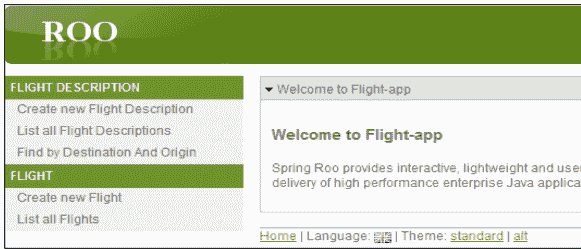

- 5. 从菜单中选择“创建新航班描述”选项，并在相应字段中输入 Origin、Destination 和 Price 的值，以创建新的航班描述，如下图所示：

  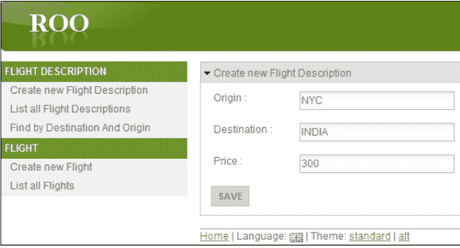

  单击 Save 按钮保存输入的航班描述。

- 6. 现在，从菜单中选择“创建新航班”选项，并选择出发日期和到达日期，如下图所示：

  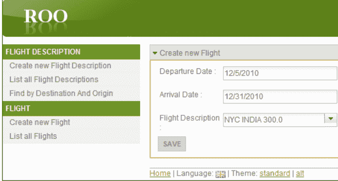

  由于出发日期和到达日期字段是日期类型字段，将显示一个弹出式日历以简化这些字段的日期输入。你可能会注意到，航班描述字段是一个下拉字段，显示你已创建的所有航班描述。Roo 显示航班描述下拉列表，因为 Flight 和 FlightDescription JPA 实体之间存在多对一关系。

  现在，单击 Save 按钮保存航班详细信息。

- 7. 你可以分别单击“列出所有航班描述”和“列出所有航班”菜单选项来查看新创建的航班描述和航班详细信息。你还可以通过单击“按目的地和原始地查找”菜单选项，根据原始地和目的地搜索航班描述。按目的地和原始地查找选项之所以可用，是因为我们为 FlightDescription JPA 实体定义了一个查找方法（请参阅 ch04_web_app.roo 脚本）。

- 8. 默认情况下，Roo 生成的 flight-app 应用程序中安装了两个主题：standard 和 alt（由 flight-app 项目的 standard.properties 和 alt.properties 文件表示）。Flight-app 应用程序的默认主题是 standard。你可以通过选择 alt 主题来更改 Flight-app 应用程序的主题，如下图所示：

  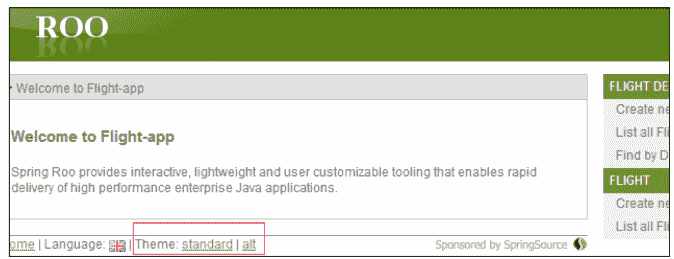

- 9. 如截图所示，选择 alt 主题会将菜单选项移至右侧，并将页面的主内容移至左侧。如前所述，用户选择的主题保存在浏览器 Cookie 中；因此，如果你关闭浏览器并重新打开，你会发现 alt 主题已默认应用于 Flight-app 应用程序的网页中。

### 工作原理

perform package 命令运行 Maven 的 package 命令，从而对项目进行打包。该项目被打包为 WAR 文件，因为 flight-app 项目指定的打包（根据 pom.xml 文件中的 <packaging> 元素）为 war。需要注意的是，执行 perform package 命令时，不会执行测试。它执行 Maven 的 package 命令并指定跳过测试，如下所示：

```
..ch04-recipe>mvn package -Dmaven.test.skip
```

如前所述，Roo 的 perform 命令可用于执行 Maven 命令。你可以从 Roo shell 执行 Maven 的 package 命令（并执行测试），如下所示：

```
.. roo> perform command --mavenCommand package
```

> **不要从 Roo shell 运行嵌入式 Tomcat 实例**
>
> 你可以使用 Roo 的 perform 命令在嵌入式 Tomcat 实例中运行 flight-app 项目作为 Web 应用程序，但你不应该这样做，因为这会创建一个不同的进程，你无法使用 CTRL+C 停止它，而且也无法从 Roo shell 执行 Roo 命令。

flight-app 项目的 pom.xml 文件配置了 Tomcat Maven 插件（http://mojo.codehaus.org/tomcat-maven-plugin/index.html），这使得可以在嵌入式 Tomcat 实例中将 flight-app 项目作为动态 Web 应用程序运行。以下 XML 片段显示了 Tomcat Maven 插件的配置：


<plugin>
<groupId>org.codehaus.mojo</groupId>
<artifactId>tomcat-maven-plugin</artifactId>
<version>1.0</version>
</plugin>

您可以配置插件以影响嵌入式 Tomcat 实例的行为。例如，如果您想要将默认的 8080 HTTP 端口更改为 8090，则可以在在 Tomcat 实例上运行项目时提供 maven.tomcat.port 系统属性，如下所示：

```
.ch04-recipe> mvn tomcat:run -Dmaven.tomcat.port=8090
```

## 更多内容...

Roo 还提供了 perform assembly 命令，它执行 Maven Assembly 插件（http://maven.apache.org/plugins/maven-assembly-plugin/，在 Roo 项目的 pom.xml 文件中配置）的 assembly 目标。您只有在希望将项目作为存档（例如 ZIP、TAR、WAR、JAR 等）分发时才应使用 perform assembly 命令。此可分发存档包含项目的配置文件、项目文档和运行时依赖项。

## 在嵌入式 Jetty 容器中运行 Roo 项目

Roo 在 pom.xml 文件中配置了 Jetty Maven 插件（http://docs.codehaus.org/display/JETTY/Maven+Jetty+Plugin），以支持在嵌入式 Jetty 容器中将 Roo 项目作为 Web 应用程序运行。要在嵌入式 Jetty 容器中运行 flight-app 项目，您只需在包含项目 pom.xml 文件的目录中执行该插件的 jetty:run 目标即可：

```
.ch04-recipe> mvn jetty:run
```

如果您希望将 Jetty 容器监听 HTTP 请求的默认 8080 HTTP 端口更改为 8090，则可以通过指定 jetty.port 系统属性来配置它，如下所示：

```
.ch04-recipe> mvn jetty:run -Djetty.port=8090
```

## 另请参阅

- 有关 Roo 生成的 JSPX 视图及如何自定义其布局的详细信息，请参阅“修改 Roo 生成的视图”配方。
- 要了解如何自定义 Roo 安装的默认主题以及如何将新主题添加到 Roo 生成的 Web 应用程序，请参阅“添加或修改 Roo 生成的主题”配方。
- 有关 Spring Roo 提供的国际化支持，请参阅“国际化 Roo 生成的 Web 应用程序”配方。

## 修改 Roo 生成的视图

在大多数应用程序场景中，您可能希望修改 Roo 生成的视图的布局，更改不同表单元素的位置，或向视图添加新的表单元素。在本配方中，我们将探讨如何修改 flight-app 应用程序的主页。

以下屏幕截图显示了 flight-app 应用程序修改后的主页：

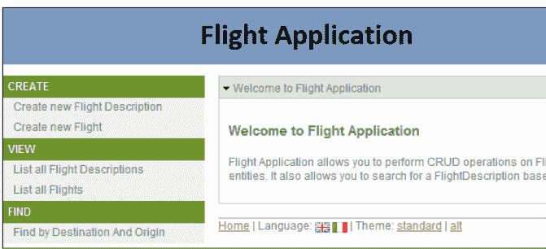

以下是我们将对 Roo 生成的 flight-app 应用程序进行的修改，以按给定屏幕截图显示主页：

- 将 Web 应用程序的主页更改为显示名为航班应用程序的应用程序
- 将 Web 应用程序的主页更改为详细描述航班应用程序，而不是 Roo 的优势。
- 更改显示在每个 Web 页面顶部的横幅图像
- 更改菜单分类，以在 **创建** 类别下显示 **创建新的航班描述** 和 **创建新航班** 选项，在 **查看** 类别下显示 **列出所有航班描述** 和 **列出所有航班**，并在 **查找** 类别下显示 **按目的地和来源查找**。

### 准备工作

删除 C:\roo-cookbook 目录中 ch04-recipe 子目录的内容。

将 ch04_web_app.roo 脚本复制到 ch04-recipe 目录。

执行 ch04_web-app.roo 脚本，该脚本会创建 flight-app Roo 项目，将 Hibernate 设置为持久性提供程序，将 MySQL 配置为应用程序的数据库，创建 Flight 和 FlightDescription JPA 实体，并定义 Flight 和 FlightDescription 实体之间的多对一关系。如果您使用的数据库不是 MySQL，或者您的连接设置与脚本中指定的不同，请相应地修改脚本。

从 C:\roo-cookbook\ch04-recipe 目录启动 Roo shell。

执行 controller all 命令，为 flight-app 项目中的 JPA 实体创建相应的控制器和视图，如下所示：

```
.. roo> controller all --package ~.web
```

由于在处理 controller all 命令期间，许多依赖项会添加到 flight-app 项目的 pom.xml 文件中，因此请执行 Roo 的 perform eclipse 命令以更新 Eclipse 项目的 .classpath 文件。

```
.. roo> perform eclipse
```

现在，将项目导入 Eclipse IDE。

### 操作步骤

- 1. 打开 SRC_MAIN_WEBAPP\WEB-INF\i18n\application.properties，将 application_name 属性的值从 Flight-App 修改为 Flight Application，如下所示：

```
application_name=Flight Application
```

现在，将以下属性添加到 application.properties 文件中：

```
menu_category_create_label=Create
menu_category_view_label=View
menu_category_find_label=Find
```

- 2. 打开 SRC_MAIN_WEBAPP\WEB-INF\views\menu.jspx 文件并执行以下更改：
- 添加一个新的 <menu:category> 标记（位于 <menu:menu> 标记内），将 id 属性值设置为 c_create，如下所示：

```
<menu:category id="c_create"></menu:category>
```

- 将 id 属性值为 i_flightdescription_new 和 i_flight_new 的 <menu:item> 移动到新添加的 <menu:category> 标记内，如下所示：

```
<menu:item id="i_flightdescription_new"
messageCode="global_menu_new"
url="/flightdescriptions?form"
z="DFDc4F2kZR5ysns4ZeMk5pr3E84=" />
<menu:item id="i_flight_new" messageCode="global_menu_new"
url="/flights?form"
z="oPwPKDFqpdHotAZ0M/SeEs1lCC4=" />
```

- 添加一个 id 属性值为 c_view 的新 <menu:category> 标记，如下所示：

```
<menu:category id="c_view"></menu:category>
```

- 将 id 属性值为 i_flightdescription_list 和 i_flight_list 的 <menu:item> 移动到新添加的 <menu:category> 标记内，如下所示：

```
<menu:item id="i_flightdescription_list"
messageCode="global_menu_list"
url="/flightdescriptions?..."
z="cvk+gcfsrOjH0bM6HiDsKdXY2gY=" />
<menu:item id="i_flight_list" messageCode="global_menu_list"
url="/flights?..."
z="sxdeS3ThjFWC2xKcFfFd4iiZms4=" />
```

- 添加一个 id 属性值为 c_find 的新 <menu:category> 标记，如下所示：

```
<menu:category id="c_find"></menu:category>
```

- 将 id 属性值为 fi_flightdescription_destinationandorigin 的 <menu:item> 移动到新添加的 <menu:category> 标记内，如下所示：

```
<menu:item id="fi_flightdescription_destinationandorigin"
messageCode="global_menu_find"
url="/flightdescriptions?find=..."
z="SiTmEGC8kg6mdn8j47EUsKdsOn4=" />
```

- 将现有的 id 属性值为 c_flightdescription 和 c_flight 的 <menu:category> 标记的 render 属性设置为 false，如下所示：

```
<menu:category id="c_flightdescription"
z=".." render="false"/>
<menu:category id="c_flight" z=".." render="false"/>
```

- 3. 打开 SRC_MAIN_WEBAPP/WEB-INF/i18n\messages.properties，并按如下所示修改 welcome_text 属性值：

```
welcome_text=Flight Application allows you to perform CRUD operations on Flight and FlightDescription JPA entities. It also allows you to search for a FlightDescription based on origin and destination.
```

- 4. 将 banner-graphic.png（来自此章附带的文件）复制到 SRC_MAIN_WEBAPP\images 目录。

- 5. 从 Spring Roo 1.1.5 开始，Roo shell 不会主动监控 JSPX 文件的更改；因此，请重启 Roo shell。您现在会发现 id 为 c_flightdescription 和 c_flight 的 `<menu:category>` 标记的 z 属性值已更改为用户管理。

### 工作原理

Roo 生成的 Web 应用程序使用 messages.properties 和 application.properties 资源包来支持 Web 用户界面的国际化。application.properties 文件包含 Roo 生成的 Web 应用程序各个 Web 页面上显示的菜单和表单字段的标签。application.properties 文件中包含的标签源自 JPA 实体及其字段的名称。此外，应用程序主页上显示的 Web 应用程序名称也包含在 application.properties 文件中。messages.properties 包含适用于所有 Roo 生成的 Web 应用程序且不特定于单个 Web 应用程序的通用消息。例如，Save 按钮和 Reset 按钮的标签在 messages.properties 文件中指定。有关如何使用这些属性文件来国际化或本地化 Roo 生成的 Spring Web MVC 应用程序的详细信息，请参阅“国际化 Roo 生成的 Web 应用程序”配方。

当 JPA 实体发生更改时，并非所有由 Roo 生成的文件都由 Roo 管理。例如，仅当向域模型添加新的 JPA 实体或向其添加新字段时，Roo 才会修改 application.properties 文件。删除字段或 JPA 实体不会自动从 application.properties 文件中删除对应的字段或 JPA 实体的标签属性。但是，修改 JPA 实体中字段的名称会导致向 application.properties 文件添加新属性。由于 Roo 永远不会尝试管理 application.properties 文件中定义的现有标签属性，因此您可以安全地更改它们。messages.properties 文件包含通用标签；因此，一旦生成，它永远不会由 Roo 管理。

menu.jspx 文件和 WEB-INF/views 文件夹内包含的 JSPX 文件由 Spring Roo 管理。如果您添加、修改或删除 JPA 实体中的字段，则 Roo 负责更新相应的 JSPX 视图（位于 WEB-INF/views 内）以反映更改。menu.jspx 文件由 Roo 管理，以确保在创建新的 Spring Web MVC 控制器或向已有控制器的 JPA 实体添加查找器方法时，会在 menu.jspx 中添加其他菜单选项。

现在，让我们来看看基于对 Roo 生成的 flight-app 项目执行的操作，我们是如何实现修改后的主页的：


## 更改显示的应用程序名称和欢迎文本

要更改应用程序名称和欢迎文本，我们首先需要找到显示 Web 应用程序主页的 JSPX 视图，然后在 `application.properties` 文件中找到相应属性，该属性由 JSPX 视图用于显示应用程序名称和欢迎文本。或者，您可以先在 `application.properties` 文件中查看要更改的标签的属性键，然后使用 IDE 搜索使用这些属性键的 JSPX 文件。

我们先来查找显示 `flight-app` 应用程序主页的 JSPX 视图。在 `webmvc-config.xml` 文件中，以下 `<view-controller>` 元素表明，当 Web 应用程序根目录 `/` 收到请求时，视图名称为 `index`：

```
<mvc:view-controller path="/" view-name="index"/>
```

现在，`webmvc-config.xml` 中的以下 `UrlBasedViewResolver` 表明，我们需要在 Tiles 定义 XML 文件中查找名为 `index` 的 Tiles 定义，以找到视图：

```
<bean class="org.springframework.web.servlet.view.
UrlBasedViewResolver" id="tilesViewResolver">
<property name="viewClass"
value="org.springframework.web.servlet.view.
tiles2.TilesView"/>
</bean>
```

`webmvc-config.xml` 中的以下 `TilesConfigurer` 配置表明在哪里查找 Tiles 定义 XML，以找到名为 `index` 的 Tiles 定义：

```
<bean class="org.springframework.web.servlet.view.tiles2.TilesConfigurer" id="tilesConfigurer">
<property name="definitions">
<list>
<value>/WEB-INF/layouts/layouts.xml</value>
<value>/WEB-INF/views/**/views.xml</value>
</list>
</property>
</bean>
```

快速浏览 `TilesConfigurer` 指定的 XML 配置文件可发现，`index` Tiles 定义在 `SRC_MAIN_WEBAPP/WEB-INF/views/views.xml` 文件中定义，如下所示：

```
<definition name="index" extends="default">
<put-attribute name="body"
value="/WEB-INF/views/index.jspx" />
</definition>
```

如我们将在“向 Roo 生成的 Web 应用程序添加静态视图”一节中看到的，<put-attribute> 元素指的是负责显示页面主体内容（不包括页眉、页脚和菜单）的 JSPX 文件。因此，/WEB-INF/views/index.jspx 是显示 flight-app 应用程序主页的文件。

以下代码显示 index.jspx 文件的内容：

```
<div xmlns:spring="http://www.springframework.org/tags"
 xmlns:util="urn:jsptagdir:/WEB-INF/tags/util" .. >

    <spring:message var="app_name" code="application_name" .../>
    <spring:message var="title"
        code="welcome_titlepane" arguments="${app_name}" .../>

    <util:panel id="title" title="${title}">
        <h3>
            <spring:message code="welcome_h3"
                arguments="${app_name}" />
        </h3>
        <p>
            <spring:message code="welcome_text" />
        </p>
    </util:panel>
</div>
```

Spring 标签库中的 <message> 标签从资源包中检索消息和标签，对于 flight-app 应用程序，这些资源包是 Roo 生成的 application.properties 和 messages.properties 文件。code 属性标识需要从资源包中获取其值的属性键。var 属性标识将返回的属性值分配给的变量。arguments 属性指定需要传递给 <message> 标签的参数，这些参数通常由 <message> 标签实现用于填充从资源包中检索的消息或标签中指定的占位符。

<panel> 标签是 Roo 在执行 controller all 命令时安装的自定义标签之一。<panel> 标签用于显示可折叠面板。要查看 <panel> 标签的实现，请参阅 /WEB-INF/tags/util/panel.tagx 文件。

下表显示了 `index.jspx` 文件中由 `<message>` 标签指定的消息和标签所在的属性文件及其值：

| 代码 | 属性值 |
|---|---|
| application_name | 定义在 application.properties 中。<br>值：Flight-app。 |
| welcome_titlepane | 定义在 messages.properties 中。<br>值：Welcome to {0}。 |
| welcome_h3 | 定义在 messages.properties 中。<br>值：Welcome to {0}。 |
| welcome_text | 定义在 messages.properties 中。<br>值：Spring Roo 提供交互式、轻量级的 ... |

`welcome_titlepane` 和 `welcome_h3` 的值中的 {0} 表示一个占位符，它由 `<message>` 元素的 arguments 属性中指定的值填充。

给定的表表明，如果更改 `application_name` 属性，将更改主页上显示的应用程序名称。如果更改 `welcome_text` 属性，将更改默认的欢迎文本。

## 更改菜单选项

`menu.jspx` 文件显示 Roo Web 应用程序中的菜单选项。下表描述了构成 `menu.jspx` 文件的标签：

| 标签 | 描述 |
|---|---|
| `<menu>` | `<menu>` 自定义标签（定义在 `menu.tagx` 中）定义一个菜单。 |
| `<category>` | `<category>` 标签（定义在 `category.tagx` 中）定义菜单中的顶级类别。 |
| `<item>` | `<item>` 标签（定义在 `item.tagx` 中）定义菜单类别中的项目。 |

以下属性适用于 Spring Roo 安装的所有标签（包括菜单的 <menu>、<item> 和 <category> 标签）：

- id: id 属性由 Roo 用于检查 JSPX 文件中元素的存在性。对于 Roo 生成的视图，id 属性的值派生自 JPA 实体名和字段名。例如，由 `<menu:item>` 元素创建的菜单项 **Create new Flight Description** 的 id 属性值为 `i_flightdescription_new`，它派生自 `FlightDescription` JPA 实体的名称。如果移除 id 为 `i_flightdescription_new` 的 `<menu:item>` 元素，则 Roo 会发现该元素已被移除，并会将其_再次_添加到 JSPX 文件中。

- 在某些情况下，id 属性的值也会由标签实现用于确定在标签实现中应使用的消息或标签。例如，如果未指定 `messageCode` 属性，则 `item.tagx` 实现会使用 `<menu:item>` 元素的 `i_flightdescription_new` id 来查找与菜单项关联的标签。

- render: render 属性指定是否应渲染标签的内容。默认情况下，render 属性的值为 `true`，即应渲染标签的内容（包括封闭标签）。如果不希望渲染标签及其封闭标签的内容，请将该值设置为 `false`。

- z: z 属性由 Spring Roo 内部用于检查开发者是否对标签进行了任何修改。正是 z 属性允许 Roo 执行往返操作。z 属性的值表示 JSPX 文件中某个标签的哈希键，该哈希键基于标签名、标签中存在的属性及其值计算得出。z 属性永不参与哈希键的计算。此外，标签中指定属性的顺序也不会在哈希键计算中被考虑。

- 如果对标签进行任何修改（通过添加属性、修改属性值或删除任何属性），Roo 会发现这一点，因为该标签的哈希键现在将不再与 Roo 为该标签计算的哈希键匹配。在出现不匹配的情况，Roo 会将 z 的值简单地设置为 `user-managed`。

## Roo 安装的 JSP 标签中 z 属性的意义

让我们来看看 menu.jspx 中的以下元素，以了解 z 属性的相关性：

```
<menu:item id="i_flightdescription_new"
messageCode="global_menu_new"
url="/flightdescriptions?form"
z="DFDc4F2kZR5yns4ZeMk5pr3E84=" />
```


给定的 <item> 元素显示了一个标记为 **创建新航班描述** 的菜单项。
<item> 标签的 url 属性用于标识处理 Web 请求的 Web 控制器，当点击 **创建新航班描述** 菜单选项时触发该请求。由于 url 属性值为 /flightdescriptions?form，且与 FlightDescriptionController 类级别的 @RequestMapping 注解值匹配（请参阅 FlightDescriptionController.java 文件），因此当点击 **创建新航班描述** 菜单选项时，由 FlightDescriptionController 处理该请求。如果将 url 属性（以及 FlightController.java 中对应的类级别 @RequestMapping 注解）更改为，例如，/fds?form，则 Roo 会自动将 <item> 元素的 z 属性值更新为 user-managed，这意味着 Roo 不再管理该元素。在本示例的后续部分，我们将探讨如何将元素从用户托管模式切换回 Roo 托管模式。

## 了解 Roo 生成的 JSPX 文件

让我们来看一下 /WEB-INF/views/flights/create.jspx 视图，该视图显示了用于创建 Flight 实体的表单。以下代码显示了 create.jspx 的内容：

```
<div xmlns:field="urn:jsptagdir:/WEB-INF/tags/form/fields"
xmlns:form="urn:jsptagdir:/WEB-INF/tags/form" xmlns:jsp="http://java.sun.com/JSP/Page" xmlns:spring="http://www.springframework.org/tags"
...
<form:create id="fc_sample_roo_flightapp_domain_Flight"
modelAttribute="flight"
path="/flights" render="${fn:empty dependencies}"
z="JEBB+QGFrFLKSzYDOjyDjJnTPc=" >
<field:datetime
dateTimePattern="${{flight_departuredate_date_format}}"
field="departureDate"
id="c_sample_roo_flightapp_domain_Flight_departureDate"
z="BtcAuQvStTt55J3J6zFybfhksXa=" />
...
<field:select field="flightDescription"
id=".." itemValue="flightDescId"
items="${{flightdescriptions}}"
path="/flightdescriptions" required="true"
z="MPt8rEJwJ7fZFpQUZPDn6K7+A8OE=" />
...
</form:create>
...
</div>
```

关于 Roo 生成的 `create.jspx` 文件，有几点值得注意：

- `<create>` 自定义标签（请参阅 `/WEB-INF/tags/form/create.tagx`）用于创建 HTML 表单。如果你查看 `create.tagx` 文件，会发现它使用 Spring 的 `form` 标签库来创建表单。`render` 属性指定，如果存在在创建 `Flight` 实体之前需要创建的某些依赖项，则不应渲染表单。稍后我们将看到 `dependencies` 变量的来源。

- `<datetime>` 自定义标签（请参阅 `/WEB-INF/tags/form/fields/datetime.tagx`）用于创建一个文本字段，以输入航班出发日期。`field` 属性标识已为其创建文本字段的 `Flight` JPA 实体的字段。该文本字段与 `dijit`（Dojo 的 UI JavaScript 库）日期日历相关联，以简化向字段输入日期。

- `<select>` 自定义标签（请参阅 `/WEB-INF/tags/form/fields/select.tagx`）用于创建一个下拉框，用于选择我们即将创建的航班关联的航班描述。同样，`field` 属性标识已为其创建下拉框的 `Flight` JPA 实体的字段。`required` 属性指定创建 `Flight` 实体时是否必须选择航班描述。由于 `required` 属性的值为 `true`，你必须从下拉框中选择一个航班描述才能创建 `Flight` 实体。

可以看出，Roo 智能地决定使用 `<datetime>` 标签来创建对应 `Date` 类型的字段，例如 `Flight` 实体的 `departureDate` 字段。Roo 还解析了 `Flight` 和 `FlightDescription` JPA 实体之间的 `@ManyToOne` 关系，并创建了一个下拉框（使用 `<select>` 标签）来选择航班描述。由于 `Flight` 和 `FlightDescription` 实体之间的 `@ManyToOne` 关系还带有 `@NotNull` 注解（JSR-303 注解），Roo 通过将 `<select>` 标签的 `required` 属性设置为 `true`，在用户界面一侧转换了该依赖关系。

现在，让我们看看 `<create>` 标签如何使用 `dependencies` 变量来决定是否渲染创建 `Flight` 表单。在创建 `Flight` 实体时，你会注意到的一件事是它会要求你先创建 `FlightDescription`，如下图所示：

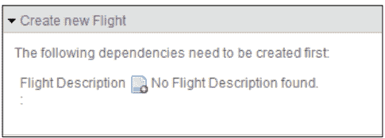

如屏幕截图所示，Web 应用程序没有显示 **创建新航班** 表单，而是显示一条说明，指出我们需要先创建航班描述。显示说明的决定由 `dependencies` 变量作出，如下所示：

```
<form:create id="fc_sample_roo_flightapp_domain_Flight"
 modelAttribute="flight"
 path="/flights" **render="${empty dependencies}"**
 ...
```

`dependencies` 变量由 `FlightController` 添加到请求中。`FlightController` 根据 `Flight` JPA 实体参与的关系来识别其依赖项。由于 `Flight` 实体与 `FlightDescription` 实体具有非空多对一关系，`FlightController` 将其作为依赖项添加到 `dependencies` 变量中，如 `FlightController_Roo_Controller.aj` 文件的内容所示：

```
@RequestMapping(params = "form", method = RequestMethod.GET)
public String FlightController.createForm(Model model)
{
    model.addAttribute("flight", new Flight());
    addDateTimeFormatPatterns(model);
    List dependencies = new ArrayList();
    if (FlightDescription.countFlightDescriptions() == 0)
    {
        dependencies.add(new String[]{"flightDescription",
            "flightdescriptions"});
    }
    model.addAttribute("dependencies", dependencies);
    return "flights/create";
}
```

`createForm` 方法负责渲染用于创建 `Flight` 实体实例的表单。给定代码显示，如果未找到 `FlightDescription` 实体实例，则 `createForm` 方法会向 `dependencies` 模型属性添加一个 `String[]`。`dependencies` 属性包含当前不可用于创建 `Flight` 实例的依赖项。只有当 `dependencies` 属性为空时，才会渲染创建 `Flight` 实体的表单，这一点我们已经见过。

我们之前看到，可以将 JSPX 文件中的元素从 Roo 托管模式切换到 `user-managed` 模式。在某些场景中，你可能希望从 `user-managed` 模式切换回 Roo 托管模式。让我们来看看如何操作：

## 将元素从用户托管模式切换到 Roo 托管模式

我们看到，Spring Roo 完成了大量繁重工作来创建 Web 应用程序的用户界面。这包括创建 JSPX 文件、安装自定义标签、创建 Spring Web MVC 控制器、创建 Web 应用程序上下文 XML 文件、创建 Web 应用程序部署描述符、创建 Tiles 定义、安装主题等。我们还看到，用于显示航班描述的 `<select>` 标签的 `required` 属性值被设置为 `true`，因为 Flight JPA 实体与 FlightDescription 实体存在非空多对一关系。

假设我们希望 `departureDate` 字段的文本框在创建 `Flight` 实体时也是必填的。你可以给 `Flight` JPA 实体的 `departureDate` 字段添加 `@NotNull` JSR-303 注解，并让 Roo 负责将 `departureDate` 文本框的 `required` 属性值设置为 `true`。我们再假设，不想对 `Flight` 实体做任何更改，且在从用户界面创建 `Flight` 实体时必须在 `departureDate` 字段中输入日期。我们只需将 `required` 属性值设置为 `true`，如下所示：

```
<field:datetime
dateTimePattern="${flight_departuredate_date_format}"
field="departureDate" required="true"
id="c_sample_roo_flightapp_domain_Flight_departureDate"
z="BtcAuQvStTt55J3J6zFybhfkSxA=" />
```

由于我们已将 `required` 属性的默认值从 `false` 更改为 `true`，因此实际上已经修改了该元素；因而，Roo 会将 `z` 属性的值设置为 user-managed。Spring Roo 中的用户托管元素不参与往返操作；因此，如果你对 `Flight` 实体的 `departureDate` 字段进行任何修改，Roo 将 *不会* 对 `create.jspx` 文件中的 `departureDate` 元素做出相应修改。例如，如果你从 `Flight` 实体中删除 `departureDate` 字段，则 Roo 不会从 `create.jspx` 中删除 `departureDate` 元素。如果你希望修改后的表单元素再次变为 Roo 托管，只需将 `z` 属性的值设置为 `？` 即可。`？` 的值指示 Roo 基于当前属性及其值重新计算 `z` 属性的值，从而使 Roo 能够判断将来表单元素是否发生变化。

正如我们刚才讨论的，你可以通过添加或修改一个或多个属性来控制 JSPX 视图中的 Roo 托管表单元素。建议在对表单元素进行更改后，通过将 `z` 属性的值设置为 `？` 来恢复 Roo 托管模式。在 Roo 托管模式下，Roo 会处理对 JPA 实体的任何修改，从而省去对视图进行调整的工作。

### 另请参阅

- 请参阅 Spring Roo 中 Web 控制器和视图的往返操作支持示例，查看 Roo 中往返操作支持的示例


- 请参阅“向 Roo 生成的 Web 应用程序添加静态视图”配方，了解如何将自定义 Web 页面添加到 Roo 生成的 Web 应用程序中
- 请参阅“为特定 JPA 实体创建 Spring MVC 控制器”配方，了解如何指示 Roo 不为某些功能生成视图的详细信息。

## Spring Roo 中 Web 控制器和视图的往返支持

在 Roo 生成的应用程序中，您可以更改 JPA 实体，并让 Roo 负责对控制器和视图进行必要的更改。在本配方中，我们将通过一个示例场景，演示对 JPA 实体的更改如何传播到相应的控制器和视图。

### 准备工作

删除 C:\\roo-cookbook 目录中 ch04-recipe 子目录的内容。

将 ch04_web-app.roo 脚本复制到 ch04-recipe 目录中。

执行 ch04_web-app.roo 脚本，该脚本将创建 flight-app Roo 项目，将 Hibernate 设置为持久化提供程序，将 MySQL 配置为应用程序的数据库，创建 Flight 和 FlightDescription JPA 实体，并定义 Flight 与 FlightDescription 实体之间的多对一关系。如果您使用的数据库不是 MySQL，或者连接设置与脚本中指定的不同，请相应地修改脚本。

从 C:\\roo-cookbook\\ch04-recipe 目录启动 Roo shell。

执行 controller all 命令，为 flight-app 项目中的 JPA 实体创建相应的控制器和视图，如下所示：

```
.. roo> controller all --package ~.web
```

执行 perform eclipse 命令以更新项目的类路径设置，如下所示：

```
.. roo> perform eclipse
```

现在，将项目导入到您的 Eclipse IDE 中。

FlightDescription.java 文件中的以下代码显示了 FlightDescription 实体，我们将在本配方中修改它，以感受 Roo 的往返功能：

```
@RooJavaBean
@RooToString
@RooEntity(identifierField = "flightDescId",
identifierColumn = "FLIGHT_DESC_ID",
table = "FLIGHT_DESC_TBL",
finders = {"findFlightDescriptionsByDestinationAndOrigin" })
public class FlightDescription
{
    @NotNull
    @Column(name = "ORIGIN_CITY")
    private String origin;
    @NotNull
    @Column(name = "DESTINATION_CITY")
    private String destination;
    @NotNull
    @Column(name = "PRICE")
    private Float price;
}
```

### 操作步骤...

要查看 Web 控制器和视图的往返支持，请按照以下步骤操作：

- 1. 在编辑器中打开 FlightDescription.java 文件。

- 2. 从 @RooEntity 注解中删除 finders 属性及其值，并保存 FlightDescription.java 文件。Roo shell 将显示 Roo 为响应删除 finders 属性而采取的操作，如下所示：

```
Updated SRC_MAIN_WEBAPP\WEB-INF\views\menu.jspx
Deleted SRC_MAIN_JAVA\...\web\FlightDescriptionController_Roo_Controller_Finder.aj
Deleted SRC_MAIN_JAVA\...\domain\FlightDescription_Roo_Finder.aj
```

- 3. 将 origin 字段的名称更改为 originCity，destination 字段的名称更改为 destinationCity，并保存 FlightDescription.java 文件。Roo shell 将显示 Roo 为响应我们的更改而采取的以下操作：

```
Updated ...\WEB-INF\views\flightdescriptions\list.jspx
Updated ...\WEB-INF\views\flightdescriptions\show.jspx
Updated ...\WEB-INF\views\flightdescriptions\create.jspx
Updated ...\WEB-INF\views\flightdescriptions\update.jspx
Updated ...\WEB-INF\i18n\application.properties
Updated ...\domain\FlightDescription_Roo_JavaBean.aj
Updated SRC_MAIN_JAVA\...\web\ApplicationConversionServiceFactoryBean_Roo_ConversionService.aj
Updated SRC_MAIN_JAVA\...\domain\FlightDescription_Roo_ToString.aj
```

- 4. 从 price 字段中删除 @NotNull JSR 303 注解，并保存 FlightDescription.java 文件。现在，Roo shell 将显示针对该更改的以下输出：

```
Updated... \WEB-INF\views\flightdescriptions\create.jspx
Updated... \WEB-INF\views\flightdescriptions\update.jspx
```

### 工作原理...

现在让我们来看看当我们修改 FlightDescription.java 时 Spring Roo 做了什么。当移除 finders 元素时，Spring Roo 在 flight-app 项目中做出了以下调整：

- Spring Roo 删除了包含查找器方法实现的 FlightDescription_Roo_Finder.aj ITD。

> 如果 JPA 实体定义了多个查找器方法，则从 @RooEntity 注解的 finders 属性中删除单个查找器方法将仅从 ITD 文件中删除相应的查找器方法。

- 最初创建 FlightDescriptionController_Roo_Controller_Finder.aj ITD 时，它包含一个用于显示表单的方法（参阅 /WEB-INF/views/flightdescriptions/findFlightDescriptionsByDestinationAndOrigin.jspx），允许根据出发地和目的地城市搜索 FlightDescription。它还包含一个用于搜索 FlightDescription 实例并显示结果的方法（参阅 /WEB-INF/views/flightdescriptions/list.jspx）。现在，由于查找器方法已被移除，显示搜索表单和搜索结果的控制器方法也被移除。需要注意的是，在 Spring Roo 1.1.3 中，负责搜索实体实例的方法不会在 FlightDescriptionController_Roo_Controller_Finder.aj 中创建。此错误已在 Spring Roo 1.1.4 及更高版本中修复。

> 需要注意的是，即使 findFlightDescriptionsByDestinationAndOrigin.jspx 文件在 flight-app 应用程序中不再需要，Spring Roo 也不会将其删除。您需要手动从 Roo 项目中删除 JSPX 文件。这是因为 Spring Roo 不会自动删除应用程序中不再需要的 JSPX 文件。

- 由于查找器方法已被移除，菜单选项“按目的地和城市查找”也已从 menu.jspx 文件中移除。

当修改 origin 和 destination 字段名称时，Roo 将执行以下修改：

- 在 `FlightDescription_Roo_JavaBean.aj` ITD 中，`origin` 和 `destination` 字段的 getter 和 setter 方法已分别替换为 `originCity` 和 `destinationCity` 的 getter 和 setter 方法。

- 在 `FlightDescription_Roo_ToString.aj` ITD 中，`toString` 方法已修改为包含 `destinationCity` 和 `originCity` 字段的值，而不是 `origin` 和 `destination` 字段。

- 在“从 JPA 实体自动生成 Spring MVC 控制器和 JSPX 视图”配方中，我们讨论了 Roo 生成的 `ApplicationConversionServiceFactoryBean` 如何由 Web 应用程序上下文 XML 中定义的 `<mvc:annotation-driven>` 元素配置。我们之前看到，flight-app 项目的 `*_Roo_ConversionService.aj` 文件将代表 `Flight` 和 `FlightDescription` JPA 实体的转换器的静态类引入 `ApplicationConversionServiceFactoryBean` 类中。

- 以下代码显示在 `ApplicationConversionServiceFactoryBean_Roo_ConversionService.aj` 中定义的 `FlightDescriptionConverter` 静态类，它返回 `FlightDescription` 实体的转换器：

```
import org.springframework.core.convert.converter.Converter;
privileged aspect ApplicationConversionServiceFactoryBean_Roo_ConversionService {
...
static class ApplicationConversionServiceFactoryBean.FlightDescriptionConverter implements
Converter<FlightDescription, java.lang.String> {
public String convert(FlightDescription
flightDescription){
return new StringBuilder().
append(flightDescription.getOrigin()).
append("").
append(flightDescription.getDestination()).
append(" ").
append(flightDescription.getPrice()).toString();
}
}
...
}
```

在给定代码中，`FlightDescriptionConverter` 静态类实现了 Spring 的 `Converter`。它将 `FlightDescription` JPA 实体转换为 `String` 表示形式。`FlightDescription` 的 `String` 表示形式是通过简单连接其每个字段的值来创建的。

由于我们将 `origin` 和 `destination` 字段的名称修改为 `originCity` 和 `destinationCity`，Roo 修改了 `FlightDescription` Converter 类以使用字段的修改后的 getter 方法。这些修改引起的变化可概述如下：

- `application.properties` 文件已修改为为 `originCity` 和 `destinationCity` 字段添加充当标签的新属性，如下所示：

```
label_sample_roo_flightapp_domain_flightdescription_destinationcity=Destination City
label_sample_roo_flightapp_domain_flightdescription_origincity=Origin City
```

如您所料，属性名称源自 JPA 实体所在的包，即 JPA 实体名称和字段名称。还需要注意的是，一旦将属性添加到 `application.properties` 文件中，Roo 永远不会将其删除或修改。Roo 始终在 `application.properties` 文件中创建新属性。因此，如果您频繁修改 JPA 实体字段，将导致 `application.properties` 文件中不需要的属性激增，您需要手动将其删除。

- JSPX 视图：`/WEB-INF/views/flightdescriptions/` 中的 `create.jspx`、`update.jspx`、`show.jspx` 和 `list.jspx` 文件已修改，以反映 `FlightDescription` JPA 实体字段名称的更改。需要注意的是，如果 JSPX 视图中定义的字段不是 Roo 管理的，即 `z` 属性的值为 'user-managed'，则 Roo 不会响应 JPA 实体的更改对该字段进行任何修改。

当从 `FlightDescription` 的 `price` 字段中移除 `@NotNull` JSR 303 注解时，Roo 会将此更改级联到 `/WEB-INF/views/flightdescriptions/create.jspx` 和 `/WEB-INF/views/flightdescriptions/update.jspx` 视图。Roo 对这些视图所做的唯一更改是从显示 Web 用户界面上 `price` 字段的 `<input>` 自定义标签元素中移除 `required` 属性。

### 更多内容...

Roo 对 JSPX 视图的往返支持非常复杂，可以处理 Roo 管理的 JPA 实体中的以下更改：

- 字段名称更改
- 字段类型更改
- 与字段关联的 JSR 303 注解更改


- 字段移除
- 新字段添加

如果希望 JSPX 中的某个元素在 Roo 管理的 JPA 实体对应字段被修改时保持不变，则可以手动将 z 属性值设置为用户管理。此更改的副作用是，如果添加或修改相应的 JPA 实体字段，Roo 将在 JSPX 视图中创建一个新元素。

## 另请参阅

- 参阅“修改 Roo 生成的视图”配方，了解如何修改由 Spring Roo 创建的视图
- 参阅“向 Roo 生成的 Web 应用程序添加静态视图”配方，了解 Roo 如何支持向 Spring MVC Web 应用程序添加静态视图

## 为特定 JPA 实体创建 Spring MVC 控制器

controller all 命令可让你为所有尚未创建对应控制器的 JPA 实体创建控制器。如果你想控制控制器映射的 Web 请求路径或控制器支持的操作，则应使用 controller scaffold 命令。

### 准备工作

删除 C:\\roo-cookbook 目录下 ch04-recipe 子目录的内容。

将 ch04_web-app.roo 脚本复制到 ch04-recipe 目录中。

执行 ch04_web-app.roo 脚本，该脚本会创建 flight-app Roo 项目，将 Hibernate 设置为持久化提供程序，将 MySQL 配置为应用程序的数据库，创建 Flight 和 FlightDescription JPA 实体，并在 Flight 与 FlightDescription 实体之间定义多对一关系。如果你使用的数据库不是 MySQL，或者连接设置与脚本中指定的不同，请相应地修改脚本。

从 C:\\roo-cookbook\\ch04-recipe 目录启动 Roo shell。

### 操作方法

以下步骤展示如何使用 `controller scaffold` 命令为 JPA 实体创建控制器：

1. 执行 `controller scaffold` 命令创建 `FlightController`，如下所示：

```
roo> controller scaffold --class ~.web.FlightController --entity ~.domain.Flight --path /myflightpath --disallowedOperations update,delete
```

2. 执行 `perform eclipse` 命令以更新类路径设置，并在 Eclipse IDE 中导入项目。

### 工作原理

下表描述了传递给 `controller scaffold` 命令的每个参数的用途：

| 参数 | 描述 |
|---|---|
| class（必需） | 要创建的控制器类的完全限定名称。 |
| entity（可选） | Roo 管理的 JPA 实体类（即使用 `@RooEntity` 注解的类）的完全限定名称，由生成的控制器用作表单支撑对象。该参数的值转换为 `@RooWebScaffold` 注解的 `formBackingObject` 属性的值。 |
| path（可选） | 标识 `/WEB-INF/views/` 内包含与控制器对应的 JSPX 视图的子目录。该参数的值转换为 `@RooWebScaffold` 注解的 `path` 属性的值。`path` 参数的值还转换为生成的控制器中 `@RequestMapping` 类级注解的值。 |
| disallowedOperations（可选） | 生成的控制器不支持的操作的逗号分隔列表。例如，如果值为 `update, delete`，则生成的控制器不包含用于更新和删除生成控制器所对应的 JPA 实体的方法。该参数的唯一有效值为 `update`、`delete` 和 `create`。 |

`FlightController.java` 文件中的以下代码展示了由 `controller scaffold` 命令创建的 `FlightController`：

```
@RooWebScaffold(path = "myflightpath", formBackingObject = Flight.class, update = false, delete = false)
@RequestMapping("/myflightpath")
@Controller
public class FlightController {
}
```

如给定代码所示，@RooWebScaffold 注解的 path 属性值和 @RequestMapping 注解的值均源自 controller scaffold 命令的 path 参数值。controller scaffold 命令的 disallowedOperations 参数值用于 @RooWebScaffold 注解中，以指定生成的控制器不支持的操作。

下表描述了 @RooWebScaffold 注解的元素：

| 元素 | 描述 |
|---|---|
| path | 指定 /WEB-INF/views/ 内包含与控制器对应创建的 JSPX 视图的文件夹。 |
| formBackingObject | 指定控制器用作表单支撑对象的 JPA 实体类。 |
| update | 指示更新操作是否由控制器的 *_Roo_Controller.aj AspectJ ITD 定义。如果为 true，Roo 会创建用于更新相应 Roo 管理的 JPA 实体的 JSPX 视图。默认值为 true。 |
| create | 指示创建操作是否由控制器的 *_Roo_Controller.aj AspectJ ITD 定义。如果为 true，Roo 会创建用于创建相应 Roo 管理的 JPA 实体的 JSPX 视图。默认值为 true。 |
| delete | 指示删除操作是否由控制器的 *_Roo_Controller.aj AspectJ ITD 定义。如果为 true，Roo 生成的 JSPX 视图提供删除相应 Roo 管理的 JPA 实体的选项。默认值为 true。 |
| exposeFinders | 公开 Roo 管理的 JPA 实体中定义的查找器方法。如果公开了查找器方法，则会创建一个 *_Roo_Controller_Finder.aj ITD，其中包含用于呈现输入搜索条件的表单、搜索实例并显示搜索结果的方法。默认值为 true。 |
| exposeJson | 指示如果相应的 Roo 管理的 JPA 实体使用 @RooJson 类级注解进行注解，则使用 JSON 公开控制器功能（创建、更新、显示和删除）。默认值为 true。有关如何为 Roo 管理的 JPA 实体和 Spring Web MVC 控制器添加 JSON 支持的详细信息，请参阅“向域对象和控制器添加 JSON 支持”配方。 |

下表描述了 *_Roo_Controller.aj ITD 中包含的方法（假设生成了所有控制器操作）：

| 方法 | 描述 |
|---|---|
| createForm | 显示创建实体的表单。创建表单支撑对象的新实例（即 @RooWebScaffold 注解的 formBackingObject 属性指定的 Roo 管理的 JPA 实体），添加持久化 Roo 管理的 JPA 实体所需的依赖项（这些依赖项包括参与关系的实体，例如持久化 Flight 实体需要 FlightDescription），并添加日期/时间模式（如果需要）。 |
| create | 持久化控制器公开的 Roo 管理实体。还会对实例执行 JSR 303（如果可用）验证。添加日期/时间模式（如果需要）。 |
| show | 显示持久化实体实例的详细信息。添加日期/时间模式（如果需要）。 |
| list | 显示持久化实体实例的列表。添加日期/时间模式（如果需要）。还添加对数据分页的支持。 |
| updateForm | 显示更新实体实例的表单。添加日期/时间模式（如果需要）。 |
| update | 持久化对实体实例的更改。添加日期/时间模式（如果需要）。 |
| delete | 删除实体实例。 |

> 更多内容...

如本配方所示，controller scaffold 命令提供选项以帮助创建自定义控制器。即使你已使用 controller all 命令创建了控制器，仍可通过设置 @RooWebScaffold 注解的属性来自定义控制器。

让我们来看看如何在 *_Roo_Controller.aj 文件中覆盖自动生成的方法：

## 覆盖自动生成的控制器方法

在某些场景下，你可能希望覆盖 *_Roo_Controller.aj 文件的自动生成方法以提供自定义实现。要覆盖在 ITD 中定义的方法，只需在控制器 Java 文件中定义一个同名方法（参数和返回类型可以相同或不同）即可。

假设在我们的 flight-app Web 应用程序中，需要满足以下要求：

- 目前，在更新 Flight 实体实例时，FlightController 在只读视图中显示更新后的实体实例。需要更改此默认功能，使得在更新后，控制器显示 Flight 实例列表。
- 为满足此要求，需要覆盖 FlightController_Roo_Controller.aj ITD 中定义的 update 方法的默认行为。要覆盖 update 方法的默认行为，只需在 FlightController.java 文件中定义一个 update 方法（参数和返回类型可以相同或不同），如下所示：

```
@RequestMapping(method = RequestMethod.PUT)
public String update(@Valid Flight flight, ..) {
...
return "redirect: /myflightpath/list";
}
```

在给定代码中，update 方法在持久化对 Flight 实体的更改后，将用户重定向到 myflightpath/list（而不是 /myflightpath/{flightId}）。

> 在 Spring Roo 1.1.3 中，如果你尝试通过在 *Controller.java 文件中定义方法来覆盖 *_Roo_Controller.aj 文件中定义的方法，Roo 会报错说该方法已在 *Controller.java 文件中定义。此问题在 Spring Roo 1.1.4 及更高版本中已解决。

## 另请参阅

- 参阅“为 JPA 实体手动创建 Spring MVC 控制器”配方，了解如何手动创建控制器。
- 参阅“从 JPA 实体自动生成 Spring MVC 控制器和 JSPX 视图”配方，了解如何使用 controller all 命令生成实体。


## 为 JPA 实体手动创建 Spring MVC 控制器

如果要创建自定义控制器，Roo 提供了 `controller` 类命令，用于创建控制器和 JSPX 视图的骨架结构，以便您快速上手。

假设在我们的 `flight-app` 应用程序中有以下实体：

- `Customer`: 表示航班预订应用程序中的客户
- `Address`: 表示客户的地址

为简单起见，假设 `Customer` 和 `Address` 实体之间存在一对一双向关系，且 `Customer` 是关系的所有者。`Customer` 实体只有一个字段：`customerName`，而 `Address` 实体有两个字段：`addressLine1` 和 `addressLine2`。

假设 `flight-app` 应用程序要求 `Customer` 和相应的 `Address` 实体从同一个表单创建。当用户输入客户姓名并单击 **Add address** 按钮（如下一张截图所示）时，表单将展开以显示用于输入客户地址信息和保存客户详细信息的表格。以下截图显示了输入信息的表单：

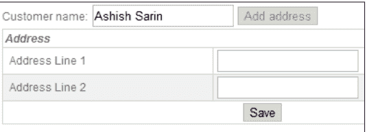

在给定的截图中，单击 **Save** 按钮将创建一个 `Customer` 以及相应的 `Address` 实体实例。

如前所述，Roo 生成的视图一次只允许创建或更新单个实体。在此场景中，我们需要同时创建 `Customer` 和 `Address` 实体。这不仅要求我们创建自定义视图，还需要创建自定义控制器。

### 准备工作

删除 `C:\roo-cookbook` 目录中 `ch04-recipe` 子目录的内容。

将 `ch04_manual_controller.roo` 脚本复制到 `ch04-recipe` 目录中。

执行 `ch04_manual_controller.roo` 脚本，该脚本将创建 flight-app Roo 项目，将 Hibernate 设置为持久性提供程序，将 MySQL 配置为应用程序数据库，创建 Flight、FlightDescription、Customer 和 Address JPA 实体，定义 Flight 和 FlightDescription 实体之间的多对一关系以及 Customer 和 Address 实体之间的一对一关系。如果您使用的数据库不是 MySQL，或者连接设置与脚本中指定的不同，请相应地修改脚本。

从 `C:\roo-cookbook\ch04-recipe` 目录启动 Roo shell。

### 操作步骤

要了解如何为给定的应用程序需求使用手动创建的 Spring Web MVC 控制器，请按以下步骤操作：

- 1. 执行 `web mvc setup` 命令，以设置 Spring Web MVC 工件，并将 Roo 项目转换为 Web 项目：
  ```
  roo> web mvc setup
  ```

- 2. 执行 `controller class` 命令，如下所示：
  ```
  roo> controller class --class ~.web.CustomerController
  --preferredMapping /customer
  ```
  Created SRC_MAIN_JAVA\sample\roo\flightapp\web\CustomerController.java
  Created SRC_MAIN_WEBAPP\WEB-INF\views\customer
  Created SRC_MAIN_WEBAPP\WEB-INF\views\customer\index.jspx
  Updated SRC_MAIN_WEBAPP\WEB-INF\i18n\application.properties
  Created SRC_MAIN_WEBAPP\WEB-INF\views\menu.jspx
  Created SRC_MAIN_WEBAPP\WEB-INF\tags\menu\menu.tagx
  Created SRC_MAIN_WEBAPP\WEB-INF\tags\menu\item.tagx
  Created SRC_MAIN_WEBAPP\WEB-INF\tags\menu\category.tagx
  Created SRC_MAIN_WEBAPP\WEB-INF\views\customer\views.xml

- 3. 在处理 `web mvc setup` 命令期间，许多依赖项被添加到 `flight-app` 项目的 `pom.xml` 文件中，因此执行 Roo 的 `perform eclipse` 命令以更新 Eclipse 项目的 `.classpath` 文件：
  ```
  roo> perform eclipse
  ```
  现在，在 Eclipse IDE 中导入 `flight-app` 项目。

- 4. 在 Customer.java 文件中，通过将 @OneToOne JPA 注解的 optional 属性值设置为 false，使 Customer 和 Address 实体之间的关联成为强制性。此外，将 @OneToOne 的 cascade 属性值设置为 CascadeType.ALL。以下清单显示了 Customer.java 中修改后的 @OneToOne 注解：

  ```
  import javax.persistence.CascadeType;
  ..
  @RooEntity(table = "CUSTOMER_TBL")
  public class Customer {
      @NotNull
      @Column(name = "CUST_NAME")
      private String customerName;
      @OneToOne(optional = false, cascade = CascadeType.ALL)
      @JoinColumn(name = "CUSTOMER_ID")
      private Address address;
  }
  ```

- 5. 在 Address.java 文件中，通过将 @OneToOne 注解的 optional 属性值设置为 false，使 Address 和 Customer 实体之间的关联成为强制性。由于 Customer 实体是关系的所有者，请将 @OneToOne JPA 注解的 mappedBy 属性值设置为 address。以下清单显示了 Address.java 中修改后的 @OneToOne 注解：

  ```
  ...
  @RooEntity(table = "ADDRESS_TBL")
  public class Address {
      @NotNull
      @Column(name = "ADDRESS_LINE1")
      private String addressLine1;
      ...
      @OneToOne(optional = false, mappedBy = "address")
      private Customer customer;
  }
  ```

  如同 Spring Roo 1.1.5 中，field reference 命令不支持任何参数来指定一对一双向关系的所有者；因此，您需要编辑 Java 源代码来指定 @OneToOne 注解的 mappedBy 属性值。另一方面，field set 命令确实提供 mappedBy 参数来指定关系所有者。

- 6. 将 SRC_MAIN_JAVA 文件夹中 sample.roo.flightapp.web 包下的 CustomerController.java 文件替换为本章源代码文件夹中包含的文件。

将 `/WEB-INF/views/customer/` 文件夹中的 `index.jspx` 文件替换为本章源代码文件夹中包含的 `index.jspx` 文件。

退出 Roo shell，并使用以下 maven 命令将 `flight-app` 项目部署到嵌入式 Tomcat 实例作为动态 Web 应用程序：

```
.ch04-recipe> mvn tomcat:run
```

现在，您可以通过访问以下 URL 来访问 `flight-app` 应用程序：
`http://localhost:8080/flight-app`

如果您看到以下网页，则表示您已成功在嵌入式 Tomcat 实例上部署 `flight-app` 应用程序：

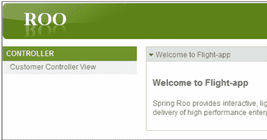

在给定的截图中，选择 **Customer Controller View** 菜单选项将带您进入创建 `Customer` 和 `Address` 实体的表单。

### 工作原理

`controller` 类命令用于创建手动控制器。它接受以下参数：

- `class`: 您要创建的控制器类的完全限定名。

- `preferredMapping`: 控制器映射到的请求路径。`preferredMapping` 参数的值用于推导生成的控制器中 `@RequestMapping` 类级注解的值。`preferredMapping` 的值还用于在 `/WEB-INF/views/` 内部创建一个子文件夹，用于包含与生成的控制器对应的 JSPX 视图和 tiles 定义 XML 文件。

如输出所示，执行 `controller` 类命令时，Roo 执行以下操作：

- 创建骨架 `CustomerController` Web 控制器，将控制器实现细节留给开发者提供。

- 在 `/WEB-INF/views/` 内部创建 `customer` 子文件夹。

- 在 `/WEB-INF/views/customer` 文件夹中创建骨架 `index.jspx` 视图，将视图详细信息留给开发者提供。

- 在 `/WEB-INF/views/customer` 文件夹中创建 tiles 定义 XML 文件 `views.xml`。它包含单个 tiles 定义 `customer/index`，对应 `index.jspx` 视图。如我们稍后将看到的，骨架 `CustomerController` 实现使用 `customer/index` tiles 定义来显示 `index.jspx` 视图。

- 将 `Customer Controller View` 标签添加到 `application.properties` 文件中，该文件被 `menu.jspx` 文件用于显示调用 `CustomerController` Web 控制器的菜单选项。

- 将标记为 `Customer Controller View` 的菜单选项添加到 `menu.jspx` 文件中，用于调用 `CustomerController` Web 控制器。

需要注意的是，执行 `controller class` 命令时不会创建 AspectJ ITD 文件。

以下来自 `CustomerController.java` 文件的代码显示了由 `controller class` 命令生成的 `CustomerController`：

```
@RequestMapping("/customer/**")
@Controller
public class CustomerController {

    @RequestMapping
    public void get(ModelMap modelMap, ...) { }

    @RequestMapping(method = RequestMethod.POST, value = "{id}")
    public void post(@PathVariable Long id, ...) { }

    @RequestMapping
    public String index() {
        return "customer/index";
    }
}
```

如给定代码所示，生成的控制器将控制器的实现留给开发者编写。当单击 **Customer Controller View** 菜单选项时，将调用 `index()` 方法。`index()` 方法只是返回 `customer/index`，从而显示 `index.jspx` 视图。

Roo 生成的 `CustomerController` 几乎没有任何用处，因此您需要编写其功能。随本章源代码提供的 `CustomerController.java` 文件包含创建 `Customer` 和 `Address` 实体所需的功能。让我们现在看看提供的 `CustomerController.java` 文件中定义的方法：


CustomerController 的 index() 方法将 Customer JPA 实体设置为表单支持对象，并添加另一个模型属性，用于标识是否显示表单的地址部分。CustomerController.java 文件中的以下代码展示了 index() 方法：

```java
@RequestMapping
public String index(Model model) {
model.addAttribute("showAddressSection", false);
Customer customer = new Customer();
customer.setAddress(new Address());
model.addAttribute("customer", customer);
return "customer/index";
}
```

index() 方法设置 showAddressSection 和 customer 模型属性。showAddressSection 属性被 index.jspx 视图用作标志，以决定是否显示或隐藏表单的地址部分。customer 模型属性代表 Customer JPA 实体，它充当表单支持对象。

现在，当用户单击“添加地址”按钮时，将调用 CustomerController 的以下 showAddress 方法：

```java
@RequestMapping(method = RequestMethod.POST,
params = "user-action=showAddressForm")
public String showAddress(@Valid Customer customer,
BindingResult result, Model model, ...) {
if (result.hasErrors()) {
model.addAttribute("customer", customer);
} else {
model.addAttribute("showAddressSection", true);
model.addAttribute("customer", customer);
}
return "customer/index";
}
```

给定代码中的 @RequestMapping 注解指定，当请求类型为 HTTP POST 且 user-action 请求参数的值为 showAddressForm 时，将调用 showAddress 方法。如果没有绑定或验证错误，则 showAddressSection 模型属性将设置为 true。

如果 showAddressSection 模型属性的值为 true，则表示 index.jspx 视图将显示表单的地址部分，以允许用户为客户输入地址。现在，用户可以输入地址信息并单击“保存”按钮以持久化 Customer 和关联的 Address JPA 实体实例。当用户单击“保存”按钮时，将调用 CustomerController 的以下 create 方法：

```java
@RequestMapping(method = RequestMethod.POST,
	params = "user-action=create")
public String create(@Valid Customer customer, ...) {
	customer.persist();
	return "customer/index";
}
```

给定代码中的 @RequestMapping 注解表示，当请求类型为 HTTP POST 且 user-action 请求参数的值为 create 时，将调用 create 方法。

以下代码展示了修改后的 /WEB-INF/views/customer/index.jspx 文件：

```xml
<?xml version="1.0" encoding="UTF-8" standalone="no"?>
<jsp:root xmlns:c="http://java.sun.com/jsp/jstl/core"
	xmlns:spring="http://www.springframework.org/tags"
	xmlns:form="http://www.springframework.org/tags/form">
<form:form modelAttribute="customer"
	action="customer" method="POST">
<form:errors cssClass="errors" delimiter="&lt;p/&gt;" />
<c:choose>
	<c:when test="${not showAddressSection}">
		<spring:message text="Customer name" />:
		<form:input path="customerName" />
		<input type="submit" value="Add address" />
		<input type="hidden" name="user-action"
			value="showAddressForm" />
	</c:when>
	<c:otherwise>
		<spring:message text="Customer name" />:
		<form:input path="customerName" onclick="blur();" />
		<input type="submit" value="Add address"
			disabled="disabled" />
		<input type="hidden" name="user-action"
			value="create" />
	</c:otherwise>
	<table>
		<thead>
			<tr>
				<td colspan="2">Address</td>
			</tr>
		</thead>
		<tr>
			<td>
				<label for="addressLine1">
Address Line 1
				</label>
			</td>
			...
		</tr>
	</table>
</form:form>
</jsp:root>
```

给定的 index.jspx 文件表明，我们可以在不使用 Spring Roo 安装的自定义标签库的情况下创建 JSPX 视图，也可以创建自己的自定义标签库并用它来创建 JSPX 视图。index.jspx 使用 Spring 的 form 标签库来创建 HTML 表单。showAddressSection 模型属性用于显示或隐藏表单的地址部分。user-action 隐藏输入字段将设置为适当的值（showAddressForm 或 create），具体取决于用户单击的是“添加地址”按钮还是“保存”按钮。

## 还有更多...

我们了解了如何使用 Roo 生成的 JPA 实体并编写自定义 JSPX 视图和 Web 控制器来创建 Web 应用程序。现在，我们来看看 Roo 为 @OneToMany 关系生成的视图存在的一个特定局限性：

## 为一对多关系脚手架 Spring Web MVC 应用程序

Spring Roo 不会为一对多关系中的“一”端脚手架 HTML 元素。让我们通过一个示例来看看这一点：

在 flight-app 应用程序中，Booking 实体实例表示客户对航班的预订。在特定航班上，可能存在多个预订；因此，Flight 和 Booking 实体之间的关系是一对多。随本书附带的 ch04_one_to_many.roo 脚本执行以下操作：

- 创建 Flight 和 Booking 实体
- 在 Flight 和 Booking 实体之间创建一对多关系
- 为实体创建控制器和 JSPX 视图

退出 Roo shell 并删除 ch04-recipe 的内容。执行 ch04_one_to_many.roo 脚本，并使用 maven 运行生成的 Spring Web MVC 应用程序（如“打包、部署和使用 Roo 生成的 Spring MVC 应用程序”配方中所述）。

现在，使用生成的 Web 应用程序中 **创建新预订** 菜单选项创建一个 Booking 实例，如以下屏幕截图所示：

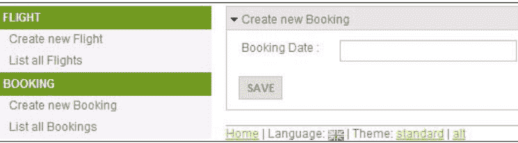

创建 Booking 实例后，您就可以创建新的 Flight 实例，并将 Flight 与新创建的 Booking 实例关联。要创建新的 Flight 实例，请选择 **创建新航班** 菜单选项，该选项将显示创建 Flight 实例的表单，如下图所示：

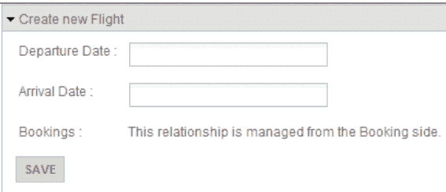

如给定的屏幕截图所示，Spring Roo 没有脚手架一个 HTML 元素来选择多个 Booking 实例，以帮助在 Flight 和 Booking 实体实例之间创建一对多关系。那么，当关系是一对多时，我们如何在实体之间创建关系呢？要使用脚手架 Spring Web MVC 应用程序来管理 Booking 和 Flight 实体之间的关系，请在 Booking 实体（关系的多端）中指定带 @ManyToOne 注解的字段，以在 Booking 和 Flight 实体之间创建多对一关系。现在，您可以创建 Flight 实例（而无需指定关联的 Booking 实例），并从创建 Booking（关系的多端）实例的表单中管理 Booking 和 Flight 实例之间的关系。

如果您不想向 Booking 实体添加带 @ManyToOne 注解的字段，可以修改 /WEB-INF/flights/create.jspx 视图（用于显示创建 Flight 实例表单）以添加一个字段，该字段显示一个多选列表框以显示 Booking 实例。create.jspx 中的以下 <field:simple> 自定义标签（由 Roo 安装）将显示消息：**此关系从 Booking 端进行管理**，当您选择菜单选项以查看创建 Flight 实例的表单时：

```xml
<field:simple field="bookings"
  id="c_sample_roo_flightapp_domain_Flight_bookings"
  messageCode="entity_reference_not_managed"
  messageCodeAttribute="Booking" z="..." />
```

您可以使用 `<field:select>` 标签（由 Roo 安装）替换 `<field:simple>` 标签，该标签显示一个多选列表框：

```xml
<field:select field="bookings"
  id="c_sample_roo_flightapp_domain_Flight_bookings"
  itemValue="id" items="${bookings}" multiple="true"
  path="/bookings"/>
```

如果您查看 FlightController_Roo_Controller.aj 文件，会找到一个带 @ModelAttribute 注解的方法，该方法将所有 Booking 实例存储在名为 bookings 的模型属性中。在给定的代码中，bookings 模型属性由 `<field:select>` 标签的 `items` 属性引用，以在多选列表框中显示 Booking 实例。

## 另请参见

- 请参阅“在实体之间创建一对多（或多对多）关系”配方
- 第 3 章配方

## 向 Roo 生成的 Web 应用程序添加静态视图

在 Spring Web MVC 应用程序中，静态视图是指无需显式创建控制器类的视图。我们之前了解到，Roo 脚手架的 Spring Web MVC 应用程序使用 Spring mvc 架构中的 `<view-controller>` 元素来配置静态视图。静态视图没有显式控制器，但在幕后，Spring 的内置 `ParameterizableViewController` 用于呈现静态视图。有关 Roo 生成的 Web 应用程序中预配置静态视图的详细信息，请参阅“从 JPA 实体自动生成 Spring MVC 控制器和 JSPX 视图”配方。

在本配方中，我们将查看 Roo 的 `web mvc install view` 命令，该命令用于创建静态视图。

### 准备工作

删除 `C:\roo-cookbook` 目录中 `ch04-recipe` 子目录的内容。

将 `ch04_web-app.roo` 脚本复制到 `ch04-recipe` 目录中。


执行 `ch04_web-app.roo` 脚本来创建 `flight-app` Roo 项目，将 Hibernate 设置为持久化提供程序，将 MySQL 配置为应用程序的数据库，创建 `Flight` 和 `FlightDescription` JPA 实体，并在 `Flight` 和 `FlightDescription` 实体之间定义多对一关系。如果使用的数据库不是 MySQL，或者连接设置与脚本中指定的不同，则相应地修改脚本。

从 `C:\roo-cookbook\ch04-recipe` 目录启动 Roo shell。

执行 `controller all` 命令，为 `flight-app` 项目中的 JPA 实体创建相应的控制器和视图，如下所示：

```
.. roo> controller all --package ~.web
```

执行 `perform eclipse` 命令以更新项目的类路径设置，如下所示：

```
.. roo> perform eclipse
```

现在，将 `flight-app` 项目导入到您的 Eclipse IDE 中。

### 操作方法...

要向 Roo 生成的 Web 应用程序添加静态视图，请执行 `web mvc install view` 命令，如下所示：

```
.. roo> web mvc install view --path /static/views --viewName help --title Help
```

```
Created SRC_MAIN_WEBAPP\WEB-INF\views\static\views
Created SRC_MAIN_WEBAPP\WEB-INF\views\static\views\help.jspx
Managed SRC_MAIN_WEBAPP\WEB-INF\i18n\application.properties
Managed SRC_MAIN_WEBAPP\WEB-INF\views\menu.jspx
Created SRC_MAIN_WEBAPP\WEB-INF\views\static\views\views.xml
Managed SRC_MAIN_WEBAPP\WEB-INF\spring\webmvc-config.xml
```

### 工作原理...

下表描述了 `web mvc install view` 命令接受的参数：

| 参数 | 说明 |
| :--- | :--- |
| `path` | 指定在 `/WEB-INF/views/` 文件夹中创建视图的子文件夹。 |
| `viewName` | 视图 JSPX 文件的名称。 |
| `title` | 指定可访问静态视图的菜单选项名称。 |

正如 `web mvc install view` 命令的输出所示，执行该命令后 Spring Roo 会执行以下操作：

- 在 /WEB-INF/views 文件夹内创建 /static/views 目录。Roo 使用 path 参数的值来确定要创建的目录。
- 在 /WEB-INF/views/static/views 目录内创建 help.jspx 文件。viewName 参数的值用作 JSPX 文件的名称。
- 向 application.properties 添加值为 Help 的属性，即，title 参数的值用作新添加属性的值。该属性由 menu.jspx 用于显示 **帮助** 菜单选项。**帮助** 菜单选项允许访问新创建的 help.jspx 视图。
- 在 /WEB-INF/views/static/views/views.xml 中创建 tiles 定义 XML 文件，包含用于显示 help.jspx 视图的单个 tiles 定义，如下所示：

```xml
<tiles-definitions>
    <definition extends="default" name="static/views/help">
        <put-attribute name="body"
            value="/WEB-INF/views/static/views/help.jspx"/>
    </definition>
</tiles-definitions>
```

- 向 webmvc-config.xml 添加 `<view-controller>` 元素，以便在无需编写控制器的情况下访问 help.jspx 视图，如下所示：

`<mvc:view-controller path="/static/view/help"/>`

## 另请参阅

- 有关如何创建自定义控制器和视图的详细信息，请参阅 *手动为 JPA 实体创建 Spring MVC 控制器* 配方。

## 国际化 Roo 生成的 Web 应用程序

Roo 通过为标签和消息使用资源包，支持完整 UI 的国际化。在本配方中，我们将查看 Roo 的 `web mvc install language` 命令，并了解它如何简化 Roo 生成的 Web 用户界面的国际化。

### 准备工作

删除 C:\roo-cookbook 目录内 ch04-recipe 子目录的内容。

将 ch04_web-app.roo 脚本复制到 ch04-recipe 目录中。

执行 ch04_web-app.roo 脚本，该脚本创建 flight-app Roo 项目，将 Hibernate 设置为持久化提供程序，将 MySQL 配置为应用程序的数据库，创建 Flight 和 FlightDescription JPA 实体，并在 Flight 和 FlightDescription 实体之间定义多对一关系。如果使用的数据库不是 MySQL，或者连接设置与脚本中指定的不同，则相应地修改脚本。

从 C:\roo-cookbook\ch04-recipe 目录启动 Roo shell。

执行 controller all 命令，为 flight-app 项目中的 JPA 实体创建相应的控制器和视图，如下所示：

```
.. roo> controller all --package ~.web
```

执行 perform eclipse 命令以更新项目的类路径设置，如下所示：

```
.. roo> perform eclipse
```

现在，将项目导入到您的 Eclipse IDE 中。

### 操作方法...

要对 Roo 生成的 Web 用户界面进行国际化，请执行 web mvc install language，如下所示：

```
.. roo> web mvc install language --code es
```

```
Created SRC_MAIN_WEBAPP\WEB-INF\i18n\messages_es.properties
Created SRC_MAIN_WEBAPP\images\es.png
Managed SRC_MAIN_WEBAPP\WEB-INF\views\footer.jspx
```

### 工作原理...

web mvc install language 命令接受一个参数：code，用于标识需要为其添加支持的 Web 应用程序的语言代码。code 参数接受一个预定义的语言代码，具体取决于 Spring Roo 支持的语言。Spring Roo 为以下语言代码的标准消息和标签包含翻译：de（德语）、en（英语）、es（Espanol）、it（意大利语）、nl（荷兰语）和 sv（瑞典语）。

执行 web mvc install language 命令时，Roo 通过执行以下操作来处理该命令：

- 在 /WEB-INF/i18n/ 文件夹中创建 messages_es.properties
- 在 images 目录中为语言复制图像图标 (es.png)
- 更新 /WEB-INF/views/footer.jspx 以显示语言的图像图标

要检查 Espanol 语言支持是否已正确安装，请部署并运行 flight-app 应用程序。添加 Espanol 语言支持后，flight-app 应用程序的主页如下图所示：

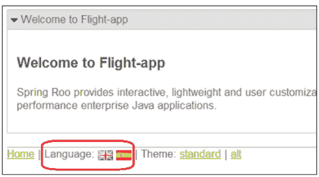

如给定截图所示，将显示一个其他图像图标，以允许用户将 Web 应用程序的语言更改为 Espanol。当用户单击与语言对应的图像图标时，请求中会设置 lang 请求参数，LocaleChangeInterceptor（在 /WEB-INF/spring/webmvc-config.xml 中配置）使用该参数来更改当前区域设置。

在 /WEB-INF/spring/webmvc-config.xml 中配置的 CookieLocaleResolver 在浏览器中存储名为 locale 的 cookie，以便用户在每次访问 Web 应用程序时都不需要更改其首选语言。

## 更多内容...

在“从 JPA 实体自动生成 Spring MVC 控制器和 JSPX 视图”配方中，我们讨论过 messages.properties 包含所有 Roo 生成的 Web 应用程序共用的消息和标签，而 application.properties 包含特定于应用程序的消息和标签。

由于 Roo 无法为特定于应用程序的消息和标签提供翻译，因此 web mvc install language 命令不会创建 application_<language-code>.properties 文件。开发者需要为特定语言代码创建 application_<language-code>.properties 文件并提供翻译。

## 另请参阅

- 有关 LocaleChangeInterceptor 和 CookieLocaleResolver 配置的信息，请参阅“从 JPA 实体自动生成 Spring MVC 控制器和 JSPX 视图”配方。

## 添加或修改 Roo 生成的主题

主题是定义 Web 应用程序整体外观和感觉的 CSS 和图像文件集合。Spring Web MVC 框架为定义和应用主题提供了内置支持。在“从 JPA 实体自动生成 Spring MVC 控制器和 JSPX 视图”配方中，我们简要介绍了 Roo 生成的 Spring Web MVC 应用程序中的主题支持。在本配方中，我们将详细了解如何向 Roo 生成的 Spring Web MVC 应用程序添加新主题以及修改 Roo 安装的默认主题。

在本配方中，我们将对 Roo 生成的 `flight-app` Web 应用程序进行以下修改：

- 添加新的自定义主题
- 修改现有主题，以显示不同的菜单标题背景颜色和不同的标题图像
- 添加新的 `standard` 主题，当语言为 `es`（即 Espanol）时应用该主题

### 准备工作

删除 `C:\roo-cookbook` 目录内 `ch04-recipe` 子目录的内容。

将 `ch04_web-app.roo` 脚本复制到 `ch04-recipe` 目录中。

执行 `ch04_web-app.roo` 脚本，该脚本创建 `flight-app` Roo 项目，将 Hibernate 设置为持久化提供程序，将 MySQL 配置为应用程序的数据库，创建 `Flight` 和 `FlightDescription` JPA 实体，并在 `Flight` 和 `FlightDescription` 实体之间定义多对一关系。如果使用的数据库不是 MySQL，或者连接设置与脚本中指定的不同，则相应地修改脚本。

从 `C:\roo-cookbook\ch04-recipe` 目录启动 Roo shell。

执行 `controller all` 命令，为 `flight-app` 项目中的 JPA 实体创建相应的控制器和视图，如下所示：

```
.. roo> controller all --package ~.web
```

执行 `perform eclipse` 命令以更新项目的类路径设置，如下所示：

```
.. roo> perform eclipse
```

现在，将 `flight-app` 项目导入到您的 Eclipse IDE 中。


## 如何执行...

要添加新主题并修改现有主题，请按照此处给出的步骤操作：

- 1. 在 /WEB-INF/classes 文件夹中创建 custom.properties 文件并设置以下属性：

```
styleSheet=resources/styles/custom.css
header_image=resources/images/custom_image.png
```

custom.properties 文件表示定义我们要添加到 flight-app 应用程序的自定义主题的文件。

- 2. 在 /WEB-INF/classes 文件夹中创建 standard_es.properties 文件并设置以下属性：

```
styleSheet=resources/styles/standard_es.css
header_image=resources/images/standard_es_image.png
```

standard_es.properties 文件表示定义语言为 es 时的标准主题的文件。

- 3. 更新 /WEB-INF/classes 文件夹中的 alt.properties 文件，使其包含以下属性：

```
styleSheet=resources/styles/alt.css
header_image=resources/images/alt_image.png
```

alt.properties 文件表示定义备用主题的文件。该主题由 Roo 安装。

- 4. 更新 /WEB-INF/classes 文件夹中的 standard.properties 文件，使其包含以下属性：

```
styleSheet=resources/styles/standard.css
header_image=resources/images/standard_image.png
```

standard.properties 文件表示定义标准主题的文件。该主题由 Roo 安装。

- 5. 将随本章附带的 alt_image.png（备用主题横幅图片）、custom_image.png（新添加自定义主题横幅图片）、standard_es_image.png（语言为 es 时新添加标准主题横幅图片）和 standard_image.png（标准主题横幅图片）复制到 flight-app 应用程序的 SRC_MAIN_WEBAPP/images/ 文件夹中。

- 6. 复制 SRC_MAIN_WEBAPP/styles/alt.css（备用主题的 CSS）并将其命名为 custom.css（新添加自定义主题的 CSS）。通过修改 #menu h2 定义中的 background 元素来更改菜单标题的背景颜色，如下所示：

```
#menu h2 {
  color: #fff;
  background: #3f0;
  text-transform: uppercase;
  font-weight: bold;
  font-size: 12px;
}
```

- 7. 更改 standard.css（标准主题 CSS）文件中 #menu h2 定义的 background 元素，如下所示：

```
#menu h2 {
  color: #fff;
  background: #06c;
  text-transform: uppercase;
  font-weight: bold;
  font-size: 12px;
}
```

- 8. 复制 SRC_MAIN_WEBAPP/styles/standard.css 并将其命名为 standard_es.css（语言为 es 时新添加标准主题的 CSS）。通过修改 #menu h2 定义中的 background 元素来更改菜单标题的背景颜色，如下所示：

```
#menu h2 {
  color: #fff;
  background: #f0f;
  text-transform: uppercase;
  font-weight: bold;
  font-size: 12px;
}
```

- 9. 修改 /WEB-INF/tags/util/theme.tagx 文件以添加切换到自定义主题的超链接（或者，您也可以复制随本章源代码附带的 theme.tagx 文件）：

```
...
<c:out value=" | " />
<spring:url var="url_theme3" value="">
  <spring:param name="theme" value="custom" />
  <c:if test="${not empty param.page}">
    <spring:param name="page" value="${param.page}" />
  </c:if>
  <c:if test="${not empty param.size}">
    <spring:param name="size" value="${param.size}" />
  </c:if>
</spring:url>

<spring:message code="global_theme_custom" var="theme_custom" />

<a href="${url_theme3}" title="${theme_custom}">${theme_custom}</a>
```

给定代码中的 <spring:message> 标签显示 **自定义** 链接，该链接允许将主题切换到 custom。

- 10. 将以下属性添加到 /WEB-INF/i18n/messages.properties 文件中：

```
global_theme_custom=custom
```

此属性由 theme.tagx 用于显示 **自定义** 链接。

- 11. 更新 /WEB-INF/views/header.jspx 文件以使用主题文件中定义的 header_image 属性作为横幅图片（或者，使用随本章附带的 header.jspx 文件）：

```
<spring:theme code="header_image" var="headerImg"/>
<spring:url value="/${headerImg}" var="banner" />
```

- 12. 使用 web mvc install language 命令添加对 es（西班牙语）的语言支持，如下所示：

```
..\roo> web mvc install language --code es
```

- 13. 使用 Maven 将 flight-app 应用程序部署到嵌入式 Tomcat 实例中，如下所示：

```
..\roo> mvn tomcat:run
```

## 工作原理...

让我们深入了解 Spring MVC 应用程序中主题的配置和使用方式：

在 webmvc-config.xml 中，ResourceBundleThemeSource 由 Spring Roo 配置。使用 ResourceBundleThemeSource 时，所有主题资源（图像和 CSS）都定义在一个属性文件（主题源）中，该文件位于类路径根目录（即 /WEB-INF/classes 目录）中。因此，/WEB-INF/classes 中的每个属性文件都构成一个主题定义文件。默认情况下，Roo 在 /WEB-INF/classes 目录中创建两个属性文件：standard.properties 和 alt.properties。可以说，在 Roo 生成的 Spring Web MVC 应用程序中，默认安装了两个主题。那么，这些属性文件包含什么内容？每个属性文件都包含构成主题一部分的 CSS 和图像的信息。alt.properties 文件包含以下属性：

```
styleSheet=resources/styles/alt.css
```

standard.properties 文件包含以下属性：

```
styleSheet=resources/styles/standard.css
```

如您所见，alt.properties 和 standard.properties 均定义了 styleSheet 属性，该属性引用一个 CSS 文件。根据您在 Roo 生成的 Web 应用程序中选择的主题，将应用适当的样式表到 Web 应用程序。

您可能会问的下一个问题是——Spring Web MVC 应用程序如何知道应用哪个主题？好吧，这时以下 Roo 生成的 CookieThemeResolver 配置就派上用场了：

```
<bean class="org.springframework.web.servlet.theme.CookieThemeResolver" id="themeResolver" p:cookieName="theme" p:defaultThemeName="standard"/>
```

cookieName 属性指定 cookie 的名称，该 cookie 包含应用于 Web 应用程序的主题。如果未找到 cookie，则配置使用 defaultThemeName 属性标识的主题（即 standard）；因此，由 standard.properties 定义的主题默认由 Roo 生成的 Spring Web MVC 应用程序使用。

现在，我们知道如何使用属性文件定义主题以及如何为 Spring Web MVC 应用程序配置主题。现在让我们看看 JSPX 视图如何访问主题资源：

JSPX 视图使用 Spring 标签库的 <theme> 标签访问属性文件中定义的主题资源（例如图像和 CSS），如下所示：

```
<spring:theme code="header_image" var="headerImg" />
```

code 属性用于标识您要从主题属性文件中访问的属性名称。<theme> 标签的 var 属性指定存储属性值的变量名称。读取属性所依据的主题属性文件取决于应用于 Web 应用程序的当前主题。例如，如果当前主题是 standard，则从 standard.properties 文件中读取 header_image 属性；如果当前主题是 custom，则从 custom.properties 文件中读取 header_image 属性，以此类推。

ResourceBundleThemeSource 还支持配置本地化主题。例如，/WEB-INF/classes 中的 standard_es.properties 文件定义了主题资源，当语言为 es 且主题为 standard 时应用这些资源。

现在，让我们来看看如何在 Roo 生成的 Web 应用程序的网页底部添加自定义主题名称。您只需修改 theme.tagx 文件，该文件负责显示所有主题超链接。当您选择心仪的主题时，ThemeChangeInterceptor 就会介入，它允许在每个请求中更改当前主题。


以下截图显示了当当前主题为修改后的标准主题时，`flight-app` 应用程序主页的外观：

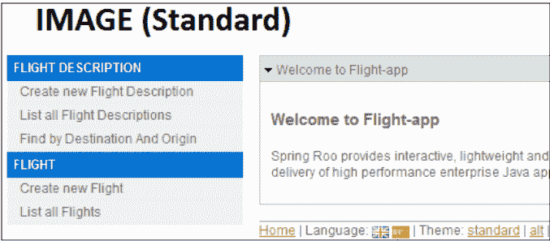

在给定的截图中，您会注意到 **航班描述** 和 **航班** 等菜单标题的背景颜色发生了变化。您还会注意到，而不是默认的标题图像，显示了包含文本 **图像（标准）** 的图像。由于我们为每个主题复制了不同的图像，因此会显示一张不同的图像，用于标识当前应用于 Web 应用程序的主题。

以下截图显示了当我们从页脚选择 Espanol 语言而不更改当前标准主题时，`flight-app` 应用程序的主页：

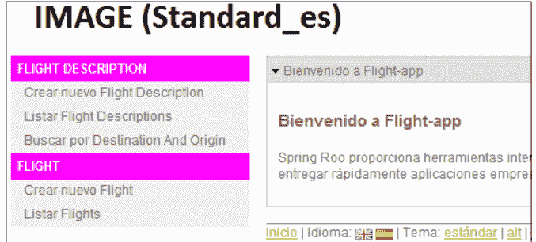

同样，请注意菜单标题背景颜色的变化以及标题图像的变化。

以下截图显示了当所选语言为英语且主题为自定义主题时，flight-app Web 应用程序的主页：

## 还有更多...

在某些场景中，您可能在 /WEB-INF/classes 目录中拥有其他属性文件。例如，您可能在 /WEB-INF/classes 中有一个 log4j.properties 文件供 log4j 库使用。在这种情况下，您可能希望将主题属性文件保存在与类路径根不同的文件夹中。您可以通过使用 ResourceBundleThemeSource 的 basenamePrefix 属性来实现这一点。例如，考虑 webmvc-config.xml 文件中 ResourceBundleThemeSource 的以下配置：

```
<bean class="org.springframework.ui.context.support.ResourceBundleThemeSource" id="themeSource"
p:basenamePrefix="themes."/>
```

basenamePrefix 属性的值 themes. 实际上表示 ResourceBundleThemeSource 应在 /WEB-INF/classes/themes 目录中查找主题。

## 另请参见

- 有关 webmvc-config.xml 文件中定义的配置的更多信息，请参阅“从 JPA 实体自动生成 Spring MVC 控制器和 JSPX 视图”配方

## 为领域对象和控制器添加 JSON 支持

假设您使用 Roo 开发了应用程序的持久层。现在，您希望通过 RESTful 接口将 Roo 生成的 JPA 实体中定义的 CRUD 操作和动态查找器方法暴露给外部。

Roo 支持通过使用 JSON 文档交换数据的 RESTful 接口来暴露 JPA 实体的 CRUD 操作和动态查找器。由于 Roo 生成的 RESTful 接口使用 JSON，您可以修改 Roo 生成的 Spring Web MVC 应用程序的 JSPX 页面，以使用 Ajax 与这些 RESTful 接口进行交互。

Roo 提供两个命令，用于向 Roo 项目中的现有类添加 JSON 支持：

- - json add：使用 class 参数指定的类添加 JSON 支持

- - json all：为使用 @RooJavaBean 注解的所有类添加 JSON 支持

json add 和 json all 命令会将 @RooJson 注解添加到 Java 类中。@RooJson 注解会导致创建与使用 @RooJson 注解的类对应的 *_Roo_Json.aj AspectJ ITD。在本配方中，我们将查看 *_Roo_Json.aj AspectJ ITD 和 @RooJson 注解。

需要注意的是，@RooJson 注解允许您控制相应的 *_Roo_Json.aj ITD 文件中与 JSON 相关的方法的自动生成。

### 准备工作

删除 C:\roo-cookbook 目录中 ch04-recipe 子目录的内容。

将 ch04_web-app.roo 脚本复制到 ch04-recipe 目录中。

执行 ch04_web-app.roo 脚本，该脚本会创建 flight-app Roo 项目，将 Hibernate 设置为持久性提供程序，将 MySQL 配置为应用程序的数据库，创建 Flight 和 FlightDescription JPA 实体，并定义 Flight 和 FlightDescription 实体之间的多对一关系。如果您使用的数据库不是 MySQL，或者您的连接设置与脚本中指定的不同，请相应地修改脚本。

从 C:\roo-cookbook\ch04-recipe 目录启动 Roo shell。

执行 controller all 命令，为 flight-app 项目中的 JPA 实体创建控制器和 JSPX 视图，如下所示：

```
.. roo> controller all --package ~.web
```

执行 perform eclipse 命令以更新项目的类路径设置，如下所示：

```
.. roo> perform eclipse
```

现在，将 flight-app 项目导入到 Eclipse IDE 中。

### 操作步骤...

要添加 json 支持，请针对 Flight JPA 实体执行 json add 命令：

```
~.domain.Flight roo> json add --class ~.domain.Flight
Updated SRC_MAIN_JAVA\...\domain\Flight.java
Created SRC_MAIN_JAVA\...\domain\Flight_Roo_Json.aj
Created SRC_MAIN_JAVA\...\web\FlightController_Roo_Controller_Json.aj
```

或者，向 Flight.java 类添加 @RooJson 注解。向 Flight 实体添加 @RooJson 注解与针对 Flight 实体执行 json add 命令效果相同。添加 @RooJson 注解将导致自动生成 Flight_Roo_Json.aj 和 FlightController_Roo_Controller_Json.aj AspectJ ITD。

### 工作原理...

执行 json add 命令会将类（通过 class 参数指定）标记为 @RooJson 注解。如果类使用了 @RooJson 注解，Roo 会创建一个 *_Roo_Json.aj AspectJ ITD，该 ITD 定义了将该类的对象转换为 JSON 文档及其反向转换的方法。

我们看到，当针对 Flight 实体执行 json addon 命令时，还会创建一个 FlightController_Roo_Controller_Json.aj AspectJ ITD。如果 FlightController.java 类中 @RooWebScaffold 的 exposeJson 属性值为 true，则会创建此 ITD。如果未指定 @RooWebScaffold 的 exposeJson 属性，则默认值为 true。

如果 exposeJson 属性的值为 true，并且 Web 控制器使用的作为表单后备对象的 JPA 实体使用了 @RooJson 注解，则 Roo 会创建与 Web 控制器类对应的 *_Roo_Controller_Json.aj ITD。此 ITD 定义了基于 JSON 的方法，用于执行 JPA 实体的 CRUD 操作和执行动态查找器方法。例如，FlightController_Roo_Controller_Json.aj ITD 将 JSON 相关方法引入 FlightController.java 类，用于对 Flight 实体执行 CRUD 操作。

以下清单显示了与使用 @RooJson 注解的 Flight 实体相对应的 Flight_Roo_Json.aj ITD 文件中定义的方法：

```
import flexjson.JSONDeserializer;
import flexjson.JSONSerializer;

privileged aspect Flight_Roo_Json {
    public String Flight.toJson() {
        return new JSONSerializer().exclude("*.class").
        serialize(this);
    }
    public static Flight Flight.fromJsonToFlight(String json) {
        return new JSONDeserializer<Flight>().use(null,
        Flight.class).deserialize(json);
    }
    public static String Flight.toJsonArray(
        Collection<Flight> collection) {
        ...
    }
    public static Collection<Flight>
        Flight.fromJsonArrayToFlights(String json) {
        ...
    }
}
```

在给定的代码清单中，Roo 使用 Flexjson 库来支持 JSON 文档的序列化和反序列化。在 Flight_Roo_Json.aj 中定义的自动生成的 JSON 方法如下：

- - toJson：将当前 Flight 对象转换为 JSON 文档

- - fromJsonToFlight：将作为参数传递的 JSON 文档转换为 Flight 对象

- - toJsonArray：将 Flight 对象的集合转换为包含数组的 JSON 文档

- - fromJsonArrayToFlights：将 JSON 数组文档转换为 Flight 对象的集合

- - 如果您想要自定义 @RooJson 生成的 JSON 方法的名称，可以使用 @RooJson 注解的以下属性：

  - - fromJsonArrayMethod：用于自定义 fromJsonArrayTo<_class_name_> 方法的名称

  - - fromJsonMethod：用于自定义 fromJson<_class_name_> 方法的名称

  - - toJsonArrayMethod：用于自定义 toJsonArray 方法的名称

  - - toJsonMethod：用于自定义 toJson 方法的名称

<class_name> 指的是 JSON 方法适用的 JPA 实体类的名称。如果某个元素的值为 ""，则 Roo 不会在 *_Roo_Json.aj 文件中生成相应的方法。


需要注意的是，你可以使用 `json add` 命令为任何类添加 JSON 支持。例如，如果你创建一个 `MyKlass` 类并使用 `@RooJson` 对其进行注解，那么 Roo 将自动生成给定的方法，其中 `<class-name>` 为 `MyKlass`。

## 排除序列化的字段

要排除序列化为 JSON 格式的字段，你只需使用 `@JSON(include=false)` 注解对该字段或其对应的 getter 方法进行注解即可。

在某些 JavaScript 库（如 EXT JS）中，预期 JSON 文档包含根节点。你可以通过使用 `json add` 命令的 `rootName` 参数，或设置 `@RooJson` 注解的 `rootName` 属性，来指示 Roo 设置生成的 JSON 文档的根节点。当使用 `json add` 命令的 `rootName` 参数时，生成的 `@RooJson` 注解的 `rootName` 属性将被设置为 `rootName` 命令参数的值。

以下代码片段显示了当 `Flight.java` 文件上 `@RooJson` 注解的 `rootName` 属性设置为 `myRoot` 时的 `Flight_Roo_Json.aj` ITD：

```
import flexjson.JSONDeserializer;
import flexjson.JSONSerializer;

privileged aspect Flight_Roo_Json {
    public String Flight.toJson() {
        return new JSONSerializer().rootName("myRoot").exclude("*.class").serialize(this);
    }
    ...
    public static String Flight.toJsonArray(
        Collection<Flight> collection) {
        return new JSONSerializer().
        rootName("myRoot").exclude("*.class").
        serialize(collection);
    }
    ...
}
```

给定代码显示，如果指定了 `@RooJson` 注解的 `rootName` 属性，则 `*_Roo_Json.aj` ITD 的 `toJson` 和 `toJsonArray` 方法将使用 Flexjson 的 `JSONSerializer` 对象的 `rootName` 方法将 JSON 文档的根节点设置为 `myRoot`。传递给 `rootName` 方法的参数是为 `@RooJson` 注解的 `rootName` 属性设置的值。

以下代码显示了 FlightController_Roo_Controller_Json.aj ITD，该 ITD 是因为 FlightController.java 文件中 @RooWebScaffold 的 exposeJson 属性值为 true 而生成的：

```
import org.springframework.http.ResponseEntity;
import org.springframework.web.bind.annotation.ResponseBody;
privileged aspect FlightController_Roo_Controller_Json {

@RequestMapping(value = "/{flightId}",
method = RequestMethod.GET,
headers = "Accept=application/json")
@ResponseBody
public Object FlightController.
showJson(@PathVariable("flightId") Long flightId) {
Flight flight = Flight.findFlight(flightId);
if (flight == null) {
HttpHeaders headers= new HttpHeaders();
headers.add("Content-Type", "application/text");
return new ResponseEntity<String>(headers,
HttpStatus.NOT_FOUND);
}
return flight.toJson();
}
...
}
```

给定代码显示了 ITD 添加到 FlightController.java 类的 showJson 方法。showJson 方法是 ITD 中定义的许多与 JSON 相关的方法之一。showJson 方法将 Flight 对象作为 JSON 文档返回。showJson 方法返回通过请求 URI 指定标识符的 flight 实体的 JSON 表示形式。如果请求 URL 为 /flights/10，则 showJson 方法将返回标识符值为 10 的 Flight 实体实例的 JSON 表示形式。@ResponseBody 注解指示 Spring Web MVC 框架将响应写入 HTTP 响应体中。@RequestMapping 注解的 headers 属性指定 Web 请求中必须存在的请求头。

要测试 FlightController_Roo_Controller_Json.aj 中定义的与 JSON 相关的方法，你可以使用 Firefox 的 Poster 插件，也可以使用 Linux 的 curl 命令。

### 另请参阅

- 请参阅“为特定 JPA 实体创建 Spring MVC 控制器”和“从 JPA 实体自动生成 Spring MVC 控制器和 JSPX 视图”的示例，以查看 Roo 生成的方法的详细信息。

## 为 Web 控制器创建和执行 Selenium 测试

自动化 Web 应用程序测试是任何 Web 应用程序开发工作的重要组成部分。Spring Roo 提供了针对 Spring Web MVC 控制器自动生成 Selenium 测试的支持。在本示例中，我们将介绍如何使用 Roo 为 Web 控制器生成 Selenium 测试，以及如何使用 Selenium Maven 插件来执行这些测试。

### 准备工作

删除 `C:\roo-cookbook` 目录内 `ch04-recipe` 子目录的内容。

将 `ch04_web-app.roo` 脚本复制到 `ch04-recipe` 目录中。

执行 `ch04_web-app.roo` 脚本，该脚本会创建 `flight-app` Roo 项目，将 Hibernate 设置为持久化提供程序，将 MySQL 配置为应用程序的数据库，创建 `Flight` 和 `FlightDescription` JPA 实体，并定义 `Flight` 和 `FlightDescription` 实体之间的多对一关系。如果你使用的数据库不是 MySQL，或者你的连接设置与脚本中指定的不同，请相应地修改脚本。

从 `C:\roo-cookbook\ch04-recipe` 目录启动 Roo shell。

执行 `controller all` 命令，为 `flight-app` 项目中的 JPA 实体创建相应的控制器和视图，如下所示：

```
.. roo> controller all --package ~.web
```

执行 `perform eclipse` 命令以更新项目的类路径设置，如下所示：

```
.. roo> perform eclipse
```

现在，将 `flight-app` 项目导入到你的 Eclipse IDE 中。

安装 Firefox Web 浏览器，它是执行 Selenium 测试时默认使用的浏览器。如果你想使用其他 Web 浏览器，请参阅本示例的 _工作原理..._ 部分。

### 操作步骤...

以下步骤演示如何创建 Selenium 测试：

- 1. 执行 `selenium test` 命令为 `FlightDescriptionController` 创建 Selenium 测试，如下所示：

```
.. roo> selenium test --controller ~.web.FlightDescriptionController --name testFlightDescriptionController --serverUrl http://localhost:8080/
Created SRC_MAIN_WEBAPP\selenium
Created SRC_MAIN_WEBAPP\selenium\test-flightdescription.xhtml
Created SRC_MAIN_WEBAPP\selenium\test-suite.xhtml
Managed SRC_MAIN_WEBAPP\WEB-INF\i18n\application.properties
Managed SRC_MAIN_WEBAPP\WEB-INF\views\menu.jspx
Managed ROOT\pom.xml
```

- 2. 执行 selenium test 命令为 FlightController 创建 Selenium 测试，如下所示：

.. roo> selenium test --controller ~.web.FlightController --name testFlightController --serverUrl http://localhost:8080/
Created SRC_MAIN_WEBAPP\selenium\test-flight.xhtml
Managed SRC_MAIN_WEBAPP\selenium\test-suite.xhtml

- 3. 退出 Roo shell，并通过执行 tomcat:run 目标在内嵌 Tomcat（或 Jetty）实例中运行 flight-app 项目：

.. recipe> mvn tomcat:run

- 4. 打开另一个命令提示符，并执行 selenium:selenese Maven 目标来运行 Selenium 测试，如下所示：

.. recipe> mvn selenium:selenese

### 工作原理...

selenium test 命令为 Web 控制器创建 Selenium 测试。下表描述了 selenium test 命令接受的参数：

| 参数 | 描述 |
| :--- | :--- |
| controller | 指定需要为其创建 Selenium 测试的 Web 控制器的完全限定名。 |
| name | 生成的 Selenium 测试的名称。 |
| serverUrl | Web 应用程序运行所在服务器的 URL。serverUrl 参数的默认值为 http://localhost:8080/。在使用 Selenium Maven 插件执行 Selenium 测试时，将使用 serverUrl 参数的值。 |

第一次执行 selenium test 命令时，Roo 将执行以下任务：

- 创建 SRC_MAIN_WEBAPP/selenium 文件夹，所有 Selenium 测试均在此创建
- 创建 test-<JPA-entity-name>.xhtml 文件，该文件表示用于测试 Web 控制器的 Selenium 脚本。<JPA-entity-name> 是 Web 控制器所管理的 JPA 实体的名称。
- 创建 test-suite.xhtml 文件，该文件包含构成 Web 应用程序一部分的 Selenium 测试集合。
- 向 application.properties 文件添加一个值为 Selenium Tests 的新标签属性。menu.jspx 文件使用该标签来显示一个菜单类别，你将在其中找到一个名为“Test Suite”的超链接。单击 Test Suite 链接将显示构成 Web 应用程序一部分的所有 Selenium 测试列表。
- 更新 pom.xml 文件以配置 Selenium Maven 插件。以下 XML 片段显示了 Selenium Maven 插件的配置：

```
<plugin>
<groupId>org.codehaus.mojo</groupId>
<artifactId>selenium-maven-plugin</artifactId>
<version>1.1</version>
<configuration>
<suite>src\main\webapp\selenium\test-suite.xhtml</suite>
<browser>*firefox</browser>
<results>
${project.build.directory}/selenium.html</results>
<startURL>http://localhost:4444</startURL>
</configuration>
</plugin>
```

<configuration> 元素配置 Selenium Maven 插件的设置。<suite> 元素标识 Selenium 测试套件，在运行 selenium:selenese 目标时将执行该套件。<browser> 元素指定用于执行 Selenium 测试的 Web 浏览器。值 *firefox 表示将使用 Firefox Web 浏览器执行测试。如果要使用 IE 执行 Selenium 测试，则请将 *iexplore 指定为 <browser> 元素的值。如果要使用任何其他浏览器，则请将 *custom 指定为该值。<startURL> 标识 Selenium 服务器运行所在的 URL。Selenium 服务器充当运行 Selenium 测试的浏览器与正在测试的 Web 应用程序之间的代理。selenium:selenese 目标启动 Selenium 服务器，执行测试套件中定义的测试，并在测试执行完成时停止服务器。<results> 元素指定存储 Selenium 测试结果的位置。${project.build.directory} 变量指的是你项目的 target 目录。


当您执行 selenium:selenese 目标时，Firefox 网络浏览器会自动打开，并执行 test-suite.xhtml 中定义的测试。执行结果保存在 /target/selenium.html 文件中。

现在让我们来看看执行 selenium test 命令时创建的 XHTML 文件（代表 Selenium 测试脚本）：

## Selenium 测试脚本

Selenium 脚本是简单的 HTML 文件。以下清单显示了 test-flightdescription.xhtml 脚本的内容：

```
<html ..>
..
<title>testFlightDescriptionController</title>
..
<table border="1" cellpadding="1" cellspacing="1">
..
<tbody>
<tr>
<td>open</td>
<td>
http://localhost:8080/flight-app/flightdescriptions?form&amp;lang=en_IN
</td>
</tr>
<tr>
<td>type</td>
<td>origin_id</td>
<td>someOrigin1</td>
</tr>
..
<tr>
<td>clickAndWait</td>
<td>/input [@id='proceed']</td>
</tr>
..
</html>
```

Selenium 的 HTML 测试脚本由多个表格行（即 <tr> 元素）组成，每行包含三个列（由 <td> 元素表示）。每个列都有特定的语义。第一列标识要执行的 Selenium 命令。例如，open 命令指示 Selenium 打开一个 URL，而 type 命令在 input 类型的 HTML 元素中输入一个值。type 命令还可用于在下拉框中选择值、选择复选框等等。clickAndWait 命令指示 Selenium 执行单击操作，并等待新页面在响应单击操作后加载。表格行的第二列标识 Selenium 命令的目标。例如，test-flightdescription.xhtml 中的 open 命令打开以下 URL：

```
http://localhost:8080/flight-app/flightdescriptions?form&amp;lang=en_IN
```

给定的 URL 打开了用于创建 FlightDescription JPA 实体的网页。这是在 flight-app Web 应用程序中选择创建新航班描述菜单选项时打开的同一表单。

test-flightdescription.xhtml 中显示的 type 命令为 id 值为 _origin_id 的输入字段输入值。创建 FlightDescription 实体的 HTML 表单中 Origin 字段的 id 属性值为 _origin_id。clickAndWait 命令使用 XPath 表达式指示 Selenium 单击 id 属性值为 proceed 的按钮。创建 FlightDescription 实例的表单中保存按钮的 id 属性值为 proceed。

Selenium 脚本中表格行的第三列指定命令用于执行其操作所使用的值。例如，在 test-flightdescription.xhtml 文件中，type 命令将 id 为 _origin_id 的输入字段的值设置为 someOrigin1（即第三个 <td> 元素中指定的值）。根据命令的不同，表格行的第二列和第三列可能为空。例如，对于 open 和 clickAndWait 命令，表格行的第三列为空。

如果您完整查看 test-flightdescription.xhtml 脚本，它正在打开用于创建新 FlightDescription 实体的表单，为表单中的输入字段输入值并单击保存按钮。这意味着，test-flightdescription.xhtml 的成功执行表示在数据库中创建了一个 FlightDescription JPA 实体。同样，test-flight.xhtml 脚本创建了一个 Flight JPA 实体实例。

## Selenium 测试套件

Roo 在 SRC_MAIN_WEBAPP/selenium 文件夹中创建的 test-suite.xhtml 文件指定了由 Selenium Maven 插件执行的测试。以下清单显示了 test-suite.xhtml 文件的内容：

```
<html xmlns="http://www.w3.org/1999/xhtml" lang="en" xml:lang="en">
..
<tr>
<td>
<a href="http://localhost:8080/flight-app/resources/selenium/test-flightdescription.xhtml">
testFlightDescriptionController
</a>
</td>
</tr>
<tr>
<td>
<a href="http://localhost:8080/flight-app/resources/selenium/test-flight.xhtml">
testFlightController
</a>
</td>
</tr>
</table>
</body>
</html>
```

在 test-suite.xhtml 中，每个 <td> 元素指定作为测试套件一部分执行的 Selenium 测试脚本。需要注意的是用于指定测试脚本位置的 URL。test-flightdescription.xhtml 和 test-flight.xhtml 由 ResourceHttpRequestHandler 处理程序静态提供，该处理程序在 webmvc-config.xml 中通过 MVC 架构的 resources 元素配置，如下所示：

```
<mvc:resources location="/"
    classpath:/META-INF/web-resources/"
    mapping="/resources/**" />
```

有关 <resources> 元素配置的更多信息，请参阅“从 JPA 实体自动生成 Spring MVC 控制器和 JSPX 视图”配方。

需要注意的是，Selenium 测试按其在 test-suite.xhtml 文件中指定的顺序执行。

您可以通过部署由 Roo 生成的 Web 应用程序，并在 **SELENIUM 测试** 类别下选择 **测试套件** 菜单选项来查看测试套件中测试的详细信息，如以下屏幕截图所示：

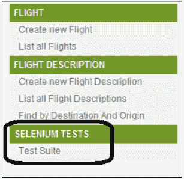

对于 flight-app 应用程序，选择 **测试套件** 选项会显示 test-suite.xhtml，进而可用于查看 test-flightdescription.xhtml 和 test-flight.xhtml 文件的详细信息。

## 还有更多…

以下是关于 Spring Roo 生成的 Selenium 测试需要注意的几个重要点：

- Spring Roo 生成的 Selenium 测试不支持往返功能。例如，如果添加、删除或修改 Flight JPA 实体的属性，那么相应的 Selenium 测试脚本 test-flight.xhtml 不会由 Roo 修改。您可以删除由 Roo 生成的 Selenium 测试脚本，并使用 selenium test 命令重新生成它们。
- 如我们所见，Roo 仅为控制器公开的表单支撑对象创建 Selenium 测试。因此，您无法为不支持创建表单支撑对象的控制器创建 Selenium 测试，即控制器中 @RooWebScaffold 注解的 create 属性值为 false。如果对指定 @RooWebScaffold 的 create 属性值为 false 的控制器执行 selenium test 命令，则 Roo 会报错，称控制器不支持创建 Selenium 测试。
- Roo 不会为手动创建的控制器生成 Selenium 测试。因此，如果您生成的控制器没有 @RooWebScaffold 注解，那么无法使用 Roo 为其生成 Selenium 测试。如果对未标记 @RooWebScaffold 注解的控制器执行 selenium test 命令，则 Roo 会报错，称该控制器似乎不是由 Roo 生成的控制器。

Roo 通过检查由 Roo 生成的控制器公开的表单支撑对象（在 Roo 生成的控制器中为 JPA 实体）的属性来生成 Selenium 测试。生成的 Selenium 测试假设用于创建 JPA 实体（由 Web 控制器作为表单支撑对象公开）的表单始终会显示，但实际情况并非总是如此。例如，如果您访问 **创建新航班** 菜单选项，那么如果尚未创建一个或多个 `FlightDescription` 实例，则不会显示用于创建 `Flight` 实例的表单。因此，如果 `test-suite.xhtml` 指定在 `test-flightdescription.xhtml` 之前执行 `test-flight.xhtml`，则如果尚未创建任何 `FlightDescription` 实例，`test-flight.xhtml` 的执行将失败。

由 Spring Roo 生成的 Selenium 测试不会对由 Roo 生成的 Web 应用程序功能进行彻底的测试；它仅测试创建 JPA 实体实例的控制器功能。建议使用 Selenium-IDE（作为 Firefox 插件提供）来录制和执行测试脚本。如果您正在寻找更复杂的测试方法，则可以使用 Selenium-IDE 创建测试脚本，将其保存为 JUnit4 或 TestNG 测试，修改测试以满足特定测试要求（例如，通过从数据库检索 JPA 实体实例来验证其是否保存成功），并使用 Maven Surefire 插件执行 JUnit4 或 TestNG 测试。

## 另请参阅

- 请参阅第 2 章中关于 *持久实体集成测试创建* 配方，了解 Roo 如何支持为 JPA 实体自动生成集成测试的详细信息。


## 使用 GWT、Flex 和 Spring Web Flow 进行 Web 应用程序开发

在本章中，我们将介绍：

- 从 JPA 实体生成 GWT 应用程序脚手架
- 开始 Flex 应用程序开发
- 从 JPA 实体生成 Flex 应用程序脚手架
- 开始使用 Spring Web Flow

### 简介

在上一章中，我们了解到 Roo 可以从应用程序中的 JPA 实体生成 Spring Web MVC 控制器和 JSPX 视图。在本章中，我们将介绍可从 JPA 实体生成 GWT 和 Flex 前端的 Roo 命令。此外，在本章中，我们将了解如何使用 Roo 为应用程序添加对 Spring Web Flow 的支持。

### 从 JPA 实体生成 GWT 应用程序脚手架

在本示例中，我们将介绍 `gwt setup` 命令，该命令可从 JPA 实体生成 GWT 制品。

### 准备工作

在您的系统中创建一个新目录（`C:\roo-cookbook\ch05-gwt`）。将随本书提供的 `ch05_gwt_app.roo` 脚本复制到 `ch05-gwt` 目录。从 `ch05-gwt` 目录启动 Roo shell，并使用 `script` 命令执行 `ch05_gwt_app.roo` 脚本。执行 `ch05_gwt_app.roo` 脚本将执行以下操作：

- 创建 `flightapp-gwt` Eclipse 项目
- 将 Hibernate 设置为持久性提供程序
- 将 MySQL 配置为应用程序的数据库
- 创建 `Flight` 和 `FlightDescription` JPA 实体，并在 `Flight` 和 `FlightDescription` 实体之间定义多对一关系

如果您使用的数据库不是 MySQL，或者您的连接设置与脚本中指定的不同，请相应修改脚本。

安装 **Eclipse IDE 的 Google 插件**（`http://code.google.com/eclipse/`）；它简化了使用 Eclipse IDE 开发 GWT 应用程序。

### 操作步骤

按照以下步骤生成 GWT 应用程序脚手架：

1. 执行 `gwt setup` 命令，如下所示：

```
..roo>gwt setup
....
Created SRC_MAIN_WEBAPP\WEB-INF\spring
Created SRC_MAIN_WEBAPP\WEB-INF\spring\webmvc-config.xml
Created SRC_MAIN_WEBAPP\WEB-INF\web.xml
Updated ROOT\pom.xml [...]
Created SRC_MAIN_JAVA\sample\roo\flightapp\client
Created SRC_MAIN_JAVA\sample\roo\flightapp\ApplicationScaffold.gwt.xml
Created SRC_MAIN_JAVA\sample\roo\flightapp\client\managed\request
Created SRC_MAIN_JAVA\sample\roo\flightapp\client\scaffold\request
Created SRC_MAIN_WEBAPP\index.html
Created SRC_MAIN_WEBAPP\ApplicationScaffold.html
...
```

为简洁起见，上面仅显示了部分输出。

2. 自 Spring Roo 1.1.3 起，gwt setup 命令会创建特定于 GAE（Google App Engine）的 Java 文件，您需要从生成的源代码中删除这些文件。为此，在进行下一步之前，请从 flightapp-gwt 项目中删除以下文件夹：
- src/main/java/sample/roo/flightapp/server/gae
- src/main/java/sample/roo/flightapp/shared/gae
- src/main/java/sample/roo/flightapp/client/scaffold/gae

如果您使用的是 Spring Roo 1.1.5，则不会生成特定于 GAE 的 Java 文件。

3. 执行 perform eclipse 命令，以更新 flightapp-gwt Eclipse 项目的 .classpath 文件，并将项目性质转换为 gwt：
..roo>perform eclipse

4. 将 flightapp-gwt 项目导入 Eclipse IDE。向 flightapp-gwt 项目的生成路径（**项目属性 | Java 生成路径 | 添加库**）中添加 **Google Web Toolkit** 库，以便项目在 Eclipse IDE 中不会显示任何编译错误。

5. 如果您想使用 **GWT Maven 插件**（http://mojo.codehaus.org/gwt-maven-plugin/）运行 GWT 应用程序，请退出 Roo shell 并执行 GWT Maven 插件的 gwt:run 目标，如下所示（或者，您可以跳到下一步）：
..recipe>mvn clean compile gwt:run

执行 gwt:run 目标将打开 **GWT 开发模式** 窗口，如下所示：

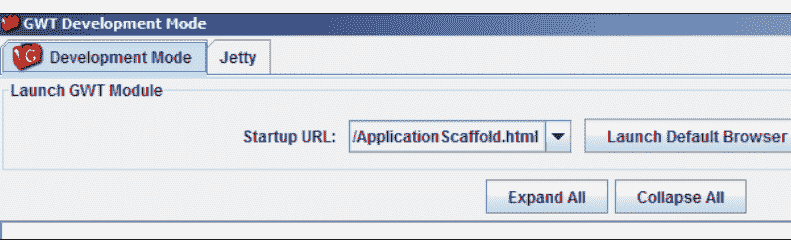

6. 如果您想从 Eclipse IDE 运行 GWT 应用程序，请在 Eclipse IDE 中右键单击 **flightapp-gwt** 项目，并选择 **Google | Web Toolkit 设置...** 选项。选择 **Web 应用程序** 选项并勾选 **此项目具有 WAR 目录** 选项，如下所示：

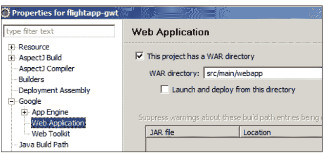

如屏幕截图所示，将 **WAR 目录** 值设置为 `src/main/webapp`——即包含 `ApplicationScaffold.html` 主机页面的 Maven 标准 WAR 目录。确保 **从此目录启动和部署** 选项未勾选。

7. 在 Eclipse IDE 中右键单击 **flightapp-gwt** 项目，并选择 **运行方式 | Web 应用程序** 选项。在 **HTML 页面选择** 对话框中选择 `ApplicationScaffold.html`（或 `index.html`）页面，如下图所示：

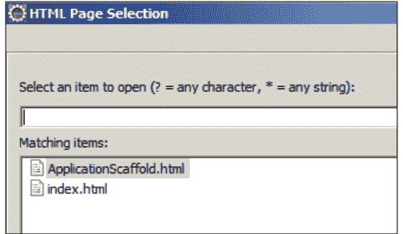

您在此屏幕上选择的 HTML 页面代表负责加载 GWT 应用程序的主机 HTML 页面。ApplicationScaffold.html 和 index.html 文件都位于 flightapp-gwt GWT 应用程序的 src/main/webapp 目录中。index.html 是一个简单的 HTML 页面，仅加载 ApplicationScaffold.html 页面——即 flightapp-gwt GWT 应用程序的主机 HTML 页面。

首次运行 GWT 应用程序时，系统将要求您选择 flightapp-gwt 项目的 WAR 目录位置，即 target/flightapp-gwt-0.1.0.BUILD-SNAPSHOT。

8. 运行方式 | **Web 应用程序** 选项会启动嵌入式 Jetty 服务器（随 **Eclipse 的 Google 插件** 捆绑）并以开发模式运行 GWT 应用程序。在开发模式下，GWT 应用程序像普通 Java 应用程序一样执行，且不会编译为 JavaScript。这使得可以在开发阶段调试 GWT 应用程序，当应用程序准备好投入生产时，只需编译 GWT 应用程序即可创建相应的 JavaScript 文件。在开发模式下，Eclipse IDE 会显示一个新的 **开发模式** 视图，其中包含访问 GWT 应用程序的链接，如下所示：

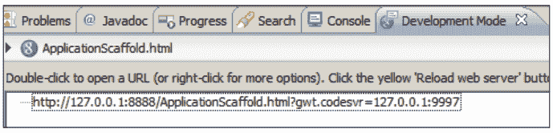

9. 单击 **开发模式** 视图中显示的 URL，以便在默认 Web 浏览器中打开，或右键单击 URL 以选择要在其中打开它的浏览器。如果 flightapp-gwt 应用程序部署成功，您将看到应用程序的主页，如下所示：

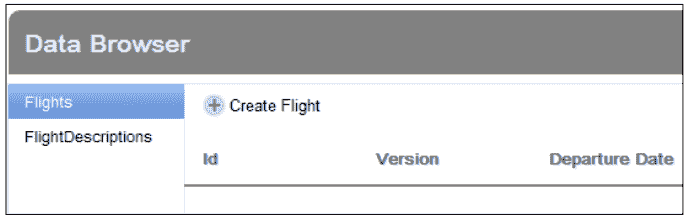

现在，您可以使用 **航班** 和 **航班描述** 菜单选项对 Flight 和 FlightDescription JPA 实体执行 CRUD 操作。

### 原理

gwt setup 命令由 Spring Roo 的 GWT 插件处理。

您可能会想知道，为什么 Roo 生成的 GWT 用户界面中没有显示与 FlightDescription JPA 实体中的 findFlightDescriptionsByDestinationAndOrigin 查找器方法相对应的链接？截至 Spring Roo 1.1.5，GWT 插件不会向生成的 GWT 应用程序添加查找器功能。

gwt setup 命令负责为对 JPA 实体执行 CRUD 操作生成 GWT Activities、Places、Proxies 和 Views 的脚手架。让我们先看一下 Roo 生成的 GWT 模块描述符文件 ApplicationScaffold.gwt.xml，该文件描述了一个 GWT 模块。

### GWT 模块描述符

Roo 在 flightapp-gwt 项目的根包 sample.roo.flightapp 中创建 ApplicationScaffold.gwt.xml。它定义了模块依赖项、源代码路径、属性、延迟绑定配置和模块入口点。让我们看一下 ApplicationScaffold.gwt.xml 中定义的一些重要元素。

默认情况下，GWT 模块的名称来源于模块描述符的位置。由于 Roo 在 sample.roo.flightapp 包中创建 ApplicationScaffold.gwt.xml 文件，因此模块的名称是 sample.roo.flightapp.ApplicationScaffold。ApplicationScaffold.gwt.xml 文件使用 <module> 元素的 rename-to 属性将模块重命名为 applicationScaffold，如下所示：

```
<module rename-to="applicationScaffold">
```

GWT 编译器在由模块名称标识的目录中生成 JavaScript 代码；因此，我们的 applicationScaffold 模块代码将生成在生成的 WAR 文件的 applicationScaffold 子目录中。

模块描述符的 <inherits> 元素指定了模块依赖的模块。例如，applicationScaffold 依赖于 GWT 的 User、Logging、Activity、Places 等内置模块，如下所示：

```
<inherits name='com.google.gwt.activity.Activity' />
<inherits name='com.google.gwt.place.Place' />
<inherits name="com.google.gwt.user.User"/>
<inherits name='com.google.gwt.logging.Logging' />
```


模块描述符的 `<source>` 元素指定包，包括其子包（相对于 `ApplicationScaffold.gwt.xml` 文件的类路径位置），这些包包含 GWT 编译器需要翻译成 JavaScript 的 Java 类，如 `applicationScaffold` 模块所示：

```
<source path='client' />
<source path='shared' />
```

给定的 `<source>` 元素指示 GWT 编译器翻译 `sample.roo.flightapp.client` 和 `sample.roo.flightapp.shared` 包及其子包中包含的 Java 类。

模块描述符的 `<public>` 元素指定包（及其子包），这些包包含公开可访问的资源，例如图像和 CSS 文件，如下所示：

```
<public path="public" />
```

与 `<source>` 元素一样，`<public>` 元素指定包相对于模块描述符文件类路径位置的位置。

`ApplicationScaffold.gwt.xml` 文件为模块配置日志记录，如下所示：

```
<set-property name="gwt.logging.enabled" value="TRUE"/>
<set-property name="gwt.logging.logLevel" value="INFO"/>
<set-property name="gwt.logging.consoleHandler"
value="ENABLED"/>
<set-property name="gwt.logging.developmentModeHandler"
value="ENABLED"/>
<set-property name="gwt.logging.simpleRemoteHandler"
value="DISABLED"/>
...
```

在此代码中，`gwt.logging.enabled` 属性为 `applicationScaffold` 模块启用日志记录，`gwt.logging.logLevel` 属性将日志级别设置为 INFO，`gwt.logging.consoleHandler` 属性使日志记录器输出显示在 IDE 控制台中，`gwt.logging.developmentModeHandler` 属性使日志记录器输出显示在 IDE 的“开发模式”控制台中，`gwt.logging.simpleRemoteHandler` 属性禁用日志消息的远程日志记录。稍后在本示例中，我们将看到 `gwt.logging.simpleRemoteHandler` 属性设置为 `ENABLED` 以启用服务器端的日志记录消息。

Roo 生成的 GWT 应用程序默认提供对移动 Safari 浏览器的支持。因此，如果您正在开发 GWT 应用程序，它将在使用移动 Safari 浏览器的手机上无缝运行。如果使用移动 Safari 浏览器访问应用程序，则 GWT 应用程序将创建适合在移动设备上显示的 Web UI。为了同时支持桌面和移动 Safari 浏览器，`applicationScaffold` 模块使用了 GWT 编译器的延迟绑定特性。

要使用延迟绑定特性，模块描述符的 `<define-property>` 元素用于定义名为 mobile.user.agent 的新属性，如下所示：

```
<define-property name="mobile.user.agent"
        values="mobilesafari, none"/>
```

values 属性指定 mobile.user.agent 属性可以接受的逗号分隔值列表。

要设置 mobile.user.agent 属性值，模块描述符使用 `<property-provider>` 元素，如下所示：

```
<property-provider name="mobile.user.agent">
    <![CDATA[
        var ua = navigator.userAgent.toLowerCase ();
        ...
    ]]>
```

CDATA 部分包含用于从 Web 浏览器发送到托管 GWT 应用程序的服务器的用户代理信息中获取 mobile.user.agent 值的 JavaScript。

现在，最重要的部分：延迟绑定规则在 applicationScaffold 模块描述符文件中使用替换技术定义，如下所示：

```
<replace-with
        class="...client.scaffold.ioc.MobileInjectorWrapper">
    <when-type-is
        class="...client.scaffold.ioc.DesktopInjectorWrapper"/>
    <all>
        <when-property-is name="mobile.user.agent"
            value="mobilesafari"/>
    </all>
</replace-with>
```

此配置指示 GWT 编译器：如果 mobile.user.agent 属性的值为 mobilesafari，则用 MobileInjectorWrapper 替换 DesktopInjectorWrapper 的代码（在为 applicationScaffold 模块生成 JavaScript 时）。之所以可行，是因为 DesktopInjectorWrapper 和 MobileInjectorWrapper 都实现了同一接口 InjectorWrapper。当 GWT 编译器执行时，它使用延迟绑定规则（在模块描述符文件中定义）为移动 Safari 和桌面浏览器生成单独的 flightapp-gwt 应用程序 JavaScript 代码。这样可确保桌面和移动浏览器下载专门针对该浏览器类型的 JavaScript 代码。例如，移动 Safari 浏览器不会下载特定于桌面 Web 浏览器的 JavaScript 代码，反之亦然。需要创建 DesktopInjectorWrapper 或 MobileInjectorWrapper 实例的类使用 com.google.gwt.core.client.GWT 类的 create 静态方法，指示 GWT 编译器使用延迟绑定实例化 DesktopInjectorWrapper 或 MobileInjectorWrapper 实例。

> 为移动 Safari 浏览器生成的代码遵循与桌面浏览器代码相似的设计方法；因此，在本书中，我们将限制讨论特定于桌面浏览器的 Roo 生成代码。

模块描述符还使用 <entry-point> 元素描述 GWT 应用程序的*入口点*，如 applicationScaffold 模块所示：

```
<entry-point
class="sample.roo.flightapp.client.scaffold.Scaffold"/>
```

上述代码表明，Scaffold 类代表 applicationScaffold 模块的入口点。Scaffold 类实现 GWT 的 com.google.gwt.core.client.EntryPoint 接口——这是入口点类的强制性要求。

## GWT 模块的入口点

如前所述，flightapp-gwt 应用程序的 Scaffold 类代表进入 applicationScaffold 模块的入口点。Scaffold 类实现 GWT 的 EntryPoint 接口并实现其 onModuleLoad 方法来引导 flightapp-gwt 应用程序，如下所示：

```
Scaffold.java
package sample.roo.flightapp.client.scaffold;

import com.google.gwt.core.client.EntryPoint;
import com.google.gwt.core.client.GWT;

public class Scaffold implements EntryPoint {
    final private InjectorWrapper injectorWrapper =
    GWT.create(DesktopInjectorWrapper.class);

    public void onModuleLoad() {
    injectorWrapper.getInjector().getScaffoldApp().run();
    }
}
```

此代码中首先需要注意的是使用 com.google.gwt.core.client.GWT 类的 create 方法来创建 DesktopInjectorWrapper 实例。由于移动 Safari 浏览器需要将 DesktopInjectorWrapper 实现替换为 MobileInjectorWrapper，因此 DesktopInjectorWrapper 使用 GWT 类的 create 方法创建。

onModuleLoad 方法类似于 Java 的 main 方法，负责初始化 flightapp-gwt 应用程序。在 Scaffold 类中，onModuleLoad 方法负责创建应用程序的 Web UI、向 EventBus 注册事件处理程序等。DesktopInjectorWrapper 和 MobileInjectorWrapper 类代表围绕 GIN 的 Ginjector 实现的包装器。

## 使用 GIN 进行依赖注入

GIN 是一种依赖注入框架，它使用 Google Guice 框架来支持 GWT 应用程序中的依赖注入。在 GWT 应用程序中，整个应用程序所需的对象引用可以使用 GIN 或工厂来创建。Roo 生成的 flightapp-gwt GWT 应用程序使用 GIN 来创建 EventBus、ApplicationRequestFactory 和 PlaceController——这些对象在 flightapp-gwt 应用程序中广泛使用。下表描述了这些对象在 flightapp-gwt 应用程序中的重要性：

| 对象 | 描述 |
|---|---|
| EventBus | EventBus 用于在 GWT 应用程序中发布事件和注册事件处理程序。 |
| ApplicationRequestFactory | 一个扩展 GWT RequestFactory 接口的 Roo 生成接口。该接口的实现由 GWT 编译器生成。flightapp-gwt 应用程序使用 RequestFactory 与 JPA 层进行交互。 |
| PlaceController | GWT Place 代表 GWT 应用程序中的一个位置。如果您从 flightapp-gwt 应用程序的 UI 中选择 Flights 菜单选项，则它代表一个位置。现在，如果您从 UI 中选择 FlightDescriptions 选项，则它代表应用程序中的另一个位置。GWT 的 PlaceController 用于在 GWT 应用程序中从一个位置导航到另一个位置。 |

现在我们知道了 flightapp-gwt 应用程序中使用哪些对象，让我们看看 GIN 如何创建这些对象，以及这些对象如何被注入到依赖它们的对象中。


要了解 Ginjector 在 flightapp-gwt 中的使用方式，让我们来看一下以下类图：

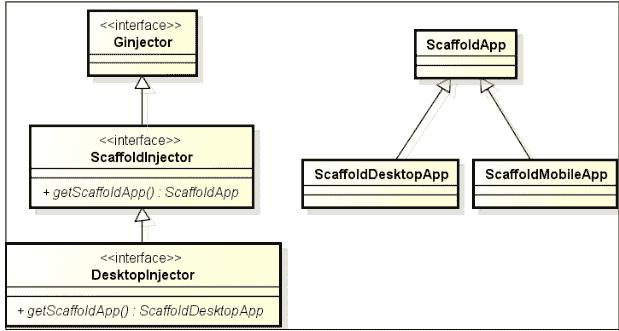

在此类图中，Ginjector 接口是 GIN API 的一部分。ScaffoldInjector 和 DesktopInjector 由 Roo 生成。以下是在上述类图中需要注意的重要点：

- ScaffoldInjector 扩展 Ginjector 接口，定义一个名为 getScaffoldApp 的方法，该方法返回类型为 ScaffoldApp 的实例。

- ScaffoldApp 是由 Roo 生成的类，用于定义桌面和移动浏览器初始化 GWT 应用程序的契约。

- DesktopInjector 扩展 ScaffoldInjector，并重写 getScaffoldApp 方法以返回 ScaffoldDesktopApp。这种返回类型的更改完全合法，因为 ScaffoldDesktopApp 是 ScaffoldApp 类的子类。

- ScaffoldDesktopApp 负责创建面向桌面 Web 浏览器的 Web UI，并在应用程序投入使用前执行所有初始化工作。同样，ScaffoldMobileApp 负责创建移动浏览器的 Web UI。

GIN 的 Ginjector 接口是 GIN 框架的核心，负责执行依赖注入。要使用 Ginjector，GWT 应用程序必须执行以下操作：

- 定义一个扩展 Ginjector 的接口——在 flightapp-gwt 中，这就是 DesktopInjector 接口。GWT 编译器负责提供该接口的实现。

- 在接口中定义一个或多个方法，用于返回应用程序其他部分将使用的顶级对象。Ginjector 根据 Ginjector 配置的绑定，通过注入低级对象的依赖项来创建顶级对象。在 flightapp-gwt 应用程序中，ScaffoldDesktopApp 和 ScaffoldMobileApp 表示顶级对象。

- 定义一个 GinModule 或 AbstractGinModule 类（两者均属于 GIN API），用于定义依赖项的绑定。flightapp-gwt 中的 ScaffoldModule 类为 EventBus、PlaceController 和 ApplicationRequestFactory 定义绑定。

- 在希望 Ginjector 执行依赖注入的类的方法、构造函数或字段上使用 @Inject 注释（属于 Guice API）进行标注。在 flightapp-gwt 中，ApplicationDetailsActivities、ApplicationMasterActivities 等使用 @Inject 注释来让 Ginjector 注入依赖项。

现在，让我们来看看 Roo 为之前描述的每个活动创建的代码。

以下代码显示 DesktopInjector 接口：

```
DesktopInjector.java
package sample.roo.flightapp.client.scaffold.ioc;
..
import sample.roo.flightapp.client.scaffold.ScaffoldDesktopApp;
import com.google.gwt.inject.client.GinModules;

@GinModules(value = {ScaffoldModule.class})
public interface DesktopInjector extends ScaffoldInjector {

    ScaffoldDesktopApp getScaffoldApp();
}
```

DesktopInjector 扩展 ScaffoldInjector 接口（后者又扩展 GIN 的 Ginjector 接口），并定义一个名为 getScaffoldApp 的方法，该方法返回 ScaffoldDesktopApp 对象。因此，由 GWT 编译器生成的 Ginjector 实现的责任是返回一个 ScaffoldDesktopApp 实例，其所有依赖项均已注入适当的实现。

@GinModules 注释指定负责定义依赖项及其提供程序的类（该类实现 `GinModule` 接口或扩展 `AbstractGinModule` 抽象类）。以下代码显示 `ScaffoldModule` 类，该类将 `EventBus`、`PlaceController` 和 `ApplicationRequestFactory` 依赖项绑定到各自的提供程序：

```java
ScaffoldModule.java
package sample.roo.flightapp.client.scaffold.ioc;

import com.google.gwt.event.shared.EventBus;
import com.google.gwt.event.shared.SimpleEventBus;
import com.google.gwt.inject.client.AbstractGinModule;
import com.google.gwt.place.shared.PlaceController;
import com.google.inject.Inject;
import com.google.inject.Provider;
import com.google.inject.Singleton;

public class ScaffoldModule extends AbstractGinModule {

    @Override
    protected void configure() {
        bind(EventBus.class).
        to(SimpleEventBus.class).in(Singleton.class);
        bind(ApplicationRequestFactory.class).
        toProvider(RequestFactoryProvider.class).
        in(Singleton.class);
        bind(PlaceController.class).
        toProvider(PlaceControllerProvider.class).
        in(Singleton.class);
    }

    static class PlaceControllerProvider implements Provider<PlaceController> {

        private final PlaceController placeController;

        @Inject
        public PlaceControllerProvider(EventBus eventBus) {
            this.placeController = new PlaceController(eventBus);
        }

        public PlaceController get() {
            return placeController;
        }
    }

    static class RequestFactoryProvider implements
    Provider<ApplicationRequestFactory> {

    }
}
```

由 Roo 生成的 ScaffoldModule 类扩展 AbstractGinModule 并重写 configure 方法，以将依赖项与其提供程序关联。AbstractGinModule 的 bind 方法将依赖项绑定到其提供程序。in(Singleton.class) 指示为应用程序仅创建 EventBus、PlaceController 和 ApplicationRequestFactory 的单个实例。PlaceControllerProvider 和 RequestFactoryProvider 静态内部类分别表示 PlaceController 和 RequestFactory 实例的提供程序。SimpleEventBus（属于 GWT API）是 EventBus 的一个实现。

这段代码中需要注意的一个重要点是，PlaceControllerProvider 使用 @Inject 注释来指示 Ginjector 注入 EventBus 的实现。因此，如果您正在创建对象层次结构，那么请在 Ginjector 中定义返回顶级对象的方法，因为层次结构中的低级对象可以使用 @Inject 注释利用 Ginjector 的依赖注入功能。

以下图表总结了 Scaffold 类如何利用 GIN 框架来引导应用程序：

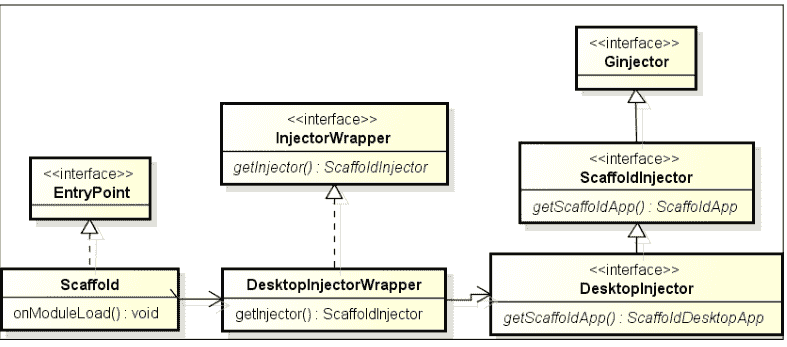

Scaffold 类的 onModuleLoad 方法调用 DesktopInjectWrapper 的 getInjector 方法来访问 Ginjector 实现，随后调用 getScaffoldApp 以获取 ScaffoldDesktopApp 的实例。以下序列图进一步澄清了类之间方法调用的顺序：

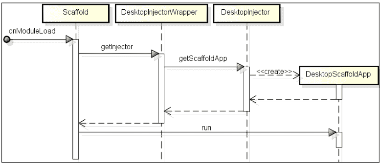

在上述序列图中，对 DesktopScaffoldApp 的 run 方法的调用会导致 Web UI 的初始化。

既然我们了解了 flightapp-gwt 应用程序如何使用 GIN 并自行初始化，我们将研究 GWT 的 EntityProxy 和 RequestFactory 接口，以及脚手架代码如何使用它们。

## EntityProxy、RequestContext 和 RequestFactory 接口

实体代理表示客户端（JavaScript 端）对象，用于模拟服务器端上的实体，在 flightapp-gwt GWT 应用程序中，该实体是 JPA 实体。实体代理充当客户端与服务器之间传输数据的手段。在 GWT 中，充当实体代理的客户端对象扩展 GWT 的 EntityProxy 接口，并为相应服务器端实体中定义的字段定义抽象 getter 和 setter 方法。在 flightapp-gwt 中，我们有 Flight 和 FlightDescription JPA 实体；因此，Roo 分别生成相应的实体代理 FlightProxy 和 FlightDescriptionProxy。默认情况下，Roo 在实体代理中为相应 JPA 实体类中定义的所有属性创建抽象 getter 和 setter 方法。以下代码显示 FlightProxy 实体代理：

```
FlightProxy.java
package sample.roo.flightapp.client.managed.request;

import com.google.gwt.requestfactory.shared.EntityProxy;
import com.google.gwt.requestfactory.shared.ProxyForName;
import org.springframework.roo.addon.gwt.RooGwtMirroredFrom;

@RooGwtMirroredFrom("sample.roo.flightapp.domain.Flight")
@ProxyForName("sample.roo.flightapp.domain.Flight")
public interface FlightProxy extends EntityProxy {
    abstract Long getId();
```


abstract Integer getVersion();
abstract Date getDepartureDate();
abstract Date getArrivalDate();
abstract FlightDescriptionProxy getFlightDescription();
abstract void setId(Long id);
...

Roo 的 @RooGwtMirroredFrom 注释指定了创建 FlightProxy 实体代理所对应的 JPA 实体的完全限定类名。

> 正是 @RooGwtMirroredFrom 注释使实体代理与相应的 JPA 实体保持同步。

GWT 的 @ProxyForName 注释指定实体代理所代表的服务器端实体。请注意，在上面的代码中，getFlightDescription 方法被定义为返回 FlightDescriptionProxy，因为它代表与 FlightDescription JPA 实体对应的实体代理。

要调用服务器端服务，GWT 应用程序的客户端代码需要为远程服务提供客户端存根。客户端代码使用服务存根来调用远程服务。服务存根由扩展 GWT 的 RequestContext 接口并定义与相应远程服务方法签名相似的方法的接口来定义。我们将稍后看到远程服务类中定义的方法与客户端服务存根之间的区别。

默认情况下，Roo 生成富实体，生成的应用程序没有服务层；因此，对于 Roo 生成的 GWT 应用程序，服务存根定义了与 JPA 实体类对应的方法。以下代码显示了 flightapp-gwt 应用程序中与 Flight JPA 实体对应的 Roo 生成的 FlightRequest 服务存根：

```
FlightRequest.java
package sample.roo.flightapp.client.managed.request;
import com.google.gwt.requestfactory.shared.InstanceRequest;
import com.google.gwt.requestfactory.shared.Request;
import com.google.gwt.requestfactory.shared.RequestContext;
import com.google.gwt.requestfactory.shared.ServiceName;
import org.springframework.roo.addon.gwt.RooGwtMirroredFrom;
@RooGwtMirroredFrom("sample.roo.flightapp.domain.Flight")
@ServiceName("sample.roo.flightapp.domain.Flight")
public interface FlightRequest extends RequestContext {
    abstract Request<java.lang.Long> countFlights();
    abstract Request<java.util.List<? extends FlightProxy>>
    findAllFlights();
    ....
    abstract InstanceRequest<? extends FlightProxy, java.lang.Void>
    remove();
    abstract InstanceRequest<? extends FlightProxy, java.lang.Void>
    persist();
}
```

正如此代码所示，FlightRequest 服务存根扩展了 GWT 的 RequestContext 接口。GWT 的 @ServiceName 注释指定与客户端服务存根对应的服务器端服务类的完全限定名称，在 FlightRequest 存根的情况下即为 Flight JPA 实体。上述代码显示 FlightRequest 服务存根定义了返回以下内容的方法：

- Request<T> - 其中 T 表示服务器端类中相应方法的实际返回类型。例如，countFlights 方法在 Flight JPA 实体中返回 java.lang.Long，FlightRequest 存根中的 countFlights 方法也是如此。如果服务器端服务类中的方法返回实体，则客户端服务存根返回相应的实体代理。例如，Flight JPA 实体中的 findAllFlights 方法返回 java.util.List<Flight>，因此 FlightRequest 存根中的 findAllFlights 方法返回 java.util.List<FlightProxy>。需要注意的是，与服务器端服务的静态方法对应的方法在客户端服务存根中返回 Request<T> 类型。

- InstanceRequest<P, T> - 其中 P 表示相应服务器端服务方法作用的实体类型，T 表示方法的实际返回类型。例如，Flight JPA 实体的 persist 方法作用于 Flight 实体实例并返回 void；因此，FlightRequest 存根中相应方法的返回类型是 InstanceRequest<FlightProxy, java.lang.Void>。请注意，只有与服务器端服务上的实例方法对应的存根方法才返回 InstanceRequest。

> 正是 Roo 的 @RooGwtMirroredFrom 注释使客户端存根与相应的 JPA 实体保持同步。

现在，让我们看看 RequestFactory 如何帮助客户端代码与服务器端代码之间的通信。

RequestFactory 充当实体代理与服务器端相应实体之间的通信桥梁。RequestFactory 管理实体代理，并负责将服务器端实体属性值复制到相应的实体代理，反之亦然。在您的 GWT 应用程序中，需要定义一个扩展 RequestFactory 接口的接口，并提供返回服务器端服务客户端存根的方法。Roo 创建了一个 ApplicationRequestFactory 类（我们之前讨论过，这是使用 GIN 创建的），如下所示：

```
package sample.roo.flightapp.client.managed.request;

import sample.roo.flightapp.shared.scaffold.ScaffoldRequestFactory;

public interface ApplicationRequestFactory extends
ScaffoldRequestFactory {
    FlightRequest flightRequest();
    FlightDescriptionRequest flightDescriptionRequest();
}
```

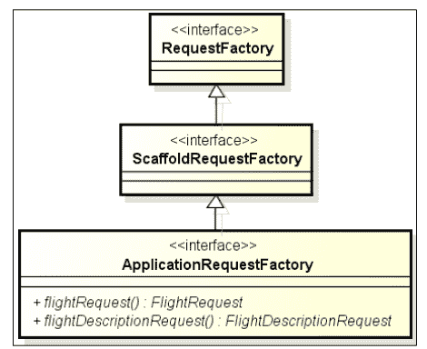

上图显示 ApplicationRequestFactory 扩展了 Roo 生成的 ScaffoldRequestFactory 接口，而该接口又扩展了 GWT 的 RequestFactory 接口。创建这种层次结构的目的是，如果您想要定义自定义客户端服务存根方法，则可以将它们添加到 ScaffoldRequestFactory。

> > ApplicationRequestFactory 由 Roo 管理；因此，您不应手动修改它以添加自定义客户端服务存根方法。相反，请将它们添加到 ScaffoldRequestFactory。

实体代理与服务器端实体之间的交互通过在 GWT Web 应用程序的 web.xml 文件中配置 GWT 的 RequestFactoryServlet 来实现。

> > 您不需要在 flightapp-gwt 项目的 web.xml 文件中配置 RequestFactoryServlet，因为在执行 gwt setup 命令时，Roo 会在 web.xml 文件中配置 GWT 的 RequestFactoryServlet。

以下代码显示了 flightapp-gwt 应用程序 web.xml 文件中 RequestFactoryServlet 的配置：

```
web.xml
<servlet>
  <servlet-name>requestFactory</servlet-name>
  <servlet-class>
    com.google.gwt.requestfactory.server.RequestFactoryServlet
  </servlet-class>
</servlet>
<servlet-mapping>
  <servlet-name>requestFactory</servlet-name>
  <url-pattern>/gwtRequest</url-pattern>
</servlet-mapping>
```

此配置显示，默认情况下 Roo 将 RequestFactoryServlet 映射到 /gwtRequest URL，您可以更改该映射。如果更改 RequestFactoryServlet 的 URL 映射，则还需要更改 ScaffoldModule（我们之前讨论过的 Roo 生成的 GIN 模块）创建 ApplicationRequestFactory 的方式。

RequestFactory 要求服务器端实体必须定义无参构造函数、getId、getVersion 和 find<Entity> 方法。getVersion 应该返回版本，getId 应该返回与实体实例关联的唯一 ID，而 find<Entity> 方法接受实体 ID 并返回相应的实体实例。因此，如果您使用 Roo entity 命令创建实体，请确保不要将标识符字段或版本字段的名称设置为除 id 和 version 之外的任何名称。当您执行 Roo gwt setup 命令，并且 Roo 发现 ID 和 版本 字段的名称与 id 和 version 不同时，则它不会为 GWT 应用程序生成脚手架。

现在，让我们看看 Roo 生成的 GWT 中的一些活动和位置。

## 活动和位置

Roo 生成的 GWT 代码由许多基类和接口组成，旨在为对 JPA 实体执行 CRUD 操作提供一致的方法。在本节中，我们将介绍一些重要的类、接口和概念，这些内容将为您理解 Roo 生成的 GWT 代码提供起点。

Roo 生成的 GWT Web UI 由一个 **主显示区域** 和一个 **详情显示区域** 组成。**主显示区域** 显示可从 Web UI 管理的实体列表。以列表形式显示 **Flight** 和 **FlightDescriptions** 的小部件代表 **主显示区域**。**详情显示区域** 显示可以对 **主显示区域** 中显示的每个实体执行的活动。显示系统中 **Flight** 或 **FlightDescription** 实体实例列表、用于创建新实体实例的表单、用于编辑实体实例的表单等的区域代表 **详情显示区域**。

以下图显示了 flightapp-gwt 应用程序中的 **主显示区域** 和 **详情显示区域**：

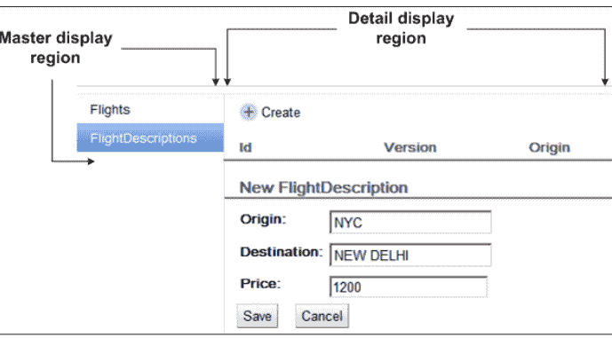

现在，让我们来看看 Roo 生成的 flightapp-gwt 应用程序中活动、位置和视图的一些示例。


Activities负责驱动视图并处理显示区域中用户交互生成的事件。它是通过实现GWT的Activity接口或扩展GWT的AbstractActivity抽象类来创建的。以下图表显示了Roo为flightapp-gwt应用程序生成的一些活动：

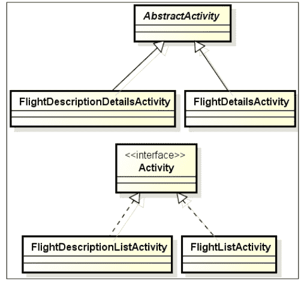

此图显示，*FlightDescriptionDetailsActivity*和*FlightDetailsActivity*继承自*AbstractActivity*抽象类，而*FlightDescriptionListActivity*和*FlightListActivity*类实现了*Activity*接口。<entity-name>DetailsActivity活动在**详情显示区域**中显示现有实体实例的详细信息时驱动视图并管理用户交互。<entity-name>ListActivity活动在**详情显示区域**中显示实体实例列表时驱动视图并管理用户交互。

Place是显示区域内可以转换为URL的位置。Activity映射到一个place（可转换为URL），从而使Activity可以通过URL访问。place是通过扩展GWT的Place抽象类来创建的。place实现类还定义了place实例如何转换为URL。Roo在flightapp-gwt中生成的ProxyPlace和ProxyListPlace类是GWT中place的示例。以下图表显示了ProxyPlace和ProxyListPlace类定义的属性：

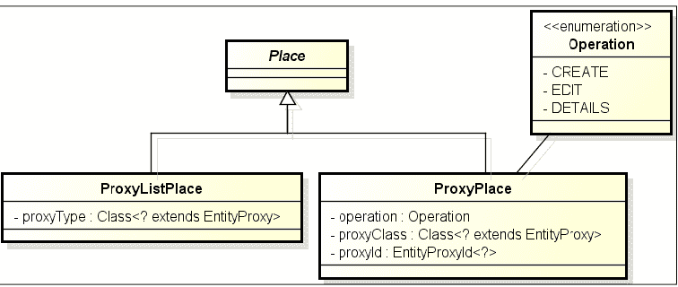

ProxyPlace对应“详情”显示区域中的一个place，ProxyListPlace对应主显示区域中的一个place。创建ProxyPlace实例时，它知道正在为其创建place实例的EntityProxy（由proxyClass属性标识）、要在EntityProxy上执行的操作（由operation属性标识）以及EntityProxy的唯一标识符（由类型为EntityProxyId的proxyId属性标识）。同样，创建ProxyListPlace时，它知道正在为其创建place实例的EntityProxy（由proxyType属性标识）。

每个显示区域都关联一个ActivityMapper，它将显示区域中的每个Place映射到一个Activity。它是通过实现GWT的ActivityMapper接口来创建的。ActivityMapper定义了一个方法getActivity(Place place)，返回与place对应的活动。在flightapp-gwt应用程序中，ApplicationMasterActivities是主显示区域的ActivityMapper，ApplicationDetailsActivities是详情显示区域的ActivityMapper。以下类图显示了Roo在flightapp-gwt项目中创建的ActivityMappers：

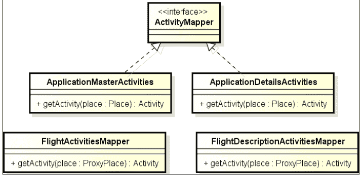

此图显示，Roo创建了与Flight和FlightDescription JPA实体相对应的FlightActivitiesMapper和FlightDescriptionActivitiesMapper类。尽管这些活动映射器不实现GWT的ActivityMapper接口，但它们在flightapp-gwt应用程序中充当活动映射器。这些活动映射器返回特定于EntityProxy的Activity实例。<entity-name>ActivitiesMapper类的getActivity方法接受一个ProxyPlace（表示详情显示区域中的一个place）参数并返回该place的Activity。ApplicationDetailsActivities活动映射器（适用于Web UI的详情显示区域）负责根据要执行用户操作的JPA实体创建FlightActivitiesMapper和FlightDescriptionActivities实例。ApplicationMasterActivities根据从主显示区域选择的JPA实体返回FlightListActivity或FlightDescriptionListActivity。

ActivityManager与一个显示区域相关联，并在用户从一个place导航到另一个place时启动和停止活动。它是通过传入ActivityMapper实例和EventBus实例来创建GWT的ActivityManager类的实例。在flightapp-gwt中，当执行ScaffoldDesktopApp的run方法时，ActivityManager会为“主”和详情显示区域创建，如以下序列图所示：

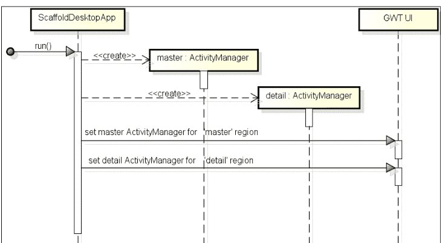

## 处理实体代理特定处理

Roo创建了一个抽象泛型类ApplicationEntityTypesProcessor<T>，用于处理脚手架GWT应用程序中的不同实体代理。ApplicationEntityTypesProcessor<T>由基于实体代理类型执行功能的类实现。以下代码清单显示了flightapp-gwt项目的ApplicationEntityTypesProcessor<T>类：

```
ApplicationEntityTypesProcessor.java
package sample.roo.flightapp.client.managed.request;

public abstract class ApplicationEntityTypesProcessor<T> {

private final T defaultValue;

private T result;

private static void process(
ApplicationEntityTypesProcessor<?> processor,
Class<?> clazz) {
if (FlightProxy.class.equals(clazz)) {
    processor.handleFlight((FlightProxy) null);
    return;
}
if (FlightDescriptionProxy.class.equals(clazz)) {
    processor.handleFlightDescription(
    (FlightDescriptionProxy) null);
    return;
}
processor.handleNonProxy(null);
}
...

public abstract void handleFlight(FlightProxy proxy);

public abstract void handleFlightDescription(FlightDescriptionProxy proxy);

public T process(Class<?> clazz) {
setResult(defaultValue);
ApplicationEntityTypesProcessor.process(this, clazz);
return result;
}
...
```

ApplicationEntityTypesProcessor<T>类表示一个泛型类。handleFlight和handleFlightDescription方法定义为抽象方法；因此，子类需要提供这些方法的实现。

> 你会在ApplicationEntityTypesProcessor<T>类中为每个实体代理定义一个抽象handleXXX方法。

result属性标识在调用ApplicationEntityTypesProcessor<T>类的公共process方法时要返回的结果。请注意，result属性的返回类型是泛型类型——由与参数关联的泛型类型决定。公共process方法接受实体代理的类或对象作为参数，并在内部调用私有process方法，后者又根据实体代理对象或类调用handleFlight或handleFlightDescription方法。

那么，handleXXX方法在实现类中预期做什么？它只是设置一个返回值，该值在调用公共process方法时返回。让我们在示例的上下文中看看这一点。

我们之前提到过，ApplicationDetailsActivities类代表Roo生成的GWT应用程序中详情显示区域的ActivityMapper。ApplicationDetailsActivities通过实现ApplicationEntityTypesProcessor<T>类，返回特定于FlightProxy实体代理的FlightActivitiesMapper或特定于FlightDescriptionProxy实体代理的FlightDescriptionActivitiesMapper实例。

ApplicationDetailsActivities扩展了ApplicationDetailsActivities_Roo_Gwt类，该类实际实现了ActivityMapper GWT接口。

以下代码展示了ApplicationDetailsActivities如何使用ApplicationEntityTypesProcessor<T>类：

```
ApplicationDetailsActivities_Roo_Gwt.java
public Activity getActivity(Place place) {
    ...
    final ProxyPlace proxyPlace = (ProxyPlace) place;
    return new ApplicationEntityTypesProcessor<Activity>() {
    @Override
    public void handleFlight(FlightProxy proxy) {
        setResult(new FlightActivitiesMapper(requests,
                placeController).getActivity(proxyPlace));
    }

    @Override
    public void handleFlightDescription(FlightDescriptionProxy
            proxy) {
        setResult(new FlightDescriptionActivitiesMapper(requests,
                placeController).getActivity(proxyPlace));
    }
    }.process(proxyPlace.getProxyClass());
}
```

在此代码中，需要注意以下重要事项：

- ApplicationEntityTypesProcessor<T>与Activity类型关联。
- handleFlight方法将返回值设置为从FlightActivitiesMapper返回的Activity。
- handleFlightDescription方法将返回值设置为从FlightDescriptionActivitiesMapper返回的Activity。
- 在末尾调用ApplicationEntityTypesProcessor<T>的process方法，以获取由handleFlight或handleFlightDescription方法设置的返回值。


这段代码表明 ApplicationEntityTypesProcessor<T> 泛型类与 Activity 类型相关联，用于检索特定于 FlightProxy 或 FlightDescriptionProxy 的 Activity。同样，Roo 生成的 GWT 代码使用 ApplicationEntityTypesProcessor<T> 类来执行其他特定于实体代理的处理，例如在 **主显示区域** 中呈现实体列表。

## 还有更多...

现在让我们来看看：

- 如何在嵌入式 Jetty 容器中编译和运行 Roo 生成的 GWT 应用程序
- 如何访问 Roo 生成的 flightapp-gwt 应用程序的移动版本
- Roo 生成的 GWT 应用程序中的往返支持
- 如何启用远程日志

## 在嵌入式 Jetty 容器中编译和运行 GWT 应用程序

在开发模式下，GWT 应用程序不会被编译为 JavaScript。您可以通过执行 `mvn jetty:run-exploded` 命令，将 GWT 应用程序编译为 JavaScript 并使用嵌入式 Jetty 容器运行，如下所示：

```
C:\roo-cookbook\ch05-gwt> mvn jetty:run-exploded
```

现在，您可以通过输入以下 URL 来访问 `flightapp-gwt` 应用程序：`http://localhost:8080/flightapp-gwt/index.html`

## 访问 GWT 应用程序的移动版本

如果您已使用 `mvn jetty:run-exploded` 命令编译并部署了 `flightapp-gwt` 应用程序，则可以使用以下 URL 访问 `flightapp-gwt` 应用程序的移动版本：

```
http://localhost:8080/flightapp-gwt/index.html&m=true
```

如果您正在开发模式下运行 `flightapp-gwt` 应用程序，则请使用以下 URL：

```
http://127.0.0.1:8888/ApplicationScaffold.html?gwt.codesvr=127.0.0.1:9997&m=true
```

无论哪种情况，您都会看到 flightapp-gwt 应用程序的移动版本，如下所示：

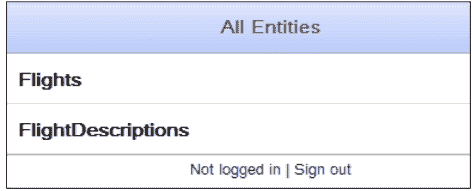

在此屏幕截图中，**航班** 和 **航班描述** 选项可点击，选择它们后即可开始对 JPA 实体实例执行 CRUD 操作。

## GWT 应用程序的往返支持

如果您在 Roo 脚手架的 GWT 应用程序中添加、修改或删除了 JPA 实体中的任何字段，Roo 将相应地对 GWT 制品进行必要的更改。要查看 Roo 对脚手架 GWT 应用程序的往返支持，请从 flightapp-gwt 项目的根目录启动 Roo shell，并使用 field 命令向 FlightDescription 实体添加 aircraftModel 字段，或直接从 IDE 中编辑 FlightDescription.java 文件。作为对 aircraftModel 属性添加的响应，Roo shell 显示 Roo 采取的以下操作：

```
Updated ...FlightDescriptionProxy.java
Updated ...FlightDescriptionListView_Roo_Gwt.java
Updated ...FlightDescriptionDetailsView_Roo_Gwt.java
Updated ...FlightDescriptionDetailsView.ui.xml
Updated ...FlightDescriptionEditView_Roo_Gwt.java
Updated ...FlightDescriptionEditView.ui.xml
...
```

输出显示，Roo 会更新 GWT 实体代理 FlightDescriptionProxy 及其他 GWT 制品，以反映对 FlightDescription JPA 实体的修改。需要注意的另一重要点是，大部分修改仅限于 *\_Roo_Gwt.java 文件——即由 Roo 管理的文件。因此，如果您对不遵循 *\_Roo_Gwt.java 命名约定的文件进行更改，则 Roo 会保留此类更改（修改 *.client.managed.* 包中的 Java 文件的情况除外）。在 Roo 脚手架的 GWT 应用程序中，*\_Roo_Gwt.java 文件相当于 *\_Roo_.aj AspectJ ITD 文件，也就是说，Roo 通过仅修改 *\_Roo_Gwt.java 文件来尽量减少对脚手架 GWT 代码的影响。

## 启用远程日志

GWT 日志框架模拟 Java Logging API，从而可以记录来自 sample.roo.client 包及其子包中 Java 代码的消息。如前所述，sample.roo.client 包及其子包中包含的 Java 类会被 GWT 编译器转换为 JavaScript。GWT 中的远程日志功能使客户端代码能够将日志消息发送到服务器端日志基础架构。要配置远程日志，请在 ApplicationScaffold.gwt.xml 文件中将 gwt.logging.simpleRemoteHandler 属性的值设置为 ENABLED：

```
<set-property name="gwt.logging.simpleRemoteHandler"
value="ENABLED"/>
```

上述配置可启用消息的远程日志。GWT 提供了 RemoteLoggingServiceImpl servlet，它充当处理从客户端接收的日志消息的处理程序。您需要在 web.xml 文件中配置 RemoteLoggingServiceImpl servlet，如下所示：

```
<servlet>
<servlet-name>remoteLogger</servlet-name>
<servlet-class>
com.google.gwt.logging.server.RemoteLoggingServiceImpl
</servlet-class>
</servlet>
```

```
<servlet-mapping>
<servlet-name>remoteLogger</servlet-name>
<url-pattern>
/applicationScaffold/remote_logging
</url-pattern>
</servlet-mapping>
```

需要注意的是，RemoteLoggingServiceImpl servlet 应映射到 /<module_name>/remote_logging URL。

由于 GWT 编译器将客户端 Java 类中的方法名称转换为 JavaScript 时会对其进行混淆，因此您需要在 ApplicationScaffold.gwt.xml 文件中设置以下属性来重新符号化或反混淆它们：

```
<set-property name="compiler.emulatedStack" value="true" />
<set-configuration-property
name="compiler.emulatedStack.recordLineNumbers"
value="true" />
<set-configuration-property
name="compiler.emulatedStack.recordFileNames"
value="true" />
```

此外，您还需要使用 GWT 编译器的 `-extra` 选项创建符号映射目录，并将其放置在服务器端代码可访问的目录中，例如生成的 WAR 文件的 `WEB-INF/classes` 目录。

## 另请参阅

- 有关 Roo 如何从 JPA 实体脚手架 Spring MVC 应用程序的详细信息，请参阅第 4 章（使用 Spring Web MVC 进行 Web 应用程序开发）中的“从 JPA 实体自动生成 Spring MVC 控制器和 JSPX 视图”配方。

## 开始进行 Flex 应用程序开发

在前一个配方中，我们了解了如何使用 Roo 脚手架一个完整的 GWT 应用程序。在本配方中，我们将了解 Roo 如何简化为 Roo 项目设置 Flex。在下一个配方“从 JPA 实体脚手架 Flex 应用程序”中，我们将了解 Roo 如何生成功能齐全的 Flex 应用程序，以便对 JPA 实体实例执行 CRUD 操作。

## 准备工作

编写本书时，Flex 插件与 Spring Roo 1.1.3 及以上版本不兼容，因此请下载 Spring Roo 1.1.2。

编写本配方时，所使用的 Flex 插件是 Flex Spring Roo 插件仓库中日期为 15-Aug-2011 的快照版本 (`http://s3browse.springsource.com/browse/maven.springframework.org/snapshot/org/springframework/flex/roo.addon/org.springframework.flex.roo.addon/1.0.0.BUILD-SNAPSHOT/`)。下载名为 `org.springframework.flex.roo.addon-xx.jar` 的 JAR 文件，并将其复制到 Roo 的 bundle 目录中，或使用 `osgi start` 命令（如第 7 章“开发插件和从项目中删除 Roo”中所述）进行安装。

Flex 插件是可安装插件的一个示例。有关可安装插件的更多信息，请参见第 7 章“开发插件和从项目中删除 Roo”。

在系统中创建新目录 `C:\roo-cookbook\ch05-flex`，并从 `ch05-flex` 目录启动 Roo shell。输入 `help` 命令，检查输出中是否显示 `flex setup`、`flex removing scaffold` 和 `flex remoting all` 命令。如果在 `help` 命令的输出中看到 `flex` 命令，则表示您已成功安装 Flex 插件。

将随本书提供的 ch05_flex_app.roo 脚本复制到 ch05-flex 目录。现在，使用 script 命令执行 ch05_flex_app.roo 脚本。执行 ch05_flex_app.roo 脚本将创建 flightapp_flex Eclipse 项目，将 Hibernate 设置为持久化提供程序，将 MySQL 配置为应用程序的数据库，创建 Flight 和 FlightDescription JPA 实体，并定义 Flight 和 FlightDescription 实体之间的多对一关系。如果您使用的数据库不是 MySQL，或者连接设置与脚本中指定的不同，则请相应地修改脚本。

虽然不是必需的，但您可能还希望下载 Flash Builder 4 并将其作为 Eclipse 插件安装，以简化编辑本配方中 Roo 生成的 MXML 和 ActionScript 文件。

## 操作方法

要设置 Flex 应用程序，请按以下步骤操作：

- 1. 执行 flex setup 命令，在 flightapp_flex 项目中创建与 Spring BlazeDS 集成相关的配置制品：

```
... roo> flex setup
Created SRC_MAIN_WEBAPP\WEB-INF\flex
Created SRC_MAIN_WEBAPP\WEB-INF\flex\services-config.xml
...
Created SRC_MAIN_WEBAPP\WEB-INF\spring
Created SRC_MAIN_WEBAPP\WEB-INF\spring\flex-config.xml
Created SRC_MAIN_WEBAPP\WEB-INF\spring\webmvc-config.xml
...
Created SRC_MAIN_WEBAPP\WEB-INF\web.xml
Managed SRC_MAIN_WEBAPP\WEB-INF\web.xml
...
Managed SRC_MAIN_WEBAPP\WEB-INF\spring\webmvc-config.xml
Managed ROOT\pom.xml [Added dependency com.adobe.flex.
framework:flex-framework:4.0.0.14159]
Managed ROOT\pom.xml [Added dependency org.springframework.
flex:spring-flex-core:1.5.0.BUILD-SNAPSHOT]
...
Created ROOT\.flexProperties
Created ROOT\.actionScriptProperties
...
Created ROOT\src\main\flex\flightapp_flex_scaffold.mxml
Created SRC_MAIN_WEBAPP\flightapp_flex_scaffold.html
Created ROOT\src\main\flex\flightapp_flex_scaffold-config.xml
```


- 2. 将 Spring 快照版本的 Maven 仓库包含在你的 `pom.xml` 文件中，以便 Flex 插件可以下载尚未在 Spring 的里程碑或发布 Maven 仓库中提供的 Flex 插件依赖项：

```xml
<repositories>
<repository>
<id>spring-maven-snapshot</id>
<name>Spring Maven Snapshot Repository</name>
<url>
http://maven.springframework.org/snapshot
</url>
</repository>
...
</repositories>
```

- 3. 在 `pom.xml` 文件中配置 Flexmojos Maven 插件的插件仓库（有关详细信息，请参阅插件文档：http://repository.sonatype.org/content/sites/flexmojos-site/3.8/plugin-info.html），如下所示：

```xml
<pluginRepositories>
<pluginRepository>
<id>flexmojos-repository</id>
<url>
http://repository.sonatype.org/content/groups/flexgroup/
</url>
</pluginRepository>
...
</pluginRepositories>
```

- 4. 执行 `perform eclipse` 命令，使用 `pom.xml` 文件中新添加的依赖项更新项目的类路径设置。它还将 Flex 和 ActionScript 性质添加到 `flightapp_flex` Eclipse 项目中。

## 工作原理...

`flex setup` 命令由 Roo 的 Flex 插件处理。

`flex setup` 命令配置 Spring BlazeDS 集成，并创建开发 Flex 4 应用程序所需的必要工件。下表描述了由 `flex setup` 命令创建的一些重要目录和文件：

| 目录 / 文件 | 说明 |
| --- | --- |
| SRC_MAIN_WEBAPP/history | 包含 history.css、history.js 和 historyFrame.html 文件，用于管理浏览器历史记录。 |
| SRC_MAIN_WEBAPP/WEB-INF/flex/services-config.xml | services-config.xml 是 BlazeDS 配置文件，包含 BlazeDS 的通道和相应的端点配置。 |
| SRC_MAIN_WEBAPP/WEB-INF/spring/flex-config.xml | flex-config.xml 将 BlazeDS MessageBroker 配置为 Spring 管理的 Bean。 |
| SRC_MAIN_WEBAPP/WEB-INF/spring/webmvc-config.xml | Spring 的 Web 应用程序上下文 XML，由 web.xml 文件中定义的 DispatcherServlet 加载。此外，webmvc-config.xml 文件从 flex-config.xml 导入 Bean 定义。 |
| ROOT/html-template | html-template 目录包含 index.template.html 文件，该文件充当嵌入 Flex 应用程序的 HTML 模板。Roo 在 SRC_MAIN_WEBAPP 目录中生成 flightapp_flex_scaffold.html 文件（基于 index.template.html 文件），用于嵌入我们的 Flight App Flex 应用程序。因此，要加载我们的 Flight App Flex 应用程序，需要在 Web 浏览器中加载 flightapp_flex_scaffold.html 页面。 |
| ROOT/src/main/flex/flightapp_flex_scaffold.mxml | flightapp_flex_scaffold.mxml 是主应用程序 MXML 文件，用于定义应用程序的布局和初始用户界面。 |
| ROOT/src/main/flex/flightapp_flex_scaffold-config.xml | flightapp_flex_scaffold-config.xml 文件会替换默认的 Flex 编译器设置。在“从 JPA 实例构建脚手架 Flex 应用程序”示例中，我们将看到该 XML 文件包含与 Roo 为每个 JPA 实例构建的主视图（MXML 文件）对应的完全限定 ActionScript 类名称。 |

现在让我们来看看 Spring Roo 创建的重要配置文件。

webmvc-config.xml 文件是 Spring 的 Web 应用程序上下文 XML 文件，由 flightapp_flex 项目 web.xml 文件中配置的 DispatcherServlet 加载。webmvc-config.xml 文件导入 flex-config.xml 应用程序上下文 XML 文件中的 Bean 定义，如下所示：

```
webmvc-config.xml
<beans ...>
...
<import resource="flex-config.xml" />
</beans>
```

> 有关 webmvc-config.xml 文件中定义的其他元素的信息，请参阅第 4 章，使用 Spring Web MVC 进行 Web 应用程序开发。

flex-config.xml 使用 Spring Flex 模式的 `<message-broker>` 元素来配置和初始化 BlazeDS MessageBroker，如下所示：

```
flex-config.xml
<beans xmlns="http://www.springframework.org/schema/beans"
    xmlns:flex="http://www.springframework.org/schema/flex"
    ...>

<flex:message-broker mapping-order="1">
    <flex:mapping pattern="/messagebroker/*"/>
    <flex:message-service default-channels="longpolling-amf" />
</flex:message-broker>

</beans>
```

默认情况下，`<message-broker>` 元素将 /WEB-INF/flex/services-config.xml 文件视为 BlazeDS MessageBroker 的配置文件。如果你更改了 flightapp_flex 中 services-config.xml 文件的名称或位置，则使用 `<message-broker>` 元素的 services-config-path 属性来指定你的 BlazeDS 配置 XML 文件。

Flex 模式的 `<mapping>` 元素将来自 DispatcherServlet 的传入请求映射到 /messagebroker/* 路径——即 BlazeDS MessageBroker 通道在 services-config.xml 中映射到的路径，我们稍后将看到这一点。

`<message-service>` 元素配置一个 BlazeDS flex.messaging.services.MessageService 对象，该对象为应用程序中消息生产者和消费者之间提供发布-订阅消息传递。default-channels 属性指定 Flex 客户端用于访问 MessageService 或从中接收消息的消息通道。longpolling-amf 值指的是 services-config.xml 中已启用轮询的 AMFChannel。

> 重要的是要注意，尽管 Roo 配置了 MessageService，但 Roo 生成的 Flex 应用程序并未使用它。

下面的清单显示了 Roo 生成的 services-config.xml 文件中配置的通道：

```
services-config.xml
<channels>
    <channel-definition id="amf"
        class="mx.messaging.channels.AMFChannel">
        <endpoint
        url="http://{server.name}:{server.port}/{context.root}/messagebroker/amf"
        class="flex.messaging.endpoints.AMFEndpoint"/>
    </channel-definition>
    ...
    <channel-definition id="longpolling-amf"
    class="mx.messaging.channels.AMFChannel">
    <endpoint url="http://{server.name}:{server.port}/{context.root}/messagebroker/amflongpolling"
    class="flex.messaging.endpoints.AMFEndpoint"/>
    <properties>
    <polling-enabled>true</polling-enabled>
    ...
    </properties>
    </channel-definition>
    ...
</channels>
```

此代码清单显示了由 Roo 创建的通道定义。`<channel-definition>` 元素定义一个通道。id 属性是通道的唯一标识符，Flex 客户端使用它来连接到端点。class 属性标识通道的类型。封闭的 `<endpoint>` 元素定义与通道对应的端点。`<endpoint>` 元素的 url 属性指定服务器的 URL，class 属性指定端点类。Flex 组件使用通道与 BlazeDS 端点进行通信。例如，上述代码清单表明 AMFChannel 由 Flex 用于与 AMFEndpoint 通信。

url 属性值中使用的 {server.name} 和 {server.port} 令牌在运行时会根据下载 SWF 文件的服务器 URL 进行替换。{context.root} 令牌会替换为在编译时根据 pom.xml 文件中 Flexmojos Maven 插件定义的 `<contextRoot>` 配置选项计算出的值。稍后在本示例中，我们将查看 Roo 为 flightapp_flex 项目生成的 Flexmojos Maven 插件配置。

发送到 DispatcherServlet 的传入请求被路由到 BlazeDS MessageBroker，因为 flex-config.xml 中 `<mapping-pattern>` 元素的值（即 /messagebroker/*）映射到 services-config.xml 中 `<endpoint>` 元素的 url 属性值（http://.../messagebroker/..）。

我们之前看到，longpolling-amf 通道被 MessageService 用作传输消息的默认通道。该通道的 `<polling-enabled>` 属性设置为 true，这意味着 longpolling-amf 通道已启用轮询。


services-config.xml 文件中的以下 <services> 元素显示了应用程序级默认频道配置：

```
<services>
<default-channels>
<channel ref="amf" />
</default-channels>
</services>
```

此 <default-channels> 元素指定，如果 Flex 组件未指定要使用的频道，则使用 amf 频道进行通信。

Roo 还使用 <logging> 元素在 services-config.xml 中配置服务器端日志记录，如下所示：

```
<logging>
<target class="flex.messaging.log.ConsoleTarget"
level="Warn">
<properties>
<prefix>[BlazeDS] </prefix>
<includeDate>false</includeDate>
<includeTime>false</includeTime>
<includeLevel>false</includeLevel>
<includeCategory>false</includeCategory>
</properties>
<filters>
<pattern>Endpoint.*</pattern>
<pattern>Service.*</pattern>
<pattern>Configuration</pattern>
</filters>
</target>
</logging>
```

日志配置指定日志消息写入的位置、写入的消息类型、写入方式，以及每个类别（如 Endpoint、Service 等）生成的日志消息。flex.messaging.log.ConsoleTarget 的 class 属性（target 元素的）值表示日志消息写入到标准输出。level="Warn" 表示仅写入警告级别的消息。在上述代码中，<properties> 元素指定日志消息带有 [BlazeDS] 前缀，并包含日期、时间、日志级别和类别。<filters> 元素将日志记录限制为由 <pattern> 子元素定义的类别。

现在让我们来看一下充当主应用程序文件的脚手架 MXML 文件——即包含 Flex Spark 组件库中 Application 组件的 MXML 文件。以下代码清单显示了 flightapp_flex_scaffold.mxml 文件：

```
flightapp_flex_scaffold.mxml
<s:Application xmlns:fx="http://ns.adobe.com/mxml/2009"
    xmlns:s="library://ns.adobe.com/flex/spark"
    xmlns:mx="library://ns.adobe.com/flex/mx">
<fx:Script>
<![CDATA[
    ...
    protected function
    entityList_doubleClickHandler(event:MouseEvent):void
    {
        ...
    }
]]>
</fx:Script>

<fx:Declarations>
<s:ArrayList id="entities"/>
</fx:Declarations>

<s:ChannelSet id="remotingChannels">
    <s:AMFChannel id="amf" url=
    "http://localhost:8080/flightapp_flex/messagebroker/amf"/>
</s:ChannelSet>
</fx:Declarations>

<s:Group id="mainGroup" height="100%" width="100%">
    <s:layout>
    <s:HorizontalLayout/>
    </s:layout>

    <s:Panel id="entityPanel" title="Entity List" height="100%">
    <s:List id="entityList" dataProvider="{entities}"
        width="100%" height="100%"
        toolTip="Double-Click the selected Entity"
        doubleClickEnabled="true"
        doubleClick="entityList_doubleClickHandler(event)"/>
    </s:Panel>
</s:Group>

</s:Application>
```

此 MXML 显示了 flightapp_flex 应用程序的用户界面。`<Panel>` 标签创建了一个包含 Spark List 组件的 Spark Panel 组件。List 组件显示可从用户界面管理的实体列表。实体列表由 `<ArrayList>` 标签定义。请注意，`<List>` 标签的 dataProvider 属性值为 {entities}，而 `<ArrayList>` 标签的 id 属性值为 entities，这意味着 List 组件显示的实体列表来自由 `<ArrayList>` 标签定义的列表。不过，`<ArrayList>` 标签不包含任何元素；因此，目前列表为空。

> 当我们执行 flex remoting all 或 flex remoting scaffold 命令来为 JPA 实体脚手架一个远程处理目标时，`<ArrayList>` 标签将用子元素填充，正如我们将在“从 JPA 实体脚手架 Flex 应用程序”配方中看到的那样。

`<List>` 的 doubleClick 属性指定当用户双击列表中的项目时，将调用 `entityList_doubleClickHandler(event)` ActionScript 方法。在“从 JPA 实体脚手架远程处理目标”配方中，我们将详细介绍 `entityList_doubleClickHandler(event)` 方法的实现。

`<ChannelSet>` 标签创建一个 ChannelSet——一组用于与 BlazeDS 服务器通信的频道。如前所述，Roo 在 services-config.xml 中将 amf 频道（频道类型为 AMFChannel）定义为默认的应用程序级频道；因此，Roo 生成的 `<ChannelSet>` 标签使用 `<AMFChannel>` 标签创建一个 AMFChannel。`<AMFChannel>` 的 url 属性指定相应的端点 URL。

> 由于 `<AMFChannel>` 标签的 url 属性将 BlazeDS 服务器的位置指定为 localhost，因此您的 Roo 生成的 flightapp_flex 应用程序仅在 BlazeDS 服务器本地运行时才能工作。为了避免硬编码端点 URL，建议将 ChannelSet 配置外部化到一个 XML 文件中，该文件在 Flex 应用程序初始化时解析，并随后用于与 BlazeDS 服务器通信。

如前所述，Roo 生成了一个 flightapp_flex_scaffold-config.xml 配置文件，用于覆盖默认的 Flex 编译器设置。请注意，该文件遵循的命名约定为：<MXML 文件名>-config.xml，其中 <MXML 文件名> 是创建的配置文件所对应的 MXML 文件的名称。在编译名为 myApp.mxml 的 MXML 文件时，Flex 编译器会在 MXML 文件所在位置查找名为 myApp-config.xml 的配置文件，并使用它来覆盖默认的编译器选项。以下清单显示了 flightapp_flex_scaffold-config.xml 文件的内容：

```
<flex-config xmlns="http://www.adobe.com/2006/flex-config">
    <includes append="true">
    </includes>
</flex-config>
```

正如代码所示，flightapp_flex_scaffold-config.xml 没有做任何有趣的事情。在“从 JPA 实体脚手架 Flex 应用程序”配方中，我们将在执行 flex remoting all 或 flex remoting scaffold 命令后对该文件进行更新时详细讨论它。

## 更多内容...

如前所述，Roo 在 `flightapp_flex` 项目的 `pom.xml` 文件中配置了 Flexmojos Maven 插件。现在让我们详细了解一下 Flexmojos 插件配置。

## Flexmojos Maven 插件配置

Flexmojos Maven 插件提供许多功能，但为了简洁起见，我们将只关注 `flexmojos:compile-swf` 目标，该目标负责编译 Flex 项目的源代码（MXML 和 ActionScript 文件）并将其打包为 SWF 文件。以下清单显示了 `flightapp_flex` 项目 `pom.xml` 文件中 Flexmojos Maven 插件的配置：

pom.xml

```
<plugin>
    <groupId>org.sonatype.flexmojos</groupId>
    <artifactId>flexmojos-maven-plugin</artifactId>
    <version>3.7.1</version>
    <executions>
        <execution>
            <id>compile-scaffold-swf</id>
            <phase>process-resources</phase>
            <goals>
                <goal>compile-swf</goal>
            </goals>
            <configuration>
                <incremental>true</incremental>
                <sourceFile>
                    ${basedir}/src/main/flex/${project.name}_scaffold.mxml
                </sourceFile>
                <sourcePaths>
                    <path>${basedir}/src/main/flex</path>
                </sourcePaths>
                <output>
${basedir}/src/main/webapp/${project.name}_scaffold.swf
</output>
<contextRoot>${project.build.finalName}</contextRoot>
<services>
${basedir}/src/main/webapp/WEB-INF/
flex/services-config.xml
</services>
<debug>true</debug>
</configuration>
</execution>
</executions>
<dependencies>
<dependency>
<groupId>com.adobe.flex</groupId>
<artifactId>compiler</artifactId>
<version>4.0.0.14159</version>
<type>pom</type>
</dependency>
</dependencies>
</plugin>
```

在此清单中，`<configuration>` 元素配置 Flexmojos Maven 插件。

`<sourceFile>` 元素标识插件要编译的主应用程序 MXML 文件，即 flighttracker_flex_scaffold.mxml 文件。

`<sourcePaths>` 指定项目 ActionScript 文件所在的基目录或目录，这对应于 /src/main/flex，即执行 `flex remoting all` 或 `flex remoting scaffold` 命令时创建的目录。

`<output>` 指定生成的 SWF 文件的名称和位置，对于 flighttracker_flex 项目，该位置为 SRC_MAIN_WEBAPP/flighttracker_flex_scaffold.swf。

`<contextRoot>` 元素指定 Web 应用程序的上下文根，这对应于值 flighttracker_flex-0.1.0.BUILD-SNAPSHOT。

`<contextRoot>` 元素的值用于替换 services-config.xml 文件中定义的端点 URL 中指定的 `{context.root}` 标记。

`<services>` 元素指定定义频道和相应端点的 services-config.xml 文件。

`<dependency>` 元素指定 Flexmojos Maven 插件依赖于 Flex 编译器。

请注意，依赖类型为 `pom` 而非 `jar`。

由于依赖类型为 `pom`，相应 `pom` 文件（可在 `https://repository.sonatype.org/content/groups/flexgroup/` 处找到）中指定的依赖项会被添加到 Flexmojos Maven 插件所需的依赖项中。


## 另请参阅

- 参考“从 JPA 实体脚手架 Flex 应用程序”配方，以了解如何使用 Roo 脚手架远程目标和 Flex 用户界面

## 从 JPA 实体脚手架 Flex 应用程序

在上一个配方中，我们了解了如何设置项目以使用 Flex 和 Spring BlazeDS 集成。在本配方中，我们进一步脚手架了一个完整的 Flex 应用程序，该应用程序与 BlazeDS 交互，以对 JPA 实体执行 CRUD 操作。

### 准备工作

本配方是上一个配方“Flex 应用程序开发入门”的扩展；因此，执行上一个配方中描述的步骤，设置 flightapp_flex 项目以使用 Flex 和 Spring BlazeDS 集成。

从 C:\roo-cookbook\ch05-flex 目录启动 Roo shell——即在完成“Flex 应用程序开发入门”配方时创建 flightapp_flex 项目的目录。

### 操作步骤...

要脚手架 Flex 应用程序，请按照以下步骤操作：

- 1. 执行 `flex remoting all` 命令，如下所示：

```
.. roo> flex remoting all --package ~.flex
Created SRC_MAIN_JAVA\sample\roo\flightapp\flex
Created ..\FlightDescriptionService.java
Created ..\FlightDescriptionService_Roo_Service.aj
..
Created ROOT\src\main\flex\sample\roo\flightapp\domain
Created ..\FlightDescription.as
Updated ROOT\src\main\flex\flightapp_flex_scaffold.mxml
Updated ROOT\src\main\flex\flightapp_flex_scaffold-config.xml
Created ROOT\src\main\flex\sample\roo\flightapp\presentation\
flightdescription
Created ..\FlightDescriptionEvent.as
Created ..\FlightDescriptionView.mxml
Created ..\FlightDescriptionForm.mxml
```

- 2. 此处显示的输出已按 Roo 创建的目录优先、随后是目录中创建的文件的顺序进行组织。Spring Roo shell 不会按上述方式显示输出。为简洁起见，输出仅显示与 FlightDescription JPA 实体相对应的创建文件。

- 3. 退出 Roo shell，并从包含 `flightapp_flex` 项目的目录执行 `mvn install` 来构建 `flightapp_flex` 项目：
  C:\roo-cookbook\ch05-flex>mvn install

- 4. 执行 Tomcat Maven 插件的 `tomcat:run` 目标（从包含 `flightapp_flex` Roo 项目的目录）以启动嵌入式 Tomcat 实例：
  C:\roo-cookbook\ch05-flex>mvn tomcat:run

- 5. 打开 Web 浏览器并访问 `flightapp_flex_scaffold.html` 文件，该文件充当我们 Flex 应用程序的 HTML 包装器：`http://localhost:8080/flightapp_flex/flightapp_flex_scaffold.html`。如果 Web 浏览器尚未安装 Flash Player 10 或更高版本，系统将提示您安装它。还建议为 Web 浏览器安装 Flash 调试器，以查看与 Flex 应用程序交互时引发的任何异常。如果您看到以下 Flex 应用程序用户界面，则表示您已成功将 Flex 应用程序部署到 Tomcat 上：

| 实体列表 |
|---|
| FlightDescription |
| Flight |

- 6. 此屏幕截图显示了可以使用 Flex 应用程序管理的 JPA 实体列表。由于 `flightapp_flex` 项目包含 `Flight` 和 `FlightDescription` 实体，因此它们在列表中显示。

- 7. 要对 `FlightDescription` 和 `Flight` 实体实例执行 CRUD 操作，请双击列表中的 JPA 实体名称。以下屏幕截图显示双击列表中的 **FlightDescription** 项目时显示的屏幕：

| 实体列表 | FlightDescription 列表 |
| :--- | :--- |
| FlightDescription | 新建 FlightDescription |
| Flight | 源 | 目的地 |

### 工作原理...

`flex remoting all` 命令由 Spring Roo 的 Flex 插件处理。

Flex 客户端通过 BlazeDS RemotingService 与服务器端 BlazeDS 远程目标（即 Java 对象）进行交互。由于我们使用的是 Spring BlazeDS 集成，远程目标被配置为 Spring 服务组件，并且 RemotingService 由 Spring `flex` 架构的 `<message-broker>` 元素配置了合理的默认值（请参阅 SRC_MAIN_WEBAPP\WEB-INF\spring\flex-config.xml 文件）。`flex remoting all` 命令的 `package` 参数指定创建远程目标的包。

> 需要注意的是，Flex 客户端使用 MessageService 与消息目标（可能是 JMS 队列或主题）进行交互，并使用 RemotingService 与远程目标（Java 对象）进行交互。

以下表格描述了执行 `flex remoting all` 命令时创建的重要目录和文件：

| 目录 / 文件 | 说明 |
| :--- | :--- |
| SRC_MAIN_JAVA\sample\roo\flightapp\flex | 包含由 Roo 为 flightapp_flex 应用程序中每个尚不存在远程目标的 JPA 实体创建的远程目标。此目录基于 `flex remoting all` 命令的 `package` 参数值创建。 |
| ROOT\src\main\flex\sample\roo\flightapp\domain | 包含 Roo 生成的 ActionScript 类，这些类映射到 flightapp_flex 应用程序中的 JPA 实体。 |
| ROOT\src\main\flex\sample\roo\flightapp\presentation\flightdescription | 包含用于对 FlightDescription JPA 实体执行 CRUD 操作的 MXML 文件和 ActionScript 类。目录名称源自 JPA 实体的名称。 |
| ROOT\src\main\flex\sample\roo\flightapp\presentation\flight | 包含用于对 Flight JPA 实体执行 CRUD 操作的 MXML 文件和 ActionScript 类。目录名称源自 JPA 实体的名称。 |

执行 `flex remoting all` 命令时，它会为应用程序中每个尚不存在远程目标的 JPA 实体创建一个远程目标（也是 Spring 服务组件）。远程目标定义用于对相应 JPA 实体执行 CRUD 操作的方法。以下代码清单显示了由 Roo 为 FlightDescription JPA 实体创建的远程目标 FlightDescriptionService 类：

```
FlightDescriptionService.java
package sample.roo.flightapp.flex;

import org.springframework.flex.roo.addon.RooFlexScaffold;
import sample.roo.flightapp.domain.FlightDescription;
import org.springframework.flex.remoting.RemotingDestination;
import org.springframework.stereotype.Service;

@RooFlexScaffold(entity = FlightDescription.class)
@RemotingDestination
@Service
public class FlightDescriptionService {
}
```

在此代码中，@RooFlexScaffold 注解指示 Roo 生成相应的 AspectJ ITD 文件。此 AspectJ ITD 文件将方法引入 FlightDescriptionService 类，用于对 FlightDescription 实体执行 CRUD 操作。@RooFlexScaffold 注解的 entity 属性指定 FlightDescriptionService 类所管理的 JPA 实体。Spring 的 @RemotingDestination 注解指示 FlightDescriptionService 类被导出为远程目标。

由 Spring 管理的 MessageBroker 负责将从 Flex 客户端接收的消息路由到 RemotingService，后者反过来调用 Spring 管理的远程目标上的方法。@Service 注解指示 FlightDescriptionService 表示 Spring 的服务组件。使用 @Service 注解可确保 FlightDescriptionService 使用 Spring 的类路径扫描功能自动注册到 Spring 的 Web 应用程序上下文中（请参阅 webmvc-config.xml 文件中定义的 `<component-scan>` 元素）。

以下代码清单显示了与 FlightDescriptionService 类中的 @RooFlexScaffold 注解相对应的 AspectJ ITD 文件：

```
FlightDescriptionService_Roo_Service.aj
package sample.roo.flightapp.flex;

import java.lang.Long;
import java.util.List;
import sample.roo.flightapp.domain.FlightDescription;

privileged aspect FlightDescriptionService_Roo_Service {

    public FlightDescription
        FlightDescriptionService.show(Long id) {
        ...
        return FlightDescription.findFlightDescription(id);
    }

    public List<FlightDescription>
        FlightDescriptionService.list() {
        return FlightDescription.findAllFlightDescriptions();
    }

    ...
}
```

此代码显示 FlightDescriptionService_Roo_Service.aj 在 FlightDescriptionService 类中为 FlightDescription JPA 实体引入了 CRUD 操作。虽然上述代码未显示，但也为读取 FlightDescription JPA 实体列表引入了分页支持。


与 @RooFlexScaffold 注释对应的 AspectJ ITD 文件的名称遵循以下命名约定：<JPA-entity-name>Service_Roo_Service.aj，其中 <JPA-entity-name> 是 @RooFlexScaffold 注释的 entity 属性所指定的 JPA 实体的名称。

从 Flex 客户端调用 Spring 管理的 remoting 目标方法可能需要发送和接收对象。例如，FlightDescriptionService 的 show 方法返回一个 FlightDescription 对象，而 create 方法接受一个 FlightDescription 对象。Flex 允许通过自动将 ActionScript 对象转换为 Java 对象（反之亦然）来在 Flex 客户端和 remoting 目标方法之间交换数据。由于 flightapp_flex 应用程序中的 Flex 客户端与 FlightDescriptionService remoting 目标交换航班描述详细信息，Roo 会生成与 FlightDescriptionService 管理的 JPA 实体对应的 ActionScript 类。以下代码显示了与 FlightDescription JPA 实体对应的 Roo 生成的 FlightDescription.as ActionScript 类：

```
FlightDescription.as
package sample.roo.flightapp.domain{
[RemoteClass(alias="sample.roo.flightapp.domain.FlightDescription")]
public class FlightDescription {
public var destination:String;
public var id:Number;
public var origin:String;
public var price:Number;
public var version:Number;
}
}
```

此代码显示，FlightDescription.as ActionScript 类定义的属性与相应的 FlightDescription JPA 实体相同。[RemoteClass] 元数据标签指定 ActionScript 对象映射到的远程 Java 对象。alias 属性指定 ActionScript 对象映射到的远程 Java 对象的完全限定类名。

Roo 为每个 JPA 实体创建 ActionScript 和 MXML 文件，以便可以从脚手架 Flex 用户界面对 JPA 实体执行 CRUD 操作。下表描述了这些 Roo 生成的文件（位于 ROOT\src\main\flex\sample\roo\flightapp\presentation\flightdescription 和 ROOT\src\main\flex\sample\roo\flightapp\presentation\flight 目录中）：

| 文件 | 描述 |
| :--- | :--- |
| `<JPA-entity-name>Event.as` | `flash.events.Event` 的子类，用于定义不同的事件类型，例如当 JPA 实体被创建、编辑或修改时生成的创建、编辑和删除事件。在 `flightapp_flex` 项目中，`FlightEvent.as` 和 `FlightDescriptionEvent.as` 表示事件类。 |
| `<JPA-entity-name>View.mxml` | 显示实体实例列表以及创建、编辑和删除实体实例选项的 MXML 文件。在 `flightapp_flex` 项目中，`FlightView.mxml` 和 `FlightDescriptionView.mxml` MXML 文件分别显示 Flight 和 FlightDescription 实体实例列表，以及创建、编辑和删除实体实例的选项。 |
| `<JPA-entity-name>Form.mxml` | 显示创建实体实例表单的 MXML 文件。在 `flightapp_flex` 项目中，`FlightForm.mxml` 和 `FlightDescriptionForm.mxml` 文件分别显示创建 Flight 和 FlightDescription JPA 实体实例的表单。 |

以下代码显示了 Roo 创建的 `FlightDescriptionEvent.as` ActionScript 类：

```
package sample.roo.flightapp.presentation.flightdescription
{
    import flash.events.Event;
    import sample.roo.flightapp.domain.FlightDescription;
    public class FlightDescriptionEvent extends Event {
    public static const CREATE:String =
    "flightDescriptionCreate";
    public static const UPDATE:String =
    "flightDescriptionUpdate";
    public static const DELETE:String =
    "flightDescriptionDelete";
    public var flightDescription:FlightDescription;
    public function FlightDescriptionEvent(type:String,
    flightDescription:FlightDescription,
    bubbles:Boolean = true, cancelable:Boolean = false) {
    this.flightDescription = flightDescription;
    super(type, bubbles, cancelable);
    }
    }
}
```

FlightDescriptionEvent 类是 flash.events.Event 类的子类，并定义了三种不同的事件类型：flightDescriptionCreate、flightDescriptionUpdate 和 flightDescriptionDelete。FlightDescription ActionScript 对象（对应于服务器端的 FlightDescription JPA 实体）表示 FlightDescriptionEvent 事件类型所携带的有效载荷。

如前所述，在 flightapp_flex 应用程序中，flightapp_flex_scaffold.mxml 文件定义了应用程序的初始用户界面。执行 flex remoting all 命令时，我们在输出中看到了 flightapp_flex_scaffold.mxml 文件已更新。以下代码显示了 Roo 对 flightapp_flex_scaffold.mxml 文件所做的修改：

```
flightapp_flex_scaffold.mxml
...
<fx:Declarations>
  <s:ArrayList id="entities">
    <fx:String>FlightDescription</fx:String>
    <fx:String>Flight</fx:String>
  </s:ArrayList>
</fx:Declarations>
...
</fx:Declarations>
...
<s:Panel id="entityPanel" title="Entity List" height="100%">
  <s:List id="entityList" dataProvider="{entities}"
    width="100%" height="100%"
    toolTip="Double-Click the selected Entity"
    doubleClickEnabled="true"
    doubleClick="entityList_doubleClickHandler(event)" />
</s:Panel>
</s:Group>
```

如果将此代码与我们在之前教程中看到的 flightapp_flex_scaffold.mxml 文件代码进行比较，您会发现唯一的变化是向 <ArrayList> 添加了 <fx:String> 元素。Roo 为应用程序中的每个 JPA 实体创建一个 <fx:String> 元素。默认情况下，<fx:String> 元素的值是相应 JPA 实体的简单名称。由于 <List> 组件使用 <ArrayList> 作为其数据提供程序，<List> 组件现在在用户界面中显示 Flight 和 FlightDescription 列表项，如下所示：

| 实体列表 | |
| --- | |
| FlightDescription | |
| Flight | |

此屏幕截图显示，Roo 并未为 FlightDescription JPA 实体中定义的查找器方法 findFlightDescriptionsByDestinationAndOrigin 生成对应的列表项。

当您双击上面列表中的某一项时，将调用 `flightapp_flex_scaffold.mxml` 文件中定义的 `entityList_doubleClickHandler` ActionScript 方法，该方法会显示由 `FlightDescriptionView.mxml` 或 `FlightView.mxml` 生成的用户界面，具体取决于双击的列表项。以下代码显示了 `entityList_doubleClickHandler` 方法：

```
protected function
entityList_doubleClickHandler(event:MouseEvent):void {
..
var selectedEntity:String = entityList.selectedItem;
var selectedEntityPackage:String =
selectedEntity.toLowerCase();

var viewClass:Class =
getDefinitionByName("sample.roo.flightapp.presentation."
+ selectedEntityPackage+"::"+selectedEntity+"View")
as Class;
if (viewClass != null) {
var newView:UIComponent = UIComponent(new viewClass());
...
mainGroup.addElement(newView);
}
...
}
```

由于 MXML 文件被编译为 ActionScript 类，`FlightDescriptionView.mxml` 和 `FlightView.mxml` 文件分别转换为 `FlightDescriptionView` 和 `FlightView` ActionScript 类。`entityList_doubleClickHandler` 方法从列表中获取所选项的值（即 **航班描述** 或 **航班**），并向其追加 'View' 字符串——使连接后的值变为 `FlightDescriptionView` 或 `FlightView`。然后，`entityList_doubleClickHandler` 创建 `FlightDescriptionView` 或 `FlightView` 的实例，并将其添加到主用户界面中。

以下序列图总结了 entityList_doubleClickHandler 方法所起的作用：

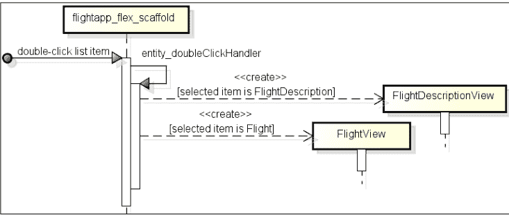

需要注意的是，flightapp_flex_scaffold.mxml 文件的 entityList_doubleClickHandler 方法从不直接引用 FlightView 或 FlightDescriptionView ActionScript 类。实际上，flightapp_flex 项目中的任何其他 MXML 或 ActionScript 类都不引用 FlightView 和 FlightDescriptionView 类。这的副作用是，Flex 编译器不会将 FlightDescriptionView 和 FlightView 包含在生成的 SWF 文件中。为了指示 Flex 编译器包含 FlightDescriptionView 和 FlightView ActionScript 类，Roo 将它们的完全限定名称添加到 flightapp_flex_scaffold-config.xml 文件中，如下所示：

```
flightapp_flex_scaffold-config.xml
<flex-config xmlns="http://www.adobe.com/2006/flex-config">
<includes append="true">
<symbol>sample.roo.flightapp.presentation.flightdescription.FlightDescriptionView</symbol>
<symbol>
sample.roo.flightapp.presentation.flight.FlightView
</symbol>
</includes>
</flex-config>
```

<symbol> 元素指定了 Flex 编译器应在生成的 SWF 文件中包含的 ActionScript 类。


FlightDescriptionView.mxml 显示一个 **新建 FlightDescription** 按钮，如果单击它，将调用 showForm 方法。FlightDescriptionView.mxml 的 showForm 方法显示用于创建 FlightDescription 实体实例的表单（由 FlightDescriptionForm.mxml 表示），如下所示：

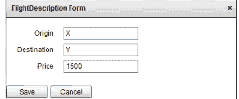

下面的序列图显示单击新建 FlightDescription 按钮时幕后发生了什么：

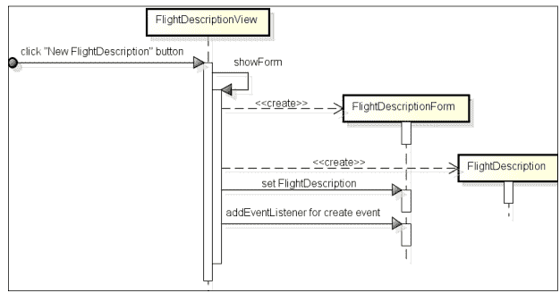

该序列图显示 showForm 方法创建 FlightDescriptionForm 和 FlightDescription 对象。FlightDescription 对象（对应 FlightDescription JPA 实体）充当 Web 应用程序中常见的表单支撑对象。showForm 方法将 FlightDescription 对象设置到 FlightDescriptionForm 实例中。另外，showForm 向 FlightDescriptionForm 添加了 FlightDescriptionEvent.CREATE 事件的事件侦听器。

下面的代码显示了 showForm 方法：

```
private function showForm
(flightDescription:FlightDescription = null):void {
var form:FlightDescriptionForm =
PopUpManager.createPopUp(this, FlightDescriptionForm, true)
as FlightDescriptionForm;
form.flightDescription = flightDescription != null ?
flightDescription : new FlightDescription();

form.addEventListener(FlightDescriptionEvent.CREATE,
flightDescriptionView_flightDescriptionCreateEventHandler);
}
```

这段代码表明，addEventListener 方法接受 FlightDescriptionForm 对象监听的事件类型，即 FlightDescriptionEvent.CREATE。addEventListener 还接受当 FlightDescriptionForm 对象接收到事件时要调用的处理程序方法的名称。因此，如果 FlightDescriptionForm 对象接收到 FlightDescriptionEvent.CREATE 事件，将导致调用 flightDescriptionView_flightDescriptionCreateEventHandler 方法。我们稍后会回到处理程序方法，但首先来看看 FlightDescriptionEvent.CREATE 事件是如何生成的。

下面的序列图显示，当用户按下 Save 按钮以创建 FlightDescription JPA 实体实例时，会生成 FlightDescriptionEvent.CREATE 事件：

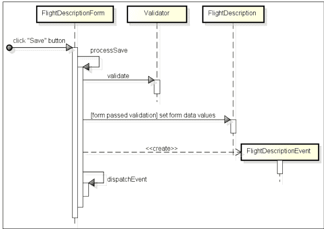

该序列图显示，单击 **Save** 按钮会导致调用 FlightDescriptionForm.mxml 中定义的 processSave 方法。processSave 方法使用 mx.validators.Validator 验证用户输入的表单数据。如果数据验证成功，则将表单数据设置到 FlightDescription ActionScript 对象中。processSave 方法现在会创建一个类型为 FlightDescriptionEvent.CREATE 的 FlightDescriptionEvent 事件，并将 FlightDescription ActionScript 对象作为事件的有效载荷传递。调用 dispatchEvent 方法会将新创建的事件分发给侦听器。

因此，接收到 FlightDescriptionEvent.CREATE 事件后，将调用 flightDescriptionView_flightDescriptionCreateEventHandler，如前所述。下面的代码显示了 flightDescriptionView_flightDescriptionCreateEventHandler 方法，它调用 FlightDescriptionService 的 create 方法来创建 FlightDescription JPA 实体的实例：

```
protected function
flightDescriptionView_flightDescriptionCreateEventHandler
(event:FlightDescriptionEvent):void {
    flightDescriptionService.create(event.flightDescription);
}
...
```

前面代码中的 flightDescriptionService 对象代表一个 mx.rpc.remoting.RemoteObject，Flex 客户端使用它来访问远程处理目标。RemoteObject 使用 <RemoteObject> 标签在 FlightDescriptionView.mxml 中定义，如下所示：

```
<s:RemoteObject channelSet="{remotingChannels}"
    destination="flightDescriptionService"
    fault="flightDescriptionService_faultHandler(event)"
    id="flightDescriptionService">
...
</s:RemoteObject>
```

在这段代码中，{remotingChannels} 标识用于与服务器端 Java 对象通信所使用的 ChannelSet。我们在前面的示例中看到，flightapp_flex 应用程序使用的远程处理通道是在 flightapp_flex_scaffold.mxml 文件中使用 <ChannelSet> 标签定义的。destination 属性指定通过 RemoteObject 访问的远程处理目标。

### 更多内容...

Flex 插件提供往返支持，即，对 JPA 实体的修改会传播到 MXML 和 ActionScript 文件中。

Flex 插件不提供用于控制构成 Spring 管理的远程处理目标一部分的方法的任何支持。例如，你无法使用 `@RooFlexScaffold` 注解来控制属于 `FlightDescriptionService_Roo_Service.aj` 文件的方法。

如果你希望 Spring 管理的远程处理目标中的某个方法对 Flex 客户端不可访问，则只需执行 push-in 重构，或者在相应的 Java 类中定义该方法并向其添加 Spring 的 `@RemotingExclude` 注解即可。

Spring Roo 使用 JPA 实体中指定的 JSR 303 注解来在 MXML 文件中添加 Flex 验证器。例如，如果 JPA 实体字段指定了 `@NotNull` JSR 303 注解，则 Roo 会添加一个 Flex `StringValidator` 或 `NumberValidator`，用于检查表单中的字段不为空白。请注意，Flex 插件对 JSR 303 注解的支持有限。

### 另请参阅

- 请参阅“Flex 应用程序开发入门”，了解如何为 Roo 项目设置 Flex

## Spring Web Flow 入门

在第 4 章，*使用 Spring Web MVC 进行 Web 应用程序开发* 中，我们了解到 Roo 简化了 Spring Web MVC 应用程序的构建。在本示例中，我们将了解 Roo 如何设置 Roo 项目以使用 Spring Web Flow——这是一个构建在 Spring Web MVC 之上的框架。

Spring Web Flow 允许将 Web 应用程序建模为一组流，其中每个流表示一个有限状态机。

> Spring Roo 1.1.3 中对 Spring Web Flow 的支持已损坏；因此，必须使用 Spring Roo 1.1.4 或 1.1.5 来执行本示例。本示例使用 Spring Roo 1.1.5 开发。

### 准备工作

在系统中创建新目录 `C:\roo-cookbook\ch05-webflow`，并将随本书附带的 `ch05_webflow_app.roo` 脚本复制到 `ch05-webflow` 目录中。

从 ch05-webflow 目录启动 Roo shell，并使用 script 命令执行 ch05_webflow_app.roo 脚本。执行 ch05_webflow_app.roo 脚本会创建 flightapp-webflow Eclipse 项目，将 Hibernate 设置为持久化提供程序，将 MySQL 配置为应用程序的数据库，并创建 Flight、FlightDescription、Customer 和 Address JPA 实体。Customer 实体与 Address 实体具有一对一关系，Flight 实体与 FlightDescription 实体具有多对一关系。如果使用的数据库不是 MySQL，或者连接设置与脚本中指定的不同，则相应地修改脚本。

### 操作步骤

1. 执行 Web 流 Roo 命令以创建 Customer 流，如下所示：

```
roo> web flow --flowName customer
Created SRC_MAIN_WEBAPP\WEB-INF\spring
Created SRC_MAIN_WEBAPP\WEB-INF\spring\webflow-config.xml
Created SRC_MAIN_WEBAPP\WEB-INF\spring\webmvc-config.xml
...
Created SRC_MAIN_WEBAPP\WEB-INF\views\customer
Created SRC_MAIN_WEBAPP\WEB-INF\views\customer\flow.xml
Created SRC_MAIN_WEBAPP\WEB-INF\views\customer\view-state-1.jspx
Created SRC_MAIN_WEBAPP\WEB-INF\views\customer\view-state-2.jspx
Created SRC_MAIN_WEBAPP\WEB-INF\views\customer\end-state.jspx
Created SRC_MAIN_WEBAPP\WEB-INF\views\menu.jspx
Created SRC_MAIN_WEBAPP\WEB-INF\views\customer\views.xml
...
Updated ROOT\pom.xml [...; added dependency org.springframework.webflow:spring-webflow:2.2.1.RELEASE]
```

2. 执行 perform eclipse 命令以更新项目的类路径设置：

```
roo> perform eclipse
```

3. 现在可以将 flightapp_webflow 项目导入 Eclipse IDE 中。

4. 退出 Roo shell，并从 ch05-webflow 目录执行 Tomcat Maven 插件的 tomcat:run 目标，将 flightapp_webflow 项目部署到嵌入式 Tomcat 容器中：

```
C:\roo-cookbook\ch05-webflow> mvn tomcat:run
```


- 在您喜欢的浏览器中打开 http://localhost:8080/flightapp_webflow URL。如果看到以下页面，则表示您的应用程序已成功部署在嵌入式 Tomcat 容器中：

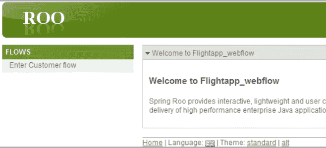

- 单击“Enter Customer flow”菜单选项以启动由 web flow 命令安装的示例流程。此屏幕截图显示启动 Customer 流程时流程中的第一步：

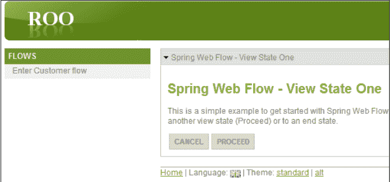

- CANCEL 按钮结束 Customer 流程，PROCEED 按钮将带您进入流程的下一步。

## 工作原理

Spring Web Flow 允许将 Web 应用程序创建为一组流程，其中每个流程定义一系列状态、转换和操作。由 Spring Web Flow 插件处理的 web flow 命令，会创建使用 Spring Web Flow 快速开发 Web 应用程序所需的构件。flowName 是一个可选参数，用于指定要创建的流程的名称。如果未指定 flowName 参数，Roo 将创建一个示例流程。

第一次执行 web flow 命令时，它主要会创建您在第 4 章“使用 Spring Web MVC 进行 Web 应用程序开发”中已经见过的文件和目录。在本示例中，我们将重点介绍 Roo 专门为使用 Spring Web Flow 开发应用程序而创建的文件和目录。需要注意的是，web flow 命令只会创建一个示例流程，它为您创建自定义流程提供了起点。

从 web flow 命令的输出可以看出，Roo 不仅创建了 webmvc-config.xml 文件（在执行 web mvc install 命令时也会创建该文件），还创建了 webflow-config.xml 文件。webflow-config.xml 文件是应用程序上下文 XML 文件，用于定义特定于 Spring Web Flow 的特殊 Bean，例如 FlowHandlerMapping、FlowHandlerAdapter 等等。webmvc-config.xml Web 应用程序上下文 XML 定义了我们在第 4 章“使用 Spring Web MVC 进行 Web 应用程序开发”中讨论过的 Bean。此外，它现在使用 Spring Beans 模式的 <import> 元素导入了 webflow-config.xml 中的 Bean 定义，如下所示：

```
<import resource="webflow-config.xml" />
```

Roo 使用 flowName 参数的值在 /WEB-INF/views 文件夹中创建同名目录，其中包含与流程相关的构件。默认情况下，Roo 只会创建一个示例流程，以让您开始创建自己的流程。下表描述了在执行 web flow --flowName customer 命令时，在 /WEB-INF/views/customer 目录中创建的与流程相关的构件：

| 文件名 | 描述 |
|---|---|
| flow.xml | 定义流程状态、转换和操作的 XML 文件 |
| view-state-1.jspx | 对应 Customer 流程第一个视图状态的 JSPX 文件 |
| view-state-2.jspx | 对应 Customer 流程第二个视图状态的 JSPX 文件 |
| end-state.jspx | 对应 Customer 流程结束视图状态的 JSPX 文件 |
| views.xml | Tiles 配置 XML 文件，其中包含用于在 Customer 流程中显示 JSPX 页面的 Tiles 定义 |

让我们先来看看如何在流程定义 XML 文件中定义流程。下面的清单显示了在 WEB-INF/views/customer 文件夹中创建的 flow.xml 文件：

```
flow.xml
<flow xmlns="http://www.springframework.org/schema/webflow" ..>

<view-state id="view-state-1" view="customer/view-state-1">
    <transition on="success" to="view-state-2"/>
    <transition on="cancel" to="end-state"/>
</view-state>

<view-state id="view-state-2" view="customer/view-state-2">
    <transition on="cancel" to="end-state"/>
</view-state>

<end-state id="end-state" view="customer/end-state"/>

</flow>
```

正如该代码所示，每个流程定义 XML 文件都以 <flow> 根元素开始。<view-state> 元素定义一个视图状态，即渲染视图的状态。<view-state> 元素的 id 属性在流程定义 XML 文件中唯一标识该状态。由于流程定义 XML 文件中定义的第一个状态是流程的起始状态，因此 view-state-1 表示 Customer 流程的起始状态。<view-state> 元素的 view 属性指定应呈现给用户的视图。由于 Roo 生成的 Spring Web Flow 应用程序使用 Apache Tiles 2 框架，view 属性的值表示视图的逻辑名称。与 view 属性值对应的实际视图是根据 WEB-INF/views/customer/views.xml 文件中包含的 Tiles 定义来确定的。<end-state> 元素定义流程的结束状态。view 属性定义在达到流程结束状态时呈现的视图的逻辑名称。一个流程可以定义多个结束状态，在某些情况下，结束状态可能不呈现视图。

<transition> 元素指定在发生事件时流程将转换到的状态。on 属性指定触发转换的事件，to 属性指定流程转换到的状态。例如，如果 Customer 流程处于 view-state-1 状态且接收到 success 事件，则流程将转换到 view-state-2 状态；如果接收到 cancel 事件，则流程将转换到 end-state。如您所见，状态转换会导致 Spring Web Flow 应用程序中从一个页面导航到另一个页面。

现在让我们来看看 Roo 为 flightapp_webflow 项目生成的 webflow-config.xml 文件中定义的 Bean。

### Spring Web Flow 配置

webflow-config.xml 定义了一个 HandlerMapping，它返回一个 FlowHandler 以启动流程的执行，如下所示：

```xml
<bean class="org.springframework.webflow.mvc.servlet.FlowHandlerMapping">
  <property name="order" value="0" />
  <property name="flowRegistry" ref="flowRegistry" />
</bean>
```

order 属性指定相对于 Web 应用程序上下文中配置的其他 HandlerMapping 实现所分配给 FlowHandlerMapping 的优先级。该值可以是 Integer.MIN_VALUE 到 Integer.MAX_VALUE 之间的任何值。order 属性的值越低，HandlerMapping 实现的优先级越高。因此，如果 Web 应用程序上下文中配置的 HandlerMapping 实现指定的 order 属性值大于 0，则其优先级低于 FlowHandlerMapping。当 DispatcherServlet 尝试查找用于处理请求的处理程序时，HandlerMapping 实现的优先级才会发挥作用。

> 优先级最高（即 order 值最低）的 HandlerMapping 配置首先由 DispatcherServlet 查询，以查找匹配的处理程序；未指定 order 属性的 HandlerMapping 配置被赋予最低优先级。

FlowHandlerMapping 的 flowRegistry 属性指定一个 FlowDefinitionRegistry，其中包含应用程序中所有流程定义的注册表。Spring Web Flow 模式中的以下 <flow-registry> 元素定义了一个流程注册表：

```xml
<webflow:flow-registry id="flowRegistry"
  flow-builder-services="flowBuilderServices"
  base-path="/WEB-INF/views">
  <webflow:flow-location-pattern value="/**/flow.xml" />
</webflow:flow-registry>
```

base-path 属性指定定位流程定义 XML 文件所基于的位置。base-path 属性的值 /WEB-INF/views 表示流程定义 XML 文件位于 /WEB-INF/views 文件夹的相对位置。<flow-location-pattern> 指定用于查找流程定义 XML 文件的位置模式，相对于 base-path。值 /**/flow.xml 表示 /WEB-INF/views 文件夹或其子文件夹中的 flow.xml 文件代表流程定义 XML 文件。

流程会使用唯一 ID 注册到流程注册表中，该唯一 ID 由流程定义 XML 文件的名称（如果未指定 base-path 属性）或流程定义 XML 文件相对于 base-path 属性值的位置来确定。由于 Roo 生成的 webflow-config.xml 文件使用了 base-path 属性，因此分配给流程的唯一 ID 由流程定义 XML 文件相对于 base-path 属性值的位置来确定。例如，flightapp-webflow 项目中的 Customer 流程定义 XML 文件位于 /WEB-INF/views/customer 文件夹（相对于 base-path），而 base-path 属性为 /WEB-INF/views。如果从流程定义 XML 位置 (/WEB-INF/views/customer) 减去 base-path 值 (/WEB-INF/views)，则会返回该流程在流程注册表中注册的唯一 ID——对于 Customer 流程而言，该 ID 为 customer。

当 FlowHandlerMapping（通过 DispatcherServlet）接收到请求时，它会检查流程注册表是否包含与当前请求路径匹配的唯一 ID 的流程。如果找到匹配项，则它会返回一个启动匹配流程执行的 FlowHandler，否则返回 null。当返回 null 时，DispatcherServlet 会查询 Web 应用程序上下文中的下一个 HandlerMapping，以查找用于处理请求的处理程序。

<flow-registry> 元素的 flow-builder-services 属性指定 FlowBuilderServices 的一个实现，该实现用于配置构建在流程注册表中注册的流程所需的自定义服务。例如，如果您想要配置自定义 ConversionService 或 ViewFactoryCreator，可以将 FlowBuilderServices 实例的引用指定为 flow-builder-services 属性值的值。由于 Roo 生成的 Spring Web Flow 应用程序使用 Apache Tiles 2 框架，FlowBuilderServices 已配置了一个 ViewFactoryCreator，该 ViewFactoryCreator 将 URL 映射到 TilesView（在第 4 章“使用 Spring Web MVC 进行 Web 应用程序开发”中有详细说明），如下所示：

```
<bean id="mvcViewFactoryCreator" class="org.springframework.webflow.mvc.builder.MvcViewFactoryCreator">
<property name="viewResolvers" ref="tilesViewResolver" />
</bean>
```

MvcViewFactoryCreator 是 ViewFactoryCreator 的一个实现，用于创建 ViewFactory 来呈现基于 Spring Web MVC 的视图，例如 JSP。MvcViewFactoryCreator 的 viewResolvers 属性指定视图解析策略。tilesViewResolver（在 webmvc-config.xml 文件中定义）代表一个 UrlBasedViewResolver，用于解析与 URL 对应的视图名称。由于 Roo 生成的 Spring Web Flow 应用程序使用 Apache Tiles 2 框架，UrlBasedViewResolver 将 URL 解析为 TilesView，如下所示：

```
<bean class="org.springframework.web.servlet.view.UrlBasedViewResolver"
id="tilesViewResolver">
<property name="viewClass" value="org.springframework.web.servlet.view.tiles2.TilesView"/>
</bean>


请参阅第 4 章，Spring Web MVC Web 应用程序开发，以获取有关 UrlBasedViewResolver 的更多信息。

让我们现在退后一步，看看请求是如何映射到流的，以及视图是如何根据客户流的视图状态解析的。如果你查看 menu.jspx 文件，你会发现菜单选项 **进入客户流** 引用 /customer URL，如下所示：

```
<menu:item id="i_flows_customer" messageCode="webflow_menu_enter"
url="/customer" z="."/>
```

因此，当你单击 **进入客户流** 菜单选项时，FlowHandlerMapping 会尝试查找唯一 ID 为 `customer` 的流（从请求路径中删除前导 '/' 即可得到要查找的流 ID）。由于我们的客户流具有 `customer` 唯一 ID，FlowHandlerMapping 将返回一个 FlowHandler 实例，该实例启动客户流的执行。由于客户流的 flow.xml 中的第一个 `<view-state>` 元素定义了客户流的起始状态，因此将渲染与第一个 `<view-state>` 元素对应的视图。第一个 `<view-state>` 元素的 `view` 属性为 `customer/view-state-1`，它表示一个逻辑视图名称。由于 Roo 生成的 Spring Web Flow 应用程序使用 Apache Tiles 2 框架，应用程序中的 Tiles 配置 XML 文件（包括 /WEB-INF/views/customer/views.xml Tiles 配置 XML 文件）将被查询，以找到与逻辑视图名称 `customer/view-state-1` 对应的 Tiles 定义。以下代码清单显示了 /WEB-INF/views/customer/views.xml 文件：

```
<tiles-definitions>
<definition extends="default" name="customer/*">
<put-attribute name="body"
value="/WEB-INF/views/customer/{1}.jspx"/>
</definition>
</tiles-definitions>
```

`<definition>` 元素的 `name` 属性值为 `customer/*`，与逻辑视图名称 `customer/view-state-1` 匹配。因此，我们现在知道适用于客户流第一个 `<view-state>` 元素的 Tiles 定义。另一个值得注意的地方是 `<put-attribute>` 元素值中使用了标记 `{1}`。标记 `{1}` 指的是在逻辑视图名称中 `customer/` 字符串之后出现的第一个值——对于客户流的第一个 `<view-state>` 元素，该值为 `view-state-1`。同样，如果逻辑视图名称为 `customer/x/y/z`，则标记 `{1}` 的值为 x，标记 `{2}` 的值为 y，`{3}` 的值为 z。这使得为客户流第一个 `<view-state>` 元素渲染的视图为 /WEB-INF/views/customer/view-state-1.jspx。

现在，回到 webflow-config.xml，流由 FlowHandler 启动并由 FlowExecutor 执行，并配置了以下 FlowHandlerAdapter 实现：

```
<bean class="org.springframework.webflow.mvc.servlet.FlowHandlerAdapter">
<property name="flowExecutor" ref="flowExecutor" />
</bean>
<webflow:flow-executor id="flowExecutor" />
```

Spring webflow 架构的 `<flow-executor>` 元素安装了一个 FlowExecutor，FlowHandler 实现使用它来执行流。如果需要，可以通过扩展 AbstractFlowHandler 类来创建自定义 FlowHandler 实现。

## 使用 Spring Web MVC 和 Spring Web Flow 开发应用程序

你还会发现 webflow-config.xml 文件中配置了以下 bean：

```
<bean class="org.springframework.web.servlet.mvc.annotation.AnnotationMethodHandlerAdapter" />
<bean class="org.springframework.web.servlet.mvc.SimpleControllerHandlerAdapter" />
```

当在 Spring Web MVC 中使用带有 @Controller 注解的控制器时，使用 AnnotationMethodHandlerAdapter；当使用实现 Spring Web MVC Controller 接口的控制器时，使用 SimpleControllerHandlerAdapter。

你可能会问，当我们使用 Spring Web Flow 而不是 Spring Web MVC 时，为什么要配置这些 HandlerAdapter 实现。嗯，Spring Web Flow 通常与 Spring Web MVC 一起使用，因为你的 Web 应用程序中的并非所有内容都代表一个流。例如，在航班预订应用程序中，Booking 可能代表跨一系列步骤的流程，但创建 Flight 实体可能不是。这就是为什么执行 Web 流命令不仅能够使用 Spring Web Flow 进行开发，还能够使用 Spring Web MVC 进行开发的原因。如果你查看 webmvc-config.xml 文件，它定义了 Spring mvc 架构的 <annotation-driven> 元素，如下所示：

```
<mvc:annotation-driven/>
```

<annotation-driven> 元素配置了 AnnotationMethodHandlerAdapter 和 DefaultAnnotationHandlerMapping bean，以支持使用带注解的控制器开发 Spring Web MVC 应用程序。由于 webflow-config.xml 显式定义了 FlowHandlerAdapter，它覆盖了由 <annotation-driven> 隐式配置的 AnnotationMethodHandlerAdapter bean。这就是 Roo 在 webflow-config.xml 文件中显式配置 AnnotationMethodHandlerAdapter bean 的原因。

要了解 Spring Web Flow 和 Spring Web MVC 如何在同一应用程序中共存，请在 flightapp_webflow 项目中为 Flight 和 FlightDescription JPA 实体脚手架 Spring Web MVC 控制器，如下所示：

```
.. roo> controller scaffold --class ~.controller.FlightController --entity ~.domain.Flight
```

```
.. roo> controller scaffold --class ~.controller.FlightDescriptionController --entity ~.domain.FlightDescription
```

执行 controller scaffold Roo 命令将在 com.sample.flightapp.controller 包中生成 Spring Web MVC 带注解的控制器。此外，它还将分别在 /WEB-INF/views/flights 和 /WEB-INF/views/flightdescriptions 文件夹中生成与 Flight 和 FlightDescription JPA 实体对应的 JSPX 视图和 Tiles 配置 XML 文件。现在，退出 Roo shell 并将 flightapp_webflow 项目部署到嵌入式 Tomcat 容器中，如下所示：

```
C:\roo-cookbook\ch05-webflow> mvn tomcat:run
```

在你喜欢的浏览器中打开 http://localhost:8080/flightapp_webflow URL。如果你看到以下页面，则表示你的应用程序已成功部署到嵌入式 Tomcat 容器中：

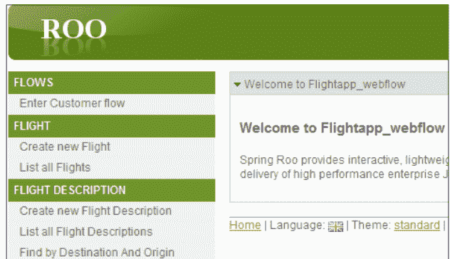

如该屏幕截图所示，flightapp_webflow 应用程序既包含通过 Web 流命令创建的 Spring Web Flow 流，也包含通过控制器脚手架命令创建的 Spring Web MVC 控制器。

## 更多内容...

Spring Web Flow 提供支持，可将模型属性与视图状态关联，从而可以创建包含表单提交的流。例如，你可以修改客户流，使用户首先在客户表单中输入详细信息（该表单将表单字段值绑定到 `Customer` JPA 实体），然后输入地址详细信息（该表单将表单字段值绑定到 `Address` JPA 实体），最后同时将 `Customer` 和 `Address` 实例持久化到数据库中。

## 另请参阅

- 请参阅第 4 章，Spring Web MVC Web 应用程序开发，中的“从 JPA 实体创建 Spring MVC 控制器和 JSPX 视图”配方，以查看 `webmvc-config.xml` 文件中定义的 bean 的描述。
