# 6 电子邮件、消息传递、Spring Security、Solr 和 GAE

在本章中，我们将介绍：

- 使用 JavaMail API 发送电子邮件
- 发送和接收 JMS 消息
- 为你的应用程序配置 Spring Security
- 将 Spring Security 与 Apache Directory Server 配合使用
- 在 GAE 上部署 GWT 应用程序
- 在 GAE 上部署 Spring Web MVC 应用程序
- 使用 Solr 为你的领域模型添加搜索功能

## 简介

在本章中，我们将介绍支持通过 JavaMail API 发送电子邮件、发送和接收 JMS 消息、为应用程序配置 Spring Security、将 Spring 和 GWT 应用程序部署到 Google App Engine (GAE) 以及使用 Solr 搜索服务器为应用程序的领域模型添加搜索功能的 Roo 命令。

## 使用 JavaMail API 发送电子邮件

Spring 框架提供了 JavaMailSenderImpl、SimpleMailMessage 等类，可简化通过 JavaMail API 发送电子邮件。在本配方中，我们将介绍有助于配置这些类的 Roo 命令。为了验证我们应用程序中的电子邮件功能是否正常工作，我们将通过 Gmail 发送一封电子邮件。

### 准备工作

在系统中创建新目录 C:\roo-cookbook\ch06-email。将 ch06_web_app.roo 脚本复制到 ch06-email 目录。如果你使用的数据库不是 MySQL，或者你的连接设置与脚本中指定的不同，请相应地修改脚本。

从 ch06-email 目录启动 Roo shell 并使用 script 命令执行 ch06_web_app.roo 脚本。执行 Roo 脚本将创建一个 flightapp-web Eclipse 项目，该项目代表由 Flight 和 FlightDescription JPA 实体组成的 Spring Web MVC 应用程序。

### 操作步骤...

为了简化电子邮件发送，请按照以下步骤操作：

- 1. 执行电子邮件发送器设置命令，为你想要用来发送电子邮件的 Gmail 帐户提供用户名和密码参数值。在以下命令中，将 <username> 和 <password> 参数值替换为分别反映你的 Gmail 帐户用户名和密码的值。需要注意的是，你不需要将 @gmail.com 指定为用户名的值，因为它是从 hostServer 参数派生的。如果你使用不同的邮件服务器来发送电子邮件，请相应地修改参数值。
- ... roo> email sender setup --hostServer smtp.gmail.com --port 587 --protocol SMTP --username <username> --password <password>
- Updated SRC_MAIN_RESOURCES\META-INF\spring\applicationContext.xml
- Updated ROOT\pom.xml [Added dependencies ... javax.mail:mail:1.4.1, javax.activation:activation:1.1.1]
- Created SRC_MAIN_RESOURCES\META-INF\spring\email.properties

- 2. 执行电子邮件模板设置命令，以指定电子邮件消息的发件人和主题（将 <username> 替换为你的 Gmail 帐户用户名），如下所示：


... roo> email template setup --from <username>@gmail.com
--subject "A new Flight instance has been created"

已更新 SRC_MAIN_RESOURCES\META-INF\spring\applicationContext.xml
已更新 SRC_MAIN_RESOURCES\META-INF\spring\email.properties

- 3. 使用 field email template 命令，将 Spring 的 MailSender 和 SimpleMailMessage 字段以及 sendMessage 方法添加到 FlightController.java 中，如下所示：

```
roo> field email template --class ~.web.FlightController
```

已更新 ..\flightapp\web\FlightController.java

- 4. 执行 perform eclipse 命令以更新项目的类路径设置：

```
roo> perform eclipse
```

- 5. 将 flightapp-web Eclipse 项目导入 Eclipse IDE。

- 6. 打开 FlightController_Roo_Controller.aj 文件，复制在 FlightController.java 中引入 create(...) 方法的声明，并将其粘贴到 FlightController.java 文件中。

> 如果您使用的是 Spring Roo 1.1.3，则需从 FlightController_Roo_Controller.aj 文件中删除 create 方法声明。之所以需要这样做，是因为 Spring Roo 1.1.3 中不会自动移除来自 FlightController_Roo_Controller.aj 文件的 create 声明。

当用户输入航班信息并提交创建新 Flight 实例的请求时，会调用 FlightController 类的 create 方法。添加 create(...) 方法后，您的 FlightController.java 应如下所示：

```java
@RooWebScaffold(...)
@RequestMapping("/flights")
@Controller
public class FlightController {
    @Autowired
    private transient MailSender mailTemplate;
    @Autowired
    private transient SimpleMailMessage simpleMailMessage;
    @RequestMapping(method = RequestMethod.POST)
    public String create(@Valid Flight flight,
    BindingResult bindingResult, Model uiModel,
    HttpServletRequest httpServletRequest) {
    flight.persist();
        return "redirect:/flights/" +
                encodeUrlPathSegment(flight.getFlightId().toString(),
                httpServletRequest);
    }

public void sendMessage(java.lang.String mailTo,
        java.lang.String message) {
        ...
    }
}
```

在给定的代码中，create 方法已通过从 FlightController_Roo_Controller.aj AspectJ ITD 文件复制而直接添加到 FlightController.java 中。在 ITD 中，create 方法声明如下：

```
public String FlightController.create(...)
```

将该方法复制到 FlightController.java 文件时，请确保从方法名中删除 FlightController。因此，FlightController.java 中的该方法变为：

```
public String create(...)
```

当您在 FlightController.java 中添加与 FlightController_Roo_Controller.aj 具有相同签名的 create(...) 方法时，Roo 会从 FlightController_Roo_Controller.aj 中删除 create(...) 方法。在 Eclipse IDE 中刷新 flightapp-web 项目，以便查看 Roo 所做的修改。

- 7. 现在，通过在 flight.persist() 方法调用后立即添加以下代码片段来修改 FlightController.java 中的 create(...) 方法：

```
sendMessage("<username>@gmail.com", "A new instance of Flight entity with id " + flight.getFlightId() + " has been created.");
```

在此代码中，将 <username> 替换为您的 Gmail 账户用户名。

- 8. 退出 Roo shell，并在 ch06-email 目录中执行 Tomcat Maven 插件的 tomcat:run 目标，以在嵌入式 Tomcat 容器中部署 flightapp-web 项目，如下所示：

```
C:\roo-cookbook\ch06-email> mvn tomcat:run
```

使用以下 URL 从 Web 浏览器访问 `flightapp-web` 应用程序：`http://localhost:8080/flightapp-web`。您现在应该看到 `flightapp-web` 应用程序的以下主页：

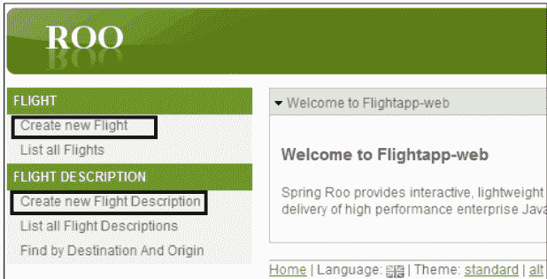

从菜单中选择 **创建新航班描述** 选项，该选项将显示创建新 `FlightDescription` 实体实例的表单。创建 `FlightDescription` 实例后，选择 **创建新航班** 菜单选项以创建 `Flight` 实例。以下截图显示了创建 `Flight` 实例的表单：

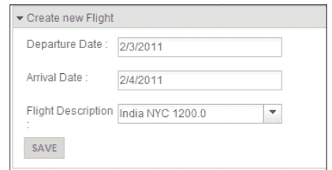

输入 **出发日期**、**到达日期** 和 **航班描述** 信息，然后单击 **保存** 按钮。保存 `Flight` 实例将向您的 Gmail 账户发送一封电子邮件，主题为 **新的 Flight 实例已创建**，消息为 **ID 1 的 Flight 实体新实例已创建**。随着您创建更多 `Flight` 实例，每创建一个 `Flight` 实例就会向您的 Gmail 账户发送一封电子邮件。

## 工作原理...

JavaMail API 提供了 Session、Transport、Authenticator 等类，用于撰写、发送和读取电子邮件。如果您想直接使用 JavaMail API 发送电子邮件消息，则需要知道如何使用不同的 JavaMail API 类和接口。Spring 框架通过提供一组类和接口来抽象 JavaMail API 的内部工作原理，从而简化了编写需要发送电子邮件功能的程序。此外，Spring 提供了一个异常层次结构，用于抽象在撰写、解析和发送电子邮件或与邮件服务器进行身份验证时抛出的异常。

以下图显示了提供电子邮件发送功能的 Spring 重要类和接口。您可以在 Spring 框架的 org.springframework.mail 和 org.springframework.mail.javamail 包中找到这些类和接口。

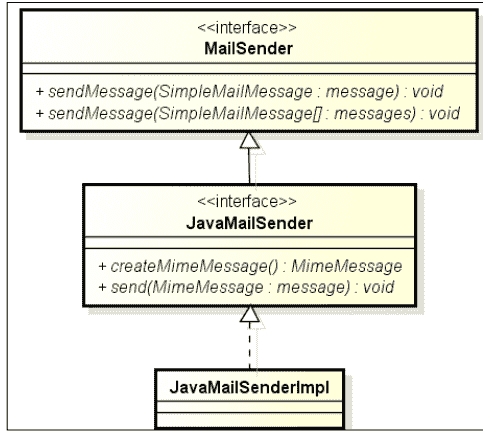

MailSender 接口是一个定义电子邮件发送功能的通用接口。如所示图，它定义了两个 send 方法，接受 Spring 的 SimpleMailMessage 和 SimpleMailMessage[] 对象作为参数。

JavaMailSender 接口扩展了 MailSender 接口，并定义了使用 JavaMail API 发送电子邮件特有的方法。JavaMailSender 定义了诸如 createMimeMessage（用于创建 MimeMessage 实例，属于 JavaMail API 的一部分）、send（用于发送 MimeMessage）等方法。有关 Spring 定义的方法完整列表，请参阅 JavaMailSender 接口的 Spring API 文档。Spring 通过 JavaMailSenderImpl 类提供了 JavaMailSender 接口的具体实现，您可以在应用程序中使用它来发送电子邮件。

需要注意的是，MailSender 接口定义接受 SimpleMailMessage 或 SimpleMailMessage[] 对象作为参数的 send 方法，而 JavaMailSender 接口定义接受 MimeMessage 或 MimeMessage[] 对象作为参数的 send 方法。SimpleMailMessage 是 Spring 框架的一部分，用于创建由 from、to、电子邮件正文等组成的简单邮件消息。如果您想发送由附件、内联图像等组成的更精细的消息，则应使用 MimeMessage 来创建您的邮件消息。

现在我们已对发送电子邮件时涉及的不同类和接口有了基本了解，让我们来看看在 flightapp-web 应用程序中用于设置电子邮件支持和发送电子邮件的各种 Spring Roo 命令。

## 设置电子邮件发送支持

电子邮件发送设置 Roo 命令通过在 Spring 应用程序上下文中配置 JavaMailSenderImpl 来在 Roo 项目中设置电子邮件发送支持。执行电子邮件发送设置命令时，Roo 会执行以下操作：

- 已更新 SRC_MAIN_RESOURCES\META-INF\spring\applicationContext.xml 文件，以将 JavaMailSenderImpl 配置为 Spring bean
- 创建了 SRC_MAIN_RESOURCES\META-INF\spring\email.properties 文件，该文件包含用于设置 JavaMailSenderImpl 实例的属性。email.properties 文件中定义的属性来自电子邮件发送设置命令指定的参数。
- 已更新 pom.xml 文件，以反映对 JavaMail 和 Java Activation Framework (JAF) JAR 文件的依赖。

以下清单显示了 applicationContext.xml 文件中的 JavaMailSenderImpl 配置：

```xml
<bean class="org.springframework.mail.javamail.JavaMailSenderImpl" id="mailSender">
<property name="host" value="${email.host}"/>
<property name="protocol" value="${email.protocol}"/>
<property name="port" value="${email.port}"/>
<property name="username" value="${email.username}"/>
<property name="password" value="${email.password}"/>
<property name="javaMailProperties">
<props>
<prop key="mail.smtp.auth">true</prop>
<prop key="mail.smtp.starttls.enable">true</prop>
</props>
</property>
</bean>
```


在给定的 XML 中，JavaMailSenderImpl 被配置了诸如 host、protocol、port 等属性。这些属性的值来自 email.properties 文件。

下面的清单显示了 email.properties 文件：

```
email.host=smtp.gmail.com
email.password=<password>
email.port=587
email.protocol=smtp
email.username=<username>
```

而不是 <username> 和 <password>，你将看到为电子邮件发送者设置命令指定的用户名和密码值。email.properties 文件由 Spring 的 PropertyPlaceholderConfigurer 读取，以填充 JavaMailSender 配置中定义的占位符。applicationContext.xml 文件使用 Spring 上下文的 <property-placeholder> 元素来配置 PropertyPlaceholderConfigurer，如下所示：

```
<context:property-placeholder location="classpath*:META-INF/spring/*.properties"/>
```

location 属性指定 PropertyPlaceholderConfigurer 将在项目的 META-INF/spring 目录中查找属性文件。

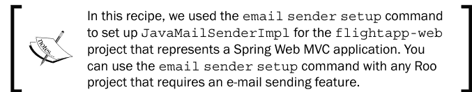

现在让我们看看如何设置 SimpleMailMessage 实例：

## 设置邮件消息

电子邮件模板设置命令将 SimpleMailMessage 配置为 applicationContext.xml 文件中的 bean。电子邮件模板设置命令接受两个参数：from 和 subject，分别标识电子邮件的发件人和主题。当执行电子邮件发送者设置命令时，Roo 会执行以下操作：

- 将 SimpleMailMessage 配置为 applicationContext.xml 中的 Spring 托管 bean，如下所示：

```
<bean class="org.springframework.mail.SimpleMailMessage"
  id="templateMessage">
  <property name="from" value="${email.from}" />
  <property name="subject" value="${email.subject}" />
</bean>
</beans>
```

${email.from} 和 ${email.subject} 占位符的值来自 email.properties 文件。

- 更新 email.properties 文件以包含 email.from 和 email.subject 属性，它们的值来自传递给电子邮件模板设置命令的 from 和 subject 参数的值：
- email.from=<username>@gmail.com
- email.subject=A new Flight instance has been created

现在 JavaMailSenderImpl 和 SimpleMailMessage 实例已在应用程序上下文 XML 文件中配置，我们将查看如何发送电子邮件。

## 发送邮件

要从企业应用程序发送电子邮件，您需要访问已在 Spring 应用程序上下文中注册的 JavaMailSenderImpl 和 SimpleMailMessage 实例。引用这些实例的属性会由 field email template Roo 命令自动添加到类中。以下代码清单显示了在对其执行 field email template 命令后的 FlightController.java 类：

```
import org.springframework.mail.MailSender;
...
public class FlightController {
    @Autowired
    private transient MailSender mailTemplate;
    @Autowired
    private transient SimpleMailMessage simpleMailMessage;
    public void sendMessage(java.lang.String mailTo,
    java.lang.String message) {
    simpleMailMessage.setTo(mailTo);
    simpleMailMessage.setText(message);
    mailTemplate.send(simpleMailMessage);
    }
}
```

在给定的代码中，mailTemplate 属性引用 JavaMailSenderImpl 实例，simpleMailMessage 属性引用已在 Spring 应用程序上下文中注册的 SimpleMailMessage 实例。需要注意的是，mailTemplate 属性的类型是 MailSender 而不是 JavaMailSender。此外，还向 FlightController.java 添加了一个用于发送电子邮件的 sendMessage 方法。sendMessage 方法接受用于标识电子邮件收件人地址和电子邮件文本内容或正文的参数。sendMessage 方法使用 MailSender 的 send(SimpleMailMessage) 方法发送电子邮件。

现在您可以从 FlightController.java 类的方法中调用 send 方法来发送电子邮件。在我们的示例场景中，在 Flight 实例持久化后，我们从 create 方法中调用了 send 方法，如下所示：

```
@RequestMapping(method = RequestMethod.POST)
public String create(@Valid Flight flight,
BindingResult bindingResult, Model uiModel,
HttpServletRequest httpServletRequest) {
...
flight.persist();
sendMessage("<username>@gmail.com",
"A new instance of Flight entity with id "
+ flight.getFlightId()
+ "has been created.");
return "redirect:/flights/" +
encodeUrlPathSegment((flight.getFlightId()).toString(),
httpServletRequest);
}
```

## 更多内容...

现在让我们看看如何异步发送电子邮件、如何发送包含附件、内联图片等的更精细电子邮件，最后如何在 JNDI 中配置了 JavaMail Session 时发送电子邮件。

## 异步发送电子邮件

迄今在本示例中讨论的电子邮件发送具有同步性。通常，应用程序会异步发送电子邮件——这可以通过 Spring 的 @Async 注解实现。field email template 命令支持 async 参数，该参数指示 Roo 执行以下操作：

- 创建标注了 Spring @Async 注解的 sendMessage 方法

- 使用 Spring 任务命名空间的 <annotation-driven> 元素启用对 @Async 注解方法的检测，如下所示：
- <task:annotation-driven executor="asyncExecutor"
  mode="aspectj" />

executor 属性引用 java.util.concurrent.Executor 接口的实现，负责执行标注了 @Async 的方法。

- 使用 Spring 任务命名空间的 <executor> 元素在应用程序上下文 XML 中配置 Spring 的 ThreadPoolTaskExecutor，如下所示：
- <task:executor id="asyncExecutor"
  pool-size="${executor.poolSize}" />

Spring 的 ThreadPoolTaskExecutor 配置了一个 java.util.concurrent.ThreadPoolExecutor 实例（java.util.concurrent.Executor 的一个实现），线程池大小由 pool-size 属性值指定。${executor.poolSize} 占位符的值来自 email.properties 文件。

- 将 executor.poolSize 属性添加到 email.properties 文件中，如下所示：

executor.poolSize=10

要在创建 FlightDescription 实例时异步发送邮件，请针对 FlightDescriptionController 类执行以下 field email template 命令，如下所示：

```
.. roo> field email template --class ~.web.FlightDescriptionController --async
```

现在，将 create(...) 方法从 FlightDescriptionController_Roo_Controller.aj 复制到 FlightDescriptionController.java 并添加对 sendMessage(...) 方法的调用，如下所示：

```
@RequestMapping(method = RequestMethod.POST)
public String create(@Valid FlightDescription... ) {
...
flightDescription.persist();
sendMessage("<username>@gmail.com",
"FlightDescription instance created");
return "redirect:/flightdescriptions/" + ..
}
```

## 发送带附件的电子邮件

如前所述，如果您想发送带有附件、内联图片等的邮件，则需要使用 MimeMessage 而不是 SimpleMailMessage。field email template 命令将 SimpleMailMessage 和 MailSender 类型的属性添加到 Java 类中，如下所示：

```
@Autowired
private transient MailSender mailTemplate;
@Autowired
private transient SimpleMailMessage simpleMailMessage;
```

现在，MailSender 定义接受 SimpleMailMessage 或 SimpleMailMessage[] 对象作为参数的方法。另一方面，JavaMailSender 定义接受 MimeMessage 或 MimeMessage[] 对象作为参数的方法。因此，我们需要将 mailTemplate 属性的类型从 MailSender 更改为 JavaMailSender（MailSender 的子接口），以发送 MimeMessage 类型的消息。此外，我们需要从类中删除 simpleMailMessage 属性，因为在发送带有附件或内联图片的邮件消息时，我们需要 MimeMessage 类型的邮件消息而不是 SimpleMailMessage。

那么，我们如何创建 MimeMessage 呢？Spring 提供了以下简化创建 MimeMessage 的实用程序类：

- MimeMessagePreparator：用于准备 MimeMessage 的回调接口
- MimeMessageHelper：提供用于创建和填充 MimeMessage 方法的帮助程序类

以下代码显示了修改后的 FlightDescriptionController.java，它使用 MimeMessageHelper 在创建新的 FlightDescription 实例时发送带附件的邮件消息：

```
import javax.mail.MessagingException;
import javax.mail.internet.MimeMessage;
import org.springframework.mail.javamail.JavaMailSender;
import org.springframework.mail.javamail.MimeMessageHelper;
import org.springframework.scheduling.annotation.Async;
...
public class FlightDescriptionController {

@Autowired
private transient JavaMailSender mailTemplate;

@RequestMapping(method = RequestMethod.POST)
public String create(@Valid FlightDescription
flightDescription...) {
...
flightDescription.persist();
sendMessage(...);
return "redirect:/flightDescriptions/" + ...);
}

@Async
public void sendMessage(java.lang.String mailTo,
java.lang.String message) throws MessagingException {
MimeMessage mimeMessage =
mailTemplate.createMimeMessage();
MimeMessageHelper helper =
```


```java
new MimeMessageHelper(mimeMessage, true);
helper.setTo(mailTo);
helper.setText(message);
helper.addAttachment("logo.gif",
new File("C:/logo.gif"));
mailTemplate.send(mimeMessage);
}
}
```

在 FlightDescriptionController.java 中我们做了以下更改：

- 将 mailMessage 属性的返回类型从 MailSender 更改为 JavaMailSender
- 删除了类型为 SimpleMailMessage 的 simpleMailMessage 属性，因为我们需要 MimeMessage 实例来发送带附件的邮件
- 修改了 sendMessage 方法，使其使用 MimeMessageHelper 类来创建 MimeMessage 实例并向其中添加附件。

## 在 JNDI 中配置 JavaMail Session 来发送电子邮件

如果在应用服务器的 JNDI 中配置了 JavaMail Session，则需要修改 Roo 项目的 applicationContext.xml 文件，以使用在 JNDI 中配置的 JavaMail Session 创建 JavaMail SenderImpl 实例，如下所示：

```xml
<beans ... xmlns:jee="http://www.springframework.org/schema/jee" ...
xsi:schemaLocation="http://www.springframework.org/schema/jee http://
www.springframework.org/schema/jee/spring-jee-3.0.xsd">
......
<jee:jndi-lookup id="mailSession" jndi-name="mail/session" />
<bean class="org.springframework.mail.javamail.JavaMailSenderImpl"
id="mailSender">
<property name="session" value="mailSession"/>
</bean>
.....
```

给定代码中所示的 Spring jee 命名空间的 jndi-lookup 元素，负责访问名称为 "mail/session"（由 jndi-name 属性引用）的在 JNDI 中配置的 JavaMail Session，并使其在 bean id 为 "mailSession" 的 Spring 应用程序上下文中可用。

## 另请参阅

- 请参阅下一条配方，使用 JMS 发送和接收消息，以了解如何使用 JMS 发送和接收消息

## 发送和接收 JMS 消息

Spring Roo 提供了基于 JMS (Java Message Service) API 开发消息传递应用程序的支持。截至 Spring Roo 1.1.5，Roo 支持的唯一 JMS 提供程序是嵌入式 ActiveMQ(http://activemq.apache.org/)；它与访问它的 Java 应用程序配置在同一 JVM 中。

在本配方中，我们将探讨 Spring Roo 如何使用嵌入式 ActiveMQ 支持发送和接收 JMS 消息。

## 准备工作

在 C:\roo-cookbook 目录中创建一个名为 ch06-jms 的子目录。

将 ch06_web_app.roo 脚本复制到 ch06-jms 目录中。

执行 ch06_web_app.roo 脚本，该脚本会创建 flightapp-web Roo 项目，将 Hibernate 设置为持久化提供程序，将 MySQL 配置为应用程序的数据库，创建 Flight 和 FlightDescription JPA 实体，并定义 Flight 与 FlightDescription 实体之间的多对一关系。此外，该脚本使用 controller all 命令从 JPA 实体生成 Spring Web MVC 应用程序。如果您使用的数据库不是 MySQL 或连接设置与脚本中指定的不同，则相应地修改脚本。

从 C:\roo-cookbook\ch06-jms 目录启动 Roo shell。

在本配方中，我们将探讨如何将新创建的 Flight 实例的属性作为 JMS 消息发送到队列目标，并使用异步消息监听器从队列中读取 JMS 消息。

## 操作方法

要将 flight-app 设置为 JMS 消息传递应用程序，请按照此处给出的步骤操作：

- 1. 执行 jms setup 命令为 flightapp-web 应用程序创建一个新的 Spring 应用程序上下文 XML 文件，该文件将嵌入式 ActiveMQ 配置为 JMS 提供程序，配置名为 myDestination 的 JMS 目标队列，并配置 Spring 的 JmsTemplate 用于发送 JMS 消息，如下所示：

```
.. roo> jms setup --provider ACTIVEMQ_IN_MEMORY --destinationName myDestination --destinationType QUEUE
```

已创建 ..\META-INF\spring\applicationContext-jms.xml ...

已更新 ROOT\pom.xml [已添加依赖项 org.apache.activemq:activemq-core:5.4.2]

- 2. 执行 field jms template 命令将 Spring 的 JmsTemplate 注入到 FlightController.java。FlightController 使用 JmsTemplate 向第一步中配置的嵌入式 ActiveMQ 发送 JMS 消息。

```
.. roo> field jms template --class ~.web.FlightController
--fieldName jmsTemplate
```

已更新 ...\sample\roo\flightapp\web\FlightController.java

- 3. 执行 jms listener 命令创建一个 MyListener JMS 消费者，该消费者将异步从第一步中创建的 myDestination 队列消耗消息。

```
... roo> jms listener class --class ~.web.MyListener
--destinationName myDestination --destinationType QUEUE
```

已创建 SRC_MAIN_JAVA\sample\roo\flightapp\web\MyListener.java

已更新 SRC_MAIN_RESOURCES\META-INF\spring\applicationContext-jms.xml

- 4. 执行 perform eclipse 命令以更新项目的类路径，如下所示：

```
.. roo> perform eclipse
```

- 5. 现在，将 flightapp-web 项目导入到您的 Eclipse IDE 中。

- 6. 修改 Flight.java 和 FlightDescription.java 以实现 java.io.Serializable 接口，如下所示：

```
import java.io.Serializable;
...
public class Flight implements Serializable { . . }
import java.io.Serializable;
...
public class FlightDescription implements Serializable { . . }
```

- 7. 打开 FlightController_Roo_Controller.aj 文件，复制在 FlightController.java 中引入 create(...) 方法的声明，并将其直接添加到 FlightController.java。当用户在航班创建 HTML 表单中输入信息并提交请求以创建新的 Flight 实例时，将调用 FlightController 类的 create 方法。添加 create(...) 方法后，您的 FlightController.java 应如下所示：

```java
@WebScaffold(...)
@RequestMapping("/flights")
@Controller
public class FlightController {
    @Autowired
    private transient JmsTemplate jmsTemplate;

    @RequestMapping(method = RequestMethod.POST)
    public String create(@Valid Flight flight,
            BindingResult bindingResult, Model uiModel,
            HttpServletRequest httpServletRequest) {
        ...
        flight.persist();
        return "redirect:/flights/" +
                encodeUrlPathSegment(flight.getFlightId().toString(),
                        httpServletRequest);
    }

    public void sendMessage(java.lang.Object messageObject) {
        jmsTemplate.convertAndSend(messageObject);
    }
}
```

> 在 Spring Roo 1.1.3 中，如果您尝试通过在 *Controller.java 文件中定义来重写 *_Roo_Controller.aj 文件中定义的方法，则 Roo 会抱怨该方法已在相应的 *Controller.java 文件中定义。此问题已在 Spring Roo 1.1.4 及更高版本中解决。您可以通过从 *_Roo_Controller.aj 文件中删除复制的声明来解决 Spring Roo 1.1.3 中的此问题。

- 8. 在给定代码中，create 方法已通过从 FlightController_Roo_Controller.aj AspectJ ITD 文件复制而直接添加到 FlightController.java。在 ITD 中，create 方法声明如下：

  `public String FlightController.create(...)`

- 9. 确保在将方法复制到 FlightController.java 文件时从方法名称中删除 FlightController. 前缀。因此，FlightController.java 中的此方法变为：

  `public String create(...)`

- 10. 现在，通过在 flight.persist() 方法调用之后立即添加 sendMessage 方法调用来修改 FlightController.java 中的 create(...) 方法：

  `sendMessage(flight);`

- 11. 退出 Roo shell，并从 ch06-jms 目录执行 Tomcat Maven 插件的 tomcat:run 目标，以在嵌入式 Tomcat 容器中部署 flightapp-web 项目，如下所示：

  `C:\roo-cookbook\ch06-jms> mvn tomcat:run`

- 12. 使用以下 URL 从 Web 浏览器访问 flightapp-web 应用程序：http://localhost:8080/flightapp-web。您现在应该看到 flightapp-web 应用程序的以下主页：

  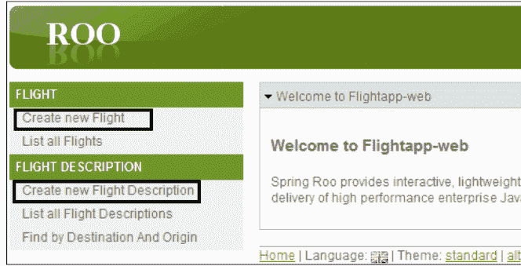

- 13. 从显示创建新 FlightDescription 实例表单的菜单中选择 **创建新航班描述** 选项。创建 FlightDescription 实例后，选择 **创建新航班** 菜单选项来创建 Flight 实例。以下屏幕截图显示了创建 Flight 实例的表单：

  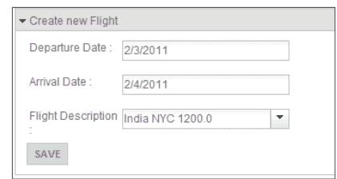

- 14. 输入 **出发日期**、**到达日期** 和 **航班描述** 信息，然后单击 **保存** 按钮。保存 Flight 实例会导致向 myDestination 队列发送一条 JMS 消息，其中包含新创建的 Flight 实例及其关联的 FlightDescription 实例属性的详细信息。


15. MyListener JMS 消费者异步从 myDestination 队列读取 JMS 消息并将其写入标准输出，如下所示：

```
JMS message received: DepartureDate: Tue Feb 01 00:00:00 IST 2011, ArrivalDate: Wed Feb 02 00:00:00 IST 2011, FlightDescription: Origin: NYC, Destination: INDIA, Price: 1200.0
```

## 工作原理...

Roo 的 JMS 插件负责处理 JMS 相关命令，即：jms setup、jms listener 和 field jms template。

Spring 简化了企业应用与 JMS 提供者的集成。Spring 的 JmsTemplate 类是一个辅助类，它使应用程序能够同步发送和接收 JMS 消息。JmsTemplate 类持有 javax.jms.ConnectionFactory 实例的引用——用于与 JMS 提供者创建连接。

> 我们示例中的 JMS 提供者是嵌入式（或内存中）ActiveMQ。需要注意的是，Roo 仅支持将嵌入式 ActiveMQ 作为 JMS 提供者。如果要使用任何其他 JMS 提供者或独立的 ActiveMQ，则需要更改 Roo 生成的 JMS 提供者配置。

让我们来看看在 flightapp-web 应用程序中用于设置 JMS 提供者以及发送和接收 JMS 消息的各种命令。

## 设置 JMS 提供者

jms setup 命令为您的企业应用程序设置 JMS 提供者。jms setup 命令接受以下参数：

- provider：必填参数，指定需要为其添加支持的 JMS 提供者。Roo 为此参数定义的唯一可接受值是 ACTIVEMQ_IN_MEMORY，用于将嵌入式 ActiveMQ 设置为 JMS 提供者。

- destinationName：可选参数，指定应用程序访问的 JMS 目标名称。如果未指定，则目标名称为 myDestination。

- destinationType：可选参数，用于标识通过 destinationName 参数指定的 JMS 目标类型。Roo 为此参数定义的两个可能值为 QUEUE（如果 JMS 目标类型为队列）和 TOPIC（如果 JMS 目标类型为主题）。如果未指定，则目标类型默认为 QUEUE。

jms setup 命令创建一个应用程序上下文 XML 文件：位于 SRC_MAIN_RESOURCES/META-INF/spring 目录下的 applicationContext-jms.xml。applicationContext-jms.xml 文件配置嵌入式 ActiveMQ broker、JmsTemplate、JMS ConnectionFactory、JMS 目标和消息监听器容器。

下面的代码清单显示了 applicationContext-jms.xml 中的嵌入式 ActiveMQ broker 配置：

```
<beans xmlns="http://www.springframework.org/schema/beans"
xmlns:amq="http://activemq.apache.org/schema/core" ...>
<amq:broker persistent="false" useJmx="true">
<amq:transportConnectors>
<amq:transportConnector uri="tcp://localhost:61616"/>
</amq:transportConnectors>
</amq:broker>
...
</beans>
```

amq 命名空间引用 ActiveMQ 架构，它允许在 Spring 的应用程序上下文 XML 文件中配置 ActiveMQ。<broker> 元素配置名为 localhost 的嵌入式 ActiveMQ broker。如果要为 broker 指定自定义名称，可以使用 <broker> 元素的 brokerName 属性。persistent 属性指定 ActiveMQ broker 接收到的 JMS 消息是否持久化到数据存储中。值 false 指示 broker 不持久化消息。如果将 persistent 属性的值指定为 true，则 ActiveMQ 将 KahaDB 配置为消息的默认数据存储。useJmx 属性指定 broker 的服务是否通过 JMX 公开。如果属性值为 true，则可以使用 JMX 客户端调用 ActiveMQ broker 的服务，例如启动或停止 broker、添加或删除主题和队列 JMS 目标等等。<transportConnectors> 元素定义 ActiveMQ broker 监听客户端连接的传输连接器。给定代码清单中的 <transportConnector> 元素指定一个 tcp 传输连接器，它监听端口 61616。

JMS ConnectionFactory 在 applicationContext-jms.xml 文件中配置，如下所示：

```
<amq:connectionFactory brokerURL="vm://localhost"
id="jmsFactory"/>

<bean class="org.springframework.jms.connection.
CachingConnectionFactory" id="cachingConnectionFactory">
<property name="targetConnectionFactory">
<ref local="jmsFactory"/>
</property>
</bean>
```

amq 命名空间的 <connectionFactory> 元素配置 JMS ConnectionFactory。JMS ConnectionFactory 通常在应用程序服务器中配置，并由应用程序通过 JNDI 获取。如果 ConnectionFactory 在应用程序服务器中配置，则可以使用 Spring jee 架构的 <jndi-lookup> 元素来获取它。brokerURL 属性标识连接 ActiveMQ broker 的 URL。brokerURL 属性的值为 vm://localhost，这意味着客户端使用 VM（虚拟机）协议访问名为 localhost 的 ActiveMQ broker。之所以使用 vm 协议，是因为客户端（在本例中为 flightapp-web 应用程序）和 broker 位于同一个 JVM 中。使用 VM 协议可确保性能提升，因为客户端与 broker 之间的通信不涉及网络开销，客户端直接调用 broker 的方法。

Spring 的 CachingConnectionFactory 类是一个 JMS ConnectionFactory 适配器，它缓存 JMS Session、MessageConsumer 和 MessageProducer 的实例以提升性能。targetConnectionFactory 属性标识 ConnectionFactory，CachingConnectionFactory 实例使用它来获取 JMS Connection。给定配置中的 targetConnectionFactory 属性引用由 amq 命名空间的 <connectionFactory> 元素创建的 JMS ConnectionFactory。

在 jms setup 命令中，我们还传递了 JMS 目标名称（myDestination）和类型（QUEUE），JMS 插件使用它们在 applicationContext-jms.xml 文件中配置名为 myDestination 的 JMS 队列，如下所示：

```
<amq:queue id="myDestination" physicalName="myDestination"/>
```

这里，amq 命名空间的 <queue> 元素配置名为 myDestination 的 JMS 队列。physicalName 属性指定 ActiveMQ 中 JMS 队列的名称。JMS 目标通常在应用程序服务器中配置，并由应用程序通过 JNDI 获取。如果 JMS 目标在应用程序服务器中配置，则可以使用 Spring jee 架构的 <jndi-lookup> 元素来获取它。

Spring 的 JmsTemplate 也在 applicationContext-jms.xml 文件中配置，如下所示：

```
<bean class="org.springframework.jms.core.JmsTemplate"
 id="jmsTemplate">
 <property name="connectionFactory"
 ref="cachingConnectionFactory"/>
 <property name="defaultDestination" ref="myDestination"/>
 </bean>
```

connectionFactory 属性引用 CachingConnectionFactory 实例。JmsTemplate 定义接受 JMS Destination 对象或 JMS 目标名称作为参数的 send 方法。defaultDestination 属性引用当使用的 send 方法不接受 JMS Destination 对象或 JMS 目标名称作为参数时用于发送或接收消息的 JMS 目标。

为了让 flightapp-web 应用程序能够异步接收 JMS 消息，jms setup 命令在 applicationContext-jms.xml 文件中配置 Spring 的消息监听器容器，如下所示：

```
<beans xmlns="http://www.springframework.org/schema/beans"
xmlns:jms="http://www.springframework.org/schema/jms" ...>
...
<jms:listener-container connection-factory="jmsFactory"
destination-type="queue" />
...
</beans>
```

消息监听器容器从 JMS 提供者接收消息并将其分发给消息消费者实现。消息监听器容器节省了编写异步消息消费所需代码的工作，这些代码包括向 JMS 提供者注册、管理事务等等。

在给定的配置中，Spring jms 命名空间的 `<listener-container>` 元素创建一个消息监听器容器。`connection-factory` 属性标识容器用于与 JMS 提供者创建连接的 JMS ConnectionFactory。`destination-type` 标识容器接收消息的 JMS 目标类型（队列、主题或持久主题）。可以在 `<listener-container>` 内部添加 Spring jms 命名空间的 `<listener>` 元素，以定义监听器容器分发消息进行处理的消息消费者。

现在让我们来看看如何使用 JmsTemplate 类发送 JMS 消息。

## 使用 JMS 模板发送消息

field jms template 命令将 JmsTemplate 实例自动注入由 `class` 参数标识的类中。fieldName 参数标识添加 JmsTemplate 的字段名称。

下面的代码显示了 FlightController.java 文件，我们在其中使用 jms template 命令添加了 JmsTemplate 字段：

```
import org.springframework.jms.core.JmsTemplate;
...
public class FlightController {

@Autowired
private transient JmsTemplate jmsTemplate;

public void sendMessage(Object messageObject) {
jmsTemplate.convertAndSend(messageObject);
}
}
```


给定的代码显示，`jms template` 命令向 `FlightController` 类添加了一个 `JmsTemplate` 字段和一个 `sendMessage` 方法。`sendMessage` 方法接受 `Object` 类型作为参数，表示你想作为 JMS 消息发送到 JMS 目标的对象。`sendMessage` 方法调用 `JmsTemplate` 的 `convertAndSend` 方法，该方法将传入的对象转换为 JMS 消息，并将其发送到由 `setDefaultDestination(...)` 方法设置的默认目标或由应用程序上下文 XML 文件中 `JmsTemplate` 的 `defaultDestination` 属性指定的目标。对于 Roo 生成的代码，`JmsTemplate` 的默认目标由 `defaultDestination` 属性指定（请参阅 `flightapp-web` 项目的 `applicationContext-jms.xml` 文件）。

所以，你可能会问——对象与 JMS 消息之间的转换是如何执行的？Spring 提供了一个 `MessageConverter` 接口，你可以实现它来定义如何处理从 Java 对象到 JMS 消息以及反之的转换。Spring 提供了一个内置的 `MessageConverter` 实现：`SimpleMessageConverter`，它由 `JmsTemplate` 默认使用，并负责 `String` 与 JMS `TextMessage`、`byte[]` 与 JMS `BytesMessage`、`Map` 与 JMS `MapMessage` 之间以及 `Serializable` 对象与 JMS `ObjectMessage` 之间的转换。由于 `flightapp-web` 应用程序中的 `Flight` 和 `FlightDescription` 对象实现了 `Serializable` 接口，因此 `JmsTemplate` 的 `convertAndSend` 方法将它们转换为 JMS `ObjectMessage` 实例。

## 创建 JMS 消息消费者

`jms listener` 命令创建一个异步 JMS 消息消费者。如果你希望应用程序同步消费消息，则可以使用 `JmsTemplate` 的一个 `receive` 方法。如果你还想使用 `SimpleMessageConverter` 将接收到的 JMS 消息转换为 Java 对象，则可以使用 `JmsTemplate` 的 `receiveAndConvert(...)` 方法来接收消息。

`jms listener` 命令创建一个消息消费者，并更新 `applicationContext-jms.xml` 文件以创建一个新的消息监听器容器，该容器包含新创建的消息消费者作为监听器。在 `flightapp-web` 的情况下，`jms listener` 命令创建 `MyListener` JMS 消息消费者，并将以下配置添加到 `applicationContext-jms.xml` 文件中：

```xml
<bean class="sample.roo.flightapp.web.MyListener"
  id="myListener"/>

<jms:listener-container connection-factory="jmsFactory"
  destination-type="queue">
  <jms:listener destination="myDestination"
    method="onMessage" ref="myListener"/>
</jms:listener-container>
```

`<bean>` 元素将 `MyListener` 消息消费者配置为 Spring bean。

Spring `jms` 命名空间的 `<listener>` 元素定义一个消息监听器，消息监听器容器（由包围的 `<listener-container>` 元素指定）将 JMS 消息分派给该监听器进行处理。`<listener-container>` 的 `destination-type` 属性源自 `jms listener` 命令的 `destinationType` 参数值。`ref` 属性指向消息消费者实例，该实例负责处理 JMS 消息。`destination` 属性（对应于 `jms listener` 命令的 `destinationName` 参数值）标识消息消费者（通过消息容器监听器）从中接收 JMS 消息以进行处理的 JMS 目标。`method` 属性指定消息消费者类中负责处理接收到的 JMS 消息的方法名称。

因此，通过为 `flightapp-web` 执行 `jms listener` 命令，我们创建了 `MyListener` 类，该类负责处理由 `myDestination` JMS 目标接收到的 JMS 消息。`MyListener.java` 中的以下代码清单显示了 Roo 生成的 `MyListener` 类：

```java
public class MyListener {

    public void onMessage(Object message) {
        System.out.println("JMS message received: " + message);
    }

}
```

如给定代码所示，Roo 生成的消息监听器不实现任何接口或扩展任何类，并定义一个接受 JMS 消息作为参数的 `onMessage` 方法。`onMessage` 没有做任何有趣的事情——它只是将消息打印到标准输出。

### 更多内容...

现在让我们看看如何从企业应用程序异步发送 JMS 消息：

### 异步发送 JMS 消息

`field jms template` 命令支持一个 `async` 参数，你可以使用它来指定 Roo 生成的 `sendMessage` 方法带有 Spring 的 `@Async` 注解。对象上带有 `@Async` 注解的方法将由 Spring 使用 `java.util.concurrent.ThreadPoolExecutor` 异步执行。如果指定了 `async` 参数，Roo 将执行以下操作：

- 创建带有 Spring `@Async` 注解的 `sendMessage` 方法
- 通过 Spring 的 task 命名空间的 `<annotation-driven>` 元素在 applicationContext.xml 中启用对带有 `@Async` 注解的方法的检测，如下所示：

  ```xml
  <task:annotation-driven executor="asyncExecutor"
  mode="aspectj" />
  ```

  `executor` 属性引用 `java.util.concurrent.Executor` 接口的一个实现，负责执行带有 `@Async` 注解的方法。

- 使用 Spring 的 task 命名空间的 `<executor>` 元素在 applicationContext.xml 中配置 Spring 的 `ThreadPoolTaskExecutor`，如下所示：

  ```xml
  <task:executor id="asyncExecutor"
  pool-size="${executor.poolSize}" />
  ```

Spring 的 `ThreadPoolTaskExecutor` 配置了一个 `java.util.concurrent.ThreadPoolExecutor` 实例（`java.util.concurrent.Executor` 的一个实现），线程池大小由 pool-size 属性值指定。`${executor.poolSize}` 占位符的值来自 Roo 生成的 `jms.properties` 文件，如下所示：

```
executor.poolSize=10
```

### 另请参阅

- 请参阅“使用 JavaMail API 发送电子邮件”配方，了解如何从应用程序发送电子邮件

## 为应用程序配置 Spring Security

Roo 支持通过 security setup 命令为你的应用程序配置 Spring Security。在本配方中，我们将查看当你执行 security setup 命令时，Roo 添加到你的应用程序中的安全相关配置。在下一个配方“将 Spring Security 与 Apache Directory Server 配合使用”中，我们将探讨如何扩展 Spring Security 配置以使用 Apache Directory Server 来满足 Roo 生成的 Web 应用程序的安全要求，以及如何引入方法级安全。

### 准备工作

在 C:\roo-cookbook 目录中创建一个名为 ch06-security 的子目录。

将 ch06_web_app_security.roo 脚本复制到 ch06-security 目录中。

执行 ch06_web_app_security.roo 脚本，该脚本会创建 flightapp-web Roo 项目，设置 Hibernate 作为持久化提供程序，将 MySQL 配置为应用程序的数据库，创建 Flight、FlightDescription 和 Booking JPA 实体，定义 Flight 和 FlightDescription 实体之间的多对一关系，以及 Booking 和 Flight JPA 实体之间的多对一关系。此外，该脚本还使用 controller all 命令来脚手架 Spring Web MVC 应用程序。如果你使用的数据库不是 MySQL，或者你的连接设置与脚本中指定的不同，请相应地修改脚本。

从 C:\roo-cookbook\ch06-security 目录启动 Roo shell。

### 操作步骤

要通过 security setup 命令为你的应用程序配置 Spring Security，请按以下步骤操作：

- 1. 执行 security setup 命令为 flightapp-web Spring Web MVC 应用程序设置 Spring Security，如下所示：

  ```
  .. roo> security setup
  Updated ROOT\pom.xml [Added property 'spring-security.version' with value '3.0.5.RELEASE']
  Updated ROOT\pom.xml [Added dependencies org.springframework.security:spring-security-core:${spring-security.version}], ...]
  Created SRC_MAIN_RESOURCES\META-INF\spring\applicationContext-security.xml
  Created SRC_MAIN_WEBAPP\WEB-INF\views\login.jspx
  Updated SRC_MAIN_WEBAPP\WEB-INF\views\views.xml
  Updated SRC_MAIN_WEBAPP\WEB-INF\web.xml
  Updated SRC_MAIN_WEBAPP\WEB-INF\spring\webmvc-config.xml
  ```

- 2. 执行 perform eclipse 命令以更新项目的类路径设置：

  ```
  .. roo> perform eclipse
  ```

- 3. 将 flightapp-web Eclipse 项目导入 Eclipse IDE


## 工作原理...

安全设置命令由 Roo 的 **Security 插件** 处理。安全设置命令仅在你通过执行 Roo 的某个控制器命令安装了 Spring Web MVC 构件后，*之后* 才可用。这限制了安全插件仅用于使用 Spring Web MVC 的项目。

Security 插件处理安全设置命令并执行以下操作：

- 向 flightapp-web 项目的 pom.xml 文件添加名为 `spring-security-version`、值为 3.0.5 的属性，如下所示：

```xml
<project ...>
  ...
  <name>flightapp-web</name>
  <properties>
    <roo.version>1.1.2.RELEASE</roo.version>
    <spring.version>3.0.5.RELEASE</spring.version>
    <spring-security.version>
      3.0.5.RELEASE</spring-security.version>
    ...
  </properties>
  ...
</project>
```

spring-security-version 属性标识应用程序所需的 Spring Security 框架版本。pom.xml 中的 `<dependency>` 元素引用了 Spring Security 版本号属性，如下所示：

```xml
<dependency>
  <groupId>org.springframework.security</groupId>
  <artifactId>spring-security-config</artifactId>
  <version>${spring-security.version}</version>
</dependency>
```

```xml
<dependency>
  <groupId>org.springframework.security</groupId>
  <artifactId>spring-security-web</artifactId>
  <version>${spring-security.version}</version>
</dependency>
```

如给定配置所示，将 flightapp-web 应用程序所需的 Spring Security 版本号定义为 pom.xml 文件中的属性，可以确保 pom.xml 定义的依赖属于同一版本的 Spring Security 的 JAR 文件。

- 在 SRC_MAIN_RESOURCES/META-INF/spring 目录中创建应用程序上下文 XML 文件：applicationContext-security.xml。applicationContext-security.xml 文件配置应用程序的身份验证和授权要求。

- 向 flightapp-web 应用程序的 web.xml 文件添加 Spring Security 的 DelegatingFilterProxy Servlet 过滤器，如下所示：

```xml
<filter>
<filter-name>springSecurityFilterChain</filter-name>
<filter-class>org.springframework.web.filter.DelegatingFilterProxy</filter-class>
</filter>

<filter-mapping>
<filter-name>springSecurityFilterChain</filter-name>
<url-pattern>/*</url-pattern>
</filter-mapping>
```

DelegatingFilterProxy Servlet 过滤器充当进入 Spring Security Web 模块的入口点，该模块处理 Web 请求安全。过滤器 springSecurityFilterChain 的名称引用在 applicationContext-security.xml 文件中配置的 Spring Security FilterChainProxy 实例的名称。DelegatingFilterProxy 过滤器将 Web 请求委派给 FilterChainProxy 实例以执行 Web 请求安全。

- 在 SRC_MAIN_WEBAPP/WEB-INF/views 目录中创建登录 JSPX 页面 login.jspx。

- 在 SRC_MAIN_WEBAPP/WEB-INF/views/views.xml Tiles 定义 XML 文件中为登录页面添加 Tiles 定义，如下所示：

```xml
<definition extends="public" name="login">
<put-attribute name="body"
value="/WEB-INF/views/login.jspx"/>
</definition>
```

- 在 webmvc-config.xml 文件（位于 SRC_MAIN_WEBAPP/WEB-INF/spring 目录）中配置 ParameterizableViewController（通过 Spring mvc 命名空间的 view-controller 元素），用于将请求分发到 login.jspx 页面，如下所示：

```xml
<mvc:view-controller path="/login"/>
```

- 更新 flightapp-web 项目的 pom.xml 文件，以包含对 Spring Security JAR 文件的依赖，例如 spring-security-core、spring-security-config 等等。

让我们现在详细查看 applicationContext-security.xml 文件。

## Spring Security 应用程序上下文 XML 文件

applicationContext-security.xml 文件配置 Spring Security Bean，这些 Bean 用于请求的身份验证和授权。如我们稍后将看到的，Roo 生成的 applicationContext-security.xml 并没有做太多事情，但为配置应用程序特定的安全性提供了一个良好的起点。

### AuthenticationManager 配置

应用程序的身份验证机制在 applicationContext-security.xml 中通过 Spring 安全命名空间的 <authentication-manager> 元素进行配置，如下所示：

```xml
<authentication-manager alias="authenticationManager">
<authentication-provider>
<password-encoder hash="sha-256" />
<user-service>
<user name="admin" password="..." 
authorities="ROLE_ADMIN" />
<user name="user" password="..." 
authorities="ROLE_USER" />
</user-service>
</authentication-provider>
</authentication-manager>
```

让我们详细查看给定配置中的每个元素，以及它们如何协同工作为应用程序提供身份验证服务：

- <authentication-manager>：它注册 Spring Security 的 AuthenticationManager 实现的一个实例，该实例负责提供身份验证服务。AuthenticationManager 将身份验证委托给使用 <authentication-provider> 子元素配置的 AuthenticationProvider。

- <authentication-provider>：它注册 Spring Security 的 AuthenticationProvider 实现的一个实例。Spring Security 提供了 AuthenticationProvider 接口的几个内置实现，以简化在应用程序中融合不同的身份验证机制。例如，如果你使用 JA-SIG CAS 进行身份验证，可以使用 CasAuthenticationProvider 实现；如果你使用 LDAP 服务器进行身份验证，可以使用 LdapAuthenticationProvider，等等。AuthenticationProvider 实现的使用通过 <authentication-provider> 元素的 ref 属性指定。如果未指定 ref 属性（如 Roo 生成的 applicationContext-security.xml 的情况），则注册 DaoAuthenticationProvider 实现。DaoAuthenticationProvider 使用 Spring Security 的 UserDetailsService 来验证用户。UserDetailsService 根据应用程序用户输入的用户名加载包含用户名、密码和授予的权限的用户详细信息。DaoAuthenticationProvider 通过将应用程序用户输入的密码与 UserDetailsService 加载的用户详细信息进行比较来验证用户。

- <user-service>：它创建一个内存中的 UserDetailsService 实例，该实例从属性文件或嵌套的 <user> 元素中读取用户详细信息。

- <user>：它定义应用程序的一个用户。name 和 password 属性标识身份验证所需的用户名和密码。

- <password-encoder>：它在将提交的密码与 UserDetailsService 检索的密码进行比较之前，将提交的密码转换为哈希版本。hash 属性指定用于编码密码的哈希算法。

### Web 请求安全配置

以下 `<http>` 元素显示了如何在 applicationContext-security.xml 文件中配置 Web 请求安全：

```xml
<http auto-config="true" use-expressions="true">
    <form-login
        login-processing-url="/resources/j_spring_security_check"
        login-page="/login"
        authentication-failure-url="/login?login_error=t"/>
    <logout logout-url="/resources/j_spring_security_logout"/>
    <intercept-url pattern="/choices/**"
        access="hasRole('ROLE_ADMIN')"/>
    <intercept-url pattern="/member/**"
        access="isAuthenticated()" />
    <intercept-url pattern="/resources/**"
        access="permitAll" />
    <intercept-url pattern="/**" access="permitAll" />
</http>
```

让我们现在详细查看给定配置中的元素如何定义 Web 请求安全：

- <http>：它包含 HTTP 安全配置元素。它创建一个 bean 名称为 springSecurityFilterChain 的 Spring Security FilterChainProxy 实例。需要注意的是，FilterChainProxy Bean 的名称与 web.xml 文件中配置的 DelegatingFilterProxy Servlet 过滤器的名称相同。

auto-config 属性自动配置提供基于表单的登录、注销和 HTTP BASIC 身份验证服务的 Spring Security Bean。

use-expression 属性指定 <intercept-url> 元素（在本配方后面讨论）的 access 属性是否可以接受 EL 表达式。

- <form-login>：它在应用程序上下文中配置 Spring Security 的 UsernamePasswordAuthenticationFilter 过滤器 Bean（一个实现 Servlet API 的 javax.servlet.Filter 接口的 Bean）和 LoginUrlAuthenticationEntryPoint Bean。UsernamePasswordAuthenticationFilter 过滤器 Bean 由 FilterChainProxy 用于执行身份验证。

UsernamePasswordAuthenticationFilter 使用提交请求中的用户名和密码，针对配置的身份验证提供程序尝试进行身份验证。需要注意的是，包含用户名和密码的请求参数的名称必须分别为 j_username 和 j_password。如果你检查 Roo 生成的 login.jspx 文件中 flightapp-web 项目的参数，你会发现用户名和密码字段的名称分别为 j_username 和 j_password。

LoginUrlAuthenticationEntryPoint Bean 使用 UsernamePasswordAuthenticationFilter 启动基于表单的登录身份验证。

login-page 属性指定登录页面的 URL。该属性的值由 LoginUrlAuthenticationEntryPoint 用于呈现登录页面。该属性的值为 /login，这意味着 webmvc-config.xml 中配置的 <mvc:view-controller path="/login" /> 控制器负责呈现登录页面。

login-processing-url 属性指定登录表单提交到的 URL。UsernamePasswordAuthenticationFilter 处理提交到其 filterProcessesUrl 属性标识的 URL 的请求。login-processing-url 属性的值用于设置 UsernamePasswordAuthenticationFilter 的 filterProcessesUrl 属性。login-processing-url 属性的值为 /resources/j_spring_security_check，这与 Roo 生成的 flightapp-web 项目的 login.jspx 文件中 HTML <form> 元素的 action 属性值相同。


authentication-failure-url 属性指定登录失败时用户被重定向到的 URL。该属性的值 /login?login_error=t 表示 webmvc-config.xml 中配置的 <mvc:view-controller path="/login"/> 控制器将再次渲染登录页面。URL 中的 login_error 参数由 login.jspx 页面用于在登录页面上显示身份验证失败消息，如下所示：

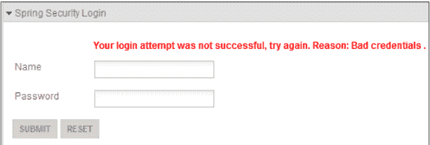

- <logout>: 它配置了负责处理退出请求的 LogoutFilter 过滤器 bean。LogoutFilter 处理提交给其 filterProcessesUrl 属性所标识 URL 的请求。logout-url 属性的值用于设置 LogoutFilter 的 filterProcessesUrl 属性。对于 Roo 生成的 applicationContext-security.xml，logout-url 的值为 /resources/j_spring_security_logout。footer.jspx 文件（位于 /WEB-INF/views 目录中）包含在用户已登录时显示的注销超链接。注销超链接引用 /resources/j_spring_security_logout URL，这意味着当用户单击注销超链接时，请求由 LogoutFilter 过滤器 bean 处理。

- <intercept-url>: 它定义 URL 模式和相应的访问权限。pattern 属性指定 URL 模式，access 属性指定访问权限。如前所述，<http> 元素的 use-expression 属性设置为 true；因此，access 属性可以接受布尔 EL 表达式。如果表达式返回的值为 true，则授予对 pattern 属性指定的 URL 模式的访问权限。

hasRole、isAuthenticated() 和 permitAll 是内置表达式的示例。如果经过身份验证的主体的角色为 ROLE_ADMIN，hasRole('ROLE_ADMIN') 返回 true。如果用户不是匿名用户，isAuthenticated() 返回 true。permitAll 表达式始终返回 true。

`<http>` 元素注册了 Spring Security 的 `AccessDecisionManager` 实现，用于对 Web URL 访问做出访问决策。传入的 Web 请求将按照其在 `<http>` 元素中出现的顺序，与 `<intercept-url>` 元素指定的 URL 模式进行匹配。如果找到匹配项，将由 `AccessDecisionManager` 实现使用它来做出访问决策。由于传入的 Web 请求按照其在 `<http>` 元素中出现的顺序与 URL 模式（由 `<intercept-url>` 元素指定）进行匹配，因此应先声明更具体的 URL 模式，再声明更通用的 URL 模式。

## 将 Spring Security 与 Apache Directory Server 配合使用

本示例在之前示例的基础上进行扩展，展示了一个使用 Spring Web MVC 开发的功能完善的 Flight Booking 应用程序，该应用程序使用 Spring Security 实现 Web 请求和 *方法级* 安全。我们将查看需要对 `security setup` 命令生成的配置和工件进行哪些修改或添加，以创建安全感知的 Flight Booking 应用程序。

在深入探讨如何使用 Spring Security 满足这些要求的详细信息之前，我们先快速了解一下 Flight Booking 应用程序的安全要求。

### Flight Booking 应用程序要求

Flight Booking 应用程序的用户针对 Apache Directory Server 进行身份验证，该服务器包含应用程序用户、详细信息及其角色信息。Flight Booking 应用程序的经过身份验证的用户可以拥有 `ROLE_ADMIN_USER` 或 `ROLE_APP_USER` 角色。对应用程序功能的访问权限根据经过身份验证用户的角色授予或限制。

Flight Booking 应用程序的 Web 请求安全要求限制对菜单选项的未授权访问。以下屏幕截图显示了 Flight Booking 应用程序的主菜单：

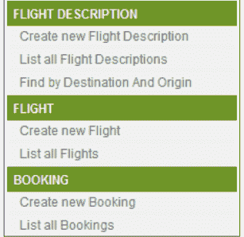

下表根据角色定义了每个菜单选项（如给定屏幕截图所示）的访问权限：

| 菜单选项 | 可访问的角色 |
|---|---|
| 创建新的 FlightDescription | ROLE_ADMIN_USER |
| 列出所有 Flight Description | |
| 按目的地和原点查找 | |
| 创建新的 Flight | |
| 列出所有 Flight | |
| 创建新的 Booking | ROLE_APP_USER |
| 列出所有 Booking | ROLE_ADMIN_USER |

如给定表所示，拥有 ROLE_ADMIN_USER 角色的应用程序用户可以访问 Flight、FlightDescription 和 Booking JPA 实体的 Web 页面。拥有 ROLE_APP_USER 角色的应用程序用户只能访问与 Booking JPA 实体对应的 Web 页面。

尽管 Create new Booking 和 List all Bookings 链接对 ROLE_APP_USER 和 ROLE_ADMIN_USER 角色都可访问（如前表所示），但应用程序还必须满足以下安全要求（这些要求最终将转换为方法级安全要求）：

- 拥有 ROLE_APP_USER 角色的用户可以创建新的 Booking 实例，但无法编辑或删除现有的 Booking 实例
- 拥有 ROLE_ADMIN_USER 角色的用户可以编辑或删除现有的 Booking 实例，但无法创建新的 Booking 实例

### 准备工作

将 ch06-ldap-security.zip 文件的内容提取到 C:\roo-cookbook 目录中。这将在 C:\roo-cookbook 中创建 ch06-ldap-security 目录。ch06-ldap-security 目录包含一个 flightapp-web Web 项目，该项目表示安全感知的 Flight Booking 应用程序。此 flightapp-web 项目是我们在之前示例中创建的 flightapp-web 项目的扩展。它包含对 Spring Security 生成工件的修改，以及针对 Flight Booking 应用程序的地址 Web 请求和方法级安全要求的几项额外更改。

如果您使用的数据库不是 MySQL，或者您的连接设置与 flightapp-web 项目的 database.properties 文件中指定的不同，请相应地修改 database.properties 文件。

打开命令提示符，并切换到 C:\roo-cookbook\ch06-ldap-security 目录。

### 操作方法

要使用 Spring 应用程序配置安全设置，请按以下步骤操作：

1. 将 flightapp-web 项目部署为内嵌 Tomcat 实例中的动态 Web 应用程序：

```
..\ch06-ldap-security> mvn tomcat:run
```

这将下载 flightapp-web 项目的 pom.xml 文件中定义的依赖项。现在，您可以通过访问以下 URL 来访问 flightapp-web 应用程序：

```
http://localhost:8080/flightapp-web
```

如果您看到以下网页，则表示您已成功将 flightapp-web 应用程序部署到内嵌 Tomcat 实例中：

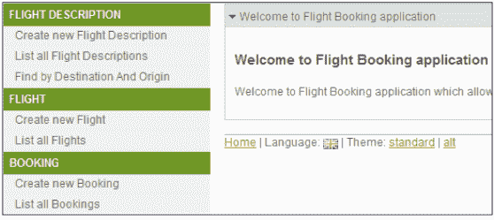

2. 选择 **创建新的 Flight Description** 菜单选项，这将显示 Flight Booking 应用程序的登录屏幕，如下所示：

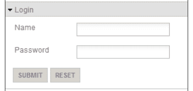

3. 在 **名称** 标记的字段中输入 **admin**，在 **密码** 标记的字段中输入 **admin**，并单击 **提交** 按钮登录到应用程序。**admin** 用户拥有 **ROLE_ADMIN_USER** 角色。

**admin** 用户与 **ROLE_ADMIN_USER** 角色关联；因此，**admin** 用户会看到创建新 **FlightDescription** 实例的表单，如下所示：

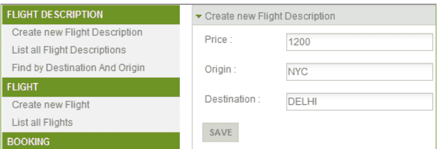

4. 按照屏幕截图输入航班描述详细信息，并单击 **保存** 按钮以创建新的 **FlightDescription** 实例。

5. 现在，选择 **创建新的 Flight** 菜单选项以查看创建新 `Flight` 实例的表单，如下所示：

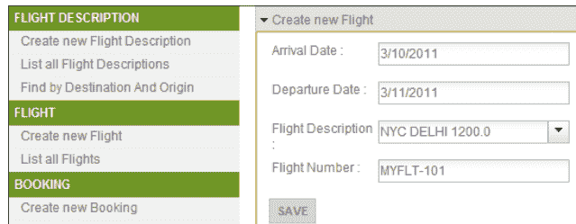

6. 在 **到达日期** 和 **出发日期** 字段中设置日期，并在标记为 **航班描述** 的组合框中选择新创建的 `FlightDescription`。将 **航班号** 字段的值设置为 **MYFLT-101**。现在，单击 **保存** 按钮在数据库中创建新的 `Flight` 实例。

7. 在给定的表单中，您可能会注意到，在 Roo 生成的 Flight Booking Spring Web MVC 应用程序中，我们可以设置到达和出发日期，但无法设置航班的到达或出发时间。这是因为 Roo 生成的 Spring Web MVC 应用程序使用 Dijit 库的 dijit.form.DateTextBox 组件在 JSPX 视图中渲染 JPA 实体的 java.util.Date 类型字段。您可以通过修改 Roo 安装的 datetime.tagx 标签（请参阅 flightapp-web 的 WEB-INF/tags/form/fields 目录）或创建自己的自定义标签来修改此行为，该自定义标签将 java.util.Date JPA 字段渲染为表单字段，同时使用 dijit.form.DateTextBox（用于选择日期）和 dijit.form.TimeTextBox（用于选择时间）。这样，用户就可以为该字段选择日期和时间值。

8. 由于我们已经创建了 `FlightDescription` 实例和关联的 `Flight` 实例，是时候在 MYFLT-101 航班上创建预订了。选择 **创建新的 Booking** 菜单选项以查看创建新 `Booking` 实例的表单，如下所示：

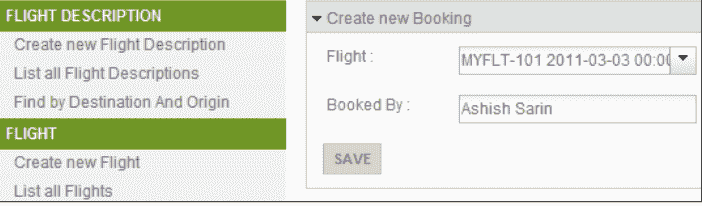


9. 从**Flight**字段中选择MYFLT-101航班号，并在**Booked By**字段中输入一个名称。如果您现在单击**Save**按钮以保存Booking实例，您将收到**Access denied to admin**消息，如下所示：

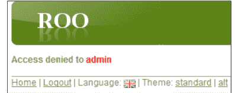

显示访问被拒绝消息是因为ROLE_ADMIN_USER角色的用户没有权限调用Booking JPA实体的persist方法。选择**Logout**超链接以从Flight Booking应用程序注销。

10. 现在，从菜单选项中选择**Create new Booking**选项。Flight Booking应用程序会要求您登录，因为所有菜单选项仅对经过身份验证的用户可用。使用名称**ashish**和密码**ashish**登录。用户**ashish**具有ROLE_APP_USER角色。

11. 如第五步所述创建一个新的Booking实例。这一次，Booking实例创建成功，因为ROLE_APP_USER有权调用Booking JPA实体的persist方法。

12. 现在，选择**Create new Flight Description**菜单选项。这将显示**Access denied to ashish**消息，如下所示：

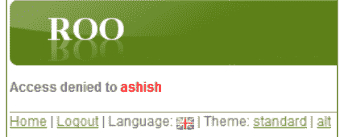

显示访问被拒绝消息是因为Flight Booking应用程序的Web请求安全限制用户访问与Flight和FlightDescription JPA实体相关的菜单选项。另外，如果您以**ashish**身份登录并尝试修改或删除现有的Booking实例，那么应用程序将拒绝您的访问。原因在于，只有具有ROLE_ADMIN_USER角色的用户才有权调用Booking JPA实体的merge和remove方法。

## 工作原理...

在“为您的应用程序配置Spring Security”配方中，我们讨论了由`security setup`命令生成的Spring Security配置。由于由`security setup`命令创建的配置仅有助于我们开始向应用程序添加安全性，因此本配方扩展了由`security setup`命令创建的配置，以演示如何将身份验证和授权快速集成到Roo生成的Web应用程序中。在本节中，我们将查看我们对`security setup`命令生成的配置和工件所做的哪些修改或添加，以创建一个安全感知的Flight Booking应用程序。

让我们先了解如何设置Apache Directory Server作为Flight Booking应用程序的身份验证源。

## 设置嵌入式Apache Directory Server

Spring Security命名空间提供了一个`<ldap-server>`元素，用于配置要对其进行身份验证的外部LDAP服务器的位置。它也可用于创建嵌入式Apache Directory Server实例。如果指定了`<ldap-server>`元素的url属性，则表示正在使用外部LDAP服务器进行身份验证。如果未指定url属性，则将创建一个嵌入式Apache Directory Server实例。

`flightapp-web`项目的`applicationContext-security.xml`文件配置了嵌入式Apache Directory Server实例，如下所示：

```xml
<ldap-server ldif="classpath:application_users.ldif"
root="dc=sample,dc=com" />
```

ldif属性指定LDIF（LDAP数据交换格式）文件的位置，该文件包含嵌入式LDAP服务器加载的用户信息。您将在`flightapp-web`项目的`WEB-INF/classes`目录中找到`application_users.ldif`文件。root属性指定LDAP目录树的根。

以下图显示了由`application_users.ldif`文件定义的LDAP目录树：

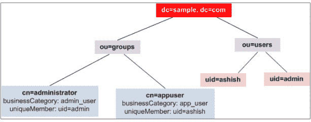

给定的图显示，用户组administrator和appuser定义在ou=groups下，应用程序用户admin和ashish定义在ou=users下。用户ashish的DN（区别名）为uid=ashish,ou=users,dc=sample,dc=com，用户admin的DN为uid=admin,ou=users,dc=sample,dc=com。administrator组条目的DN为cn=administrator,ou=groups,dc=sample,dc=com，appuser组条目的DN为cn=appuser,ou=groups,dc=sample,dc=com。

定义在ou=groups下的条目的uniqueMember属性标识属于该组的应用程序用户。例如，在cn=administrator条目中，uniqueMember属性值为uid=admin,ou=users,dc=sample,dc=com（用户admin的DN），这意味着admin用户属于administrator组。同样，ashish属于appuser组。

ou=groups下条目的businessCategory属性标识属于该组的用户的角色。如给定的图所示，用户admin的角色是admin_user，用户ashish的角色是app_user。

由于Flight Booking应用程序使用嵌入式Apache Directory Server，因此已将以下JAR依赖项添加到flightapp-web项目的pom.xml文件中：

- apacheds-protocol-shared
- apacheds-protocol-ldap
- apacheds-core-entry
- apacheds-core
- apacheds-server-jndi
- shared-ldap

> 由于Spring Security支持嵌入式Apache Directory Server的1.5.5版本，因此所有给定的JAR文件均属于1.5.5版本。

由于我们使用Spring Security的LDAP支持，因此spring-security-ldap JAR依赖项也已添加到pom.xml文件中。

## 对LDAP服务器进行身份验证

要对嵌入式LDAP服务器进行身份验证，已将以下配置添加到applicationContext-security.xml文件中：

```xml
<authentication-manager>
<authentication-provider>
<ldap-user-service group-search-filter="uniqueMember={0}"
 group-search-base="ou=groups"
 user-search-base="ou=users"
 user-search-filter="uid={0}"
 group-role-attribute="businessCategory" />
</authentication-provider>
</authentication-manager>
```

<ldap-user-service>配置了LdapUserDetailsService（我们之前讨论过的UserDetailsService的一个实现），它从LDAP服务器加载包含用户名、密码和角色的用户详细信息。身份验证是通过将用户输入的密码与LdapUserDetailsService实例加载的用户详细信息进行比较来执行的。

<ldap-user-service>元素接受以下属性：

- user-search-base: 指定执行用户搜索的目录树部分。值ou=users表示将在定义在DN下的条目上执行搜索，即ou=users,dc=sample,dc=com。

- user-search-filter: 它指定用于在目录树中搜索用户的过滤条件。值uid={0}表示搜索uid属性值等于用户在登录表单中输入的用户名的用户条目。值{0}将被用户在登录表单中输入的用户名替换。

- group-search-base: 它指定执行组搜索的目录树部分。值ou=groups表示将在定义在DN下的条目上执行搜索，即ou=groups,dc=sample,dc=com。

- group-search-filter: 它指定用于在目录树中搜索组的过滤条件。值uniqueMember={0}表示搜索uniqueMember属性值等于用户DN的组条目。

如果用户ashish尝试登录Flight Booking应用程序，则将使用user-search-base和 user-search-filter属性的值来搜索用户。这将返回DN为uid=ashish,ou=users,dc=sample,dc=com的条目。现在，将使用group-search-filter和group-search-base属性的值来搜索uniqueMember属性值为uid=ashish,ou=users,dc=sample,dc=com的组条目。这将返回cn=appuser,ou=groups,dc=sample,dc=com条目，因为它包含值为uid=ashish,ou=users,dc=sample,dc=com的uniqueMember属性。

- group-role-attribute: 它指定用作角色名称的组条目属性。由于group-role-attribute的值是businessCategory，如果为身份验证用户返回的组条目是cn=administrator,ou=groups,dc=sample,dc=com，那么用户的角色是admin_user——即该条目的businessCategory属性的值。


需要注意的是，Spring Security的LDAP身份验证机制默认会在身份验证后返回的角色名称前添加ROLE_前缀。因此，如果admin用户对航班预订应用程序进行身份验证，那么它获得的不是admin_user角色，而是ROLE_ADMIN_USER角色。同样，用户ashish获得的是'ROLE_APP_USER'角色。

现在让我们看看如何为航班预订应用程序配置Web请求安全。

## 配置Web请求安全

`security`命名空间的以下`<http>`元素显示了如何在flightapp-web项目的applicationContext-security.xml文件中配置Web请求安全：

```xml
<http auto-config="true" use-expressions="true">
<access-denied-handler error-page="/accessdenied" />
<form-login ... />
<logout logout-url="/resources/j_spring_security_logout" />
<intercept-url pattern="/flights/**"
access="hasRole('ROLE_ADMIN_USER')" />
<intercept-url pattern="/flightdescriptions/**"
access="hasRole('ROLE_ADMIN_USER')" />
<intercept-url pattern="/bookings/**"
access="hasAnyRole('ROLE_APP_USER','ROLE_ADMIN_USER')" />
<intercept-url pattern="/accessdenied/**"
access="hasAnyRole('ROLE_APP_USER', 'ROLE_ADMIN_USER')" />
</http>
```

与前面的示例一样，我们讨论了Roo生成的applicationContext-security.xml文件中的`<http>`元素；但这里我们只关注专门为满足flightapp-web应用程序的Web安全要求而添加的配置元素。在给定代码中，我们添加了以下元素来为航班预订应用程序配置Web请求安全：

- `<access-denied-handler>`：它配置当用户请求的页面被拒绝访问时向用户显示的错误页面。error-page属性指定错误页面的URL。webmvc-config.xml中的`<mvc:view-controller path="/accessdenied"/>`条目配置ParameterizableViewController，负责渲染拒绝访问页面——位于`/WEB-INF/views`目录中的accessdenied.jspx。

- `<intercept-url>`：它定义航班预订应用程序的URL模式和相应的访问权限。让我们来看看为航班预订应用程序定义的每个`<intercept-url>`元素：

```xml
<intercept-url pattern="/flights/**"
access="hasRole('ROLE_ADMIN_USER')" />
```

- 模式/flights/**指的是专门用于管理Flight JPA实体实例的所有Web页面。hasRole('ROLE_ADMIN_USER')表达式指定，专门用于管理Flight JPA实体实例的页面只能由具有ROLE_ADMIN_USER角色的用户访问。

```xml
<intercept-url pattern="/flightdescriptions/**"
access="hasRole('ROLE_ADMIN_USER')" />
```

- 模式/flightdescriptions/**指的是专门用于管理FlightDescription JPA实体实例的所有Web页面。hasRole('ROLE_ADMIN_USER')表达式指定，专门用于管理FlightDescription JPA实体实例的页面只能由具有ROLE_ADMIN_USER角色的用户访问。

```xml
<intercept-url pattern="/bookings/**"
access="hasAnyRole('ROLE_APP_USER', 'ROLE_ADMIN_USER')" />
```

- 模式/bookings/**指的是专门用于管理Booking JPA实体实例的所有Web页面。hasAnyRole('ROLE_APP_USER', 'ROLE_ADMIN_USER')表达式指定，专门用于管理Booking JPA实体实例的页面只能由具有ROLE_ADMIN_USER或ROLE_APP_USER角色的用户访问。

```xml
<intercept-url pattern="/accessdenied/**"
access="hasAnyRole('ROLE_APP_USER', 'ROLE_ADMIN_USER')" />
```

- 模式/accessdenied/**指的是显示**拒绝访问**...消息的Web页面。hasAnyRole('ROLE_APP_USER', 'ROLE_ADMIN_USER')表达式指定，拒绝访问页面可供具有ROLE_ADMIN_USER或ROLE_APP_USER角色的用户访问。这一点很重要，因为拒绝访问页面不应对匿名用户开放。

现在让我们看看如何在航班预订应用程序中配置方法级安全。

## 配置方法级安全

航班预订应用程序中的方法级安全由applicationContext-security.xml文件中的`<global-method-security>`元素启用，如下所示：

```xml
<global-method-security mode="aspectj"
 secured-annotations="enabled"/>
```

mode属性值指定是使用Spring AOP（它会代理目标对象）还是AspectJ（Spring的AspectJ安全切面会在加载时或编译时织入类中）来保护方法。由于Booking JPA实体是在Spring容器之外创建的，要使用Spring的@Secured注解（将在下一节中讨论）来保护由Booking JPA实体定义的方法，需要使用AspectJ。mode属性的值aspectj指示Spring将AnnotationSecurityAspect（可在Spring Security的spring-security-aspects JAR文件中找到）织入使用@Secured注解的类中。secured-annotations属性指定是否为应用程序上下文启用或禁用@Secured注解的使用。enabled值表示Spring Security将保护所有使用@Secured方法级注解的方法。Spring还支持使用JSR-250安全注解、安全表达式（如hasRole、hasPermission等）以及<global-method-security>元素的<protect-pointcut>子元素来实现方法级安全。您可以结合使用不同的方法来在应用程序中实现方法级安全。

由于我们使用AspectJ模式为航班预订应用程序实现方法级安全，因此已将spring-security-aspects JAR的依赖项添加到pom.xml文件中，并更新了pom.xml文件中的AspectJ编译器插件配置以包含spring-security-aspects，如下所示：

```xml
<plugin>
 <groupId>org.codehaus.mojo</groupId>
 <artifactId>aspectj-maven-plugin</artifactId>
 ...
 <configuration>
 <outxml>true</outxml>
 <aspectLibraries>
 <aspectLibrary>
 <groupId>org.springframework</groupId>
 <artifactId>spring-aspects</artifactId>
 </aspectLibrary>
 <aspectLibrary>
 <groupId>org.springframework.security</groupId>
 <artifactId>spring-security-aspects</artifactId>
 </aspectLibrary>
 </aspectLibraries>
 ...
 </configuration>
 </plugin>
```

`<aspectLibrary>`元素指定包含切面的JAR文件。spring-aspects JAR包含用于织入@Transactional支持的切面，spring-security-aspects JAR包含用于在类中织入@Secured支持的切面。

> 您还可能会注意到，航班预订应用程序中使用了Spring Security版本3.1.0 RC1，因为3.1版本之前的spring-security架构不支持`<global-method-security>`元素的mode属性。

既然我们已经了解了如何为航班预订应用程序配置方法级安全，现在可以使用@Secured注解来标注Booking JPA实体方法了。

## 向JPA实体方法添加@Secured注解

Spring Security的@Secured注解可用于方法级，以防止未经授权的访问方法。@Secured注解指定授权调用该方法的用户角色。

在Roo生成的应用程序中，向JPA实体方法添加Spring Security的@Secured注解是一个比较复杂的过程。Roo在*_Roo_Entity.aj AspectJ ITD文件中定义JPA实体方法，不建议应用程序开发人员修改该文件。要向JPA实体方法添加@Secured注解，请执行push-in重构（请参阅第7章）以将方法移动到实体的Java类中，或者简单地将方法从AspectJ文件复制到实体的Java类中。例如，对于Booking JPA实体，persist方法已从Booking_Roo_Entity.aj文件复制到Booking.java文件，如下所示：

```java
@RooEntity(identifierColumn = "BOOKING_ID")
public class Booking {
    @PersistenceContext
    transient EntityManager entityManager;
    ...
    @Transactional
    @Secured("ROLE_APP_USER")
    public void persist() {
        if (this.entityManager == null)
            this.entityManager = entityManager();
        this.entityManager.persist(this);
    }

    public static final EntityManager entityManager() {
        EntityManager em = new Booking().entityManager;
        ...
        return em;
    }
}


给定的代码显示，`persist` 方法已从 `Booking_Roo_Entity.aj` 复制到 `Booking.java` 文件中。`@Secured` 注解已添加到 `persist` 方法，以使其安全。

需要注意的是，从 AspectJ ITD 复制方法到 Java 文件 *不需要* 同时移动依赖的方法和属性。例如，将 `persist` 方法从 `Booking_Roo_Entity.aj` 移动到 `Booking.java` *不需要* 移动 `entityManager` 属性和 `entityManager()` 方法，如代码所示。这样做是为了简化代码理解。

## 在 GAE 上部署 GWT 应用程序

GAE（Google App Engine）是 Google 提供的云计算平台，为部署 Web 应用程序提供基础架构。在本配方中，我们将探讨 Roo 如何简化为 GAE 开发应用程序。我们还将了解如何创建和部署 Roo 脚手架生成的 GWT 应用程序。在 *在 GAE 上部署 Spring Web MVC 应用程序* 配方中，我们将了解可以部署到 GAE 的 Spring Web MVC 应用程序。

## 准备工作

如果你只想使用适用于 Java 的 App Engine SDK 在本地运行 GWT 应用程序，那么你不需要注册 Google App Engine 并创建 *应用程序标识符*。如果你想将应用程序部署到 GAE，请按照此处提到的步骤为你的应用程序创建应用程序标识符。

- 1. 通过访问以下网址注册免费的 Google App Engine 账户：`http://appengine.google.com`。登录后，你将看到以下欢迎页面：

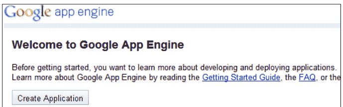

- 2. 现在，你需要创建一个唯一标识你的应用程序并用于在 GAE 上部署应用程序的 *应用程序标识符*。单击 **Create Application** 按钮，它将要求你选择国家信息和手机号码以生成验证码，如下所示：

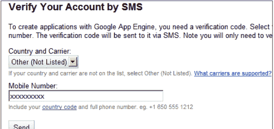

- 3. 提供通过短信接收到的验证码后，你可以按以下屏幕截图所示创建应用程序标识符：

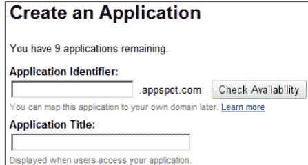

- 4. 为 **应用程序标识符** 字段输入一个唯一值，并为 **应用程序标题** 输入一个值。如给定的屏幕截图所示，应用程序标识符名称会添加到 **.appspot.com** 之前以形成访问应用程序的 URL。因此，如果你的唯一标识符是 **myappid**，那么在 GAE 上部署应用程序后，可以通过访问 `http://myappid.appspot.com` 来访问它。

现在，我们已准备好创建要部署到 GAE 的 GWT 应用程序。

在 `C:\roo-cookbook` 目录内创建子目录 `ch06-gae-gwt`，并从 `C:\roo-cookbook\ch06-gae-gwt` 启动 Roo shell。

## 操作步骤...

要创建 Roo 脚手架生成的 GWT 应用程序并将其部署到 GAE，请按照此处给出的步骤操作：

- 1. 使用 project 命令创建 flightapp-gae-gwt 项目：

```
... roo project --topLevelPackage sample.roo.flightapp --java 6 --projectName flightapp-gae-gwt
```

- 2. 使用 persistence setup 命令设置 DataNucleus 作为持久化提供程序，并将 GOOGLE_APP_ENGINE 设置为数据库。applicationId 参数是可选的，如果你只想在本地测试应用程序，则不需要指定它。

```
... roo persistence setup --provider DATANUCLEUS --database GOOGLE_APP_ENGINE --applicationId <your application identifier>
```

```
Created SRC_MAIN_WEBAPP\WEB-INF\appengine-web.xml
Created SRC_MAIN_WEBAPP\WEB-INF\logging.properties
Updated SRC_MAIN_RESOURCES\log4j.properties
```

```
Updated ROOT\pom.xml [Added property 'gae.home' with value '${user.home}/.m2/repository/com/google/appengine/appengine-java-sdk/1.4.0/appengine-java-sdk-1.4.0']
```

```
Updated ROOT\pom.xml [Added dependencies com.google.appengine.orm:datanucleus-appengine:1.0.7.final...]
```

```
Updated ROOT\pom.xml [Added plugin maven-gae-plugin]
```

```
Updated ROOT\pom.xml [Added plugin maven-datanucleus-plugin]
```

为了简洁，给定的输出仅显示 Roo 执行的 GAE 特定操作。

- 3. 创建 FlightDescription JPA 实体并向其添加字段，如下所示：

```
... roo entity --class ~.domain.FlightDescription --identifierType java.lang.Long --testAutomatically
```

```
... roo field string --fieldName origin --notNull
```

```
... roo field string --fieldName destination --notNull
```

```
... roo field number --type java.lang.Float --fieldName price --notNull
```

- 4. 使用 `gwt setup` 命令生成 GWT 应用程序脚手架：

```
... roo> gwt setup
```

- 5. 如果你想将 `flightapp-gae-gwt` 导入 Eclipse IDE，请执行 `perform eclipse` 命令：

```
... roo> perform eclipse
```

- 6. 退出 Roo shell 并执行 Maven GAE 插件的 `gae:run` 目标，以便在随适用于 Java 的 App Engine SDK 捆绑的 Google App Engine 开发 Web 服务器上在本地运行 `flightapp-gae-gwt` 应用程序，如下所示：

```
C:\roo-cookbook\ch06-gae-gwt> mvn gae:run
```

- 7. 当我们执行 `persistence setup` 命令时，Maven GAE 插件已在 `flightapp-gae-gwt` 项目的 `pom.xml` 文件中配置。开发服务器成功启动后将显示以下消息：服务器正在 `http://localhost:8080/` 上运行

- 8. 现在，打开你喜欢的 Web 浏览器并访问 `http://localhost:8080` 以访问 GWT `flightapp-gae-gwt` Web 应用程序，该应用程序允许你对 `FlightDescription` JPA 实体执行 CRUD 操作，如下所示：

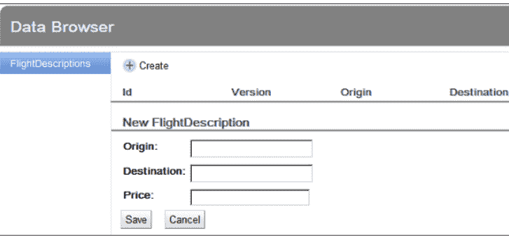

- 9. 在本地测试应用程序后，你可以通过执行 Maven GAE 插件的 `gae:deploy` 目标将 flightapp-gae-gwt 应用程序部署到 GAE，如下一命令所示。如果你没有创建应用程序标识符，并将其指定为 persistence setup 命令的 applicationId 参数的值，那么此步骤将失败。

```
C:\roo-cookbook\ch06-gae-gwt> mvn gae:deploy
```

Beginning server interaction for <your-application-identifier>...
...
Email: <email-id>@gmail.com
Password for <email-id>@gmail.com:
...

- 10. 如给定输出所示，在部署应用程序时，你需要提供用于注册 Google App Engine 的电子邮件地址和相应密码。

- 11. 一旦 flightapp-gae-gwt 应用程序成功部署到 GAE，你可以通过以下 URL 访问它：

http://<your-application-identifier>.appspot.com

由于 flightapp-gae-gwt 应用程序是安全应用程序，你将需要使用你的 Google 账户或 OpenID 凭据登录。

## 工作原理...

`persistence setup` 命令会判断，如果 database 参数的值为 GOOGLE_APP_ENGINE，则目标部署环境为 Google App Engine。如果 database 参数的值为 GOOGLE_APP_ENGINE，则必须将 DATANUCLEUS 指定为 provider 参数的值。

你可能会疑惑，为什么必须指定持久化提供程序为 DataNucleus 且数据库为 GOOGLE_APP_ENGINE。其实，Google App Engine 使用一种专有的无模式对象数据存储（即 BigTable）来持久化应用程序数据。Java 应用程序可以通过 DataNucleus App Engine 插件（这不是 Maven 插件，而是 DataNucleus 插件）使用 JPA 或 JDO 访问 BigTable 数据存储。DataNucleus 是一个独立产品，允许使用 JDO 和 JPA API 访问数据存储（包括 RDBMS、Excel、XML、LDAP 等等）。此外，DataNucleus App Engine 插件由 Google 开发和维护，专门用于与 GAE 配合使用。因此，可以说，通过使用 DataNucleus，开发人员可以在其应用程序中使用 JDO 或 JPA API 来访问或持久化数据，而不考虑应用程序使用的数据存储。如果你的应用程序使用不同类型的数据源，这可能特别有用。


在响应持久化设置时，Roo 执行以下操作：

- 在 `WEB-INF` 目录中创建 `appengine-web.xml` 文件
- 在 `pom.xml` 中添加对 DataNucleus `App Engine` 插件的依赖
- 在 `pom.xml` 中配置 Maven `GAE` 插件
- 在 `pom.xml` 中配置 Maven `DataNucleus` 插件
- 为 Java 日志记录 API 创建 `logging.properties` 配置
- 在 `META-INF` 目录中创建 `persistence.xml` 文件，该文件提供持久化提供程序（在本例中为 `DataNucleus`）信息
- 在 `META-INF/spring` 目录中创建 `applicationContext.xml` 文件，该文件包含事务管理器和 JPA `EntityManagerFactory` 定义

现在让我们来看看 `appengine-web.xml` 文件和 Roo 配置的插件。

## appengine-web.xml

`appengine-web.xml` 是 GAE 特定的配置文件，用于指定应用程序标识符、应用程序版本、应用程序中的静态文件和资源文件、系统属性等。以下清单显示了 Roo 为 `flightapp-gae-gwt` 项目生成的 `appengine-web.xml` 内容：

```
<appengine-web-app xmlns="http://appengine.google.com/ns/1.0">
    <application>myappid</application>
    <version>1</version>
    <sessions-enabled>true</sessions-enabled>
    <system-properties>
        <property name="java.util.logging.config.file"
        value="WEB-INF/logging.properties"/>
        <property
        name="appengine.orm.disable.duplicate.emf.exception"
        value="false"/>
    </system-properties>
</appengine-web-app>
```

`<appengine-web-app>` 是 `appengine-web.xml` 的根元素。`<application>` 元素指定应用程序标识符，其值来自 `persistence setup` 命令的 `applicationId` 参数。

`<version>` 元素指定您在 GAE 上部署的应用程序代码的版本标识符。当您想要在将应用程序设置为对用户可访问的默认版本之前，先在 GAE 上测试已部署的应用程序时，应用程序版本标识符尤其有用。假设，您已经在 GAE 上部署了版本 1 的航班预订应用程序。现在，您对应用程序代码进行了一些更改，以修复错误或添加/修改应用程序功能。要在 GAE 上测试修改后的应用程序，请将 `<version>` 元素更改为不同的值，假设为 2，并使用 Maven GAE 插件的 gae:deploy 目标（稍后介绍）在 GAE 上部署应用程序。GAE 使用 `<version>` 元素的值来确定现有应用程序代码是否需要由新部署的应用程序代码替换，或者创建新版本的应用程序代码。由于新部署的航班预订应用程序代码版本为 2，而现有应用程序代码版本为 1，因此 GAE 会创建新版本的应用程序，您可以通过访问以下 URL 来访问该应用程序：http://<app-version>.latest.<application-id>.appspot.com。假设航班预订应用程序的应用程序标识符为 myappid，部署的版本为 2，则 URL 变为 http://2.latest.myappid.appspot.com。

`<sessions-enabled>` 元素启用 GAE 的会话持久化功能，即会话数据被持久化到 App Engine 的数据存储中。因此，如果您使用 HttpSession 的 setAttribute 方法在 Web 应用程序中设置会话数据，则该数据会被存储在 App Engine 的数据存储中。由于会话对象被持久化，您在会话中设置的对象必须实现 java.io.Serializable 接口。

`<system-properties>` 元素定义应用程序可用的系统属性。App Engine 支持通过 Java 的 Logging API 进行应用程序日志记录（请参阅 java.util.logging 包）。日志配置是从文件中读取的，该文件指定为 java.util.logging.config.file 系统属性的值。在 flightapp-gae-gwt 项目的 appengine-web.xml 文件中，`<system-properties>` 元素的 `<property>` 子元素指定 java.util.logging.config.file 系统属性的值为 WEB-INF/logging.properties。同样，值为 true 的 appengine.orm.disable.duplicate.emf.exception 系统属性指示 App Engine 在应用程序尝试为持久化单元创建多个 javax.persistence.EntityManagerFactory 实例时不引发异常。默认情况下，App Engine 期望每个持久化单元只存在一个 EntityManagerFactory 实例，尝试创建重复的 EntityManagerFactory 实例会导致异常。

## Maven GAE 插件

Maven GAE 插件通过提供目标，简化了为 App Engine 开发 Java 应用程序的过程，这些目标有助于下载和解压缩 App Engine SDK、启动和停止 App Engine 开发服务器、将应用程序部署到 App Engine、从 App Engine 检索应用程序日志等。

以下清单显示了 flightapp-gae-gwt 项目的 pom.xml 中定义的特定于 Maven GAE 插件的配置：

```
<project ...>
...
<properties>
...
<gae.home>
${user.home}/.m2/repository/com/google/appengine/
appengine-java-sdk/1.4.0/appengine-java-sdk-1.4.0
</gae.home>
</properties>
...
<plugin>
<groupId>net.kindleit</groupId>
<artifactId>maven-gae-plugin</artifactId>
<version>0.5.7</version>
<configuration>
<unpackVersion>1.4.0</unpackVersion>
</configuration>
<executions>
<execution>
<phase>validate</phase>
<goals>
<goal>unpack</goal>
</goals>
</execution>
</executions>
</plugin>
</project>
```

gae.home 属性指定解压缩版本的 App Engine SDK 的位置。

插件 `<configuration>` 的子元素 `<unpackVersion>` 指定要解压缩的插件版本。`<execution>` 元素指定 Maven GAE 插件的 gae:unpack 目标在 validate 构建生命周期阶段执行。validate 构建生命周期阶段是 Maven 验证项目是否正确并且所有构建所需信息均可用的阶段。gae:unpack 目标将 GAE SDK 解压缩到 gae.home 属性指定的位置。

Spring Roo 1.1.3 生成的 pom.xml 使项目依赖于 GAE SDK 1.4.0 和 Maven GAE 插件 0.5.7，如我们刚才看到的清单所示。在撰写本书时，GAE SDK 的当前版本为 1.5.1，Maven GAE 插件的版本为 0.8.4。要更改 GAE SDK 的版本，请修改 gae.home 属性。要更改 Maven GAE 插件的版本，只需修改配置 Maven GAE 插件的 `<plugin>` 元素的 `<version>` 子元素的值即可。如果您使用的是 Spring Roo 1.1.5，则项目已使用 GAE SDK 1.5.1 和 Maven GAE 插件 0.8.4。

以下表格指定了 Maven GAE 插件定义的一些目标：

| 目标 | 描述 |
|---|---|
| gae:run | 在 GAE 开发 Web 服务器上本地运行项目 |
| gae:deploy | 将应用程序上传到 GAE 服务器 |
| gae:logs | 从 GAE 服务器检索应用程序日志 |
| gae:version | 显示插件和 GAE SDK 版本 |

现在让我们来看看 Maven DataNucleus 插件及其在 GAE 应用程序中发挥的作用。

## Maven DataNucleus 插件

要使类持久化，DataNucleus 期望该类必须实现 JDO 的 PersistenceCapable 接口。我们为什么现在要谈论 JDO 呢？嗯，这是因为 DataNucleus 对 JPA 的支持是建立在 JDO 之上的。这意味着，即使您使用 @Entity JPA 注释对域类进行了注释，DataNucleus 也无法持久化它们。为了使开发人员无需在其域类中实现 PersistenceCapable 接口，DataNucleus 提供了一个增强器，该增强器作用于编译后的域类，并通过字节码增强实现 PersistenceCapable 接口。Maven DataNucleus 插件提供 datanucleus:enhance 目标，用于增强使用 @Entity 注释的 JPA 类。以下代码显示了此过程：

```
<plugin>
<groupId>org.datanucleus</groupId>
<artifactId>maven-datanucleus-plugin</artifactId>
<version>1.1.4</version>
<configuration>
<mappingIncludes>**/*.class</mappingIncludes>
<enhancerName>ASM</enhancerName>
<api>JPA</api>
<mappingExcludes>**/GaeAuthFilter.class</mappingExcludes>
</configuration>
<execution>
<execution>
<phase>compile</phase>
<goals>
```


```
<goal>enhance</goal>
</goals>
</execution>
</executions>
</plugin>
```

在插件配置中，`<execution>` 元素指定 datanucleus:enhance 目标在编译构建生命周期阶段执行。因此，在编译 Java 源文件时，Maven DataNucleus 插件会增强已编译的 JPA 领域类。`<mappingIncludes>` 元素指定应包含在增强中的类。`<mappingExcludes>` 指定不应考虑用于增强的类。

`<api>` 元素指定增强是针对 JPA 还是 JDO。由于在 flightapp-gae-gwt 项目中使用的是 JPA，`<api>` 元素的值为 jpa。`<enhancerName>` 元素指定 ASM 作为值，这基本上是指 DataNucleus 用于增强字节码的 ASM 框架 (`http://asm.ow2.org/`)。

让我们来看看由 Roo 生成的 FlightDescription 实体：

## 持久实体

由于 GAE datastore 不是关系型数据库，您会发现，在使用关系型数据库的 JPA 时适用的一些概念，在将 JPA 与 GAE datastore 一起使用时将不再适用。

以下代码显示了由 Roo 生成的 FlightDescription JPA 实体。

```
@RooJavaBean
@RooToString
@RooEntity
public class FlightDescription {

    @NotNull
    private String origin;

    @NotNull
    private String destination;

    @NotNull
    private Float price;

}
```

给定的代码显示，我们没有使用 `@Column` 和 `@Table` JPA 注解来标识保存实体实例的表以及持久实体字段映射到的表列。由于 GAE datastore 是无模式的，您无需指定表或列信息。您仍然可以使用 JSR 303 注解，例如本代码中的 `@NotNull`，来验证您的领域对象。

以下代码显示了 FlightDescription_Roo_Entity.aj AspectJ ITD 文件：

```
privileged aspect FlightDescription_Roo_Entity {

    declare @type: FlightDescription: @Entity;

    @PersistenceContext
    transient EntityManager FlightDescription.entityManager;

    @Id
    @GeneratedValue(strategy = GenerationType.IDENTITY)
    @Column(name = "id")
    private Long FlightDescription.id;

    @Version
    @Column(name = "version")
    private Integer FlightDescription.version;

    ...
}
```

值得注意的是，主键生成策略指定为 GenerationType.IDENTITY。在 GAE 中，这意味着在相关事务完成或您显式调用 EntityManager 的 flush 方法之前，标识符值不会分配给 FlightDescription 实体。

让我们来看看 flightapp-gae-gwt 应用程序如何确保只有经过身份验证的用户才能访问它。

## GAE 应用程序中的身份验证和授权

与其他任何 Web 应用程序一样，flightapp-gae-gwt 应用程序的 Web 请求安全约束在应用程序的 web.xml 文件中指定。以下清单显示了 flightapp-gae-gwt 应用程序 web.xml 文件中的 `<security-constraint>` 元素：

```
<security-constraint>
<display-name>...</display-name>
<web-resource-collection>
    <web-resource-name>...</web-resource-name>
    <url-pattern>*.html</url-pattern>
</web-resource-collection>
<auth-constraint>
    <role-name>*</role-name>
</auth-constraint>
</security-constraint>
```

`<url-pattern>` 指定任何匹配 `*.html` 模式的 URL 都受到保护，并需要身份验证。对于 flightapp-gae-gwt 应用程序，应用程序的主页是 index.html，它根据 `<url-pattern>` 元素指定的 URL 模式受到保护。由于对 flightapp-gae-gwt 应用程序的入口受到限制，用户在访问应用程序之前需要使用其 Google 账户凭据进行身份验证。`<role-name>` 元素将 * 指定为值，这意味着任何经过身份验证的用户都可以访问该应用程序。如果您希望 GAE 上的应用程序也可供匿名用户访问，则从 web.xml 文件中删除 `<security-constraint>` 元素。

如果从 flightapp-gae-gwt 项目的 web.xml 中删除 `<security-constraint>` 元素并将应用程序上传到 GAE 服务器，您会发现尝试访问 flightapp-gae-gwt 应用程序仍会要求身份验证。这种行为背后的原因是 Roo 生成的 web.xml 文件中配置了 sample.roo.flightapp.server.gae.GaeAuthFilter Servlet 过滤器。GaeAuthFilter 是一个由 Roo 生成的 Servlet 过滤器，用于检查用户是否已登录。如果用户未登录，则它会将用户重定向到 Google 账户登录页面。GaeAuthFilter.java 中的以下代码清单显示了 GaeAuthFilter 类：

```
import com.google.appengine.api.users.UserService;
import com.google.appengine.api.users.UserServiceFactory;

public class GaeAuthFilter implements Filter {
...

public void doFilter(...) ... {
    UserService userService =
    UserServiceFactory.getUserService();
    ...

if (!userService.isUserLoggedIn()) {
    String requestUrl = request.getHeader("requestUrl");
    if (requestUrl == null) {
    requestUrl = request.getRequestURI();
    }
    response.setHeader("login",
    userService.createLoginURL(requestUrl));
    response.sendError(HttpServletResponse.SC_UNAUTHORIZED);
    return;
}
...
}
```

在给定代码中，UserServiceFactory 是 GAE 特定的类，其 getUserService 方法返回 UserService 的实例。UserService 接口定义了用于创建登录和注销 URL、获取当前登录用户详细信息、检查用户是否已登录等方法。在此代码中，GaeAuthFilter 通过调用 isUserLoggedIn() 方法检查用户是否已登录。如果用户未登录，GaeAuthFilter 将使用 UserService 的 createLoginURL(..) 方法创建登录 URL 并将用户重定向到该 URL。

关于 GaeAuthFilter 另一个值得注意的有趣点是它的映射。以下清单显示了 web.xml 文件中 GWT 的 RequestFactoryServlet 和 GaeAuthFilter 的映射：

```
<filter-mapping>
  <filter-name>GaeAuthFilter</filter-name>
  <url-pattern>/gwtRequest/*</url-pattern>
</filter-mapping>

<servlet-mapping>
  <servlet-name>requestFactory</servlet-name>
  <url-pattern>/gwtRequest</url-pattern>
</servlet-mapping>
```

GaeAuthFilter 和 GWT 的 RequestFactoryServlet 的 `<url-pattern>` 元素显示，发送到 RequestFactoryServlet 的 Web 请求会被 GaeAuthFilter 拦截。这确保了如果会话过期，应用程序用户将被重定向到 Google 账户登录页面。

UserService 提供了一个 getCurrentUser 方法，如果用户已登录，则返回 User 对象。User 对象包含经过身份验证的用户的用户 ID、昵称和电子邮件信息。如果您的应用程序需要捕获更多有关用户的信息（例如其首选项、地址等），则需要将此类信息作为应用程序数据的一部分来保存。

默认情况下，App Engine 定义的唯一角色是 admin，您可以将其指定为 `<role-name>` 元素的值。admin 角色分配给应用程序管理员，即您使用 GAE 的 Admin Console 添加的用户。Admin Console 让您对 GAE 上已部署的应用程序拥有完全控制权。它允许您管理 datastore、测试应用程序的不同版本、创建应用程序等等。您可以通过访问以下 URL 来访问 Admin Console：http://appengine.google.com。您可以使用 UserService 的 isUserAdmin 方法来确定登录用户是否属于 admin 角色。

尽管 GAE 仅支持 admin 角色，但您仍然可以通过引入应用程序特定角色，在 App Engine 应用程序中实现基于角色的安全性。您可以将应用程序特定角色信息作为应用程序数据的一部分来保存。例如，您可以将 Spring Security 框架与 GWT 或 Spring Web MVC 应用程序一起使用，以根据分配给用户的角色实现 Web 请求安全性和方法级安全性。


## 在 GAE 上部署 Spring Web MVC 应用程序

自 Spring Roo 1.1.5 起，Roo 生成的 Spring Web MVC 应用程序无法在 GAE 上运行。其原因与 GAE 和 Roo 生成的 Spring MVC 应用程序所使用的 JSTL 版本不匹配有关。此外，Roo 生成的 JPA 实体仅支持非拥有关系（有关拥有关系和非拥有关系的信息，请参阅 http://code.google.com/appengine/docs/java/datastore/jdo/relationships.html）。在本示例中，我们将探讨一个 Spring 3.0 Web MVC 应用程序（该应用使用可在 GAE 上运行的 JSTL 标签），该应用由 FlightDescription 和 Flight JPA 实体组成，并演示如何在 JPA 实体之间创建单向拥有一对多关系。FlightDescription 实体位于一对多关系的“一”端。

如果您使用的是 Spring Roo 1.2.x，则 Roo 生成的 Spring Web MVC 应用程序可以成功部署到 GAE 上。

## 准备工作

如果您仅想使用适用于 Java 的 App Engine SDK 在本地运行 Spring Web MVC 应用程序，则无需注册 Google App Engine 并创建应用程序标识符。如果您想将应用程序部署到 GAE，请按照前面示例中描述的步骤操作，并确保修改 WEB-INF/appengine-web.xml 文件中的应用程序标识符。建议您将应用程序部署到 GAE 服务器上，因为我们还将讨论管理控制台提供的某些功能。

将随本书附带的 ch06-gae-spring-mvc.zip 文件解压到 C:\roo-cookbook 目录。解压 ZIP 文件将创建一个名为 ch06-gae-spring-mvc 的目录，其中包含 flightapp-gae-spring-mvc Eclipse 项目。flightapp-gae-spring-mvc 项目使用 App Engine SDK 版本 1.4.2 和 Maven GAE Plugin 0.8.2。

## 操作步骤

要在 GAE 上部署 Spring Web MVC 应用程序，请按照以下步骤操作：

- 1. 打开命令提示符并进入 c:\roo-cookbook\ch06-gae-spring-mvc 目录。执行 mvn gae:run 命令，将 flightapp-gae-spring-mvc 项目部署到 App Engine 开发 Web 服务器：
    C:\roo-cookbook\ch06-gae-spring-mvc> mvn gae:run

- 2. 开发 Web 服务器成功启动后，打开 Web 浏览器并访问以下 URL：http://localhost:8080。如果看到以下页面，则表示您的 flightapp-gae-spring-mvc 项目已成功部署：

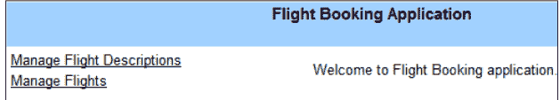

- 3. 给定的截图显示了我们的航班预订应用程序的主页，当前允许管理 Flight 和 FlightDescription 对象。选择 **管理航班描述** 超链接允许用户创建和查看 FlightDescription 实例。此外，它还允许用户添加与 FlightDescription 实例关联的子 Flight 实例。**管理航班** 选项允许用户创建和删除 Flight 实例。

- 4. 选择 **管理航班描述** 选项以查看应用程序中的 FlightDescription 实例，如下所示：

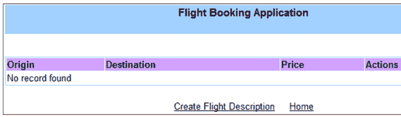

- 5. 由于我们尚未创建任何 FlightDescription 实例，表格显示 **未找到记录** 消息。

- 6. 选择 **创建航班描述** 选项以查看创建新 FlightDescription 实例的表单，如下所示：

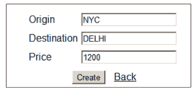

- 7. 按给定截图所示输入 **FlightDescription** 详细信息，然后单击 **创建** 按钮。新创建的 **FlightDescription** 实例将显示在 **FlightDescription** 实例列表中，如下所示：

| 出发地 | 目的地 | 价格 | 操作 |
|---|---|---|---|
| NYC | DELHI | 1200 | 查看 删除 |

- 8. **FlightDescription** 记录对应的 **查看** 按钮显示 **FlightDescription** 详细信息以及与 **FlightDescription** 实例关联的 **Flight** 详细信息。**删除** 按钮将删除 **FlightDescription** 实例以及关联的 **Flight** 实例。

- 9. 单击 **主页** 链接返回应用程序的主页，并选择 **管理航班** 链接以查看 **Flight** 实例，如下所示：

| 航班名称 | 操作 |
|---|---|
| 未找到记录 | |

- 10. 选择 **创建航班** 链接以查看创建 **Flight** 实例的表单，如下所示：

| 字段 | 值 |
|---|---|
| 航班名称 | FLT-100 |
| 航班描述 | NYC - DELHI 仅需 1200 美元 |

- 11. 将 **FLT-100** 输入为 **航班名称** 字段的值，并将 **NYC – DELHI 仅需 1200 美元** 选择为 **航班描述** 字段的值。单击 **创建** 按钮以创建 **Flight** 实例（航班名称为 **FLT-100**），它是 **FlightDescription** 实例（出发地：NYC，目的地：DELHI，价格：1200）的子实例。同样，创建名为 **FLT-200**、**FLT-300** 和 **FLT-400** 的航班。现在，如果您转到 **FlightDescription** 列表页面并单击 **查看** 按钮，则将看到新创建的 **Flight** 实例作为 **NYC-DELHI-1200 FlightDescription** 实例的子实例，如下所示：

| 航班描述 | | |
|---|---|---|
| 出发地 | 目的地 | 价格 |
| NYC | DELHI | 1200 |
| 关联航班 | | |
| 航班名称 | | |
| FLT-100 | | |
| FLT-200 | | |
| FLT-300 | | |
| FLT-400 | | |

- 12. 给定的截图显示了与 FlightDescription 实例关联的 Flight 实例。

- 13. 如果您现在通过选择对应于 NYC-DELHI-1200 FlightDescription 实例的 Delete 按钮（如下一个截图所示）来删除 FlightDescription 实例，则它也将删除关联的 Flight 实例。

| 出发地 | 目的地 | 价格 | 操作 |
|---|---|---|---|
| NYC | DELHI | 1200 | 查看 删除 |

## 工作原理

GAE 数据存储是一个非关系型数据库，其中实体之间的关系被建模为拥有关系或非拥有关系。拥有关系基于父子关系的概念，其中子实例不能在没有父实例的情况下存在。在非拥有关系中，实例可以独立于与其他实体的关系而存在。

拥有关系最好可视化为树结构，其中树的根是一个实体实例，是所有实体的最终父实例。以下图示展示了一个拥有关系的示例，其中 FlightDescription 是根实体，Flight 实体实例为其子实例，Booking 实体实例是 Flight 实体的子实例。

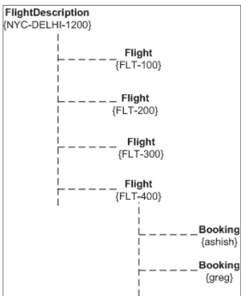

在给定的图中，FlightDescription (NYC-DELHI-1200) 位于树的根部。Flight 实例 (FLT-100, FLT-200, FLT-300, FLT-400) 是 FlightDescription (NYC-DELHI-1200) 实例的子实例。Booking (ashish, greg) 实例是 Flight (FLT-400) 实例的子实例。如果在 App Engine 数据存储中存储的实体定义了这种父子关系，则这些实体被称为属于同一实体组。您可以将实体组视为树，树顶部是一个根实体，该根实体没有任何父实例。在此图中，FlightDescription (NYC-DELHI-1200) 表示根实体。关于拥有关系的另一个重要点是，除了根实体外，实体组中的所有其他实体都不能在没有父实例的情况下创建。例如，Flight 实体实例不能在没有 FlightDescription 实例的情况下存在，Booking 实例不能在没有 Flight 实例的情况下存在。

在 GAE 中，创建拥有关系会限制您可以为子实体定义的主键类型。其原因是，子实体实例除了需要知道其自身实体 ID 外，还需要知道其在实体组中的父实例。拥有关系中子实体的主键类型为 com.google.appengine.api.datastore.Key 或 com.google.appengine.api.datastore.Key 的编码字符串形式。GAE 提供了一个 KeyFactory 类（将在本示例后面讨论），您可以使用它来创建 Key 实例，或将 Key 实例值转换为字符串（称为 Key 的编码形式）并反之亦然。


在非拥有关系中，每个实体实例相互独立存在。例如，Student 和 Course 实体之间的关系是非拥有关系的一个示例。Student 实体可以在没有 Course 的情况下存在，Course 实体也可以在没有 Student 的情况下存在。

在我们的航班预订应用程序中，FlightDescription 和 Flight 实体之间的关系是拥有关系的一个示例，其中 Flight 实体实例不能在没有 FlightDescription 实例的情况下存在。让我们现在看看在航班预订应用程序中，FlightDescription 和 Flight 实体之间是如何创建拥有的一对多关系的。

## 拥有关系

下面的代码清单显示了 FlightDescription 实体的一些重要方法和属性：

```java
import com.google.appengine.api.datastore.Key;
import com.google.appengine.api.datastore.KeyFactory;

@Entity
public class FlightDescription {
	@Id
	@GeneratedValue(strategy = GenerationType.IDENTITY)
	@Basic
	private Key flightDescriptionId;

	@Basic
	@NotNull
	private String origin;
	...

	@OneToMany
	private List<Flight> flights;

	...

	@Transactional
	public void persist() {
		if (this.entityManager == null)
			this.entityManager = entityManager();
		this.entityManager.persist(this);
	}

	@Transactional
	public static FlightDescription
	findFlightDescription(String key) {
		return
		(FlightDescription)entityManager().createQuery("select o
		from FlightDescription o where o.flightDescriptionId =
		:id").setParameter("id",
		KeyFactory.stringToKey(key)).getSingleResult();
	}
	...
	public String getFlightDescriptionKeyAsString() {
		return KeyFactory.keyToString(flightDescriptionId);
	}
	...
}
```

给定的代码显示，FlightDescription 实体的主键类型为 com.google.appengine.api.datastore.Key。Key 不仅保存实体的主键，还保存实体实例所属实体组的信息。由于 FlightDescription 表示一个根实体（即没有父实体），Key 字段不会包含实体组信息。带有 @OneToMany 注解的 flights 字段定义了 FlightDescription 和 Flight 实体之间的拥有关系。

如果是非拥有关系，flights 字段将采用以下形式：

```
private List<Key> flights;
```

在这里，flights 字段引用 Flight 实体实例的主键。此外，该字段没有使用 @OneToMany 注解。

FlightDescription 实体的 findFlightDescription 方法接受 Key 的编码 String 值，以查找匹配的 FlightDescription。KeyFactory 类提供 keyToString 和 stringToKey 方法，用于在 Key 与其编码的 String 形式之间进行相互转换。当你通过 Web 应用程序的用户界面在实体之间创建关系时，这尤其有用。用于获取 FlightDescription 对象的查询使用了 KeyFactory 类，从其 String 表示形式获取 Key 并将其作为查询的一部分，如下所示：

```
entityManager().createQuery("select o
from FlightDescription o where o.flightDescriptionId =
:id").setParameter("id",
KeyFactory.stringToKey(key)).getSingleResult();
```

FlightDescription 的 persist 方法表明，你不需要设置主键的值。它由 App Engine 设置。

FlightDescription 实体的 getFlightDescriptionKeyAsString 方法使用 KeyFactory 类将实体的主键作为编码的 String 值返回。

让我们现在看看如何对 Flight 实体进行建模。

下面的代码清单显示了 Flight 实体值得注意的属性和方法：

```java
@Entity
public class Flight {

    @Id
    @GeneratedValue(strategy = GenerationType.IDENTITY)
    @Basic
    private Key flightId;

    @Basic
    @NotNull
    private String flightName;

    private transient String encodedFlightDescriptionId;

    @Transactional
    public void persist() {
        if (this.entityManager == null)
            this.entityManager = entityManager();

        Key parentKey = KeyFactory.stringToKey(
            encodedFlightDescriptionId);

        Key flightKey = KeyFactory.createKey(parentKey,
            Flight.class.getSimpleName(), flightName);

        setFlightId(flightKey);
        this.entityManager.persist(this);
    }

    public String getEncodedFlightDescriptionId() {
        return encodedFlightDescriptionId;
    }

    public String getFlightKeyAsString() {
        return KeyFactory.keyToString(flightId);
    }
}
```

在给定的代码中，`flightId` 表示 `Flight` 实体的主键。`Flight` 实体的 `persist` 方法使用 `KeyFactory` 类的 `createKey` 方法来创建主键。`createKey(parent, kind, name)` 方法接受 **父** 实体的主键信息（在 `Flight` 实体的情况下，`FlightDescription` 是父实体）、**种类**（类似于关系型数据库中表的概念）以及用于在 **种类** 中唯一标识实体的键的 **名称**。对于 `Flight` 实体的主键，`种类` 指的是实体类的简单名称：`Flight.class.getSimpleName()`，键的 `名称` 是 `Flight` 实体的 `flightName` 属性。因此，如果你使用 `flightName` 为 `FLT-100` 重新创建一个 `Flight` 实体，它将覆盖现有的 `Flight (FLT-100)` 实体实例。GAE datastore 不支持复合主键，但你可以通过在创建键的 `名称` 时串联多个实体字段值来实现此目的。

`encodedFlightDescriptionId` 是作为 `Flight` 实体实例父实体的 `FlightDescription` 主键的 `String` 形式。当用户从用户界面中选择 `FlightDescription` 以创建 `Flight` 实例时，将设置 `encodedFlightDescriptionId` 的值，如下所示：

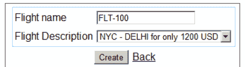

与 `FlightDescription (NYC-DELHI-1200)` 实体实例对应的 `<option>` 元素呈现如下所示：

```
<option value="<string value of Key>">NYC-DELHI for only 1200 USD</option>
```

`value` 属性指定了 `FlightDescription` 主键（类型为 `Key`）的 `String` 形式。因此，当用户单击 **创建** 按钮时，`Key` 的 `String` 值将绑定到 `Flight` 实例的 `encodedFlightDescriptionId` 字段。

`flightapp-gae-spring-mvc` 项目包含 `KeyEditor` 属性编辑器类，该类使用 `KeyFactory` 在 `Key` 与 `String` 格式之间执行相互转换。使用此属性编辑器而不是 Spring `ConversionService` 实现，是因为 `ConversionService` 实现目前无法与 Spring `form` 标签库的 `<options>` 标签一起工作。

让我们现在看看如何使用 Admin Console 管理 GAE datastore 中持久化的数据。

## 使用 Admin Console 管理持久化数据

你可以使用 Admin Console 查看、编辑和删除应用程序在 GAE datastore 中持久化的数据。转到 http://appengine.google.com 并登录，以查看你创建的应用程序，如下所示：

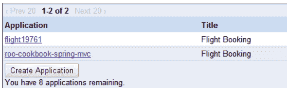

给定的屏幕截图显示了我在 GAE 中创建的两个应用程序。roo-cookbook-spring-mvc 应用程序对应我们在本示例中看到的应用程序。选择该应用程序将显示该应用程序的 Dashboard，你可以在其中查看与应用程序相关的不同统计信息。我们只关心查看在 datastore 中保存的数据，因此从 Dashboard 中选择 Datastore Viewer 选项。Datastore Viewer 显示你在 datastore 中保存的实体，如下一个屏幕截图所示：

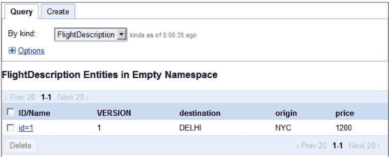

给定的屏幕截图显示了我们创建的 `FlightDescription` kind 的数据。你可以使用 **查询** 选项卡使用 **GQL** 查询 datastore。你也可以删除或编辑实体实例。如果将 `kind` 更改为 `Flight`，则 Admin Console 将显示你创建的 `Flight` 实体，如下所示：

| □ | ID/名称 | 版本 | 航班名称 |
|---|---|---|---|
| □ | name=FLT-100 | 1 | FLT-100 |
| □ | name=FLT-200 | 1 | FLT-200 |
| □ | name=FLT-300 | 1 | FLT-300 |
| □ | name=FLT-400 | 1 | FLT-400 |

给定的屏幕截图显示，为 `Flight` 实例主键设置的 `name` 在 **ID/名称** 列下显示。

## 更多内容...

如果你正在为 App Engine 设计实体，请注意，在事务内你只能操作属于同一实体组的实体。因此，如果你有属于不同实体组的 `Student` 和 `Course` 实体，则无法在单个事务中创建或更新它们。

从 Spring Roo 1.1.3 开始，你只能在实体之间创建 _非拥有_ 关系。例如，如果你使用 `field reference` 或 `field set` 命令添加关系字段，那么与 JPA 实体对应的 `*_Roo_JavaBean.aj` AspectJ ITD 文件会从 JPA 实体 Java 源文件的相应字段中移除 `@OneToMany`、`@OneToOne`、`@ManyToOne` 或 `@ManyToMany` 注解，从而产生一个 _非拥有_ 关系。下面的代码片段展示了 AspectJ ITD 文件如何从 Java 源文件中移除关系注解：

```
privileged aspect FlightDescription_Roo_JavaBean {

declare @field: * FlightDescription.flights: -@OneToMany;
...
}
```


给定代码显示，如果 FlightDescription 和 Flight 实体是使用 Spring Roo 创建的，那么 FlightDescription 的 flights 字段（指代 Flight 实体集合）上的 @OneToMany 注解将被 FlightDescription_Roo_JavaBean.aj AspectJ ITD 文件删除。减号 (-) 表示 @OneToMany 注解将从 FlightDescription.java 文件中删除。

## 另请参阅

- 参阅《在 GAE 上部署 GWT 应用程序》示例，查看 App Engine 上 GWT 应用程序的示例

## 使用 Solr 为领域模型添加搜索功能

Apache Solr 是一个构建在 Apache Lucene 搜索引擎库之上的开源搜索平台。Spring Roo 的 Solr 插件提供了将 Roo 生成的领域模型与 Solr 平台集成的支持。在本示例中，我们将了解 Roo 如何使用 SolrJ Java 客户端库将领域模型数据添加到 Solr 服务器中以建立索引，并根据用户提供的查询参数搜索领域模型数据。

## 准备工作

要查看 Roo 对 Solr 的支持，您需要下载并运行 Solr 服务器，具体步骤如下：

- 1. 从 Solr 网站下载 Solr 服务器 1.4.0 版 ZIP 文件，并将包解压到一个目录。将解压后的目录称为 SOLR_HOME。
- 2. 进入 SOLR_HOME\example 目录并启动 Solr 服务器：
  C:...\apache-solr-1.4.0\example> java -jar start.jar
- 3. 打开网页浏览器，通过访问以下 URL 验证 Solr 服务器是否已成功启动：http://localhost:8983/solr/admin/

现在，在 C:\roo-cookbook 目录中创建一个名为 ch06-solr 的子目录，复制 ch06_web_app.roo 脚本，并从 C:\roo-cookbook\ch06-solr 启动 Roo shell。

## 操作步骤

按照以下步骤添加搜索功能：

- 1. 执行 ch06_solr.roo 脚本，如下所示：
  roo> script --file ch06_web_app.roo

该脚本创建一个包含 Flight 和 FlightDescription JPA 实体的 flightapp-web Roo 项目。

- 2. 使用 solr setup 命令为 flightapp-web 项目设置 Solr：

```
roo> solr setup
```

```
Updated ROOT\pom.xml [Added dependency org.apache.solr:solr-solrj:1.4.0]
Created SRC_MAIN_RESOURCES\META-INF\spring\solr.properties
Updated SRC_MAIN_RESOURCES\META-INF\spring\applicationContext.xml
```

- 3. 通过执行 solr all 命令使项目中的所有 JPA 实体可搜索，如下所示：

```
roo> solr all
```

```
Updated SRC_MAIN_JAVA\...\FlightDescription.java
Updated SRC_MAIN_JAVA\...\Flight.java
Created SRC_MAIN_JAVA\...\Flight_Roo_SolrSearch.aj
Created SRC_MAIN_JAVA\...\FlightDescription_Roo_SolrSearch.aj
```

- 4. 创建一个负责搜索 Solr 文档的控制器，如下所示：

```
roo> controller class --class ~.web.FlightDescriptionSearchController --preferredMapping /flightdescriptionsearch
```

```
Created SRC_MAIN_JAVA\...\FlightDescriptionSearchController.java
Created SRC_MAIN_WEBAPP\WEB-INF\views\flightdescriptionsearch
Created SRC_MAIN_WEBAPP\WEB-INF\views\flightdescriptionsearch\index.jspx
```

将随本章附带的源代码中的 MySolrField.java 和 FlightDescriptionSearchController.java 文件复制到 sample.roo.flightapp.web 包中。此外，使用随本章附带的源代码中的 index.jsp 文件替换 /WEB-INF/views/flightdescriptionsearch/index.jsp。

- 5. 执行 perform eclipse 命令，以便将 flightapp-web 项目导入到 Eclipse IDE 中，如下所示：

```
roo> perform eclipse
```

- 6. 退出 Roo shell，并在 ch06-solr 目录中执行 Maven Tomcat 插件的 tomcat:run 目标，将 flightapp-web 项目部署到嵌入式 Tomcat 容器中，如下所示：

```
C:\roo-cookbook\ch06-solr> mvn tomcat:run
```

7. 打开网页浏览器并访问 http://localhost:8080/flightapp-web。如果看到以下 Web 应用程序主页，则表示 flightapp-web 项目已成功部署到 Tomcat：

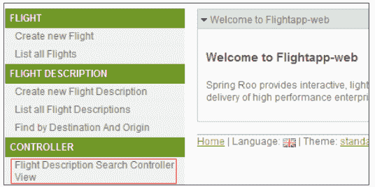

在给定的截图中，Flight Description Search Controller View 菜单选项会向 FlightDescriptionSearchController 类发送请求，该类随后呈现位于 /WEB-INF/views/flightdescriptionsearch 文件夹中的 index.jsp 页面。

8. 此时，请确保 Solr 服务器已启动并运行。现在，选择 Create new Flight Description 菜单选项以查看在数据库中创建新 FlightDescription 实体的表单，如下所示：

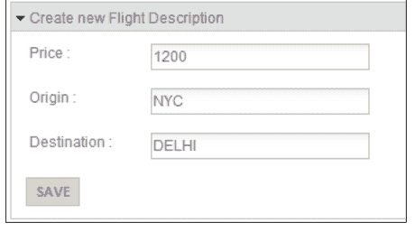

给定的截图显示，您需要输入以下字段的信息：Price、Origin 和 Destination。使用以下表格中显示的信息创建两个 FlightDescription 实例：

| 实例 | 价格 | 起点 | 目的地 |
|---|---|---|---|
| Instance-1 | 1200 | NYC | DELHI |
| Instance-2 | 1400 | MUMBAI | ATLANTA |

- 9. 当您创建 `FlightDescription` 实体实例时，Roo 的 Solr 支持会将实体数据添加到 Solr 中以进行索引和搜索。选择 **航班描述搜索控制器视图** 菜单选项，该选项会搜索 Solr 服务器中包含名为 `flightdescription_solrsummary_t` 字段的文档，并以表格形式显示，如下所示：

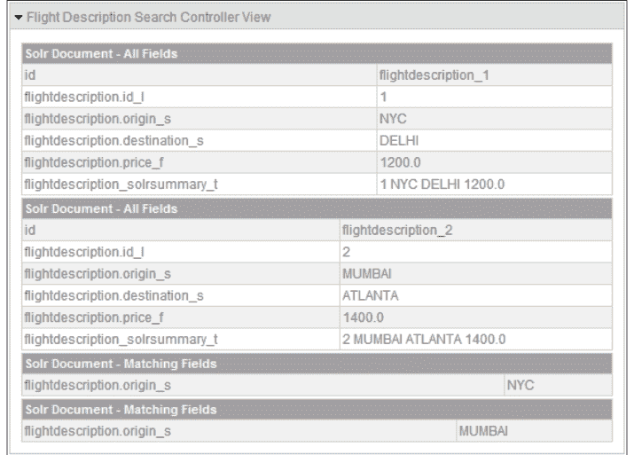

- 10. 给定的截图显示四个表：其中两个标题为 **Solr 文档 – 所有字段**，其余两个标题为 **Solr 文档 – 匹配字段**。标题为 **Solr 文档 – 所有字段** 的表显示包含 `flightdescription_solrsummary_t` 字段的 Solr 文档的所有字段，而标题为 **Solr 文档 – 匹配字段** 的表仅显示包含 `flightdescription_solrsummary_t` 字段的 Solr 文档的 `flightdescription.origin_s` 字段。

我们将在 *操作原理...* 部分回到这些字段，了解幕后工作原理。

## 工作原理

Solr 搜索平台与 Roo 生成的领域模型之间的集成通过以下方式实现：

- 为 Roo 项目配置 Solr
- 定义将领域模型数据添加到 Solr 索引的方法
- 定义查询 Solr 搜索服务器的方法

现在，让我们来看看 Roo 如何简化 Solr 集成。

## 为 Roo 项目配置 Solr

solr setup 命令为 Roo 项目配置 Solr。执行 solr setup 命令时，Roo 将执行以下操作：

- 在 pom.xml 文件中添加项目对 SolrJ 1.4.0 的依赖。JPA 实体使用 SolrJ 将实体数据添加到 Solr 索引并查询 Solr 搜索服务器。

- 通过在 applicationContext.xml 文件中添加 Spring 任务命名空间的 <annotation-driven> 元素，启用项目对 @Async 注解方法的支持，如下所示：

```
<task:annotation-driven executor="asyncExecutor"
    mode="aspectj" />
```

executor 属性指 java.util.concurrent.Executor 接口的实现，负责执行 @Async 注解的方法。

- 通过使用 Spring 任务命名空间的 <executor> 元素在 applicationContext.xml 中配置 Spring 的 ThreadPoolTaskExecutor，如下所示：

```
<task:executor id="asyncExecutor"
    pool-size="${executor.poolSize}" />
```

Spring 的 ThreadPoolTaskExecutor 配置一个 java.util.concurrent.ThreadPoolExecutor 实例（java.util.concurrent.Executor 的实现），其线程池大小由 pool-size 属性值指定。${executor.poolSize} 占位符的值来自 solr.properties 文件。

- 在 applicationContext.xml 文件中配置 SolrJ 的 CommonsHttpSolrServer 实例（SolrJ SolrServer 抽象类的子类），以允许 JPA 实体通过 HTTP 协议与 Solr 搜索服务器交互：

```
<bean class="org.apache.solr.client.solrj.impl.CommonsHttpSolrServer" id="solrServer">
    <constructor-arg value="${solr.serverUrl}" />
</bean>
```

幕后，CommonsHttpSolrServer 使用 Apache Commons HttpClient 与 Solr 搜索服务器进行交互。CommonsHttpSolrServer 的构造函数接受 Solr 搜索服务器的 URL 作为参数。`<constructor-arg>` 元素将构造函数参数的值指定为 `${solr.serverUrl}`，它引用 `solr.properties` 文件中定义的 `solr.serverUrl` 属性。

- 在 `SRC_MAIN_RESOURCES\META-INF\spring\` 目录中创建一个 `solr.properties` 文件。该属性文件定义了一个 `executor.poolSize` 属性，用于指定 `ThreadPoolExecutor` 所需的线程池大小，如下所示：

```
executor.poolSize=10
```

`solr.properties` 文件还包含一个 `solr.serverUrl` 属性，用于标识 Solr 搜索服务器运行的 URL，如下所示：

```
solr.serverUrl=http://localhost:8983/solr
```

如果 Solr 服务器运行在不同的主机或端口上，请更改 `solr.properties` 文件中的 URL，或使用 `solr` setup 命令的 `searchServerUrl` 参数来指定 Solr 搜索服务器 URL。

## 将领域模型数据添加到 Solr 索引并搜索 Solr 文档

假设您想搜索 `origin` 字段为 NYC 的 `FlightDescription` 实例。您可以针对持久化 `FlightDescription` 实例的数据库执行此搜索，也可以将 `FlightDescription` 实例数据添加到 Solr 索引并针对其进行搜索。我们将了解 Roo 如何支持将实体实例数据添加到 Solr 索引，并在下一部分中了解如何在 Solr 搜索服务器中查询这些数据。

虽然有多种方法可以将数据推送到 Solr，但 Roo 使用 SolrJ 客户端库与 Solr 搜索服务器进行交互。执行 `solr all` Roo 命令时，它会通过 AspectJ ITD 向 JPA 实体类添加某些方法，当实体被添加、删除或更新时触发这些方法。这些方法负责使用 SolrJ 客户端库从 Solr 索引中添加、更新和删除实体数据。

执行 `solr all` 命令时，Roo 将执行以下操作：

- 向 JPA 实体类添加 `@RooSolrSearchable` 注解，以触发创建相应的 `*_Roo_SolrSearch.aj` AspectJ ITD 文件。

以下代码清单显示了执行 `solr all` 命令后 `flightapp-web` 项目的 `FlightDescription` JPA 实体：

```
@RooEntity(identifierColumn = "FLIGHT_DESC_ID", table = "FLIGHT_DESC_TBL", finders = { "findFlightDescriptionsByDestinationAndOrigin" })
```


@RooSolrSearchable
public class FlightDescription {
...
}
```

给定代码显示，@RooSolrSearchable 注解已添加到 FlightDescription 实体。如果你查看 Flight 实体，你会发现 @RooSolrSearchable 注解也已添加到它。

- 创建一个 *_Roo_SolrSearch.aj AspectJ ITD 文件（对应于项目中的每个 JPA 实体。_*_Roo_SolrSearch.aj）将方法引入 JPA 实体类，用于从 Solr 索引中添加、更新和删除实体。另外，_*_Roo_SolrSearch.aj 定义用于使用 SolrJ 客户端库查询 Solr 服务器的方法。

## *_Roo_SolrSearch.aj AspectJ ITD 引入的方法和属性

让我们现在来看看 FlightDescription_Roo_SolrSearch.aj 文件引入的方法和属性：

- solrServer 属性指向在 applicationContext.xml 文件中配置的 CommonsHttpSolrServer bean，如下所示：

```java
@Autowired
transient SolrServer FlightDescription.solrServer;
```

- solrServer()：一个静态方法，返回 ITD 文件引入的 solrServer 属性，如下所示：

```java
public static final SolrServer FlightDescription.solrServer() {
    SolrServer _solrServer = new FlightDescription().solrServer;
    ..
    return _solrServer;
}
```

- indexFlightDescriptions：一个静态方法，将 FlightDescription 实体实例的集合添加到 Solr 索引中，如下所示：

```java
import org.springframework.scheduling.annotation.Async;
...
@Async
public static void FlightDescription.indexFlightDescriptions
(Collection<FlightDescription> flightdescriptions) {
    java.util.List<SolrInputDocument> documents =
    new java.util.ArrayList<SolrInputDocument>();
    
    for (FlightDescription flightdescription :
    flightdescriptions) {
        SolrInputDocument sid = new SolrInputDocument();
        sid.addField("id", "flightdescription_" +
                flightdescription.getId());
        sid.addField("flightdescription.id_l",
                flightdescription.getId());
        sid.addField("flightdescription.origin_s",
                flightdescription.getOrigin());
        ...
        sid.addField("flightdescription.price_f",
                flightdescription.getPrice());
        sid.addField("flightdescription_solrsummary_t", ...);
        documents.add(sid);
    }
    try {
        SolrServer solrServer = solrServer();
        solrServer.add(documents);
        solrServer.commit();
    } catch (Exception e) {
        e.printStackTrace();
    }
}
```

给定代码显示，indexFlightDescriptions 方法标注了 Spring 的 @Async 注解，这意味着它是异步调用的。该方法遍历所有 FlightDescription 实例（作为方法参数传递）并创建一个 SolrInputDocument 列表。SolrJ 的 SolrInputDocument 类表示你想要馈送到 Solr 服务器以进行索引的文档。SolrInputDocument 的 addField 方法标识你想要添加到文档的字段。

Roo 添加到 SolrInputDocument 的字段名具有以下命名约定：
<entity-simple-name>.<field-name>_<field-type>

这里，entity-simple-name 是 JPA 实体的简单名称，field-name 是字段的名称，field-type 是字段的类型。因此，origin 字段以 flightdescription.origin_s 的名称添加到 SolrInputDocument，price 字段以 flightdescription.price_f 的名称添加。

如果 JPA 实体字段类型不是 Integer、String、Long、Boolean、Float、Double 或 Date，则 JPA 实体字段添加到 SolrInputDocument 时的字段名如下所示：
<entity-simple-name>.<field-name>_t

例如，`flightapp-web` 项目中的 `Flight` 类包含类型为 `FlightDescription` 的 `flightDescription` 关系字段，该字段以 `flight.flightdescription_t` 的名称添加到 `SolrInputDocument`（参考 `Flight_Roo_SolrSearch.aj` AspectJ ITD 文件）。

你可能会想知道，为什么 Roo 不使用确切名称将 JPA 实体字段添加到 `SolrInputDocument` 中。以下是 Solr 工作原理的简要说明：

`SolrInputDocument` 表示你要添加到 Solr 搜索服务器的文档。该文档由字段组成，你需要告诉 Solr 搜索服务器，其中哪些字段应该被 **索引**。需要注意的是，如果某个字段 *未* 被索引，则你无法基于该字段搜索或排序文档。你通过在 `SOLR_HOME\example\solr\conf` 目录中的 `schema.xml` 文件中指定字段，告诉 Solr 搜索服务器文档的哪些字段应该被索引。Solr 具有动态字段的概念，即如果字段遵循标准命名约定，则它会被 Solr 搜索服务器自动索引。`schema.xml` 文件中的以下 XML 片段定义了将由 Solr 自动索引的动态字段：

```xml
<dynamicField name="*_s" type="string" indexed="true" stored="true"/>
<dynamicField name="*_l" type="long" indexed="true" stored="true"/>
<dynamicField name="*_t" type="text" indexed="true" stored="true"/>
<dynamicField name="*_f" type="float" indexed="true" stored="true"/>
```

给定的 XML 片段指示 Solr 索引与模式 `*_s`、`*_l`、`*_t` 或 `*_f` 匹配的任何字段。因此，现在你可以看到 Roo 生成的字段名与 Solr 定义的动态字段之间的联系。

indexFlightDescriptions 方法还向 `SolrInputDocument` 添加了一个 `id` 字段名。任何 SolrInputDocument 必须包含一个名为 id 的字段，该字段在 Solr 索引中 *唯一* 标识文档。默认情况下，Roo 将 id 字段的值设置为 "flightdescription_" + flightdescription.getId()。我们将在本节后面看到，此 id 字段值用于从 Solr 索引中删除文档。

indexFlightDescriptions 方法还在 SolrInputDocument 中添加了一个额外字段 flightdescription_solrsummary_t，以便可以用于搜索 Solr 为 FlightDescription JPA 实体索引的所有文档。同样，Flight_Roo_SolrSearch.aj AspectJ ITD 的 indexFlightDescriptions 方法在 SolrInputDocument 中添加 flight_solrsummary_t 字段，以允许搜索 Solr 为 Flight JPA 实体索引的文档。

`indexFlightDescriptions` 方法中的以下代码将 `SolrInputDocument`s 添加到 Solr 索引：

```java
SolrServer solrServer = solrServer();
solrServer.add(documents);
solrServer.commit();
```

- indexFlightDescription：一个静态方法，将 FlightDescription 实体实例添加到 Solr 索引，如下所示：

```java
public static void
FlightDescription.indexFlightDescription(FlightDescription
flightdescription) {
List<FlightDescription> flightdescriptions =
new ArrayList<FlightDescription>();
flightdescriptions.add(flightdescription);
indexFlightDescriptions(flightdescriptions);
}
```

如给定代码所示，indexFlightDescription 方法将将 FlightDescription 实例添加到 Solr 索引的责任委托给 indexFlightDescriptions 方法。

- deleteIndex：一个静态方法，删除与 FlightDescription JPA 实体实例对应的 Solr 文档，如下所示：

```java
@Async
public static void
FlightDescription.deleteIndex(FlightDescription
flightdescription) {
SolrServer solrServer = solrServer();
try {
solrServer.deleteById("flightdescription_" +
flightdescription.getId());
solrServer.commit();
} catch (Exception e) {
e.printStackTrace();
}
}
```

在给定代码中，SolrServer 的 deleteById 方法删除（从 Solr 索引中）id 属性值为 "flightdescription_" + flightdescription.getId() 的文档。Spring 的 @Async 注解意味着 deleteIndex 方法被异步调用。

- postPersistOrUpdate 方法，当 FlightDescription JPA 实体实例在数据库中被持久化或更新时调用。该方法负责使用修改后的 JPA 实体实例数据添加或更新 Solr 索引，如下所示：

```java
import javax.persistence.PostPersist;
import javax.persistence.PostUpdate;
...
@PostUpdate
@PostPersist
private void FlightDescription.postPersistOrUpdate() {
    indexFlightDescription(this);
}
```

@PostUpdate 和 @PostPersist JPA 注解表明，当 FlightDescription JPA 实体在数据库中被更新或持久化时，将调用 postPersistOrUpdate 方法。对 indexFlightDescription 方法的调用表明，实体数据已更新或添加到 Solr 索引。

- preRemove 方法，通过调用 deleteIndex 方法从 Solr 索引中删除实体数据：

```java
import javax.persistence.PreRemove;
...
@PreRemove
private void FlightDescription.preRemove() {
    deleteIndex(this);
}
```

@PreRemove JPA 注解意味着，preRemove 方法在 JPA 实体实例从数据库中删除之前被调用。

- search(SolrQuery query) 方法，允许搜索与搜索查询匹配的 Solr 文档：

```java
public static QueryResponse FlightDescription.search(SolrQuery
query)
    {
        try {
            return solrServer().query(query);
        } catch (Exception e) {
            e.printStackTrace();
        }
    return new QueryResponse();
}
```


SolrQuery 表示一个查询对象，其中包含执行搜索所依据的字段信息、要返回的字段等。SolrServer 的 query 方法使用 Apache Commons HttpClient 将搜索请求发送到 Solr 搜索服务器，并返回一个 QueryResponse 对象，你可以从中提取与搜索查询匹配的 Solr 文档。

- search(String) 方法，仅返回 Solr 搜索服务器中与 FlightDescription 实体对应的 Solr 文档：

```
public static QueryResponse FlightDescription.search(String queryString) {
 String searchString = 
 "FlightDescription_solrsummary_t:" + queryString;
 return search(new SolrQuery(searchString.toLowerCase()));
}
```

在给定代码中，SolrQuery 对象是使用 searchString 创建的。searchString 指定用于查找匹配 Solr 文档的 Solr 查询。由于 searchString 已经包含常量值 "FlightDescription_solrsummary_t:"，这意味着你只能搜索包含 "FlightDescription_solrsummary_t" 字段的 Solr 文档。如果你还记得之前的讨论，"FlightDescription_solrsummary_t" 字段仅在与 FlightDescription 实体对应的 Solr 文档中可用。

现在让我们来看看 FlightDescriptionSearchController 控制器如何使用 FlightDescription JPA 实体中定义的搜索方法来搜索由 Solr 搜索服务器索引的文档。

### 搜索 Solr 文档

FlightDescriptionSearchController 定义了用于搜索与 FlightDescription 实体对应的 Solr 文档的方法。以下代码清单显示了 FlightDescriptionSearchController 类：

```
@Controller
public class FlightDescriptionSearchController {
 private List<List<MySolrField>> getAllFields() {
 QueryResponse response = FlightDescription.search("*");
 SolrDocumentList documentList = response.getResults();
 return getSolrDocumentFieldList(documentList);
 }

 private List<List<MySolrField>> getMatchingFields() {
 SolrQuery solrQuery = new SolrQuery().
 setQuery("flightdescription_solrsummary_t:*").
 setParam("fl", "flightdescription.origin_s");
 QueryResponse response =
 FlightDescription.search(solrQuery);
 SolrDocumentList documentList = response.getResults();
 return getSolrDocumentFieldList(documentList);
 }

 private List<List<MySolrField>>
 getSolrDocumentFieldList(SolrDocumentList list) {
 List<List<MySolrField>> matchingDocList
 = new ArrayList<List<MySolrField>>();
 ...
 return matchingDocList;
 }
}
```

getAllFields 方法调用 FlightDescription 实体的 search(String queryString) 方法，并将 * 作为方法参数传递。如我们之前所见，FlightDescription 的 search(String queryString) 方法将创建以下查询："FlightDescription_solrsummary_t:*"，这意味着搜索包含 "FlightDescription_solrsummary_t" 字段的所有 Solr 文档。此查询将返回我们添加到 Solr 索引中的与 FlightDescription 实体对应的所有 Solr 文档。

getMatchingFields 方法调用 search(SolrQuery query) 方法并传递 SolrQuery 对象，该对象查询与 FlightDescription JPA 实体对应的所有 Solr 文档，但指定查询结果应仅包含 flightdescription.origin_s 字段。SolrQuery 的 setQuery 参数指定查询，setParam 指定结果中应仅返回 flightdescription.origin_s 字段。

QueryResponse 对象的 getResults 方法返回 SolrDocumentList，表示查询返回的匹配 Solr 文档列表。

getSolrDocumentFieldList 方法以 SolrDocumentList 作为参数并从中提取 SolrDocument 实例。然后，该方法从每个 SolrDocument 实例中提取字段名和值以创建 List<List<MySolrField>>。MySolrField 表示我们在 flightapp-web 项目中创建的一个自定义类，用于表示 SolrDocument 中的单个字段值对。

/WEB-INF/views/flightdescriptionsearch/index.jsp JSP 页面显示由 getFields 和 getMatchingFields 方法返回的数据。这就是为什么选择 Flight Description Search Controller View 菜单选项会显示两种不同类型的表格。一种表格类型显示所有 Solr 文档字段，另一种表格类型仅显示 flightdescription.origin_s 字段。

### 更多内容……

Solr 索引在带有 @PreRemove、@PostPersist 和 @PostUpdate 注释的方法中更新。那么，如果事务无法提交但实体数据已作为 Solr 文档存储在 Solr 搜索服务器中呢？你需要自己负责维护完整性，因为 Roo 无法帮助你。

现在让我们来看看 @RooSolrSearchable 定义的属性，用于自定义 *_Roo_SolrSearch.aj AspectJ ITD 中 Roo 生成的方法名称。

### 自定义 Roo 生成的 *_Roo_SolrSearch.aj AspectJ ITD

下表描述了 @RooSolrSearchable 注解的属性：

| Attribute | Description |
|---|---|
| deleteIndexMethod | 为 `deleteIndex` 方法指定自定义名称。值为空 "" 指示 Roo 不生成 `deleteIndex` 方法。 |
| indexMethod | 为 `index` 方法指定自定义名称。值为空 "" 指示 Roo 不生成 `index` 方法。 |
| postPersistOrUpdateMethod | 为 `postPersistOrUpdate` 方法指定自定义名称。值为空 "" 指示 Roo 不生成 `postPersistOrUpdate` 方法。 |
| preRemoveMethod | 为 `preRemove` 方法指定自定义名称。值为空 "" 指示 Roo 不生成 `preRemove` 方法。 |
| searchMethod | 为接受 `SolrQuery` 作为参数的 `search` 方法指定自定义名称。值为空 "" 指示 Roo 不生成接受 `SolrQuery` 参数的 `search` 方法。 |
| simpleSearchMethod | 为接受 `String` 作为参数的 `search` 方法指定自定义名称。值为空 "" 指示 Roo 不生成接受 `String` 参数的 `search` 方法。 |
