# 开发加载项并从项目中移除 Roo

在本章中，我们将介绍：

- 为加载项开发设置 GnuPG
- 安装可安装的加载项
- 开发简单的加载项
- 开发高级加载项
- 将非 OSGi JDBC 驱动程序转换为 OSGi 兼容的 bundle
- 通过 push-in 重构移除 Roo
- 通过 pull-out 重构将 Roo 添加到项目
- 升级到最新版本的 Roo

## 简介

在之前的章节中，我们看到执行 Roo 命令会触发 Roo 加载项中的代码生成逻辑。你可能希望为基础或可安装加载项尚不支持的功能创建自定义加载项。例如，目前没有 Roo 加载项支持使用 Spring Portlet MVC 创建 Java portlet。因此，我们可以开发一个 Roo 加载项，它负责从 JPA 实体生成 Spring Portlet MVC 控制器和 JSP。

在本章中，我们将介绍一些示例，展示 Roo 如何简化加载项的安装、开发和发布。此外，我们还将概述 Roo 架构和在开发和测试加载项时会很有用的 Roo 命令。

## 为加载项开发设置 GnuPG

Roo 使用 GnuPG (http://www.gnupg.org/) 对加载项进行签名。加载项签名可确保 Roo 用户仅下载和安装受信任的加载项。Roo 的加载项创建者模块使用其秘密 PGP 密钥对加载项进行签名，并将公共 PGP 密钥发布到公共密钥服务器。Roo 用户需要通过将公共 PGP 密钥添加到 Roo 的密钥存储中，明确告知 Roo 它信任某个加载项。这样，Roo 就可以下载和安装该加载项。如果未将公共 PGP 密钥添加到 Roo 的密钥存储中，则不会下载和安装该加载项。

在本示例中，我们将了解如何安装 GnuPG、创建密钥对（包含秘密密钥和公共密钥）以及将公共密钥发布到公共密钥服务器。

### 准备工作

如果你使用的是 Windows 或 UNIX，请从以下位置下载并安装 GnuPG：http://www.gnupg.org/download/。如果你使用的是 Mac，请从以下位置下载并安装 GnuPG for Mac：http://macgpg.sourceforge.net/。

在 Windows 上安装 GnuPG 将创建以下安装目录：C:\\Program Files\\GNU\\GnuPG。

### 操作步骤

以下步骤将演示如何设置 GnuPG：

1. 打开命令提示符，执行以下 GnuPG `list-secret-keys` 命令以查看你可能之前创建的秘密 PGP 密钥：

```
C:\\Users\\Ashish>gpg --list-secret-keys
gpg: keyring 'C:/Users/Ashish/AppData/Roaming/gnupg\\secring.gpg'
created
```

输出显示，如果未找到 `secring.gpg` 文件，则会创建该文件。`secring.gpg` 文件包含密钥信息。

2. 使用 GnuPG 的 `gen-key` 命令创建包含秘密 PGP 密钥和公共 PGP 密钥的新密钥对，如下所示：

```
C:\\Users\\Ashish>gpg --gen-key
...
Please select what kind of key you want:
```


- (1) RSA 和 RSA（默认）
- (2) DSA 和 Elgamal
- (3) DSA（仅签名）
- (4) RSA（仅签名）
- 你的选择？1
- ...

执行 gen-key 命令会询问多个问题，例如电子邮件 ID、真实姓名、密钥类型和长度等。在被要求选择所需密钥类型时，请选择选项 1（RSA 和 RSA（默认））或 2（DSA 和 Elgamal），因为该密钥可同时用于加密和解密。

最后，系统会要求你提供一个密码短语来保护你的秘密 PGP 密钥。

请记住该密码短语，因为在构建自定义附加组件时需要提供它。

- 3. 要验证密钥对是否已成功创建，请执行 GnuPG 的 list-secret-keys 命令：

```
C:\Users\Ashish>gpg --list-secret-keys
```

```
C:\Users\Ashish\AppData\Roaming\gnupg\secring.gpg
---------------------------------------
sec 2048R/BFB28A4D 2011-04-30
uid Ashish Sarin (This is my key)
<ashish.k.sarin@gmail.com>
ssb 2048R/9FCAFB76 2011-04-30
```

如果看到上述输出，表示你的密钥对已成功生成。sec 密钥 ID 为 BFB28A4D，它代表你的公开 PGP 密钥的密钥 ID，你需要将其发布到公共密钥服务器。

- 4. 现在，使用 GnuPG 的 send-keys 命令发布公钥，如下所示：

```
gpg --send-keys --keyserver hkp://pgp.mit.edu <public-key-id>
```

这里，<public-key-id> 是执行 list-secret-keys 命令时列出的 sec 密钥 ID。在我这里，<public-key-id> 为 BFB28A4D。

## 它的工作原理...

我们了解到，GnuPG 用于创建密钥对并将公开 PGP 密钥发布到公共密钥服务器。由于大多数公共密钥服务器共享密钥，因此你不需要将密钥发送到所有公共密钥服务器。

## 另请参见

- 请参阅“安装可安装的附加组件”一节，了解如何安装附加组件
- 请参阅“开发简单附加组件”一节，了解 Spring Roo 如何使用你的秘密密钥为自定义附加组件签名

## 安装可安装的附加组件

不属于 Spring Roo 发行版一部分的附加组件被称为可安装的附加组件。因此，任何不是基础附加组件的附加组件都是可安装的附加组件。在本示例中，我们将探讨如何安装可安装的附加组件，以及在此过程中遇到的挑战。

## 准备工作

请参阅“为附加组件开发设置 GnuPG”一节，在系统上设置 GnuPG。

在系统中创建新目录 C:\roo-cookbook\ch07-service，并从 ch07-service 目录启动 Roo shell。

执行 ch07_jpa_setup.roo 脚本将创建 flight-app Roo 项目，将 Hibernate 设置为持久性提供程序，并将 MySQL 配置为应用程序的数据库。如果你使用的数据库不是 MySQL，或者连接设置与脚本中指定的不同，请相应地修改脚本。

## 操作步骤

以下步骤将演示如何安装可安装的附加组件：

- 1. 在 Roo shell 中输入以下命令并按 Tab 键：

```
roo> addon install bundle --bundleSymbolicName
```

```
Display all 308 possibilities? (y or n)
```

Roo 会询问是否应显示所有可用附加组件的符号名称。按 Y 键指示 Roo 列出所有附加组件。你会发现列表中有几个 gvNIX (https://code.google.com/p/gvnix/) Roo 附加组件，它们的 bundle 符号名称以 "org.gvnix." 开头。为了本示例的目的，我们将安装 gvNIX Service Management 附加组件，其 bundle 符号名称为 org.gvnix.service.roo.addon。使用 Service Management 附加组件，你可以快速创建企业应用程序的服务层。

- 2. 现在，使用 addon install bundle 命令安装 gvNIX，如下所示：

```
roo> addon install bundle --bundleSymbolicName org.gvnix.service.roo.addon
...
Downloaded 100% of org.gvnix.service.roo.addon-0.6.0.jar.asc

Download URL 'http://gvNIX.googlecode.com/svn/repo/org/gvnix/org.gvnix.service.roo.addon/0.6.0/org.gvnix.service.roo.addon-0.6.0.jar' failed

This resource was signed with PGP key ID '0xC5FC814B', which is not currently trusted
```

输出显示，gvNIX Service Management Roo 附加组件无法下载和安装，因为它是用 PGP 密钥 ID 0xC5FC814B 签名的，而你的 Spring Roo 安装不信任该密钥 ID。

- 3. 使用 pgp trust Roo 命令将 PGP 密钥 ID 0xC5FC814B 添加到 Roo 的密钥库中，如下所示：

```
roo> pgp trust --keyId 0xC5FC814B
```

- 4. 既然我们已告知 Spring Roo 信任用于为 gvNIX Service Management Roo 附加组件签名的 PGP 密钥 ID，现在可以使用 addon install bundle 命令安装 gvNIX Service Management Roo 附加组件，如下所示：

```
roo> addon install bundle --bundleSymbolicName org.gvnix.service.roo.addon
```

```
Target resource(s):
-------------------

gvNIX - Spring Roo - Addon - Services Management (0.6.0)

Deploying...done.

Successfully installed add-on: gvNIX - Spring Roo - Addon - Services Management [version: 0.6.0]
```

输出显示，gvNIX Service Management 附加组件已被 Spring Roo 成功安装，且 gvNIX Service Management 附加组件提供的命令可供 Roo shell 使用。例如，你现在会发现以下 Roo 命令可供 Roo shell 使用：service class、service import ws 和 service operation。

## 它的工作原理...

附加组件列表来自 RooBot 的索引文件。RooBot 是由 VMWare 托管的服务，用于索引公开可用的 OBR（OSGi Bundle Repository）文件。OBR 表示附加组件仓库，OBR 文件是一个 XML 文件（通常名为 repository.xml），包含关于附加组件及其发布 URL 的信息。请注意，OBR 仓库不一定物理托管附加组件，而可能仅提供一个 OBR 文件，其中包含附加组件的详细信息以及发布它们的 URL。开发者为其在自己网站上发布的 Roo 附加组件提供一个 OBR 文件。OBR 文件由 RooBot 索引，RooBot 确保用于下载附加组件的 URL 使用 httpgpg://（而不是 http://）URL 进行签名验证。

每次通过执行 Roo 批处理文件启动 Roo shell 时，Spring Roo 都会下载 RooBot 的索引文件，以便你可以搜索和安装附加组件。重要的是要注意，RooBot 不物理托管附加组件。当你执行 addon search 或 addon list 命令时，Spring Roo 会参考 RooBot 的索引文件来执行可用附加组件的搜索和列表。

当你尝试使用 addon install bundle 或 addon install id 命令安装 Roo 附加组件时，会使用 RooBot 索引文件中附加组件的 httpgpg:// URL 来下载和安装该附加组件。使用 httpgpg:// URL 要求 Spring Roo 首先下载附加组件的 PGP 签名文件（.asc 文件）和 URL，并验证你的 Spring Roo 安装是否信任用于为签名文件签名的 PGP 密钥 ID。如果你的 Spring Roo 安装不信任该 PGP 密钥 ID，它将不尝试下载附加组件。

在本示例中，当我们首次尝试下载 gvNIX Service Management Roo 附加组件时，出现了错误，因为 PGP 签名文件是使用 Spring Roo 安装不信任的 PGP 密钥 ID 签名的。因此，我们使用 pgp trust Roo 命令将 PGP 密钥 ID 添加到 Spring Roo 的密钥库中，并重新尝试下载 gvNIX Service Management Roo 附加组件。Spring Roo 将受信任的密钥存储在用户主目录中的 .spring_roo_pgp.bpg 文件中。

## 更多内容...

需要注意的是，addon 命令（addon info bundle、addon info id、addon install bundle、addon install id、addon list、addon search、addon upgrade）仅适用于已在 RooBot 索引文件中注册的附加组件。例如，你无法搜索或安装未在 RooBot 索引文件中列出的 Roo 附加组件。

## 默认信任附加组件

如果你希望在无需将 PGP 密钥 ID 添加到 Roo 密钥库的情况下下载附加组件，可以执行 pgp automatic trust Roo 命令，如下所示：

```
roo> pgp automatic trust
```

执行 pgp automatic trust 命令会指示 Roo 不验证下载的附加组件 PGP 签名文件是否由受信任的 PGP 密钥 ID 签名。需要注意的是，启用 Roo 的自动 PGP 密钥信任功能可能不安全。

如果你想关闭自动 PGP 密钥信任功能，只需重新执行 pgp automatic trust 命令即可。

## 安装未由 RooBot 索引的附加组件

可能存在这样的场景：Roo 附加组件未在 RooBot 中注册，但你仍想安装和使用它。如果 Roo 附加组件仅供组织内部使用，则你不会将其发布到 RooBot，或者你可能希望在将其注册到 RooBot 之前彻底测试该附加组件。在这种情况下，你需要使用 osgi obr url add 命令将附加组件仓库的 OBR URL 添加到 Roo 安装中，然后执行 osgi obr start 命令下载并安装附加组件。

让我们来看一个示例场景，其中你使用 osgi obr url add 和 osgi obr start 命令下载并安装 Roo 附加组件。

gvNIX (https://code.google.com/p/gvnix/) Google Code 项目提供多个 Roo 附加组件，涉及服务管理（如前所述）、报告、主题等。尽管 gvNIX 附加组件已在 RooBot 中发布，但我们可以直接使用 osgi obr url add 和 osgi obr start 命令下载并安装它们。

要添加托管附加组件的仓库的 OBR URL，你需要找到包含附加组件列表及其发布 URL 的 OBR XML 文件。对于 gvNIX Google Code 项目，OBR 文件名为 repository.xml，位于项目的 repo 目录中。

你可以执行以下步骤，将 gvNIX 项目的 OBR 文件 URL 添加到 Roo 安装中：

- 访问 gvNIX Google Code 项目并选择 Source | Browse 选项以查看 repository.xml 文件。由于我们需要使用 osgi obr url add 命令将此 repository.xml 文件的 URL 添加到 Roo 安装中，请访问 Google Code 上 gvNIX 项目的 Source | Browse 选项，并打开 repo 目录中的 repository.xml 文件。


> Google Code以HTML格式呈现`repository.xml`文件的内容，您在浏览器中现在看到的URL并不是`repository.xml`文件的URL位置。

- 要获取`repository.xml`文件的实际位置，请选择HTML页面右侧菜单中显示的**查看原始文件**链接。您现在在浏览器中看到的URL是 http://gvnix.googlecode.com/svn/repo/repository.xml。

- 现在，如示例所示，将`repository.xml`文件的URL添加到Roo安装中：

```
roo> osgi obr url add --url http://gvnix.googlecode.com/svn/repo/repository.xml
```

如这里所述，您可以向Roo安装添加多个OBR文件URL。添加OBR文件URL后，您可以下载并安装OBR文件中定义的Roo add-on。例如，我们现在可以安装gvNIX项目`repository.xml`文件中列出的add-on，如这里所示为gvNIX项目的Web Report add-on：

```
roo> osgi obr start --bundleSymbolicName org.gvnix.web.report.roo.addon
Target resource(s):
---------------------------------
gvNIX - Spring Roo - Addon - Web Report (0.6.0)
Deploying...done.
```

由于`osgi obr start`命令使用OBR文件中定义的URL下载add-on，因此OBR文件中的下载URL可能使用`http://`而不是`https://`。这可能不安全，因为使用`http://`URL下载add-on时不需要Spring Roo PGP签名验证。

## 另请参阅

- 参阅*开发简单 add-on*教程，了解如何直接安装add-on JAR文件

## 开发简单 add-on

Roo提供一个add-on创建者add-on，可简化自定义add-on的开发。您可以使用add-on创建者暴露的命令来创建简单或高级add-on。

简单add-on旨在向pom.xml文件添加项目依赖项，或向项目添加配置工件。例如，在第4章《使用Spring Web MVC进行Web应用程序开发》中，我们了解到Roo在脚手架Spring Web MVC应用程序时会安装JSP自定义标签。与使用Roo安装的JSP自定义标签不同，您可以创建一个简单的Roo add-on，用根据您的应用程序要求定制的标签替换Roo安装的JSP自定义标签。

另一方面，当您想要创建新的Java类、接口和AspectJ ITD文件时，需要高级add-on。例如，Portlet add-on将从JPA实体脚手架控制器和JSP。

在本教程中，我们将介绍addon create simple命令，它创建一个简单的Roo add-on，用自定义标签替换Roo为Spring MVC应用程序安装的一些标签。我们还将了解如何在Roo项目中使用新创建的add-on。

如第1章《Spring Roo入门》中所述，Roo基于Apache Felix OSGi容器构建，Roo add-on代表OSGi bundle。在本章介绍Roo add-on开发教程的过程中，我们将涉及您需要了解的一些OSGi概念，以便理解add-on的工作原理。

## 准备工作

在您的系统中创建一个新目录C:\\roo-cookbook\\ch07-simple-add-on，并从ch07-simple-add-on目录启动Roo shell。

## 操作步骤...

以下步骤将演示如何开发一个简单add-on：

1. 执行addon create simple命令，如示例所示，以创建com.roo.addon.mysimple add-on项目：

```
roo> addon create simple --topLevelPackage com.roo.addon.mysimple
--description "Mysimple addon" --projectName "Mysimple addon"

Created ROOT\\pom.xml
Created ROOT\\readme.txt
Created ROOT\\legal
Created ROOT\\legal\\LICENSE.TXT

Created SRC_MAIN_JAVA\\...\\MysimpleCommands.java
Created SRC_MAIN_JAVA\\com\\...\\MysimpleOperations.java
Created SRC_MAIN_JAVA\\...\\MysimpleOperationsImpl.java
Created SRC_MAIN_JAVA\\...\\MysimplePropertyName.java
Created ROOT\\src\\main\\assembly\\assembly.xml
Created SRC_MAIN_RESOURCES\com\roo\addon\mysimple\info.tagx
Created SRC_MAIN_RESOURCES\com\roo\addon\mysimple\show.tagx
```

2. 执行perform eclipse命令以创建Eclipse IDE特定的配置文件：

```
roo> perform eclipse
```

3. 现在，将com.roo.addon.mysimple Eclipse项目导入到Eclipse IDE中。

## 工作原理...

addon create simple命令创建一个Roo add-on，该add-on向Roo shell贡献命令，并定义在执行这些命令时被调用的操作。package参数指定add-on的顶级包，也用作add-on项目的名称。addon create simple命令生成以下类和接口，<last-part-of-top-level-package>指的是topLevelPackage参数值中最后一个'.'索引之后的文本。在我们的示例中，topLevelPackage参数值为com.roo.addon.mysimple，这使得<last-part-of-top-level-package>的值为mysimple：

- <last-part-of-top-level-package> Commands.java类：定义add-on向Roo shell贡献的方法
- <last-part-of-top-level-package> Operations.java接口：定义包含与Roo命令对应的大部分处理逻辑的方法
- <last-part-of-top-level-package> OperationsImpl.java类：实现*Operations.java接口
- <last-part-of-top-level-package> PropertyName.java枚举类型：定义传递给Roo命令的参数的可能值

通过addon create simple命令生成的add-on为您提供了自定义add-on开发的起点。生成的add-on不具备太多功能，只是展示您通常会在add-on中创建的类和接口。您需要修改生成的add-on以执行特定于您要求的功能。

让我们首先查看由addon create simple命令创建的、为com.roo.addon.mysimple add-on定义命令和操作的Java类和接口。

### MysimpleCommands类

以下代码清单显示了MysimpleCommands类，该类定义add-on向Roo shell贡献的命令：

```
import java.util.logging.Logger;
import org.apache.felix.scr.annotations.Component;
import org.apache.felix.scr.annotations.Reference;
import org.apache.felix.scr.annotations.Service;
import org.springframework.roo.shell.converters.StaticFieldConverter;

@Component
@Service
public class MysimpleCommands implements CommandMarker {
private Logger log = Logger.getLogger(getClass().getName());

@Reference private MysimpleOperations operations;

@Reference private StaticFieldConverter
staticFieldConverter;

protected void activate(ComponentContext context) {
staticFieldConverter.add(MysimplePropertyName.class);
}

protected void deactivate(ComponentContext context) {
staticFieldConverter.remove(MysimplePropertyName.class);

...
}
```

以下是关于MysimpleCommands类的一些重要注意事项：

- MysimpleCommands类通过带有@CliCommand注解的方法定义mysimple add-on向Roo shell贡献的Roo命令。我们将在本节稍后讨论mysimple add-on贡献的命令。当从shell执行Roo命令时，会导致执行MysimpleCommands类中相应的带有@CliCommand注解的方法。

- MysimpleCommands类使用@Component和@Service Apache Felix注解进行注解。@Component和@Service注解具有源级保留策略，由Apache Felix Maven SCR插件（http://felix.apache.org/site/apache-felix-maven-scr-plugin.html）使用，以生成OSGi的服务组件运行时（SCR）所需的XML配置——SCR负责管理MysimpleCommands组件的生命周期，并将其作为服务注册到OSGi服务注册表。使用@Component和@Service注解对MysimpleCommands进行注解可确保（如有需要）可以从其他Roo add-on访问MysimpleCommands对象（使用@Reference Apache Felix注解）。

- MysimpleCommands类实现Roo的CommandMarker接口。CommandMarker是一个标记接口，即它不声明任何方法。Roo查找实现CommandMarker接口的组件，以识别向Roo shell贡献命令的组件。

- Apache Felix的@Reference注解类似于Spring的@Autowired注解，用于解析组件的服务依赖项。MysimpleOperations和StaticFieldConverter是MysimpleCommands组件的服务依赖项。通过@Reference注解，MysimpleOperations和StaticFieldConverter服务对MysimpleCommands可访问，因为实现MysimpleOperations和StaticFieldConverter接口的类也使用@Service和@Component注解进行注解——这使它们对其他Roo add-on可访问。

- MysimpleOperations定义实现add-on贡献的Roo命令所执行的主要功能的方法。这些方法由MysimpleCommands类中定义的方法调用。

- StaticFieldConverter代表一个Spring Converter，它为从Roo shell传递到MysimpleCommands类中相应@CliCommand注解方法的参数值提供类型安全。

- 由于Roo add-on作为OSGi bundle部署在底层Apache Felix OSGi容器上，activate和deactivate方法分别代表由OSGi容器调用以激活和停用Roo add-on的生命周期方法。对于mysimple add-on，activate方法将MysimplePropertyName枚举类型添加到StaticFieldConverter实现中。在deactivate方法中，mysimple add-on从StaticFieldConverter实现中移除MysimplePropertyName枚举类型。

- 现在我们了解了MysimpleCommands类在mysimple add-on中所扮演的角色，让我们来看看MysimpleCommands类中向Roo shell注册命令并处理从Roo shell执行的这些Roo命令的方法。


## 定义 Roo 命令

以下代码清单显示了 MysimpleCommands 类的方法，这些方法定义了 mysimple 插件暴露的 Roo 命令：

```
import org.springframework.roo.shell.CliCommand;
import org.springframework.roo.shell.CliOption;
...

@Reference private MysimpleOperations operations;

@CliCommand(value = "say hello",
    help = "Prints welcome message to the Roo shell")
public void sayHello(
    @CliOption(key = "name", mandatory = true,
        help = "State your name") String name,
    @CliOption(key = "countryOfOrigin", mandatory = false,
        help = "Country of origin") MysimplePropertyName country) {
    log.info("Welcome " + name + "!");
    ...
}

@CliCommand(value = "web mvc install tags",
    help="Replace default Roo MVC tags used for scaffolding")
public void installTags() {
    operations.installTags();
}
```

在前面的代码中，我们可以看到：

- @Reference 注解按类型执行自动装配，并将引用绑定到实现 MysimpleOperations 接口的服务。由于 MysimpleOperationsImpl 实现了 MysimpleOperations 接口，MysimpleOperationsImpl 对象的引用被注入到 MysimpleCommands 实例中。

- @CliCommand 是 Roo 的方法级注解，用于标识向 Roo shell 贡献命令的方法。value 属性指定由插件向 Roo shell 贡献的命令名称。例如，mysimple 插件向 Roo shell 贡献 say hello 和 web mvc install tags 命令。help 属性指定在执行 help Roo 命令时显示在命令旁边的帮助文本。当从 Roo shell 执行 Roo 命令时，Roo 会执行相应的带 @CliCommand 注解的方法。例如，如果你从 Roo shell 执行 say hello 命令，Roo 会执行 MysimpleCommands 类的 sayHello 方法，该方法使用 Java Logging API 在 Roo shell 上打印欢迎消息。同样，如果你执行 web mvc install tags 命令，Roo 会执行 MysimpleCommands 类的 installTags 方法。installTags 方法会调用 MysimpleOperationsImpl 类的 installTags 方法，该方法将 info.tagx 和 show.tagx 标签文件复制到你的 Roo 项目中。在本教程的后面，我们将详细介绍 MysimpleOperationsImpl 类的 installTags 方法。

- @CliOption 是 Roo 的方法参数级注解，用于指定 Roo 命令接受的参数。key 属性指定命令参数的名称，mandatory 属性指定参数是必选还是可选，help 属性指定与参数关联的帮助文本。例如，say hello 命令接受两个参数——name 和 countryOfOrigin。name 参数是必选的，countryOfOrigin 是可选的。

参数的 Java 类型可以是简单的 String，也可以是复杂类型。对于 say hello 命令，name 参数的类型为 String，countryOfOrigin 的类型为 MysimplePropertyName。Roo 为常见 Java 类型（如 String、Date、Enum、Locale、boolean 等）提供转换器。你也可以创建自定义转换器，并将其作为 OSGi 服务注册到 Roo。Roo 会使用已注册的转换器，将为参数指定的值转换为方法期望的 Java 类型。对于 mysimple 插件，Roo 会将 say hello Roo 命令中 countryOfOrigin 参数输入的值转换为 MysimplePropertyName 类型。在本教程后面，我们将看到，使用 MysimplePropertyName（一个枚举）作为 countryOfOrigin Roo 参数的 Java 类型，可为参数值提供 Tab 补全功能。我们之前看到，MysimplePropertyName 类在 activate 方法中被添加到 StaticFieldConverter 实例中。这样做是为了让 StaticFieldConverter 能够将 say hello Roo 命令中 countryOfOrigin 参数的值转换为 MysimplePropertyName 类型。

现在让我们来看看，如果某些前置条件未满足，如何使 Roo 命令对 Roo shell 不可用。

## 使 Roo 命令不可用

如果某些前置条件未满足，你可能希望使 Roo 命令对 Roo shell 不可用。例如，如果你尚未使用 project 命令创建 Roo 项目，那么 Roo 不允许你使用 persistence setup 命令设置 JPA 持久化提供程序。

- @CliAvailabilityIndicator 是 Roo 的方法级注解，可让你指定 Roo 命令对 Roo shell 可用必须满足的前置条件。以下代码显示了 MysimpleCommands 类中定义 say hello 和 web mvc install tags 命令可用性条件的方法：

```
import org.springframework.roo.shell.CliAvailabilityIndicator;
...
@Reference private MysimpleOperations operations;
...
@CliAvailabilityIndicator("say hello")
public boolean isSayHelloAvailable() {
    return true;
}

@CliAvailabilityIndicator("web mvc install tags")
public boolean isInstallTagsCommandAvailable() {
    return operations.isInstallTagsCommandAvailable();
}
```

在代码中，带 @CliAvailabilityIndicator 注解的方法定义了 say hello 和 web mvc install tags 命令的可用性。@CliAvailabilityIndicator 注解中指定的值标识了用于确定命令可用性而执行该方法的 Roo 命令名称。例如，isSayHelloAvailable 方法定义了 say hello 命令的可用性，isInstallTagsCommandAvailable 方法定义了 web mvc install tags 命令的可用性。带 @CliAvailabilityIndicator 注解的方法的返回类型为 boolean，且该方法必须是公共方法且不接受任何参数。如果带 @CliAvailabilityIndicator 注解的方法返回的值为 true，则表示相应命令可用，否则不可用。

由于 isSayHelloAvailable 方法始终返回 true，say hello 命令对 Roo shell 始终可用。另一方面，isInstallTagsCommandAvailable 方法会查询 MysimpleOperations 实现，以确定 web mvc install tags 命令的可用性。

现在让我们来看看 MysimpleOperationsImpl 类，该类定义了当 mysimple 插件的 Roo 命令从 Roo shell 执行时执行的大部分逻辑。

## MysimpleOperations 接口和 MysimpleOperationsImpl 类

MysimpleOperations 接口定义了三个方法，如下表所示：

| 方法 | 描述 |
|---|---|
| boolean isInstallTagsCommandAvailable() | 检查 SRC_MAIN_WEBAPP/WEB-INF 目录下的 tags 子目录是否存在于你的 Roo 项目中。如果目录存在，则返回 true。 |
| String getProperty(String) | 接受系统属性作为参数并返回其值。 |
| void installTags() | 将 info.tagx 和 show.tagx 标签文件从 mysimple 插件复制到你的 Roo 项目中。 |

MysimpleOperationsImpl 类实现了 MysimpleOperations 接口。MysimpleCommands 类中定义的方法主要将逻辑处理委托给 MysimpleOperations 接口的实现。以下代码显示了 MysimpleOperationsImpl 类（为简洁起见，未显示方法）：

```
import org.springframework.roo.process.manager.FileManager;
import org.springframework.roo.project.ProjectOperations;

@Component
@Service
public class MysimpleOperationsImpl
implements MysimpleOperations {
private static final char SEPARATOR = File.separatorChar;

@Reference private FileManager fileManager;

@Reference private ProjectOperations projectOperations;
... }
```

MysimpleOperationsImpl 类使用了 @Component 和 @Service Apache Felix 注解，这意味着 OSGi 的 SCR 负责管理 MysimpleOperationsImpl 组件的生命周期，并将其作为服务注册到 OSGi 服务注册表中。与 MysimpleCommands 一样，你可以使用 @Reference Apache Felix 注解从其他插件访问 MysimpleOperationsImpl 实例。


Roo 提供许多内置服务，用于简化附加组件开发。FileManager 和 ProjectOperations 类型分别代表 Roo 提供的用于管理文件（如创建、读取、更新文件、撤销功能等）和对 Roo 项目执行操作（如向 pom.xml 文件添加依赖、更新项目类型等）的服务。FileManager 服务和 ProjectOperations 分别由 Roo 的 Process Manager 和 FileManager 核心模块提供。需要注意的是，附加组件与 Roo 中的核心模块不同。核心模块提供 Spring Roo 工具的重要功能，如文件系统监控、向 Roo shell 注册命令等。由附加组件提供的 Roo 命令由 Spring Roo 用户执行以进行代码生成，但由核心模块提供的 Roo 命令主要用于访问 Spring Roo 的内部功能，如获取元数据、设置轮询速度等。

前面我们已经看到，MysimpleOperations 的 isInstallTagsCommandAvailable 方法由 MysimpleCommands 类的 isInstallTagsCommandAvailable 方法调用，用于检查 web mvc install tags 命令的可用性。以下代码展示了 MysimpleOperationsImpl 的 isInstallTagsCommandAvailable 方法：

```
public boolean isInstallTagsCommandAvailable() {
    return
        projectOperations.isProjectAvailable() &&
        fileManager.exists(projectOperations.getProjectMetadata()
        .getPathResolver().getIdentifier(Path.SRC_MAIN_WEBAPP,
        "WEB-INF" + SEPARATOR + "tags"));
}
```

在代码中，isInstallTagsCommandAvailable 方法使用 ProjectOperation 服务来检查 Roo 项目是否存在。该方法还使用 FileManager 服务来检查 Roo 项目的 SRC_MAIN_WEBAPP/WEB-INF 目录中是否存在 tags 子目录。如果 tags 目录不存在或尚未创建 Roo 项目，则该方法返回 false。这意味着，如果尚未创建包含 SRC_MAIN_WEBAPP/WEB-INF 目录中 tags 子目录的 Roo 项目，则 web mvc install tags Roo 命令对 Roo shell 不可用。

前面我们已经看到，MysimpleCommands 的 installTags 方法调用 MysimpleOperations 的 installTags 方法。以下代码展示了由 MysimpleOperationsImpl 类实现的 installTags 方法：

```
import org.springframework.roo.process.manager.MutableFile;
import org.springframework.roo.project.Path;
import org.springframework.roo.project.PathResolver;
import org.springframework.roo.project.ProjectOperations;
import org.springframework.roo.support.util.FileCopyUtils;
import org.springframework.roo.support.util.TemplateUtils;
...
public void installTags() {
    PathResolver pathResolver =
    projectOperations.getProjectMetadata().getPathResolver();

    createOrReplaceFile(..., "info.tagx");
    createOrReplaceFile(..., "show.tagx");
}

private void createOrReplaceFile(String path, String fileName)
{
    String targetFile = path + SEPARATOR + fileName;

    MutableFile mutableFile = fileManager.exists(targetFile) ?
    fileManager.updateFile(targetFile) :
    fileManager.createFile(targetFile);
    try {
    FileCopyUtils.copy(TemplateUtils.getTemplate(getClass(),
    fileName), mutableFile.getOutputStream());
    } catch (IOException e) {
    throw new IllegalStateException(e);
    }
}
```

在代码中，installTags 方法将 mysimple 附加组件的 SRC_MAIN_RESOURCE/com/roo/addon/mysimple 目录中的 info.tagx 和 show.tagx 文件复制到你 Roo 项目的 SRC_MAIN_WEBAPP/WEB-INF/tags 目录中。createOrReplace 方法是 installTags 方法用于复制文件的方法。下表描述了 installTags 和 createOrReplace 方法用于复制标签文件所使用的类：

| 类 | 描述 |
|---|---|
| PathResolver | 用于定位你 Roo 项目中的文件和目录。你可以使用 ProjectOperations 服务获取对 PathResolver 的引用。 |
| MutableFile | 表示你 Roo 项目中要创建、修改或删除的文件。你可以使用 FileManager 服务获取对 MutableFile 实例的引用。 |
| FileCopyUtils | 实用程序类，提供将资源从附加组件复制到你 Roo 项目的方法。 |
| TemplateUtils | 用于解析附加组件项目中模板文件的实用程序类。我们将在后面详细讨论模板。 |

现在让我们来看看 MysimplePropertyName 枚举类型，它为 web mvc install tags 命令的 countryOfOrigin 参数定义常量。

## MysimplePropertyName 枚举类型

以下代码展示了 MysimplePropertyName 枚举类型，它为 web mvc install tags 命令的 countryOfOrigin 参数值定义常量：

```
public enum MysimplePropertyName {
    AUSTRALIA("Australia"),
    UNITED_STATES("United States"),
    GERMANY("Germany"),
    NOT_SPECIFIED("None of your business!");

    private String propertyName;

    private MysimplePropertyName(String propertyName) {
        Assert.hasText(propertyName, "Property name required");
        this.propertyName = propertyName;
    }

    ...
}
```

在代码中，常量 AUSTRALIA 关联值 Australia，UNITED_STATES 关联值 United States，依此类推。前面我们已经看到，countryOfOrigin 参数的类型为 MysimplePropertyName。我们只能为 Roo shell 中的参数传递 String 类型值，因此应将 countryOfOrigin 参数的值指定为什么，以及它如何转换为 MysimplePropertyName。当你为 countryOfOrigin 参数输入部分值并按 Tab 键时，Roo 内部会查询 MysimplePropertyName 以查找匹配的常量。例如，如果你将 countryOfOrigin 参数的值设为 au，Roo 会尝试在 MysimplePropertyName 中查找与 au 匹配的常量并自动完成该值。由于匹配不区分大小写，Roo shell 会将 countryOfOrigin 参数的值 au 自动完成为 AUSTRALIA。

以下图示总结了简单附加组件的工作原理：

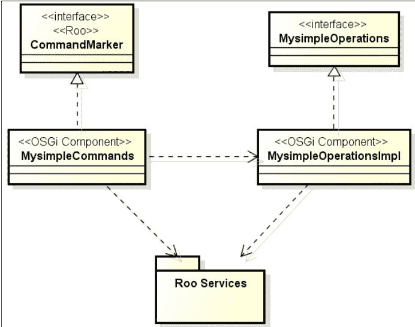

该图显示，CommandMarker 是 Roo 提供的接口，由 MysimpleCommands 类实现。MysimpleCommands 类调用 MysimpleOperationsImpl 类的方法来处理 mysimple 附加组件暴露的命令。MysimpleCommands 和 MysimpleOperationsImpl 类使用 Roo 提供的服务来执行所需功能。

## 还有更多内容

在本节中，我们将了解：

- 如何在本地部署 mysimple 附加组件以测试 Roo 命令
- 如何使用枚举类型和 Java 类中定义的常量为 Roo 命令实现 Tab 补全支持
- 如何使用 @CliAvailabilityIndicator 注解为方法定义多个由 *Command 类暴露的 Roo 命令的可用性
- 附加组件中的模板是什么以及它们通常如何使用
- 附加组件的 pom.xml 文件中的插件和依赖配置

## 部署和运行 mysimple 附加组件

创建附加组件后，在将其提供给其他开发者之前，你可能想先测试其功能。在本节中，我们将了解如何在本地部署和测试使用 `create addon simple` 命令创建的 mysimple 附加组件。

要使用 mysimple 附加组件，需要将其转换为符合 OSGi 规范的 JAR 包。为此，请从包含 mysimple 附加组件项目的目录执行 `mvn clean install`，如下所示：

```
C:\roo-cookbook\ch07-simple-add-on> mvn clean install -Dgpg.passphrase=<thephrase>
```

此处，`<thephrase>` 是你使用 GnuPG（也称为 GPG）对附加组件签名时提供的密码短语。有关如何设置 GnuPG 以及为签名附加组件创建密码短语的信息，请参阅 *设置用于附加组件开发的 GnuPG* 配方。

执行 `mvn clean install` 命令会在 mysimple 附加组件项目的 `target` 目录中创建 `com.roo.addon.mysimple-0.1.0.BUILD-SNAPSHOT.jar` 附加组件 OSGi 包。现在，让我们了解如何在 Roo 项目中使用 mysimple 附加组件。

## 在 Roo 项目中使用 mysimple 附加组件

以下步骤将演示如何使用附加组件：

1. 在系统中创建新目录 `C:\roo-cookbook\ch07-addon-test`，并从此目录启动 Roo shell。

2. 执行 `ch07_web_app.roo` 脚本以创建 `flight-app` Spring Web MVC 项目。

3. 执行 `osgi start` 命令来安装并激活 mysimple 附加组件，如下所示：
```
roo> osgi start --url file:///C:/roo-cookbook/ch07-simple-add-on/target/com.roo.addon.mysimple-0.1.0.BUILD-SNAPSHOT.jar
```
此处，`url` 参数指定你要安装并激活的附加组件 OSGi 包的位置。

`osgi start` 命令安装 mysimple 附加组件。该命令还用于通过将附加组件 JAR 文件的 `http://` 或 `https://` URL 作为 `url` 参数的值，下载并安装位于网站上的 Roo 附加组件。

4. 要验证附加组件是否已成功安装，请在 Roo shell 中输入 `say` 并按 `Tab` 键。Roo 应会将命令自动补全为 `say hello`，如下所示：
`roo> say hello`


- 5. 再次按 Tab 键，让 Roo 显示 say hello 命令的必需 name 参数，如下所示：

roo> say hello --name

- 6. 将 Ron 作为 name 参数的值，然后输入 -- 并按 Tab 键以查看 say hello 命令的可选参数：

roo> say hello --name Ron --

- 7. 由于 say hello 命令的唯一可选参数是 countryOfOrigin，因此在 Roo shell 中会显示它：

roo> say hello --name Ron --countryOfOrigin

- 8. 现在，再次按 Tab 键以查看可以传递给 countryOfOrigin 参数的参数值。您将看到以下输出：

roo> say hello --name Ron --countryOfOrigin

```
AUSTRALIA       GERMANY       NOT_SPECIFIED   UNITED_STATES
```

输出显示，countryOfOrigin 只能接受四个可能值中的一个：AUSTRALIA、GERMANY、NOT_SPECIFIED 和 UNITED_STATES。

- 9. 输入 aus 作为 countryOfOrigin 参数的值，然后按 Tab 键让 Roo 执行值的自动补全，如下所示：

roo> say hello --name Ron --countryOfOrigin aus
roo> say hello --name Ron --countryOfOrigin AUSTRALIA

如所示，Roo 为 countryOfOrigin 参数的值执行自动补全。countryOfOrigin 参数的可能值来自 MysimplePropertyName 枚举类型。

- 10. 现在，按 Enter 键让 mysimple 插件处理 say hello 命令。您将看到类似于以下内容的输出：

~.web.controller roo> say hello --name Ron --countryOfOrigin
AUSTRALIA

Welcome Ron!
Country of origin: Australia
It seems you are a running JDK 1.6.0_23
You can use the default JDK logger anywhere in your add-on to send messages to the Roo shell

执行 `say hello` 命令时，由 `MysimpleCommands` 类的 `sayHello` 方法进行处理。

- 11. 现在，执行 mysimple 插件的 `web mvc install tags`，将 `info.tagx` 和 `show.tagx` 文件安装到 `flight-app` Roo 项目中：

```
roo> web mvc install tags
```

```
Created SRC_MAIN_WEBAPP\WEB-INF\tags\util\info.tagx
Updated SRC_MAIN_WEBAPP\WEB-INF\tags\form\show.tagx
```

执行 `web mvc install tags` 的输出显示，`info.tagx` 文件已添加到 `flight-app` 项目，`show.tagx` 文件已被替换。`web mvc install tags` 命令由 `MysimpleCommands` 类的 `installTags` 方法处理，该方法又将其委托给 `MysimpleOperationsImpl` 类的 `installTags` 方法。

如果您对 mysimple 插件进行了修改并想将其重新部署到 Spring Roo，则可以使用 `osgi update` 命令，如下所示：

```
roo> osgi update --url file:///C:/roo-cookbook/ch07-simple-add-on/target/com.roo.addon.mysimple-0.1.0.BUILD-SNAPSHOT.jar
```

如果您想卸载 mysimple 插件，则可以使用 `osgi uninstall` 命令，如下所示：

```
roo> osgi uninstall --bundleSymbolicName com.roo.addon.mysimple
```

`bundleSymbolicName` 参数用于标识要从 Spring Roo 卸载的插件名称。卸载插件后，该插件公开的 Roo 命令将不再可供 Roo shell 使用。

## 带常量值的 Tab 补全功能

`MysimplePropertyName` 枚举类型定义了常量，这些常量表示 Roo 命令参数可以接受的可能值。您并不局限于使用枚举类型来定义参数值的常量。假设我们不想使用 `MySimplePropertyName` 枚举类型，而是想使用一个定义国家常量的 `Country` 类。以下代码展示了可以用来替代 `MySimplePropertyName` 枚举类型的 `Country` 类：

```
public class Country {
public static final Country AUSTRALIA =
new Country("Australia");
public static final Country NOT_SPECIFIED =
new Country("None of your business!");
public static final Country UNITED_STATES =
new Country("United States");
public static final Country GERMANY =
new Country("Germany");

private String countryName;

public Country(String countryName) {
this.countryName = countryName;
}

public String getCountryName() {
return countryName;
}
}
```

前面的代码显示，Country 类为每个国家定义了常量，这些常量代表 countryOfOrigin 参数的可能值。现在，要使用 Country 类代替 MysimplePropertyName 枚举，您只需在 MysimpleCommands 类中将对其的引用替换为 Country，如下所示：

```
public class MysimpleCommands implements CommandMarker {
@Reference private StaticFieldConverter staticFieldConverter;

protected void activate(ComponentContext context) {
staticFieldConverter.add(Country.class);
}

protected void deactivate(ComponentContext context) {
staticFieldConverter.remove(Country.class);
}
```

```
@CliCommand(value = "say hello",
help = "Prints welcome message to the Roo shell")
public void sayHello(... , @CliOption(key = "countryOfOrigin",
mandatory = false,
help = "Country of origin") Country country) {

log.info("Welcome " + name + "!");
log.warning("Country of origin: " + (country == null ?
Country.NOT_SPECIFIED.getCountryName() :
country.getCountryName())) ;
...
}
...
```

前面的代码显示，Country 类必须添加到 StaticFieldConverter 服务中，并且必须指定为 sayHello 方法中 countryOfOrigin 参数的类型。

## 使用 @CliAvailabilityIndicator 实现多个命令的可用性

在 mysimple 插件中，使用分别标注了 @CliAvailabilityIndicator 的方法来指示 say hello 和 web mvc install tags 命令的可用性。如果您想使用单个标注了 @CliAvailabilityIndicator 的方法来指示 mysimple 插件提供的多个 Roo 命令的可用性，请在 @CliAvailabilityIndicator 注解中指定命令数组。例如，您可以在 MysimpleCommands 中定义以下方法，以指示 say hello 和 web mvc install tags 命令始终可供 Roo shell 使用：

```
@CliAvailabilityIndicator({"say hello",
"web mvc install tags"})
public boolean isCommandAvailable() {
    return true;
}
```

在前面的代码中，@CliAvailabilityIndicator 注解指定了一个 Roo 命令数组（say hello 和 web mvc install tags），其可用性由 isCommandAvailable 方法进行检查。

## Roo 插件中的模板

插件项目中的模板是资源，在执行插件的一个或多个命令时，会被复制到 Roo 项目中。例如，当您执行 web mvc install tags 命令时，info.tagx 和 show.tagx 文件会从插件复制到 Roo 项目。模板也可以是图片、XML 文件、属性文件等等，由插件命令复制到 Roo 项目中。

模板位于插件项目的 SRC_MAIN_RESOURCES 目录中。例如，在 mysimple 插件的情况下，info.tagx 和 show.tagx 文件位于 SRC_MAIN_RESOURCES/com/roo/addon/mysimple 目录中。插件使用 TemplateUtils 类访问模板，然后使用 FileCopyUtils 类将其复制到 Roo 项目。TemplateUtils 定义了以下两个用于访问插件中模板的静态方法：

- String getTemplatePath(Class<?> clazz, String templateFilename)：此方法通过 templateFilename 参数返回模板文件的路径。clazz 参数的包信息用于获取 SRC_MAIN_RESOURCES 目录中包含模板文件的子目录。

例如，如果 clazz 参数表示包名为 com.roo.addon.mysimple 的类，而 templateFileName 参数的值为 show.tagx，则 getTemplatePath 方法返回 SRC_MAIN_RESOURCES/com/roo/addon/mysimple/show.tagx 文件的路径。您也可以将模板文件的相对路径作为 templateFilename 参数的值。例如，如果将 templateFilename 的值指定为 WEB-INF/myconfig.xml，则模板文件的路径变为 SRC_MAIN_RESOURCES/com/roo/addon/mysimple/WEB-INF/myconfig.xml。

- InputStream getTemplate(Class<?> clazz, String templateFileName)：此方法返回指向模板文件的 java.io.InputStream。在 mysimple 插件的情况下，MySimpleOperationsImpl 类的 createOrReplaceFile 方法使用 TemplateUtils 类来获取 info.tagx 和 show.tagx 文件的 InputStream。

在某些插件中，模板文件可能是 XML 文件，插件在将其复制到 Roo 项目之前需要对其进行修改。要修改 XML 模板，Roo 提供了 XMLUtils 类，插件可以使用它来修改 XML 模板文件的内容。让我们看一个场景，该场景展示了插件如何在将 XML 模板文件复制到 Roo 项目之前修改其内容。

以下 config.xml 文件展示了一个 Spring 应用程序上下文 XML 文件，它代表了插件的模板 XML 文件：

```
<beans xmlns="http://www.springframework.org/schema/beans"
xmlns:context="http://www.springframework.org/schema/context" ...>
<context:component-scan base-package=""/>
...
</beans>
```

在 config.xml 文件中，Spring 上下文命名空间的 <component-scan> 元素指定了通过 base-package 属性扫描的包。这些包（及其子包）中标注了 @Component、@Service 和 @Repository Spring 注解的类会自动注册到 Spring 的应用程序上下文中。由于插件在执行 Roo 命令时会将 config.xml 文件复制到 Roo 项目，因此插件事先不知道需要为 base-package 属性指定什么值。这就是 config.xml 文件中 base-package 属性的值为空的原因。

以下代码展示了插件如何读取 config.xml 文件、对其进行修改，然后将修改后的 config.xml 写入 Roo 项目：

```
import org.springframework.roo.metadata.MetadataService;
import org.springframework.roo.project.PathResolver;
import org.springframework.roo.project.ProjectMetadata;
import org.springframework.roo.support.util.XmlUtils;
import org.w3c.dom.Document;
```


```java
import org.w3c.dom.Element;
import java.io.ByteArrayOutputStream;
import java.io.OutputStreamWriter;

@Component
@Service
public class FileWriterOperationsImpl
implements FileWriterOperations {
@Reference private MetadataService metadataService;
...
public void copyApplicationContextXML() {
ProjectMetadata projectMetadata =
(ProjectMetadata) metadataService.get(ProjectMetadata.
getProjectIdentifier());

InputStream templateInputStream =
TemplateUtils.getTemplate(getClass(),
"config.xml");
Document config;
try {
config = XmlUtils.getDocumentBuilder().
parse(templateInputStream);
} catch (Exception ex) {...}

Element rootElement = (Element) config.getDocumentElement();

XmlUtils.findFirstElementByName("context:component-scan",
rootElement).setAttribute("base-package",
projectMetadata.getTopLevelPackage().
getFullyQualifiedPackageName());

ByteArrayOutputStream outputStream =
new ByteArrayOutputStream();

XmlUtils.writeXml(XmlUtils.createIndentingTransformer(),
outputStream,
config);
String xmlContent = outputStream.toString();

FileCopyUtils.copy(xmlContent, new OutputStreamWriter(...));
}
...
}
```

FileWriterOperationsImpl 类与 mysimple 插件的 MysimpleOperationsImpl 类类似。它定义了 copyApplicationContextXML 方法，该方法负责将插件中的 config.xml 文件复制到 Roo 项目。

MetadataService 类表示 Roo 提供的一种服务，用于检索 Roo 项目、Java 类型、字段、方法等的元数据信息。元数据是通过 Roo 的 MetadataService 使用元数据标识字符串获取的，其格式为：MID:<fully-qualified-class-name>#<instance-identification-key>，其中 <fully-qualified-class-name> 是元数据类型，<instance-identification-key> 是元数据所适用的 Java 类型。如果元数据未与 Java 类型关联，则元数据字符串格式为：MID:<fully-qualified-class-name>。如果元数据标识字符串的格式为 MID:<fully-qualified-class-name>#<instance-identification-key>，则称为实例级元数据标识字符串。如果元数据标识字符串的格式为 MID:<fully-qualified-class-name>，则称为类级元数据标识字符串。在 FileWriterOperationsImpl 类中，ProjectMetadata 表示一种元数据类型，用于保存 Roo 项目的详细信息，如项目名称、顶层包名称、依赖项等。ProjectMetadata 的 getProjectIdentifier() 方法返回 Roo 项目的元数据标识字符串，并将其传递给 MetadataService 以检索 ProjectMetadata 实例。

TemplateUtils 类用于获取指向 config.xml 文件的 java.io.InputStream。随后使用 XmlUtils 类解析 config.xml 文件以构建 org.w3c.dom.Document 实例。XmlUtils 的 findFirstElementByName 方法用于查找 config.xml 中 <context:component-scan> 元素的第一个出现位置。findFirstElementByName 方法返回一个 org.w3c.dom.Element 实例。Element 的 setAttribute 方法用于将 <context:component-scan> 元素的 base-package 属性值设置为 Roo 项目的顶层包。XmlUtils 的 writeXml 方法将 Document 对象写入 java.io.OutputStream。XmlUtils 的 createIndentingTransformer 方法创建一个 javax.xml.transform.Transformer 实例，该实例将 Document 对象中的条目缩进 4 个字符。如果您要对 XML 执行自定义转换，可以创建一个自定义 Transformer 实现，并将其传递给 XmlUtils 类的 writeXml 方法。

假设您有一个名为 flight-app 的 Roo 项目，其顶层包为 com.sample.flightapp。现在假设您执行了一个 Roo 命令，从而导致执行插件中 FileWriterOperationsImpl 类的 copyApplicationContextXML 方法。该 copyApplicationContextXML 方法将读取 config.xml 模板文件，将 <context:component-scan> 元素的 base-package 属性设置为 com.sample.flightapp，并将修改后的 config.xml 写入 flight-app Roo 项目。

现在让我们来看看 mysimple 插件项目 pom.xml 文件中定义的一些重要配置。

## pom.xml 文件

通过 addon create simple 命令创建的插件的 pom.xml 文件包含以下配置：

- 简单插件所依赖的核心 Spring Roo 模块在 pom.xml 文件中进行配置。如果您的插件使用了其他插件，则需要在 pom.xml 文件中进行配置。
- 默认情况下，Google Code 被配置为插件的 SCM（软件配置管理）仓库。
- Maven assembly 插件用于打包插件。您可以执行 perform assembly Roo 命令或 assembly 插件的 assembly:single 目标，将插件打包为 ZIP 文件。装配描述文件 assembly.xml 位于插件的 src/main/assembly 文件夹中。
- Maven release 插件用于发布插件。在完成插件的本地测试后，您可以通过执行 mvn release:prepare release:perform Maven 命令，将插件发布到 Google Code（或您在 pom.xml 文件中配置的 SCM）。
- Maven GPG 插件用于使用 GnuPG 对插件项目的构件进行签名。
- Maven bundle 插件用于将插件打包为符合 OSGi 标准的 bundle。您会发现，插件 pom.xml 文件中 <packaging> 元素的值被指定为 bundle，这意味着插件被打包为一个 OSGi bundle。

## 故障排除的 OSGi 命令

部署插件后，您可以通过从 Roo shell 使用以下 OSGi 命令来检查它是否成功安装：

- osgi ps：列出 OSGi bundle 及其状态。如果您已成功安装 mysimple 插件，则执行 osgi ps 命令应显示 mysimple 插件为 active 状态，如下所示：
  [Active] [1] Mysimple add-on (0.1.0.BUILD-SNAPSHOT)
- osgi log：显示 OSGi 容器日志。如果您的插件未能成功安装，可以参考容器日志来排查安装问题。
- osgi scr list：列出已向 OSGi 容器注册的服务和组件。如果您已成功安装 mysimple 插件，则执行 osgi scr list 命令应显示命令和操作类型，如下所示：
  [181] [active] com.roo.addon.mysimple.MysimpleOperationsImpl
  [180] [active] com.roo.addon.mysimple.MysimpleCommands

在上述输出中，数字 180 和 181 分别表示 OSGi 容器分配给 MysimpleCommands 和 MysimpleOperations 类型的组件 ID。

- osgi scr info：显示已向 OSGi 容器注册的组件或服务的详细信息。该命令接受一个必需参数 componentId。您可以使用此命令来查找组件无法解析的依赖项。如果您已成功安装 mysimple 插件，则执行 osgi scr info --componentId 180（将 180 替换为执行 osgi scr list 命令时显示的 MysimpleCommands 的组件 ID）应显示 MysimpleCommands 的依赖项是否已满足，如下所示：

```
ID: 180
Name: com.roo.addon.mysimple.MysimpleCommands
State: active
Services: org.springframework.roo.shell.CommandMarker
...
Reference: staticFieldConverter
Satisfied: satisfied
Service Name: org.springframework.roo.shell.converters.StaticFieldConverter
...
Reference: operations
Satisfied: satisfied
Service Name: com.roo.addon.mysimple.MysimpleOperations
```

输出表明，MysimpleCommands 的 StaticFieldConverter 和 MysimpleOperations 依赖项已成功解析。

## 另请参阅

- 请参阅“开发高级插件”教程，了解如何开发可创建新 Java 类、接口和 AspectJ ITD 文件的插件

## 开发高级插件

如果您希望在执行一个或多个 Roo 命令时生成 Java 代码（类和接口）及 AspectJ ITD，则应创建一个高级 Roo 插件。


Spring Roo 对简单和高级加载项一视同仁。简单和高级加载项之间的区别存在，以便您可以根据自定义加载项需求选择合适的加载项模板。由 `addon create simple` 命令创建的加载项模板在您想要创建自定义加载项（用于向 `pom.xml` 文件添加项目依赖项并向项目添加配置工件）时非常有用。在本示例中，我们将介绍 `addon create advanced` 命令，如果您想要创建自定义加载项以生成 Java 代码和 AspectJ ITD，则该命令非常有用。

## 准备工作

在系统中创建新目录 `C:\roo-cookbook\ch07-advanced-add-on`，并从 `ch07-advanced-add-on` 目录启动 Roo shell。

## 操作步骤...

以下步骤将演示如何创建高级加载项：

- 1. 执行 `addon create advanced` 命令，如下所示，以创建 `com.roo.addon.myadvanced` 加载项项目：

  ```
  ..roo> addon create advanced --topLevelPackage com.roo.addon.myadvanced
  ...
  Created SRC_MAIN_JAVA\...\MyadvancedCommands.java
  Created SRC_MAIN_JAVA\...\MyadvancedOperations.java
  Created SRC_MAIN_JAVA\...\MyadvancedOperationsImpl.java
  Created SRC_MAIN_JAVA\...\MyadvancedMetadata.java
  Created SRC_MAIN_JAVA\...\MyadvancedMetadataProvider.java
  Created SRC_MAIN_JAVA\...\RooMyadvanced.java
  Created SRC_MAIN_RESOURCES\...\configuration.xml
  ```

输出仅显示 Roo 命令生成的一些重要文件，我们将在本示例中讨论这些文件。

- 2. 执行 `perform eclipse` 命令以创建 Eclipse-IDE 特定的配置文件：

  ```
  roo> perform eclipse
  ```

  现在，将 `com.roo.addon.myadvanced` Eclipse 项目导入 Eclipse IDE。

## 工作原理...

`addon create advanced` 命令创建一个 Roo 加载项模板，您可以将其用作创建自定义 Roo 加载项的起点，该自定义加载项可生成 Java 类、接口和 AspectJ ITD。以下类和接口由 `addon create advanced` 命令生成。`<last-part-of-top-level-package>` 指的是 topLevelPackage 参数值中最后一个 '.' 之后的文本。在我们的示例中，topLevelPackage 参数值为 com.roo.addon.myadvanced，这使得 `<last-part-of-top-level-package>` 的值为 'myadvanced'。

- `<last-part-of-top-level-package>Commands.java` 类：定义加载项贡献给 Roo shell 的方法。
- `<last-part-of-top-level-package>Operations.java` 接口：定义包含 *Commands.java 类中定义的命令的处理逻辑的方法。
- `<last-part-of-top-level-package>OperationsImpl.java` 类：实现 *Operations.java 接口。
- `<last-part-of-top-level-package>Metadata.java` 类：表示与此加载项关联的元数据。在此类中，您需要编写创建 Java 类、接口和 AspectJ ITD 的代码。
- `<last-part-of-top-level-package>MetadataProvider.java` 类：创建与此加载项关联的元数据。
- `Roo<last-part-of-top-level-package>.java` 类：表示 Roo 注释（类似于其他 Roo 注释，如 @RooEntity、@RooJavaBean、@RooSolrSearchable 等），它触发此加载项生成 Java 类、接口和 AspectJ ITD。

您可能已经注意到，在 SRC_MAIN_RESOURCES\com\roo\addon\myadvanced 目录中也会生成一个 configuration.xml 文件。configuration.xml 文件定义了加载项添加到 Roo 项目 pom.xml 文件中的依赖项。

## MyadvancedCommands 类

以下代码显示了 MyAdvancedCommands 类的方法，该类定义了 myadvanced 加载项公开的 Roo 命令：

```
@Component
@Service
public class MyadvancedCommands implements CommandMarker {
    @Reference private MyadvancedOperations operations;

    @CliAvailabilityIndicator({ "myadvanced setup",
                                "myadvanced add", "myadvanced all " })

    public boolean isCommandAvailable() {
        return operations.isCommandAvailable();
    }

    @CliCommand(value = "myadvanced add",
        help = "Some helpful description")
    public void add(@CliOption(key = "type",
        mandatory = true,
        help = "The java type to apply this annotation to")
        JavaType target) {
        operations.annotateType(target);
    }

    @CliCommand(value = "myadvanced all",
        help = "Some helpful description")
    public void all() {
        operations.annotateAll();
    }

    @CliCommand(value = "myadvanced setup",
        help = "Setup Myadvanced addon")
    public void setup() {
        operations.setup();
    }
}
```

如代码所示，myadvanced 加载项向 Roo shell 注册了以下命令：

- myadvanced setup：执行使用加载项所需的初始设置。执行此命令时，myadvanced 加载项会更新 pom.xml 文件中的项目依赖项。
- myadvanced add：使用 @RooMyAdvanced 注释注释 Java 类（通过 myadvanced add 命令的 type 参数指定）。在前面的代码中，您会注意到传递给 add 方法的 Java 类是 JavaType 类型。JavaType 表示一种 Roo 特定的类，用于简化访问 Java 类型的简单名称和包名称。使用 @RooMyAdvanced 注释注释 Java 类型会启动 myadvanced 加载项的代码生成。
- myadvanced all：查找项目中使用 @RooJavaBean 注释注释的所有 Java 类型（我们很快就会看到 myadvanced 加载项如何执行此操作），并使用 @RooMyAdvanced 注释注释它们。使用 @RooMyAdvanced 注释注释 Java 类型会启动 myadvanced 加载项的代码生成。

MyAdvancedCommands 类还定义了一个带有 @CliAvailabilityIndicator 注释的方法，用于决定 myadvanced setup、myadvanced add 和 myadvanced all 命令的可用性。

现在让我们来看看 MyadvancedOperationsImpl 类，该类提供了 myadvanced 加载项公开的命令的实现。

## MyadvancedOperationsImpl 类

以下代码显示了 MyadvancedOperationsImpl 类。代码未显示 annotateType 和 annotateAll 方法的实现，这些内容将在本节后面详细讨论。

```
import ... .roo.classpath.PhysicalTypeMetadataProvider;
import ... .roo.classpath.TypeLocationService;
import ... .roo.metadata.MetadataService;
import ... .roo.model.JavaType;
import ... .roo.project.ProjectOperations;
import ... .roo.project.Dependency;
import ... .roo.project.DependencyScope;
import ... .roo.project.DependencyType;
import ... .roo.project.Repository;
import ... .roo.support.util.XmlUtils;
import org.w3c.dom.Element;

@Component
@Service
public class MyadvancedOperationsImpl implements
    MyadvancedOperations {

    @Reference private MetadataService metadataService;
    @Reference private PhysicalTypeMetadataProvider
        physicalTypeMetadataProvider;
    @Reference private ProjectOperations projectOperations;
    @Reference private TypeLocationService typeLocationService;
    ...

    public boolean isCommandAvailable() {
        return projectOperations.isProjectAvailable();
    }

    public void annotateType(JavaType javaType) { ... }

    public void annotateAll() { ... }
    public void setup() {
        projectOperations.addRepository(
            new Repository("Myadvanced Roo add-on repository",
            "Myadvanced Roo add-on repository",
            "https://com-roo-addon-myadvanced.googlecode.com/svn/repo"));

        List<Dependency> dependencies = new ArrayList<Dependency>();
        dependencies.add(
            new Dependency("com.roo.addon.myadvanced",
            "com.roo.addon.myadvanced", "0.1.0.BUILD-SNAPSHOT",
            DependencyType.JAR, DependencyScope.PROVIDED));

        for (Element dependencyElement :
            XmlUtils.findElements("/configuration/batch/" +
            "dependencies/dependency",
            XmlUtils.getConfiguration(getClass()))) {
            dependencies.add(new Dependency(dependencyElement));
        }

        projectOperations.addDependencies(dependencies);
    }
}
```

MyadvancedOperationsImpl 类引用了 Roo 提供的以下服务：

- **MetadataService**：Roo 提供的服务，用于检索 Roo 项目、Java 类型、字段、方法等的元数据信息。有关更多详细信息，请参阅 *Developing a simple add-on* 示例。
- **PhysicalTypeMetadataProvider**：一个元数据提供程序，用于为类、接口、枚举或注释类型提供元数据。如本节后面所述，MyadvancedOperationsImpl 类使用此元数据提供程序来获取需要使用 @RooMyAdvanced 注释进行注释的 Java 类型的元数据信息。


- ProjectOperations: 由 myadvanced 插件在 isCommandAvailable 和 setup 方法中使用，用于检查 Roo 项目是否存在并修改 Roo 项目的 pom.xml 文件，如给定代码所示。给定代码中的 isCommandAvailable 方法使用 ProjectOperations 的 isProjectAvailable 方法来确定是否已创建 Roo 项目。isCommandAvailable 方法由 MyadvancedCommands 类中带有 @CliAvailabilityIndicator 注解的方法调用。此代码中的 setup 方法使用 ProjectOperations 的 addRepository 方法将插件的仓库信息添加到 Roo 项目的 pom.xml 文件中。默认情况下，该仓库指向插件的 Google Code 仓库目录（参阅 myadvanced 插件的 pom.xml 文件）。setup 方法通过使用 addDependencies 方法，将 Roo 项目对 myadvanced 插件的依赖以及 configuration.xml（位于 SRC_MAIN_RESOURCES/com/roo/addon/myadvanced 中）文件中定义的依赖添加进去。setup 方法使用 XmlUtils 类的 getConfiguration 方法来加载 configuration.xml 文件。

- TypeLocationService: Roo 服务，用于帮助在 Roo 项目中定位 Java 类型。例如，可以使用 TypeLocationService 查找带有特定注解的 Java 类型。

- 当执行 myadvanced add 命令时，会调用 MyadvancedOperationsImpl 类的 annotateType 方法。以下代码显示了 annotateType 方法的实现：

```
import ...roo.classpath.PhysicalTypeDetails;
import ...roo.classpath.PhysicalTypeMetadata;
import ...roo.classpath.PhysicalTypeMetadataProvider;
import ...roo.classpath.TypeLocationService;
import ...roo.classpath.details.MemberFindingUtils;
import ...roo.classpath.details.MutableClassOrInterfaceTypeDetails;
import ...roo.classpath.details.annotations.AnnotationMetadataBuilder;
...
@Reference private MetadataService metadataService;
@Reference private PhysicalTypeMetadataProvider
        physicalTypeMetadataProvider;
...
public void annotateType(JavaType javaType) {
        String id =
                physicalTypeMetadataProvider.findIdentifier(javaType);
        PhysicalTypeMetadata physicalTypeMetadata =
                (PhysicalTypeMetadata) metadataService.get(id);
        PhysicalTypeDetails physicalTypeDetails =
                physicalTypeMetadata.getMemberHoldingTypeDetails();
        MutableClassOrInterfaceTypeDetails mutableTypeDetails =
                (MutableClassOrInterfaceTypeDetails) physicalTypeDetails;
        if (MemberFindingUtils.getAnnotationOfType(
                mutableTypeDetails.getAnnotations(),
                new JavaType(RooMyadvanced.class.getName())) == null) {
            JavaType rooRooMyadvanced =
                    new JavaType(RooMyadvanced.class.getName());
            AnnotationMetadataBuilder annotationBuilder =
                    new AnnotationMetadataBuilder(rooRooMyadvanced);
            mutableTypeDetails.addTypeAnnotation(
                    annotationBuilder.build());
        }
}
```

annotateType 方法接受一个 JavaType 参数。该 JavaType 参数表示您在 myadvanced add 命令的 type 参数值中指定的 Java 类型。annotateType 方法执行以下操作，以使用 @RooMyadvanced 注解对 JavaType 参数进行注解：

- 获取需要应用注解的 JavaType 的元数据识别字符串。这是通过使用 Roo 的 PhysicalTypeMetadataProvider 类的 findIdentifier 方法实现的。

假设 myadvanced add 命令如下所示执行：

```
... roo> myadvanced add --type sample.roo.flightapp.domain.Flight
```

在 myadvanced add 命令中，type 参数的值为 sample.roo.flightapp.domain.Flight。此 Java 类型由 Roo 传递给 MyadvancedOperationsImpl 类的 annotateType 方法。PhysicalTypeMetadataProvider 类的 findIdentifier 方法返回的元数据识别字符串如下：

```
MID:org.springframework.roo.classpath.PhysicalTypeIdentifier#SRC_MAIN_JAVA?sample.roo.flightapp.domain.Flight
```

- 使用 Java 类型的元数据识别字符串获取 PhysicalTypeMetadata 对象，该对象表示有关 Java 类型的元数据信息。

- 使用 PhysicalTypeMetadata 的 getMemberHoldingTypeDetails 方法检索 PhysicalTypeDetails。PhysicalTypeDetails 提供 PhysicalTypeMetadata 所表示的 Java 类型的详细信息。

- 将 PhysicalTypeDetails 转换为 MutableClassOrInterfaceTypeDetails。MutableClassOrInterfaceTypeDetails 用于修改其所表示的 Java 类型，即传递给 MyadvancedOperationsImpl 类的 annotateType 方法的 JavaType 参数。除其他外，您可以使用 MutableClassOrInterfaceTypeDetails 对象从 Java 类型中添加或删除字段、方法和注解。

> 需要注意的是，从 Spring Roo 1.2.x 开始，对 Java 类型的修改是使用 Roo 的 TypeManagementService 而不是 Roo 的 MutableClassOrInterfaceTypeDetails 来执行的。

- 使用 MemberFindingUtils 工具类检查 Java 类型是否已带有 @RooMyadvanced 注解。

- 使用 AnnotationMetadataBuilder 创建 @RooMyadvanced 注解，并使用 MutableClassOrInterfaceTypeDetails 对象将其添加到 Java 类型中。

- 以下代码显示了 MyadvancedOperationsImpl 类的 annotateAll 方法，该方法将 @RooMyadvanced 注解添加到所有带有 @RooJavaBean 注解的 Java 类型上：

```
import ...roo.classpath.TypeLocationService;
import ...roo.model.JavaType;
...
public void annotateAll() {
    for (JavaType type:
        typeLocationService.findTypesWithAnnotation(
        new JavaType("org.springframework.roo.addon. " +
        "javabean.RooJavaBean"))) {
        annotateType(type);
    }
}
```

如上述代码所示，annotateAll 方法使用 TypeLocationService 查找带有 @RooJavaBean 注解的 Java 类型，然后调用 annotateType 方法以使用 @RooMyadvanced 注解对 Java 类型进行注解。

现在让我们来看看 myadvanced 插件如何使用 MyadvancedMetadataProvider 类触发代码生成。

## MyadvancedMetadataProvider 类

MyadvancedMetadataProvider 类表示一个 OSGi 组件，当 Java 类型带有 @RooMyadvanced 注解时，该组件会创建一个 MyadvancedMetadata 实例。MyadvancedMetadata 反过来会创建一个 AspectJ ITD，并向其中添加一个方法和一个字段。在本节中，我们将了解 Roo 生成的 MyadvancedMetadataProvider 是如何实现的。

以下代码显示了 MyadvancedMetadataProvider 类的一些方法：

```
import org.apache.felix.scr.annotations.Component;
import org.apache.felix.scr.annotations.Service;
import org.osgi.service.component.ComponentContext;
import ...roo.classpath.PhysicalTypeIdentifier;
import ...roo.classpath.PhysicalTypeMetadata;
import ...roo.classpath.itd.AbstractItdMetadataProvider;
import ...roo.classpath.itd.ItdTypeDetailsProvidingMetadataItem;
import org.springframework.roo.model.JavaType;
import org.springframework.roo.project.Path;

@Component
@Service
public final class MyadvancedMetadataProvider extends
AbstractItdMetadataProvider {

protected void activate(ComponentContext context) {
metadataDependencyRegistry.
registerDependency(PhysicalTypeIdentifier.
getMetadataIdentifierType(), getProvidesType() );

addMetadataTrigger(
new JavaType(RooMyadvanced.class.getName() ));
}

protected void deactivate(ComponentContext context) {
metadataDependencyRegistry.
deregisterDependency(PhysicalTypeIdentifier.
getMetadataIdentifierType(), getProvidesType() );

removeMetadataTrigger(
new JavaType(RooMyadvanced.class.getName() ));
}
...
}
```

上述代码显示，MyadvancedMetadataProvider 扩展了 Roo 的 AbstractItdMetadataProvider 抽象类。AbstractItdMetadataProvider 类定义了生成 AspectJ ITD 的插件所需的通用功能。activate 方法由 Apache Felix OSGi 容器在安装 myadvanced 插件时调用。

## 依赖注册和注销

在第 4 章《使用 Spring Web MVC 进行 Web 应用程序开发》中，您看到如果在 *Controller.java 类中重新定义 *_Roo_Controller.aj 文件中的方法，则 Roo 会自动从 *_Roo_Controller.aj 文件中删除该方法。我们还看到，当您修改 @RooEntity 或 @RooWebScaffold 注解时，会导致相应的 AspectJ ITD 发生修改。Roo 使用元数据识别字符串维护 Roo 项目中 Java 类型（可能是类、接口或 @Roo* 注解）之间的依赖关系，从而使 Roo 在对 Java 类型进行更改时能够管理 AspectJ ITD 中包含的代码。

现在让我们详细查看 MyadvancedMetadataProvider 类 activate 方法中的以下代码片段：

```
metadataDependencyRegistry.
    registerDependency(PhysicalTypeIdentifier.
        getMetadataIdentifierType(), getProvidesType());
```

metadataDependencyRegistry 是 Roo 的 AbstractItdMetadataProvider 类中定义的 protected 属性，类型为 MetadataDependencyRegistry。MetadataDependencyRegistry 实例跟踪元数据识别字符串之间的依赖关系。registerDependency 方法用于指定元数据识别字符串之间的依赖关系。PhysicalTypeIdentifier 表示一个 Roo 类，用于为 Roo 项目中的 Java 类型创建元数据识别字符串。

在上述代码中，PhysicalTypeIdentifier.getMetadataIdentifierType() 代码返回 MID:org.springframework.roo.classpath.PhysicalTypeIdentifier，而 MyadvancedMetadata.getMetadataIdentifierType() 返回 MID:com.roo.addon.myadvanced.MyadvancedMetadata。由于这两个元数据识别字符串都不包含其适用的 Java 类型，因此它们是类级元数据识别字符串。您可以在类级或实例级元数据识别字符串之间创建依赖关系。

MID:org.springframework.roo.classpath.PhysicalTypeIdentifier 表示上游依赖，而 MID:com.roo.addon.myadvanced.MyadvancedMetadata 表示下游依赖。当对上游依赖进行更改时，Roo 会负责通知所有下游依赖，这会导致重新创建下游元数据。MetadataProviders 负责处理通知。因此，在 myadvanced 插件的情况下，当 Roo 项目中的 Java 类型（由 MID:org.springframework.roo.classpath.PhysicalTypeIdentifier 表示）发生更改时，它会通知 MyadvancedMetadataProvider 实例。


激活方法中指定的元数据依赖项应在元数据提供程序的停用方法中注销。元数据依赖项使用 MetadataDependencyRegistry 实例的 deregisterDependency 方法注销，MyadvancedMetadataProvider 示例如下：

```
protected void deactivate(ComponentContext context) {
    metadataDependencyRegistry.deregisterDependency(PhysicalTypeIdentifier.getMetadataIdentifierType(), getProvidesType()));
    ... }
```

## 注册和注销元数据创建触发器

元数据依赖注册可确保在上游依赖项发生更改时通知元数据的下游依赖项。要指定触发元数据创建的内容，元数据提供程序使用 AbstractItdMetadataProvider 类的 addMetadataTrigger 方法，MyadvancedMetadataProvider 示例如下：

```
protected void activate(ComponentContext context) {
    metadataDependencyRegistry.registerDependency(PhysicalTypeIdentifier.getMetadataIdentifierType(), getProvidesType()));
    addMetadataTrigger(new JavaType(RooMyadvanced.class.getName()));
}
```

在前面的代码中，addMetadataTrigger 方法接受 RooMyadvanced Java 类型。这意味着每当 Java 类型使用 @RooMyadvanced 注解进行注释时，MyadvancedMetadataProvider 将创建 MyadvancedMetadata 的实例。

元数据触发器由元数据提供程序在停用方法中移除，MyadvancedMetadataProvider 类示例如下：

```
protected void deactivate(ComponentContext context) {
    ... removeMetadataTrigger(new JavaType(RooMyadvanced.class.getName()));
}
```

现在让我们看看当 Java 类型使用 @RooMyadvanced 注解进行注释时，Spring Roo 在幕后如何生成代码。

## 插件的代码生成功能

以下时序图显示了 myadvanced 插件如何处理 myadvanced add --type sample.roo.flightapp.domain.Flight 命令，其中 Flight 类表示 Roo 项目中要添加 @RooMyadvanced 注解的 JPA 实体。

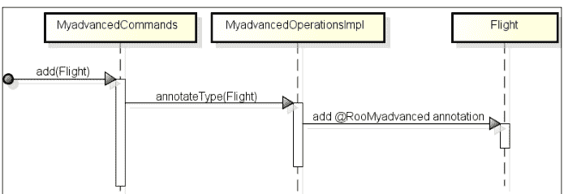

该图显示，当执行 myadvanced add 命令时，会调用 MyadvancedCommands 实例的 add 方法，并将类型参数值传递给 add 方法。您可能会注意到 add 方法接受 JavaType 类型的参数，但我们没有为其向 Roo shell 注册自定义转换器。这是因为 Roo 负责将类型参数值转换为 JavaType 类型。JavaType 包含关于类型参数值的简单名称和包名称信息。在我们的例子中，传递给 add 方法的 JavaType 参数包含我们指定为类型参数值的 Flight 类的简单名称和包名称信息。MyadvancedCommands 的 add 方法调用 MyadvancedOperationsImpl 类的 annotateType 方法，并传递包含 Flight 类信息的 JavaType 实例。annotateType 方法使用 @RooMyadvanced 注解对 Flight.java 文件进行注释。

使用 @RooMyadvanced 注解对 Flight.java 进行注释会导致向 Roo 的文件监控服务发出通知，表明 Flight.java 文件已被修改。以下时序图显示了 Roo 的文件监控服务如何向 MetadataDependencyRegistry 通知 Flight.java 文件的更改：

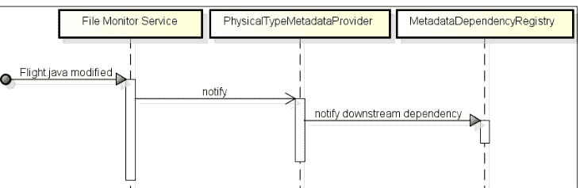

前面的图显示，文件监控服务通知 PhysicalTypeMetadataProvider Flight.java 文件已被修改。如前面所述，PhysicalTypeMetadataProvider 为 Roo 项目中的 Java 类型提供元数据。当 Flight.java 被修改时，PhysicalTypeMetadataProvider 会收到通知，因为 PhysicalTypeMetadataProvider 是文件更改事件的注册监听器。接收到文件更改通知后，PhysicalTypeMetadataProvider 要求 MetadataDependencyRegistry 实例通知任何注册的下游依赖项。如前面所见，MyadvancedMetadataProvider 的 activate 方法将 MID:com.roo.addon.myadvanced.MyadvancedMetadata 注册为 MID:org.springframework.roo.classpath.PhysicalTypeIdentifier 的下游依赖项。MID:org.springframework.roo.classpath.PhysicalTypeIdentifier 表示 PhysicalTypeMetadataProvider 创建的类级元数据标识字符串，表示 Roo 项目中的 Java 类型。因此，Flight.java 的更改会导致通知创建 MID:com.roo.addon.myadvanced.MyadvancedMetadata 元数据标识字符串的元数据提供程序，即 MyadvancedMetadataProvider。

以下时序图显示了 MetadataDependencyRegistry 如何通知 MyadvancedMetadataProvider 创建 MyadvancedMetadata：

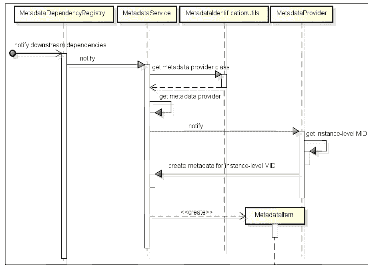

在前面的图中，MetadataProvider 表示 Roo 中所有元数据提供程序实现的接口，MetadataItem 表示 MetadataProvider 实现创建的元数据。对于 myadvanced 插件，MyadvancedMetadataProvider 实现 MetadataProvider 接口，MyadvancedMetadata 实现 MetadataItem 接口。

前面的时序图显示，MetadataDependencyRegistry 通知 MetadataService，以告知元数据提供程序（在 myadvanced 插件中为 MyadvancedMetadataProvider）下游依赖项。

> MetadataService 是 Roo 中的一个中心服务，了解系统中所有元数据提供程序。您无需将元数据提供程序注册到 MetadataService，因为如果实现了 MetadataProvider 接口，它可以自动将 OSGi 服务检测为元数据提供程序。

当下游依赖项的 MetadataProvider（在 myadvanced 插件中为 MyadvancedMetadataProvider）收到通知时，将创建 MetadataItem（在 myadvanced 插件中为 MyadvancedMetadata），我们稍后将看到。MetadataService 使用 MetadataIdentificationUtils 实用程序类来获取与下游依赖项的元数据标识字符串对应的 MetadataProvider 类。一旦获得下游依赖项的 MetadataProvider，MetadataService 就会通知 MetadataProvider。

MetadataProvider 需要知道要为哪个 Java 类型创建 MetadataItem。例如，在 myadvanced 插件示例中，MyadvancedMetadataProvider 需要知道需要为 Flight.java 类创建 MyadvancedMetadata。MetadataProvider 将下游依赖项的类级 MID（MID:com.roo.addon.myadvanced.MyadvancedMetadata）转换为实例级 MID（MID:com.roo.addon.myadvanced.MyadvancedMetadata #SRC_MAIN_JAVA?sample.roo.flightapp.domain.Flight），以标识要为其创建 MetadataItem 的 Java 类型。创建 MetadataItem 实例时，将生成代码。

现在让我们看看 MyadvancedMetadataProvider 的一些方法，这些方法在创建 MyadvancedMetadata 实例中起着重要作用：

```
import ...roo.classpath.itd.ItdTypeDetailsProvidingMetadataItem;
...
public final class MyadvancedMetadataProvider extends AbstractItdMetadataProvider {
...
protected ItdTypeDetailsProvidingMetadataItem getMetadata(String metadataIdentificationString,
    JavaType aspectName,
    PhysicalTypeMetadata governorPhysicalTypeMetadata,
    String itdFilename) {
    return new MyadvancedMetadata(metadataIdentificationString,
        aspectName, governorPhysicalTypeMetadata);
}
```

```
public String getItdUniquenessFilenameSuffix() {
    return "Myadvanced";
}
```

```
protected String getGovernorPhysicalTypeIdentifier(String metadataIdentificationString) {
    JavaType javaType = MyadvancedMetadata.getJavaType(metadataIdentificationString);
    Path path = MyadvancedMetadata.getPath(metadataIdentificationString);
    return PhysicalTypeIdentifier.createIdentifier(javaType, path);
}
```

```
protected String createLocalIdentifier(JavaType javaType, Path path) {
    return MyadvancedMetadata.createIdentifier(javaType, path);
}
```

```
public String getProvidesType() {
    return MyadvancedMetadata.getMetadataIdentifierType();
}
```


MyadvancedMetadataProvider 类扩展 AbstractIdMetadataProvider 抽象类，并使用模板方法设计模式。前面代码中所示的方法由 AbstractIdMetadataProvider 类中定义的具体方法调用。下表描述了每个方法的用途：

| 方法名 | 描述 |
|---|---|
| getMetadata | 此方法负责创建并返回 MetadataItem（在 myadvanced 插件的情况下为 MyadvancedMetadata）。 |
| getItdUniquenessFilenameSuffix | 此方法返回应用于命名 AspectJ ITD 文件的后缀。由于此方法返回 "Myadvanced"，因此此插件创建的 AspectJ ITD 文件名为 *_Roo_Myadvanced.aj。 |
| getGovernorPhysicalTypeIdentifier | 返回接收由 *_Roo_Myadvanced.aj AspectJ ITD 文件定义的方法的 Java 类型的实例级 MID。在我们的示例中，Flight 是接收由 *_Roo_Myadvanced.aj 定义的方法的 Java 类型。 |
| getProvidesType | 此方法返回类级 MID，用于标识此 MetadataProvider 实现所提供的 MetadataItem。此方法将创建 MID 的责任委托给 MetadataItem 实现类。 |
| createLocalIdentifier | 为指定的 Java 类型和路径参数创建本地实例级 MID。此方法将 MID 的创建委托给 MetadataItem 实现类。 |

getMetadata 方法负责通过传递 MyadvancedMetadata 所依赖的信息来创建 MyadvancedMetadata。下表描述了传递给 getMetadata 方法的参数：

| 方法参数 | 描述 |
|---|---|
| metadataIdentificationString | 这表示 MyadvancedMetadata 的实例级元数据。由于 Flight.java 文件使用了 @RooMyadvanced 注解，因此此参数的值为：MID:com.roo.addon.myadvanced.MyadvancedMetadata #SRC_MAIN_JAVA?sample.roo.flightapp.domain.Flight。此值由元数据提供程序的超类通过调用 createLocalIdentifier 方法和 getProvidesType 方法创建。 |
| aspectName | 这表示与插件创建的 AspectJ ITD 文件对应的 JavaType。 |
| governorPhysicalTypeMetadata | 表示 PhysicalTypeMetadata 实例，用于标识要为其创建 AspectJ ITD 文件的 Java 类型。由于 Flight.java 文件使用了 @RooMyadvanced 注解，因此此参数表示与 Flight.java 类对应的 PhysicalTypeMetadata。 |
| itdFilename | 这表示 MyadvancedMetadata 创建的 AspectJ ITD 文件的名称。此文件的名称由元数据提供程序的超类通过调用 getItdUniquenessFilenameSuffix 方法派生而来。由于 Flight.java 文件使用了 @RooMyadvanced 注解，因此文件名为 Flight_Roo_Myadvanced.aj。 |

现在，让我们来看看负责创建 AspectJ ITD 文件并向其中添加方法和字段的 MyadvancedMetadata 类。

以下代码显示了 MyadvancedMetadata 类：

```
public class MyadvancedMetadata
extends AbstractItdTypeDetailsProvidingMetadataItem {
private static final String PROVIDES_TYPE_STRING =
MyadvancedMetadata.class.getName();
private static final String PROVIDES_TYPE =
MetadataIdentificationUtils.create(PROVIDES_TYPE_STRING);

public MyadvancedMetadata(String identifier,
JavaType aspectName,
PhysicalTypeMetadata governorPhysicalTypeMetadata) {

super(identifier, aspectName, governorPhysicalTypeMetadata);
builder.addField(getSampleField());
builder.addMethod(getSampleMethod());
itdTypeDetails = builder.build();
}

private FieldMetadata getSampleField() {
...}

private MethodMetadata getSampleMethod() {
...}

...
public static final String getMetadataIdentifierType() {
return PROVIDES_TYPE;
}
...
}
```

前面的代码显示，MyadvancedMetadata 定义了两个常量和几个方法。PROVIDES_TYPE_STRING 常量指 MyadvancedMetadata 类的完全限定名，PROVIDES_TYPE 指 MyadvancedMetadata 类提供的元数据类型。PROVIDES_TYPE 的值为 MID:com.roo.addon.myadvanced.MyadvancedMetadata。

MyadvancedMetadata 扩展 AbstractItdTypeDetailsProvidingMetadataItem 抽象类，该类为希望创建与 Java 类型对应的 AspectJ ITD 文件的插件提供通用功能。MyadvancedMetadata 的构造函数使用 MyadvancedMetadataProvider 传递的信息来创建 AspectJ ITD 文件。为了简化 AspectJ ITD 文件的创建，使用了 Roo 的 ItdTypeDetailsBuilder 实例（在构造函数中由 builder 变量表示）。ItdTypeDetailsBuilder 的 addField 和 addMethod 方法用于添加构成 AspectJ ITD 一部分的字段和方法的信息。上述代码中的 getSampleField 和 getSampleMethod 方法分别返回 FieldMetadata 和 MethodMetadata，它们表示要添加到 AspectJ ITD 的字段和方法。

以下代码显示了 MyadvancedMetadata 类的 getSampleField 方法：

```
private FieldMetadata getSampleField() {
int modifier = 0;

FieldMetadataBuilder fieldBuilder =
new FieldMetadataBuilder(getId(),
modifier,
new ArrayList<AnnotationMetadataBuilder>(),
new JavaSymbolName("sampleField"),
JavaType.STRING_OBJECT);

return fieldBuilder.build();
}
```

Roo 的 FieldMetadataBuilder 用于创建 FieldMetadata 实例。下面是传递给 FieldMetadataBuilder 构造函数的参数详细信息：

- getId(): 标识字段将由 AspectJ ITD 引入的 Java 类型
- modifier: 表示字段的访问修饰符
- new ArrayList<AnnotationMetadataBuilder>(): 包含必须添加到字段的注解的信息
- new JavaSymbolName("sampleField"): 字段名
- JavaType.STRING_OBJECT: 字段的 Java 类型

同样，MyadvancedMetadata 的 getSampleMethod 方法使用 Roo 的 MethodMetadataBuilder 来创建 MethodMetadata 实例。

现在您已了解 myadvanced 插件的工作原理，可以像我们使用 mysimple 插件一样在 Roo 项目中使用它。

### 更多内容...

Roo 提供 `metadata for type` 命令来查看 Java 类型的元数据。您也可以使用 `metadata trace` 命令来查看元数据事件通知的发生情况。

### 另请参阅

- 参阅 *开发简单插件* 配方，了解如何开发简单插件

## 将非 OSGi JDBC 驱动程序转换为 OSGi 兼容的包

在第 3 章 Spring Roo 中的高级 JPA 支持中，我们讨论了 Roo 的数据库逆向工程过程要求数据库的 JDBC 驱动程序作为 OSGi 包可用。在本配方中，我们将了解如何使用 `addon create wrapper` 命令将 H2 数据库的 JDBC 驱动程序转换为 OSGi 包，并在数据库逆向工程中使用它。

### 准备工作

从  下载打包为 ZIP 文件的 H2 数据库，并将其解压到 C:\roo-cookbook\ 目录。解压 H2 数据库 ZIP 文件将在 C:\roo-cookbook 目录中创建一个名为 h2 的目录。

### 操作步骤...

以下步骤将演示如何将非 OSGi JDBC 驱动程序转换为 OSGi 兼容的包：

1. 转到 C:\roo-cookbook\h2\bin 目录并双击 h2.bat 文件。这将启动 H2 数据库，并在默认 Web 浏览器中打开 H2 控制台，如下面的屏幕截图所示：

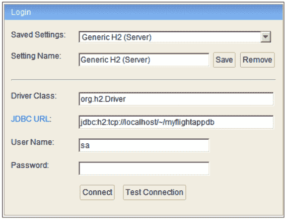

请确保将 **通用 H2 (服务器)** 选为 **已保存的设置** 选项的值，且 **JDBC URL** 字段的值为 `jdbc:h2:tcp://localhost/~myflightappdb`。单击 **连接** 按钮登录到 H2 控制台。这将自动在 H2 数据库中创建 `myflightappdb`。

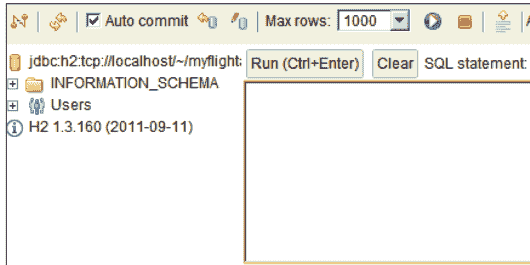

现在，将以下 SQL 语句粘贴到给定屏幕截图中显示的文本区域，并通过单击 **运行 (Ctrl+Enter)** 按钮执行它：

```
DROP TABLE IF EXISTS 'customer_tbl';
CREATE TABLE IF NOT EXISTS 'customer_tbl' (
 'cust_id' int(10) NOT NULL,
 'cust_dob' date NOT NULL,
 'cust_name' varchar(50) NOT NULL,
 PRIMARY KEY ('cust_id','cust_dob')
)
```

执行 SQL 语句将在 `myflightappdb` 数据库中创建 `CUSTOMER_TBL` 表。

3. 创建 `C:\roo-cookbook\ch07-recipes\driver` 目录，并将 `h2*.jar` 文件从 `C:\roo-cookbook\h2\bin` 目录复制到 `driver` 目录。

4. 打开命令提示符，转到 `C:\roo-cookbook\ch07-recipes\driver`，并执行 `maven install` 命令：

```
C:\roo-cookbook\driver> mvn install:install-file 
-Dfile=h2-1.3.160.jar -DgroupId=com.h2database -DartifactId=h2 
-Dversion=1.3.160 -Dpackaging=jar
```

此处假设 H2 数据库驱动程序 JAR 文件是 `h2-1.3.160.jar` 文件。

5. 创建 `C:\roo-cookbook\ch07-recipes\wrapper` 目录，并从中启动 Roo shell。


- 6. 执行 addon create wrapper 命令，创建一个封装 h2-1.3.60.jar Maven 构件的 Roo 插件：

```
... roo addon create wrapper --topLevelPackage com.h2.roo.jdbc --groupId com.h2database --artifactId h2 --version 1.3.60 --vendorName H2 --licenseUrl http://www.h2database.com
```

- 7. 修改 pom.xml 文件，将以下 `<Import-Package>` 元素添加到 Maven Bundle Plugin 的配置中：

```
<instructions>
<Import-Package>javax.servlet.*;resolution:=optional,
org.apache.lucene.*;resolution:=optional,
org.slf4j.*;resolution:=optional
</Import-Package>
...
</instructions>
```

- 8. 现在，退出 Roo shell 并执行以下 Maven 目标以生成 H2 数据库驱动程序的 OSGi 版本：

```
C:\roo-cookbook\ch07-recipes\wrapper> mvn bundle:bundle
```

此 Maven 目标会在项目的 target 目录中创建名为 com.h2.roo.jdbc.h2-1.3.60.0001.jar 的 OSGi 兼容 H2 数据库驱动程序。

- 9. 创建 C:\roo-cookbook\ch07-recipes\flight-app 目录并从该目录启动 Roo shell。

- 10. 在 flight-app 目录内创建新的 Roo 项目：

```
... roo project --topLevelPackage sample.roo.flightapp --java 6 --projectName flight-app
```

- 11. 将 Hibernate 设置为 myflightappdb H2 数据库的持久性提供程序：

```
... roo persistence setup --provider HIBERNATE --database H2_IN_MEMORY --databaseName myFlightAppDB
```

- 12. 将 'sa' 设置为连接 H2 数据库时使用的用户名：

```
... roo database properties set --key database.username --value sa
```

- 13. 现在，执行 perform eclipse 命令以创建 Eclipse IDE 特定的配置文件：

```
... roo perform eclipse
```

- 14. 将 flight-app 项目导入 Eclipse IDE，并修改 SRC_MAIN_RESOURCES/META-INF/spring/database.properties 文件中的 database.url 属性，使其指向 myflightappdb H2 数据库，如下所示：

```
database.password=
database.url=jdbc:h2:tcp://localhost/~/myflightappdb
database.username=sa
database.driverClassName=org.h2.Driver
```

- 15. 现在，安装我们之前创建的 OSGi 兼容的 H2 数据库驱动程序：

```
roo> osgi start --url file:///C:/roo-cookbook/ch07-recipes/wrapper/target/com.h2.roo.jdbc.h2-1.3.60.0001.jar
```

- 16. 执行数据库逆向工程命令，指示 Roo 创建与 H2 数据库中 CUSTOMER_TBL 对应的 JPA 实体：

```
roo> database reverse engineer --schema PUBLIC
```

## 工作原理...

addon create wrapper 命令创建一个封装 Maven 构件的插件。Apache Felix Maven Bundle Plugin 的 bundle 目标为插件项目创建 OSGi 兼容的 JAR。

`<Import-Package>` 元素指定捆绑包所需或可选的包。

## 另请参阅

- 请参阅第 3 章的“从数据库创建实体”配方，了解数据库逆向工程命令的工作原理

## 使用推入重构移除 Roo

Spring Roo 负责管理 Roo 项目中的 AspectJ ITD。由于 AspectJ ITD 由 Roo 管理，您不得修改它们。在某些情况下，您可能希望修改 AspectJ ITD 文件以满足应用程序的要求。例如，您可能希望修改 AspectJ ITD 文件中方法的实现。

在第 6 章“发送电子邮件、消息传递、Spring Security、Solr 和 GAE”的“使用 JavaMail API 发送电子邮件”配方中，我们将 FlightController_Roo_Controller.aj 文件中的 create(...) 方法复制到 FlightController.java 文件，因为我们希望修改 create(...) 方法的实现。如果 Roo 发现 Java 源文件中定义了方法，它会从相应的 AspectJ ITD 文件中删除具有相同签名的方法。因此，当我们将 create(...) 方法复制到 FlightController.java 文件时，Roo 从 FlightController_Roo_Controller.aj 文件中删除了 create(...) 方法。如果需要在许多位置执行此操作，复制粘贴方法可能非常棘手。在此配方中，我们将探讨如何使用 Eclipse IDE 将特定方法和属性推入到相应的 Java 源文件中。

### 准备工作

如果您使用的不是 STS 以外的任何 IDE，请确保安装了 AJDT（AspectJ 开发工具）。

创建目录 C:\roo-cookbook\ch07-recipes\push-in 并复制 ch07_web_app.roo 脚本。现在，从 push-in 目录启动 Roo shell 并使用 script 命令执行脚本。执行脚本将创建一个 flight-app Spring Web MVC 应用程序。

### 操作步骤...

以下步骤将演示如何移除 Roo：

- 1. 将 flight-app Roo 项目导入 Eclipse IDE。

- 2. 在项目资源管理器中选择 Flight_Roo_ToString.aj AspectJ ITD 文件，如下所示：

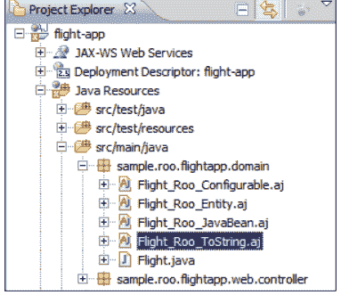

- 3. 打开 Flight_Roo_ToString.aj 文件后，在 Eclipse IDE 的大纲视图中，您将看到 Flight_Roo_ToString.aj 文件中定义的方法和属性详细信息，如下所示：

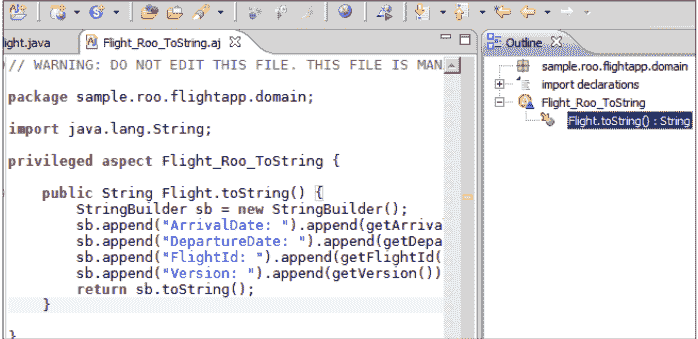

- 4. 现在，在大纲视图中右键单击 Flight.toString() : String 元素并选择“重构”选项，如下所示：

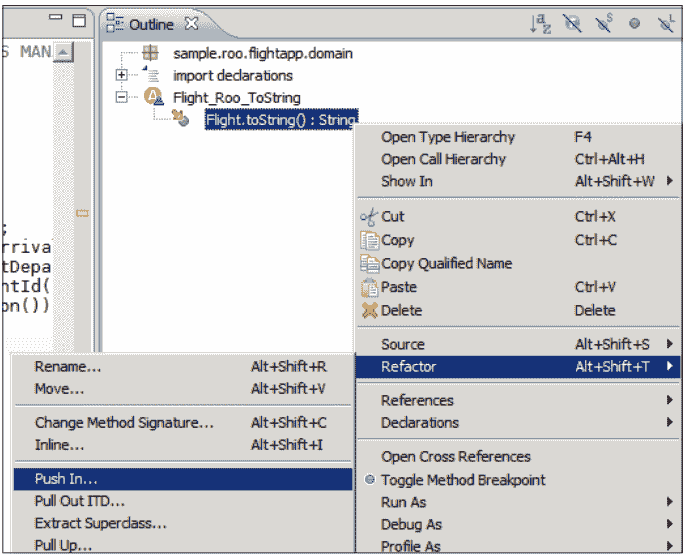

- 5. 选择 **重构 | 推入...** 选项将显示以下对话框：

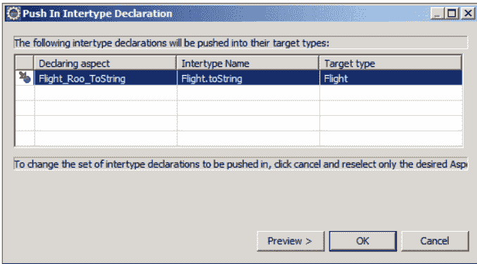

- 6. 对话框显示以下信息：

  - 声明切面：显示 AspectJ ITD 文件的名称
  - 类型间名称：显示从 **大纲** 视图中选择的 AspectJ ITD 中的声明
  - Flight：显示声明目标的 Java 类名称

- 7. 选择 **预览** 按钮将显示如果继续此重构操作，将对目标 Flight 类进行的更改，如下所示：

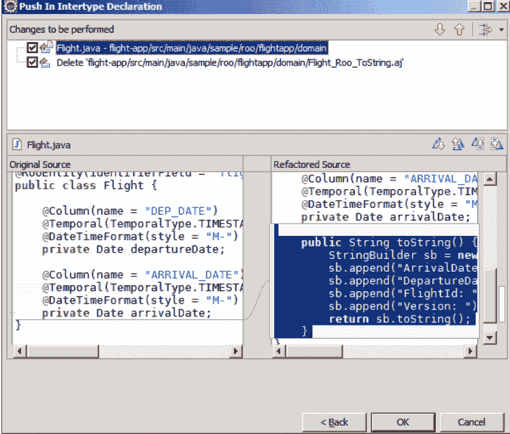

此屏幕截图显示，`Flight_Roo_ToString.aj` 文件中定义的 `toString` 方法将添加到 `Flight.java` 文件。另外，请注意，如果继续此重构操作，将导致 `Flight_Roo_ToString.aj` 文件被删除。如果您想保留空的 `Flight_Roo_ToString.aj` 文件，则取消选中 `删除 ...Flight_Roo_ToString.aj` 选项。

- 8. 单击 **确定** 按钮以完成重构。您现在将看到，`Flight_Roo_ToString.aj` AspectJ ITD 中定义的 `toString` 方法已移动到 `Flight.java` 文件。

- 9. 可选地，如果您要撤销重构，只需选择 Eclipse IDE 的 **编辑 | 撤销** 选项。

### 工作原理...

推入重构类似于 IDE 提供的其他重构机制。根据 AspectJ ITD 声明，IDE 会确定声明的目标，并将代码从 ITD 文件移动到目标 Java 源文件。

请注意，如果您要从项目中完全移除 Roo，还需要从项目的 pom.xml 文件中删除对 Roo 的依赖，并从项目中删除所有 @Roo* 注释（及相应的 import 语句）。

### 更多...

让我们看看如何将单个 AspectJ ITD 文件中的所有声明推入目标 Java 源文件，以及如何将 Roo 项目中所有 AspectJ ITD 文件中的所有声明推入各自的目标 Java 源文件。

### 推入重构—单个 AspectJ ITD 文件

要将单个 AspectJ ITD 文件中的所有声明推入目标 Java 源文件，请从项目资源管理器中右键单击 AspectJ ITD 文件，或右键单击大纲视图中表示 AspectJ ITD 类型的元素，并选择“重构 | 推入”选项。

以下屏幕截图显示当您从项目资源管理器中选择 flight-app 项目的 Flight_Roo_JavaBean.aj ITD 文件并选择“重构 | 推入”选项时显示的对话框。

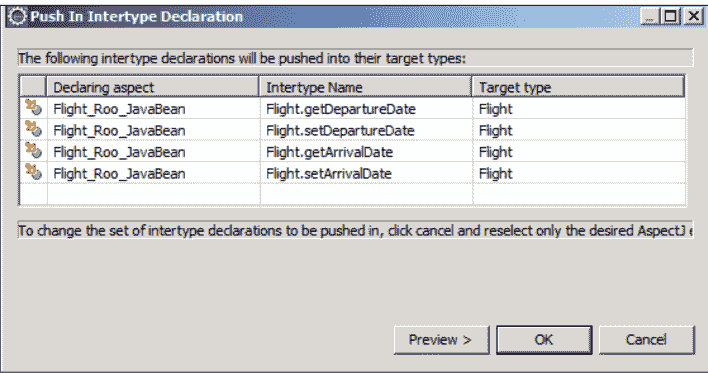

此屏幕截图显示，Flight_Roo_JavaBean.aj 文件中的所有声明现在都成为重构过程的一部分。

### 推入重构—整个项目

要在整个项目中执行推入重构，请从项目资源管理器中选择项目并选择“重构 | 推入”选项。


## 另请参阅

- 请参阅*“使用提取重构将 Roo 添加到项目”*配方，了解如何从 Java 类中将方法和属性提取到 AspectJ ITD 文件

## 使用提取重构将 Roo 添加到项目

提取重构是推入重构的逆操作。在推出重构中，您将从 Java 源文件提取方法和属性，并将其移动到 AspectJ ITD 文件中。此功能在以下情况下特别有用：

- 如果您之前在 Roo 项目上执行过推入重构，而现在希望再次使用 Spring Roo 开发您的项目
- 如果您已部分开发一个项目，而现在希望在其开发中使用 Spring Roo
- 在本配方中，我们将探讨如何将 `toString` 方法从 `Flight.java` 文件提取到 `Flight_To_String.aj` 文件中。

## 准备工作

请按照*“使用推入重构移除 Roo”*配方中指定的说明，将 `Flight_To_String.aj` 文件中定义的 `toString` 方法推送到 `Flight.java` 文件。

## 操作步骤

按照以下步骤将代码从 Java 源文件移动到 AspectJ ITD 文件中：

- 1. 在 `sample.roo.flightapp.domain` 包中创建一个 `Flight_To_String.aj` 文件，如下所示：

```
package sample.roo.flightapp.domain;

public aspect Flight_To_String { }
```

这是一个空切面，我们打算从 Java 源文件中将字段、构造方法、方法等提取到其中。
- 2. 在 Eclipse IDE 中打开 `Flight.java` 文件。
- 3. 从 **Outline** 视图中右键单击 toString 方法，并选择 **重构 | 提取 ITD...**，如下截图所示：

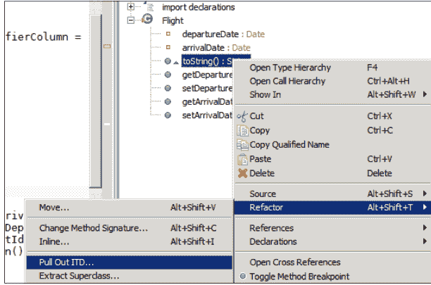

- 4. 选择 **提取 ITD** 选项将显示以下对话框，以便让您指定应将所选 `toString` 方法添加到的 AspectJ ITD 文件：

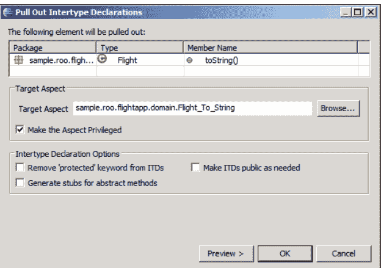

在上述截图中，将 `sample.roo.flightapp.domain.Flight_To_String` 输入为 **目标切面** 的名称，并确保选中 **将切面设为特权** 选项。

- 5. 单击 **确定** 将 toString 方法提取到 Flight_To_String.aj 文件中。

## 更多内容

如果您希望为现有项目使用 Spring Roo，则需要将 Java 源文件中的方法、属性或构造方法移动到 AspectJ ITD 文件中。这些 ITD 文件随后将由 Spring Roo 管理。您需要确保仅将可由 Roo 管理的 Java 元素移动到 AspectJ ITD 文件中。这些 AspectJ ITD 文件遵循的命名约定应符合 Roo 期望的命名约定。您还需要在 pom.xml 文件中添加必要的 Roo 相关依赖项。

## 另请参阅

- 请参阅“使用推入重构移除 Roo”配方，以便从您的项目中移除 Roo

## 将 Roo 升级到最新版本

Roo 简化了将项目从之前的版本升级到最新版本的过程。您只需从 Roo 项目的根目录启动 Roo shell 即可。Roo 会针对该版本对 AspectJ ITD 文件进行必要的调整。

在本配方中，我们将查看一个在 1.1.3 版本上创建的 Roo 项目，并将其升级到 1.1.5。

## 准备工作

解压本书附带的 ch06-ldap-security.zip 文件。解压 ZIP 文件将创建一个名为 ch06-ldap-security 的目录，该目录代表一个使用 Spring Roo 1.1.3 开发的 Roo 项目。

## 操作步骤

按照以下步骤升级您的 Roo 版本：

- 1. 从 ch06-ldap-security 目录启动 Roo shell；您将看到以下输出：

```
Updated ROOT\pom.xml [updated property 'roo.version' to '1.1.5.RELEASE']
Updated SRC_MAIN_JAVA\...\domain\Booking_Roo_ToString.aj
... SRC_MAIN_JAVA\...\web\FlightDescriptionController_Roo_Controller_Finder.aj
...
```

输出显示，Roo 修改的文件之一是 `FlightDescriptionController_Roo_Controller_Finder.aj`。如果您查看此文件，将发现 Roo 已添加一个负责搜索 `Flight` 实例的方法。现在，请查看第 4 章《使用 Spring Web MVC 进行 Web 应用程序开发》中的这句话：

> 需要注意的是，在 Spring Roo 1.1.3 中，负责搜索实例的方法不会在 `FlightDescriptionController_Roo_Controller_Finder.aj` 中创建。
>
> 此错误在 Spring Roo 1.1.4 及更高版本中已修复。

您可以看到，将 Roo 升级到 1.1.5 自动修复了 Roo 1.1.3 中存在的错误。

## 工作原理

我们之前提到过，Roo 负责管理 Roo 项目中的 AspectJ ITD 文件。因此，当您升级到更高版本的 Roo 时，Roo 会负责修改项目中 AspectJ ITD 文件里的代码。

## 更多内容

Roo 的升级过程具有破坏性，也就是说，您无法撤销升级过程中 Roo 所做的更改。因此，在从项目基目录启动 Roo shell 之前，请确保备份您的项目副本。
