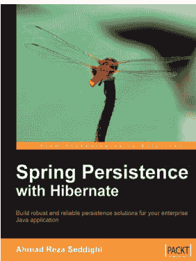
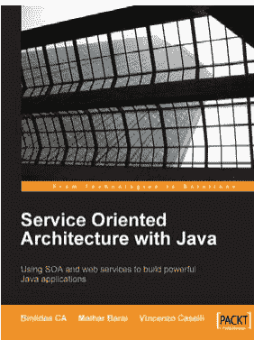

## 索引

- 符号
- <access-denied-handler> 元素 325
- <annotation-driven> 元素 52, 147, 148, 282
- <api> 元素 338
- <ArrayList> 标记 258
- <aspectLibrary> 元素 328
- @Async 注解 294
- @AttributeOverride JPA 注解 122
- @AttributeOverrides JPA 注解 122
- <authentication-manager> 元素
  - 关于 312
  - 工作原理 312
- <authentication-provider> 元素
  - 关于 313
  - 工作原理 313
- <bean> 元素 306
- <broker> 元素 303
- <browser> 元素 214
- <channel-definition> 元素 255
- <ChannelSet> 标记 258
- @CliAvailabilityIndicator 注解 386
- @CliAvailabilityIndicator 方法 381
- @Component 注解 146
- <component-scan> 元素 146, 392
- @Configurable 注解 21, 62
- <configuration> 元素 214
- <connectionFactory> 元素 304
- <Controller> 注解 146, 156
- Controller.java 类 406
- @DateTimeFormat 注解 148
- <define-property> 元素 228
- <dependency> 元素 260
- @Embeddable 注解的类
  - 创建 120-122
- @Embeddable JPA 注解 120
- <endpoint> 元素 255
- <execution> 元素 336, 338
- <flow-registry> 元素 280
- <flow> 根元素 278
- <form-login> 元素
  - 关于 314
  - 工作原理 314
- @GeneratedValue JPA 注解 124
- @GinModules 注解 233
- <global-method-security> 元素 327
- <http> 元素
  - 关于 314
  - 工作原理 314
- <Import-Package> 元素 419
- @Inject 注解 234
- <inherits> 元素 226
- <intercept-url> 元素 326
  - 关于 315
  - 工作原理 315
- <jndi-lookup> 元素 304
- <last-part-of-top-level-package> 398
- <ldap-server> 元素 322
- <ldap-user-service> 元素
  - 关于 324
  - group-role-attribute 324
  - group-search-base 属性 324
  - group-search-filter 属性 324
  - user-search-base 属性 324
  - user-search-filter 属性 324
- <listener-container> 元素 305, 307
- <listener> 元素 307
- <logout> 元素
  - 关于 315
  - 工作原理 315
- @ManyToOne JPA 注解 113
- @MappedSuperclass 注解 119
- <mapping> 元素 254
- <mappingIncludes> 元素 338
- <message-broker> 元素 254
- <message-service> 元素 254
- @NotNull JSR 303 注解 77
- @NumberFormat 注解 148
- @OneToOne 注解 188
- <option> 元素 350
- <packaging> 元素 142
- <password-encoder> 元素
  - 关于 313
  - 工作原理 313
- @PostPersist JPA 注解 363
- @PostUpdate JPA 注解 363
- @PreRemove JPA 注解 363
- <protected-pointcut> 子元素 327
- <public> 元素 227
- <queue> 元素 304
- @Repository 注解 146
- @RequestMapping 注解 156, 191
- @RequestMapping 方法 147
- <results> 元素 214
- <role-name> 元素 341
- *_Roo_Controller.aj 文件 406
- @RooConversionService 149
- @RooDataOnDemand 注解 72
- *_Roo_DbManaged.aj ITD 文件 132
- @RooDbManaged 注解 134
- @RooEntity 注解 102, 103, 106
- @RooEntity 属性
  - countMethod 70
  - findAllMethod 70
  - findEntriesMethod 70
  - finders 70
  - findMethod 70
  - flushMethod 70
  - identifierColumn 70
  - identifierField 70
  - identifierType 70
  - inheritanceType 70
  - mappedSuperclass 70
  - mergeMethod 70
  - persistenceUnit 70
  - persistMethod 70
  - removeMethod 70
  - transactionManager 70
  - versionColumn 70
  - versionField 70
  - versionType 70
- @RooFlexScaffold 注解 265, 266
- @RooIdentifier 注解 63
- @RooIntegrationTest 注解 75
- @RooJavaBean 注解 35, 60
- @RooMyAdvanced 注解 404
- @RooSerializable 注解 35
- @RooSolrSearchable 注解 359
  - 属性 366
  - *_Roo_SolrSearch.aj AspectJ ITD 文件 359
  - 自定义 366
  - deleteIndex 方法 362
  - indexFlightDescription 362
  - indexFlightDescriptions 359
  - postPersistOrUpdate 方法 363
  - preRemove 方法 363
  - search(SolrQuery query) 方法 363
  - search(String) 方法 364
  - solrServer 属性 359
  - solrServer() 方法 359
- @RooToString 注解 60
- @RooWebScaffold 注解 218
- @RooWebScaffold Roo 注解 156
- @Secured 注解，Apache Directory Server
  - 添加到 JPA 实体方法 328, 329
- <security-constraint> 元素 339
- @Service 注解 146
- <session-enabled> 元素 335
- <source> 元素 227
- <system-properties> 元素 335
- @TableGenerator JPA 注解 124
- @Transactional 注解 53
- <transition> 元素 278
- <transportConnectors> 元素 303
- <unpackVersion> 元素 336
- <url-pattern> 元素 341
- <user> 元素
  - 关于 313
  - 工作原理 313
- <user-service> 元素
  - 关于 313
  - 工作原理 313
- <version> 元素 335
- <view-state> 元素 278

## A
- AbstractIdMetadataProvider 抽象类 412
- createLocalIdentifier 方法 412
- getGovernorPhysicalTypeIdentifier 方法 412
- getUniqueFilenameSuffix 方法 412
- getMetadata 方法 412
- getProvidesType 方法 412
- AbstractIdMetadataProvider 类 406
- AbstractIdTypeDetailsProvidingMetadataItem 抽象类 414
- 活动，GWT 应用程序
  - 关于 241
  - DetailsActivity 241
  - FlightDescriptionDetailsActivity 241
  - FlightDescriptionListActivity 241
  - FlightDetailsActivity 241
  - FlightListActivity 241
  - ListActivity 241
- ActivityManager 244
- ActivityMapper 接口
  - 关于 242
  - ApplicationDetailsActivities 242
  - ApplicationMasterActivities 242
  - FlightActivitiesMapper 243
  - FlightDescriptionActivitiesMapper 243
- addEventListener 方法 272
- addField 方法 414
- addMetadataTrigger 方法 407
- addMethod 方法 414
- addon create simple 命令 375
  - 关于 395
  - 执行 375
- addon create wrapper 命令 419
- add-on 创建器模块 368
- addon install bundle 命令 371
- addon install 命令 127
- 插件
  - 安装，未由 RooBot 索引 373, 374
  - 信任 373
- Admin Console，GAE
  - 关于 341
  - URL 341
- 高级插件 375
  - 代码生成功能 408-414
  - 开发 396, 398
- 高级插件命令
  - myadvanced add 399
  - myadvanced all 399
  - myadvanced setup 399
- afterPropertiesSet 150
- annotateAll 方法 400, 404
- annotateType 方法 403
- annotateType 方法 400
- 注解驱动的开发支持
  - 配置 147
- AnnotationMethodHandlerAdapter 282
- Apache Directory Server
  - 设置 322, 323
- Apache Felix OSGi 容器 12
- Apache Lucene 搜索引擎库 353
- Apache Maven 3.x
  - URL 10
- Apache Solr 353
- appengine-web.xml 文件
  - <session-enabled> 元素 335
  - <system-properties> 元素 335
  - <version> 元素 335
  - 关于 334
- applicationContext-jms.xml 文件 303
- applicationContext-security.xml 文件
  - 关于 312
  - AuthenticationManager，配置 312
  - Web 请求安全性，配置 313-316
- applicationContext.xml 文件 292
- ApplicationDetailsActivities_Roo_Gwt.java 246
- ApplicationEntityTypesProcessor.java 244-245
- ApplicationEntityTypesProcessor<T> 类 245
- application.properties 167
- ApplicationRequestFactory 对象 230
- 应用程序
  - 开发，使用了 Spring Web MVC 和 Spring Web Flow 282, 283
- ApplicationScaffold.gwt.xml 226
- applicationScaffold 模块 226
- 应用程序，与多个数据库交互
  - 创建 87-91
- application_users.ldif 文件 322
- 参数
  - 关于 16
  - 命令参数 16
  - 主题参数 16
- 传递给 class 命令的参数
  - abstract 30
  - class 30
  - extends 30
  - path 30
  - permitReservedWords 30
  - rooAnnotations 30
- 传递给 interface 命令的参数
  - class 42
  - path 42
  - permitReservedWords 42
- 传递给 logging setup 命令的参数
  - level 25
  - package 25
- 传递给 getMetadata 方法的参数
  - aspectName 413
  - governorPhysicalTypeMetadata 413
  - itdFilename 413
  - metadataIdentificationString 413
- 传递给 controller class 命令的参数
  - class 189
  - preferredMapping 189
- 传递给 controller scaffold 命令的参数
  - class 182
  - disallowedOperations 182
  - entity 182
  - path 182
- 传递给 database introspect 命令的参数
  - enableViews 127
  - file 127
  - schema 127
- 传递给 database reverse engineer 命令的参数
  - enableViews 132
  - excludeTables 132
  - includeTables 132
  - package 131
  - schema 131
  - testAutomatically 132
- 传递给 entity 命令的参数
  - abstract 59
  - catalog 60
  - class 59
  - extends 59
  - identifierColumn 59
  - identifierField 59
  - identifierType 59
  - inheritanceType 59
  - mappedSuperclass 59
  - persistenceUnit 60
  - schema 60
  - table 59
  - testAutomatically 60
  - transactionManager 60
  - versionColumn 60
  - versionField 60
- 传递给 FieldMetadataBuilder 构造函数的参数
  - getId() 415
  - JavaType.STRING_OBJECT 415
  - modifier 415
  - new ArrayList<AnnotationMetadataBuilder>() 415
  - new JavaSymbolName( 415
- 传递给 field reference 命令的参数
  - cardinality 110
  - fetch 110
  - fieldName 110
  - joinColumnName 110
  - referencedColumnName 110
  - type 110
- 传递给 field set 命令的参数
  - cardinality 115
  - fetch 115
  - fieldName 115
  - mappedBy 115
  - type 115
- 传递给 jms setup 命令的参数
  - destinationName 302
  - destinationType 302
  - provider 302
- 传递给 persistence setup 命令的参数
  - applicationId 50
  - database 49
  - databaseName 49
  - hostName 49
  - jndiDataSource 49
  - password 50
  - persistenceUnit 50
  - provider 49
  - transactionManager 50
  - username 50
- **传递给 selenium 测试的参数**
  - 命令
    - controller 213
    - name 213
    - serverUrl 213
- **传递给 web mvc install view 的参数**
  - 命令
    - path 196
    - title 196
    - viewName 196
- **传递给 project 命令的参数**
  - java 19
  - projectName 19
  - topLevelPackage 19
- **传递给 properties list 的参数**
  - 命令
    - name 27
    - path 27
- **传递给 properties set 和 properties remove 命令的参数**
  - key 28
  - name 28
  - path 28
- **AspectJ 8**
- **AspectJ 编译器插件 22**
- **AspectJ ITD 文件**
  - 管理 39
- **AspectJ ITDs 31**
- **属性**
  - 添加，到 Java 类 36-40
- **属性，@RooJson 注解**
  - fromJsonArrayMethod 209
  - fromJsonMethod 209
  - toJsonArrayMethod 209
  - toJsonMethod 209
- **属性，@RooSolrSearchable 注解**
  - deleteIndexMethod 366
  - indexMethod 366
  - postPersistOrUpdateMethod 366
  - preRemoveMethod 366
  - searchMethod 366
  - simpleSearchMethod 366
- **AuditFields 类 117**
- authentication-failure-url 属性 315
- 身份验证，GAE 应用程序 339-341
- **Authenticator 类 290**
- 授权，GAE 应用程序 339-341
- **auto-config 属性 314**
- 自动生成的控制器方法
  - 重写 185
- 自动生成的 JPA 字段/关系
  - 修改 134
- 自动生成的方法，持久实体
  - 控制 68
- automaticallyDelete 属性 134

## B
- base-package 属性 146, 392, 394
- base-path 属性 279
- bind 方法 234
- boolean isInstallTagsCommandAvailable() 方法 382
- bundleSymbolicName 参数 389
- businessCategory 属性 323

## C
- CachingConnectionFactory 类 304
- ch01-recipe 目录 17
- class 命令
  - 参数 30
- code 属性 204
- CommonsMultipartResolver 156
- 配置文件，Flex 应用程序
  - flex-config.xml 254
  - flightapp_flex_scaffold.mxml 257-259
  - services-config.xml 255, 256
  - webmvc-config.xml 254
- web.xml 配置定义
  - 关于 142
  - contextConfigLocation 初始化参数 143
  - ContextLoaderListener 143
  - DispatcherServlet 143
  - 异常页面 146
  - HiddenHttpMethodFilter 145
  - OpenEntityManagerInViewFilter 144
  - contextConfigLocation 初始化参数 143
  - ContextLoaderListener 143
- controller all 命令 138, 159
- 控制器自动检测 146
- controller class 命令 138
- controller scaffold 命令 138, 181
- 转换服务
  - 关于 147
  - 配置 147
  - 自定义转换器和格式化器，连接 148
- conversion-service 属性 147
- Converter SPI 147
- CookieLocaleResolver 155, 199
- CookieThemeResolver 155
- copyApplicationContextXML 方法 394
- countFlights 方法 85
- create addon simple 命令 387
- createdDate 字段 99
- createForm 方法 157, 184
- create.jspx 文件
  - <create> 自定义标签 173
  - <datetime> 自定义标签 173
  - <select> 自定义标签 173
  - 关于 173
- createLocalIdentifier 方法 412
- create 方法 157, 184, 229, 287
- create(...) 方法 419
- createOrReplace 方法 384
- CustomerController.java 文件 190

## D
- database 参数 333
- 数据库配置属性
  - database.initialPoolSize 55
  - database.modified.url 55
  - database.password 55
  - database.url 55
  - database.username 55
  - 管理 55, 56
  - 查看 54
  - 操作 55, 56
- database introspect 命令
  - 关于 125
  - 使用 126
- 数据库元数据生成 125-128
- database properties list 命令 54, 55
- database reverse engineer 命令 130
  - 执行 132
- 具有复合主键的数据库表 135
- 按需数据
  - 创建，用于测试实体 80, 81
- dataSource 52
- dbManaged 属性 63
- dbre.xml 文件 132
- DefaultAnnotationHandlerMapping 282
- DefaultRequestToViewNameTranslator 153
- DefaultServletHttpRequestHandler 151
- DelegatingFilterProxy servlet 过滤器 311
- deleteById 方法 362
- DELETE HTTP 方法 145
- deleteIndex 方法 362, 363, 366
- delete 方法 158, 184
- 依赖
  - 注册 406
  - 注销 406
- 弃用注入 230
- depth 参数 99
- deregisterDependency 方法 407
- DesktopInjector 接口
  - DesktopInjector.java 232
  - ScaffoldModule.java 233, 234
- DesktopInjector.java 232
- DesktopInjectorApp 228
- destination 字段 99
- 目录，flightapp 项目
  - sample\roo\flightapp\web 140
  - SRC_MAIN_WEBAPP\images 140
  - SRC_MAIN_WEBAPP\styles 140
  - SRC_MAIN_WEBAPP\WEB-INF\classes 141
  - SRC_MAIN_WEBAPP\WEB-INF\.itn 142
  - SRC_MAIN_WEBAPP\WEB-INF\layouts 141
  - SRC_MAIN_WEBAPP\WEB-INF\spring 140
  - SRC_MAIN_WEBAPP\WEB-INF\views 141
  - SRC_MAIN_WEBAPP\WEB-INF\views\flightdescriptions 141
  - SRC_MAIN_WEBAPP\WEB-INF\views\flights 141
- DispatcherServlet 143, 279
- dod 命令 80

### domain model data
- 添加，到 Solr 索引 358

- 下游依赖 406

### dynamic finder methods
- 关于 98
- 通过 @RooEntity 注解添加 106
- 添加到实体 101-103
- 添加到 JPA 实体 102
- 自定义查找器方法，添加 104, 105
- 用于多对一关系字段 113
- 集成测试 105
- 列出，针对多个持久字段 99, 100
- 列表，限制 100
- 查看 98, 99

## E
- Eclipse 插件 22

### elements, @RooWebScaffold annotation
- 关于 183
- 创建 183
- 删除 183
- exposeFinders 183
- exposeJsp 184
- formBackingObject 183
- path 183
- 更新 183

### e-mails
- 发送 293
- 异步发送 294
- 发送，使用 JavaMail API 286-291
- 发送，带附件 295, 297
- 发送，在 JNDI 中配置了 JavaMail Session 297

### email sender setup command 286
- 执行 292

### e-mail sending
- 简化 286

### e-mail sending support
- 设置 291, 292

- 电子邮件模板设置命令 292

- end-state.jspx 277

### entities
- 创建，用于数据库 130-133

### entity commands
- 关于 59
- identifierColumn 108
- identifierField 108

- entityList_doubleClickHandler 方法 269

- entityManagerFactory 52

### entity proxy-specific processing
- ApplicationDetailsActivities_Roo_Gwt.java 246, 247
- ApplicationEntityTypesProcessor.java 244-246
- 处理 244

- EventBus 对象 230

- 异常处理 155

- exceptionMappings 属性 155

- 异常页面 146

- exposeJson 属性 208

## F
- 字段电子邮件模板命令 293

- 字段嵌入命令 121

### field jms template command 307
- 执行 299

- FieldMetadataBuilder 构造函数 415

- 字段引用命令 108

- 字段设置命令 114, 188

- FileCopyUtils 类 384

- FileWriterOperationsImpl 类 394

- filter 参数 100

- 查找器添加命令 102

- Finder 插件 102

### finder list command
- 关于 98
- 使用 98

- findFirstElementByName 方法 394

- findFlightDescription 方法 348

- findFlightsByDestinationLikeAndOriginLike 方法 101

- findIdentifier 方法 403

- flash.events.Event 类 268

- Flex 8

- Flex 插件 250, 252

### Flex application
- 开发 250-252
- Flexmojos Maven 插件 259
- 工作 252

### Flex application
- 脚手架，从 JPA 实体 -273

- flex-config.xml 254

### Flexmojos Maven plugin
- 关于 259
- 配置 252, 259
- pom.xml 259, 260
- flex remoting all 命令 263
- 目录 264
- 执行 261
- flex remoting scaffold 命令 260

### flex setup command
- 关于 252
- 目录 252

- flightapp_flex_project 261
- flightapp_flex_scaffold-config.xml 270
- flightapp_flex_scaffold.mxml 257-269
- flightapp_flex_scaffold.mxml 文件 268

### flight-app project
- 关于 48
- applicationContext.xml 文件 50
- database.properties 文件 50
- flight-app 项目目录 140
- persistence.xml 文件 50
- pom.xml 文件 50

- Flight Booking 应用程序安全要求 316, 317

- FlightConverter 静态类 150

- FlightDataOnDemand.java 类 71, 72
- FlightDataOnDemand_Roo_Configurable.aj 72
- FlightDataOnDemand_Roo_DataOnDemand.aj 72
- FlightDataOnDemand_Roo_DataOnDemand.aj 方法 76

- FlightDescription.as 266
- FlightDescriptionConverter 静态类 150
- FlightDescriptionDataOnDemand.java 类 111
- FlightDescription 实体 108, 265
- FlightDescriptionEvent 类 268

### FlightDescriptionEvent.CREATE event
- 生成 272

- FlightDescription JPA 实体 262
- FlightDescription_Roo_JavaBean.aj ITD 179
- FlightDescriptionService.java 164, 265
- FlightDescriptionService_Roo_Service.aj 265, 266
- FlightDescTbl 实体 134

- FlightIntegrationTest.java 72
- FlightIntegrationTest_Roo_IntegrationTest.aj 72
- FlightProxy.java 235, 236
- FlightRequest.java 236-238
- Flight_Roo_Configurable.aj 72
- Flight_Roo_Entity.aj 文件 123
- FlightService 类 32
- FlightService.java 文件 31
- Flight_To_String.aj 文件 425

- flow-builder-services 属性 280
- FlowExecutor 282
- FlowHandlerMapping 281
- flowName 277
- flow.xml 文件 277, 278
- focus 命令 43
- Formatter SPI 147
- FormattingConversionServiceFactoryBean 148

## G
### GAE
- 关于 329
- 账户，注册 329
- 持久实体 338, 339
- URL 329

### GAE applications
- 身份验证 339-341
- 授权 339-341

- GenericConversionService 147
- gen-key 命令 368
- getAllFields 方法 365
- getCurrentUser 方法 341
- getFlightDescriptionKeyAsString 方法 348
- getGovernorPhysicalTypeIdentifier 方法 412
- getIdUniquenessFilenameSuffix 方法 412
- getMatchingFields 方法 365
- getMetadata 方法 412
- getMetadata() 方法 145
- getNewTransientFlightDescription 方法 111
- getProjectIdentifier() 方法 394
- getProvidesType 方法 412
- getRandomFlight() 方法 74
- getResultList 方法 103
- getSampleField 方法 414
- getSampleMethod 方法 414
- getScaffoldApp 方法 231
- getSolrDocumentFieldList 方法 365
- getSpecificFlight(int index) 方法 74

### getter and setter methods
- 生成，控制 41

- getUserService 方法 341
- GIN 230

### Ginjector interface
- 关于 231
- DesktopInjector 231
- ScaffoldInjector 231
- 使用 231

### GnuPG
- 设置，用于插件开发 368, 369
- URL 368
- 工作 369

### GnuPG, for Windows
- URL 368

### GnuPG, for Windows or UNIX
- URL 368

- Google App Engine。参见 GAE
- GOOGLE_APP_ENGINE 333
- Google Guice 框架 230
- gvNIX 服务管理 Roo 插件 372
- GWT 8
- GWT 插件 226

### GWT application
- 编译，在嵌入式 Jetty 容器中 247
- 部署，在 GAE 上 329-332
- 移动版本，访问 247, 248
- 远程日志，启用 249, 250
- 往返支持 248
- 运行，在嵌入式 Jetty 容器中 247

### GWT applications
- 活动 241
- ApplicationRequestFactory 对象 230
- 依赖注入 230
- EntityProxy 235
- 实体代理特定处理，处理 244
- EventBus 对象 230
- GWT 模块描述符 226
- GWT 模块入口点 229
- PlaceController 对象 230
- 位置 242
- RequestContext 235
- RequestFactory 235
- 脚手架，从 JPA 实体 222-226

- gwt.logging.enabled 属性 227
- gwt.logging.simpleRemoteHandler 属性 227

### GWT module descriptor
- <define-property> 元素 228
- <inherits> 元素 226
- <public> 元素 227
- <source> 元素 227
- 关于 226-228
- 入口点 229
- GWT 模块入口点 229

- gwt 设置命令 222, 226

## H
- handleFlightDescription 方法 245
- handleFlight 方法 245
- HandlerExceptionResolver 155
- HandlerMapping 279
- HandlerMapping 实现 279
- handleXXX 方法 245

### help command, Spring Roo
- 执行 14, 15

- Hibernate 8
- HiddenHttpMethodFilter 145

### hint command, Spring Roo
- 执行 14, 15

- hint jpa 命令 16

## I
- id 属性 171
- IDEA 插件 22
- identifierColumn 108
- identifierField 108

### incremental database reverse engineering
- 135

- indexFlightDescription 方法 362
- indexFlightDescriptions 方法 359, 360
- index() 方法 190
- indexMethod 366
- InjectorWrapper 228
- InputStream getTemplate 392

### installable add-on
- 安装 370-372
- 工作 372

- installFormatters 方法 149
- installLabelConverters 150
- installTags 方法 383, 384

### integration tests, persistent entities
- 创建 70
- 自定义实现，提供 80
- 生成，在实体创建时 79
- 集成测试方法，控制 79
- 种子数据创建，自定义 76-79
- 工作 71-76

### interface command
- 参数 42

- isInstallTagsCommandAvailable 方法 381, 383
- isSayHelloAvailable 方法 381
- isUserLoggedIn() 方法 341

## J
### Java class
- 属性，添加 36-41
- 创建 29-35
- getter 和 setter 方法，控制 41

### Java interface
- 创建 41

- java.lang.Object 类 63
- JavaMailSenderImpl 286
- JavaMailSender 接口 290
- javap 命令 93
- Java 持久化 API。参见 JPA

### Java SE 6
- URL 10

### JDBC drivers
- 安装，用于 Oracle 和 DB2 134

### Jetty Maven Plugin
- URL 163

- JMS 插件 302
- JMS ConnectionFactory 304

### jms listener command
- 关于 306
- 执行 299

### JMS message consumer
- 创建 306

### JMS messages
- 接收 298-301
- 发送 298-301
- 异步发送 307
- 发送，使用 JMS 模板 305

### JMS provider
- 设置 302-305

### jms setup command
- 执行 298

- JNDI 绑定的数据源 53

### Joda Time
- URL 147

- JPA 插件 55

### JPA entities, participating in relationships
- 测试 111-113

### JPA provider
- 设置 48, 49
- 工作 49-52

- json add 命令 207
- json all 命令 207

### JSON methods
- fromJsonArrayToFlights 209
- fromJsonToFlight 209
- 测试 211
- toJson 209
- toJsonArray 209

### JSON support
- 添加，到域对象和控制器 206-211
- 工作 208, 209

### JSPX views
- 生成，从 JPA 实体 138-142

### JSR 303 constraints
- 添加，到持久字段 65, 67

## K
- KeyFactory 类 348
- kind 350

## L
### LDAP directory tree
- 图示表示 322, 323

### LDAP server
- 针对其身份验证 323

- ldif 属性 322
- list 方法 184
- list-secret-keys 命令 368
- LocaleChangeInterceptor 152
- location 属性 151
- log4j.properties 文件

### M

- 邮件消息
  - 设置 292
- MailSender 接口 290
- 多对多关系
  - 在实体之间创建 114-116
- 多对一关系
  - 在实体之间创建 106-110
- mappedBy 属性值 188
- 映射超类
  - 创建 117-119
- mappedSuperclass 参数 118
- 映射属性 151
- maven 插件 85
- Maven 插件 20
- Maven Assembly 插件
  - URL 163
- mavenCommand 24
- Maven DataNucleus 插件 337, 338
- Maven GAE 插件
  - <execution> 元素 336
  - <unpackVersion> 子元素 336
  - 关于 332, 335
  - gae.home 属性 336
  - 目标 337
  - 特定配置 336
- Maven 插件
  - AspectJ 编译器插件 22
  - Eclipse 插件 22
  - IDEA 插件 22
  - Tomcat 和 Jetty 插件 22
- MemberFindingUtils 工具类 404

- menu.jspx 文件 167
  - 关于 170
  - 标签 170
- MessageConverter 接口 306
- messages.properties 167
- 元数据创建触发器
  - 注册 407
  - 注销 407
- metadataDependencyRegistry 406
- MetadataDependencyRegistry 406
- Metadataaltem 410
- MetadataProvider 410
- MetadataService 类 394, 401
- META-INF/persistence.xml 文件 132
- method 属性 157
- 方法级安全性，Apache 目录服务器
  - 配置 327
- MimeMessage[] 对象 291
- MobileInjectorWrapper 228
- mobile.user.agent 属性 228
- GWT 应用的移动版
  - 访问 247, 248
- 持久实体的模拟测试
  - 创建 82, 83
- modifiedDate 字段 99
- modifyFlight(Flight obj) 方法 74
- MutableFile 类 384
- MvcViewFactoryCreator 280
- mvn package 命令 93
- myadvanced add 命令 408
- MyadvancedCommands 类 398-400
- MyadvancedMetadata 类 413
- MyadvancedMetadataProvider 类 405-412
- MyadvancedOperationsImpl 类 400-404
- myOwnId 字段 108
- mysimple 插件
  - 部署 387
  - 运行 387
  - 在 Roo 项目中使用 387-389
- MysimpleCommands 类 377, 378
- MysimpleNameProperty 枚举类型 385
- MysimpleOperations 378
- MysimpleOperationsImpl 组件 382
- MysimpleOperations 接口
  - 关于 382
  - boolean isInstallTagsCommandAvailable() 方法 382
  - String getProperty(String) 方法 382
  - void installTags() 方法 382
- MysimplePropertyName 385

### N

- name 350
- 非 OSGi JDBC 驱动程序
  - 转换为 OSGi 兼容包 416-419
- NumberValidator 274

### O

- 一对多关系
  - 在实体之间创建 114-116
- 一对一关系
  - 在实体之间创建 106-110
- onModuleLoad 方法 229
- OpenEntityManagerInViewFilter 144
- OSGi 命令
  - 关于 395, 396
  - osgi log 395
  - osgi ps 395
  - osgi scr info 396
  - osgi scr list 395
  - osgi obr start 命令 373, 374
  - osgi obr url add 命令 373
- 拥有的关系 345, 347

### P

- ParameterizableViewController 152
- 父实体 350
- PathResolver 类 384
- 路径值
  - ROOT 20
  - SPRING_CONFIG_ROOT 20
  - SRC_MAIN_JAVA 20
  - SRC_MAIN_RESOURCES 20
  - SRC_MAIN_WEBAPP 20
  - SRC_TEST_JAVA 20
  - SRC_TEST_RESOURCES 20
- pattern 属性 315
- perform assembly 命令 163
- perform 命令 24
- perform eclipse 命令 23, 165, 376
- perform package 命令 92, 160
- perform tests 命令 84
- GAE 持久实体 338, 339
- persistence setup 命令 48, 49, 88, 333, 381

- persistence-unit 元素 51
- 持久实体
  - 控制自动生成的方法 68, 69
  - 使用类参数 64
  - 创建 57, 58
  - 创建集成测试 70-76
  - 添加 JSR 303 约束 65, 67
  - 创建模拟测试 82, 83
  - 添加表列信息 64
  - 操作 59-63
- 持久实体测试
  - 执行 84, 85
  - 操作 85

- pgp automatic trust 命令 373
- pgp trust Roo 命令 372
- PhysicalTypeMetadata 对象 403
- PhysicalTypeMetadataProvider 类 401
- PlaceController 对象 230
- PlaceControllerProvider 234
- GWT 应用的位置
  - 关于 242
  - ProxyListPlace 242
  - ProxyPlace 242
- pom.xml 259, 260
- pom.xml 文件 395
- postPersistOrUpdate 方法 363, 366
- preRemove 方法 363, 366
- processSave 方法 273
- project 命令 16
  - 参数 19
- ProjectOperations 类 402
- Properties 文件插件 27, 28
- properties list 命令
  - 关于 26
  - 参数 27
- properties remove 命令 28
- properties set 命令 28
- ProxyListPlace 242
- ProxyPlace 242
- 公共 PGP 密钥 368
- 推入重构

### R

- registerDependency 方法 406
- ReloadableResourceBundleMessageSource 155
- 远程类元数据标记 266
- GWT 应用的远程日志记录
  - 启用 249, 250
- RemotingService 263
- render 属性 171
- RequestFactoryProvider 234
- RequestToViewNameTranslator 153
- ResourceBundleThemeSource 155
- ResourceHttpRequestHandler 151
- Roo。另请参阅 Spring Roo
- Roo 插件
  - 模板 391-394
- Roo 命令
  - 定义 379, 380
  - 使不可用 381
- Roo 生成的控制器
  - 关于 156
  - FlightController 156
  - FlightDescriptionController 156
- Roo 生成的文件
  - Event.as 267
  - Form.mxml 267
  - View.mxml 267
- Roo 生成的标识符定义
  - 自定义 122-124
- Roo 生成的 JSPX 文件 172
- Roo 生成的视图
  - 更改应用程序名称 168-170
  - 将元素从用户管理模式切换到 Roo 管理模式 175
  - 更改菜单选项 170, 171
  - 修改 164-167
- Roo 生成的 JSPX 文件 172-174
  - 更改欢迎文本 168-170
  - 操作 167
  - z 属性的意义 171
- Roo 生成的 Web 应用程序
  - 国际化 197-199
  - 添加静态视图 195, 197
  - 添加或修改主题 200-205

- Roo 项目
  - 关于 13
  - 传递参数 19, 20
  - 创建 18
  - 导入到 Eclipse 或 IntelliJ IDEA IDE 23, 24
  - JMS 插件 302
  - 接收 JMS 消息 298-301
  - 发送 JMS 消息 298-301
  - 设置 JPA 提供程序 48, 49
  - 配置日志记录 24, 25
  - 发送邮件 293
  - 异步发送邮件 294
  - 发送带附件的邮件 295, 297
  - 发送在 JNDI 中配置了 JavaMail Session 的邮件 297
  - 设置邮件消息 292
  - 打包 92-95
  - 设置 Roo 项目的电子邮件发送支持 291, 292
  - 在嵌入式 Jetty 容器中运行 163
  - 为 Solr 配置 357
  - 操作 19
- Roo 脚手架 GWT 应用程序
  - 创建 331, 332
  - 部署 333
- Roo Shell 12
- RooToString 注解 35
- Web 控制器和视图的往返支持 176-180
- GWT 应用程序的往返支持 248

### S

- say hello 命令 381
- Scaffold 类 234
- ScaffoldDesktopApp 子类 231
- Scaffold.java 229
- ScaffoldModule.java 233-235
- script 命令
  - 参数 45
- 搜索功能
  - 使用 Solr 向领域模型添加搜索功能 353-357
- searchFlight 方法 105
- searchMethod 366
- search(SolrQuery query) 方法 363
- search(String) 方法 364
- secured-annotations 属性 327
- Security 插件 310
- security setup 命令 308
- selenium test 命令 212
- Selenium 测试脚本 215, 216
- Web 控制器的 selenium 测试
  - 创建 212-214
  - 执行 212-214
- Selenium 测试套件 216-218
- sendMessage 方法 293
- services-config.xml 255
- Session 类 290
- setAttribute 方法 394
- setDestination 方法 86
- setEmbedded 方法 77
- setNumOfSeats 方法 86
- setOrigin 方法 86
- showAddress 方法 191
- showAddressSection 属性 191
- showAddressSection 模型属性值 191
- showForm 方法 271
- show 方法 184
- simple 插件
  - 关于 375
  - 开发 374, 376
  - MySimpleCommands 类 377
  - 操作 376, 386
- SimpleControllerHandlerAdapter 282
- SimpleMailMessage 286
- SimpleMailMessage[] 对象 291
- SimpleMappingExceptionResolver 155
- simpleSearchMethod 366
- Solr
  - 为 Roo 项目配置 357
  - 使用以添加搜索功能 353-356
- Solr 插件 353
- Solr 文档
  - 搜索 364, 365
- Solr 索引
  - 添加领域模型数据 358
- SolrJ Java 客户端库
  - 使用 353
- Solr 服务器
  - 下载 353
- solrServer 属性 359
- solrServer() 方法 359
- solr setup 命令
  - 关于 357
  - 执行 357
- Spring 8
- Spring MVC 应用程序
  - 部署 159-162
  - 打包 159-162
  - 使用 159-162
- Spring MVC 控制器
  - 为特定 JPA 实体创建 181-184
  - 为 JPA 实体手动创建 186-193
  - 从 JPA 实体生成 138-142
- Spring 项目
  - 移动 35
- Spring Roo
  - 关于 8
  - 使用提取重构将其添加到项目中 425-427
  - 开发高级插件 396, 398
  - 高级 JPA 支持 97
  - 从 Roo 脚本创建应用程序工件 44, 46
  - 创建与多个数据库交互的应用程序 87-91
  - 覆盖自动生成的控制器方法 185
  - 优点 9
  - 查看候选动态查找方法 98
  - 命令 13
  - 核心服务 12
  - 生成数据库元数据 125-127
  - 图形表示 9
  - 向实体添加动态查找方法 101
  - 从数据库创建实体 130
  - Flex 应用程序开发 250-252
  - 为插件开发设置 GnuPG 368, 369
  - 从 JPA 实体脚手架 GWT 应用程序 222-226
  - help 命令 14
  - 执行 help 命令 14, 15
  - hint 命令 13
  - 执行 hint 命令 14, 15
  - 安装可安装的插件 370-372
  - 安装 10, 11

- Java 类，创建 29-35
- Java 接口，创建 41
- JSON 支持 206
- JNDI 绑定数据源 53
- log4j.properties 文件属性，管理 27, 29
- log4j.properties 文件属性，查看 26, 27
- 日志记录插件 25
- 多对多关系，在实体之间创建 114
- 多对一关系，在实体之间创建 106
- 映射超类，创建 117
- 非 OSGi JDBC 驱动程序，转换为 OSGi 兼容的包 416-419
- 一对多关系，在实体之间创建 114
- 一对一关系，在实体之间创建 106
- Properties 文件插件 27
- 删除，使用推入式重构 419-423
- Roo 生成的标识符定义，自定义 122
- 往返支持，针对 Web 控制器和视图 176-180
- 设置 10, 11
- 简单插件，开发 374, 376
- 安全插件 310
- Solr 插件 353
- SolrJ Java 客户端库，使用 353
- Spring MVC 控制器，为特定 JPA 实体创建 181-184
- Spring MVC 控制器，为 JPA 实体手动创建 186-193
- Spring Web Flow 274
- 类型，引用，来自 Roo shell 42, 44
- 升级 427
- 使用，与 Eclipse/STS 一起使用 12, 13
- 工作 12
- Spring Roo 命令参数，传递给 16, 17
  - 日志文件 17
- Spring Roo ZIP 归档下载 10
- Spring Security applicationContext-security.xml 文件 312
  - 配置 308
  - 使用，与 Apache Directory Server 一起使用 316-321
  - 工作 310, 311
- Spring Security，关于与 Apache Directory Server 一起使用 316
- Apache Directory Server，设置 322, 323
- 航班预订应用程序要求 316
- LDAP 服务器，对其进行身份验证 323, 325
- 方法级安全性，配置 327, 328
- @Secured 注解，添加到 JPA 实体方法 328, 329
- Web 请求安全性，配置 325, 326
- Spring Source URL 8
- Spring Web Flow 关于 8, 274
  - 优点 284
  - 配置 279-282
  - 使用 274-276
  - 工作 277, 278
- Spring Web Flow 插件 277
- Spring Web MVC 应用程序部署，在 GAE 上 342-347
  - 持久数据，使用管理控制台管理 351, 352
  - 脚手架，用于一对多关系 193, 194
- standard.properties 文件 201
- StaticFieldConverter 378
- 静态视图添加，到 Roo 生成的 Web 应用程序 195, 197
- String getProperty(String) 方法 382
- String getTemplatePath 391
- String Validator 274

### T
- 制表符自动完成功能，使用常量值 389, 391
- targetConnectionFactory 属性 304
- 模板，Roo 插件 391-394
- TemplateUtils 类 384, 394
- test-flightdescription.xhtml 脚本 216
- 测试集成命令 70
- testMarkerMethod 75
- 测试模拟命令 83
- testPersist 方法 80
- testRemove 方法 111

### theme
- 关于 200
- 添加或修改 200
- ThemeChangeInterceptor 152, 204
- theme.tagx 文件 204
- TilesConfigurer 154
- TilesView 154
- tilesViewResolver 280
- Tomcat 和 Jetty 插件 22
- toString 29
- toString 方法 32, 423
  - 自定义 35, 36
  - 从中排除属性 36
- transactionManager 52
- transaction-type 属性 51
- Transport 类 290
- 受信任插件 368

### type
- 类型，引用，来自 Roo shell 42, 43
- TypedQuery 对象 103
- TypeLocationService 类 402

### U
- uniqueMember 属性 323
- 非拥有关系 345
- updateForm 方法 184
- update 方法 184
- 上游依赖 406
- UrlBasedViewResolver 153, 280
- use-default-filters 属性 146
- use-expression 属性 314
- 用户管理元素 175
- UsernamePasswordAuthenticationFilter 过滤器 Bean 314

### V
- ViewFactoryCreator 280
- ViewResolver 153
- view-state-1.jspx 277
- view-state-2.jspx 277
- views.xml 277
- void installTags() 方法 382

### W
- Web 流命令 277
- Web MVC 插件 138

### webmvc-config.xml file
- 关于 143, 146, 254
- 注解驱动开发支持 147
- 控制器自动检测 146
- DefaultServletHttpRequestHandler 151
- 异常处理 155
- LocaleChangeInterceptor 152
- 杂项配置 155
- ParameterizableViewController 152, 153
- ResourceHttpRequestHandler 151
- ThemeChangeInterceptor 152
- TilesConfigurer 154
- UrlBasedViewResolver 153
- ViewResolver 153
- web mvc install language 命令 198
- web mvc install tags 命令 381, 385

### web request security
- 配置 313, 314

### web request security, Apache Directory Server
- 配置 325, 326

- web.xml 239
- writeXml 方法 394

### X

### XML elements
- <column> 129
- <foreignKey> 129
- <table> 129
- <unique> 129
- XmlUtils 类 394
- XMLUtils 类 392

### Z
- z 属性 171

## 感谢购买 Spring Roo 1.1 Cookbook

## 关于 Packt Publishing

Packt 发音为 'packed'，于 2004 年 4 月出版了其第一本书《用于有效 MySQL 管理的 phpMyAdmin 精通》，此后继续专注于出版针对特定技术和解决方案的高度专业化图书。

我们的图书和出版物分享了您的 IT 专业同行在调整和定制当今系统、应用程序和框架方面的经验。我们的面向解决方案的图书为您提供知识和能力，以定制您正在使用的软件和技术，从而完成工作。Packt 图书比您过去见过的 IT 图书更具体、更不笼统。我们独特的商业模式使我们能够为您提供更有针对性的信息，让您了解更多需要知道的内容，而减少不需要的内容。

Packt 是一家现代且独特的出版公司，专注于为开发者、管理员和初学者社区制作高质量、前沿的图书。如需更多信息，请访问我们的网站：www.packtpub.com。

## 关于 Packt 开源

2010 年，Packt 推出了两个新品牌，即 Packt Open Source 和 Packt Enterprise，以继续其专业化焦点。本书是 Packt Open Source 品牌的一部分，该品牌专注于围绕开源许可证构建的软件出版图书，并面向从高级开发人员到初学者网页设计师的所有人提供信息。开源品牌还运行 Packt 的开源版税计划，通过该计划，Packt 会为每本关于开源软件出版图书的开源项目支付版税。

## 为 Packt 撰稿

我们欢迎所有有兴趣撰写书籍的人士的咨询。图书提案应发送至 author@packtpub.com。如果您的书籍构想仍处于早期阶段，并在撰写正式图书提案之前希望先与我们讨论，请联系我们；我们的一位责任编辑将与您联系。

我们不仅寻找已出版的作者；如果您拥有强大的技术技能但没有写作经验，我们经验丰富的编辑可以帮助您发展写作生涯，或者只是为您的专业知识赚取一些额外报酬。

## Spring 持久化与 Hibernate

ISBN: 978-1-849510-56-1 平装：460 页

为您的企业 Java 应用程序构建强健可靠的持久化解决方案

- 1. 掌握 Hibernate 及其配置管理器、映射、类型、会话 API、查询以及更多内容
- 2. 将 Hibernate 与 Spring 集成，作为您的企业 Java 栈开发的一部分
- 3. 使用 Spring IoC（控制反转）、Spring AOP、事务管理、Web 开发以及单元测试注意事项和功能
- 4. 以实用的方式介绍 Hibernate 的高级和有用功能

## 基于 Java 的面向服务架构

ISBN: 978-1-847193-21-6 平装：192 页

使用 SOA 和 Web 服务构建强大的 Java 应用程序

- 1. 使用 Java Web 服务构建有效的 SOA 应用程序
- 2. 包含最佳实践设计示例的快速参考指南
- 3. 通过示例从核心理解 SOA 概念
- 4. 设计可扩展的企业间通信

## Spring Web Flow 2 Web 开发

ISBN: 978-1-847195-42-5   平装: 200 页

掌握 Spring 设计精良的 Web 框架，开发强大的 Web 应用程序

- 1. 使用 Spring Web Flow 2 框架设计、开发和测试你的 Web 应用程序
- 2. 通过渐进式 AJAX、Spring 安全集成和 Spring Faces 增强你的 Web 应用程序
- 3. 跟进 Spring Web Flow 的最新版本
- 4. 在清晰解释的指导下，逐步构建一个缺陷跟踪 Web 应用程序

## Spring Security 3

ISBN: 978-1-847199-74-4   平装: 396 页

使用本易于遵循的实用指南，保护你的 Web 应用程序免受恶意入侵者的攻击

- 1. 让你的 Web 应用程序无懈可击。
- 2. 实现用户身份验证和授权。
- 3. 将 Spring Security 3 与常见的外部安全提供商集成
- 4. 包含大量具体、简单且简洁的示例。

