## Trello 的结构

在开始使用 Trello 之前，您需要了解它是什么以及它是如何工作的。在本章中，我们将逐步介绍您开始使用 Trello 所需了解的内容。

我们将讨论以下内容：

+ - 类比，帮助您理解 Trello
+ - 您可以在哪里使用 Trello
+ - 为什么它比其他工具更受青睐
+ - 创建 Trello 帐户
+ - 创建您的第一个看板和列表

准备好了吗？让我们开始吧！

## 什么是 Trello？

我与许多人谈论过 Trello——数不胜数。我总是用一个比喻来解释 Trello，并用第二个比喻来解释它的工作原理：**数字白板**。

我敢说您使用过白板来组织项目。您可能在白板上贴了便利贴，以帮助您跟踪该项目的事项。您使用吱吱作响的可擦除记号笔在白板上创建阶段或列表，您的便利贴就放在下面。

当便利贴发生变化时，您将其移动到白板的另一个部分。您在上面记下额外的笔记或添加贴纸。您使用特定颜色的便利贴来区分它们。您可能会根据谁在处理这些任务或哪个团队负责这些任务而使用不同的颜色。

由于这种白板流程，您可以了解项目的全貌，并可以看到哪些已完成、哪些正在进行中，以及哪些仍需完成。并且，任何时候您需要放大查看时，都可以参考便利贴。

白板很棒，是一种经典的方法。但它有几个问题。

第一——它不便于携带。

白板只有在您和您的团队都在近距离物理位置工作时才效果良好。毕竟，白板的效果取决于更新它的人。如果没有人能看到它、检查其状态或随其变化移动事项，白板就无法发挥作用。

如果您在家庭办公室使用它，只有在您坐在家里时才有用，您无法在外出时查看它。您在旅行时无法参考和更新它，您团队中的任何人都无法编辑它。

第二，便利贴的能力有限！

您可以更改颜色、添加贴纸，并以不同的方式排列便利贴。但您能做的事情有限，无法让它们更加突出并保留有关其任务的信息。它们不会保存任何数据，例如相关文件或图像。它们很小，因此您只能添加少量细节。

_进入 Trello... 数字白板。_

想象一个白板，但更好。这就是 Trello。它是一个带有超级便利贴的数字白板。

它是一个白板，但没有那些问题。它更强大，可用于与您的团队协作并跟踪一切。

Trello 看板包含卡片（便利贴），按列表组织——不需要可擦除记号笔。您像移动便利贴一样在列表之间移动卡片。而且它比带有便利贴的巨大物理白板占用的空间更少！

卡片也是可自定义的，但我们将在第二章中更详细地讨论它们。

既然你了解了 Trello 是什么，让我们来谈谈它的工作原理。

它就像乐高积木！

虽然 Trello 与白板有很多共同点，但它也与我们都用过的另一样东西有很多共同点（虽然，也许已经过了几年）。

一个项目管理工具与孩子的玩具有什么共同点呢？

这是因为你可以用 Trello 构建几乎任何你想要的东西。它是一个高度可定制的平台，灵活性高，不仅仅是一个白板。你可以用它构建一百万种不同的东西——就像乐高一样。

世界上有多少种不同的乐高套装？数百种，数千种？也许更多？你可以构建霍格沃茨城堡、死星、赛车、恐龙、村庄……你甚至可以构建泰坦尼克号！

因为乐高积木具有多功能性，你可以将它们塑造成任何你喜欢的样子。你只需要一个有创造力的人来规划它们应该放在哪里。幸运的是，我碰巧就是那个有创造力的人！

## 但是为什么选择 Trello？

你坐在这里读这本书，并不是因为我是 Asana 或 Monday.com 的专家。我之所以选择 Trello 而不是那些工具，是有原因的，但我可能不会在这本书里贬低其他工具。它们都有自己的位置，在某些情况下，其他工具对某些人来说效果更好。

Trello 的魔力在于它既极其多功能又功能强大。

我们将在这本书中深入技术细节，解释使用 Trello 的方方面面，而在我写作时，我意识到有太多东西要说，因为你可以对其进行自定义并将其完善为完全符合你想要的工作方式。

它可以与你能想到的几乎任何软件集成，是市场上最知名的工具之一。它由 Atlassian 拥有，这是一家专注于生产高质量工具以改进工作流程的大型公司。

如何调整体验以使其完全符合你的需求，从你打开看板的那一刻起可能并不十分清楚，但你需要的一切都在那里。就像雕塑家一样，你需要雕刻和加工它，使其成为你和你团队的一件精美艺术品。

## 你可以在哪里使用 Trello？

你可以在几个地方使用 Trello。这使其比只能在浏览器中访问的其他工具更强大。

## 通过网页

你可以从任何浏览器将 Trello 用作基于网页的应用程序。访问 trello.com 并登录，你将从 Chrome 中访问所有功能、键盘快捷键等。

## Trello 桌面应用

如果你更喜欢计算机应用程序，你可以访问 Windows 和 Mac 计算机的 Trello 桌面应用程序。该应用程序提供通知、访问 Power-Ups 以及更多键盘快捷键。

## Trello 移动应用

Trello 非常适合随时随地使用，可以通过其 Android 和 iOS 应用程序实现。这是在远离计算机时创建和访问卡片的好方法。

## 人们用 Trello 做什么？

许多团队将 Trello 用于不仅仅是项目管理。让我们来看看。

## 工作相关的用例

以下是一些工作相关的用例示例：

- 客户支持团队使用 Trello 为响应客户请求创建有组织的流程
- 销售团队使用 Trello 通过管道跟踪潜在客户，将其转化为交易和收入
- 营销人员使用 Trello 看板规划内容日历并跟踪内容创建过程
- 活动策划人员使用 Trello 确保没有遗漏，并创建任务时间表
- 工程团队使用 Trello 在开发周期中跟踪错误和功能
- 产品团队使用 Trello 进行路线图规划，并经常通过其看板公开分享应用程序中即将推出的新功能
- 小型企业使用 Trello 管理运营并与利益相关者协调
- 代理机构使用 Trello 与客户协作并跟踪交付物
- 律师事务所使用 Trello 为客户管理诉状，同时跟踪可计费工时
- 非营利团队使用 Trello 组织内部运营并协调筹款工作
- 教堂使用 Trello 组织工作人员日程安排和周日礼拜需要完成的任务

## 非工作相关的用例

人们也在工作之外使用 Trello 进行各种个人用途，其中一些如下：

- 组织要读的书
- 膳食计划
- 家务杂务和产品
- 旅行计划
- 存储地址和联系人记录
- 锻炼计划和跟踪
- 保存文章
- 带有产品链接的在线购物车

还有更多！

可能性是无限的。所以，现在你明白它为什么像乐高了！

这既令人兴奋，又令人生畏。当我只看到一堆积木和一张霍格沃茨城堡的图片时，我不知道自己将如何到达那里。这些小积木如何组合成如此酷炫的东西？

这就是这本书的目的。把这想象成随乐高附带的说明书。我会帮你建造你的霍格沃茨城堡。但在开始建造之前，你需要了解积木是什么。

那么，让我们来检查一下我们打开的这个乐高套装的内容，看看我们有什么可用的。

## 开始使用

在深入了解 Trello 的元素之前，你需要创建一个帐户并创建你的第一个工作区。

## 创建帐户

访问 [trello.com](https://trello.com/) 并单击 **Sign up**。你将被引导至 Atlassian 登录页面。如果你使用其他 Atlassian 产品（例如 Jira、Confluence 或 Bitbucket），可以使用你现有的 Atlassian 登录。如果你使用多个工具，这使得入门变得非常容易，并将所有内容保存在一个登录下。否则，你需要创建一个新帐户。

你可以通过输入电子邮件地址或选择一个社交账户选项（例如 Gmail）来完成此操作：

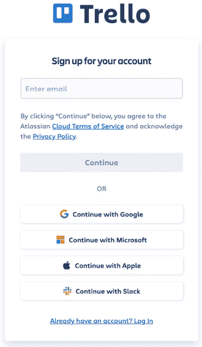

## 工作区（以前称为团队）

向导将引导你完成注册流程，并帮助你创建第一个工作区。将工作区视为你的部门或组织，或一种类型的项目：

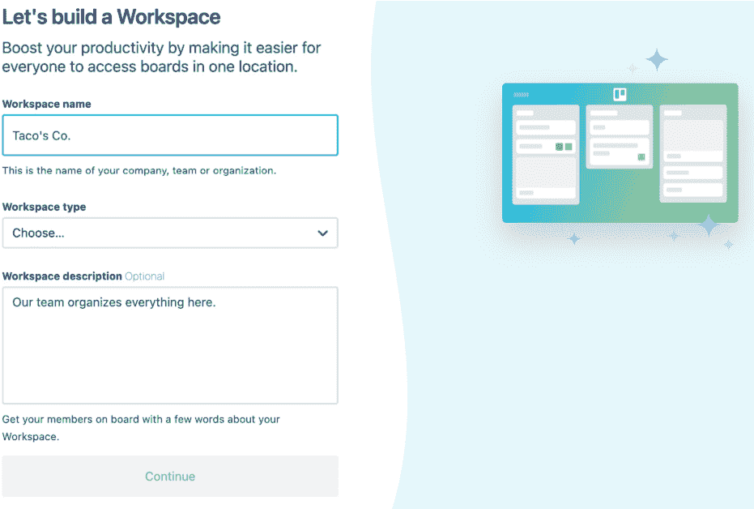

每个工作区按该工作区中的成员数量收费。你可以拥有免费工作区，并且可以拥有任意数量的工作区。选择你的团队类型以获取特定的模板建议。接下来，通过电子邮件地址邀请团队成员，或暂时跳过此过程并稍后邀请他们。

既然你已经设置好了 Trello 帐户，你就可以开始尝试和动手实践了。是时候让理论付诸实践了，因为我们将开始创建看板和列表，并了解这些东西是什么，以及如何使用它们。

让我们深入了解 Trello 最为人所知的东西……它的看板！

## 看板

Trello 的第一个主要组件是数字白板——即“看板”。你可以在 Trello 中拥有多个看板（免费计划中每个工作区最多 10 个，付费计划中无限数量）。

看板是卡片的集合，但我们稍后再讨论那些。将看板视为一个主题或目标。它可能是你正在从事的特定项目，也可能是一个团队。

不要太担心你的看板应该是什么，因为它可能会随时间而改变，你会发现自己在多个看板上操作。随着进度调整很容易。

你准备好把手指放在键盘上了吗？是时候开始深入研究了。

## 创建看板

为了帮助你探索看板，我们将创建一个，以便在我解释看板内部发生的情况时，你有一个直观的视图。

从 Trello 的顶部工具栏中，单击 **Create** 按钮并选择出现的第一个选项——即 **Create board**：

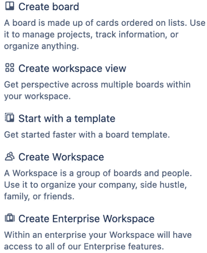

图 1.3 – Trello 中的创建选项

为你的看板命名。你可以将其命名为 `To Do` 或 `Team Tasks`。

接下来，确认你希望看板所在的工作区。你可以保留默认选项，或单击看板名称以选择另一个可用的工作区。

最后，你将选择可见性级别——即谁有权查看你的看板。目前，请使用默认选项，即 **Workspace visible**。如果你的工作区中没有其他人，这实际上与私有可见性相同。如果你不确定并希望隐藏此看板，可以将可见性设置为 **Private**。

单击 **Create** 后，你将直接进入新看板。

## 查找你的看板

访问 [trello.com](https://trello.com) 以查看你已加入或创建的看板：

## 图 1.4 – Trello 看板主页

查看所有看板，先显示星标看板，然后是最近查看的看板，最后是其余看板。你可以通过左侧选择工作区名称，仅查看特定工作区的看板。

要进入某个看板，请点击其卡片。

## 看板顶部工具栏选项

虽然看板外观可能大不相同，但导航方式相同。它们都有一个顶部工具栏，包含用于个性化看板的项目。

虽然其他工具也有“看板”概念，但你知道吗？Trello 是第一个推广这种组织方式的工具。Trello 还提供了我在所有其他类似工具中见过的最佳看板级别自定义和功能集。

## 为看板加星

你会看到的第一个项目是看板名称；紧挨着它的是一颗星。如果星星是黄色填充，则表示该看板已“加星”，并将出现在你的 **Trello 看板** 页面顶部。

你也可以通过 Trello 顶部工具栏中的 **星标** 菜单访问这些看板。

默认情况下，星标字段未选中。点击它以加星，再次点击以取消加星：

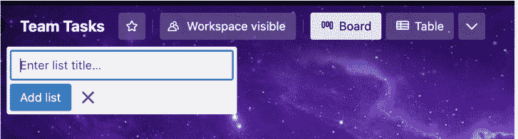

图 1.5 – 带有星标图标的看板标题，用于收藏

## 设置看板可见性

接下来你会看到的是看板的可见性。创建看板时，默认情况下将设置为 **工作区可见**。这意味着你工作区中的任何人都可以查看该看板并加入。

要更改此设置，请选择当前可见性选项 – 将出现一个菜单，包含更改选项：

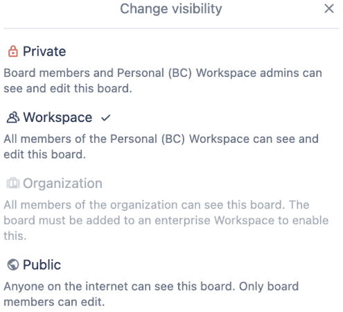

图 1.6 – 看板可见性选项

你至少有三个可见性选项，如果你使用的是 Trello 企业版，则有第四个选项。

**私有** 表示只有你和你邀请的人可以查看看板及其内容，有一个例外 – 工作区管理员也可以查看任何看板的内容（所以在看板里可别说你老板的坏话 😉）。

你可以通过打开看板左侧面板并选择 **成员** 来找到工作区管理员：

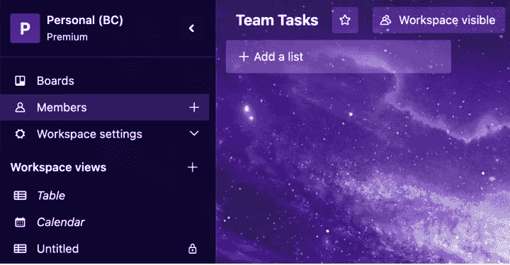

图 1.7 – 看板成员设置

如果你希望其他人查看你的内容并参与看板，即使其可见性为 **私有**，也可以邀请他们加入看板。点击看板右上角工具栏中的 **分享** 按钮，将出现一个模态框：

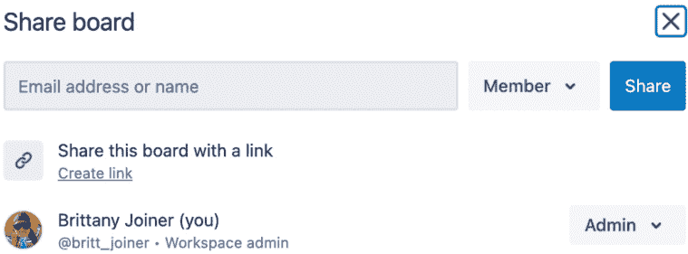

图 1.8 – 看板分享和邀请选项

在这里，你可以输入成员的姓名或电子邮件地址。如果他们不在 Trello 上，你可以向其电子邮件地址发送邀请。

你也可以点击文本字段下方的 **创建链接** 按钮，创建一个可以发送给他人以加入看板的链接。此链接不是公开的，但任何收到它的人都可以加入看板。创建后，你可以随时撤销此链接。

**工作区可见** 表示你工作区中的任何人都可以查看看板的内容。他们还可以加入并编辑。这对于与更广泛的同事群体相关且不包含敏感信息的任何信息都非常有用。

**公开** 可见性意味着任何人都可以查看此看板，即使他们没有 Trello 账户。有时，这实际上非常有用！例如，也许你想分发信息，如路线图或资源。虽然任何人都可以查看此看板，但他们无法编辑它。

还需要注意的是，截至 2022 年，Google 不会索引 Trello 看板，因此它们不会出现在 Google 搜索结果中。对于那些拥有带有大量流量链接的 Trello 看板的人来说，这真是令人沮丧！

**组织** 可见性仅适用于 Trello 企业版账户。它意味着任何使用相同公司电子邮件域（例如 mary@coolcompany.com 和 john@coolcompany.com）的人都可以查看此看板。

在可见性设置旁边，你会看到看板视图的选项。如果你想现在了解它们，请跳至第 4 章。

还有一个名为 **Power-Ups** 的按钮，但同样，我们将在后面章节再介绍，因为那里有很多内容需要讲解。这些插件可以增强你的 Trello 看板，使其能够做更多强大的事情。最好先从 Trello 的原生功能开始，再深入了解额外功能。我们将在第 11、12、13 和 14 章讨论这些内容。

你还会看到一个名为 **Automation** 的按钮，它允许你自定义规则来管理 Trello 中的项目。你将在第 6 章了解更多相关内容。

## 筛选看板

顶部栏中你还会看到一个 **Filter** 按钮。如果你的看板上没有卡片，它将不太有用，但一旦添加卡片，你就可以选择想要查看的卡片：

## Filter

## 关键字

输入关键字...

搜索卡片、成员、标签等。

## 成员

- [ ] 无成员
- [ ] 分配给我的卡片

## 到期日期

- [ ] 无日期
- [ ] 已逾期
- [ ] 一天内到期

显示更多选项 ∨

## 标签

- [ ] 无标签
- [ ]
- [ ]

图 1.9 – 看板筛选选项

在这里，你可以筛选仅显示你的卡片（或另一成员的卡片），或按到期日期筛选。你甚至可以按关键字、标签或活动近期性筛选。这是一个深入了解真正重要内容的绝佳工具，当你的看板很繁忙时非常有帮助。

## 添加成员和设置角色

你还会注意到看板右上角有头像，指示谁加入了看板。点击头像可查看该成员的信息。如果需要更改其角色，请点击 **Share** 按钮。你也可以在这里查看所有成员及其角色的列表。

默认情况下，每个人都是 **成员**，这意味着他们可以编辑看板上的内容，例如创建卡片、列表等。

管理员拥有超能力，可以重命名看板并关闭看板。

如果你使用的是 Trello 高级版或更高计划，你将可以使用另一种角色类型：**观察者**。这些用户可以查看内容并评论卡片，但无法编辑看板上的任何内容。如果你不想让看板公开，但需要团队查看内容而又不希望他们有权破坏任何东西，这很有帮助。

## 访问看板菜单

看板菜单的最后一站是顶部工具栏右侧的省略号。点击它以显示配置看板的额外设置：

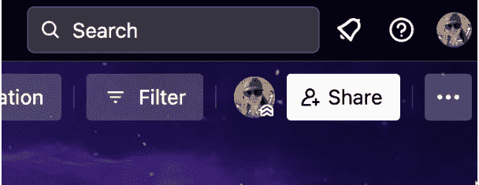

图 1.10 – Trello 看板上的菜单导航

## 描述

看板描述是你可以总结看板的地方。这有助于他人了解看板的上下文，也是保存相关链接的好地方。让我们来设置一下：

## 关于此看板

## 看板管理员

**Brittany Joiner**  
@britt_joiner  
Just a major Trello Nerd :) Follow m...  
[Edit profile info](https://trello.com/britt_joiner)

## 描述

使用 Markdown 快捷方式在输入时格式化页面，例如 * 用于列表，# 用于标题，--- 用于水平线。

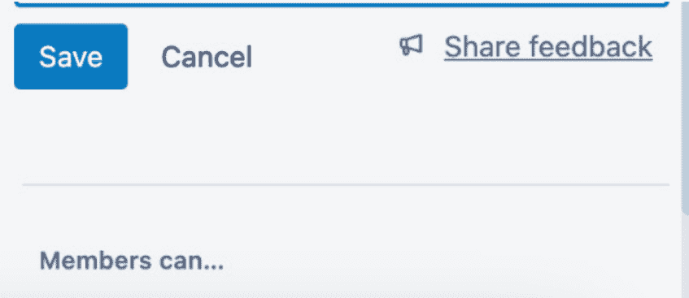

图 1.11 – 看板描述部分

使用富文本编辑器使用标题、项目符号和任何其他你想要的内容来设置文本样式。完成后，点击 **Save**。

## 背景

下一个设置允许你将背景更改为另一种颜色、库存照片或自定义图像。

点击 **Custom** 上传文件，或搜索关键字以从 Unsplash 查找照片：

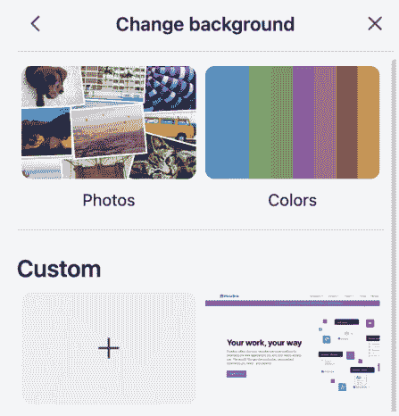

图 1.12 – 看板背景自定义选项

并非每个工具都允许你自定义和设置工作区样式。Trello 让你让看板成为你自己的，而不是局限于使用默认的浅色或深色模式背景。

## 贴纸

如果你想为看板增添风格，可以添加贴纸来设置卡片样式。打开贴纸菜单，搜索关键字，选择贴纸，然后将其拖到卡片上。你可以通过将鼠标悬停在贴纸上并点击 x 按钮来删除贴纸：

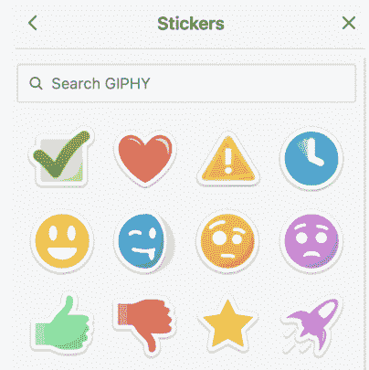

图 1.13 – Trello 看板贴纸

## 其他设置

点击 **More** 查看另一个隐藏的设置层。如果你选择第一个选项，即 **Settings**，你将看到更改看板工作区的选项。

你还可以启用或禁用卡片封面（预置在卡片顶部的图片）。

最后，你可以更改谁被允许在看板上执行各种操作的权限，例如评论卡片或添加人员。

你甚至可以编辑工作区成员加入看板而无需邀请的权限：

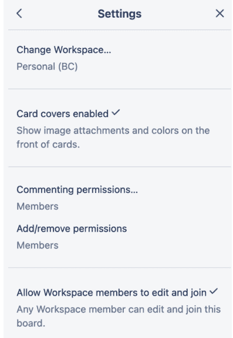

图 1.14 – 看板高级设置选项

## 集合

集合有点像 Trello 看板的文件夹。如果你想将多个看板组织在一起，可以将它们添加到集合中。此功能仅适用于高级及更高级别的计划。

## 归档项目

Trello 让你很难意外删除某个项目。如果你发现某些东西不见了，很可能只是被归档了！你可以在此处找到归档的项目。点击此选项，查看此看板中归档的所有内容，按卡片或列表排序：

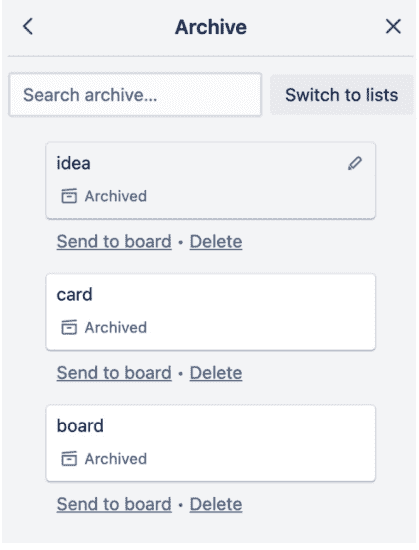

图 1.15 – Trello 中的归档项目

要恢复某个项目，请点击 **发送到看板** 按钮。

这是我偏好使用 Trello 的原因之一——因为不容易丢失东西。在其他工具中，删除可能是默认操作。如果误删，恢复起来会比较困难。但使用 Trello 时，如果发现某些东西不见了，很容易找回。

## 电子邮件地址

你知道吗，你可以将内容发送电子邮件到 Trello 看板？每个看板都有一个唯一的电子邮件地址。你可以使用 **电子邮件到看板设置** 区域来查看看板的地址、生成新地址，并配置将新项目添加到哪个列表：

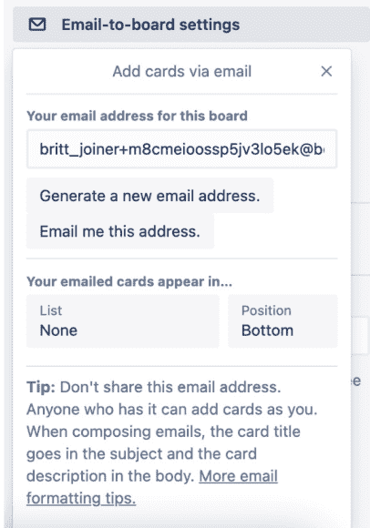

图 1.16 – 看板电子邮件选项

去试试吧！复制电子邮件地址，然后打开你的电子邮件。发送一封主题为 `Hi` 且正文中包含内容的电子邮件。然后，返回 Trello，几秒钟内就能看到它出现在你的看板上！

## 关注

如果你想接收关于此 Trello 看板上所有内容的所有通知，请点击 **关注** 按钮。但请注意——这会产生大量通知！当此看板上的任何卡片发生任何事情时，你都会收到通知：

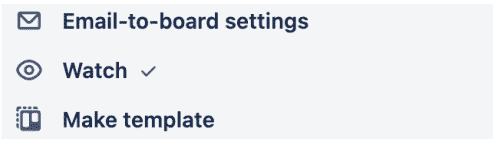

图 1.17 – 已勾选的看板关注按钮

你可以在此部分确认是否正在关注某个看板，如果正在关注，会显示一个对勾标记。或者，在工具栏中，你会看到一个关注按钮。如果通知太多，可以将其关闭。

## 模板

一旦你按照喜好设置好看板，你可能希望将其作为模板分享，以便你或他人将来使用。这是一种自定义和重复使用看板的好方法，这样你就不必每次都从头开始设置：

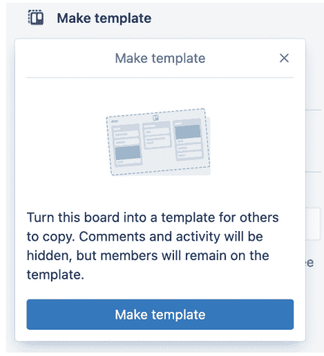

图 1.18 – 制作模板按钮

你甚至可以公开模板，帮助更多人发现 Trello 的更多用途！要查看其他人贡献的模板，请访问 trello.com/templates。

## 复制

你不必将看板设为模板才能复制它。点击 **复制** 按钮来复制看板，并选择要复制的部分，例如成员和卡片：

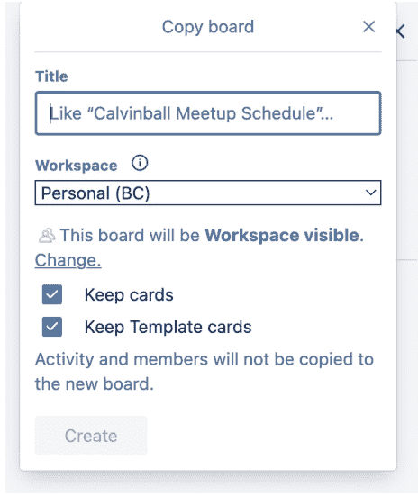

图 1.19 – 复制看板的设置

试试看，复制你当前的看板。创建一个名为 `House Projects` 的副本看板。

## 导出

无论你在 Trello 工作多么开心，你可能会发现需要将信息从 Trello 导出。有多种方法可以做到这一点——你可以打印看板，将其导出为 CSV，或导出为 JSON 对象（专业提示——你还可以通过在 URL 后附加 `.json` 在浏览器中将看板查看为 JSON 对象）：

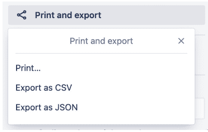

图 1.20 – 看板导出选项

目前，我们的看板相当空，但如果你想测试一下，添加几张卡片并试试看！

## 关闭看板

如果你想删除看板，可以将其关闭。即使关闭后，如果你改变主意，也可以撤销！只需点击 **重新打开看板**。你还可以从 **看板** 页面找到关闭的看板（要进入该页面，从 Trello 中的任何位置点击左上角的 Trello 标志）。从那里，滚动到页面底部，然后点击 **查看所有关闭的看板** 按钮。

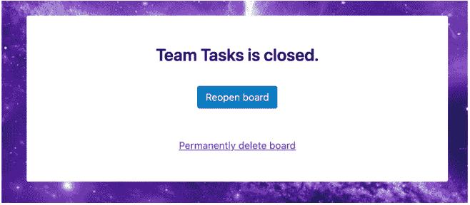

图 1.21 – 重新打开关闭的看板

去试试看！关闭你的看板，然后将其恢复。

## 列表

Trello 看板的第二大主要组件是你的 **列表**。列表是你在看板内组织便利贴的方式。虽然有成百上千种使用列表的策略，但它们通常被用作工作流程的阶段。

在许多情况下，这很简单，就是 **待办**、**进行中** 和 **已完成**。

更改列表名称和拖动它们很容易，所以不要太担心你叫它们什么，以及名称是否会更改。

要创建第一个列表，请在看板名称下方的框中点击 **添加列表**。输入任何你想要的内容，但如果你需要灵感，就将这个列表命名为 `Ideas`。按 _Enter_ 创建第一个列表：

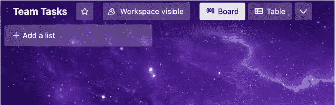

图 1.22 – 添加列表前的空看板

去创建更多列表吧。你将遵循相同的过程——只需输入名称，并在列表右侧的框中按 _Enter_。

添加 **待办**、**进行中** 和 **已完成** 列表。

如果你放错了顺序，或者想移动列表，请拖动列表将其移动到不同的位置。

就像看板有操作一样，列表也有用于管理卡片组的操作。点击列表右上角的三点菜单以访问列表菜单：

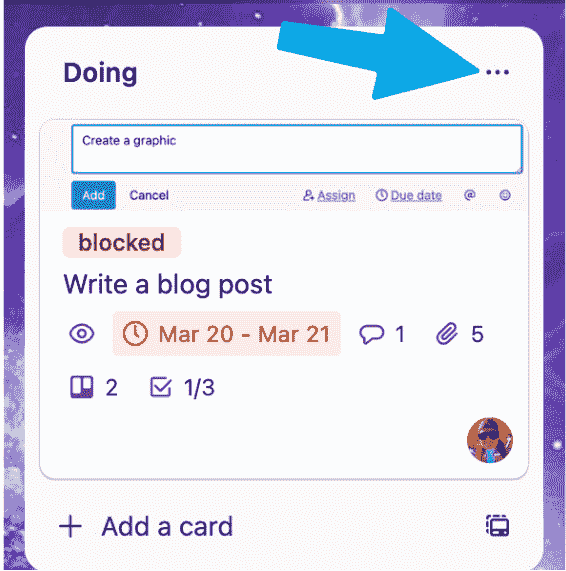

图 1.23 – 用于访问列表操作的三点菜单

## 添加卡片

第一个选项是将卡片添加到列表中。这不是添加卡片的唯一方式，但如果你喜欢，可以使用。点击 **添加卡片** 来命名卡片，之后它将被添加到你的列表中。去试试看！

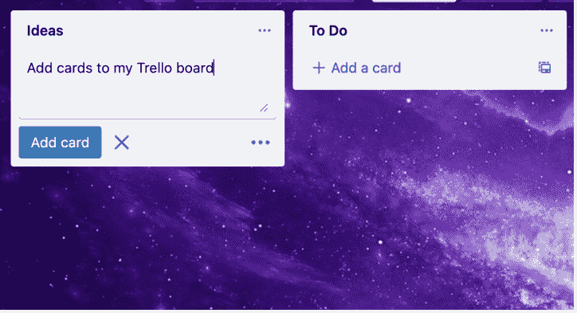

图 1.24 – 将卡片添加到列表

创建一张写着 `Add cards to my Trello board` 的卡片。按 `Enter` 保存它。瞧！它将出现在你的列表中！

## 复制

列表菜单中的下一个操作是复制列表。这就像它听起来那样——它会复制列表，并将其添加到当前列表旁边，包括该列表中的任何卡片。去试试看！点击 **复制**，查看带有你刚刚创建的卡片的另一个列表出现。

## 移动

列表也有 **移动** 选项。你可以拖动列表将其移动到看板内的另一个位置，或者使用此操作来移动它。你甚至可以将列表移动到完全不同的看板！当你在想如何组织看板，或者在完成项目后，你可能会想这样做。

## 关注

你也可以关注列表，类似于关注看板。

这会发送关于此列表中任何卡片发生的任何事情的通知。如果你正在管理工作流程的特定阶段，这非常合适。

例如，如果你负责审查博客内容，你可能希望收到 **审查** 列表中每张卡片的通知：

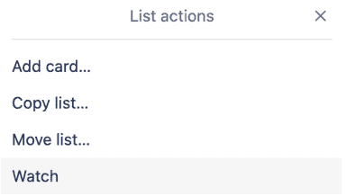

图 1.25 – 列表中可用的操作

为此 **待办** 列表选择 **关注** 选项，以便每当有新卡片添加到此列表时，你都能收到通知。

## 排序方式

你可以使用 **排序列表** 操作按某些属性对列表中的卡片进行排序。在这里，你可以按卡片名称、创建日期或到期日期（如果该列表中有带到期日期的卡片）来排序卡片：

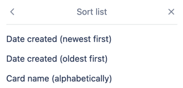

图 1.26 – 列表排序菜单

## 列表中卡片的操作

以下两个选项适用于列表中的所有卡片，但不适用于列表本身。你可以将所有卡片移动到另一个列表，同时保持列表列在当前位置。你可能会在周末这样做，将 **本周已完成** 列表中的所有卡片移动到另一个 **已完成** 列表：

将此列表中的所有卡片移动...
将此列表中的所有卡片归档...

Figure 1.27 – 列表中卡片的操作

下一个操作是归档列表中的所有卡片，同时保留列表本身。如果你已经处理完列表中的卡片并想将其清除，但仍计划继续使用该列表，这将非常有用。

## 归档列表

**列表**菜单中的最后一个操作是归档列表，这将归档卡片_和_列表本身。如果你意识到不再需要该列表，这将非常有用。如果你不小心归档了列表（或列表中的卡片），可以进入**已归档项目**区域的看板设置，将列表移回看板。

## 卡片

Trello 看板的最后一个元素是超级便利贴。你的看板包含列表，列表中包含卡片。你可以轻松地在列表（和看板）之间移动卡片，随意命名它们，并做更多事情。

这就是为什么_第 2 章_和_第 3 章_将深入探讨 Trello 的核心功能，这些功能嵌套在这些卡片中。

目前，只需知道这些是看板上的便利贴，可以在列表之间移动。它们拥有超能力，允许你向每个便利贴添加比你想象中更多的细节：

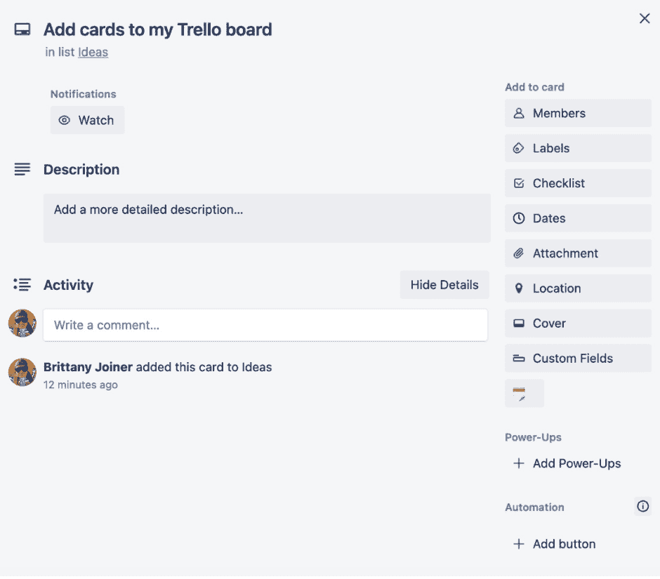

Figure 1.28 – Trello 卡片

## 总结

在本章中，我们了解了 Trello 是一个带有便利贴的数字白板。你可以用它构建几乎任何你想要的东西，因为，就像乐高一样，它非常多功能。许多不同类型的团队和人员都在 Trello 中找到了价值！

在构建时，你将使用三个组件——看板、列表和卡片——来设计你的杰作。看板是卡片的集合——超级便利贴——而列表在看板上组织这些卡片。有许多选项可以自定义你的看板，使其独一无二。

好了，你已经度过了艰难的设置内容，现在是时候享受乐趣并深入了解 Trello 卡片了。
