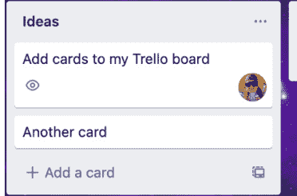
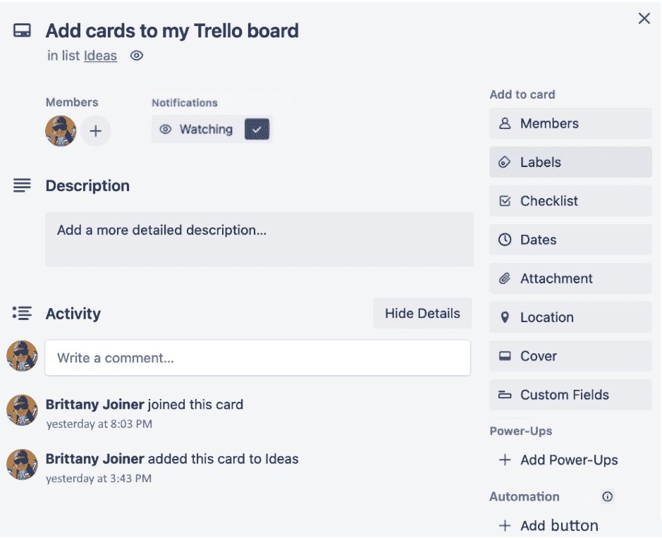
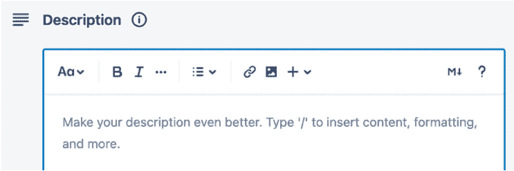
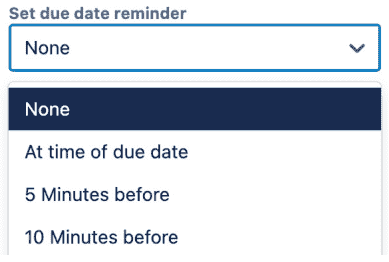
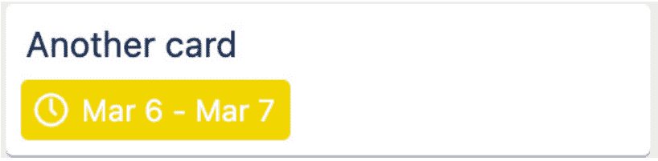
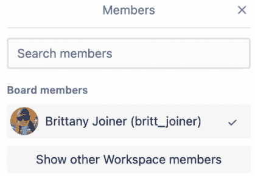
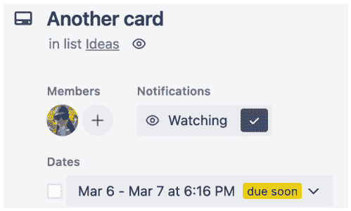
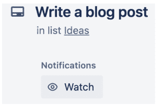
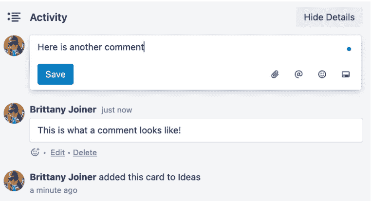
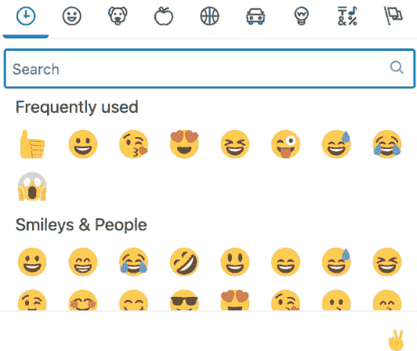

## Trello 卡片入门包

Trello 的关键组件是我们称之为**卡片**的超级便利贴。Trello 中的一切都围绕卡片展开——它是 Trello 的核心！要充分利用 Trello，你需要了解卡片的不同功能。

在本章中，我们将介绍你需要知道的关于卡片的最重要内容，包括最常用的字段。在本章结束时，你将能够创建带有清晰描述和时尚标签的卡片，添加成员和日期。你还将能够轻松地移动事物。

虽然卡片有很多内容，但本章将重点介绍以下内容：

- 卡片视图
- 名称和描述
- 标签
- 日期
- 成员
- 关注卡片
- 评论

我们将在_第 3 章_中更多地讨论卡片中的其他功能，例如清单、自定义字段和附件。

## 卡片视图

Trello 卡片有两个视图——**卡片正面**和**卡片背面**。

正面视图是你从看板上看到的，无需点击打开卡片：

Figure 2.1 – 卡片正面

背面视图是你打开卡片时看到的。这显示了卡片的完整详细信息，并允许你与之交互。

Figure 2.2 – 卡片背面

## 名称和描述

每个 Trello 卡片都必须有一个标题。这在卡片顶部可视化。下方是描述字段。

Figure 2.3 – 卡片描述编辑器

描述字段允许你提供关于任务或项目的详细信息。这对于提供上下文或可能无法从卡片标题中立即察觉的额外信息特别有用。

## 为什么使用描述？

描述是记录任务或项目笔记并提供额外详细信息的好地方。例如，如果你是一名营销人员，使用卡片来代表一个活动，描述可以保存你会在活动简报中包含的项目。这消除了链接到其他文档的需要。如果你是一名项目经理，你可以将所有利益相关者的笔记合并，并在描述中列出项目的目标和宗旨。工程师可能会使用描述来描述一个 bug，并包含一个损坏功能的屏幕截图。你还可以在附件中包含信息，我们将在第 3 章中讨论。

## 编辑描述

要为卡片添加描述，请从看板视图中点击卡片名称以打开卡片。然后，选择提示你编写描述的框，并输入任何你想到的内容。

描述字段接受 Markdown，但如果你愿意，可以使用富文本编辑器来设置标题、粗体、斜体、创建链接、添加链接、图片等文本样式！如果你需要将卡片描述导出为 Markdown，请选择 M↓ 按钮，然后复制文本。

## 标签

标签用于对卡片进行分类。它们是颜色编码的，可以根据你的需求进行自定义。例如，你可以使用标签来指示任务的优先级、任务类型、项目状态，或任何你能想象的其他内容！

为什么使用标签？

标签为你的卡片添加可视标签，因此你可以快速获取有关它们的相关详细信息，而无需打开卡片。它们对于过滤看板也很有用，允许你随时查看卡片的子集。我们将在第 4 章中更多地讨论过滤器。

## 创建和编辑标签

有两个地方可以编辑标签——看板菜单或直接从卡片内部。两个过程相同——唯一的区别是你访问它的位置！

从卡片内部，点击卡片右侧**添加到卡片**菜单上的**标签**按钮：

| 在列表 **Ideas** 👁 |
|---|
| 成员 |
| 标签 |
| 描述 |
| 添加更详细的描述... |
| 活动 |
| 隐藏详情 |
| 写评论... |
| **Brittany Joiner** 加入了此卡片 |
| 2 月 25 日 晚上 8:03 |
| **Brittany Joiner** 将此卡片添加到 Ideas |
| 2 月 25 日 下午 3:43 |
| 添加到卡片 |
| 成员 |
| 标签 |
| 清单 |
| 日期 |
| 附件 |
| 位置 |
| 封面 |
| 自定义字段 |
| Power-Ups |
| + 添加 Power-Ups |

Figure 2.4 – 添加到卡片菜单

这将打开一个模态框，允许你选择当前标签或创建一个新标签：

## 标签

### 标签设置

- [ ] 测试标签
- [ ]
- [x]
- [x] blocked
- [ ] p1
- [x]
- [x]

创建新标签

## 启用色盲友好模式

## 给我们反馈

Figure 2.5 – 标签模态框

在搜索框中输入名称以搜索现有标签。要创建标签，请点击**创建新标签**按钮，或点击你想要编辑的现有标签旁边的铅笔图标。然后将出现一个框，允许你为标签添加标题，这是显示在标签上的文本。

你还可以将标签的颜色更改为调色板选择器中可用的 30 种色调中的任何一种。如果你更喜欢只有文本而没有颜色，标签将从 Trello 卡片的正面隐藏，只有在打开卡片时才会出现。

Figure 2.6 – 无颜色标签示例

在你为标签命名并选择颜色后，点击 **Save**。

如果你更喜欢更多色盲友好选项，请点击标签下方的按钮以打开**色盲友好模式**。这将标签更改为各种图案，而不仅仅是颜色，这对于任何难以分辨颜色的人来说可能更易于访问。

要删除标签，请点击菜单右侧的铅笔，然后选择红色的 **Delete** 按钮。

在你创建了想要的标签后，点击标签或标签旁边的复选框以将其添加到当前卡片。退出卡片，你可以从卡片正面点击标签以显示或隐藏标签的文本。

## 日期

开始日期和到期日期字段用于为任务或项目设置截止日期。到期日期是任务或项目应完成的日期，而开始日期是工作应开始的日期。还不够，需要更多日期？我们将在第 3 章讨论自定义字段时，介绍如何添加更多日期。

要设置开始日期或到期日期，只需点击卡片并从日历中选择相应的日期。

### 开始日期和到期日期

卡片可以同时设置开始日期和到期日期字段，两个字段都不设置，或者各设置一个。两个字段都提供日期值，但只有到期日期字段接受时间值。

为什么使用日期？

日期对于可视化截止日期和优先处理任务很有用。带有到期日期的卡片可以绘制在时间线或日历视图上，我们将在第 4 章中更详细地讨论。

按到期日期对列表中的卡片进行排序是优先处理本周工作量的有用方法。如果你只想查看即将到期的任务，可以使用看板过滤器仅显示今天或下周内到期的卡片，或显示已逾期的卡片。

### 将开始日期和到期日期添加到卡片

从看板中，点击一张卡片以打开其背面视图。在卡片右侧的 **添加到卡片** 菜单中，点击 **日期**。这将打开一个带有开始日期和截止日期选项的模态框。

## 日期设置

## 2023 年 3 月

| SUN | MON | TUE | WED | THU | FRI | SAT |
|-----|-----|-----|-----|-----|-----|-----|
| 26 | 27 | 28 | 1 | 2 | 3 | 4 |
| 5 | 6 | 7 | 8 | 9 | 10 | 11 |
| 12 | 13 | 14 | 15 | 16 | 17 | 18 |
| 19 | 20 | 21 | 22 | 23 | 24 | 25 |
| 26 | 27 | 28 | 29 | 30 | 31 | 1 |
| 2 | 3 | 4 | 5 | 6 | 7 | 8 |

### 开始日期

M/D/YYYY

### 截止日期

03/07/2023 5:47 PM

### 设置截止日期提醒

无

提醒将发送给该卡片的所有成员和观察者。

保存

移除

图 2.7 – 日期模态框

使用月份名称左右两侧的箭头导航到过去或未来的日期。

默认情况下，开始日期处于禁用状态，但点击任何日期都会自动设置截止日期。如果需要，您可以通过选择日期右侧的时间框并输入另一个时间来调整时间。

要设置开始日期，请选择 **开始日期** 标签下方灰色日期前面的复选框。立即，开始日期将设置为当前截止日期的前一天。要更改此设置，请点击上方日历中的另一个日期，或在开始日期字段中输入所需的日期。

如果您希望在卡片到期前收到通知，请使用下拉选项设置提醒。这些选项类似于日历工具中即将举行的会议的提醒。

## 图 2.8 – 截止日期提醒选项

您可以为卡片设置从到期时间到两天前的提醒。如果需要更早的提醒，这是可能的，但仅通过 Trello 自动化实现。我们将在第二部分更详细地介绍截止日期自动化。

提醒将出现在您配置 Trello 通知的任何地方。例如，如果您允许移动应用通知，您将在设置的时间收到关于卡片的推送通知。如果您配置了这些类型的通知，您还将收到电子邮件或桌面通知。

还需要注意的是，任何卡片成员或正在观察该卡片的人都会收到关于截止日期的提醒——不仅仅是您！

如果您不希望收到关于即将到期卡片的通知，只需保持此字段不变，因为默认选项是 **无**。

当您对开始日期、截止日期和提醒配置感到满意时，请点击卡片底部的蓝色 **保存** 按钮。

## 图 2.9 – 开始日期和截止日期在卡片正面的显示方式

如果您想从卡片中清除日期，请点击灰色的 **移除** 按钮。

当卡片打开时，卡片日期将在卡片名称下方、描述上方的卡片详细信息中可见，并且也可以从看板视图中看到，因此您可以在不打开卡片的情况下引用日期。

## 成员

**成员** 字段允许您将团队成员分配给任务或项目。此字段非常适合跟踪谁负责任务的各个部分，并将责任分配给多个队友。

为什么使用成员？

将成员添加到卡片是确保任务所有者收到其项目通知并了解其正在处理的事物的任何变化的关键。它还可以用于在看板上分离任务，以便每个人都可以筛选只查看自己的任务，而项目经理仍然可以使用看板在一个地方查看所有内容。

使用时间轴视图，您还可以按日期和成员查看卡片，这是了解给定期间内带宽和容量的有用方法。我们将在第 4 章更详细地介绍视图。如果您使用的是 Trello 的免费版本，您仍然可以使用 Swimlanes Power-Up 在列表中查看按成员组织的卡片。我们将在第 3 部分更详细地介绍 Power-Ups。

## 将成员添加到卡片

通过从看板点击卡片来打开它。从卡片背面，选择 **添加到卡片** 菜单顶部出现的 **成员** 按钮。这将打开 **成员** 模态框。

图 2.10 – 成员模态框

搜索看板成员或从列出的名称中选择他们。如果用户已经是卡片成员，其名称旁边会出现一个对勾标记。成员将收到您将他们添加到卡片的通知。

要从卡片中移除用户，请点击其名称以取消选择。他们也将收到关于其被移除的通知。

您可以向卡片添加任意数量的成员。如果您想添加某人但看不到其列出，您需要先将其添加到看板。如果您需要回顾如何将用户添加到看板，请返回第 1 章。

卡片的所有成员都会在卡片标题下方显示其头像。它们也从卡片正面可见，以便您可以在不打开卡片的情况下查看谁被分配。

图 2.11 – 卡片的成员部分

## 观察

当某人是卡片成员时，其头像会出现在卡片上，并且他们被分配了该项目。但是，有时您可能希望收到关于卡片上活动的通知，而无需在 Trello 中将其分配给您。您可以在 Trello 中执行此操作，这称为 **观察**。

为什么观察卡片？

当您需要关于卡片的通知但不希望它显示为您指定的任务之一时，观察卡片很有用。当任务结果与您相关但您无法采取任何行动来推进卡片时，这也非常好。

## 配置卡片观察

打开卡片，在名称下方查找名为 **通知** 的部分。在其下方，有一个带有眼睛图标的灰色 **观察** 按钮。

图 2.12 – 卡片的观察部分

默认情况下，复选框未选中。点击按钮以开始观察卡片。复选框会出现在 **观察** 旁边，眼睛图标会出现在卡片顶部的列表名称旁边。

要停止观察卡片，请再次点击 **观察** 按钮以移除勾选。

## 评论和活动详情

Trello 卡片底部的部分提供了卡片上的活动日志以及用户添加的评论。评论对于与团队成员沟通或提供任务或项目状态更新特别有用。

为什么使用评论？

评论对于讨论与卡片相关的任何事情很有用。与其发送电子邮件或通过 Slack 发送消息，不如在卡片本身内进行对话更容易。评论始终保存到卡片中，

即使卡片被存档，您仍然可以访问卡片并查看评论，显示与该任务或项目相关的任何决策的历史记录。

## 在卡片上评论

要向卡片添加评论，请从主看板点击卡片打开它，然后滚动到卡片底部，位于描述和任何检查清单或附件下方。您将看到一个名为 **活动** 的部分，其下方是一个用于输入评论的输入字段。

图 2.13 – 卡片的评论部分

点击字段并开始输入一些文本。您可以附加文件、@提及另一位用户以向其发送通知、添加表情符号以增添风格，甚至引用另一张卡片。完成后，请点击文本下方的蓝色 **保存** 按钮。

发布后，您仍然可以使用其下方的操作编辑或删除评论。如果其他人发布了评论，您将看到 **回复** 选项，这将自动开始新评论并提及该用户。

最后，您可以对评论做出反应。点击已发布评论下方的表情符号按钮，并从选项中选择一个，或搜索合适的表情符号。

图 2.14 – 用于对评论做出反应的表情符号选择器

## 活动详情

在卡片上的评论之间，您将看到关于卡片上发生的事情的其他更新，例如成员、日期、标签、自定义字段、附件甚至描述的更改。虽然当您想查看卡片上发生了什么或不确定谁更改了卡片上的字段时，这通常很有帮助，但如果您发现这些更新不必要或使卡片变得杂乱，您可以将其关闭。点击 **隐藏详情** 以移除这些更新并仅显示评论。

如果您改变主意，可以通过点击 **显示详情** 将其恢复。

## 卡片操作

我们已经讨论了很多可以对卡片执行的操作，但到目前为止提到的大部分内容都与添加信息有关。使用卡片还有几个重要操作。

卡片操作菜单位于卡片选项的最底部，在卡片右侧，位于任何 Power-Ups 和自动化按钮下方。这些操作可用于对整个卡片执行某些操作：

- **Move**：使用此操作可将卡片移动到另一个列表或看板。您可以指定位置，例如是将其添加到列表的顶部还是底部。请记住，您也可以通过简单的点击和拖动轻松在看板上移动卡片。
- **Copy**：复制卡片允许您复制卡片并保留您想要的部分。您可以复制所有内容，而检查清单可让您选择避免复制某些项目，例如附件、检查清单或评论。与 **Move** 选项一样，您可以指定复制的卡片要出现在哪个列表和看板上。
- **Make template**：模板卡片是一种让队友知道您是否有卡片的首选格式的方式，并让他们轻松复制该格式。虽然您可以复制看板上的任何卡片，但模板卡片非常清楚地表明如何复制卡片，并为新用户提供了一个轻松引用它们的方式。
- **Archive**：存档卡片会将其从看板中移除。不用担心——它永远不会真正丢失！您可以通过看板菜单中的 **Archived Items** 并搜索卡片，轻松将卡片发送回看板。没有必要删除它，因为您的存档数据没有存储限制，但有些人可能更喜欢删除它，如果它是他们永远不希望重新出现的机密信息。
- **Share**：在某些情况下，您可能想要共享卡片。**Share** 选项允许您打印卡片或将其导出为 JSON 格式。您还可以查看和复制卡片的短链接，为卡片生成二维码，或获取嵌入代码以在网页上查看它。（请注意，这不会让没有访问权限的人看到卡片。）您还可以获取卡片的电子邮件地址。发送到该电子邮件的任何内容都将显示为卡片上的评论。

卡片操作可能很有用，所以请花时间熟悉这些操作。您还可以使用键盘快捷键——在卡片被选中时输入字母 C 即可存档它。有了这些技巧，您就可以避免滚动到 **Card actions** 菜单来执行这些操作。

## 卡片正面的快速操作

我们迄今讨论的所有内容都是在卡片背面，即打开卡片时。但是，您可以在不点击打开卡片的情况下对卡片进行更改。将鼠标悬停在卡片上时，单击卡片名称右侧的铅笔图标。

这将打开一个菜单，允许您访问卡片的字段并打开这些模态框，而无需进入卡片本身。

单击出现的任何选项都会打开您在卡片内部会找到的相同菜单，例如添加成员、从日历中选择到期和开始日期、移动卡片以及添加标签的菜单。还有键盘快捷键选项可以直接进入其中之一——请查看 [trello.com/shortcuts](trello.com/shortcuts)。

## 摘要

哇！我们在这一章中讨论了很多内容。如果您在想，“哇，Trello 可以做很多事情！”，您是对的。这就是它的美妙之处。不要感到不知所措，给自己一个机会去看看可能性！

让我们回顾一下。我们学习了卡片的元素以及可以分配给它的属性，例如成员、日期和标签。您现在也习惯于在卡片周围导航、执行操作、显示详细信息以及随心所欲地进行编辑。

既然您了解了卡片最有用的部分，是时候深入了解了。我们只是触及了这些超级便利贴中可以做的一切的表面，所以让我们继续！
