## 提升您的卡片

如果您对卡片可以做的所有事情感到头晕目眩，那么系好安全带，因为我们才刚刚开始。虽然添加成员、日期和标签是最常见的，但您可以在 Trello 卡片中包含许多其他内容，使它们更加强大。

在本章中，我们将讨论如何向卡片添加文件、链接和任何其他附件。我们还将讨论位置、检查清单和卡片封面，以及如何使用所有这些字段为您的卡片提供更多上下文。如果您想到我们尚未提到的输入，您将学习如何创建自定义字段来存储您能想象的任何其他信息。

## 附件

虽然您可以向 Trello 卡片描述中添加大量信息，或通过我们已经讨论过的一些其他字段添加信息，但有时您会有存储在其他地方的数据或文件。这就是附件派上用场的地方。

为什么使用附件？

我并不天真到认为 Trello 是您将使用的唯一工具。哎呀，即使我仍然使用其他东西，例如电子表格来组织财务信息，或使用 Canva 为博客文章创建图片，甚至使用 Google Docs 或 Confluence 与他人通过文本进行协作。附件使您能够将所有内容放在一个地方，而无需牺牲使用最适合工作的工具。您还将使用多个彼此相关的 Trello 卡片和看板，因此在处理卡片时能够快速访问相关项目至关重要。

## 将项目附加到卡片

将项目附加到卡片的最简单方法是将文件拖放到卡片上或粘贴链接。您可以在卡片打开（卡片正面）或关闭（卡片背面）时执行此操作。

另一种附加卡片的方式是通过 **添加到卡片** 菜单中的 **附件** 操作。将出现一个模态框，提示您选择附件类型。

## 附件管理

### 从计算机附加文件

您也可以将文件拖放以上传它们。

选择文件

### 搜索或粘贴链接

查找最近的链接或粘贴新链接

### 显示文本（可选）

要显示的文本

- Trello
- Confluence
- Jira

最近查看

在此处编辑检查清单模板

Mods · 44 分钟前查看

## [2023 OS] 目标

个人 (BC) · 3 小时前查看

## 挑选感谢礼物给技术 ...

[2023 OS] 目标 · 4 小时前查看

## 让 Vy 找到技术工作

Britt&Vy · 6 小时前查看

## Amazon 评论者/影响者表单 - ...

[2023 OS] 目标 · 8 小时前查看

取消 插入

您可以向卡片添加多种类型的附件，添加一个附件的过程会根据您想要附加的内容略有不同。

## 计算机文件

如果您有保存在计算机上的文件，例如 PDF、电子表格、图片、演示文稿、视频或音频文件，您可以将它们添加到卡片，其他人可以预览或下载附件。

选择 **计算机** 选项，将出现一个文件选择器模态框，要求您从计算机上的目录中选择文件。

选择文件，并在文件加载到卡片时，您将看到加载通知。添加后，附件将出现在卡片描述下方和卡片上任何检查清单之上。

如果文件是图片或 PDF，单击名称或项目将打开项目的预览。要下载资源，请单击项目后面的箭头图标。

filename.

如果你想重命名项目，请点击 **Edit** 来更改名称并使其更清晰。如果有人给你发送名为 "Screenshot-12345" 的截图，而没人知道这是什么意思，这将非常有用。

如果你向卡片添加图片，Trello 会自动将其设置为卡片封面。这意味着，无论卡片是打开还是关闭并在看板上查看，图片的缩略图都会显示在卡片顶部。要禁用图片预览，请在卡片内的 **Attachments** 部分中选择图片的 **Remove cover**。

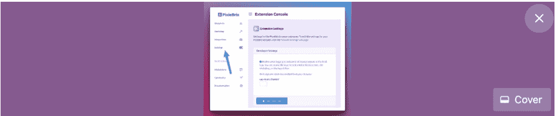

## Another card
in list Ideas 👁

Notifications
👁 Watching ✓

## Description
添加更详细的描述...

## Custom Fields
🔘 Test

T Custom text
添加自定义文本...

## Attachments
Untitled (2).png ↗
几秒前添加 · Comment · Delete · Edit
🗑 Remove cover

Suggested ⚙
👤 Join

Add to card
👤 Members
🏷 Labels
✉ Checklist
⏰ Dates
📎 Attachment
📍 Location
📝 Custom Fields
✏

Power-Ups
+ Add Power-Ups

## Trello cards and boards

你还可以将 Trello 项目附加到卡片，从而方便地快速引用其他看板或卡片。

从附件选项中点击 **Trello**，将出现一个新模态框，要求你搜索要添加到卡片的卡片或看板。搜索名称、输入链接，或选择自动出现的卡片或看板之一。

你的卡片上将创建一个名为 **Trello attachments** 的新部分，并显示你选择的项目。这是预览卡片关键信息的绝佳方式，而无需实际前往该卡片。

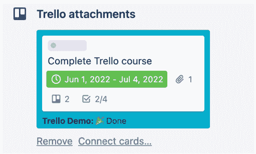

Figure 3.5 – Preview of attached card

如果你附加一个看板，你的附件将显示看板背景的预览以及看板名称，你只需点击一下即可直接前往该看板。

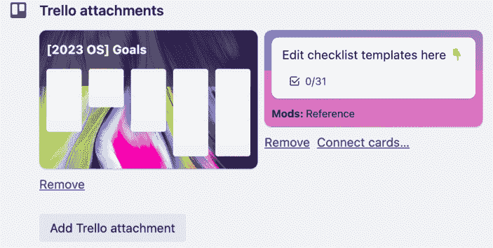

Figure 3.6 – Preview of attached board and card

请注意，如果卡片的成员无法访问附加 Trello 项目的看板，他们将无法预览附件。当你查看卡片时，这对于从私有看板快速引用某些内容非常有用，同时又不允许其他人看到该项目。

你会注意到，在搜索 Trello 项目的选项旁边，你还会看到 Confluence 和 Jira。由于 Trello 由 Atlassian 拥有，因此与这些其他 Atlassian 工具有紧密集成，允许你在菜单中搜索并选择 Confluence 页面和 Jira 工单。

## Cloud drives

我们中的许多人使用工具在云端共享文档，例如 Google Drive、Box、Dropbox 和 OneDrive。附加云文件的工作方式非常相似，无论平台如何。

以前，Trello 的附件中有针对其中一些平台的部分，例如 Box 和 Google Drive。但随着其附件菜单的最新更新，这些部分已被移除。如果你想在看板中加入云文件，可以搜索 Power-Up（例如 Google Drive Power-Up），或者可以通过链接附加这些文件，我们将在一分钟后讨论。

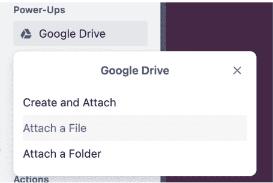

Figure 3.7 – Attach Google Drive files and folders to cards

你会看到卡片上出现一个新部分，显示云文档提供商和图片预览。

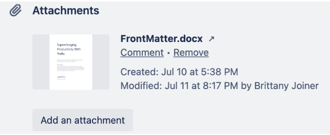

Figure 3.8 – Google sheet attached to a card

点击 Comment 以开始一个链接到文件的评论。如果你已添加文件，并希望确保卡片上的其他人知道文件存在，并邀请他们对文件采取任何必要操作，这将非常有用。

## Links

在某些情况下，你可能只想附加一篇文章的链接。只需将链接粘贴到 **Attachment** 菜单顶部的框中。

链接下方的 Display text 字段允许你为链接命名。这是可选的，并为你提供了一种快速方式，以澄清该字段的名称，如果默认出现的文本不够清晰。我发现这对于 Notion 链接特别有用，这些链接显示为一串无用的字母和数字。我可以将它们重命名为，例如，Mod Promo Playbook。

当你对链接和名称满意时，点击蓝色的 **Insert** 按钮。

## Inline attachments

与通过 **Attachments** 部分将链接附加到卡片不同，你可以将它们插入到描述和评论中。试一试！

将链接粘贴到评论中。我过去讨厌录制自己，但现在我实际上更喜欢通过 Loom 传达想法，而不是输入长评论，所以我会粘贴一个来自 Loom 的链接。

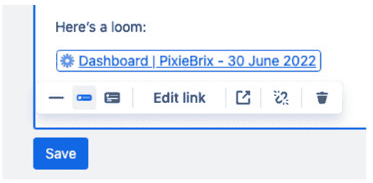

Figure 3.9 – Smart link options in card comment

点击链接以查看带有更改链接外观选项的菜单。你可以保持简单，仅包含链接的精确副本，也可以选择中间选项（即默认选项），显示带有超链接标题的徽标，或者可以选择第三个选项，它类似于链接内容的可嵌入视图。

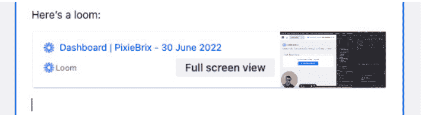

Figure 3.10 – Full embed of smart link in card comment

要查看此功能适用于哪些服务，请查看 [support.atlassian.com/trello/docs/link-cards/#supported-services](https://support.atlassian.com/trello/docs/link-cards/#supported-services) 以获取最新信息，因为我相信他们会不断添加更多服务。这些功能与链接卡片的工作方式非常相似，你将在本章后面阅读到相关内容。

## Custom fields

我们已经讨论了卡片的许多特定字段。你可以定义日期、分配成员、用任何你想要的信息更新描述、附加文件，等等！但有时，你仍然只需要其他东西。

这时自定义字段就派上用场了！Trello 的 Standard、Premium 和 Enterprise 计划用户可以创建自定义字段，以跟踪任务或项目的其他信息。这个字段对于跟踪特定于你组织或工作流程的信息特别有用。

自定义字段在看板级别设置，并出现在看板上的每个卡片上。你不能将字段设置为仅在某些卡片上显示，或者在填写后才在卡片正面显示。如果你愿意，还可以选择将它们从卡片正面完全移除。

我几乎在创建的每个看板上都使用自定义字段。虽然你可以使用标签来添加关于卡片的信息和详细信息，但我发现自定义字段更易于使用，并且在定义卡片的相关详细信息方面更加直接。

它们还非常适合将你的 Trello 卡片转换为表单。使用自定义字段，你可以告诉某人创建一个 Trello 卡片并填写出现的字段，而不是描述他们应该在卡片描述中输入的所有信息。

为什么要使用自定义字段？

一旦你在 Trello 中熟悉了工作流程，你就会希望它们尽可能顺畅。自定义字段可以帮助你做到这一点，并提供护栏，以确保使用看板的其他人向卡片添加正确的数据，并确保没有遗漏任何内容。这也是一种完全自定义 Trello 使其成为你需要的工具的方式，而不是仅仅是一款普通的项目管理工具。这确实是允许你将 Trello 构建为你需要的任何东西的基础模块之一。

你对自定义字段感兴趣，但不确定为你的看板创建什么？以下是一些基于你使用 Trello 方式的想法：

| Content Calendar | Ad title, Publish date, Content topic |
|------------------|---------------------------------------|
| Sales Pipeline   | Lead email, Deal amount, Status       |
| Support Tickets  | Ticket ID, Customer email, Support level/tier |
| Engineering Sprint | Estimated story points, Actual story points, Priority |
| Product Roadmap  | Votes for feature, Key stakeholder    |
| Project Management | Milestone date(s), Impacted team      |
| E-commerce Orders | Order ID, Estimated delivery date     |

## Creating a custom field

你可以在卡片或看板菜单中创建自定义字段。在卡片右侧的 **Add to card** 菜单底部选择 **Custom Fields** 按钮。

Figure 3.11 – 自定义字段创建模态框

Trello 建议了一些自定义字段，例如 **Priority** 和 **Status**。如果你想添加其中一个，只需选择 **Add** 即可。这些是常用的自定义字段，也是入门的好方法。

点击灰色的 + **New field** 按钮来创建自己的字段。系统会提示你为字段选择一个标题，该标题将显示在卡片上。然后你可以从五种字段类型中选择一种。

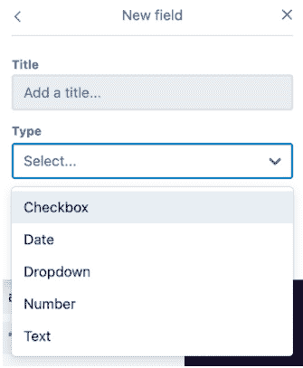

Figure 3.12 – 自定义字段类型选项

如果某个值的选项是“是”或“否”，你可以使用 **Checkbox** 字段。这是显示某事是否已获批准，或查看卡片是否经历过工作流中特定阶段的好方法。

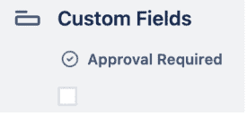

Figure 3.13 – 带有 Checklist 类型的自定义字段

我喜欢将其用作卡片上的切换开关，以帮助判断是否符合某些标准（例如 **Needs review from a senior manager**）。在自动化中这很有用，因为你可以指定对带有已勾选字段的卡片执行操作，例如在字段被勾选时将卡片移动到某个列表，或在字段被取消勾选时将其移动到另一个列表。

**Date** 字段是带有日期和时间值的时间戳字段。如果你想在卡片上添加另一个日期（除了开始日期和到期日期之外），它很有用。

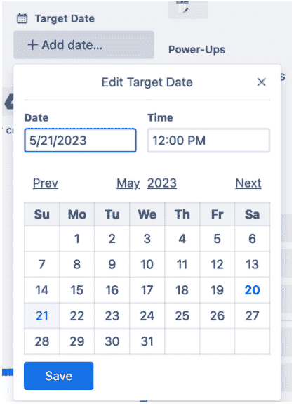

Figure 3.14 – 带有 Date 类型的自定义字段

你可以使用它来跟踪实际完成日期，或跟踪一个在最终到期日期前一周的草稿到期日期。有些人甚至更喜欢将其用作开始日期和结束日期，而不是原生的 Trello 日期字段。根据你执行操作的时间来设置卡片的日期字段，构建自动化非常简单，因此你可以创建一个日期字段来跟踪卡片移动到当前列表的时间或卡片创建的时间。

**Dropdown** 字段允许你预设选项，供人们从下拉菜单中选择。这非常适合数据验证，并防止卡片上的字段出现不一致的文本值。

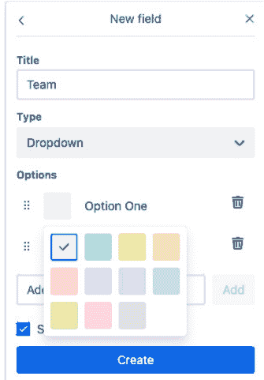

Figure 3.15 – 带有 Dropdown 类型的自定义字段

你可以使用它来设置卡片的优先级为高、中或低。为 **Dropdown** 选项添加颜色，以帮助不同的答案脱颖而出。

**Number** 值就是数字。你可以执行计算，并使用第三方 Power-Ups 对这些值的汇总进行报告，我们将在 _Part 3_ 中讨论。

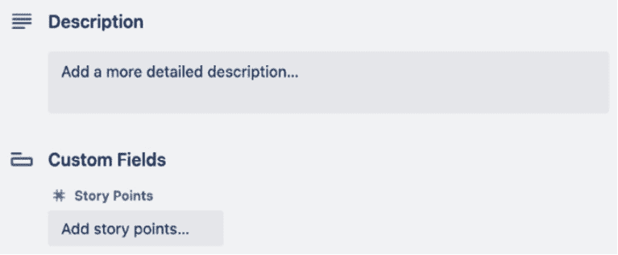

Figure 3.16 – 带有 Number 类型的自定义字段

此类型适用于跟踪项目或预算中的工时或故事点。

**Text** 字段适用于几乎任何不适合其他类型的内容。

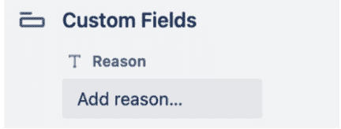

Figure 3.17 – 带有 Text 类型的自定义字段

你可以使用文本字段来存储联系人的电子邮件地址、关于任务的备注或与任务相关的其他信息。

选择类型并为下拉字段定义任何预设选项后，你可以决定是希望在卡片正面显示该字段（从看板与其他卡片一起查看时），还是仅在打开卡片时才查看。最后，在选项下方点击 **Create** 按钮来创建字段。

如果你不再需要自定义字段，可以从卡片的 **Custom Field** 菜单或 **Board** 菜单中选择选项将其删除。点击 **Delete field**，然后输入字段名称以启用红色的 **Delete field** 按钮。这是为了防止意外删除看板上的数据。

## 设置自定义字段值

你可以在卡片描述下方、附件上方找到卡片的 **Custom Fields** 部分。与卡片上的任何其他字段一样与该字段进行交互。如果是复选框，点击方框以显示任务是完成还是未完成。点击文本或数字字段以输入值。选择日期字段以打开日历。点击下拉字段以查看配置的选项。

无需点击 **Save**——只需离开字段即可保存输入！

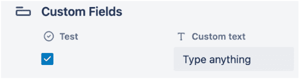

Figure 3.18 – 在卡片上设置自定义字段

如果你需要更多关于自定义字段的灵感，请前往 Atlassian Community 的 Trello 部分提问或查看其他人如何使用他们的看板——你会发现许多自定义字段的酷炫用法！

## 检查清单

检查清单功能让你创建一份与任务或项目相关的需要完成的子任务列表。此字段特别适用于将复杂任务分解为更小、更易于管理的部分。

为什么要使用检查清单？

检查清单有助于确保你遵循常规程序的特定任务集，或确保不会遗漏任务的任何重要部分。如果你有多个成员被分配到卡片上，它们也是委派职责的好方法。

## 添加检查清单

要将检查清单添加到卡片，打开卡片并从 **Add to card** 菜单中选择 **Checklist** 按钮。

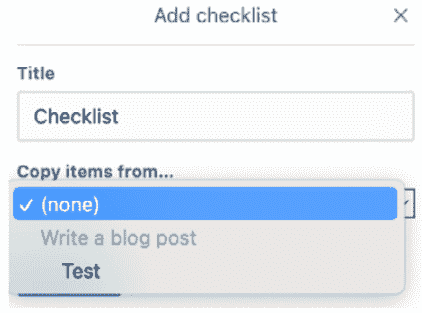

Figure 3.19 – 检查清单创建模态框

如果你已经在当前看板中创建了检查清单，可以从下拉菜单中选择它，以创建一个与当前卡片具有相同项目的副本版本。否则，你只需给它一个标题并点击蓝色的 **Add** 按钮。

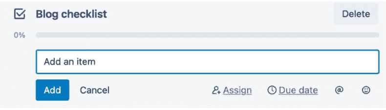

Figure 3.20 – 卡片上的检查清单

通过在显示 **Add an item** 的框中输入内容，向检查清单添加特定项目。按 _Enter_ 或点击蓝色的 **Add** 按钮来创建项目。专业提示——你可以从文档或电子表格中复制并粘贴一个项目列表，它将根据每个换行符创建一个新项目！

如果你意外创建了一个项目，可以通过选择文本来编辑名称。但如果你确实不再需要它，可以将鼠标悬停在卡片上并点击行末尾的省略号，然后点击 Delete。

有时你可能将一个项目创建为子任务，但意识到它更适合作为独立的卡片。更改它很容易！点击任务行末尾的省略号，然后点击 **Convert to card**。检查清单项目将变为与原始卡片在同一列表中的新卡片。完成后，只需点击检查清单外部即可。

## 高级检查清单

Standard、Premium 和 Enterprise Trello 用户可以使用高级检查清单，这允许你向检查清单项目添加到期日期和成员。如果你有多个人参与完成卡片，这尤其有用。你可以看到哪些任务仍需完成，以及谁是下一个。

要向现有检查清单项目添加到期日期或成员，将鼠标悬停在项目上，你会注意到时钟图标和用户图标出现。点击时钟图标将打开一个类似于到期日期选择器的模态框，允许你为项目设置到期日期。点击用户图标允许你向检查清单项目添加一名成员。

你也可以在创建项目时添加成员和到期日期。在检查清单中输入任务名称。在按下 _Enter_ 或点击 **Add** 之前，使用右侧的 **Assign** 或 **Due date** 按钮。

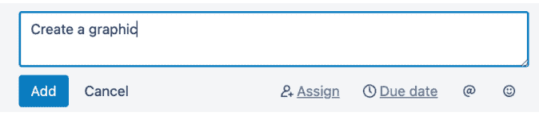

Figure 3.21 – 添加高级检查清单项目的模态框

没有付费的 Trello 计划？你仍然可以通过点击 @ 图标在检查清单项目中提及某人。这不会将项目分配给他们，但会超链接他们的个人资料并向他们发送通知。点击表情符号按钮允许你从表情符号选择器中选择一个表情符号，为检查清单项目添加样式。完成后，点击蓝色的 Add 按钮。

## 查看所有检查清单项目

如果你在多个卡片上被分配了检查清单项目，可以通过前往 trello.com 的主页视图来查看所有项目。它显示你被分配的下一个即将到来的项目。点击 Show more 以查看所有检查清单项目。

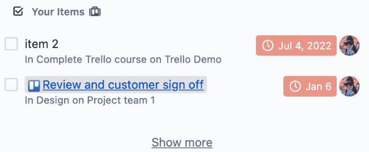

Figure 3.22 – Trello 主页部分显示已分配的检查清单项目

你可以从这个视图中勾选项目，或点击项目以转到卡片并查看更多信息。

## 查看检查清单的进度

通过勾选检查清单名称左侧的方框来勾选检查清单上的项目。

Figure 3.23 – 半完成的检查清单

检查清单标题下方会出现一条进度条，显示已完成项目的百分比。任何已勾选的项目都会被划掉。如果你只想查看尚未完成的剩余任务，请点击检查清单名称旁的 **Hide checked items**。

你也可以从卡片正面查看检查清单的进度。关闭卡片，即可在卡片正面看到一个分数，显示卡片中已完成项目数和总项目数。

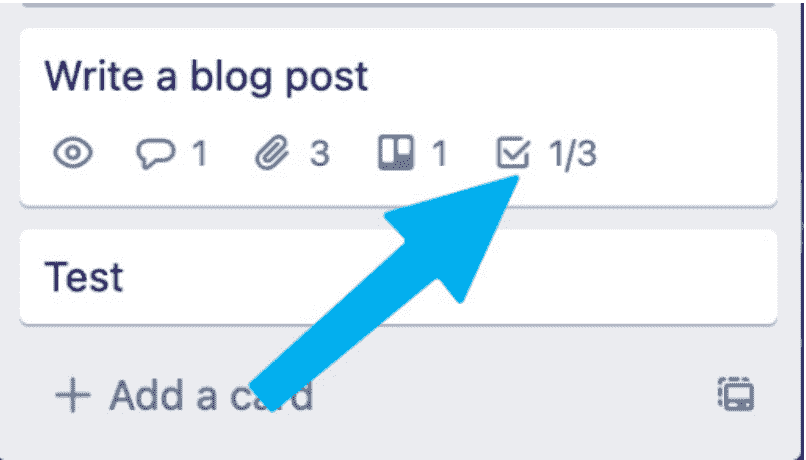

Figure 3.24 – 卡片正面的检查清单进度分数

要删除检查清单，请在卡片内部点击 **Delete**，位置在检查清单名称的右侧。

## Locations

我们讨论过的许多字段在其他生产力和项目管理工具中也可用，但这个字段是我在其他任何地方都没见过的！

此字段类型将 Google Maps 中的位置值作为卡片中的一个字段存储。虽然这可能对每个看板都不适用，但如果你处理与工作相关的位置数据，或者正在策划活动或旅行，这个字段将证明非常有价值，能帮助你直观地规划工作流程。

请注意，此字段仅适用于高级版和企业版工作区。

为什么使用位置？

虽然并非每个看板都需要使用位置，但如果你需要查看多个位置及其相互关系，它会非常方便。使用地图视图，你可以将所有这些卡片绘制在地图上，并查看它们彼此之间的距离。它非常适合规划订单配送、为旅行制定行程或组织通讯录。

## 在卡片上设置位置

要在卡片上设置位置，请点击卡片右侧 **Add to card** 菜单中的 **Location** 按钮。这将打开一个模态框，允许你在 Google Maps 中搜索位置。

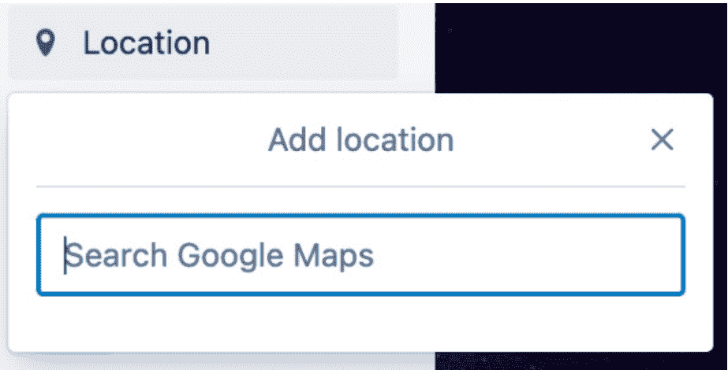

Figure 3.25 – 添加位置模态框

输入地址或目的地名称，例如迪士尼世界。输入时，选项会出现在下方。选择一个选项，你的卡片上会出现一个新部分，添加地图预览。点击箭头会在新标签页中打开 Google Maps 上的位置。

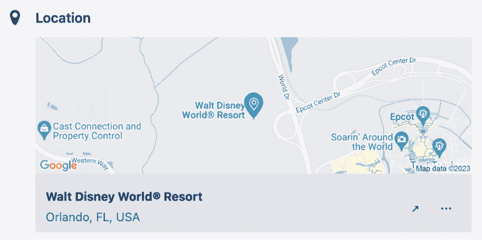

Figure 3.26 – 卡片上的位置预览

你可以通过选择行末尾的省略号来更改位置或将其删除。

## Covers

卡片封面是让你的看板更具视觉效果的完美方式。这些封面显示在卡片标题的后面或上方。你可以添加到卡片上的封面有两种类型：颜色和图片。

为什么使用卡片封面？

卡片封面是美化看板的好方法。颜色对于在列表中创建部分或标题很有用。图片对于可视化卡片的重要方面很有用。它们也非常适合为产品、作品集或任何其他视觉依赖的事物组织图片画廊。

## 添加卡片封面

要为卡片添加封面，请点击卡片右侧 **Add to card** 菜单上的 **Cover** 按钮。如果你已经向卡片添加了图片，Trello 可能会自动将该图片设置为封面。在这种情况下，**Cover** 菜单将位于卡片顶部，即显示图片的右下角。点击 **Cover** 后，将打开一个菜单。

## 封面设置

### Size

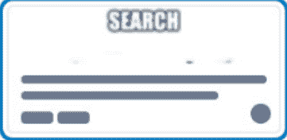

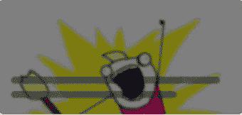

Remove cover

### Colors

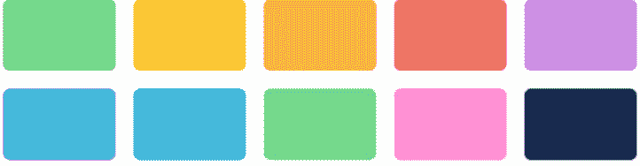

### Attachments

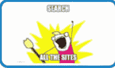

Upload a cover image

Tip: Drag an image on to the card to upload it.

### Photos from Unsplash

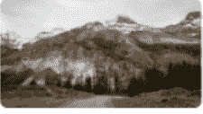

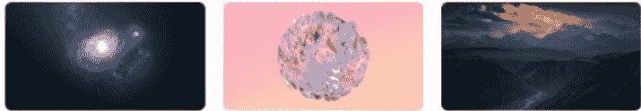

Search for photos

By using images from Unsplash, you agree to their [license](placeholder) and [Terms of Service](placeholder)

Figure 3.27 – 带有选项的卡片封面模态框

你可以配置卡片封面的几个方面。

首先，你可以配置大小。默认情况下，图片或颜色显示在卡片名称上方，但选择右侧的选项会将图片放置为卡片正面的背景，并将卡片名称放置在图片上方。选择此选项会从卡片正面删除其他信息，例如标签、成员、附件数量、检查清单进度和自定义字段。但如果你的卡片依赖图形，这可能是一个战略性设计选择，例如，如果你有一个组织可用于广告或旅行目的地图片的看板。它们也可以作为很好的列表标题，用于说明如何使用列表。

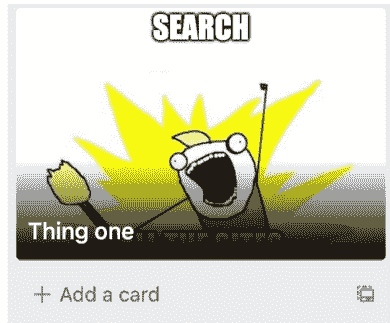

Figure 3.28 – 带有图片封面作为背景的卡片正面

当你为图片选择这种样式的卡片封面时，你将能够选择覆盖在图片上的文本颜色（黑色或白色）。

如果你没有将图片附加到卡片，你仍然可以将其添加到封面中。在封面选项底部搜索 Unsplash 的照片。

除了图片，你还可以使用另一种卡片封面选项——颜色！颜色对于将卡片样式设置为分隔符以及为列表创建部分很有用。

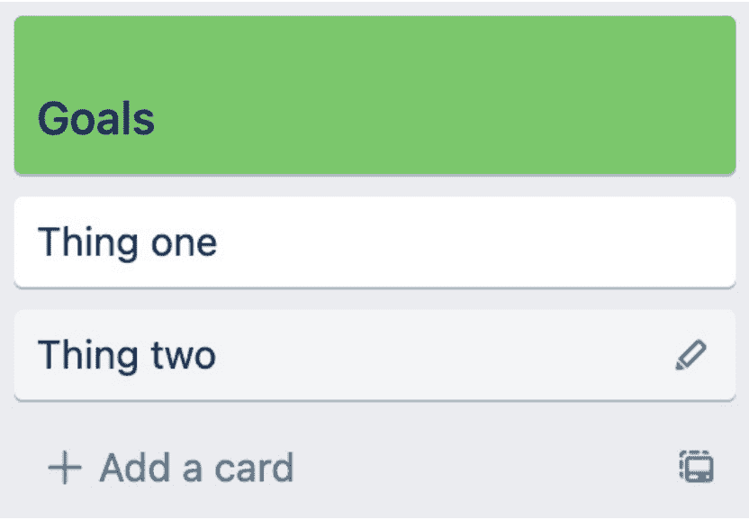

Figure 3.29 – 带有颜色封面的卡片正面

## Link cards

如果你创建一个以链接作为名称的 Trello 卡片，该卡片会变得更加精美。Trello 与某些工具集成，在你的看板上嵌入链接，使与你使用的其他工具交互变得更加容易。

例如，如果你将 YouTube 视频链接粘贴为卡片名称，卡片将在你的 Trello 看板上显示嵌入的 YouTube 视频。

Figure 3.30 – 嵌入 YouTube 视频的 Trello 卡片

视频下方会出现带有视频和标题的缩略图，以及一个 **Full screen view** 按钮。点击该按钮会打开 YouTube 视频播放器，让你在不离开 Trello 屏幕的情况下从 YouTube 观看视频。

尝试使用你经常使用的其他链接！使用 Google Sheets 或 Google Doc 链接作为名称创建新卡片，可以让你在不离开 Trello 的情况下预览和编辑 Google Doc。

了解有关服务链接卡片支持的更多信息，请访问此页面：[support.atlassian.com/trello/docs/link-cards/](https://support.atlassian.com/trello/docs/link-cards/)。

## Disabling link cards

如果你想将链接作为普通卡片使用，请在将鼠标悬停在卡片上时点击右上角的铅笔图标，然后选择 **Convert to regular card**。

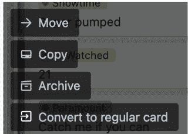

Figure 3.31 – 链接卡片菜单选项

有很多方法可以向卡片添加信息！希望现在你已经清楚如何真正将所有内容都保存在 Trello 中。

## Summary

现在你可以将任何需要的内容放入 Trello 卡片中。你已经学习了如何附加项目——无论是数字文件、链接还是其他 Trello 卡片！你可以通过向卡片添加位置字段，在看板上直观地规划数据。你关于委派和质量保证的担忧已经消失，因为你可以向卡片添加检查清单。

你正在成为 Trello 专家的道路上，因为你可以自信地浏览你的卡片！现在，是时候讨论如何使用卡片的所有这些属性来在 Trello 的不同视图中分析我们的卡片了。
