## Viewing Cards Your Way

既然你知道可以向卡片添加什么，你可能已经充满了想要放入 Trello 看板的想法。由于在 Trello 中组织大量信息很容易，你会发现自己向看板添加了许多卡片。虽然以看板样式查看所有内容很有帮助，但有多种查看卡片的方式可以解锁更多洞察。

在本章中，我们将讨论如何更改看板中的数据，以便你可以查看最相关的卡片。你将学习如何执行以下操作：

- 设置过滤器以仅显示最相关的卡片
- 创建和查看可视化卡片信息的图表
- 在日历和时间线上按日期绘制卡片
- 使你的看板看起来像电子表格
- 在地图上按位置查看卡片

## Filters

过滤器可用于每个 Trello 视图，除了 **Dashboards**。它们的作用正如其名称所示——根据你设置的条件，过滤看板上的所有卡片，仅显示卡片的一个子集。

跟随操作，为你已经创建的卡片设置一个过滤器。要访问过滤器，请点击看板右上角的灰色 **Filter** 按钮，位于 **Automation** 按钮旁边：

## 筛选器概述

### 关键字

输入关键字...

搜索卡片、成员、标签等。

### 成员

- [ ] 无成员
- [ ] 分配给我的卡片
- [ ] 选择成员

### 到期日期

- [ ] 无日期
- [ ] 已逾期
- [ ] 未来一天内到期

显示更多选项

### 标签

- [ ] 无标签

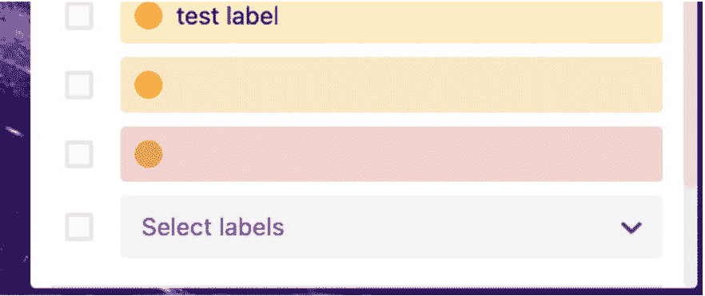

图 4.1 – 看板中的筛选器菜单

单击 **筛选器** 按钮将显示一个选项菜单，向您展示筛选功能。

## 筛选维度

筛选器对于查询卡片的多个维度非常强大。您可以组合使用它们，以清晰了解您正在寻找的内容，例如本周当前受阻的任务，或今天必须完成的客户任务。

## 关键字

您可以搜索一个词或短语，仅显示卡片某个方面包含该文本的卡片。此搜索按名称、标签或成员进行。

在框中开始输入要搜索的术语；筛选器将立即应用，并从看板中移除不匹配文本的任何卡片。

## 成员

说到成员，一个流行的筛选器显示属于特定成员的卡片。例如，您可能与整个团队共享一个看板，在计划或协调日常工作时，看到每个人正在做什么很好，但有时您可能只想查看自己的任务。

如果您是项目经理，可能希望按未分配成员的卡片进行筛选，以便您可以决定哪些任务需要委派并指定负责人：

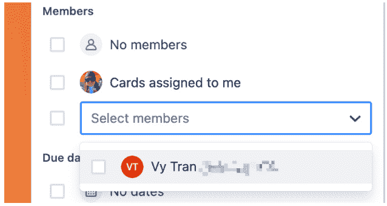

图 4.2 – 筛选器菜单中的其他成员筛选器

要使用 **成员** 筛选器，请勾选您偏好的筛选器左侧的复选框，或在 **其他成员** 字段中搜索特定成员。您可以选择一个或多个。如果看板上有许多人，但您只想查看几个人组成的特定团队正在做什么，选择多个会很有帮助。

由于按自己的卡片筛选是一种常见做法，当您在看板上时，可以按键盘上的 _Q_ 键，自动应用 **分配给我的卡片** 筛选器。

### 到期日期

也许您已缩小看板上卡片的范围，只查看自己的卡片，但可能仍有很多！使用日期筛选器可以帮助您查看哪些即将到来，以便您了解紧急事项。

这些对于评估当前工作量以及查看是否计划过多或是否有任何事情落后非常有帮助。

您可以筛选没有日期的卡片，以查看是否有需要计划的任务，或使用 **标记为完成** 筛选器查看已完成的卡片。如果您没有使用 _完成_ 列来指示卡片状态，这尤其有帮助：

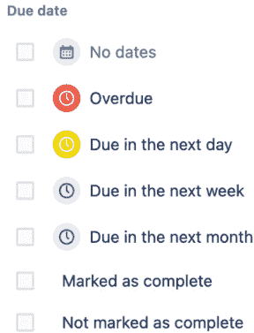

图 4.3 – 筛选器菜单中的日期筛选器选项

要设置日期筛选器，请勾选您偏好的选项旁边的复选框。如果您改变了主意，请勾选另一个复选框。

## 标签

**标签** 筛选器对于查看具有特定状态或属于某个类别的卡片很有用。有时，我使用标签表示优先级，因此应用红色 “p1” 标签的筛选器会将看板筛选为显示我的最高优先级卡片，或者 “blocked” 标签会显示我可能需要提交给经理的任何卡片：

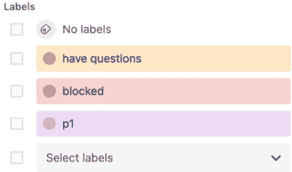

图 4.4 – 筛选器菜单中的标签筛选器选项

您可以通过勾选左侧的复选框来选择特定标签。如果看不到某个标签，请单击 **选择标签** 下拉菜单。您还可以按没有标签的卡片进行筛选，这对于给看板上新创建的卡片打标签很有用。

### 活动

Trello 最近添加了按活动筛选卡片的选项，以便您查看哪些卡片在某段时间内最活跃。这对于查看人们最近一直在处理的卡片很有帮助。

您还可以按过去四周内没有活动的卡片进行筛选，这是查看是否有任何卡片被忽略的好方法。

### 筛选逻辑

默认情况下，筛选器使用 OR 逻辑。这意味着，如果其中一个条件为真，卡片将显示在看板上：

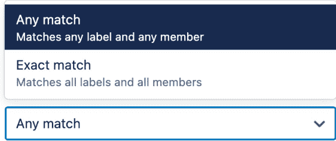

图 4.5 – 筛选器菜单中的筛选逻辑设置

如果您只想查看满足所有条件的卡片，例如分配给我的卡片 且 带有黄色标签的卡片，请在筛选模态框底部应用 **精确匹配** 设置。

## 移除筛选器

移除筛选器就像单击看板工具栏中筛选框里的 X 按钮一样简单。许多人打开一个空看板，想知道他们的卡片去哪了！它们并没有消失，很可能只是有一个筛选器在隐藏它们！当您在看板上找不到卡片时，请务必检查是否有筛选器。

我将以一个专业的筛选技巧结束本节：虽然没有保存筛选视图的功能，但从技术上讲仍然可行。每个筛选器都会更改看板的 URL。当您应用筛选器时，您会看到 URL 会根据所选筛选器发生变化。将 URL 加入书签以保存这些筛选器，并随时返回到特定视图。

## 访问替代看板视图

虽然筛选器有助于控制哪些卡片显示在您的看板上，但看板视图为您提供了显示卡片的替代方式。要访问 Trello 看板中的其他视图，请单击 Trello 看板顶部工具栏中 **看板** 按钮旁边的箭头，就在看板名称的右侧：

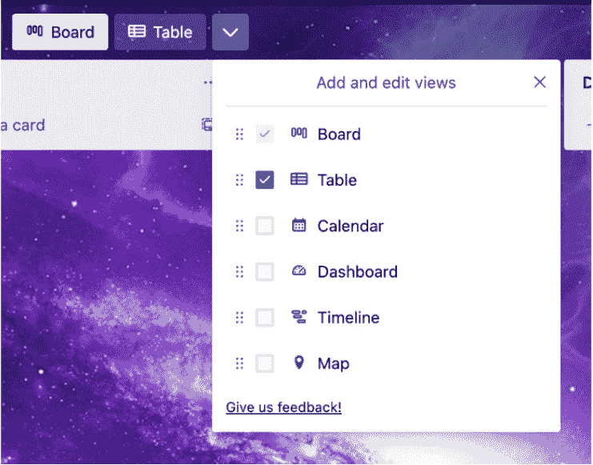

图 4.6 – 看板视图选择器

在出现的下拉菜单中，勾选您想查看的视图旁边的复选框。对于每个被勾选的视图，看板工具栏上将添加一个按钮，帮助您导航到该视图。如果您没有 **Trello Premium** 账户，将提示您开始 Trello Premium 试用以访问这些视图。

请勾选所有复选框——我们将在本章中探索每个视图。要进入某个视图，请单击指定视图名称的按钮，例如 **日历**。

本章的其余部分将详细介绍每个视图，因此为了跟进，请单击与该部分匹配的按钮名称。

## 仪表板

仪表板视图是一种轻量级解决方案，用于可视化卡片的统计信息。用户可以快速了解其看板和卡片，并查看它们在各种属性上的对比情况：

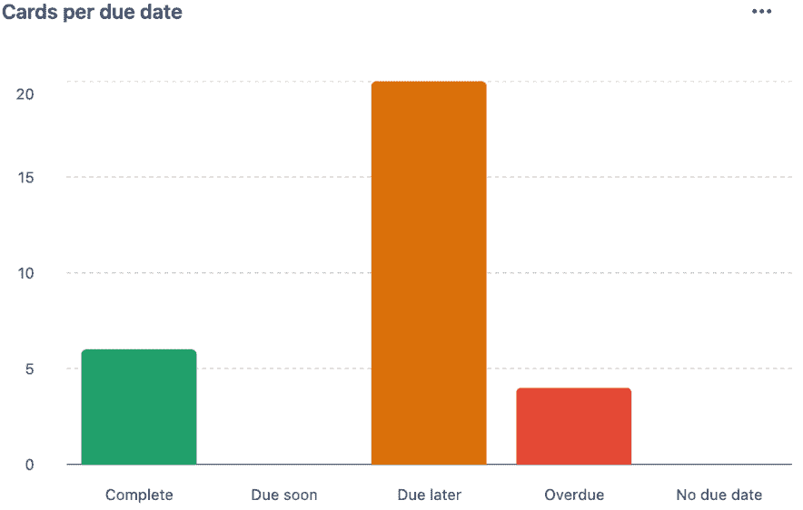

图 4.7 – 仪表板视图上的图表（磁贴）

如果您需要强大的报告功能，可能需要添加第三方 Power-Up 以获得更多自定义图表和洞察。我们将在第 14 章中更多地讨论这些内容，但如果您想快速了解工作流程，仪表板视图可以突出显示工作量平衡、时间表的可行性或工作流程阶段中的阻塞点。

### 添加新磁贴

要自定义仪表板，您可以添加新图表或删除现有图表。要添加新图表，请单击现有图表（称为磁贴）底部灰色框中的 + 按钮：

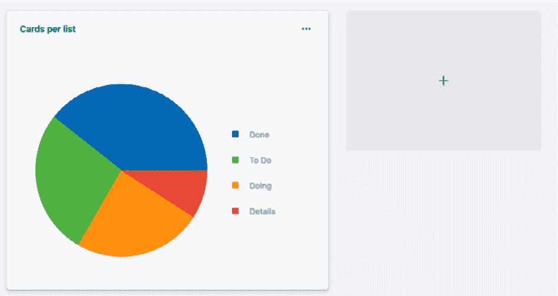

图 4.8 – 带有用于添加新磁贴的空框的磁贴

将出现一个模态框，要求您选择要添加的磁贴类型。选择下面所示的三种图表之一：

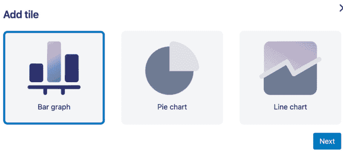

图 4.9 – 可创建的磁贴类型

选择最能代表您希望如何可视化信息的一个，但不要为选择正确的一个而烦恼——您可以在下一步轻松更改它，甚至在创建磁贴后也可以更改。单击蓝色的 **下一步** 按钮。

接下来，选择四个属性之一来显示您的卡片：

- 按列显示卡片：这有助于您可视化是否有任何卡片在工作流程的某些阶段卡住
- 按标签显示卡片：此属性显示您是否花费了过多（或过少）的时间在某一类型的卡片上，而不是另一类型
- 按成员显示卡片：此属性非常适合容量规划，并确保团队任务被公平分配
- 按到期日期显示卡片：此类型帮助您可视化是否有太多任务在短时间内即将到来

通过单击右下角的蓝色 **添加磁贴** 按钮，您的新图表将出现在仪表板中！

## 编辑现有磁贴

要编辑或删除现有磁贴，请单击鼠标悬停在磁贴上时出现在其右上角的省略号。将出现一个包含两个选项的菜单：**编辑** 和 **删除**。

**编辑** 菜单为您提供更改图表类型和数据属性的选项。

## 日历

虽然到期日期对于提醒、通知和筛选看板很有价值，但它们也可用于以日历格式可视化卡片。这对于任何使用日期的人来说最有帮助，以检查带宽并根据需要快速重新分配或更改截止日期。

虽然被各种团队使用，但最能发现其价值的是拥有内容日历、班次计划表或活动策划者的团队：

## 更改节奏

卡片和清单项目会从其日期开始，在一天或多天内显示，包括开始日期（如果提供了开始日期）。这有助于您分析项目可能需要多长时间，并创建自己的甘特图。

从这个视图中，您可以看到卡片名称、标签和成员。要查看卡片的其他详细信息，只需从日历中点击它即可——卡片背面将会出现，就像在看板视图中一样。

如果您想要更细致或更宏观的卡片视图，可以在日历上方左上角的设置中选择另一个节奏：

图 4.10 – 日历视图中组织的卡片

图 4.11 – 日历视图选项

在这里，您可以更改每天显示的时间量，按 **Day**、**Week** 或 **Month** 来查看本周的任务，或者缩小视图来规划整个月。您也可以通过从日历工具栏最左侧选择月份和年份，跳转到特定日期。如果您只需要向前或向后跳转较小的增量，请使用 **Today** 右侧和左侧的箭头快速前进或后退。

## 编辑卡片上的日期

日历视图最棒的功能之一是轻松更改开始日期和到期日期。您无需打开卡片，从日期菜单中选择新日期，然后保存这些日期并关闭卡片，而是可以将卡片拖放到日历上的另一个位置——这样做，日期将会更新。

您可以将卡片左侧拖到较早的日期以设置开始日期，并将卡片右侧拖到未来的日期以设置到期日期。从中间拖动整个卡片会保持持续时间不变，但会移动日期。

当您发现同时有太多工作需要快速重新分配时，这非常有帮助。

## 添加卡片

您可以直接从这个视图添加卡片，而无需切换回看板视图。双击网格中的任何日期，将出现一个模态框，您可以在其中设置卡片详细信息：

图 4.12 – 从日历视图添加卡片模态框

为卡片命名并选择列表。默认情况下，到期日期将设置为您点击的日期，但您可以点击日期字段将其更改为另一个日期。通过勾选 **Start date** 旁边的复选框，开始日期将设置为到期日期的前一天。如果您想更改它，可以在日期字段中输入新日期。

完成后，单击模态框底部的 **Add card** 按钮，即可在日历或看板上查看您新创建的卡片。

## 与您的日历同步

如果您希望 Trello 卡片出现在另一个日历上，例如 Google 日历，您可以获取一个用于订阅日历的 URL。这将使用 Trello 卡片中的事件更新您的日历。

选择日历上方右上角的 **Sync to personal calendar** 按钮。将出现一个模态框，显示 URL 已禁用。但是，单击其旁边的省略号将为您提供启用它的选项：

图 4.13 – 用于同步到日历的 Trello 日历 URL

复制出现的链接并将其添加到您选择的日历中。如果您需要关闭此功能，请单击菜单中的相同省略号，然后单击 **Disable**。

## 使用日历 Power-Up

虽然 Trello 高级用户可以访问此视图，即使是免费 Trello 用户也可以从 **Calendar Power-Up** 获得大部分相同的功能。您可以通过单击看板工具栏顶部的 **Power-Ups** 按钮并选择 **Add Power-Ups** 来找到它。您将被带到 Power-Up 市场。我们将在 _Part 3_ 中更多地讨论 Power-Ups，但此市场允许您向看板添加更多功能。

在左侧搜索框中搜索 `Calendar` 并选择 **Calendar Power-Up**。虽然还有其他选项，但拥有超过 1000 万个看板的那个是由 Trello 制作的官方 Calendar Power-Up：

图 4.14 – Power-Up 市场中的 Calendar Power-Up

单击 **Add** 后，顶部工具栏中将出现一个名为 **Calendar Power-Up** 的新按钮。单击该按钮即可查看类似于我们已描述的视图。

Power-Up 和高级视图的主要区别在于，Power-Up 仅限于按周或月显示，并且没有用于调整期间的日期选择器。您需要手动单击箭头才能找到您要查找的确切日期。

您仍然可以使用 Power-Up 同步到个人日历。只需单击右上角的齿轮图标即可获取订阅链接。

## 时间线

时间线视图与日历视图类似，因为它也按日期绘制卡片，但它允许您添加另一个属性，以帮助您更清晰地查看卡片。

此视图对经理或任何需要了解时间范围、优先级、状态、容量规划或任何由列表或标签表示的其他内容的项目协调人最有帮助：

图 4.15 – 按日期和列表分组的卡片

就像日历视图一样，您可以使用日历选择器选择出现的期间和节奏，或选择 **Week** 按钮以获取更多节奏选项，例如 Day、Week、Month、Quarter 和 Year。

从这个视图中，卡片正面显示其名称和成员。要查看更多信息，请单击卡片将其打开并查看所有字段。

## 添加另一个维度

时间线视图的美妙之处在于其最后一个配置，即垂直轴。默认情况下，此视图按列表显示卡片，让您不仅可以看到卡片被分配的日期，还可以看到它当前所在的列表。在整个星期中检查进度以确保明天到期的卡片正在流程中并未被忽略时，这非常有帮助。

除了按列表显示外，您还可以按其他属性排序，例如 Members，这有助于您查看容量，并了解某个队友是否工作量过大，或者其他人是否有额外的带宽。

按 Labels 查看可以帮助您将相似的工作批量处理在一起。例如，如果您喜欢同时处理内容任务，您可以看到本周到期的所有带有内容标签的卡片，即使它们在不同的列表中，也会以分组格式显示。

## 添加卡片

就像日历视图一样，您可以通过双击任何空间来添加另一张卡片。这张新卡片将默认使用您双击的部分中的日期、成员、列表或标签。与日历视图一样，您可以调整这些字段，完成后单击 Add card。

## 表格

如果您喜欢 Trello 但怀念您的电子表格，那么您可能会喜欢表格视图。此视图不是将卡片绘制在看板上，而是将卡片的字段显示为表格的行：

| Card | List | Labels | Members | Due date |
|---|---|---|---|---|
| Finalize product features and specifications | Backlog | · | 👤 | ☐ Jul 19 |
| Create marketing collateral (e.g., brochures, videos) | Backlog | · | 👤 | ☐ Jul 19 |
| Build a landing page or website for the product | Backlog | · | · | ☐ Jul 19 |

图 4.16 – 按行组织的卡片

此视图对于将一组可能跨越多个列表的任务一起显示特别有帮助。例如，如果您想分享本周团队正在处理的内容的截图，您可以轻松地在这里收集。如果您需要查看卡片的更多信息，请单击卡片名称以查看卡片背面。如果您需要快速更新许多卡片，表格视图也很有用。

## 编辑卡片

虽然您无法为此视图添加更多列，但您可以看到最重要的属性，例如名称、列表、成员和到期日期。您可以通过单击行中的相应部分快速编辑这些属性。这比打开卡片并设置这些值，然后关闭卡片并选择另一张卡片要容易得多：

| Card | List | Labels | Members | Due date |
|---|---|---|---|---|
| Add cards to my Trello board | Ideas | 🏷️ text label | 👤 | · |
| Another card | | | 👤 | ☐ Mar 24 |
| Goals | | | · | · |
| Thing one | | | · | · |
| Another card | Ideas ✅ | | · | ☐ Mar 21 |
| Write a blog post | To Do | | · | ☐ Mar 20 |
| | Doing | | | |
| | Done | | | |

## Figure 4.17 – 在表格视图中编辑卡片

出于这个原因，我在进行每周回顾和计划时更喜欢使用此视图。我可以看到本周完成了什么，并快速规划下周的计划。

如果您想更改列出的卡片顺序，请将鼠标悬停在卡片名称上，直到左侧出现点，然后单击并拖动以重新排序：

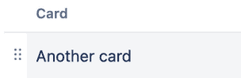

## Figure 4.18 – 在表格视图中重新排序卡片

## 添加卡片或列表

表格视图不仅可以让您在看板上创建新卡片，还可以在看板上创建新列表！要添加其中任何一个，只需单击表格左下角的灰色 + Add 按钮。选择卡片或列表选项并设置相关详细信息。

设置列表或卡片名称并确认其他属性后，单击蓝色 Add 按钮，即可完成。

## Maps

这是我曾在项目管理工具中体验过的最独特的视图。虽然其他工具通常会提供日历或表格格式的数据，但我还没有见过另一个提供原生功能，允许您将卡片绘制在地图上的工具！

虽然 Map 视图并非对每个看板都有用，但每当您在卡片中处理位置数据时，这将是一个改变游戏规则的功能。它对于任何计划路线的人都很有帮助，例如当地维修公司安排一天的工作或花店进行送货。对于个人使用，它非常适合计划旅行并将同一天附近的活动分组：

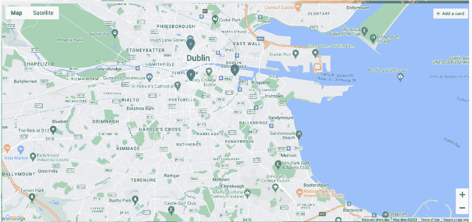

## Figure 4.19 – 绘制在地图上的卡片

Map 视图根据卡片上设置的位置绘制您的卡片。蓝色图钉代表每张卡片，如果它们彼此靠近，当您缩小到足够远时，可以看到卡片组。单击数字以放大该区域并查看关联的卡片。您也可以单击特定图钉以查看卡片正面，包括其封面图片、到期日期、成员以及卡片上的检查清单或附件数量：

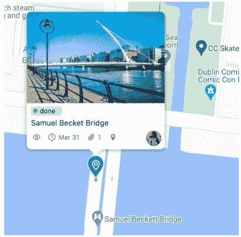

Figure 4.20 – Map 视图中的卡片正面

要查看卡片的更多详细信息，请单击它；这将显示卡片背面。

## 在卡片上设置位置

要向卡片添加位置，请打开卡片并单击卡片右侧 **Add to card** 部分下方的 **Location**。在出现的搜索框中，开始输入位置的名称或地址。Google Maps 会根据您输入的内容显示结果。选择最相关的一个后，您的地址预览将出现在卡片上。

## 添加新卡片

要从此视图添加新卡片，请单击看板右上角的 **Add card...** 按钮：

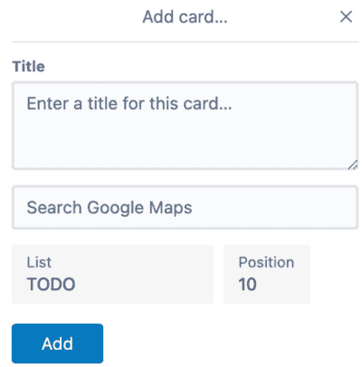

Figure 4.21 – 从 Map 视图添加卡片的模态框

设置卡片名称，并在下方的框中搜索位置的名称或地址。确认列表或单击字段以选择另一个列表。一旦您对卡片详细信息满意，请单击模态框底部的蓝色 Add 按钮。此新创建的卡片现在将出现在您的地图上！

## Workspace views

到目前为止，我们讨论的所有视图都与特定看板上的卡片有关。如果您想创建包含多个看板卡片的视图，则需要使用 Workspace views。

## Workspace calendar views

我们讨论过从单个看板查看日历中的卡片，但如果您想要一个显示所有看板卡片的日历怎么办？这可以通过 **Workspace Calendar view** 实现。

您可以从任何看板的左侧边栏访问此视图。如果此面板未显示，请单击看板名称前面的 > 箭头或按键盘上的 [。单击 **Workspace views** 部分中菜单顶部附近的 **Calendar** 选项：

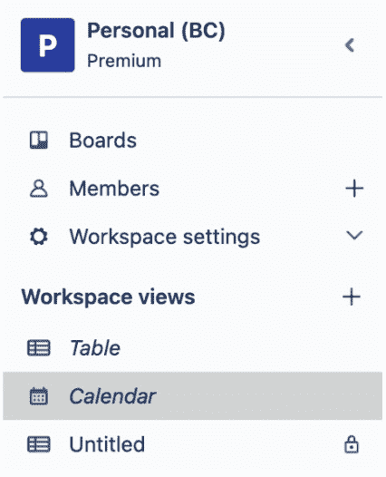

## Figure 4.22 – Trello 看板左侧面板显示工作区设置和视图

这将打开一个 Calendar 视图，看起来就像我们在看板上看到的视图一样，但这次，我们还将看到工作区中最近看板的卡片。此视图的功能与单个看板 Calendar 视图相同，只是您无法通过双击日期来创建新卡片。卡片名称前还会有一个小显示，帮助您可视化卡片来自哪个看板。

要调整显示哪些看板和卡片，请单击视图右上角的 **Filter** 选项，并选择要包含的看板和列表卡片：

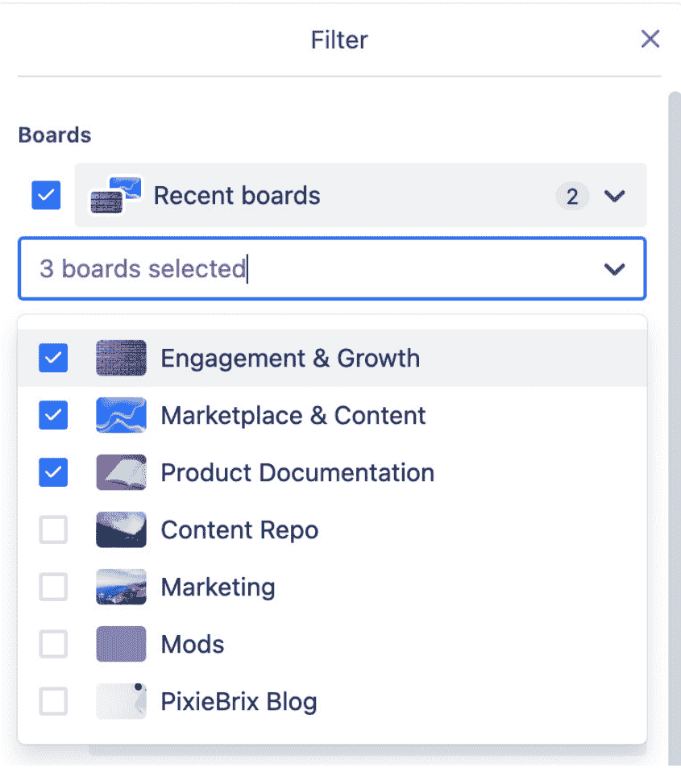

## Figure 4.23 – 用于选择看板的 Workspace 视图筛选选项

如果您只想跟踪正在进行或处于工作流某个阶段的卡片，或者只想查看多个项目看板上的自己的卡片，这将很有帮助。

## Workspace Table view

与 Workspace Calendar 视图一样，您可以通过单击看板名称前面的 > 图标或按键盘上的 / 从看板左侧面板访问此视图。在 **Workspace views** 部分下选择 **Table** 后，您的表格将转换并包含来自其他最近看板的数据。

要自定义出现的卡片，请单击右上角的 **Filter** 按钮，以选择您希望包含在视图中的卡片的看板、列表、成员、标签、日期和其他条件：

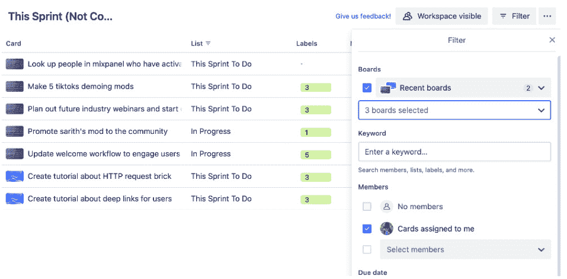

Figure 4.24 – 带有筛选选项的 Table 视图

看板视图与工作区视图的主要区别在于，您无法在 Workspace Table 视图中重新排序卡片。但是，Workspace Table 视图中会多出一列，显示卡片来自哪个看板。

## Summary

在本章中，我们讨论了在 Trello 中查看卡片的不同方式。虽然 Trello 可能最以其看板风格的 Board 视图而闻名，但拥有这些额外视图可以让您更多地了解卡片，并帮助您快速找出要采取的行动。

您可以筛选卡片以随时放大所需的信息，并可以以对您和您的团队最重要的方式可视化卡片。在下一章中，我们将讨论如何通过特定用例和模板将所有内容整合在一起！
