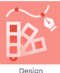
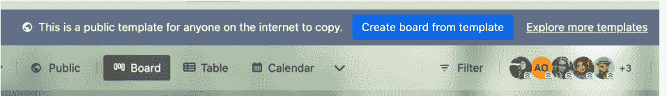
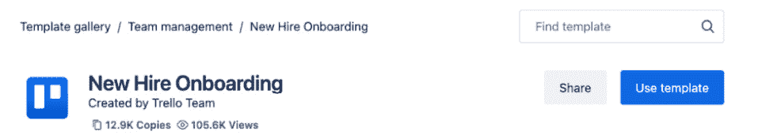
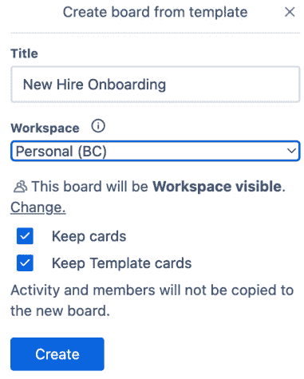
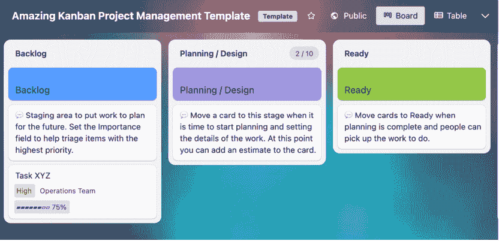

## Real World Trello Boards

既然您知道如何查看卡片，是时候将它们与实际用例结合起来了。在本章中，我们将介绍演示 Trello 常见用途的 Trello 看板模板。

本章将探讨展示 Trello 功能常见应用的看板。通过遵循这些模板，您将能够可视化如何使用 Trello，甚至可以为设置工作流程抢占先机。

本章将帮助您轻松组织任务并跟踪进度。那么，让我们深入了解，探索如何充分利用 Trello 为您的项目服务。

本章结束后，您将能够做到以下几点：

- 在 Trello 上管理您的团队（或个人目标）的冲刺
- 协调即将到来的项目的所有环节
- 使用有效的 Trello 看板改善您的会议
- 使用产品路线图看板定义公司的方向

让我们开始吧！

## Understanding Trello templates

要探索 Trello 模板，请访问 trello.com/templates。到达后，您可以浏览一堆可以复制和自定义的预构建 Trello 看板。以下是一张截图，让您了解 Trello 模板画廊的样子：

## Boards

## Templates

- Business
- Design
- Education
- Engineering
- Marketing
- HR & Operations
- Personal
- Productivity
- Product management
- Project management
- Remote work
- Sales

## Featured categories

## New and notable templates

**New Hire Onboarding**
by Trello Team
Help new employees start strong with this onboarding template.
16.1K ⬤ 119.8K

**Tier List**
by Trello Engineering Team
Use this template to create a tier list for anything you want. A tier list is a way to rank items in a category from best to...

Figure 5.1 – Trello template gallery

要找到您需要的 Trello 看板模板，可以从模板画廊左侧列出的选项中选择一个类别。这将筛选模板，仅显示与您选择的类别匹配的模板。

或者，您可以使用页面右上角的搜索框查找特定关键词或术语。这将显示所有与您的搜索词匹配的模板。

找到感兴趣的模板后，单击它以查看更多详细信息。您将能够预览模板，阅读简要描述，并查看有多少人之前使用过它。如果它看起来适合您的需求，您可以单击 **Use template** 按钮来制作副本并开始自定义它。

## Viewing template information

在 **查看模板信息** 区域，你可以查看模板的更多详细信息以及关于其预期用途的说明。你还可以通过模板被复制和查看的次数来了解其受欢迎程度。

文本描述下方是模板的嵌入式版本，你可以滚动查看以了解看板的结构以及所使用的卡片类型。滚动查看很不错，但你可能想进入模板仔细查看。

## 新员工入职
由 Trello 团队创建

12.9K 次复制 © 105.6K 次查看

## 关于此模板

此模板为每位新员工提供了一个集中式空间，用于处理所有与工作相关的后勤事项和业务要求，以完成入职。为了节省时间并避免人为错误，请用公司所需的所有任务填充此模板。之后，只需复制模板并为每位新人个性化即可。

此入职模板包含以下内容：

1. 首日前任务：确保新员工到达前，所有 HR 后勤事项和经理任务均已就绪
2. 第一周任务：一份实用的待办事项清单，用于将新员工纳入公司和团队系统
3. 人物名录：帮助新人熟悉环境，了解他们在工作中将遇到的关键人员
4. 常见问题解答：有助于了解工作方式的有用资源

使用此模板后，每位员工都将拥有自己的私有 Trello 看板，以帮助他们入门。同时，你始终拥有团队可访问的模板看板，可以对其进行更新，然后为之后的新员工复制——为未来的你节省宝贵时间。

图 5.2 – 查看模板信息

转到嵌入内容的右下角，查找写有 **查看模板** 的链接。点击它，你将直接进入模板！（你不会经过起点，也不会收到 $200。）

到达后，你可以打开卡片并查看卡片可能的设置示例。你可以查看列表的顺序，并更熟悉设置。点击看板右上角的省略号以打开看板菜单并查看看板描述。预览完成后，你可以点击浏览器的后退按钮返回模板列表页面。或者，如果它很合适，你可以立即开始使用该模板。

## 复制模板

如果你找到了一个中意的模板，可以轻松复制并试用。如果你当前正在预览模板并处于 Trello 看板中，请点击页面顶部的 **从模板创建看板** 按钮：

图 5.3 – 页面顶部的模板描述栏

如果你在模板描述页面，请点击模板名称右侧的 **使用模板** 按钮：

图 5.4 – 模板标题和使用模板按钮

将出现一个模态框，要求你选择要添加到的工作区，以及是否要保留模板中的卡片。

图 5.5 – 从模板创建新看板的模态框

要使其成为你自己的看板，请重命名看板！你还可以选择保留卡片（模板卡片或所有卡片）作为副本的一部分。如果你只对列表结构、看板描述和建议的 Power-Ups 感兴趣，可能会将这些选项留空。在某些看板中，我有兴趣保留卡片本身，因为它们可能对模板至关重要。通常，我会复制所有内容，并使用 **存档列表中的所有卡片** 操作来移除不再需要的卡片。当你对设置满意时，点击 **创建**。

复制看板后，你可以随意调整和编辑。你是新看板的所有者和管理员，因此你的更改只会反映在你复制的看板上。这是让看板成为你自己的好方法！

你可能决定重命名列表或移动列表。你还可能添加或移除一些复制过来的卡片。你可以通过给卡片添加贴纸或更改看板描述来添加自己的风格。如果你需要回顾看板菜单中可以自定义的所有内容，请返回 _第 1 章_。

现在你已经知道如何查找和使用 Trello 看板模板，让我们来看一个特定的模板，它展示了 Trello 如何用于特定的项目管理方法，例如看板和敏捷。

## 使用 Trello 进行看板和敏捷工作流程管理

Trello 最著名的是其看板风格的看板。看板是一种可视化工作流程和调度系统，用作精益管理系统，通常用于敏捷软件开发。然而，各行各业的许多团队都已采用此流程来提高生产力并简化工作流程。从本质上讲，看板涉及将工作分解为可管理的任务，并通过看板可视化工作流程，这可以帮助团队识别瓶颈、优先处理任务，并就如何分配资源做出更明智的决策。

在本节中，我们将探讨如何在 Trello 中实现看板风格的看板，以帮助简化团队的工作流程并提高生产力。

这些类型的看板用于帮助团队可视化其工作流程并识别改进机会。这些看板将任务分类为列表，让你可以轻松跟踪进度并高效处理任务。

你可以看到 Trello 可能天然适合此流程！让我们一起了解 Amazing Kanban Project Management Template。你可以在 Trello 模板库中找到它：[trello.com/b/WHOzj88m/amazing-kanban-project-management-template/](https://trello.com/b/WHOzj88m/amazing-kanban-project-management-template/)。

这就是模板的样子。它是一个包含六个列表的看板，每个列表描述工作流程中的一个阶段：

图 5.6 – 看板模板看板结构

让我们深入了解此看板的组织方式，并了解使用它的最佳实践。

## 看板结构

在此看板中，每个列表都是团队工作流程的一个阶段。你可以通过列出确切阶段来尽可能具体。例如，如果你的团队负责公司的博客，那么你的阶段可能是构思、优先级排序、草稿、审核、发布和推广。

但在其他情况下，你可能有许多不同的任务，它们并不都经历工作流程中的相同阶段。在这种情况下，你仍然可以使用看板/敏捷看板，但你可能希望列表更通用一些，例如名为待办事项、待办、进行中和已完成的列表。

如果你想要介于两者之间的东西，请使用此模板中提供的列表。大多数任务将经历这些阶段，尽管你可能会根据任务称其为其他名称。让我们看看此模板中的默认列表以及你可能如何使用它们：

> **待办事项**：将这些视为想法。这是你收集所有想法以及其他团队请求的地方。

+   - **规划/设计**：在开始处理任务之前，你可能需要做一些准备工作，或者可能需要进一步细化想法。使用此列表，你可以移动那些你确实想处理但可能需要更多定义后才能让人采取行动的事项。
+   - **就绪**：此列表中的任务意味着已准备好开始处理。如果你的团队有多个人，此列表中的卡片意味着任何人都可以拿起它并开始处理。如果你已经分配了它，该成员将知道他们可以开始处理此事项。你可以将此列表视为你的待办事项列表。
+   - **审核**：此列表中的卡片已处理并正在等待审核。这可能是经理需要给予批准，或者在你的开发团队中进行正式的代码审核。
+   - **已完成**：这个可能很明显……这是你已完成的卡片！这对我来说是最喜欢用来庆祝的列表。
+   - **进行中**：此类别中的任务正在处理。它们至少已经开始，但尚未完成。这对于查看团队当前正在进行的工作很有用。如果卡片在此列表中停留时间过长，你可能分配了太多无法完成的任务。

你可以随意将列表重命名为任何你喜欢的名称！现在，让我们深入了解这些列表中发生的事情。是时候谈谈卡片了！

## 卡片代表任务

在此类型的看板中，卡片代表与团队主要工作相关的特定任务或事项。如果你管理一个博客，每张卡片将代表一篇博客文章。如果你是一个软件团队，每张卡片可能代表实现新功能或修复现有错误的用户故事：

将卡片在列表之间移动以指示其状态。如果团队中有一个人负责流程的某个阶段（例如审核），他们就能在那里接手任务并将其推进到下一步。你也可以添加评论或更改负责人，以指明还有谁需要协助将任务推进到下一阶段。尽可能将信息保留在卡片中。请注意，有许多字段和部分可用于记录你可能需要知道的关于任务的任何信息。借助这些功能，你可以描述任务、说明其重要性、分配成员、显示进度，甚至在需要时请求审核。

你也可以使用标签来提供更多关于任务的详细信息或对其进行分类。如果你是软件团队，可能会使用标签来指示任务是 bug 还是功能。如果你是营销团队，标签可以区分你正在创建的内容类型，例如博客文章、视频或电子书。

值得注意的是，我们在 Trello 中讨论的许多看板和敏捷工作流管理原则和策略，也可以应用于处理大型项目的跨职能团队。我们将在下一部分探讨这一点！

## 跨团队项目管理

在某些情况下，你可能会发现自己需要与多个团队合作才能完成特定项目。例如，假设你即将在公司推出一款新产品。有多个利益相关者，你的团队将依赖其他团队来完成所有工作。这就像你在编排一场大型舞蹈！

在这种情况下，为每个阶段设置列表可能没有意义。相反，你可以为参与项目的每个部门或团队创建一个列表。查看此模板：trello.com/b/hyBcI9IX/pm72-single-project-board。

让我们来看看这个模板，并学习如何有效地与其他团队协调以推动项目向前发展：

Figure 5.8 – 项目管理模板看板结构

## 看板结构

在此模板中，第一个列表是资源或详情列表。它用于收集有关特定项目的所有链接和相关信息。在这里，你可以包含任何项目简介、报告、蓝图、设计或与项目相关的其他任何内容。你可能还希望在此列表中包含常见问题解答（FAQ）部分。

我喜欢通过创建一张仅为水平线的卡片来在列表中创建分段。要做到这一点，只需创建一张新卡片并将 `-----` 作为名称输入。这将创建一张带有线条的卡片，非常适合在列表中分隔项目：

Figure 5.9 – Trello 列表中的分隔卡片

看板上的其他列表可以用于项目中涉及的不同团队或活动类型。在此模板中，我有工程、产品、营销、销售和支持。

## 卡片代表目标

在此看板上，卡片 *可以* 代表任务，也可以是更大的计划。由于这种类型的看板通常用于需要团队协作的大型产品，因此可能有 *大量* 需要完成的任务，如果全部列出，可能会使看板杂乱且难以阅读。

组织卡片的另一种方式是按目标。例如，考虑产品发布。营销团队可能有多个目标，例如创建登录页面、撰写博客文章、创建广告和组织网红。列出这些卡片，然后让营销团队在卡片的 **检查清单** 区域自行整理具体的行动事项，这可能更合理：

标签

未开始

### 描述

添加更详细的描述...

### 检查清单

0%

- [ ] 创建 100 个网红名单
- [ ] 草拟初始联系模板
- [ ] 创建他们可以分享的图片
- [ ] 定义 utm 参数
- [ ] 联系网红
- [ ] 创建 Google 表格以衡量努力

添加项目

Figure 5.10 – 带有检查清单项目的 Trello 卡片

标签可用于从高层次指示目标的状态。这很有帮助，因为列表是按团队分组的，因此更难立即看到哪些正在进行中，哪些已完成。添加显示状态的标签可以解决这个问题，因为你可以通过卡片上的颜色和文本来可视化卡片的状态，并且可以过滤看板以仅显示带有特定标签的卡片。你可以使用过滤器查看哪些任务尚未开始，以便在需要知道待办事项列表中还剩下什么时使用。

话虽如此，让我们深入了解 Trello 的会议规划师模板，并探索它如何帮助我们简化我们最喜欢的职业消遣……会议！

## 会议规划师

当你参加会议时，很可能会在 Google 文档、手机或实体笔记本上做笔记。但是，你是否曾考虑过使用 Trello 来实现这一目的？虽然 Trello 主要以任务管理工具而闻名，但它也可以成为跟踪会议议程、笔记和行动事项的强大工具。在本节中，我们将探讨如何使用 Trello 来简化会议笔记，并让所有人保持一致。

查看 Trello 模板库中的此每周团队会议模板（trello.com/templates/team-management/weekly-team-meetings-GDz7Wd53）：

Figure 5.11 – 每周团队会议模板看板结构

## 看板结构

在此看板中，每个列表代表一次会议实例。这使得查找以前会议的笔记和行动事项变得容易，以便讨论过的内容不会被遗忘在某个隐藏的文档中。

看板上的第一个列表用作模板。在这里，你可以添加任何你希望确保每次团队同步时都涵盖的卡片，例如要审查的任何指标，或者也许询问团队可以改进的任何方面的反馈。

要复制列表，请单击列表右上角的省略号并选择 **复制列表...** 操作。这将复制列表，让你能够快速为新会议创建议程：

Figure 5.12 – 在 Trello 中复制列表

会议完成后，将列表拖动到 **以前会议** 列表的右侧，或从 **列表** 菜单中选择 **移动列表** 操作以选择其位置。

## 卡片是议程项目

列表中的每张卡片代表你希望在会议上讨论的内容。在卡片名称中保持清晰简单，并使用卡片描述来添加有关需要具体讨论的更多详细信息。

为卡片分配成员，以指定谁应该主持项目的讨论。这也会给该成员发送警报，并给他们一些时间在会议前准备：

Figure 5.13 – 示例议程项目卡片

你可以使用标签来指示议程项目所属的类别，或在会议期间澄清该项目的状态。例如，你可以设置一个标签来指示某事是否需要进一步讨论、是否需要采取行动，或者是否只是沟通更新。

说到需要采取行动，检查清单在这种类型的看板中效果很好，因为每个议程项目通常都会有某种形式的行动，即使只是“结束循环”。你可以使用检查清单来分配行动事项，并为这些项目指定负责人和截止日期。

既然你已经使用 Trello 改进了会议，让我们再看一个常见的 Trello 模板，它将帮助你与用户沟通。

## 产品路线图

许多团队也使用 Trello 来共享他们的产品路线图。你可以将其视为一个公开的待办事项列表。虽然与世界分享团队的任务和目标可能会让人感到畏惧，但许多公司正在这样做，以帮助用户对产品的方向建立信心并了解公司的优先事项。请参考产品路线图模板：trello.com/templates/product-

## 看板结构

看板中的列表展示了功能从构思到开发过程中的各个步骤。用户（或其他利益相关者，例如公司中的团队成员）可以提交功能建议、请求修复错误，或向团队提出其他要求。可以将 **Ideas** 列表视为愿望清单。任何内容都可以添加到该列表，但这并不意味着你需要着手处理。

首先，卡片会移动到下一个列表，以帮助你更好地了解问题可能涉及的内容以及需要完成什么。例如，如果有人要求在你的产品中添加聊天功能，你可能会将此卡片移动到 **Research and Design** 列表，以深入了解这是否是用户的常见需求，还是偶然的请求。你还可以深入研究实现聊天功能的具体情况——是否已有相关工具，还是需要从头构建？

一旦你有效地研究了任务及其内容，并定义了完成任务所需的工作量，卡片就会移动到 **Estimating** 列表。我喜欢将此视为使研究过程更具可操作性，并能够为工作量分配特定值，例如 **Story Points**。这些是代表任务所需工作量的估计数字。

最后，你计划处理的任何问题都可能移动到 **Sprint Candidates** 列表，以便排入开发人员的工作流程中。你可以在这些现有列表之后添加更多列表，以表示问题是否正在处理中，以及何时最终可供用户使用。

## 卡片代表产品中的功能或错误

每张卡片代表产品中可更新或受影响的一部分。例如，你可能有一张用于实现聊天功能的卡片，或者用于修复导致屏幕上文本换行不正确的 UI 错误的卡片，或者你可能希望能够自定义链接的外观：

### 可自定义的链接设置

在列表 [ideas](https://www.notion.so/ideas-1a6c0b2c7c8c4c9c8c7c6c5c4c3c2c1)

| 标签 | 票数 |
|------|------|
|      | 1 票 |

操作

复制

分享

### 描述设置

#### 功能概述

...

#### 业务动机

...

#### 用户故事 / 需求完成工作

作为 < 用户类型 >，我想要 < 某些目标 >，以便 < 某些原因 >。

当 < 情况 > 时，我想要 < 动机 >，以便 < 预期结果 >。

应在卡片上包含指向任何文档的链接，或将其附加到卡片，并可以创建清单来跟踪构建功能所需的任务或用户故事。

附加任何已请求或将从该功能中受益的客户也可能很有用，以便你的销售团队在功能发布时联系他们。

图 5.15 – 功能请求描述

描述和附件在此看板中非常有用，因为你需要尽可能详细地描述功能或错误，以便有效地评估修复所需的工作量。确保你包括请求概述、它将如何帮助业务，以及需要完成什么的详细信息。

卡片模板非常适合此看板，因为在描述中包含这些详细信息很重要。创建卡片后，你可以通过卡片操作菜单中的 **Make template** 按钮将其转换为模板，该按钮位于卡片右侧 **Automation** 部分下方。一旦将卡片设为模板，任何人都可以在添加卡片时，通过列表底部的模板图标（位于 **Add a card** 文本之后）创建相同格式的卡片：

图 5.16 – 访问 Trello 卡片模板

点击该图标将弹出一个模态窗口，其中包含看板上保存的任何模板，允许用户以相同格式创建卡片，这样他们就不必记住卡片描述中应包含的具体内容。

## 创建你自己的 Trello 模板

在自定义这些模板并构建看板时，你可能希望与世界分享它们并创建自己的 Trello 模板！任何看板都可以复制，因此当你希望明确该看板旨在被复制和自定义时，可以将其设为模板。模板看板顶部有一个横幅，让查看者知道它是模板，并且还有一个粗体按钮，以便用户可以快速复制模板，而无需在看板菜单中查找复制操作。

图 5.17 – 模板看板上的横幅

幸运的是，将看板设为模板非常简单。

创建好要分享的精彩看板后，点击看板右上角的省略号以打开菜单。点击 **More**，然后选择 **Make template** 操作：

图 5.18 – Make template

这将告诉你更多关于设为模板的内容。它将隐藏评论和活动，但保留成员、卡片、列表、标签以及其他一切，以保持看板的核心构成。点击 **Make template** 按钮以确认此操作。

之后，你将被带到 **About this template** 面板，它看起来与 **About the board** 完全一样。它将填充你之前设置的任何看板描述，但你可以通过点击 **Edit** 轻松更改此内容：

图 5.19 – 模板描述

你还会注意到，你的看板顶部现在有一个横幅，以告知访问者它是一个可以轻松复制的模板。

如果你不小心创建了模板，并希望它不再是模板，你可以返回菜单，点击 **More**，并选择 **Convert to board** 选项：

图 5.20 – 看板菜单中的 Convert to board 选项

这将把你的看板恢复为普通看板，并移除顶部的横幅。

## 摘要

在本章中，我们探讨了 Trello 的四种常见用例，并查看了模板看板，以帮助你入门。你甚至不需要从头开始构建任何东西！到此时，你应该能够熟练地在 Trello 的模板库中搜索模板，以便获得关于使用 Trello 的各种方式的灵感，并使用已被证明对团队有效的格式。

当然，你仍然可以自定义所有这些模板，使其成为你自己的，并在过程中不断改进。你了解规则，所以现在，你知道如何打破它们！说到规则，是时候开始学习如何在 Trello 中创建自动化规则，以使我们的新工作流程更高效了。这就是我们将在下一章中要做的事情。
