## 启动 Trello 自动化

到此时，你可能已经频繁使用 Trello，并熟悉更新卡片、完成清单、移动卡片以及在 Trello 中完成工作。

现在，我们将讨论如何自动化所有这些操作，以便跟踪工作不会变成一份全职工作。本章将向你展示可以为其实施自动化工作流的不同类型的事件。

你将了解以下内容：

- 如何知道何时准备好进行自动化
- 在哪里可以找到 Trello 的自动化库
- 可以触发自动化的事件类型

Trello 是一款协作工具，可帮助管理任务，但它并不实际为你完成所有管理工作。但是，有一个解决方案——自动化。通过自动化某些任务，Trello 可以处理繁琐的工作，腾出你的时间专注于其他重要任务。让我们探索自动化，看看它如何使我们使用 Trello 的工作更加高效。

## 准备好进行自动化

我想关于自动化快速提醒一下：**不要立即开始自动化**。首先，先弄清楚你的工作流程以及你希望如何与团队一起使用 Trello。只有在你拥有稳固的工作流程并注意到重复模式后，才准备好开始自动化。

## 何时准备好进行自动化？

如何知道自己是否准备好进行自动化？当你能够用类似下面这样的语言解释你的工作流程时，你就知道自己准备好了：

> “当有新卡片添加到看板时，我会将自己添加到该卡片，并将其截止日期设为七天后。”

> “当卡片本周到期时，我会将其移动到“本周到期”列表。”

如果你能使用“当（或如果）……那么……”这样的语句来描述你的工作流程，那么你就准备好了。这是因为自动化的工作方式基于两个关键事件：**触发器**和**操作**。

## 练习题

拿一支笔和纸，或者你最喜欢的数字绘图工具。尝试画出你使用 Trello 看板的方式，或者写出你能想到的尽可能多的“当，那么”语句。在你继续阅读时，这将很有帮助，因为你会在可能使用的自动化类型与你的工作流程之间建立联系。

## 触发器概述

**触发器**是启动自动化的事件。这是你工作流程中的“当”语句，例如“当卡片添加到看板时”或“当卡片到期时”。

之所以称之为触发器，是因为它会触发其他一切！想象一串多米诺骨牌。当第一张被推倒时，其他许多骨牌也会倒下。自动化也是如此——一切都始于一张骨牌：触发器。

在 Trello 中，触发器是作为自动化起点的特定事件。这个事件可能是新卡片的创建、卡片移动到特定列表，或向卡片添加标签等。一旦触发器发生，它就会触发你指定的自动化操作或一系列操作。

这不仅仅是 Trello 的特性——这是一个自动化原则。
你可以在触发器之后让多件事情发生。这些被称为**操作**。

## 操作

操作是触发器之后发生的事情。它们是你工作流程中的“那么”语句。
你可以在触发器之后添加多个操作。例如，你可以向卡片添加标签**并**发布评论**并**更改截止日期——所有这些都在一个自动化中完成！
我们将在<u>第 7 章</u>和<u>第 8 章</u>讨论操作，但目前，只需知道这是触发器之后发生的事情，也是实际执行自动化的内容。但是，它们只有在你告诉它们何时工作时才能发生，这就是为什么我们必须从触发器开始的原因。
现在让我们探索 Trello 中可用的触发器以及你可能在何时使用它们！系好安全带，因为有很多——但我们会一起逐一介绍，你不需要全部记住。我甚至会提供每个触发器的实际应用示例，以便更容易理解。

## 访问触发器

我们将在<u>第 9 章</u>更多地讨论如何将触发器和操作结合起来，并在 Trello 中实际构建自动化工作流程，但目前，如果你想在阅读触发器和操作类型时跟随操作，你可以通过点击任何 Trello 看板顶部工具栏中的**自动化**来查看它们：

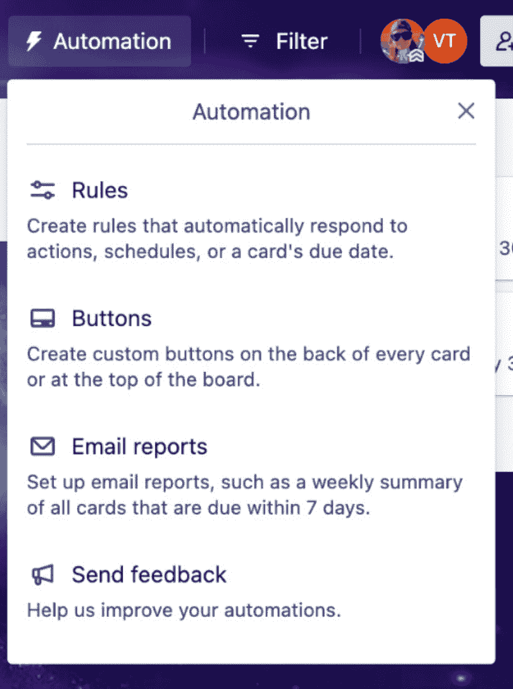

在出现的模态框中，你会看到各种自动化类型。大多数标准触发器位于**规则**中，因此我们将在本节中介绍这些触发器。在第 9 章，我们将讨论如何将触发器和操作结合起来创建完整的自动化，在第 10 章，我们将探讨仅在**日历**和**截止日期**部分中可用的几个额外触发器选项。

点击第一个选项**规则**，它将打开**自动化**覆盖层。接下来，选择右上角写着**创建规则**的按钮。

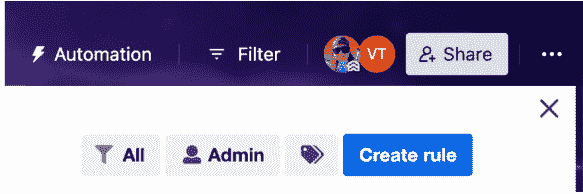

图 6.2 – 自动化部分中的创建规则按钮

每个规则都始于一个触发器。点击 **+ 添加触发器** 按钮，你将看到触发器选项列表以及描述卡片和看板不同部分的选项卡，用于监控事件。

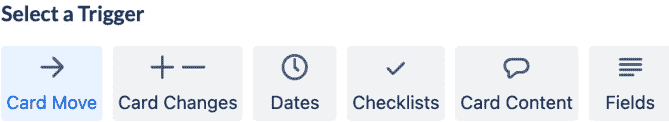

图 6.3 – 显示触发器选项的选项卡

这里不需要采取任何操作。请随意保持此页面打开，以便我们跟随操作。每个部分都以触发器选项中的不同选项卡命名。

## 专业提示 – 高级模式

如果你想查看更多自动化选项，请切换触发器选项卡最右侧的开关以打开高级自动化功能。当开关变为蓝色而不是灰色时，你就知道它已打开。这为你提供了更多筛选触发器的选项，以便你可以更具体地指定这些触发器将应用于哪些类型的卡片。例如，你可以指定当卡片添加到看板**且**名称包含单词“任务”时。或者你可以说当卡片移动到列表**且**@moonie 是卡片成员时。点击过滤器图标来探索这些选项。你还会注意到每个触发器末尾有一个人形图标，允许你指定是希望当你或特定人员或任何人执行触发事件时触发器才生效。

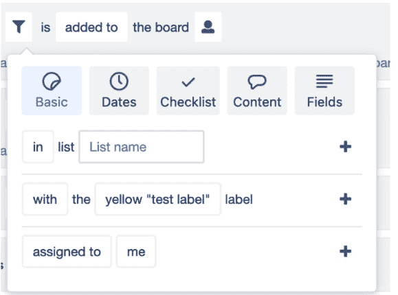

图 6.4 – 高级选项中的过滤器选项

现在让我们看看当卡片移动时的第一部分触发器。

## 卡片移动

当你希望根据卡片添加到看板或列表，或在看板中移动来启动自动化时，你将使用这些触发器。让我们逐一查看每个触发器，并讨论一些实际应用案例。

| 选择触发器 | 卡片移动 | 卡片更改 | 日期 | 检查清单 | 卡片内容 | 字段 | 高级 |
|---|---|---|---|---|---|---|---|
| when a card is added to the board | | | | | | | |
| "Added" means created, copied, moved into the board or emailed into the board. | | | | | | | |
| when a card is added to list | List name | | | | | | |
| "Added" means created, copied, emailed or moved into the list. | | | | | | | |
| when a card is archived | | | | | | | |
| when a list is created | | | | | | | |
| when list List name has exactly 1 cards | | | | | | | |

图 6.5 – 卡片移动触发器事件

这些位于第一部分，因为它通常涉及新卡片或列表的创建或移动到当前看板。

### 当卡片添加到看板时

每当卡片添加到看板时，这就会触发。你可以具体说明卡片是_如何_添加到看板的。

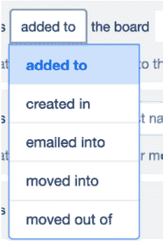

图 6.6 – 卡片移动的下拉选项

例如，如果你只对通过电子邮件添加到看板的卡片感兴趣，从下拉菜单中选择该选项将限制触发器仅在该情况下触发。**在看板中创建**的卡片仅在看板内创建新卡片时触发。**移动到**在卡片在不同看板上创建并移动到当前看板时触发。但是，如果你想了解添加到此看板的所有卡片，请选择**添加到**选项。

### 实际示例

当卡片添加到看板时，将 @funmanandy 添加到卡片。

这是确保当任务添加到你的任务列表时（无论是由你还是他人添加）你能意识到它们的好方法。这是保持待办事项列表井井有条的好方法。

### 当卡片添加到特定列表时

此触发器监视添加到你定义的列表的卡片。这是跟踪卡片在工作流程中移动的好方法。根据卡片移动到哪个列表，分配特定人员或截止日期很有帮助。

请注意，你与前一个触发器有类似选项，因此你可以具体说明卡片是如何移动的。

### 实际示例

当卡片移动到**审核**列表时，使用 @jimmytalksjira 评论“是时候审核此任务了！”。

这是一种好方法，可以让同事知道任务何时准备好供他们处理，而无需手动提醒他们。

### 当卡片存档/取消存档时

如果你希望在卡片存档或取消存档（重新放回看板）时触发某些操作，这就是你需要的触发器。

诚然，我不经常使用这个触发器，但如果你担心丢失卡片，并希望意识到是否有卡片被意外存档，它会很有帮助。

### 实际示例

当卡片存档时，发送电子邮件到 email@test.com，主题为**卡片已存档！**。

这在提醒你某物已被存档时很有帮助，因为 Trello 中对此没有原生通知。

### 当列表创建/重命名/存档/取消存档时

当列表创建时，你可以使用此触发器，但还有一些隐藏选项。点击**创建**以查看可作为触发器的其他列表操作。

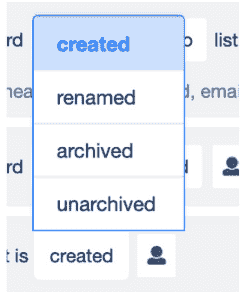

图 6.7 – 列表触发器事件

与存档卡片类似，如果你的看板上有新的 Trello 用户，并且希望意识到意外更改，这些操作会很有帮助。另外，如果

你希望在看板更新时实时接收更新，这是获取包含列表更改的电子邮件流的绝佳方式。

## 真实示例 – 列表事件

当创建列表时，向 `info@test.com` 发送一封主题为 **名为 {listname} 的新列表已创建！** 的电子邮件。

这有助于在看板发生更改时提醒你，以便你能够撤销对看板的任何意外编辑。

## 自动化变量

你注意到我在该规则中使用了 `{listname}` 吗？这是因为 Trello 自动化允许你访问自动化发生位置的详细信息，从而让你的自动化针对特定情况变得非常智能和定制化（如果你愿意，可以称之为动态化）。在此示例中，每次创建新列表时，电子邮件主题都将包含新列表的名称。这样可以避免你打开 Trello 并猜测添加了哪个新列表。

使用变量是让自动化强大 10 倍的绝佳方式，但起初可能令人生畏。当你准备好了解它们时，请访问 [support.atlassian.com/trello/docs/butler-variables/](https://support.atlassian.com/trello/docs/butler-variables/) 了解你可以访问的所有信息。在本章中，每当看到文本写在花括号中时，你都会看到一些示例，例如 {} 。

## 当列表中有特定数量或范围的卡片时

此触发器监视列表中的卡片数量，并在满足所需条件时执行操作。它不仅适用于特定数量——点击 **exactly** 查看更多选项。

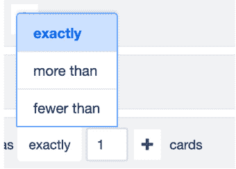

图 6.8 – 列表卡片数量选项

将触发器设置为监视列表中的卡片数量是多于还是少于所需数量。点击加号图标可以设置范围，例如多于 5 张卡片且少于 10 张卡片。

### 真实示例 – 卡片数量触发

当 **待办** 列表中有超过 10 张卡片时，按到期日期对列表中的卡片进行排序。

这有助于优先处理任务。当列表中有超过 10 张卡片时，它会对它们进行排序，使最快到期的卡片排在最前面。

我们刚刚了解了与移动卡片交互的所有方式。现在让我们来看看当卡片发生某些更改时可用的所有触发器。这个触发器也很复杂，所以给自己倒杯咖啡吧。

## 卡片更改

许多自动化工作流与卡片内部的某些更改有关，无论是有人从卡片中移除、添加附件，还是添加标签。Trello 可以监视卡片中几乎任何你能想象到的更改。

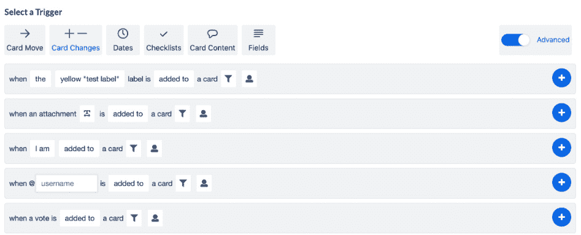

图 6.9 – 卡片更改触发器事件

这些是最常见的卡片更改。如果你在寻找某个选项但在这里没有看到（例如到期日期或清单），请不要惊慌，因为它们可能只是另一个触发器选项卡的一部分！

## 当特定（或任何）标签添加到卡片时

基于标签添加到卡片时，或任何标签添加时触发操作。请记住，如果你想更具体，可以使用 **filter** 设置，例如仅适用于带有红色标签且分配给你的卡片。

### 真实示例 – 标签触发

当绿色标签添加到卡片时，将其移动到 **已完成** 列表。

这为你提供了一种快速“完成”卡片的方法，即通过添加标签而不是拖动卡片。

## 当附件添加/移除时

你可以根据附件添加到卡片时指定触发器，甚至可以通过在触发器中选择文本图标，指定名称中包含或不包含某些单词、短语、字母或数字的附件。

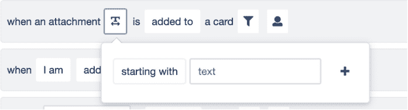

图 6.10 – 附件触发器的文本过滤器

### 真实示例 – 附件触发

当以 **Invoice** 开头的文件添加到卡片时，将卡片分配给 @andyg_finance。

这有助于在添加特定类型的文件时自动标记与卡片相关的个人。

## 当你或其他人添加到/从卡片中移除时

如果你希望在有人添加到卡片时发生某事，请使用此触发器。这纯粹是检查你或任何其他人是否被添加到或从卡片中移除，而不是特定用户。如果你想为非你自己的特定人员设置触发器，则需要查看下一个触发器。

### 真实示例 – 成员添加/移除

当有人添加到卡片时，将卡片移动到 **已分配** 列表。

这在有人加入卡片时节省点击很有用。与其加入并拖动卡片，不如自动将其移动到另一个列表，让你快速知道哪些卡片已被认领，哪些未被认领。

## 当特定用户添加到/从卡片中移除时

如果你需要更具体地指定添加到卡片的人员，这非常合适。例如，也许如果设计人员而不是产品人员添加到卡片，则需要发生某些特定类型的事情。

### 真实示例 – 特定用户触发

当 @lane-design 添加到卡片时，将设计师清单添加到卡片。

这在工作流程的每个阶段将特定流程清单添加到卡片时很有用。

## 当投票添加到/从卡片中移除时

Trello 通过其 Power-Up 目录在看板上启用高级功能。一个名为 Voting Power-Up 的特殊 Power-Up 由 Trello 自身构建，为用户在看板中对卡片投票添加了功能。如果你的看板是公开的，投票者甚至不需要是看板成员。这对于获取产品路线图的用户反馈或优先处理博客内容非常有用！这也是少数几个集成到自动化中的 Power-Up 之一。我们将在第 11 章详细讨论这一点，但目前，只需知道它在自动化中可用。

### 真实示例 – 投票触发

当投票添加到卡片时，按从最多票到最少票的顺序对 {cardlistname} 列表进行排序。

此自动化可帮助你查看最受欢迎的卡片，并在数据（卡片上的投票数量）更改后自动对它们进行排序。

基于卡片更改可以触发很多事情。希望到现在，你开始思考工作流程中可能作为触发器的一些活动，但我们才刚刚开始。现在是时候谈谈日期了。

## 日期

虽然我们已经了解了卡片更改，但你是否知道卡片上仍然可能发生许多其他更改？让我们在本节中处理日期——具体来说，是开始日期和到期日期（我们将在本章后面深入了解自定义字段日期）。

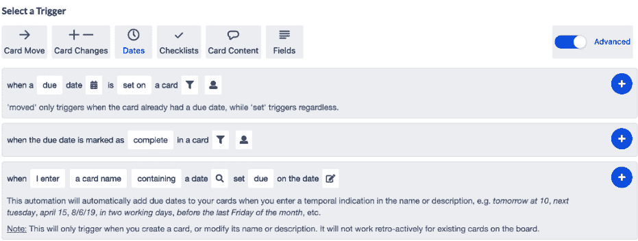

图 6.11 – 日期触发器事件

日期触发器是指卡片上的到期日期或开始日期发生变化时。这里有几个不同的选项，但你会注意到没有关于卡片到期的选项。我们将在第 10 章讨论基于日期的自动化时介绍这些触发器。但目前，我们将坚持使用 Rules 部分下可用的自动化触发器。

## 当开始/到期日期设置在卡片上时

如果你希望在开始日期或到期日期添加到卡片时触发操作，那么这就是你要找的。和往常一样，你可以点击过滤器按钮以更具体。此触发器有助于澄清看板中已安排的卡片。

### 真实示例 – 日期设置

当到期日期添加到卡片时，将卡片添加到 **已安排** 列表。

此自动化有助于在分配截止日期后将卡片排队到特定列表，帮助你优先处理最重要的即将到来的任务。

## 当到期日期标记为完成/未完成

如果你希望在任务“完成”时，或当有人取消已完成卡片的到期日期时发生某事，此触发器很有帮助。这个触发器 _仅_ 适用于到期日期，因为开始日期不是可以标记为完成或未完成的字段。

### 真实示例 – 到期日期完成

当到期日期标记为完成时，将卡片移动到 **已完成** 列表。

此自动化为你节省了完成卡片的一个步骤。只需检查到期日期，卡片也会移动到已完成列表，所以你不需要做两次！

## 当你或其他人输入包含日期的卡片名称时，设置到期日期

这可能在你实际看到之前并不太清楚，但当你设置此规则时，它会获取卡片标题或描述中任何类型的日期（例如数字，甚至是单词 **Monday**），并使用该日期来设置卡片的到期日期。

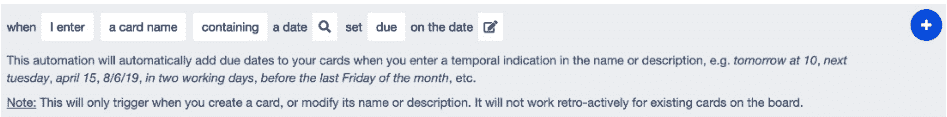

图 6.12 – 日期部分下设置卡片名称或描述中的到期日期的触发操作

例如，如果你创建一个名为 **Email client on Tuesday** 的卡片，它将把即将到来的周二作为该卡片的到期日期。如果你输入特定日期，例如 **Email client on April 25th**，它将设置该日期——在此例中为 4 月 25 日——作为到期日期！

点击名称后面的铅笔图标，Trello 将从卡片名称中删除日期。

此规则不同于任何其他规则，因为它同时包含触发器和操作。如果你只单击规则末尾的 + 图标并保存，则无需向其添加任何其他内容，因为它已经同时包含触发器（卡片中包含日期时）和操作（设置到期日期）。

现实示例

当我在卡片名称中输入日期时，将其设置为到期日期。

这让你在创建卡片时设置其到期日期。这意味着当你创建一个名为 **Email client on Tuesday** 的卡片时，它将把到期日期设置为即将到来的周二，并将卡片重命名为 **Email client**。

现在你已经是到期日期触发器专家了。让我们继续查看检查清单。

## 检查清单

我们在第 3 章中已经讨论过检查清单，但现在是时候讨论如何自动化它们了。这些子任务有很多选项！

选择触发器
→
卡片移动
+−
卡片更改
🕒
日期
✔
检查清单
💬
卡片内容
📋
字段
高级
当检查清单 Checklist name 被添加到卡片时
+ 当检查清单 Checklist name 在卡片中完成时
+ 当项目 Item name 被勾选时
+ 当检查清单项目上设置了到期日期 📅 时
+ 检查清单项目的到期日期仅在标准版和高级版工作区中可用。
当项目 📝 被添加到检查清单 Checklist name 时
+ 你可以使用 {checklistitemname} 变量在随后的操作中使用项目名称。

图 6.13 – 检查清单触发事件

在撰写本文时，Trello 最近启用了自动化功能来监控检查清单项目上的到期日期设置。但目前没有可用的触发器用于当成员被分配给检查清单项目时。

### 当特定检查清单被添加到/从卡片中移除时

当检查清单被添加到任何卡片（或如果你添加筛选器，则是特定卡片）时会发生触发。你需要在此规则中指定检查清单。你不能选择任何检查清单，请牢记这一点。

#### 现实示例 – 检查清单添加/移除

当 **Monthly Report** 检查清单被添加到卡片时，设置一个当月最后一个工作日的到期日期。

这对于需要添加到检查清单并在特定时间完成的重复性操作很有帮助。

### 当卡片中的检查清单完成/变为未完成时

如果你希望在检查清单完成时发生某些事情（例如发送电子邮件通知或评论），请使用此选项。它也可以用于指示检查清单是否变为未完成。当添加了尚未勾选的内容或已完成的项目被取消勾选时，就会发生这种情况。

这不需要指定检查清单，尽管你可以。或者，留空以监控任何或所有检查清单。

#### 现实示例 – 检查清单完成

当所有检查清单都完成时，将卡片移动到 **Done** 列表。

如果你经常使用检查清单，此规则很有帮助，因为当你完成卡片内的检查清单时，它会自动使整个卡片完成。

### 当项目被勾选/取消勾选时

此触发器再次为你提供具体化或监控检查清单中任何项目的选项。此触发器允许你在项目完成或取消勾选时触发操作。如果你正在将卡片和检查清单项目关联起来，这很有帮助。

#### 现实示例 – 项目勾选

当项目被勾选时，查找同名卡片并将其移动到 **Done** 列表。

当你使用单个卡片作为检查清单项目来跟踪其他卡片时，这是一个有用的规则。这有助于保持它们同步。

### 当项目上的到期日期被设置/移除时

此触发器监控项目上的到期日期设置。在撰写本文时，这是一个新功能，因为项目到期日期的自动化以前最多也很困难，甚至根本不存在。就像到期日期触发器一样，请记住，这仅监控到期日期的设置或移除，并不监控当前日期与该日期的关系。

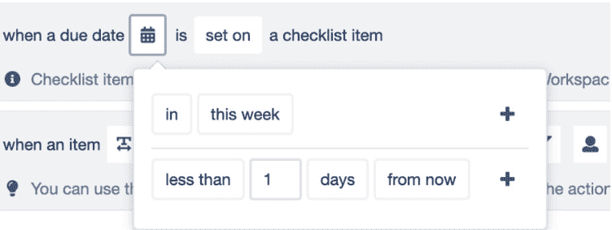

图 6.14 – 检查清单项目的其他日期选项

点击日历图标以查看你想要监控的到期日期类型的更多选项，例如设置为下个月或明天的日期。这可以防止来自未来太远的子任务的不必要触发。

#### 现实示例 – 项目日期

当本月在检查清单项目上设置了到期日期时，将卡片移动到 **This Month** 列表。

此规则对于在看板中组织卡片以帮助你优先处理有即将到来截止日期的卡片很有用。

### 当项目被添加到/从检查清单中移除时

这类似于检查清单被添加时，但现在我们关注的是其中的项目。这是任何项目被添加到检查清单时的触发器。

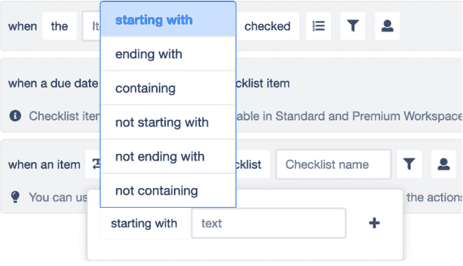

图 6.15 – 检查清单项目的文本筛选选项

如果你想更具体地指定要监控的项目类型，请点击 T 按钮。

#### 现实示例 – 项目添加/移除

当包含 “design” 的项目被添加到检查清单时，将 @nanun-designer 添加到卡片。

如果你的团队成员始终负责特定角色和任务，此规则很有用。

觉得卡片中包含/以...开头/以...结尾/文本的 T 很酷吗？对下一节感到兴奋吧，下一节是关于卡片内容的。这全是关于使用卡片名称和描述中的文本条件来触发自动化。

### 卡片内容

如果你想根据卡片中包含的单词或字符触发某些操作，这就是你要操作的区域。

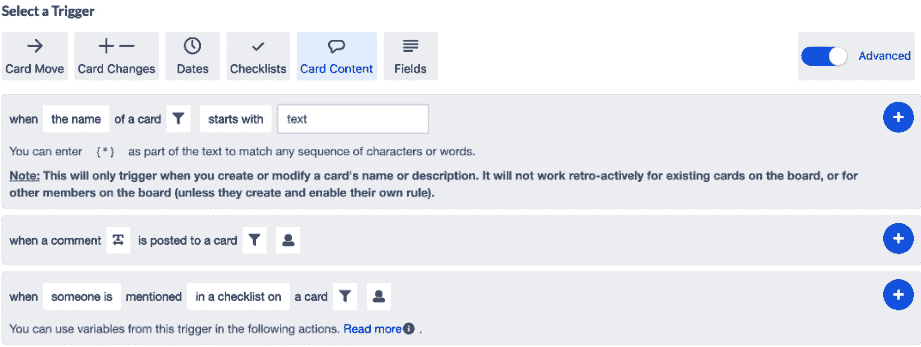

图 6.16 – 卡片内容触发事件

如果你想不出任何想要使用此功能的理由，只需将其作为一个选项留在脑海深处即可。我曾以为自己永远不需要这类触发器，但我最近开始在我的膳食计划看板上使用它们，为我的杂货购物清单上的项目添加标签（例如 _produce_、_dairy_ 或 _meat_），从而可以轻松按杂货店区域对购物清单进行分类。

### 高级专业技巧

这非常高级，不适合胆小者。请自行斟酌。如果你想在文本筛选中包含多个条件，例如卡片名称包含 _milk_ 或 _creamer_，则没有可点击的按钮。你需要在文本字段中使用 _regex_ 并为 “或” 编写自己的代码。它看起来像这样：_regex:/.*(salt|Salt|oil|Oil|water|Water).*/_。

### 触发器

when a card with a name containing
regex:/.*(salt|Salt|oil|Oil|water|Water).*/
is added to list
Shopping List

### 操作

archive the card

图 6.17 – 在自动化中使用 regex 的示例

如果这感觉太高级，不用担心——你可能永远不需要它。但现在你知道它在这里，如果你需要，是可行的！

### 当卡片名称/描述中包含特定文本时

就像我们在上一节中对项目所做的那样，你可以在卡片名称或描述中包含特定文本时触发操作。这具有相同的设置，你可以说 “以...开头”、“以...结尾”、“包含”，或者不是这些中的任何一项。

#### 现实示例 – 文本触发

当卡片名称包含 Q1 时，创建一个 3 月 31 日的到期日期。

此规则对于使用标题在卡片上创建相对到期日期很有用，尤其是当它是一个模糊或未定义的术语，其他触发器无法识别时。

### 当评论发布到卡片时

这与名称/描述相同，但这个是查找注释中的文本。

## 实际示例 – 评论发布

当包含单词 `urgent` 的注释发布到卡片时，添加红色 **高优先级** 标签。

这对于使重要任务更加清晰可见并帮助它们在看板上脱颖而出很有用。

## 当有人在卡片中被提及时

这会检查卡片中是否有人被提及。你可以使用此功能来创建一个动作，将该人添加到卡片中，以确保重要卡片不会因为有人错过评论而被忽略。

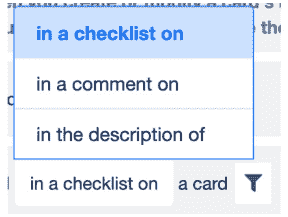

图 6.18 – 监视提及位置的选项

Trello 会监视卡片的几个部分以查找提及，你可以指定感兴趣的部分。如果你想检查所有部分，则需要创建三条不同的规则，因为无法将所有三个部分合并。

## 实际示例 – 提及触发

当有人在评论中被提及时，将其添加到卡片中。

如果你在评论中标记的人往往是项目的利益相关者，并且可能希望接收有关任务活动的其他通知，这很有用。

感到有点不知所措吗？你不需要记住所有这些。你现在的目标只是熟悉所有这些部分，了解可以使用什么以及有哪些可用内容。还有一个部分就完成了，我们就完成了标准触发器选项。让我们来谈谈当自定义字段发生更改时的触发器。

## 字段

触发自定义字段的功能仅适用于具有自定义字段的看板（说得通，对吧？），并且你只能在 Trello Standard 及更高计划上激活自定义字段。

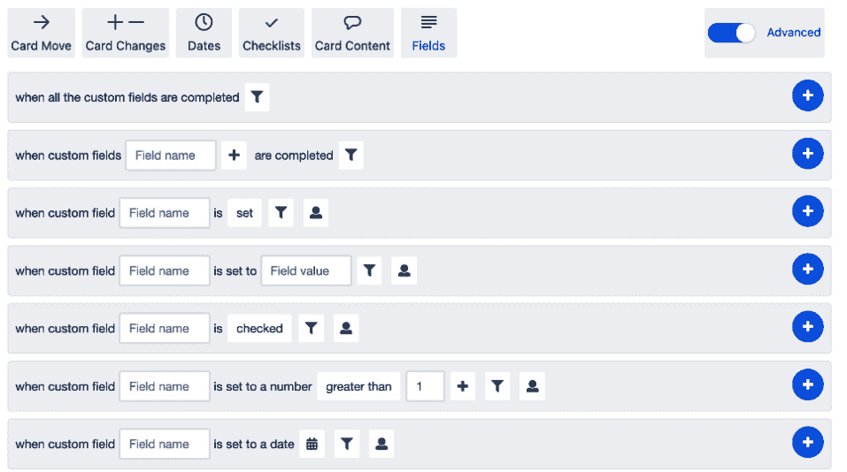

图 6.19 – 字段触发事件

如果你不使用自定义字段，可以随意跳过此部分，并在开始使用它们时稍后再回来。它们对于高级自动化非常有帮助，因为你将看到，有很多用于监视它们的触发器！

## 当所有自定义字段都完成时

如果你只有一个自定义字段，当该字段填写时将触发此操作。如果你有多个字段，则只有当 _所有_ 字段都填写时才会触发。

## 实际示例 – 所有字段完成

当自定义字段完成时，将卡片移动到 **可使用** 列表。

此规则对于创建一种“表单验证”类型的工作流很有用，当你拥有处理卡片所需的所有信息时，该工作流会将卡片移动到下一阶段。

## 当自定义字段完成时

这与前一个相同，但仅查看特定字段是否完成。你可以通过单击字段旁边的 + 图标将多个字段添加到此规则中。

## 实际示例 – 字段完成

当 **姓名** 和 **部门** 自定义字段完成时，将 @**britt_the_heir** 分配给卡片。

当你拥有开始处理任务所需的必要信息时，这有助于创建负责人。

## 当自定义字段被设置时

这与自定义字段完成类似，但允许你仅指定一个自定义字段。

## 实际示例 – 字段设置

当 **生日** 自定义字段被设置时，将卡片到期日设置为相同的日期。

如果你正在将 Trello 用作 CRM 并希望在某人生日时收到联系提醒，此特定规则很有用。

## 当自定义字段被设置为特定值时

这会检查自定义字段是否具有特定值——也就是说，不仅是它被设置，而且与你要查找的值匹配。

实际示例

当 **部门** 自定义字段被设置为 `Design` 时，将 **@venus** 添加到卡片。

此规则对于根据卡片可能所属的部门分配负责人很有用，你可以从下拉字段中选择该部门。

## 当复选框自定义字段被选中/取消选中时

自定义字段有多种形状和大小，其中一种可以是复选框。此触发器允许你根据特定复选框自定义字段是否被选中或取消选中来设置条件。

实际示例

当 **已批准** 自定义字段被选中时，在卡片上发布一条评论，内容为 `@card this has been approved`。

此规则允许你使用字段来指示项目的状态，并将其传达给下一位团队成员，而无需手动创建评论并提醒所有人。

## 当数字自定义字段被设置为特定数字/数字范围时

另一种自定义字段类型是数字。你可以使用此触发器，根据自定义字段中的数字值来触发某些操作。

实际示例

当 **年龄** 自定义字段大于 13 且小于 20 时，添加“青少年”标签。

如果你有需要分组的特定数据，这很有用。这是将自定义字段信息与卡片上的其他字段关联的另一个示例。

## 当日期自定义字段被设置时

另一种自定义字段类型是日期字段。无论你的看板是否启用了自定义字段，你都可以访问卡片上的开始日期和到期日期。但如果你需要更多日期字段，可以使用自定义字段创建它们。然后，你可以使用此触发器来监视它们的情况。

实际示例

当自定义日期字段 **关闭日期** 被设置时，将卡片移动到 **已赢得** 列表。

类似于到期日期，这是一个有用的自动化，可以通过日期字段的存在来指示某事的状态。

## 摘要

你做到了！现在你了解了所有可用作事件触发器的选项！希望你开始看到可能性，并对在看板上实施自动化感到自信。

接下来，我们将学习操作，这样你就可以看到基于这些触发器可以做什么！你可能已经从实际示例中了解了一些可能性，但我们才刚刚开始。
