## 常见自动化操作

现在是时候谈谈创建触发器后会发生什么了。既然你知道启动自动化工作流的选项，让我们来谈谈你可以实际自动化的 _操作_ 类型！我们将从介绍最常用和最基本的操作开始。

在本章中，你将学习如何自动化诸如以下活动：

- 将卡片移动到其他看板或列表
- 添加成员或标签
- 调整到期日期
- 创建检查清单或评论

这只是其中一部分……让我们深入了解，这样你就能明白我的意思了。我们将从在哪里找到这些操作开始。

## 访问自动化操作

你访问操作的方式与访问触发器相同——通过出现在任何 Trello 看板顶部工具栏上的 **自动化** 按钮。单击它，然后从出现的菜单中选择 **按钮**。

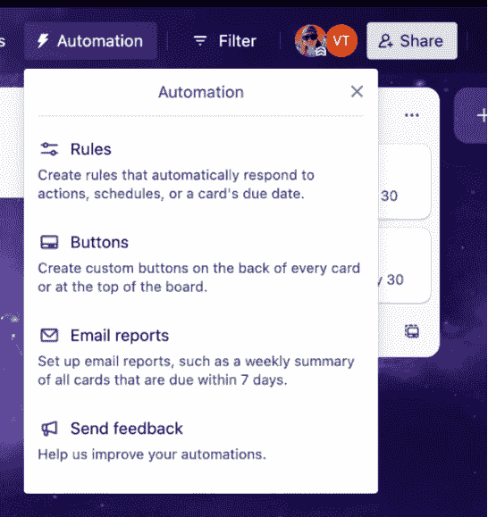

图 7.1 – 自动化模态框

我们将在第 9 章中更多地讨论按钮，但目前，只需知道这是一种手动启动自动化的方式，因此是查看所有可用操作的最快方式。

从卡片按钮模态框中，单击右上角的蓝色创建自定义按钮选项。单击 + 添加操作按钮。

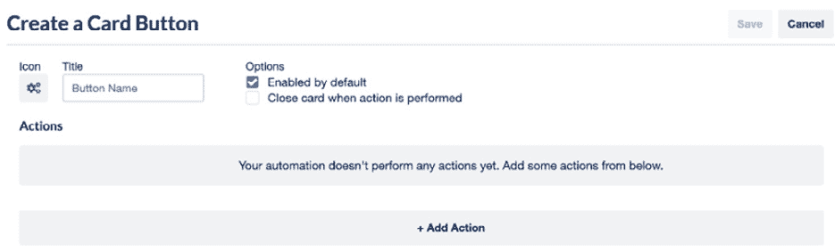

图 7.2 – 卡片按钮自动化选项

这将弹出一个我们可以自动化的操作菜单。请随意从这里开始跟随，在本章剩余部分中，我们将介绍每个部分中可用的不同操作。

我已经整理了所有这些信息，以便你可以访问它并在需要时快速找到它，但没有人能凭记忆记住所有这些（连我也不行！）。你越是摆弄它，就会越感到自在，并且会开始记住你能做什么和不能做什么。让我们先从谈论 Trello 工具箱中的移动操作开始。

## 移动

你看到的第一种操作类型与在看板上移动卡片，甚至移动到另一个看板有关。如果你想更改卡片的位置，**移动** 操作集最有帮助。

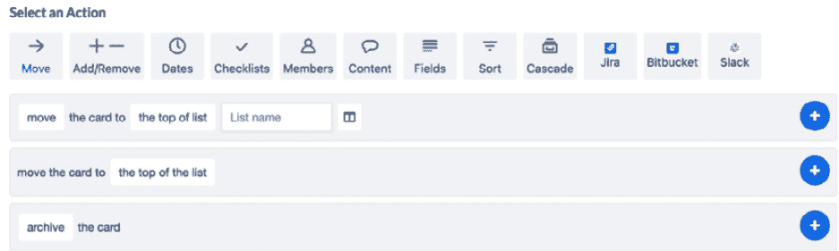

图 7.3 – 移动操作

这类自动化操作使得将卡片放在看板上适合你工作流程的正确位置变得无缝。你不需要手动拖动卡片，而是可以设置卡片移动到下一阶段的条件，例如检查清单完成，并让它立即发生。

如果你在多个看板上操作，这非常有用。你可能有一个看板用于在分配给特定

teams or projects, so being able to quickly go from one board to another is essential.

There are only a few options here but there are some nuances to each one, so read closely.

## Move/copy the card to the top/bottom of the list

This one is sneaky—if you’re looking for the option to copy a card when something is created, this is the one you want! Click on **move** and you’ll see the copy option appear. This action lets you simply move (or copy) a card to another list. (You can even clarify whether you want it added to the top or bottom.) Click the board icon at the end and you can specify a list that is on another board. (Note: these other boards do not have to be in the same workspace! They just have to be boards that you’re part of!)

Real-world example

When a card is assigned to me, move it to the top of the **Brittany working** list.

This is useful for keeping all of your own cards in one list automatically, making it easy for you to find your tasks without using any filters.

## Move the card to the top/bottom of the current list

This is the same as the previous option, but rather than specifying another list, it will perform the action based on the list the current card is in.

Real-world example

When a red **urgent** label is applied to a card, move it to the top of the list.

This is helpful for prioritizing cards and helping the most urgent ones rise to the top.

## Archive/unarchive the card

This does exactly what it says! You can archive a card, or unarchive it if it’s been archived.

Real-world example

When a card is moved to the **Done** list, archive the card.

This is great for keeping your board clean and making sure you only see the things that need your attention.

Next up, let’s talk about another common automation type—adding and removing attributes to cards.

## Add/Remove

These actions are for making changes to cards, specifically adding/removing all sorts of elements, such as labels, stickers, links, and event text. A lot of automation tends to fall into this category, so keep an eye out!

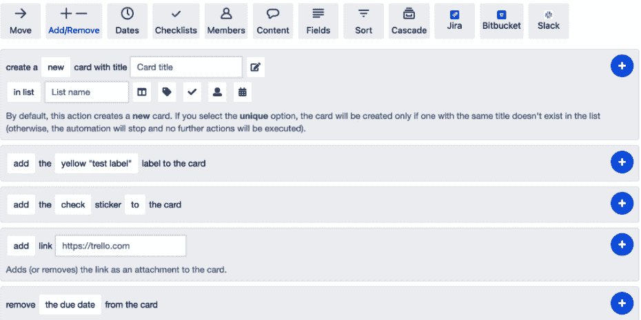

Figure 7.4 – Add/Remove actions

If you’re making changes to cards that don’t necessarily have their own sections (such as due dates, members, or links), you’ll find this section most helpful. It’s also a great place to go when you want to create a specific kind of card with checklists, dates, members, and more. For example, maybe you have a board for request ads. You could create a button that uses the **create a new card** action to create a templated card with all the fields set to your preferences, all with the click of a button!

Let’s start from the top and work our way down.

## Create a new/unique card

Don’t get this confused with copying or moving—this creates a brand-new card! You can define just about anything you want with this new card. Though only the title and specific list are required, you can include a description by clicking the pencil icon. The rest is optional, but if you prefer, you can add labels, checklists, or due dates, and assign members. This is great for making a templated card type or creating recurring cards.

## Real-world example – 创建卡片

Every day, create a new card for the day with today’s habits checklist.

This is helpful for generating a new card every day, and has more options and control than the Card Repeater Power-Up.

## Add/remove a label to a card

You can specify whether you want to add or remove a specific label to a card. You can choose from any label on that current board. If the label doesn’t exist yet, refer to _Chapter 2_ for instructions on creating new labels.

Real-world example

When a comment contains **urgent**, add the red **urgent** label to the card.

This is great for quickly categorizing cards and helping ensure you don’t miss anything important that might be skimmed in the comments.

## Add/remove a sticker to a card

Just like labels, you can add stickers! Admittedly, I don’t use these a lot (or ever) in automation, but I can see how they might be useful if you want to style your board and make the robots do it instead of yourself.

Real-world example

When a vote is added to a card, add a **checkmark** sticker to the card.

Okay, maybe this is just a style thing, but it still gives your cards a way to stand out and sometimes that helps you take action on them!

## Add/remove a link

If you want to add an attachment to a card, such as a link to an article or a file, you can add that with this action. You can even make the automation advanced enough to find another card and add the link there, rather than the original card, which is helpful for keeping related cards up to date.

## Real-world example – 链接操作

When a label is added to the **Invoicing** list, add a link to the invoice template file on Google Drive.

This is incredibly helpful to prevent spending time looking for templates or files in Google Drive, and there’s no need to take multiple steps after tagging a card.

## Remove (just about anything) from the card

You can remove the due date, the start date, the cover image, all the labels, all the members, or all the checklists from a card. This is great if you need to reset a card! Click the **the due date** option to see a dropdown of additional items.

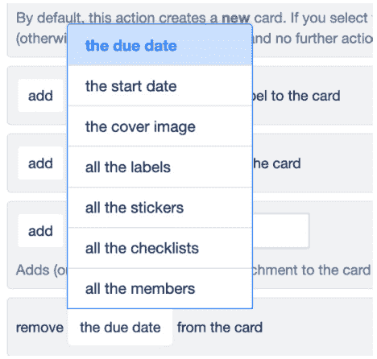

Figure 7.5 – Due date options

If you want to remove multiple elements, select one, then click the blue plus button at the end of the row, and then rinse and repeat until you’ve selected all the elements you want to remove.

## Real-world example – 移除项目

When a card is moved into the “backlog” list, remove all members from the card.

This is a great way to “reset” a card. You could also add an action that removes the due date and sends a comment to everyone on the card letting them know that for whatever reason, this task has been deprioritized.

Now it’s time to talk about dates. Get it? 😉

## Dates

## Let’s make some automation happen with dates!

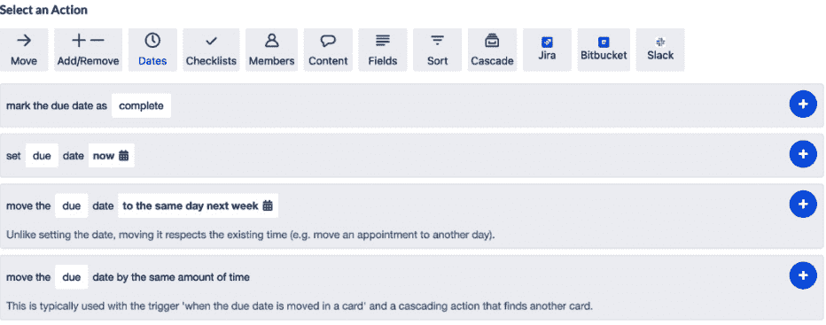

Figure 7.6 – Date actions

If you have a process that involves setting, changing, or completing due dates, this is the section you want to pay attention to. Well, of course you do, because many of us use due dates in Trello to surface the most time-sensitive tasks and make sure we’re moving through our projects at the right pace.

However, dates are never static. When was the last time you had a project or task that actually stuck to its intended schedule? Even as I write this book, we’ve had to adjust the deadlines for drafts and edits throughout this whole process. These automations make setting and shifting due dates easy and allow you to focus on doing the work.

Let’s dive in.

## Mark a due date as complete/incomplete

You can check off a due date as done, or uncheck it if it’s already checked off.

Real-world example

When a card is moved to **Done**, mark the due date as complete.

And a bonus one!

When a comment is added to a card in the **Done** list, mark the due date as incomplete.

These help manage the date field by other properties on the card. The second example is a great way to “reopen” a card if something changes.

## Set the due/start date to ___

The world is basically your oyster here.

No, really... you’ve got a ton of options from setting it to be right away, to a certain number of hours in the future, to an upcoming day of the week, or a specific date or day of this current month, or this year! You can even match it to a date in a custom field.

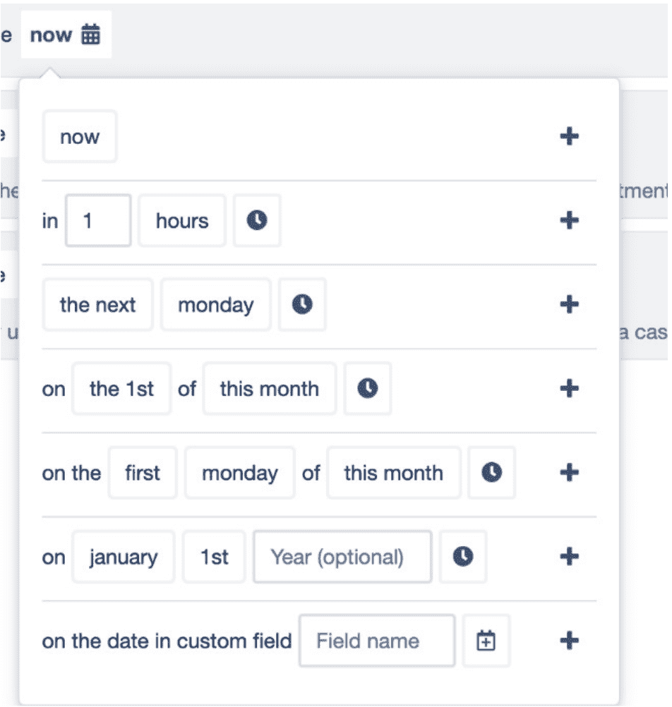

Figure 7.7 – Date setting options

Clicking the clock icon allows you to set a specific time if you have a preference. Click the + button at the end when you’ve selected your desired time.

## Real-world example – 日期标记

When a card name contains **this week** in the title, set the due date to the upcoming Friday.

This is a quick way to set the date of a card as it’s created, or by renaming it.

## Move the due/start date to _

This is similar to the previous one, but with this action, you can shift the date based on a relative time frame from the current date.

Real-world example

When a card button is clicked, **Snooze card** set the due date to the same day next week.

I use this rule sometimes to deprioritize tasks that I know won’t get done this week. There’s no use leaving it on my plate to distract me and make me feel bad about not completing everything I planned earlier in the week when I was younger and more full of life.

## Move the due/start date by the same amount of time

This one’s a bit of an advanced maneuver and is usually paired with another action that looks for another card and _then_ moves the due date by the same amount of time as specified in the previous step.

Real-world example

When a due date changes on a card with the **orange Brittany Project** label, find other cards with the orange **Brittany Project** label and move the due date by the same amount of time.

This is excellent for managing card dependencies that all relate to the same project. If a project due date is pushed back a week, you might have several

(or many) cards that also need to be adjusted. By grouping them together with a label, custom field, or some other attribute, it’s easy to quickly adjust everything at once with this rule.

You’ve time traveled and moved around with dates, so now let’s move on to checklist actions.

## Checklist actions

The next set of elements that you can automate are checklists, which are subtasks inside of your Trello cards.

| add | the | Checklist name | checklist | 👁️ | ✏️ | to the card | + |
|---|---|---|---|---|---|---|---|
| \multicolumn{8}{c}{Finds an existing checklist with that name on the board and copies it to the card. You can select a specific source card by clicking on the "bull's eye" option and entering the card's name or link.} |
| add an empty checklist named | Checklist name | to the card | | | | | + |
| add | Item | Item name | to checklist | Checklist name | | | + |
| assign the item to | me | | | | | | + |
| \multicolumn{8}{c}{ⓘ Assigning checklist items is only available in Standard and Premium workspaces.} |
| set the item due | now | 📅 | | | | | + |
| \multicolumn{8}{c}{ⓘ Checklist item due dates are only available in Standard and Premium Workspaces.} |
| move the item due date | to the same day next week | 📅 | | | | | + |
| \multicolumn{8}{c}{ⓘ Checklist item due dates are only available in Standard and Premium Workspaces.} |
| remove the due dates from the checklist | Checklist name | | | | | | + |
| \multicolumn{8}{c}{ⓘ Checklist item due dates are only available in Standard and Premium Workspaces.} |
| remove the due date from the item | | | | | | | + |
| \multicolumn{8}{c}{ⓘ Checklist item due dates are only available in Standard and Premium Workspaces.} |
| check | Item | Item name | ≡ | | | | + |
| check | all the items | In checklist | Checklist name | on the card | | | + |
| reset all the checklists on the card | | | | | | | + |
| remove all | the | items | from checklist | Checklist name | | | + |

## Figure 7.8 – Checklist actions

We learned about checklists in Chapter 3, and they’re one of my favorite parts of Trello. As someone recently diagnosed with ADHD, I’ve learned that breaking tasks into smaller bites and making clear action items make it easier for me to get started on something, and easier to finish. Plus, it helps me ensure I don’t forget any important steps along the way.

While that’s all good and well, it means nothing if it becomes another thing to do to manage those subtasks. That’s why checklist automation is helpful, whether it’s automatically adding a checklist for standard tasks that I have, such as cleaning my kitchen, or moving the due date when life happens and things get delayed.

There are a lot of options here. Instead of feeling overwhelmed, just remember you don’t need to learn them all now—it simply means there’s more you can do with them if you one day decide to!

## Add/remove checklists to a card

This is probably the most common action applied to cards. By clicking the target icon you can define an existing checklist that you want to add.

I find this works well with creating a template card that has the checklist you plan to use for automation. That way, you don’t have to worry about copying over a partially completed checklist or anything and it’s easy to edit from one place if you ever want to make changes.

## Real-world example – 添加检查清单

Every day at 6 a.m., create a new card with a Daily Habits checklist.

This is great for giving me one place to check my daily habits.

## Add an empty checklist

This is effectively the same as the “create a new checklist” action you can click inside a card. You can add a new checklist to the card and then add actions below it to add items to that new checklist.

## Real-world example – 空检查清单

When a card is added to the **Design** list, create a new checklist called **Design Tasks**.

This is useful for starting a new checklist on a card automatically. Note that this rule doesn’t add items to the checklist, but you can use the next action to do that.

## Add/remove items to a checklist

You can add/remove items from a checklist on a card. Just specify the name of the checklist you want to add it to, and if it doesn’t already exist, then it will create that checklist.

## Real-world example – 检查清单项目

When a red urgent label is added to a card, add a checklist item for **follow up on the case with customer**.

This is helpful for dynamically updating items in a checklist based on other activities in the card.

## Assigning the item to someone

If you have Trello Standard or higher, you will have advanced checklists, which let you assign due dates and members to items in a checklist. When someone is added to a checklist item, that task shows up on their **Home** page under **Your Items**.

You can also incorporate more automation to organize these subtasks in other ways, such as every time someone is added to a subtask, creating a card with that task and a link to the card as a new card on another board.

## Real-world example – 分配项目

When a checklist item is added to **Course checklist**, assign Robin.

This is useful if you tend to have the same people dedicated to specific tasks. It saves you the step of adding them after creating the task.

## Set the item due date

Similar to being able to add members, if you’re on Trello Standard or higher, you can add due dates to checklist items. This action lets you set the date of a task and gives you similar options to what we saw with date actions. Clicking **now** opens a modal with more date customization options, similar to what you see in the **Dates** section.

## Real-world example – 设置项目日期

When a checklist item is added to the **Daily** checklist, set the due date to today.

This saves the step of assigning due dates to items when you can logically define when they’d be due.

## Move the item due date

Like shifting the due dates of cards, you can shift the due dates of the checklist items inside a card. You have the same options, such as shifting to the same time, by a certain number of days, or to a relative or absolute time.

How you use this will depend on your use case, but it’s helpful to know which options are available.

## Real-world example – 移动项目日期

When a card is moved to the **Next Week** list, find each item in the checklist and move it to the same day next week.

Just like with card due date automation, this action is useful when you have multiple subtasks due on the same day and need to shift to the next week.

## Remove the due dates from the checklist

This action allows you to specify a checklist that you want to remove dates from. For instance, you might use this if you want to clear all of the dates from multiple checklist items rather than just a single item.

Real-world example

When a due date is removed from a card, remove due dates from the **Initial Steps** checklist.

Use this rule when you find yourself having to remove due dates from checklist items after a task is deprioritized and moved back to the backlog (or starter list).

## Remove the due date from the item

This is like the previous action, but if you don’t want to remove the due dates for all checklist items, you’ll need to use this with a trigger that specifies which one.

Real-world example

When someone is added to an item, remove the due date from the item.

This is helpful if you use dates as reminders to follow up on a card and assign them. Once someone else is assigned, they can create a new due date if they prefer.

## Check/uncheck an item

This action allows you to check off (mark as complete) or uncheck a specific item. You can specify which checklist it falls under by clicking the list icon next to it. This is often most useful when you’re trying to sync cards and checklists so that if a card with a task name that matches a checklist item name is moved to a completed list, you can check the item with the name off a checklist in the main card.

## Real-world example – 勾选项目

When a “submitted” label is applied, check the submit item in the **Process** checklist.

Use this rule with care—you’ll need to make sure the text matches what you set! But if you are consistent with text, it’s a great way to check off items when they’re incorporated with other steps you’re already taking.

## Check/uncheck all the times in a/all checklist(s)

This is just like it sounds! It checks off (or unchecks) everything in either a specific checklist or all the checklists on the card. This is most useful if you get bothered by incomplete checklists and sometimes you just finish multiple things and then ship a card over to the **Done** list.

## Real-world example – 全部勾选

When a card is moved to **Done**, check all the items in all the checklists.

I use this one all the time because sometimes I get so engrossed in doing the thing that I realize I’ve completed all the checklist items and don’t want to have to check them off one by one. (_Although sometimes it is kinda satisfying to do that._ 😊)

## Reset all the checklists on a card

如果你正在使用另一张卡片上的清单，并且该清单被复制过来，其中有些任务已完成，有些未完成，那么这是一个清理该清单并从头开始的好方法。

同样，我通常更倾向于设置一张带有干净清单的指定卡片，用于在自动化中引用清单。我发现这样更整洁，可以防止获取使用过一半的清单。它还使添加或删除项目变得容易。但你不必这样做，如果你更愿意只引用清单的名称而不指定它所在的卡片，那么你可以使用此规则来添加清单并将其重置。

## 现实示例 – 重置检查清单

当卡片移动到 **Design** 时，添加 **Designer** 清单并重置所有清单。

如果你在多个卡片中使用相同的清单，并且不从模板卡片指定清单，这将非常有帮助，这确保清单始终以未完成状态开始。使用此规则，你可以添加一个清单，即使它导入了部分完成的清单，它也会为当前卡片重置它。

## 从清单中删除项目

你可以从所有清单或特定清单中删除所有项目，或删除已完成或未完成的项目。有很多方法可以做到这一点，但我大多将其归类为清单清理部分。单击 **the before items** 以查看带有指定要删除的项目类型的其他选项的下拉菜单。

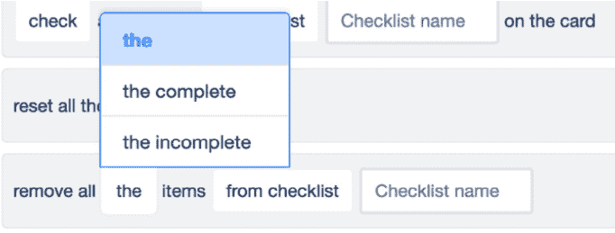

## 图 7.9 – 清单项目类型选项

你还可以选择 **from checklist**，以便该操作从卡片上的所有清单中删除符合条件的项目。

## 现实用例 – 清单项目类型

当卡片在一天内到期时，从所有清单中删除所有已完成项目。

这对于确定确切需要做什么非常有帮助，这样你就可以专注于剩余任务，并使你的清单更加整洁。只要记得花点时间庆祝你已经完成的事情！

你现在是清单自动化专家了！接下来，让我们看看可以在看板中自动化成员和人员的操作。

## 成员操作

成员操作非常有帮助，因为将人员分配给卡片可以轻松筛选卡片并确定谁会收到卡片通知。这也是跟踪容量和工作负载管理的好方法。

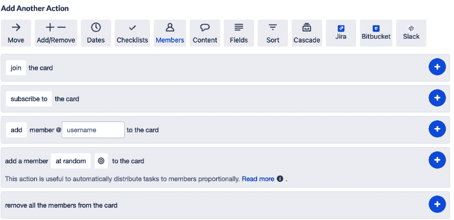

## 图 7.10 – 成员操作

由于卡片成员与 Trello 的许多其他方面相关，例如筛选器、视图，以及也许最重要的是通知，因此确保正确的人始终在正确的卡片上非常重要。如果你仔细想想，无论你如何使用 Trello，你可能都有一种相当系统的方式将人员添加到卡片中。

例如，你可能会让你的设计师在卡片移动到营销看板的某个阶段时接管卡片，或者你可能会让你的产品经理被分配到任何新添加的卡片以评估其重要性。一旦你确定了谁获得什么的系统，你每周就可以通过避免手动打开卡片、单击成员、思考它是给谁的，然后单击他们的姓名的过程来节省时间。

即使你是看板上唯一的人，你可能仍然希望将项目分配给自己以获取通知或与其他应用程序集成。

## 加入/离开卡片

此操作仅针对你，即设置它的人。因此，如果你想根据某些标准自动加入卡片（或离开卡片），这就是你想要使用的操作。

## 现实示例 – 加入/离开卡片

当卡片在未来五天内到期时，加入卡片。

这确保你了解即将到期的卡片，即使你没有设置筛选器或突出显示即将到来卡片的视图。

## 订阅/取消订阅卡片

订阅卡片等同于“关注”卡片。这意味着你的头像不会显示在卡片上，你也不会成为卡片的正式“成员”，但你仍然会收到卡片活动的通知。我们在 _Chapter 2_ 中了解了 **watching**。

请记住，此规则也仅适用于你自己。你不能为其他人订阅，所以如果你团队中的其他人想要此规则，他们需要自己设置。也许你应该借给他们这本书的一份副本，并把这一页折角标记！

## 现实示例 – 订阅卡片

当卡片添加到带有黄色“interesting”标签的看板时，订阅卡片。

这是一种快速关注卡片的方法，通过将其与标签关联，你会记得为什么想要关注该卡片。

## 添加/删除特定用户到卡片

如果你想将特定用户添加到卡片（或从卡片中删除），这就是操作方法。他们必须是看板的成员！如果你记不清他们的用户名，也不用担心，因为当你单击成员框时，你的所有成员都会作为选项显示在下拉菜单中。

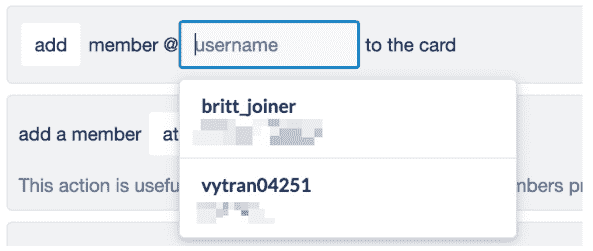

Figure 7.11 – Member drop-down options

只需单击你想要的那个，你就准备好了。

## 现实示例 – 添加特定用户

当卡片移动到 **Design** 列表时，将 @melman 添加到卡片。

这在只涉及卡片部分内容时将特定人员分配给卡片时很有用。你还可以添加一条规则，当卡片移动到下一个列表时将其移除。

## 随机/轮流添加成员到卡片

如果你有多个人想要公平地分配到卡片，你可以使用此选项来随机选择某人，或者均匀且按顺序分配人员（轮流）。这比尝试构建步骤来实现这一点要好得多，因此将其作为命令非常棒。如果你有一整个团队的人可以做某事，而你不想每次都将其分配给同一个人，这非常好。

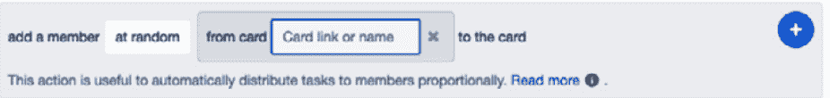

Figure 7.12 – Define a card to choose members from

如果你只想将分配范围限制在几个成员而不是看板上的所有人，请创建一个包含这些成员的卡片，然后单击目标图标以链接到该卡片。

## 现实示例 – 随机添加成员

当新卡片添加到看板时，从 **Sales Team** 卡片轮流添加成员到卡片。

当你有一组人可能被分配到卡片，以确保他们的分配均匀轮换时，这很有用。

## 从卡片中删除所有成员

这正是说到做到——从卡片中删除所有成员。如果你需要重置已复制的卡片，或者你有一个触发器将卡片退回到工作流程的开头，这非常方便。

## 现实示例 – 删除所有成员

当 **reset** 标签添加到卡片时，将其移动到 **Backlog** 列表并从卡片中删除所有成员。

就像到期日期和清单一样，可能存在需要重置卡片的场景。如果任务已被降级优先级或需要重新分配，请使用此规则清除所有成员。

## 内容操作

内容操作全都是关于更改你在卡片中交互的文本，例如卡片标题、描述和评论。你甚至可以给自己发送电子邮件，这是自定义通知的好方法。

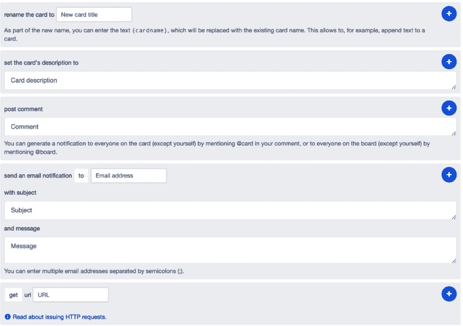

## 图 7.13 – 内容操作

我不是每天都使用这些部分，但当我使用时，它们非常有用。这些操作背后的强大之处在于，你可以完全基于项目本身的上下文来完成你的工作流程。

与其根据其他操作将自动化串联在一起，你可以让 Trello 执行与卡片详细信息中发生的事情相关的特定操作，例如名称、描述或评论，并将这些操作延续到卡片的文本中，改变其背后的含义并创建信息日志。

让我们深入一些示例，看看我的意思。

## 将卡片重命名为

这允许你重命名卡片，如果你正在尝试从另一张卡片同步信息，或者你想在名称中添加文本，例如 `Ready to Go : {cardname}`，这将很有帮助，它会保留旧卡片名称，但会包含新文本。

## 现实示例 – 重命名卡片

当 **help** 标签添加到卡片时，将卡片重命名为 **NEEDS ADDRESSING: {cardname}**

这是使重要卡片更加显眼的另一种方式。

## 将卡片描述设置为 ___

这就像重命名卡片标题一样，但适用于卡片的描述。

## 现实示例 – 设置描述

当我向卡片添加评论时，将卡片描述设置为 `{carddescription}, {commenttext}`。

如果你倾向于分享需要包含在卡片范围内的重要评论，你可以使用此规则仅将你的评论追加到卡片描述中，将最重要的信息集中在卡片顶部的一个位置。

## 发布评论

这会向卡片添加评论，这是发送通知的好方法，因为任何关注卡片、分配到卡片或在评论中被提及的人都会收到通知（如果他们已相应配置电子邮件通知设置，还会收到电子邮件）。

## 现实示例 – 发布评论

When the **urgent** label is added to a card, post the `@board this card needs urgent attention!` comment.

This is a quick way to tag everyone on the board and make them aware of something that’s urgent. Selecting a label, moving a card, or even clicking a button is much faster than typing a comment out, and it’s definitely faster than copying a card link and posting a Slack message!

## 向 __ 发送电子邮件通知

Even though sending a comment will trigger an email notification, if you only want the email and don’t need the content documented on the card, or if you just want to make sure everyone sees regardless of their notification settings, you can send an email notification with this action. You can trigger it to send it to a specific email address (regardless of whether they’re a Trello user or not) or send an email to everyone on the card or everyone on the board.

You can then specify the content of the subject and message. This is where knowing **automation variables** is most handy because that’s how you can reference the specific card and details about it inside the body of the email.

Real-world example

When a new card is added to the board, send an email notification to every member of the board with the subject **New card : {cardname}** and the message **A new card has been added to the board! View it here {cardlink}**

If you have trouble getting people on your team to check Trello, try using this action to send email notifications. You can even do this for cards people are not subscribed to, which is a perfect way to help more people get on board—literally.

## Get/post/put to URL

If you have an API endpoint that can receive and store data, then you can use this rule to get data from that API or send data to it. This is pretty advanced stuff, but if you want to integrate with another tool, this is likely what you’ll want to use.

You’ll need to be familiar with the API you’re working with and what’s returned to be able to best use this, but essentially you can reference whatever is returned in your next step. You can learn more about HTTP requests with automation in the official docs here: support.atlassian.com/trello/docs/issuing-http-requests/.

Real-world example

When a card is moved into the **Get data** list, get the URL https://api.thecatapi.com/v1/images/search?breed_ids=beng&include_breeds=true and post {httpresponse.image} as a comment on the card.

_You know, in case you want to put images of cats as comments on your cards. Who doesn’t?_

## Summary

We’ve covered so much ground, and these are just the “basic” actions you can automate with Trello. You can now move cards around, add or remove attributes such as labels or links, adjust due dates, create checklists, add members, and more.

You’ll never remember all of these off the top of your head, and that’s totally okay. Even I have to open up the **Automation** section sometimes to remember everything that is possible. At first, it’s also not always intuitive which sections you’ll find the actions in, but the more you use them, the more familiar they’ll become.

But if you thought that was all, we’re only getting started. You can still automate even more actions in Trello, so in the next chapter, we’ll talk through some advanced automation actions.

## Advanced Actions

We’ve already covered a lot of ground and you are hopefully feeling extremely inspired by how much you can do in Trello. But for some workflows, you’ll need to use even more than basic automation actions. For instance, maybe you can’t find an action that suits what you need for counting how many cards have been through a workflow, or you need to find a similar card and make an update on _that_ card.

In this chapter, you’ll learn about more advanced actions such as the following:

- Clearing and setting custom field values
- Sorting lists by attributes such as dates, labels, or fields
- Finding one or more cards and performing actions
- Sending Slack messages with Trello

Now, grab some coffee because there’s a lot to go through here!

## Field actions

If you want to do any automation of updating or clearing custom fields, this is your section!

Custom fields only available for Trello Standard or higher plans

If you aren’t using them, you can skip right past this section and come back one day when you need it. But if you are using custom fields (or if you aren’t but you’ve thought about it), you have a lot of options for automating those fields, so let’s dive in!

## Select an Action

Move Add/Remove Dates Checklists Members Content Fields Sort Cascade Jira Bitbucket Slack

clear custom field Field name +

set custom field Field name to New value +

check custom field Field name +

increase the number in custom field Field name by 1 +

set date custom field Field name to now +

move the date in custom field Field name to the same day next week +

Unlike setting the date, moving it respects the existing time (e.g. move an appointment to another day).

### Figure 8.1 – Field actions

In [Chapter 3], we learned about how powerful custom fields were, and we didn’t even talk about automation! While they’re pretty nifty just sitting around on cards, the real potency comes from being able to tie automations to them.

If you think your use case is so unique that Trello probably can’t handle it, then I’d say you probably haven’t used custom fields to their full potential. Although we’ve discussed a lot of actions for dates, members, checklists, and more, custom field actions allow you to do almost everything else. So, if you were disappointed to not find something in the previous rules, then buckle up because you can find a way to make it work with custom fields. You might just have to get a bit creative!

## Clear custom field __

Pick a custom field and clear it—great for when you need to reset a card.

Real-world example

When a card is moved to **Backlog**, clear custom field **Prioritized**.

Clearing custom fields is helpful for resetting a card, such as when it’s deprioritized.

## Set custom field __ to __

Use this to update a custom field to a specific value. You can make it a single, static value that will apply every time. Or you can make it dynamic by using **automation variables**. For instance, you can set a custom field to be the current date, the current list name, or anything else!

Real-world example

When a card is added to the board, set custom field **Type** to `{cardlistname}`.

This is a great rule for keeping track of where a card originated. I use this in my recipe board to keep track of the type of meal a recipe falls under (like Meatless, Quick, or New). I’ll queue up meals to make in my **Meal Plan** list, and then when I’m done, I use another automation rule to move the card back to its meal type list, by referencing the value in that `Type` custom field.

## Check/uncheck custom field

If you’re using a checkbox custom field, this will allow you to set it to “true” or “false” (checked or unchecked).

Real-world example

When a card is moved to **Ready for Review** list, check the custom field **Drafted**.

Some people prefer using custom fields instead of checklists, which is understandable as they are at the top of the card, and for a while, there were more options for automating custom fields than checklist items.

## Increase/decrease the number in custom field __ by __

If you have a number type custom field, you can use this rule to adjust that number by specific increments. This is useful if you want to count the number of times something happens, as every time that thing happens, you can increase the number of a card by one.

### Real-world example – 增加/减少数字

When a comment is added to a card, increase the number in custom field **Comments** number by 1.

This rule is specifically helpful if you want to keep a log of the number of comments on a card. Perhaps your team could agree that if a card reaches 20 comments, it’s time to have a quick sync to discuss to make a decision together. This automation would make it easy to quickly count comments, and you could even add another automation that notified you when that custom field reaches 20 (or whatever number you set).

## Set date custom field __ to __

This is the automation for date fields. You can set it to a variety of options, very similar to what you’ve seen in the **Dates** automation section.

### Real-world example – 设置日期字段

When a card is moved to **Done**, set the date for **Completed Date** to **Now**.

While you could set the due date, using a custom field for tracking the completed date allows you to see actual versus estimated dates.

## Move the date in custom field __ to __

如果你想在发生某事时让自定义字段日期按一定增量更改，你将使用此触发器。这与设置前一个中的日期字段类似，但它让你可以根据现有日期设置日期，从而提供了一些额外选项。

## 实际示例 – 移动日期字段

当卡片上的暂停按钮被点击时，将自定义字段**草稿到期日期**移至下周同一天。

与到期日期自动化类似，这对于“暂停”卡片很有帮助，因为，你知道——生活总会发生！Trello 不会评判你。Taco 只想帮助你！

自定义字段自动化就介绍到这里！这是一种自动化许多事情的便捷方式，因为如果你在其他地方找不到自动化，你可能可以通过创建自定义字段并通过该字段设置自动化来构建你需要的一切！

现在，让我们谈谈对卡片进行排序。

## 排序操作

我们都喜欢一点秩序，因此排序操作为你提供了清理卡片的选项。排序是按列表进行的，所以如果你想对整个看板进行排序，你需要为每个列表添加一个操作。不过，请保持兴奋，因为这里的排序选项比列表内的操作要多得多！

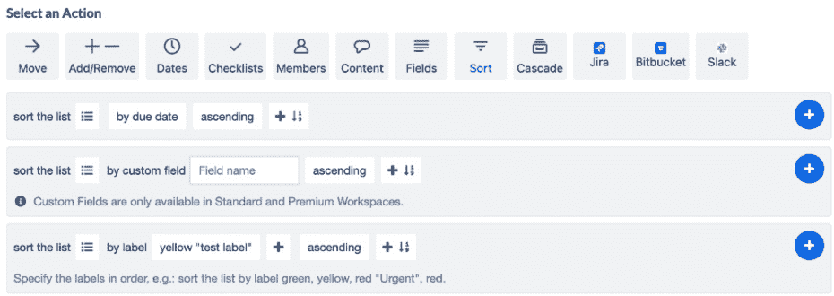

## 图 8.2 – 排序操作选项

对于喜欢将卡片按特定顺序排列的人来说，我不认为我说得太过分，当我说这一部分将对你产生改变人生的影响时。这些操作可以帮助你按对你最重要的内容（无论是到期日期、自定义字段值，甚至是标签）来组织列表中的卡片。虽然你可以通过点击列表顶部的省略号手动对列表进行排序，但那里的选项实际上比自动化选项要有限一些。具体来说，没有按标签排序的选项。这就是自动化大放异彩的地方！

如果你曾经在电子表格中排序过数据，这与之类似。排序将按你定义的属性和你希望的顺序对卡片进行分组。让我们深入了解具体细节！

## 按 ___ 对列表进行排序

你几乎可以想到任何用于对列表进行排序的选项。此操作为你提供了一种按日期、标题、投票数、年龄和在列表中的时间进行排序的方式。我喜欢将此视为我的“可量化”排序。我的意思是，顺序是明确的（按字母顺序、从新到旧等）。

通过点击项目符号列表图标选择要执行排序的特定列表，但如果你不选择，默认情况下，它将在触发卡片所在的列表上执行排序。

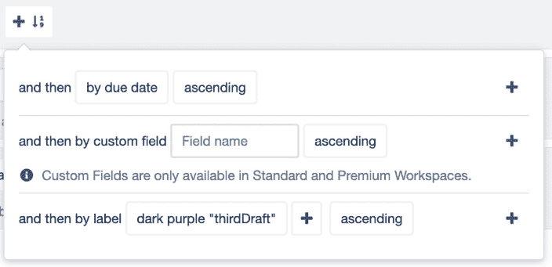

图 8.3 – 对列表进行排序的条件选项

如果你点击末尾的 + 按钮，你可以在该条件内进一步排序卡片。（想想看，按日期排序，然后按自定义字段排序，然后按标签排序，等等。）

## 实际示例 – 按字段排序

每个星期一，按到期日期降序对**待办**列表中的卡片进行排序。

因为星期一早上你最不想做的事情就是弄清楚本周要从哪件最重要的事情开始。

## 按自定义字段 ___ 进行排序

如果你的看板上有自定义字段，你可以按这些字段进行排序。

你拥有与前面描述的排序操作相同的所有选项。你可以指定要在其上执行操作的列表，并在初始排序中添加更多排序层。

## 实际示例 – 按自定义字段排序

当卡片被添加到**审核**时，按自定义字段**草稿完成日期**对**审核**列表进行排序。

这条规则是另一种优先处理使用非到期日期的卡片的好方法，让最重要的卡片排在最前面。

## 按标签__进行排序

此排序操作为你提供了按标签对卡片进行排序的选项。你需要指定希望卡片排序的标签顺序，因为颜色没有默认的升序或降序顺序。在标签名称后点击 + 按钮来指定标签顺序，如下所示：

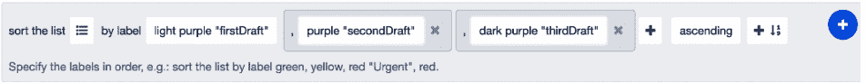

图 8.4 – 按多个标签进行排序

再次，你可以进一步深入并在这些组内进行排序。

## 实际示例 – 按标签排序

当卡片被添加到**购物清单**时，按绿色**生鲜**标签、红色**肉类**标签和蓝色**乳制品**标签进行排序。

我实际上在我的购物清单上使用这个（以及一些根据卡片名称分配这些标签的自动化），这是我找到的最接近能够制作出在杂货店周围最高效路线地图的东西（顺便说一句，我认为这是一个绝妙的应用程序想法。不客气！）。

现在，让我们来看看级联，对于我的电子表格极客来说，这基本上就是 Trello 自动化中的 VLOOKUP。🙂

## 级联操作

我假设你阅读这本书是因为你想深入了解 Trello 的方方面面。但是，我们已经讨论过的（以及将继续发现的）自动化有很多价值，所以即使你永远不触及这一部分，你仍然可以在你的看板中构建非常强大的自动化。

所以，请暂停一下，回顾你所学到的内容，再拿一杯咖啡（或者如果你已经头晕目眩，就来杯好波本威士忌吧！）。你不需要记住所有这些。只需花几分钟时间吸收并了解 Trello 自动化世界中所有可能的事情。如果你想跳过这部分并稍后回来，我会在这儿！

当你点击**级联**部分时，你首先看到的是一个非常有用的说明框，解释了你为什么可能会使用这一部分的操作。

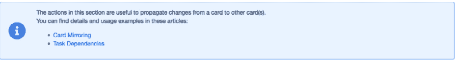

图 8.5 – 何时使用级联操作的说明

此部分中的操作对于与多个卡片交互以及允许一个卡片的更改传播到另一个卡片非常有用。

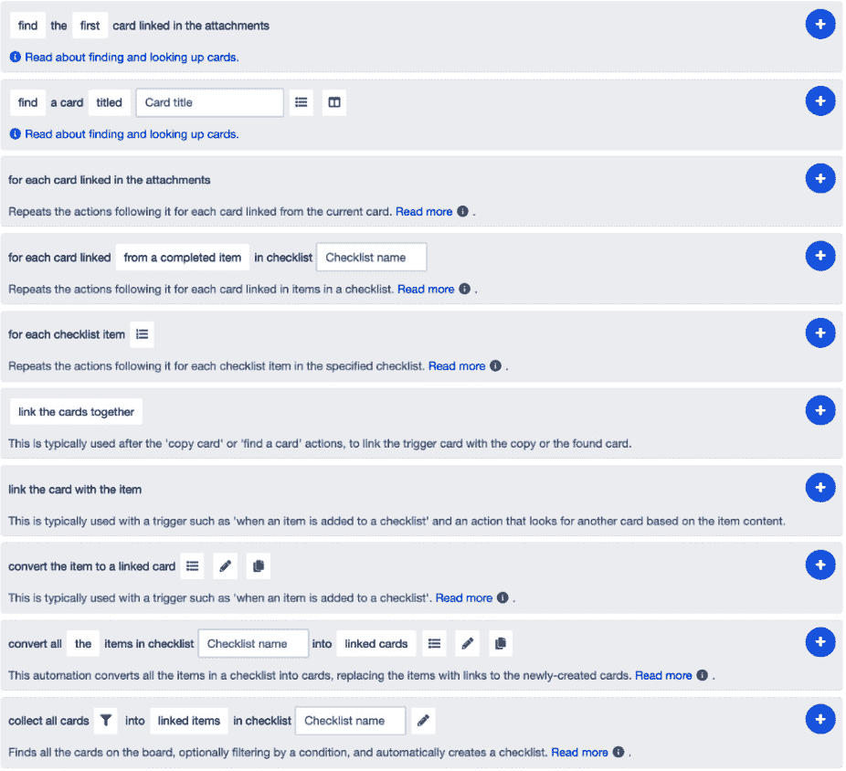

## 图 8.6 – 级联操作选项

当你希望一个卡片上的触发器对另一个卡片执行操作，或者你希望引用另一个卡片上的内容以更新原始卡片时，通常会使用此部分。

## 查找/查询附件中链接的第一张/最后一张卡片

让我们先谈谈查找和查询之间的区别。自动化文档对此解释得很好，但这里是要点：**查找**会查找附件中的卡片，然后在找到的卡片上执行下一步操作，而**查询**会查找附件中的卡片，然后保留来自该找到的卡片的信息，但继续基于**触发**卡片执行操作。

此操作永远不会是最后一步。相反，你会在之后添加另一个操作来指定要在指定卡片上执行什么操作。

## 实际示例 – 查找附件卡片

当卡片被添加到**进行中**列表时，查找附件中链接的第一张卡片并添加评论**此卡片正在进行中**。

这是一种处理依赖任务的好方法，而无需手动保持它们的状态同步。

## 查找/查询标题为/带有链接的卡片

与前一个类似，它会查找另一张卡片，但不是查看卡片附件，而是查找具有特定名称（你可以跨特定列表和看板搜索）或特定 URL 的另一张卡片。

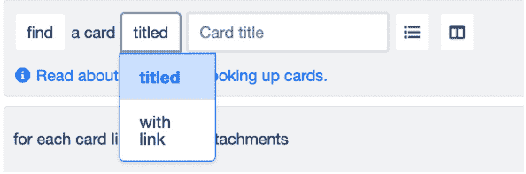

图 8.7 – 通过名称或链接查找卡片的选项

## 所有卡片都有自己的 URL

你可以通过进入卡片并选择顶部 URL 栏中的内容来找到它。它看起来会像这样：https://trello.com/c/qs4WlF6N/393-wednesday-mar-9-2022-daily。

当你希望基于相关卡片而不是最初触发的卡片执行操作时，这很有帮助。

## 实际示例 – 查找标题卡片

当卡片被添加到**进行中**列表时，查找标题为**当前正在处理**的卡片并添加带有 `{triggercardname}` 的检查清单项。

与前一条规则类似，这条规则可以帮助你跟踪卡片内的卡片。真是元！

## 对附件中链接的每张卡片

使用此操作对附件中的每张卡片执行操作，而不仅仅是第一张或最后一张。当你有一张卡片跟踪相关卡片中的多个任务并希望它们保持同步时，这很有用。

## 实际示例 – 附件每张卡片

当卡片被移动到**完成**时，对附件中链接的每张卡片，添加绿色**已完成**标签。

如果你想将自动化提升到一个新水平，不仅保持相关卡片同步，还要在状态之上执行额外操作，请使用此规则。如果你对子任务卡片的完成状态有不同的处理方式，这也非常好。

## 对检查清单项中链接的每张卡片

这是一个强大的级联操作，它将检查清单项与卡片关联，允许你拥有一张引用其他卡片并跟踪其进度的单张卡片。然后它可以找到与检查清单项链接的卡片，并对其应用你想要的任何自动化。

## 实际示例 – 检查清单项卡片

When checklist ToDo is completed, for each card linked from an item in checklist ToDo, move the card to Done.

This is specifically helpful for keeping cards in sync with checklist items that are dependent cards.

## For each checklist item

This iterates through an action for every item in a checklist of a card. You can provide a specific checklist by clicking the numbered list icon. Otherwise, it will apply to every checklist item on the card.

### Real-world example – 检查清单项循环

When clicking the Convert list to cards button, for each checklist item, convert the item to a linked card.

If you sometimes think you want a checklist but then decide you actually want those items as their own cards, this rule makes it easy to convert rather than manually clicking through each one.

## Link/unlink the cards together

As it says in the rule itself...

This is typically used after the copy card or find a card actions to link the trigger card with the copy or the found card.

Hopefully, you can see from the first couple of sections in this lesson how helpful it can be to link cards together, so this is where the magic starts. This is particularly useful if you’re trying to sync activities from cards across multiple boards.

### Real-world example – 链接卡片

When a card is created on the Marketing board, copy the card to the All Activities board and link the cards together.

This rule is helpful for duplicating cards and attaching them to each other. Note that this won’t sync them. For instance, if you make a change on one card, it won’t be reflected on the other. It just means the cards will be attached to each other and easier to reference.

## Link the card with the item

Trello provides more helpful notes inside this rule.

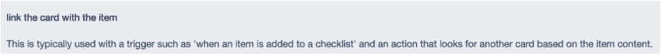

Figure 8.8 – Explanation of use for linking card with item

If you’re trying to link cards with checklist items, similar to the previous steps, rather than linking whole cards, you can simply link items in a checklist with other cards.

### Real-world example – 链接项目

When an item is added to a checklist, look up the card with the title {checklistitemname} and link the card with the item.

This is helpful if you’ve already made a card and now want to make a checklist that references that specific card without having to open each existing card and copy the link.

## Convert the item to a linked card

There is a bunch of customization options in here, but the gist of this action is that it takes a checklist item and then turns it into its own card.

You can specify a few different things, such as the following:

- The list you want the linked card to be created in
- The pattern you want your card to be named (doesn’t have to just be the item name)
- What copies over from the original card the checklist item is on (labels or members, or both!)

### Real-world example – 转换项目

When a checklist item is added to a card assigned to me, convert the item to a linked card in list **Brittany’s projects**.

I prefer to operate in cards instead of checklist items for my own tasks but sometimes get assigned individual items on another checklist. This automation lets everyone have the best of both worlds, operating out of a checklist *and* a card.

## Convert items in a checklist to cards/linked cards

You’re probably getting tired of seeing all these options at this point, but believe it or not, they all have nuances that people have requested, which makes the functionality of how they perform quite different!

This one converts specific items (or all of them) in a checklist that you specify to new cards or linked cards. Similar to our previous actions, the difference is that you can watch for completed or incomplete ones. Or if you want to reference all the checklist items, this saves you from having to add two actions for each checklist item and convert the item to a linked card.

And you get the same options as before with defining the list, specifying a pattern, and copying over labels and members.

### Real-world example – 转换检查清单

When a card is due in 7 days, convert all the unchecked items in a checklist to cards on the **This Week** list.

This rule is great for using checklists to determine all the important steps for a project, and then creating cards for them that can easily be worked on as a task is due. I sometimes prefer this method because it allows me to use lists to show the status of all the individual tasks and add comments on specific items instead of having to keep everything in one card.

## Collect all the cards into linked items/links/items in checklist

Okay, stick with me—last one!

This one’s pretty cool. This action searches for all the cards that fit your criteria (click the filter to see all the options we’ve become familiar with in our other actions).

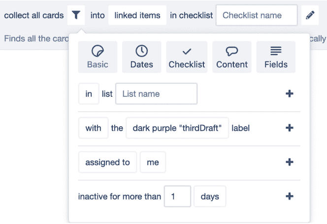

Figure 8.9 – Filter menu options

It then takes the cards it finds on the board and combines them in a checklist for you. As it sets them up in the checklist, it can create them in one of three ways:

- Linked items (checklist item that links to the original card it came from and the card itself with a link back to the card with this newly created checklist)
- Links (straight links to the card with no title info)
- Items (just the text of the card name without any link to the original card it came from)

### Real-world example – 收集卡片

Every Monday, collect all cards assigned to me with a due date in less than 7 days into linked items in checklist **Rodney Tasks**.

If I preferred to work on checklists instead of cards, I could use this rule to make a single checklist of all the things I need to do, rather than an assortment of cards.

For the final section of automation actions, we’re going to talk about non-Trello tools. Trello doesn’t offer native automation tools for a lot of integrations, but there are a few exceptions that we’ll discuss.

## Other tool actions

To combine Trello with other tools through automation, you’ll often need to use third-party automation software, such as Zapier. But there are a few tools you can build automation for within Trello’s automation suite.

Before creating the automations, you’ll need to connect the tools you want to use in the **App automations** section in your Trello **Automation** settings. You can find it in the bottom left-hand side of the automation menu.

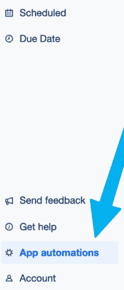

Figure 8.10 – Additional automation settings

As much as I love Trello, even I understand that not everything can be done in Trello. While I wish everyone would use Trello, sometimes people prefer Jira. And Trello isn’t meant for code management and handling pull requests. And while I can communicate about tasks via Trello comments, there are still a lot of reasons I need to use Slack.

Rather than pretending you can do everything in Trello, automation helps you find the best workflow to make all your tools work together as effortlessly as possible. Let’s start with Trello’s big brother.

## Jira

You won’t be shocked to know that since Atlassian owns Trello, the first tool they offer robust internal automation with is Jira, another Atlassian tool. Jira is a popular project management tool used for issue tracking, agile project management, and software development.

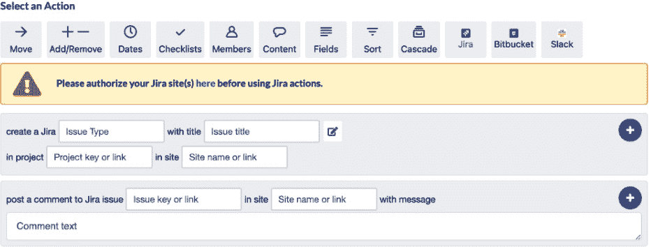

Figure 8.11 – Jira actions

Atlassian owns Trello and Jira, so thankfully, there are some great ways to keep them synced together. Although there are tools out there that are more robust for complete mirroring, if you just need info from Trello pushed to Jira, this should do the job.

There are two available actions:

- One is used to create a Jira issue. You’ll need to specify the issue type and title, as well as the Jira instance you want the issue created in.
- The other action is to post a comment to a Jira issue that already exists.

You can use **automation variables** to reference the Jira instance or issue from data on the Trello card, such as a custom field or name of the card.

### Real-world example – Jira 集成

When a card is added to the **Send to Dev Team** list, create a Jira issue with title {cardname} in the project **Requests** in the site **Dev Team**.

This is helpful when your team works in Trello but you have another team that works in Jira. 😞 We can’t all be perfect I guess.

## Bitbucket

Atlassian 还拥有 Bitbucket，它是一个基于 Web 的版本控制仓库托管服务，用于源代码管理，允许团队协作编写代码并跟踪更改。它与 GitHub 类似（我知道有人会因为我说这话而朝我扔石头）。

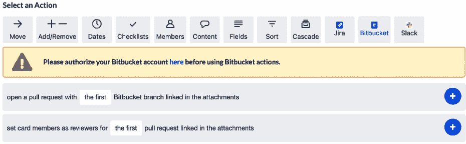

图 8.12 – Bitbucket 操作

如果要将 Trello 与 Bitbucket 集成，这里有几个操作可供选择。你可以打开拉取请求，或将卡片成员设置为审核人。

## 实际示例 – Bitbucket 集成

当卡片被添加到 **Ready for QA** 列表时，打开一个拉取请求，并关联附件中第一个 Bitbucket 分支。

如果你的团队正在使用 Bitbucket，这将非常有帮助。你可以直接从 Trello 中的问题进入 Bitbucket 中的拉取请求，甚至可以将两者关联起来！

## Slack

可以通过内部自动化选项轻松实现自动化的最后一个工具是 Slack。Slack 是一款即时通讯和团队协作工具，支持实时通信、文件共享以及与其他应用程序的集成。

许多团队（例如我自己的团队）使用 Trello 进行项目管理，使用 Slack 进行沟通。

Slack 只有一个操作，即发布消息。这非常适合发送通知，让团队了解任务进度，即使他们不在 Trello 内。

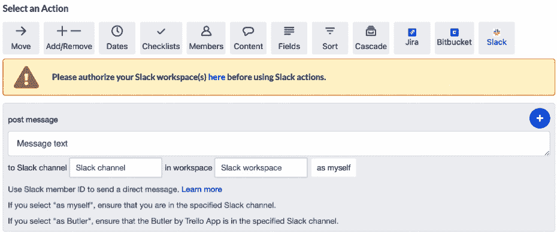

图 8.13 – Slack 操作

你可以编写一条特定的消息，每次触发时都会发送，例如 `a card was just added to your board!`，或者你可以通过引用触发器中的自动化变量来使消息更具体。例如，你可以说 `{cardname} was added to your board.`

你需要指定要将其发布到哪个频道，以及如果有多个连接，则指定哪个工作区。（同样，如果你愿意，可以在此处使用自动化变量——例如，如果你有一个名为 `Comms` 的自定义字段和一个 Slack 频道下拉列表，你可以在卡片上设置频道，然后引用 `{{%Comms}}` 作为频道，它将从卡片中获取该数据。）

你甚至可以将消息设置为来自你本人，或者允许它来自 Butler*，以表明你正在让机器人工作！

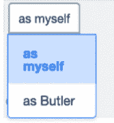

图 8.14 – 自动化中 Slack 消息发送者的选项

*Butler 是 Trello 自动化工具套件的原名称。

实际示例

当卡片被移动到 **Done** 时，在 Slack 频道 **team** 中发布一条消息，内容为 `{cardname} was completed by {cardmemberfullnames}`，并在工作区 **company** 中以 Butler 身份发送，消息内容为 📢 **Well done team!**。

如果你的团队在记住查看 Trello 方面遇到困难，这是另一个很棒的自动化功能。向 Slack 推送更多通知，可以让队友更容易进入 Trello，而不是依赖他们记住要去那里。

## 摘要

哇，这涵盖了很多内容。我打赌你要么感到筋疲力尽，要么感到受到启发……或者两者皆有！没关系！记住——你不需要真正记住所有这些事情。相反，你只需要了解基础知识，以便当你想知道“卡片是否可以成为检查清单项并保持同步？”时，可以回来找到它们。剧透，答案是 _yes_，如果你将许多这些操作配对在一起。

在下一章中，我们将讨论如何将触发器和操作结合起来，为你的自动化形成工作流。

## 使用触发器构建自动化

我们在第 6 章中了解了可以启动自动化工作流的触发器。然后，我们在第 7 章和第 8 章中了解了可以跟随这些触发器来完成卡片和看板上各种任务的操作。现在是时候将一切结合起来，看看我们如何使用这两部分来真正实现自动化。

虽然规则很简单——选择一个触发器，并将任意数量的操作串联在一起——但我甚至还没有向你展示每一个可能的触发器，因为当你进入自动化的不同部分时，新的触发器会解锁！这就是本章的目的：向你展示如何将知识付诸实践，利用你已有的知识来构建在 Trello 中高效工作所需的工作流。

在本章中，你将学习如何：

- 使用规则将触发器和操作结合起来
- 在看板上使用按钮来触发自动化工作流
- 向卡片添加按钮以启动自动化序列

无论你在 Trello 中做什么，你可能都想自动化其中的一些活动，因此本章非常重要。如果你花所有时间在 Trello 中组织项目、分配成员、创建截止日期以及在列表之间移动卡片……那么你并没有节省任何时间；你只是为自己创造了另一份工作，在各个地方移动东西！

你知道在另一张纸上重写检查清单比实际执行任务更容易吗？当你组织工作流时，很容易感到高效，但你花在组织上的任何时间都会从你本可以用来做实际工作的时间中扣除。

这就是自动化至关重要的原因——这样你就可以让 Trello _为你工作_，而不是反过来。如果你一直认为自己不需要自动化，本章将把一切结合起来，帮助你简化工作流，以便所有繁琐的卡片移动和字段设置不会分散你对手头任务的注意力。

事情变得有趣了，让我们开始吧！

## 访问自动化

如果你是按顺序阅读各章的，你在前面的章节中已经见过这个了，但这里有一个快速回顾，以防你跳着读。

要访问 Trello 的惊人自动化功能，请单击任何 Trello 看板顶部工具栏中的 **Automation** 按钮。

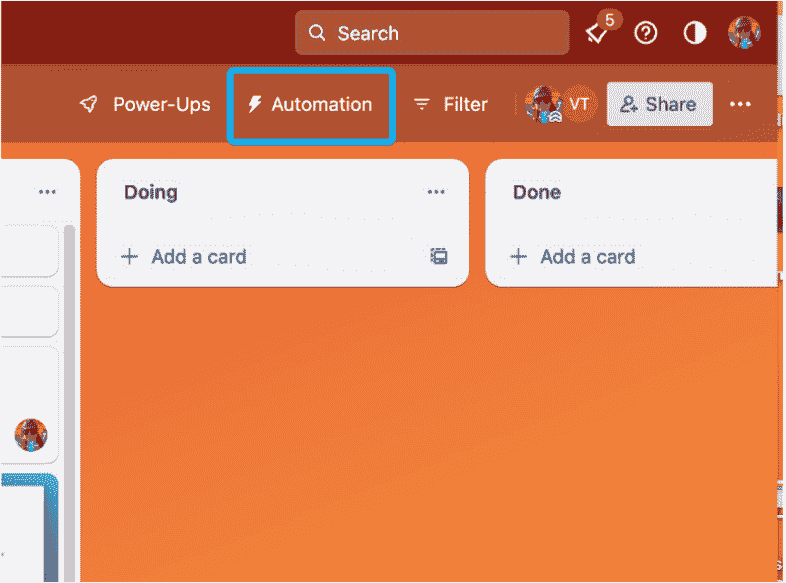

图 9.1 – 看板工具栏中的自动化按钮

这将打开一个包含几种自动化类型的菜单。单击出现的任何选项，即可打开一个完整的模态框，其中左侧包含完整的自动化类别集。

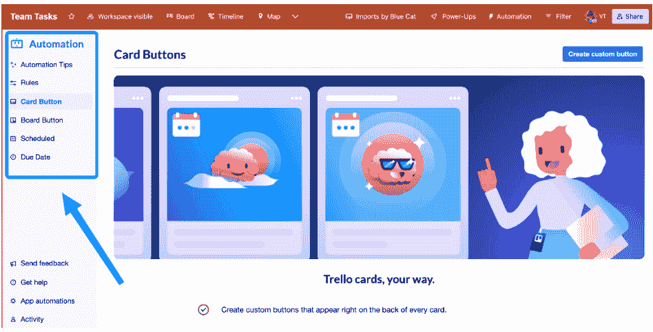

图 9.2 – 左侧面板中的自动化部分

在本章中，我们将回顾这些自动化类别中的每一个。当你进入某个部分时，请单击左侧面板中的该类别名称，以便跟随学习。让我们从顶部的第一个开始，就在 **Automation Tips** 之后。

## 规则

规则只是将我们已经讨论过的触发器和操作相结合。第 6 章展示了可以为事件设置的可能触发器。你将在本节中找到所有这些触发器，然后可以将其与任意数量的操作相连。

还记得“当卡片添加到看板时，将截止日期设置为从现在起七天后”这样的示例吗？你会在这里设置这种类型的自动化，因为它正在监视看板上发生的活动（例如新卡片被添加）。

规则可能是最常见的自动化类型——正如你所料，因为我写了一整章关于 **规则** 部分中存在的触发器！

### 何时使用规则自动化

如果你希望自动化基于卡片或看板上发生的其他事情，你可能会想要使用规则。回顾你工作流中的“当发生……时……那么……”语句。如果你的“当”有一个特定的动作发生，例如添加标签、移动卡片或设置或更改字段，那么你会想要使用规则。

如果你找不到适合你想要的操作的触发器，不要绝望！你仍然可以使用按钮手动触发操作，或使用计划自动化将其设置为定期发生，但我们说得太远了。

### 创建规则

想想你想要自动化什么。你手头有所有的触发器和所有的操作。让我们一起制定一条规则。

我们将制定一条规则：每次向看板添加新卡片时，你都会被添加到卡片中，并且截止日期设置为从现在起七天后。

听起来很多？别担心，这很简单！

确保在自动化模态框的左侧面板中选择了 **Rules**，然后单击右上角的 **Create rule**。

然后，你将被提示使用 + **Add Trigger** 按钮添加触发器。点击它，你将看到一个菜单出现，其中包含所有可用的触发器。

在我们的示例中，我们希望在卡片添加到看板时触发一个操作。点击第一个触发器旁边行末尾的 + 按钮，将其添加到我们的规则中。

Figure 9.4 – 使用 +/plus 按钮将触发器或规则添加到自动化中

如果你想更具体，并且只在卡片添加到特定列表或具有特定标签或其他属性时触发此规则，请点击过滤器图标。现在我们不需要它，但如果你将来需要，请记住这一点。

向上滚动，你将看到触发器已添加，下面的部分已更改为操作。

Figure 9.5 – 自动化中的步骤

如果你不小心添加了错误的触发器，请点击触发器旁边的垃圾桶图标将其删除并重试。

但我们的看起来是正确的，所以我们可以继续。现在是时候选择我们的操作了。

让我们从将自己添加到卡片的操作开始。这样，我们就能收到关于该卡片上发生的任何事情的通知，并且它会出现在我们应用的任何过滤器以及查找属于我们的卡片的工作区视图中。

为此，请点击 **Members** 选项卡，并选择加入卡片的第一个操作。再次点击行末尾的 + 按钮。

Figure 9.6 – 加入卡片的操作

向上滚动以确认它已列为操作，然后你可以在此处停止并保存规则，也可以继续添加更多内容。我们是追求卓越的人，所以我们将继续。

前往 **Dates** 选项卡。查看第二个操作，它显示 **set due date now**。点击 **now**，你将看到你有一系列选项。

Figure 9.7 – 为卡片设置到期日期的操作选项

我们希望卡片在创建后七天到期；这样，我们就不会忘记它，并且会在一周内被提示对其采取一些行动，即使该操作被重新分配到稍后的日期。

点击第二行中的 **hours**，你可以选择另一个周期。将其更改为 **weeks**，现在你的卡片将在创建后一周（或七天）到期。点击模态框中行末尾的 + 按钮。

最后，不要忘记点击行末尾的 + 按钮将此操作添加到工作流中！

快完成了，但还有一步。向上滚动以确认规则看起来符合你的预期。

Figure 9.8 – 触发器和操作的预览

确保触发器符合你的预期，既不会太宽泛以至于经常运行，也不会太窄以至于从不运行。你可能需要运行此规则几天才能弄清楚。另外，确保操作是你想要的。当你准备好时，点击右上角的 **Save**。

保存规则后，享受屏幕上喷洒的彩纸吧。🎉 这是我最喜欢的 Trello 部分之一！

## 测试你的规则

你可能会觉得到此为止就完成了，也许确实如此。但下一步是将你与自动化新手区分开来。你将测试规则，因为你是专业人士，不希望任何事情意外发生。

要测试规则，只需执行触发它的操作即可。对于我们创建的规则，我们将其触发为每次将卡片添加到看板时。所以，创建一个新卡片，并确认你已添加到看板，并且到期日期设置为当前日期后的一周。

去试试吧。我会等着。

Figure 9.9 – 将卡片添加到看板时自动化中设置的新字段

太好了，它起作用了！如果对你不起作用，请确保你的规则看起来像 _Figure 9.8_ 中的截图。如果不是，这很容易修复；你可以编辑现有规则。

## 编辑现有自动化

如果你想对已创建的规则进行更改，请返回 **Automation** 的 **Rules** 部分，你将看到已创建规则的列表。找到你创建的规则。如果你刚刚创建了它，它将位于顶部。

Figure 9.10 – 现有规则列表

点击规则上方的铅笔图标，你将回到编辑器。你可以删除操作和触发器，并将其设置为你想要的任何内容。

对于这个示例，我们构建了此自动化，以便在看板上创建的每个卡片上都发生。但过一段时间后，你可能会发现这发生得太频繁了，你真的只希望它发生在添加到特定列表或卡片描述中包含你姓名的卡片上。这就是你可以使用过滤器并更改触发器和/或操作来调整规则的地方。

你可以以这种方式编辑所有自动化

这不仅仅适用于规则！你创建的任何其他自动化都可以在构建后通过左侧面板中的菜单进行编辑，然后点击要编辑的规则旁边的铅笔图标。

## 其他自动化设置

让我们花点时间探索铅笔附近的其他按钮，因为它们都能帮助你尽可能高效地使用自动化。

Figure 9.11 – 编辑现有自动化的选项

铅笔左侧的 **tag icon** 允许你为自动化添加标签并对其进行分组。注意所有自动化上方右上角的过滤器按钮，顶部显示 **All**。点击它将为你提供选项，以仅显示符合指定条件的自动化，例如标签。

自动化菜单上的 **copy icon** 用于复制。这会复制一条规则，如果你需要相同的一组操作在多个触发器下发生，这会很有帮助。截至 2022 年，无法应用 OR 触发，例如，“当卡片添加到 **To Do** 列表时” 或 “当卡片添加到 **Doing** 列表时”，因此复制按钮对于复制规则并仅替换触发器很有帮助。

**trash icon** 用于删除规则，但如果你想停止规则运行，我建议取消选中规则下方的 **Enabled on this board** 字段。这将停止规则在看板上的执行，但会保留它，以便你以后可以重新启用。

最后，我们有 **light bulb icon**。这将打开一个日志，以便你可以查看规则运行的时间以及与之相关的任何错误。我不是很常用这个，除非某些事情没有按预期工作并且我需要进行调试。

末尾还有一个强大的按钮 – 它允许你将当前规则添加到另一个看板。如果你有一系列用途相同且需要使用类似自动化的看板，这将非常有用。

我希望有一天有机会写一本更新版的书，并报告 Trello 已经使批量将自动化应用到其他看板或与他人共享自动化以便他们添加到自己的看板上变得容易得多，但目前，这是最好的方法。你可以共享命令库，它们与工作区中的其他人共享一组带标签的命令，但这仅适用于 Trello Standard 和 Premium 工作区，并且仅与工作区内的人员共享，因此如果你为其他团队或客户构建自动化，这没有帮助。另外，按钮无法共享，但 Trello 文档表示他们计划在某个时间点包含它们。参考此处：support.atlassian.com/trello/docs/working-with-command-libraries/。

你可以无休止地玩转规则，但现在是时候进入下一种自动化类型了。

## 按钮自动化

有时你无法确切地知道何时需要触发自动化。例如，也许不是每次卡片移动到另一个列表时都触发，只是有时触发。或者也许你并不总是想将所有检查清单项目转换为卡片，但你也不想为每个项目手动操作。

这就是按钮派上用场的地方。你可以将按钮添加到卡片和看板，由你决定何时发生自动化，然后 Trello 接管后续操作。

### 何时使用按钮自动化

当你有一系列想要自动化的操作，但没有一致的触发标准时，使用按钮。或者当你只是更喜欢点击按钮来触发一系列操作的控制权时，也可以使用！我认识一些人，他们使用卡片按钮将卡片移动到另一个列表，尽管你可以拖动它或在卡片上选择 **Move** 操作。

如果你试图限制执行的 **command runs** 数量，这可能很有用。所有 Trello 计划都可以访问相同的自动化功能，但每个计划提供的自动化运行次数不同。

Buttons also make a nice aesthetic on a card and can be great for instructing newbies on what needs to happen next on a card.

Trello offers two kinds of button automation: card and board. Let’s start with the card button.

## Card buttons

Card buttons are used for automation that you want to perform on, well, a card! This button will appear on every card on your board and will perform the associated actions on that specific card.

Let’s make a card button that removes the members and due dates from a card, and then moves it to our **Backlog** list. This is helpful for “resetting” a card, which you might need to do if a task has been deprioritized or a project moves to another team.

## Creating a card button

To create a card button, go to the **Card Button** section of the **Automation** menu on the left-side panel.

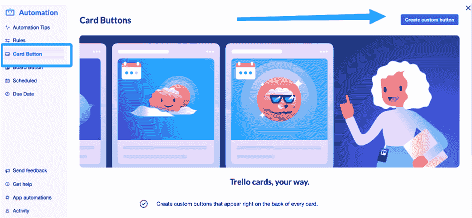

Figure 9.12 – Card Button automation section

From there, click the button that says **Create custom button** in the top-right corner.

You’ll start off with the most fun and important task... coming up with a name for your button and selecting a related icon!

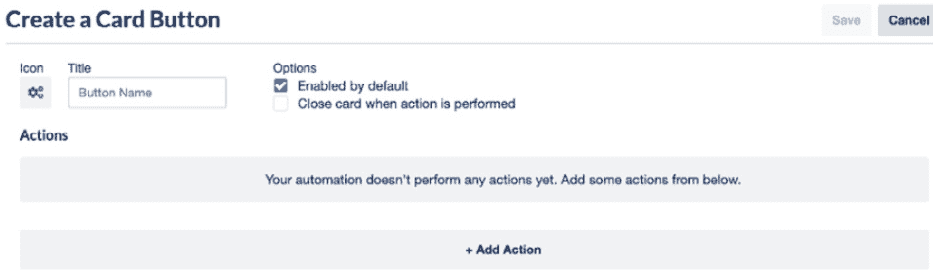

Figure 9.13 – Card button title and settings

I try to give the button a name that is clear and concise about what’s happening. Good luck. This is the hardest part 😅 I’m going to call this one `Reset card`.

After you’ve picked a name and icon, confirm the options. By default, the buttons will be enabled, but you can turn that off so the button does not show up for everyone and needs to be added by individuals. You can also check the option to close the card once the actions have been completed. I tend to leave these settings as is. When I’m making a card button, I tend to want everyone on the board to access it, and sometimes I still want to do things on the card after the action has been completed. (Also, I can easily close a card by pressing the `esc` key on my keyboard.)

Next, you’ll click **+ Add Action** and then string together the actions we became so familiar with in _Chapter 7_ and 8.

Since we’re removing info from the card, we’ll go to the **Add/Remove** tab.

## Create a Card Button

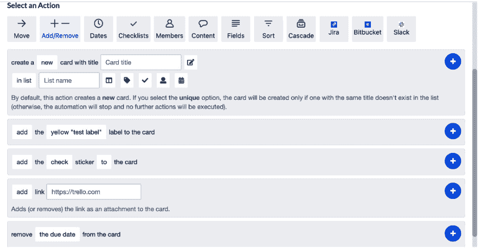

Figure 9.14 – Add/Remove actions available for card button

Select the + button at the end of the final row to add it to our list of actions. Scroll up and you’ll see the action listed above the sections. Scroll back down and click **the due date** to see a dropdown appear with other options.

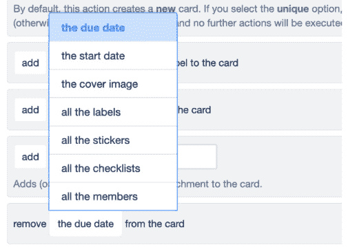

Figure 9.15 – Removal options for an action in a card button

Click **all the members** and then once again click the + button at the end of the row. Scroll up and you should see both actions above the tabs.

Let’s add one more action that moves the card to the Backlog list. Click the **Move** tab. Click the **List name** field in the first action. Choose the **Backlog** list from the dropdown (or another list on your board that you’d prefer to move the card to).

## Actions

remove the due date from the card

remove all the members from the card

## Add Another Action

Move Add/Remove Dates Checklists Members Content Fields Sort Cascade Jira Bitbucket Slack

move the card to the top of list List name

Backlog

move the card to the top of the list To Do

archive the card Doing

Done

## Figure 9.16 – 卡片按钮移动操作选项

Click the + button at the end of the row to add the action, and then scroll up to see all the actions. You did it!

## Create a Card Button

Icon Title Reset card Options Enabled by default Close card when action is performed

## Actions

remove the due date from the card

remove all the members from the card

move the card to the top of list

Backlog

## Add Another Action

Move Add/Remove Dates Checklists Members Content Fields Sort Cascade Jira Bitbucket Slack

## Figure 9.17 – 卡片按钮操作预览

Click the **Save** button in the top right. Enjoy the magical confetti that sprays across your screen. Now, let’s test the button!

## Testing your card button

Head to a card on your board that has members and due dates. I’m going to use the card we automated with a rule that I added. It’s currently on my **To Do** list.

Look at the new fancy button on our card!

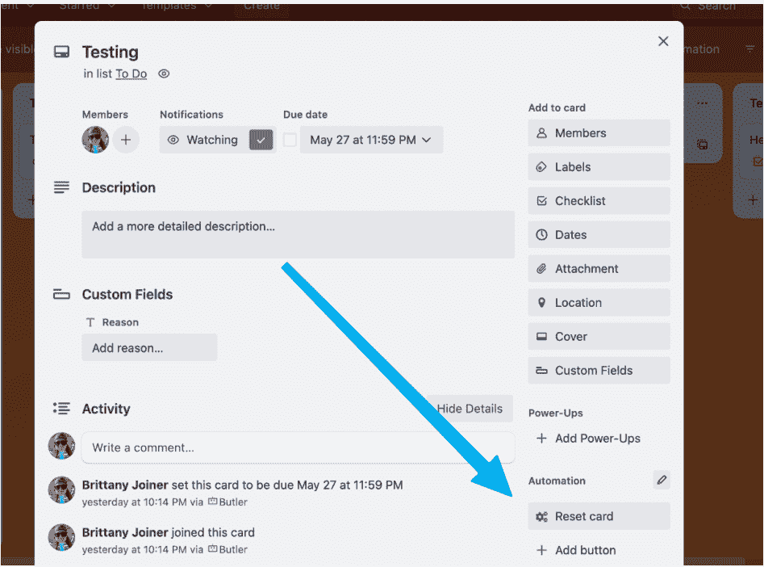

## Figure 9.18 – 卡片按钮查看位置

Don’t see it right away? Check on the right side below the **Add to card** and **Power-Ups** sections. Click the button and watch the members and due date be removed, and the card moves to the list specified in our rule.

A handy notification appears in the bottom right to let you know what is happening when you press the button. This is helpful for teammates, or even a refresher for yourself if you can’t remember what you told a button to do.

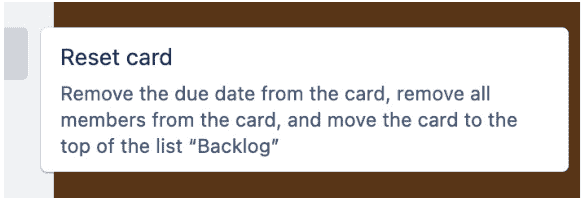

Figure 9.19 – Toast notification explaining the card button

You’re a card button expert now! But that’s not all the buttons Trello offers. You can also add buttons to your board.

## Board buttons

Board buttons are used to trigger automation from the board level, not a specific card level. I find this particularly helpful for sorting lists or creating templated cards for requests.

You’ll find these buttons in the top toolbar of your Trello board, alongside the **Automation** and **Power-Ups** buttons.

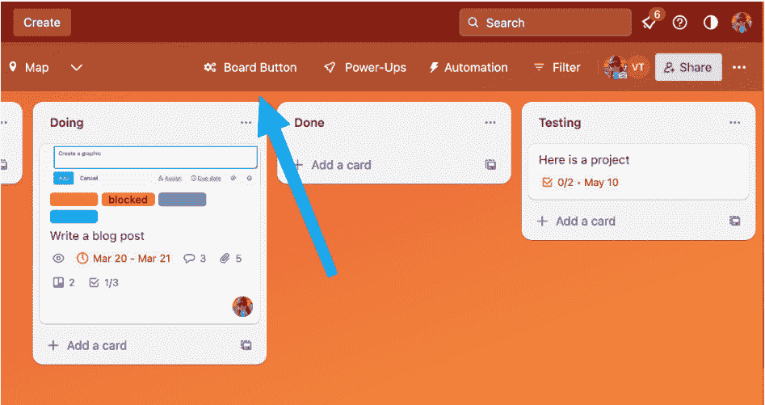

Figure 9.20 – Board button placement in the top toolbar

There are a few additional actions available in board buttons because of the nature of them being a board-level automation. For example, under the **Sort** section, there’s an action for shuffling cards in a list you define.

The **Move Cards** section also offers some fun new actions to play with. You can build some useful workflows here, such as a button that plans your week for you by moving all the cards with certain criteria to your **This Week** list, or even randomly picking cards from your Backlog list to ensure you aren’t just picking favorites.

## Create a Board Button

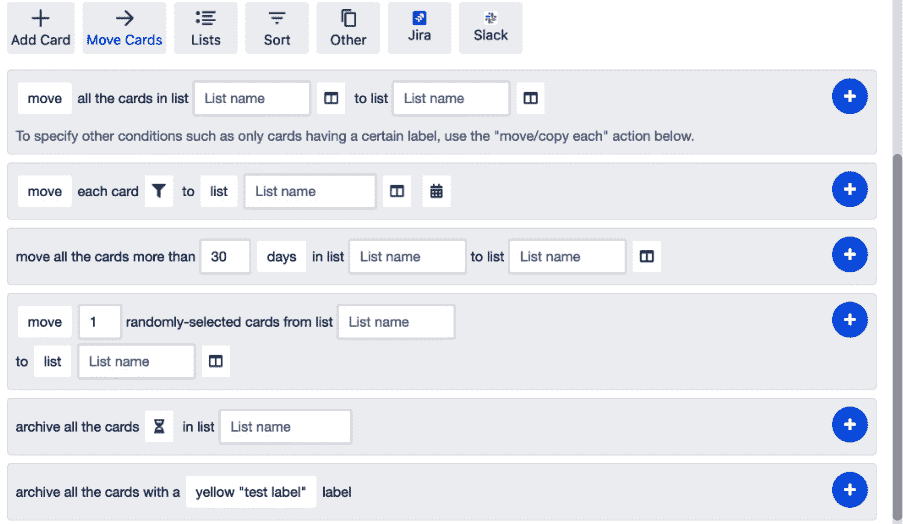

Figure 9.21 – Board button Move Cards actions

I like combining **Move Cards** actions with **Lists** actions for weekly board cleanup. Head to the **Lists** section and check out the actions there allowing you to create lists, rename them, move them, or even sort them!

## Create a Board Button

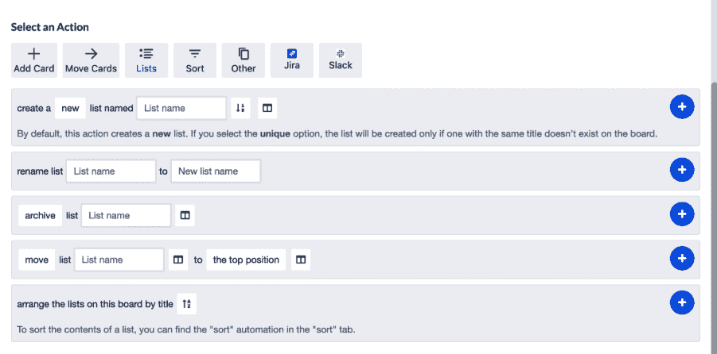

## Figure 9.22 – 看板按钮列表操作

These work great when combined with **automation variables**. For example, you can create a board button that creates a new list with the current week number, moves all your done cards to that list, and then randomly picks three cards from your Backlog list to move into your ToDo list.

Let's try it out and build that together!

## Creating a board button

To create a board button, go to the **Board Button** section of the **Automation** menu on the left hand side panel.

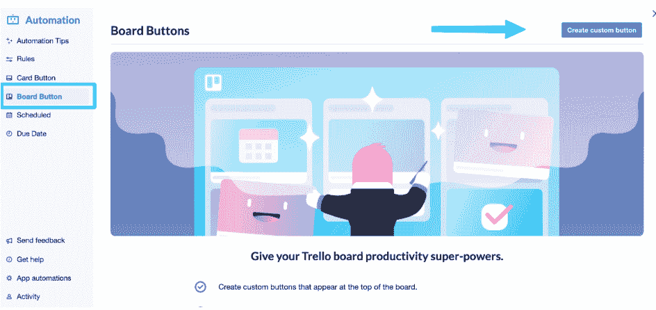

Figure 9.23 – Board button automation section

Just like with card buttons, you get to start with the fun part of coming up with a name and icon. Then decide whether you want the button to be enabled by default. I tend to leave this as is, just like with cards. I’ll call this button New week, and I’ll use a calendar icon because that’s fun.

Next, click + Add Action to see all the actions available. First, we need to make a list of all the tasks we completed this week currently sitting on the Done list. I want this newest name to mention the week number so I can use lists to sort when tasks were completed. To do this, I’ll use the {weeknumber} automation variable, which will dynamically name the list the current week number.

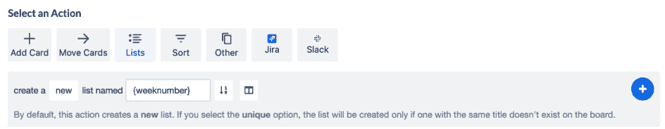

Figure 9.24 – Board button Lists action example

Depending on when you run this rule, you might want to use {lastweeknumber} if you are running this at the beginning of a week and

想要创建一个列表，显示你上周处理了哪些工作。你可以在 Trello 文档中了解有关自动化变量选项的更多信息：support.atlassian.com/trello/docs/butler-variables/。

点击带有数字和箭头的图标，选择新创建的列表放置位置。我希望它放在看板的最右侧末尾，因此我将选择 **in the bottom position** 旁边的 + 图标来指定这一点。

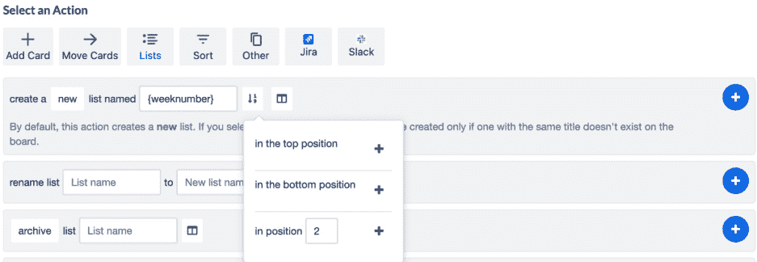

最后，点击行末尾的 + 图标将操作添加到工作流中。接下来，前往 **Move Cards** 部分，因为我们要将 **Done** 列表中的所有卡片移动到新创建的列表。为此，我们将使用第一个操作。点击第一个 **List name** 字段以选择 **Done** 列表（或你在看板中定义为“已完成”的任何列表）。

在第二个列表字段中，输入 `{weeknumber}`，或者如果你在之前的规则中使用过，则输入 `{lastweeknumber}`。这应该与你创建的新列表相同。

Figure 9.26 – Variables for new list and moving cards to list should match
点击行末尾的 + 按钮将操作添加到工作流中。
难的部分完成了！让我们再添加一个操作，用于从 Backlog 列表中选取卡片。向下滚动到 **move 1 randomly-selected cards from list** 规则。我有时喜欢使用随机选取的卡片，因为我难以确定优先级，并且容易忘记 Backlog 中的卡片。因此，假设我有一份重要性相同的事项列表，这是一种有趣的方式，让 Trello 决定我应该处理哪些事情，并为其他事情节省脑力。

Figure 9.27 – Board button move random cards action

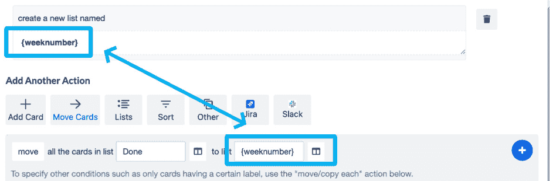

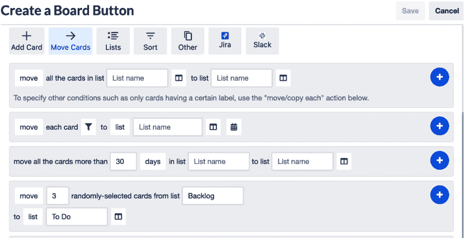

将 **1** 改为 **3**，并点击第一个 **List name** 字段以选择你的 Backlog 列表。接下来，点击第二个 **List name** 字段，选择你想要移动卡片到的 **To Do** 列表。如果你希望这些卡片移动到列表顶部（或底部），请在第二个 **List name** 字段之前点击 **list** 按钮，这将打开一个下拉菜单以选择放置位置。

点击行末尾的 **+** 按钮，然后向上滚动以确认你拥有所有操作。它应该如下所示。

## Create a Board Button

| Icon | Title | New Week |
|------|-------|----------|
| Options | Enabled by default | Actions |
| create a new list named | {weeknum} | in the bottom position |
| move all the cards in list | Done | to list |
| {weeknumber} | | |
| move 3 randomly-selected cards from list | Backlog | to list |
| To Do | | |

Figure 9.28 – Card button create list options

现在点击右上角的 **Save** 按钮，让我们去试用一下我们的按钮！

## Testing your board button

保存按钮后，关闭 **Automation** 模态框，你将在看板工具栏的列表上方看到新按钮。

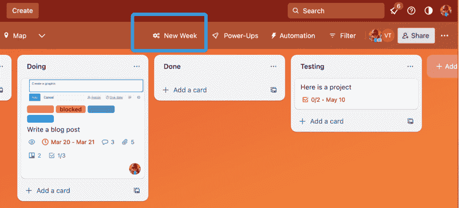

Figure 9.29 – Newly created button appearing in board toolbar

点击 **New Week** 按钮，观察奇迹发生！屏幕底部会出现一个通知栏，显示自动化正在运行。

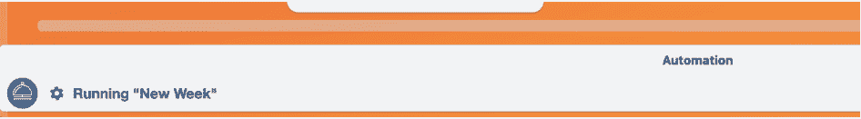

Figure 9.30 – Lower-banner notification to show progress during Board Button runs

完成后，你可以点击查看详情。我不是每次都这样做，但如果出现意外情况，这对于调试很有帮助。

现在，你的周已经通过点击一下就组织和规划好了！难道这不神奇吗？但是，如果我们能做到这一切……甚至不需要点击一下呢？我觉得这是一个很好的过渡，来谈论计划自动化。

## Summary

哇，我希望你在读完本章后，能给自己倒杯喜欢的饮料放松一下。我们涵盖了大量内容，如果你跟着我一起操作，你已经为自己的工作流构建了多个自动化，它们将帮助你凸显重要且紧急的任务，组织并准备好下周的工作，并为你清理卡片。

还有几个触发器我想向你展示，所以让我们进入下一章，讨论 Trello 中基于日期的自动化。

## Date-Based Automation

虽然你可以使用触发器在特定事件发生时触发自动化，也可以使用按钮手动触发它们，但还有另外两种触发自动化的方式，两者都与日期相关。我们将在本章中深入了解它们的工作原理。

以下是你将在本章学习的内容：

- Automation for creating a new card each day
- Testing your date automations
- Automation for joining a card when it’s due

就像其他章节一样，你可能不会每天使用这些功能，所以如果你是第一次学习，没有必要纠结每一个细节。熟悉可用的功能，并在你想深入了解如何设置这些功能时随时回来重读本章。

## Scheduled automation

所以，你明白——Trello 自动化可以做很多事情，当你想手动触发某事时，按钮非常好。但是时间触发器呢？

计划自动化是 Trello 版本的告诉特定操作在重复间隔发生，例如每天、每周、每月……或者你能想到的几乎任何时间。

## When to use scheduled automation

当你有每天或每周都要执行的流程时，使用计划自动化，例如创建每日提醒卡片，或在周初或周末在列表之间移动卡片。如果你在 Trello 中解释你的工作流，并且发现自己说“每个星期一早上，我……”，那么这就是一个信号，表明你可能应该使用计划自动化来自动化它！

由于计划自动化的性质，我们需要比目前看到的更多触发器。让我们看看能找到什么。从 **Automation** 模态框中，确保你在左侧面板的 **Scheduled** 部分：

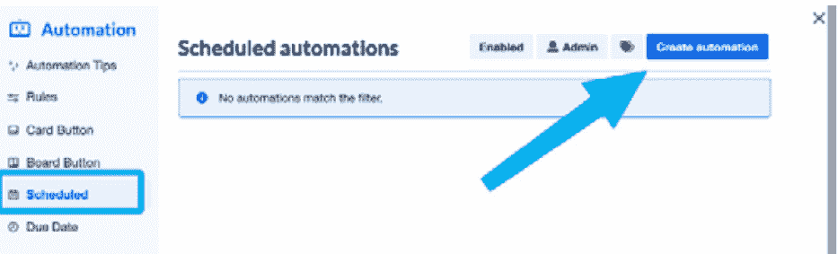

Figure 10.1 – The Scheduled automations section

点击右上角的 **Create automation** 按钮，然后点击 **+ Add Trigger**。

你可能觉得这一切都见过，但出乎意料的是，新的触发器选项将出现！

## New triggers for schedule automation

因为我们在 **Scheduled** 部分，所以会得到一些特殊的触发器。这些与我们在 _Chapter 6_ 中审查的不同：

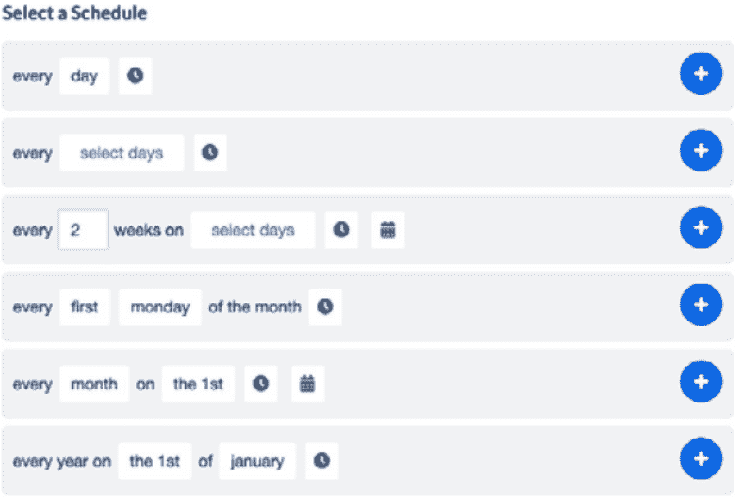

Figure 10.2 – Scheduled automations trigger options

你明白的——每个触发器都有多种自定义选项；只需点击选项并探索它们。我最喜欢这种自动化的部分之一是，你可以设置某事每天或每个工作日发生，如果你想做诸如分配潜在客户或创建重复卡片作为提醒来做诸如“清理工作邮箱”这样的事情，在周末除外的每天，这很有帮助：

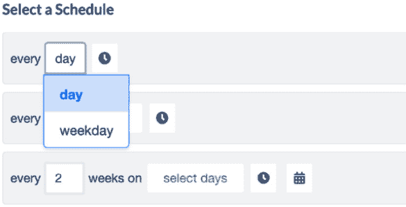

Figure 10.3 – Every day/weekday trigger options

你也可以通过在一个触发器中选择每个星期一、星期三和星期五来选择多天，而不是为每一天创建三个单独的规则：

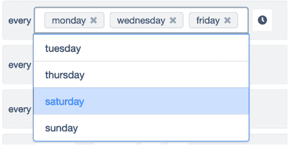

Figure 10.4 – Multi-day trigger option

每个触发器后面的 **clock** 图标用于在需要时指定时间。设置一些操作后，你可以使用 **calendar** 图标选择自动化开始的日期。例如，你可以创建一个每两周发生一次的自动化，从下周开始（而不是从触发它起等待两周）。

## Creating a scheduled automation

当我们在 **Scheduled** 部分时，让我们创建一个自动化，每个星期六为我们清理一周，这样当我们星期一早上来上班时，一切准备就绪。这个自动化具有我们刚刚为 Board Button 构建的相同操作，但我们将使用计划触发器来实现，这样我们就不需要点击任何东西。

为 **every select days trigger** 从下拉菜单中选择 **saturday**：

## 图 10.5 – 重复自动化日期选择

选择 **saturday** 后，单击行末尾的 + 按钮。

你将看到看板按钮自动化中的所有操作，因此让我们获取上一条规则中使用的相同操作。我们将添加一个 **Lists** 操作，用于创建一个列表并在看板底部添加 `{weeknumber}`，然后添加一个 **Move Cards** 操作，将 **Done** 列表中的所有卡片移动到新创建的 `{weeknumber}` 列表中。最后，我们将添加另一个操作，将 **Backlog** 列表中随机选择的三张卡片移动到 **To Do** 列表中。

如果你跟着操作，你的计划规则应该如下所示：

## 创建计划自动化

## 触发器

every saturday

## 操作

create a new list named

{weeknumber}

in the bottom position

move all the cards in list

Done

to list

{weeknumber}

move 3 randomly-selected cards from list

Backlog

to list

To Do

图 10.6 – 计划触发器及其操作的预览

单击右上角的 **Save**，即可获得屏幕上洒落彩纸带来的多巴胺快感，并感到满足，因为你知道甚至不需要按一下按钮就能为自己安排好一周。

## 测试计划自动化

你可能会想，既然无法强制触发器并突然让今天变成星期六（虽然那样会很不错），那该如何测试新规则呢。

幸运的是，Trello 提供了一种方法，让你假装今天是星期六，或者你在触发器中设置的任何日期/时间：

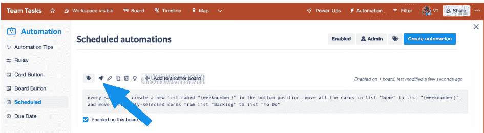

图 10.7 – 用于测试计划自动化的火箭图标

在 **Scheduled automations** 菜单中，找到要测试的规则；你会在规则上方看到一个新图标！单击火箭图标后，Trello 将执行你的操作，仿佛日期/时间触发器刚刚发生，让你确保所需操作已执行，并且你对规则感到满意。

如果不满意，请单击铅笔图标并调整规则，直到它按你想要的方式工作。有时，需要一些实验——无论你在 Trello 自动化方面有多擅长！

在向你颁发 Trello 自动化博士学位之前，我们还需要讨论一组特殊的触发器。让我们谈谈 **Due date** 自动化，因为它已经迟到了很久。😉

## 到期日期自动化

我们几乎已经涵盖了 Trello 自动化的所有方面，但如果你一直跟着操作，可能已经注意到还有一个部分我们尚未讨论。让我们谈谈 **Due date** 自动化。

## 何时使用到期日期自动化

如果你有需要针对到期卡片执行的特定操作，则会使用 **Due date** 自动化。如果你觉得 **Rules** 中的日期触发器相当有限，你会很高兴地知道这里有一些额外的触发器。区别在于，这些触发器更多地涉及监控当前日期与到期日期的关系，而 **Rules** 更多地关注字段的变化，而不考虑其与当前时间范围的关系。

由于我们需要基于时间进行自动化，因此有新的触发器可用。让我们来探索一下！

首先，确保你在 **Automation** 模态框的 **Due Date** 部分：

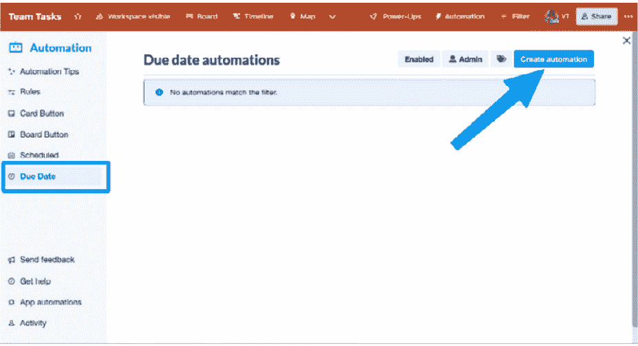

图 10.8 – 到期日期自动化部分

单击右上角的 **Create automation** 按钮，然后单击 **+ Add Trigger**。再次，我们有一个全新的触发器选项世界可以探索。

## 到期日期自动化的新触发器

这些新触发器都专注于监控卡片的到期日期以及当前日期/时间与该日期的关系。

本节中的横幅提供了一些明智的建议，我也将强调，因为了解这一点很重要。例如，如果你应用一个新自动化，将未来七天内到期的所有卡片移动到 **This Week** 列表，你可能会想知道为什么保存后卡片没有移动。这是因为这些自动化 _不支持回溯操作_，不会查找七天内到期的卡片并将其移动。自动化将查找当前日期以及今天和之后七天内到期的任何卡片，每天如此。因此，如果你没有看到卡片突然移动，并不意味着你的自动化出了问题。这只是意味着你需要手动找到这些卡片并将其移动。

专业提示 – 对于想要回溯应用此规则的任何卡片，请使用看板按钮

你可以使用看板按钮将未来七天内有到期日期的任何卡片移动到特定列表。这意味着你仍然可以使用自动化，而无需手动操作！

## 创建看板按钮

图 10.9 – 回溯移动带有到期日期的卡片的操作

现在我们已经解决了警告问题，让我们来谈谈可用的操作：

## 创建到期日期自动化

## 触发器

你的自动化还没有触发器。请为下面的自动化选择一个触发器。

⚠️ **到期日期触发器不支持回溯操作。**

例如，如果你输入一个表示 `2 days before a card is due` 的自动化，..., 这不会对已经在 2 天或更短时间内到期的卡片触发。

它将在卡片因时间流逝而变为 2 天后到期时触发，从输入自动化的那一刻起开始计算。

### 选择到期日期触发器选项

the moment a card is due

2 days before a card is due

on the monday before a card is due

图 10.10 – 到期日期自动化的触发器

这些触发器的作用与其名称完全一致。你可以为卡片到达到期日期的那一刻或到期当天的开始设置触发器。就像计划自动化一样，你可以引用工作日。单击 **2 days before a card is due** 触发器中的 **days** 以查看选项。在这里，你可以从 **days**、**working days** 或 **hours** 中选择。不幸的是，工作小时不是选项：

2 days before a card is due

days

working days

hours

on the a card is due

图 10.11 – 到期日期触发器的选项

你还可以单击某些触发器中的 **before** 以查看更多选项，例如 **after**、**of the week** 和 **of the week before**，这有助于你为每周的每一天优先处理卡片：

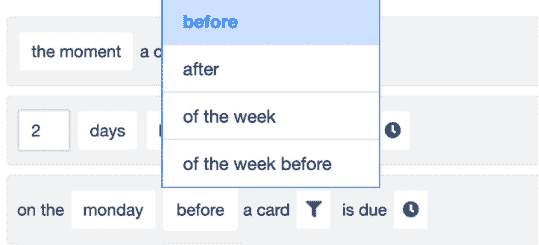

图 10.12 – 用于自定义相对于到期日期的天数的选项

我喜欢使用这些触发器来标记即将到期的卡片，以帮助我确保不会错过任何重要事项，以及升级已过期的卡片。

## 创建到期日期自动化

如果你想在每个星期一早上查看当周到期的所有卡片，你可以创建一个自动化，在卡片到期的那一周的星期一为你分配卡片，前提是它们带有 **p1** 标签。让我们一步步了解如何操作。

从 **Select a Due Date trigger** 部分，转到以 **on the monday before** 开头的触发器。单击 **before** 打开下拉菜单并选择 **the week**。单击 **filter** 图标以显示更多高级选项：

图 10.13 – 用于缩小触发器条件的筛选选项

这里我们将选择筛选带有紫色 p1 标签的卡片。单击标签筛选旁边的 + 图标，然后单击行末尾的 + 按钮以将整个触发器添加到你的自动化中。

接下来，转到 **Actions** 的 **Members** 部分，并单击 **join the card** 规则行末尾的 + 图标。

你可以添加更多操作，例如发送带有卡片详细信息的电子邮件提醒、更新自定义字段以显示你已将其排入本周队列、使用项目模板信息编辑描述，或为开发流程添加检查清单。

可能性是无限的！当你准备好所需的一切后，向上滚动以确保自动化符合你的预期。如果你一直遵循我们的示例且未添加任何其他操作，它应该如下所示：

## 创建到期日期自动化

### 触发器

在卡片带有紫色标签且到期日为当周周一时触发

### 操作

加入卡片

图 10.14 – 预览触发器及其操作

点击右上角的 **保存** 按钮后，你就可以开始使用了。那遍洒在屏幕上的彩纸看腻了吗，不是吗？！

## 测试到期日期自动化

测试 **到期日期** 自动化的最佳方法是创建或查找现有卡片，并设置一个符合触发条件的到期日期。例如，如果你选择卡片到期时触发，可以将到期日期设置为当前时间后 1 分钟，看看自动化是否运行。

如果你选择 **当天** 或 **周一之前** 触发器，这就有点棘手了。我通常的做法是将操作创建为看板按钮，并在看板上确认其按预期工作。如果操作符合预期，我就可以构建一个 **到期日期** 自动化，并相信它会以同样的方式工作。Trello 在提醒卡片到期方面从未让我失望，所以我相信这些触发器会继续工作！

到这时，你几乎已经是 **到期日期** 自动化专家了，希望你继续练习，并在工作流中发现这些自动化的大量用途。

## 摘要

到这时，你基本上就是 Trello 专家了！你可以自动化很多事情，并可以在特定间隔发生，或根据到期日期优先处理自动化。

继续尝试自动化——这正是让你无需编码即可在 Trello 内为工作流构建应用程序的方式。我曾与多位客户合作，他们可以将 Trello 内的自动化原则应用于创建几乎全自动运行的公司运营系统。

你可以构建任何你需要的东西！如果你卡住了或需要帮助，请在 Atlassian 社区的 Trello 部分联系我们：community.atlassian.com/t5/Trello/ct-p/trello。在下一章中，我们将讨论使用 Power-Ups 扩展 Trello 的奇妙世界！
