## 由 Trello 构建的 Power-Ups

到这时，我们已经介绍了 Trello 的大部分默认功能，这些功能已经非常强大。但这只是 Trello 的核心！当你叠加称为 Power-Ups 的附加组件时，你的看板可以更上一层楼。

在本章中，我们将讨论什么是 Power-Ups，以及它们如何为你的看板增强功能。我们将回顾 Trello 制作的一些特定 Power-Ups，它们可以免费为你的看板添加惊人的功能。你将能够做到以下事情：

- 将 Trello 与你每天使用的其他应用程序集成，例如 Slack
- 直观地显示列表中有多少张卡片，并在超过设定数量时更改颜色
- 创建并显示一份操作指南，供同事访问你的看板时阅读
- 允许看板成员，甚至非看板成员，对卡片进行投票，然后按得票最多的顺序对这些卡片进行排序

我们还将讨论一些你可能感兴趣的其他 Trello 制作的 Power-Ups。在深入具体内容之前，我们需要讨论什么是 Power-Ups 以及在哪里可以找到它们。

最好的 Power-Ups 是最适合你的

在接下来的几章中，我们将讨论 Power-Ups。人们总是问：“最好的 Power-Ups 是什么？”如果你希望我为你回答这个问题，我很抱歉，但这只有你或深入了解你工作流的人才能最好地回答。

虽然一个 Power-Ups 被添加到多少个看板可以看出哪些最受欢迎（或者更常见的是，哪些存在时间更长），但并没有适合每个人的理想 Power-Ups 工具箱。利用这些章节来熟悉搜索和与 Power-Ups 交互，并了解它们的功能。然后，如果它们适合你，就使用它们；或者浏览 Power-Ups 目录，看看是否有更适合你工作流的更好选择。

## 什么是 Power-Ups？

Power-Ups 是为看板和卡片提供更多功能或样式的附加组件。它们通过添加新功能或字段，或从其他来源汇总信息，来增强生产力、协作和组织能力。有超过 300 个 Power-Ups 可用，因此无论你想在 Trello 中做什么，你可能都能找到一个 Power-Ups 来帮助你。

许多人使用 Power-Ups 将 Trello 与他们使用的其他应用程序集成，例如 Slack 或 GitHub。Power-Ups 提供了一种无缝的方式来同步信息，而无需在多个位置之间跳转。你将在 _Power-Ups for Integrations_ 部分看到更多示例。

除了与其他工具集成之外，当人们寻找他们想要在看板中但无法原生实现的特定功能时，也会使用 Power-Ups。例如，如果你正在进行报告或时间跟踪，你会找到可以帮助 Trello 更好地适应你的用例的 Power-Ups。

Power-Ups 添加到你的看板是免费的，你可以添加任意多个。但是，对于某些第三方 Power-Ups（非 Trello 制作的），开发者会向你收取费用。这些价格可能从每年几美元到每月 20 美元不等（在某些情况下甚至更多）。大多数 Power-Ups 提供免费试用期，以便你在被要求付费之前确认它是你想要的。不用担心——仅仅将它们添加到看板上是不会被收费的。每个 Power-Ups 略有不同，但对于付费 Power-Ups，你将被要求创建帐户并选择订阅。

Power-Ups 可以由看板的任何成员添加到看板，并可以自定义以满足看板或项目的特定需求。现在让我们讨论在哪里可以找到 Power-Ups 以及如何将它们添加到你的看板。

## 访问 Power-Ups

要访问 Power-Ups，请点击任何 Trello 看板顶部工具栏中的 **Power-Ups** 按钮。

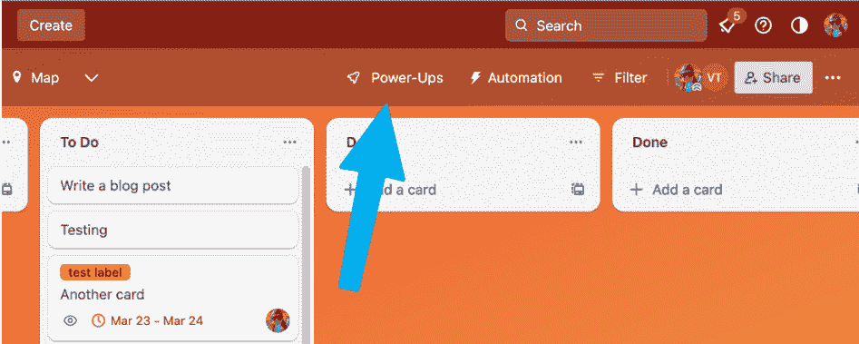

图 11.1 – Power-Ups 看板按钮

如果看板上已经添加了任何 Power-Ups，你会看到它们以列表形式出现，并有选择切换看板按钮显示以及访问 Power-Ups 设置的选项。如果你还没有添加任何 Power-Ups，你会看到一张鼓舞人心的图形和一个 **添加 Power-Ups** 按钮。

图 11.2 – Power-Ups 模态框

点击按钮进入目录，发现所有可以添加到看板的 Power-Ups。

我不建议你在这里随意添加 Power-Ups。这会让人不知所措，因为有太多可供选择！就像自动化一样，好东西也有过多的时候。在看板上拥有几十个 Power-Ups 会降低性能并增加干扰，阻止人们有效地使用你的看板。

相反，我建议你先看看有哪些选项，然后思考什么最符合你的工作流。

目录左侧的部分（参见 _图 11.3_）也将帮助你缩小哪些 Power-Ups 可能对你最有用的范围。例如，你可以看到哪些是精选和最常见的，或者你可以按特定用例或行业排序。

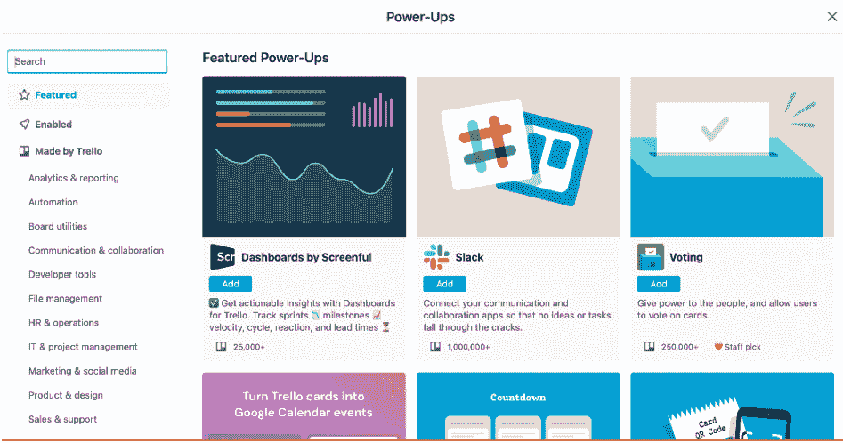

图 11.3 – Power-Ups 目录

如果你在人力资源部门工作，你可能想查看 **HR & operations** 类别。如果你想了解看板上发生的更多数据，你可能想查看 **Analytics & reporting** 部分。

在查看 Power-Ups 时，你会看到关于它们的各种详细信息。每个卡片显示一个徽标、名称、简短描述以及它已被添加到的看板数量。

Figure 11.4 – Power-Up 卡片

这能帮助你了解 Power-Up 有多受欢迎以及有多少人使用过它。精选的 Power-Up 包含一张图片，通常展示 Power-Up 的外观或可能的使用示例。

你可以从卡片视图添加 Power-Up，但如果想了解更多，只需点击卡片即可。

Figure 11.5 – Power-Up 列表

这会带你进入列表，显示更多详细信息。Power-Up 开发者通常会使用此部分来解释 Power-Up 的功能、最适合哪类用户以及工作原理，通常会包含 GIF 和截图。如果 Power-Up 不是免费的，你通常也会在此处看到定价信息。

你还可以在顶部名称下方找到 **Contact support** 按钮，用于联系 Power-Up 开发者。如果你对 Power-Up 有疑问或需要排查问题，这会很有帮助。

当你准备好尝试 Power-Up 时，只需点击 **Add** 按钮。每个 Power-Up 都略有不同，因此接下来的情况会因 Power-Up 而异。但通常会出现一个屏幕，要求你批准其访问你的 Trello 看板，并注册或登录任何第三方账户或配置任何初始设置。

添加 Power-Up 后，你可以随时通过顶部工具栏中的 **Power-Ups** 按钮从看板访问它。

Figure 11.6 – 看板 Power-Up 设置

点击 **Settings** 按钮，你可以将其移除、查看列表，或在设置时未授权的情况下授权 Power-Up。

现在让我们谈谈一些由 Trello 开发的特定 Power-Up 以及你如何使用它们！

## 用于集成的 Power-Ups

人们使用 Power-Up 的最常见原因之一是在 Trello 与其他应用之间发送或接收数据，以便它们能够无缝协作。Trello 与其他工具开发了许多 Power-Up，以尽可能高效地实现这一点，并帮助你将所需的所有数据集中在一个地方。

为什么要将 Trello 与其他应用连接？

我并不天真到认为 Trello 是你或你的团队将来唯一会使用的工具。Trello 很棒，但我不会去那里设计图片或与同事交谈。将 Trello 与你使用的其他应用集成，可以帮助你将所需的所有信息集中在一个中心位置，同时让每个工具发挥其自身的作用。它还可以节省你的时间，避免通过更新多个工具来重复工作。如果你难以跟踪 Trello 中的通知，将这些更新发送到 Slack 或 Google Chat 将帮助你的团队在重要的地方看到最重要的内容。

## Trello 可轻松集成的工具

如果你对可与 Trello 集成的可用工具感兴趣，可能性是无限的。在本章中，我将专门介绍由 Trello 创建的 Power-Up，这些是 Trello 本身提供的原生集成。在以下列表中，你将找到这些 Power-Up 的全面列表以及如何利用它们的示例：

- Box、Google Drive 和 OneDrive（直接在卡片中预览这些提供商的文件）
- Evernote（在 Trello 和 Evernote 之间同步笔记）
- Giphy（在看板的卡片中添加 GIF）
- GitHub（在卡片中预览拉取请求和问题信息）
- Google Chat（通过 Google Chat 接收 Trello 通知）
- Mailchimp（在卡片中查看营销活动绩效详情）
- Salesforce（直接在卡片中查看案例和联系人详情）
- Slack（通过 Slack 接收 Trello 通知）
- Twitter（在卡片中预览推文）
- Zendesk（搜索工单并将其附加到卡片）

我不会逐一介绍每个集成，因为外面有很多工具，但这能让你了解你可以做什么。如果你有想要集成的特定工具，请在 Power-Up 目录左上角的搜索框中搜索它们。

Figure 11.7 – Power-Up 目录中的搜索字段

假设我在一家科技公司工作，我使用 Trello 来组织我的营销团队的任务，但我们也通过 Slack 进行沟通。我们将逐步介绍如何设置 Slack Power-Up，以便我的团队可以直接在我们公司 Slack 工作区的内部营销频道中接收通知。

## 添加 Slack Power-Up

在左上角的搜索栏中搜索 Slack，并选择出现的第一张卡片。

Figure 11.8 – Slack Power-Up 卡片

点击 **Add** 按钮。按钮的颜色和文本会立即发生变化。点击新创建的 **Settings** 按钮，然后点击 **Edit Power-Up settings**。

Figure 11.9 – Slack Power-Up 设置

在此处，配置你希望在 Slack 中共享哪种 Trello 通知。在 **ALERTS** 部分下选择 **+ Add Slack Alert...** 按钮。

选择一个 Slack 工作区，然后选择你希望通知发布到的频道。为了延续我的营销示例，我可能会将这些通知设置为发送到我的 #**marketing** 频道。

勾选你希望接收的通知类型旁边的复选框。我倾向于只保留评论以及创建和移动到不同列表的卡片。

Figure 11.10 – Slack 警报配置

如果你尚未连接到 Slack 工作区，则在选择频道或其他选项之前需要先进行连接。只需从下拉菜单中点击 **+ Add new Slack workspace** 并允许权限即可。

## 在 Slack 中查看通知

一旦工作区连接成功，并且你已配置想要的警报类型，你就可以立即在 Slack 中接收通知了！

Figure 11.11 – Slack 中的 Trello 通知

它们将出现在你指定的频道中，任何人都可以点击链接前往卡片或看板。

如果你在 Slack 中收到的通知太多或太少，随时可以更改这些设置。记住——你希望这些通知对你有用并为你服务，而不是与你作对；如果太吵闹以至于大家都忽略它们，你会想要减少通知的数量。

说到看板上事情太多，让我们来谈谈列表限制。

## 列表限制

你是否曾经发现自己开始做太多事情却一件都没完成？我有过这种情况，尤其是在我的副项目中！我有太多想法，一切听起来都很有趣和令人兴奋，但很快我就发现自己陷入了 10 件不同的事情之中，无法给任何一件事应有的关注。

这在许多工作团队中也会发生。你收到了上级的指令，似乎不可能完成所有事情，但你仍在努力尝试。到了周末，令你惊讶的是，你发现并非所有事情都已完成。

### 为什么要限制任务？

限制在制品数量很重要，因为它让你能够专注于完成任务，然后再转向新任务。当我进行中的任务太多时，我会失去专注力，生产力下降，并且更容易犯错和错过截止日期。当你限制在制品数量时，你可以优先处理任务、更有效地管理时间，并最终取得更好的结果。限制在制品数量还可以帮助减轻压力并改善工作与生活的平衡，因为你能够更高效地完成任务，并为其他活动腾出更多时间。

借助列表限制 Power-Up，我们可以设置特定列表中显示的卡片最大数量。虽然这不会阻止我们将卡片移动到该列表，但此 Power-Up 会从视觉上改变列表的显示方式，因此如果超过了限制，一目了然。

假设我正在管理我的开发团队的工作，并且只希望他们同时处理最多五张卡片。如果他们想从待办事项中获取新功能，只有在已进行中的卡片少于五张时才能这样做。以下是我们如何使用列表限制来设置这一点。

### 添加列表限制 Power-Up

要添加 List Limits Power-Up，请前往 Power-Up 目录并在左上角搜索 List Limits。选择出现的第一个选项并单击 **Add**。

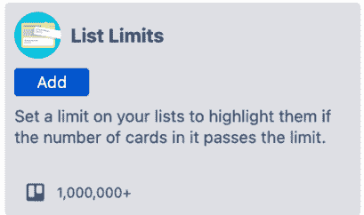

Figure 11.12 – List Limits Power-Up 卡片

一旦按钮变为，例如，**Settings**，请按键盘上的 *Esc* 键或单击屏幕右上角的 **X** 图标退出 Power-Up 模态框。这将带你返回到你的看板。

## 配置 List Limits

要使用此 Power-Up，你需要配置每个列表中你希望的卡片最大数量。你不需要为每个列表设置，但如果你愿意，也可以！找到你想要设置限制的列表，并单击列表名称旁边的省略号：

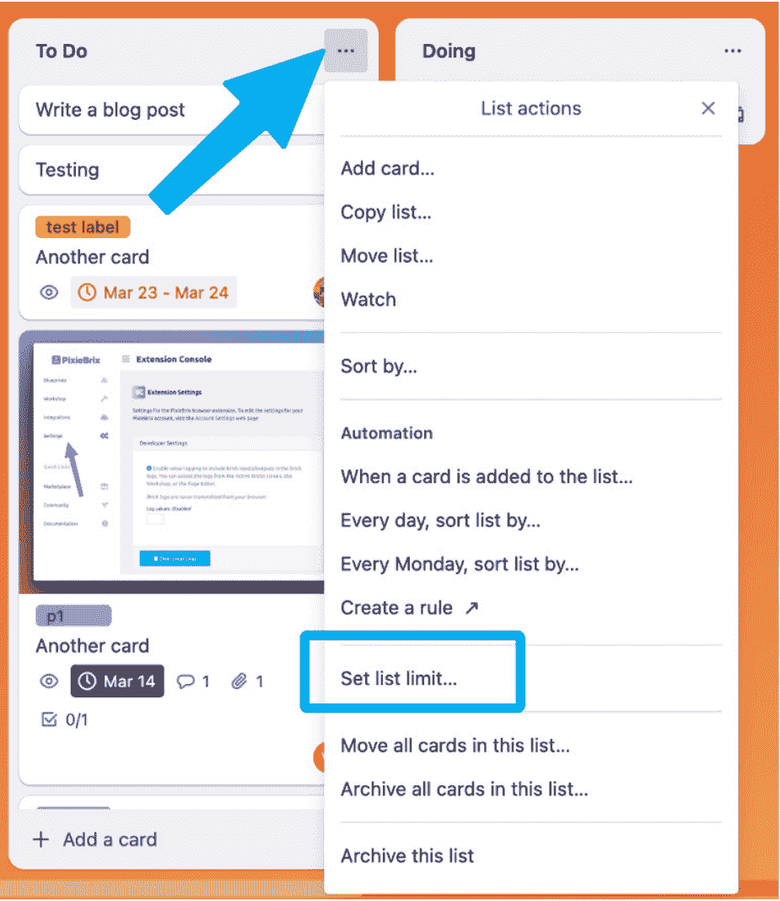

Figure 11.13 – 带有 Set list limit... 动作的列表操作菜单

向下滚动出现的菜单大约三分之二的位置，你应该会看到 **Set list limit...** 动作。单击它，然后设置最大数量。

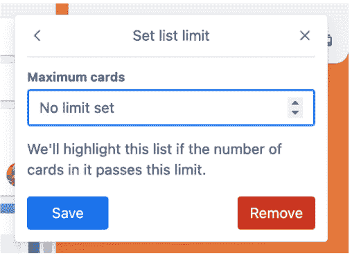

Figure 11.14 – 设置列表限制选项

你可以输入任何数字或使用箭头滚动。就我的示例而言，我将输入 2。设置好数字后，单击 **Save**。或者，如果你已经设置了想要清除的限制，可以单击 **Remove**。

## 使用 List Limits

当你配置列表限制时，列表顶部将显示一个徽章，显示当前卡片数量和你设置的最大数量。

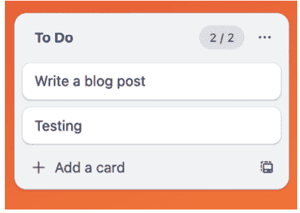

Figure 11.15 – 列表顶部显示卡片数量的徽章

如果当前卡片数量等于或小于最大值，列表的其余部分将正常显示。但是，一旦卡片数量超过最大值，列表的背景将从灰色变为浅黄色，顶部的徽章将加粗以使其突出。

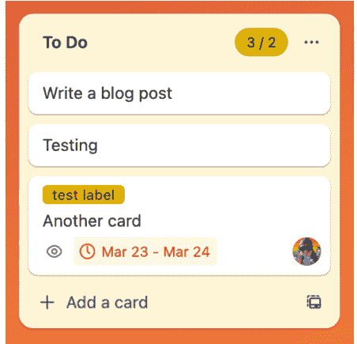

Figure 11.16 – 当卡片超过列表限制时，徽章加粗且背景改变

你仍然可以超过限制添加卡片并查看顶部的计数。我认为这很理想，因为有时我确实需要做例外，将 Power-Up 用作指南而不是严格防止卡片移动到另一个列表更有帮助。

即使你不需要限制，此 Power-Up 对于计算列表中的卡片数量也很有帮助，因为它始终通过顶部的徽章显示该数字。我有时会在列表上使用它，只是为了跟踪我有多少张卡片，以防我想对此进行报告，例如我本周正在处理的任务数量，或我 **Won** 列表中的联系人数量。

你如何选择使用限制完全取决于你和你的团队。事实上，概述你打算如何使用限制是你可以在看板的 Read Me 中提到的内容，我们将在下一节讨论。

## Read Me

无论你组织看板得多么清晰，人们仍然会加入并感到有点迷茫，不确定如何使用看板。即使你和团队一起浏览看板，有一个集中位置来解释如何使用看板以及看板成员的期望仍然很好。

README 是软件项目中的一个文件，通常包含有关项目的重要信息，例如其目的、如何使用、如何安装以及任何依赖项或要求。它通常是用户在探索新项目时会阅读的第一个文件。Read Me Power-Up 由此得名，因为如果你启用了此 Power-Up，当用户被添加到看板时，这是他们看到的第一件事。

为什么要在 Trello 看板中添加 Read Me？

拥有一段简短的文本来向人们介绍看板并引导他们浏览，将增加人们使用你的看板的可能性——也许更重要的是——帮助他们正确使用它。我建议对任何与其他人协作的看板或模板看板使用此 Power-Up。它是免费且易于配置的，所以没有理由不使用！

## 添加 Read Me Power-Up

如果你在支持团队工作，你可能希望使用 Read Me 向支持工程师解释如何使用你的看板，并确保每个人都了解如何获取任务。

要添加 Read Me Power-Up，请前往 Power-Up 目录并搜索 Read Me。选择出现的第一个 Power-Up，它看起来像这样：

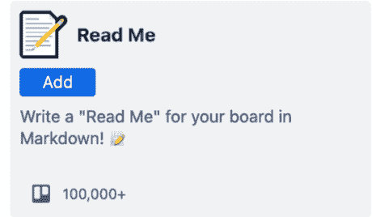

Figure 11.17 – Read Me Power-Up 卡片

单击 **Add**，将出现一个弹出窗口来配置你的 Read Me。在此部分，输入你的看板描述。你可以使用 Markdown 语法格式化文本，这允许你创建标题、加粗或斜体文本、添加图像、创建项目符号或编号列表等！

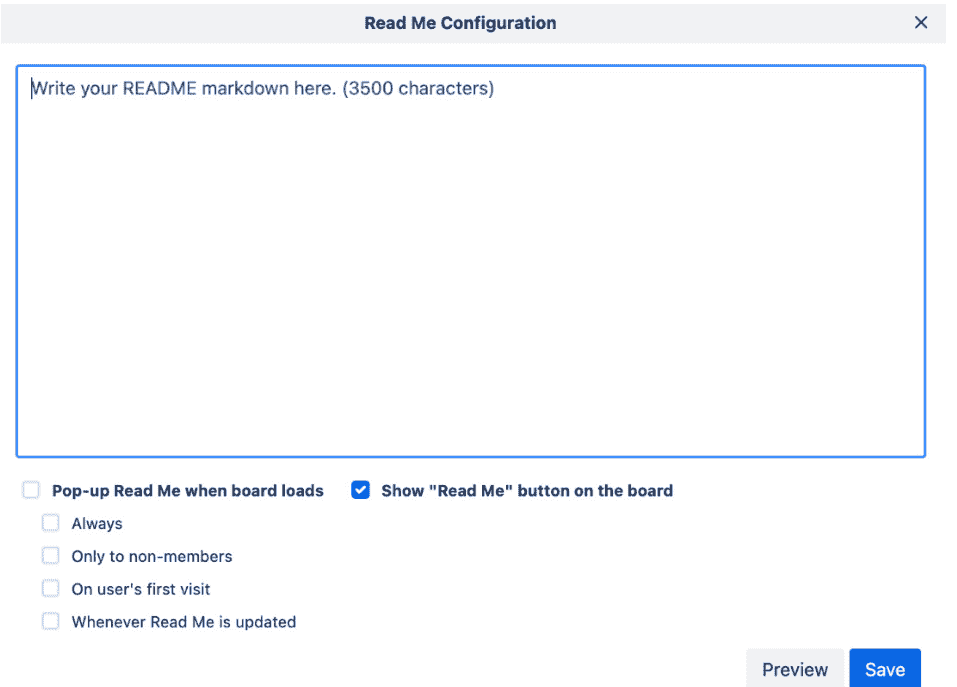

Figure 11.18 – Read Me 配置

创建描述后，你可以选择访问你的看板的访客何时应该看到这个 Read Me。我建议保留“在看板上显示 Read Me 按钮”选项被勾选，这样你的队友随时都可以快速访问它。我还建议勾选“用户首次访问时”和“每当 Read Me 更新时”选项。完成配置后单击 Save。

## 预览 Read Me

要查看你的 Read Me，请单击 Trello 看板顶部工具栏中的 **Read Me** 按钮。如果你没有勾选包含该按钮的框，那么只需执行你触发它显示的操作即可。（例如，如果你选择每次加载看板时都显示它，则刷新页面。）

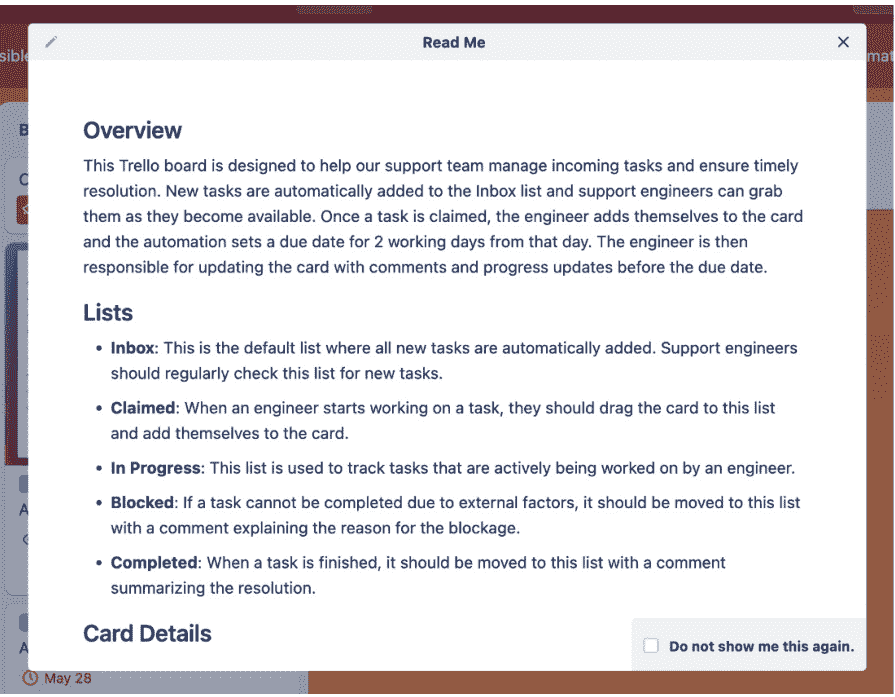

Figure 11.19 – Read Me 预览

你应该会看到你输入的描述，使用 Markdown 格式化得很漂亮！

## 编辑 Read Me

当你打开 Read Me 时，你还会在右上角看到一个铅笔图标。这允许你返回并编辑 Read Me，如果你想更改任何内容。你也可以通过从 Power-Up 菜单的 Read Me 设置中单击 **Edit Power-Up settings** 来编辑 Read Me。

## Power-Ups

Buttons

+   - [x] Read Me

Enabled Power-Ups

### List Limits 设置

为你的列表设置限制，以便当其中的卡片数量超过限制时突出显示它们。

+   - [ ] Settings

### Read Me 设置

为你的看板在 Ma 中编写一个“Read Me”

+   - [ ] Settings

+   - [ ] Add Power-Ups

Figure 11.20 – 编辑看板上 Power-Ups 设置的界面

你将能够重新打开模态框并更改文本或配置选项并保存它。

如果你想了解更多关于在看板上吸引人们的想法，你会很高兴了解 Voting Power-Up！

## Voting

有时你可能想了解人们想要处理什么或哪些类型的主题对人们最有趣。虽然你可能想让某人加入卡片如果他们想为某事“投票”，但这会增加很多不必要的开销（例如关于卡片活动的通知以及这些卡片出现在你的过滤列表中）。

为什么要在 Trello 看板上投票？

如果你想从用户或队友那里收集反馈，你可能希望在 Trello 看板上启用投票功能。例如，如果你是产品团队，你可以使用 Trello 作为你的路线图，并允许产品用户分享功能请求并对其进行投票。这可能有助于你优先处理待办事项，并只处理请求最多且影响最大的功能。

你可能希望在看板上启用投票的原因有很多，例如快速投票让队友选择一个适合开会的时间，或对会议议程中的项目进行优先级排序。这也是确保团队对你在项目期间想要完成的任务表示认可的好方法。通过每个人都同意很重要的任务，员工更有可能完成这些任务。

Voting Power-Up 使你能够轻松地将投票功能纳入你的 Trello 看板。此 Power-Up 在卡片操作中添加一个按钮，允许成员（甚至非看板成员）为卡片 +1。每张卡片将显示总票数的统计，列表有一个新操作，允许你按票数对列表中的卡片进行排序。

## 添加投票 Power-Up

让我们将投票 Power-Up 添加到我们假设的产品路线图看板中。前往 Power-Up 目录，并在左上角的搜索栏中搜索 Voting。点击出现的第一个 Power-Up 上的 **Add** 按钮。

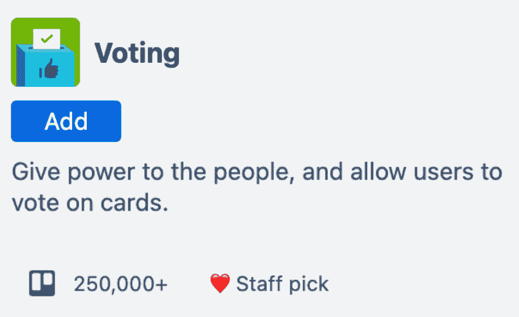

图 11.21 – 投票 Power-Up 卡片

当它变成 **Settings** 按钮时，您的 Power-Up 即可使用 --无需配置任何内容！按 _Esc_ 键或点击右上角的 **X** 图标退出 Power-Up 目录，然后打开看板上的任何卡片。

如果您确实想要配置其他选项，请点击 **Settings** 按钮，您将能够配置一些选项，例如谁可以投票以及投票数字是可见还是隐藏。如果您以后想更改这些设置，可以从 Trello 看板工具栏顶部的 Power-Up 按钮访问它们。

## 投票设置

### 谁可以对卡片进行投票？

- **Members** ✓  
  管理员和看板成员可以投票。

- **Members and observers**  
  管理员、看板成员和观察者可以投票。

- **Workspace members**  
  管理员、看板成员、观察者和工作区成员可以投票。

- **Public members**  
  任何 Trello 用户都可以投票。

### 投票数字应该可见吗？

- **Hide vote counts**  
  启用后，看板成员只能在卡片上看到自己的投票。

图 11.22 – 投票设置

我们现在将此更改为 **Public members**，因为我们希望任何 Trello 用户都能对我们的功能请求进行投票。这允许我们的用户对我们看板上的卡片进行投票，但不能编辑其任何内容。

## 对卡片进行投票

在 Trello 看板上的每个卡片上，您会注意到右下角 **Actions** 部分中有一个新按钮，就在 **Activity** 部分的右侧。

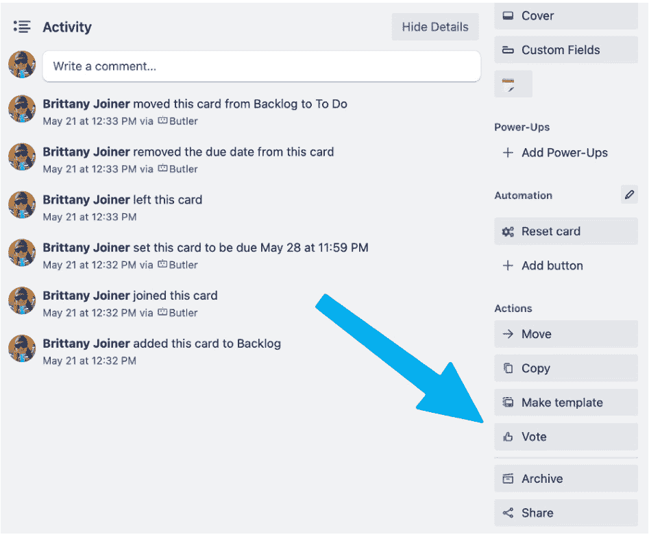

点击 **Vote** 按钮，您会注意到出现一个对勾，表示您已为该卡片投票。

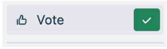

图 11.24 – 提交投票后卡片上的对勾

如果您想要移除投票，只需再次点击 **Vote** 即可。

对于看板上每个至少有一个投票的卡片，卡片正面会出现一个点赞图标，显示该卡片的投票数量。

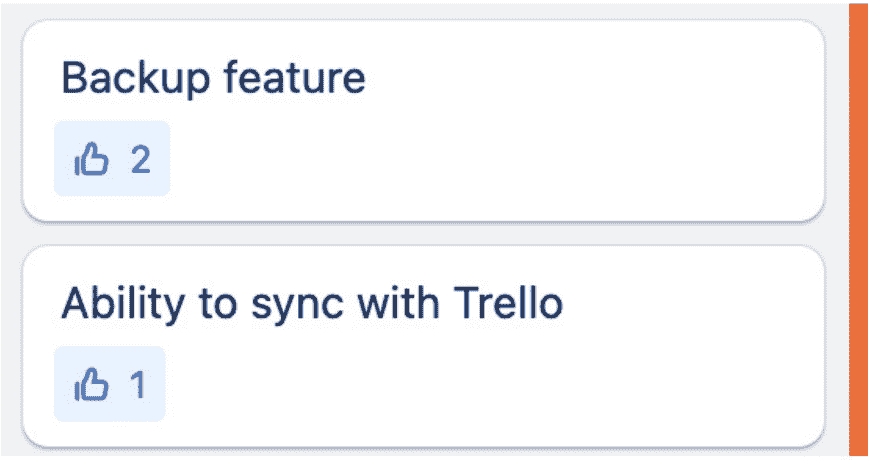

图 11.25 – 卡片正面显示的投票数量

您还可以通过打开卡片并在卡片标题下方查看卡片背面的投票数量。这为我们提供了一种快速查看特定功能请求受欢迎程度的方式。

## 按投票数排序列表

如果您想要组织列表以查看投票最多的卡片排在最前面，请点击列表名称旁边的省略号，并选择 **Sort** 选项。这将打开您之前见过的排序选项，但您会注意到一个新选项！

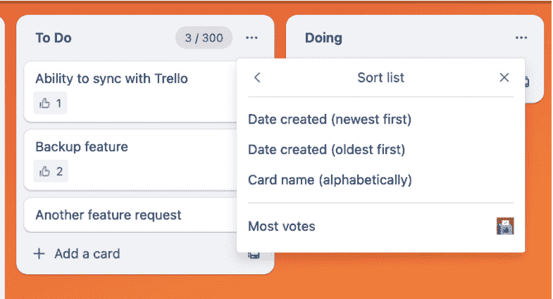

图 11.26 – 带有投票 Power-Up 的排序选项

您可以按 **Most votes** 排序。选择该选项，观看卡片移动以按最高到最低的投票数排序。现在您可以根据受欢迎程度快速判断应该优先处理哪些功能！

## 其他 Trello 制作的 Power-Ups

如果我谈论每个 Power-Up，这本书很快就会变成一系列百科全书，即使我只谈论 Trello 制作的每个 Power-Up 也是如此。我挑选了我最喜欢的一些以及一些最有用的、适用于一些常见用例的 Power-Up，但这只是个开始。

如果您想要探索更多 Trello 制作的 Power-Ups，请前往 Power-Up 目录，并点击屏幕左侧的 **Made by Trello** 选项：

## Power-Ups 列表

图 11.27 – Power-Up 目录中的 Made by Trello 部分

在这里，您将看到我们已经讨论过的一些 Power-Ups，以及更多，例如以下内容：

- **Card Snooze** (允许您暂停卡片，使其从看板上消失，并在您希望时重新出现)
- **Card Repeater** (设置卡片在特定间隔复制自身)
- **Package Tracker** (通过提供追踪号和服务提供商，直接在卡片上查看货件追踪信息)
- **Calendar** (如果您不是 Trello Premium 用户，以日历形式显示卡片)
- **Dashcards** (迷你报告卡片，显示符合您设置的筛选条件的卡片数量)

在目录中搜索这些内容并查看列表页面，以了解如何使用它们，并为您提供想法和灵感！

## 摘要

您再次提升了 Trello 知识！在本章中，我们讨论了 Power-Ups 如何为您的看板赋予超能力，让您能用 Trello 做更多事情。任何人都可以制作 Power-Ups，但一些最受欢迎的 Power-Ups 是由 Trello 制作的，我们在本章中重点介绍了这些。

我们讨论了与其他工具集成的 Power-Ups，例如 Slack 和 Google Drive。我们还学习了如何在看板周围创建结构以统计每个列表中的卡片并提供限制，以及如何在看板上创建文档，以便其他人能够有效地使用它。我们甚至学习了如何使用投票 Power-Up 将我们的 Trello 看板变成一个反馈收集机器。

如果您以前从未使用过 Power-Ups，而这是您初次涉足，那么您已经在改进 Trello 看板的道路上走得不错，但您还有很多东西要发现。在下一章中，我们将讨论一些由其他开发者制作的您可能喜欢的 Power-Ups。
