## 通用 Power-Ups

您已经了解了一些由 Trello 创建的 Power-Ups，它们将帮助您改进工作流程，但现在是时候走出内部生态系统，探索由其他人创建的 Power-Ups 了。在本章中，我们将探索一些不是由 Trello 制作，而是由其他公司和开发者制作的 Power-Ups。虽然我得写一百万本书才能谈论所有这些，但我们将介绍一些适用于少数用例并解决我被问到的最常见挑战的 Power-Ups。

在本章中，您将了解以下主题：

- Approvals for Trello—简化团队的审查和审批流程
- Amazing Fields—为 Trello 卡片添加自定义字段，以便更全面地了解项目
- Bulk Actions—通过允许您一次对多个卡片执行操作来简化工作流程

内容很多，让我们立即开始！

## Approvals for Trello

如果您在 Trello 工作流程中有任何审批流程，此 Power-Up 很有用。例如，也许您需要在 Trello 上跟踪内容日历，在任何内容发布之前，您的经理或其他队友必须批准它。

虽然您可以使用 Trello 的自定义字段和标签构建自己的审批系统，但为什么不使用一个开箱即用的 Power-Up 呢？这就是 Approvals for Trello 的用武之地。

这是一个由 AppFox 团队构建的 Power-Up，他们也是为 Jira、Confluence 和 monday.com 制作其他备受喜爱的应用程序的团队。Approvals 已在全球超过 75,000 个 Trello 看板上添加，并且可以免费使用，尽管有一个付费订阅计划可以添加一些很酷的额外功能。

## 为什么使用 Approvals？

在工作流程中添加审批流程可以帮助确保每个人都清楚谁在做什么。它消除了“我不知道那个要发布了！”的对话，以及“没有人和我的团队确认！”的沮丧情绪，当我们都在快速行动（希望不会）搞砸事情时，这些情况往往会发生。

## 将 Approvals for Trello 添加到您的看板

要添加 Power-Up，请从任何 Trello 看板顶部工具栏的 Power-Up 目录中选择 **Power-Up** 按钮。点击 **Add Power-Ups** 按钮，并在左上角的搜索字段中搜索 `Approvals`。点击出现的第一个结果上的 **Add** 按钮：

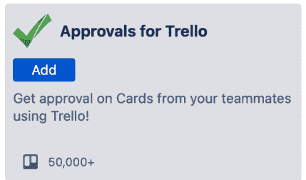

图 12.1 – Power-Up 目录中的 Approvals for Trello 卡片

您将被提示再次点击 **Add** 以确认您理解这是一个第三方 Trello Power-Up，由 Trello 外部的另一位开发者制作。不过，不用担心——Power-Ups 仍然经过严格的审查流程，因此您可以确保您的数据和信息安全！

模态框会说明如何在 Trello 中使用 Approvals。请花点时间查看，然后我们将一起创建一个审批：

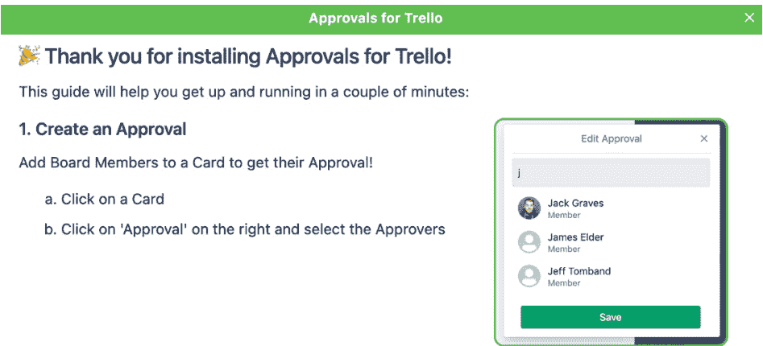

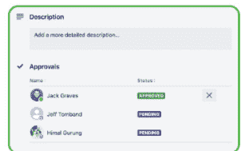

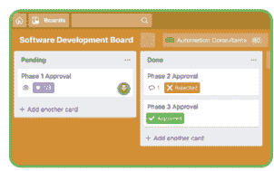

图 12.2 – Approvals for Trello 欢迎流程

准备好后，单击 **Get Started**，然后关闭 Power-Ups 模态框以试用。我们将演示如何在 **Review** 列表中的卡片上创建审批，要求我们的技术负责人批准该卡片。

## 创建审批

每个 Power-Up 都略有不同，但要使用这个 Power-Up，请转到 Trello 看板上的任何卡片。在卡片右侧 **Add to card** 部分下方的 **Power-Up** 部分中查找。

我将选择我看板中 Review 列表里的一张卡片，但你可以从任何喜欢的卡片或列表中选择：

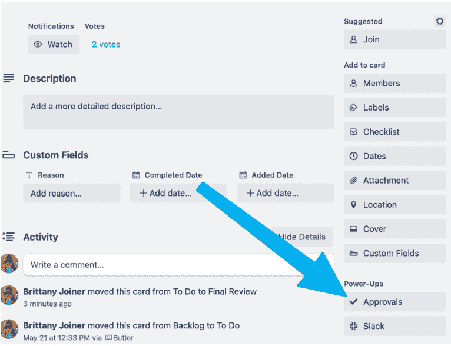

图 12.3 – 卡片上的 Approvals 按钮

单击 **Approvals** 按钮，将出现一个模态框邀请你开始添加审批。你会看到任何现有的审批，但由于我们是新用户，它是空的。单击底部的 + 按钮。

从下拉选项中选择审批人，其中包括看板的所有成员：

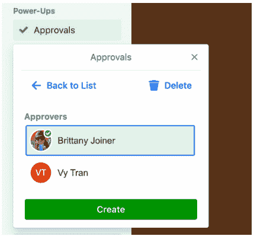

图 12.4 – 向卡片添加审批人

选择成员后，**Create** 按钮会变暗以便单击。
如果你有多个人需要批准某事，这里可以选择多个成员。为了示例，我将只保留我自己。

单击 **Create**，你就设置好了第一个审批！现在，让我们看看它在 Trello 卡片上的样子。如你所见，它出现在卡片描述下方，而你添加的任何自定义字段都在 **Activity and Comments** 部分上方：

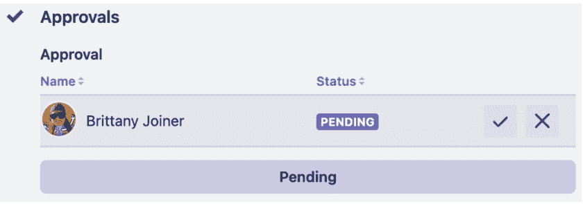

图 12.5 – 卡片上的 Approvals 按钮

Trello 卡片中的 **Approvals** 部分清晰地显示了谁被请求审查以及该审批的状态。

## 批准或拒绝审批

如果你是审批人，可以单击 ✓ 或 X 按钮来批准或拒绝。如果误触，可以再次单击以撤销你的批准。

请注意，你不仅可以在卡片背面看到可视化的状态，还可以从卡片正面看到状态，这使得在 Trello 看板上一目了然地查看非常容易：

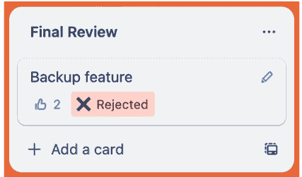

图 12.6 – 卡片正面上的拒绝状态

这使得你可以快速识别看板上卡片的审批状态。

当然，如果你总是需要相同的人批准卡片，你可能不想为每张卡片手动添加审批人。虽然无法快速选择多张卡片并为它们设置审批人，但我建议这样做。

首先创建一张卡片，作为你 Trello 看板上任何新卡片的示例。在我的示例中，我可能会为功能请求制作一个模板卡片。在该卡片上设置审批人。我会将我的技术负责人添加为审批人。

现在，每当我想添加新功能时，我会复制那张示例卡片，它会复制审批。（我们可以通过制作看板按钮来实现自动化！请参阅第 9 章以复习创建看板按钮。）就这样——该卡片的审批人已自动设置！

## 按审批状态查看卡片

如果你想查看自己批准了哪些卡片，或者哪些卡片正在等待你的审批，请单击 Trello 看板顶部工具栏中出现的 **Approvals** 按钮！

**Approvals** 仪表板将出现在 Trello 看板底部，以便你可以轻松按审批状态查看卡片，并快速识别任何需要你关注的事项：

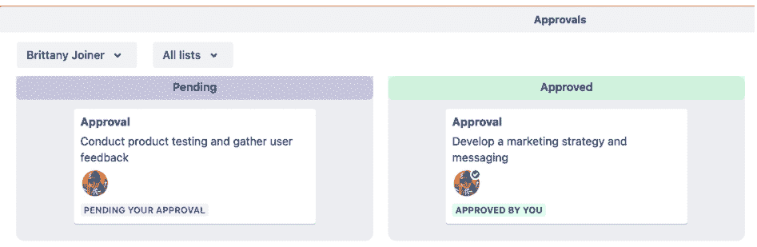

图 12.7 – 按审批状态排序的卡片视图

使用下拉菜单查看其他审批人的审查状态。只需单击你的名字并选择 **All members** 或另一个看板成员以更改显示的卡片。你也可以单击 **All lists** 来指定要查看的列表。例如，也许你只对需要立即审查的卡片感兴趣，所以你可能只想显示 QA 列表中需要你审查的卡片，而不是看板上最终都需要你批准的每张卡片。

## 高级功能

如果这听起来不错但你想要更多，你会很高兴地知道，付费（Pro）版本包含更多功能。

## 创建审批组或团队

使用 Pro 计划，你将能够创建审批团队。假设你需要法务部门的人签署某事，但你不需要特定的人——只需要法务团队的一名成员。你可以创建一个由五名法务人员组成的团队，其中只有一人需要批准才能显示卡片的已批准状态。现在，你可以指定审批类型以及该组中需要多少人批准。

## 在卡片上指定多个审批

另一个 Pro 功能让你能够在卡片上指定多个审批，而不是只有一个可能包含多人的审批。例如，如果你需要法务、信息安全和财务团队的人批准添加到公司工作区的新工具，你可能会这样做。

## 基于状态移动卡片

通常，当有人批准卡片时，它会移动到工作流程的下一阶段，如果被拒绝，它可能会移动到工作流程的前一阶段，以便队友可以重新处理并再次请求批准。与其在看到卡片上的审批状态更新后手动移动卡片，不如设置自动化规则（在 **Approval Teams** 中），在审批状态更改后将卡片移动到特定列表。如果你在 Pro 计划中创建审批团队，可以选择 **Move on Approval** 或 **Move on Rejected**。

## 升级到 Pro

如果这些功能中有任何让你感兴趣并且你想要升级，这很容易实现。为此，请单击任何卡片右侧的 **Approvals** 按钮，并选择顶部的 **Get Pro** 操作：

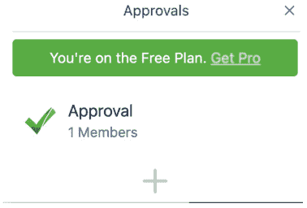

图 12.8 – 升级到 Pro 计划

现在我们已经介绍了审批，让我们谈谈你可能想要添加到看板上的其他字段！

## Amazing Fields

Trello 的原生自定义字段功能强大且多用途，但对于所谓的自定义字段，你只能“自定义”这么多。只有五种字段类型，你无法对它们进行任何样式设置，除了下拉字段类型的下拉选项颜色或字段名称。虽然它们对于存储数据很有用，但如果你想输入更长的笔记（或超过约 20 个字符的任何内容），文本会被截断且难以阅读。嘿——它们对于许多用例都很有效！但有时你只需要多一点。

Amazing Fields 将自定义字段更进一步，允许你在 Trello 卡片上创建额外字段，并自定义它们出现的位置和方式。Amazing Fields 由 Amazing PowerUps 公司开发，已添加到超过 100,000 个看板！与其他 Power-Ups 一样，有一个功能丰富的免费计划和一个 Premium 版本，让你能做更多！

## 为什么使用 Amazing Fields？

当你有额外信息想要添加到看板上时，你会想要使用 Amazing Fields，例如更多日期或更多文本字段、表示状态的复选框，或者几乎任何其他核心 Trello 卡片属性中不存在的数据。

具体来说，当你想要选择额外字段的外观，或者当你想要控制字段的可见性以及谁可以编辑它们时，你会想要使用 Amazing Fields 而不是 Trello 的原生自定义字段。

虽然你可以用 Amazing Fields 做很多事情，但我将解释如何设置并创建第一个字段，然后我会让你随心所欲地玩耍。

我将向你展示一个 _非常_ 真实的示例，因为我实际上正在用它来写这本书！我将向你展示我如何使用 Amazing Fields 来跟踪每章需要写的页数，以及单词数。

## 添加 Amazing Fields

要将 Amazing Fields 添加到你的看板，请从任何 Trello 看板顶部工具栏的 **Power-Up** 按钮中单击 **Add Power-Ups**。在目录中，在左上角的搜索栏中搜索 `Amazing Fields`。你应该会看到以下内容：

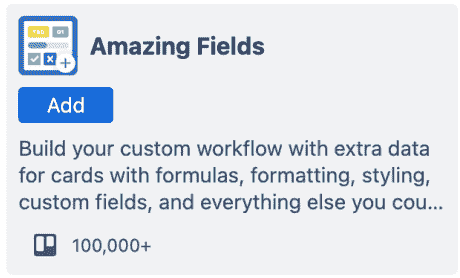

图 12.9 – Power-Up 目录中的 Amazing Fields 卡片

单击 **Add** 按钮，然后再次单击 **Add** 以确认你意识到这是一个非 Trello 创建的 Power-Up。立即，你将

提示连接您的 Trello 帐户并允许访问，然后您就可以开始创建字段了！

如果您退出并返回看板，可以通过单击看板顶部工具栏中的 **Fields**，然后选择 **Settings** 来访问此设置页面：

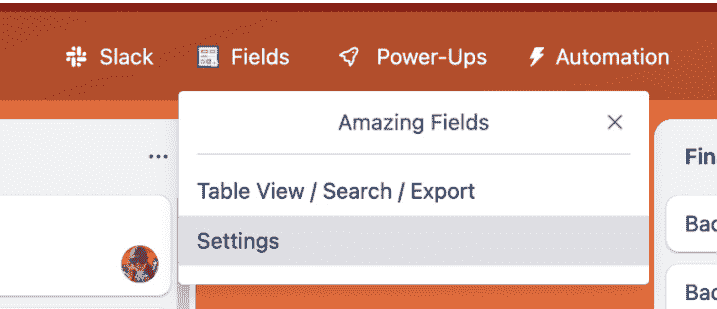

图 12.10 – 带有设置的 Amazing Fields 模态框

现在，让我们创建一个字段！具体来说，让我们创建一个 _amazing_ 的字段。😃

## 创建字段

首先，单击面板左侧的 + **Add** 按钮，位于 **Settings** 部分下方的 **Fields** 部分内：

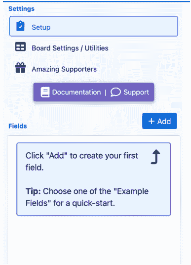

图 12.11 – Amazing Fields 设置和字段侧边栏

然后，系统会提示您选择字段类型。将鼠标悬停在每个选项上以显示更多选项，并查看可以构建哪些类型的字段：

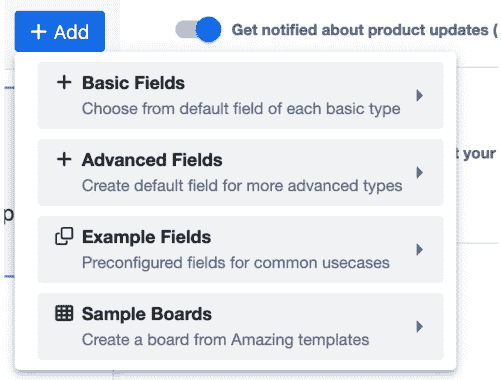

图 12.12 – Amazing Fields 类别

你可以做很多事情！你可能期望基本字段，例如文本、复选框、日期、数字和下拉列表，但还有许多其他字段类型，例如进度条和卡片引用，甚至还有用于组织字段的字段，例如节标题或选项卡。

对于我的 Trello 书籍看板，每张卡片都是一章，我需要一个数字字段来存储该章节的页数。我单击了 **Basic Fields** 并选择了 **Number Field**。请照做以跟随我！

现在，您来到了一个页面，该页面为您提供了配置字段的选项，其可能性超乎您的想象。首先为您的字段命名。您甚至可以为字段添加表情符号！

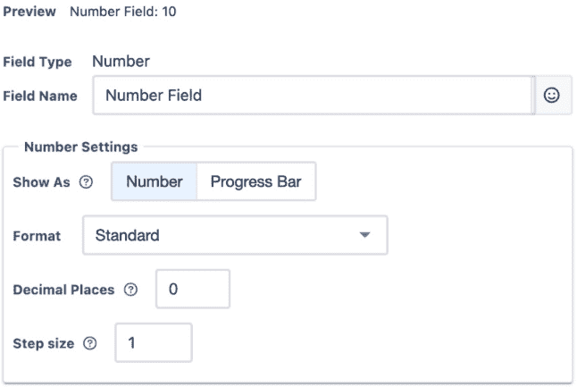

图 12.13 – Amazing Fields 数字配置选项

对于数字，您可以设置数字的格式，例如货币或百分比，并可以选择以数字或进度条的形式显示。其他字段在此部分会有其他设置。如果您选择了下拉列表字段类型，这就是您设置选项的地方。如果您选择了文本字段，您可以选择文本是单行还是多行。如果是复选框，您可以从六种不同的样式中选择复选框的样式！

我们将保留 **Pages** 字段的这些设置。现在，让我们查看 **Card Display** 选项：

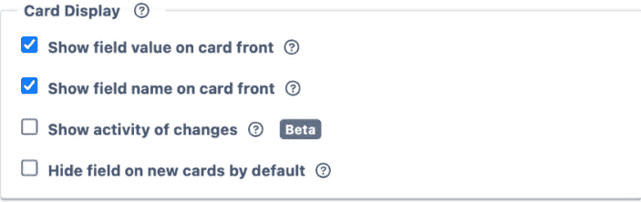

图 12.14 – Amazing Fields Card Display 选项

您可以选择是否显示字段名称和/或值（卡片正面的答案，或者在与其他卡片一起在看板上查看卡片时的视图），以及是否希望卡片上的评论在对自定义字段进行更改时记录下来。如果您需要查看记录何时更改、谁更改了以及更改了什么，这很有帮助。最后，您可以选择在卡片上隐藏新字段，以免空值使卡片显得杂乱。

接下来，您可以更改字段在 **Field Editor Layout** 选项中的显示方式：

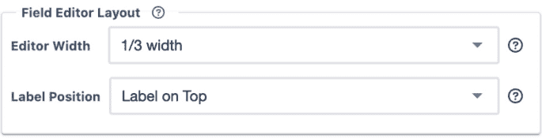

图 12.15 – Amazing Fields Field Editor Layout 选项

如果是长文本字段且您希望尽可能多地显示文本，您可以选择让其显示卡片的全宽。这是 Trello 原生自定义字段无法实现的功能，对于显示长文本块非常有帮助，尤其是当与文本字段的 **Multiple Line** 布局配合使用时。您还可以指定标签相对于字段的位置，从而获得更多自定义选项。

为了更多样式，您可以设置卡片的 **Background Color** 选项以使其突出，并可以添加条件逻辑以根据字段的值指定背景。您可以使用此功能使选中的复选框显示绿色，未选中的复选框显示红色：

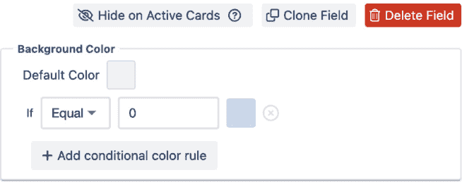

图 12.16 – Amazing Fields Background Color 选项

下一部分选项仅对高级订阅者可用，如 **Supporter Only** 徽章所示。字段公式非常适合根据其他字段的值设置值。虽然我不为我的 **Pages** 字段使用它们，但我使用它们来计算 **Words** 字段的值。由于我知道每页大约应该有 3,500 个单词，我的单词目标是 `Pages * 3,500`，我可以使用 Amazing Fields 构建该公式。如果我没有设置 **Pages** 字段，我也可以选择不显示 **Words** 字段：

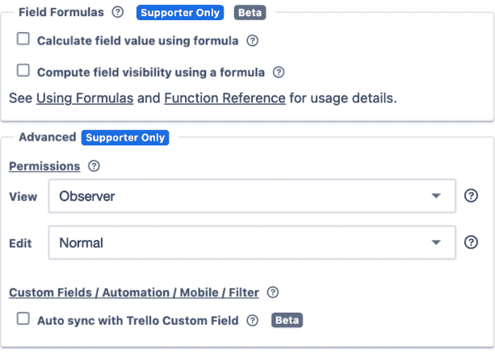

图 12.17 – Amazing Fields 字段公式和高级选项

最后一部分也仅对支持者可用，但如果您需要对字段进行终极控制，则非常有用。在某些情况下，您可能希望只有管理员才能编辑这些字段，或者您可能甚至只希望他们能够查看这些字段。通过这些 **Permissions** 设置，您可以控制谁可以查看和编辑整个看板上的自定义字段。这是 Trello 原生自定义字段的另一个限制，因为看板上的任何人都可以查看自定义字段的任何值。

最后一个设置是我认为真正使 Amazing Fields 比以往任何时候都更神奇的地方，因为我过去曾告诉人们，如果您想要样式，请使用 Amazing Fields，但如果您想要自动化，请使用 Trello 的原生自定义字段。但是有了这个最终设置，您不必二选一！

为什么您会想要在看板中同时拥有 Amazing Fields 和自定义字段，而不是只拥有一个？因为 Power-Ups 在移动端不工作，所以如果您想在移动端查看字段值，您需要使用 Trello 的原生自定义字段。Power-Ups 也无法在 Trello 的自动化套件中访问，所以如果您想使用字段自动化任何操作，您也需要使用自定义字段。但是，随着您阅读本节，您希望能看到 Amazing Fields 相对于 Trello 原生自定义字段的所有优势。这就是这个设置很棒的原因。您可以既拥有蛋糕又吃掉它。如果选中，Amazing Fields 将为您的 amazing 字段创建一个自定义字段并使其保持同步。您还可以添加 **Amazing Fields for Chrome** 扩展程序，它将隐藏自定义字段，以免在卡片上显示重复字段。

完成了！无需单击保存或其他操作——您的字段会在您操作时自动保存，当您准备好查看效果时，只需关闭右上角的 X 按钮即可！

## 更新字段

打开看板上的卡片，您应该会在 **Description** 部分下方看到新创建的字段：

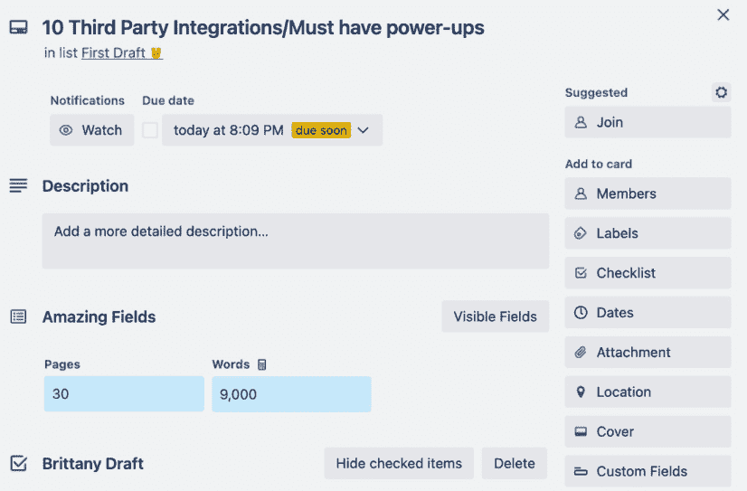

图 12.18 – 在卡片上查看 Amazing Fields

要编辑字段，请单击它并输入或选择值，就像您使用看板上的原生自定义字段一样。

如果您想在特定卡片上隐藏字段，请单击字段右上角附近的 **Visible Fields** 按钮。如果您有一些参考或说明卡片，不需要像看板上的其他卡片那样包含值，您可能会这样做。

## 其他功能

在结束本节之前，我还想向您展示一件事。Amazing Fields 还提供看板备份功能，它会复制看板并提供备份，以防看板发生您想要撤销的任何更改。要启用此功能，请从 **Getting Started** 页面打开选择开关：

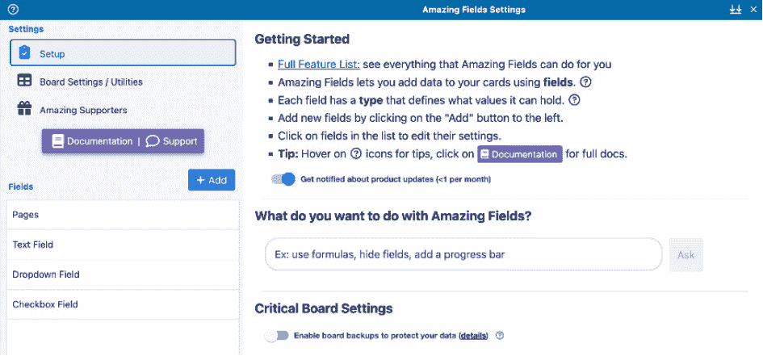

图 12.19 – Amazing Fields 看板备份功能

您还可以导出看板，以防您需要将数据添加到另一个工具或以另一种格式。还有另一件特别的事情——您可以复制看板配置，如果您想要创建多个带有这些创建的字段的看板，这很重要。对于我的开发者朋友们，您还可以通过 API 访问您的 Amazing Fields 数据，以便您可以在其他工具中引用这些数据。如果您与希望能够通过其他工具访问项目数据的团队合作，这非常好。

还有一件事！Amazing Fields 甚至允许您以表格视图查看卡片，而无需 Trello 高级计划。要执行此操作，请单击看板顶部工具栏中的 **Fields** 按钮，并选择 **Table View | Search | Export** 选项。您将看到类似这样的屏幕：

## 列

- [x] 全部
- [x] 无
- [x] 名称
- [x] 列表
- [x] 描述
- [x] 标签
- [x] 成员
- [x] 开始日期
- [x] 到期日期
- [x] 地址
- [x] 位置

| | 开始日期 |
|---|---|
| | |
| | |
| | |
| | |
| | |
| | |
| | |
| | |

重新加载
导出

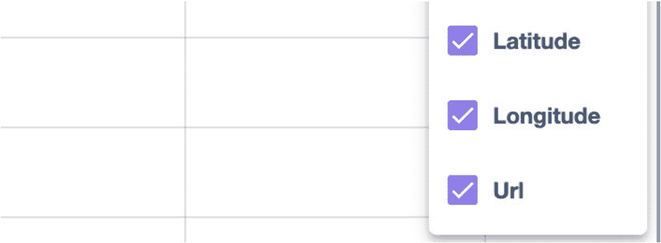

图 12.20 – Amazing Fields 表格视图

与 Trello 的 **Premium Table** 视图不同，此视图允许您在表格中查看卡片以及您创建的字段，并且您可以控制显示哪些属性和字段。

要涵盖您可以使用 Amazing Fields 做的所有事情，需要写更多章节，但幸运的是，此 Power-Up 非常直观，您只需点击即可学到很多。您也可以通过 **设置** 页面右下角的聊天联系支持。

您可以对看板做很多事情，但在结束本章之前，我需要向您展示最后一件事——如何快速编辑多个 Trello 卡片！

## 批量操作

虽然对单个 Trello 卡片进行更改并不困难，但一次性对多个卡片进行更改可能需要一段时间。截至 2022 年，Trello 原生不提供一次性快速编辑多个卡片的方式，例如添加成员、更改到期日期或删除标签。但借助批量操作 Power-Up，这是可能的！

批量操作由 AxoApps 开发，已添加到超过 100,000 个看板！有一个有限的免费计划，允许一次最多对 5 张卡片执行操作，但您可以每月每个看板花费低至 1 美元来编辑更多卡片。

### 为什么使用批量操作？

无论是春季大扫除、项目日期变更，还是团队成员的加入或离开，您会发现有很多情况需要在看板上快速进行大规模更改。

手动完成所有这些操作是可能的，但非常耗时。如果您发现自己处于需要快速将一堆卡片移动到另一个列表、在里程碑日期变更时更新卡片上的到期日期，或重新分配卡片标签或成员的情况，您会发现此 Power-Up 可以为您节省大量时间。

让我们通过两个编辑卡片的示例。我们将编辑一小部分卡片以添加标签，因为我想出了一种组织卡片的新方法，我们还将演示当项目更改到期日期时如何移动多个卡片的到期日期。

### 添加批量操作

单击任何 Trello 看板顶部的 **Power-Up** 按钮，然后单击 **Add Power-Ups** 进入 Power-Up 目录。如果您的看板上已经有几个 Power-Up，**Power-Up** 按钮可能是一个火箭船图标而不是文本。当您到达 Power-Up 目录时，搜索 `Bulk Actions`，然后单击出现的第一个 Power-Up 上的 **Add**：

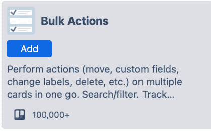

图 12.21 – Power-Up 目录中的批量操作卡片

系统会要求您再次单击 **Add** 以确认您承认此 Power-Up 不是由 Trello 开发的。

您将看到几张介绍幻灯片，解释批量操作的工作原理，然后系统会提示您注册订阅。您随后将看到有关高级计划和免费试用的一些信息：

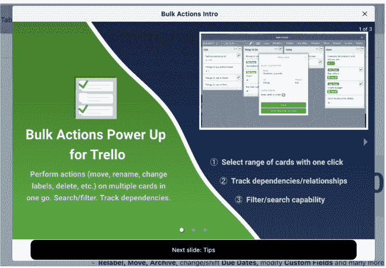

图 12.22 – 批量操作欢迎说明

您可以选择按看板付费的订阅，并且可以添加若干看板。如果您知道自己有几个特定的看板想要添加此功能，并希望您的团队能够访问批量编辑功能，这非常好。每个计划都有最低许可证数量，并且每个计划都附带免费 7 天试用。

接下来，您需要打开批量操作编辑器以开始选择卡片并进行更改。单击 Trello 看板顶部的 **Bulk Actions** 按钮，查看带有几个额外元素的看板版本：

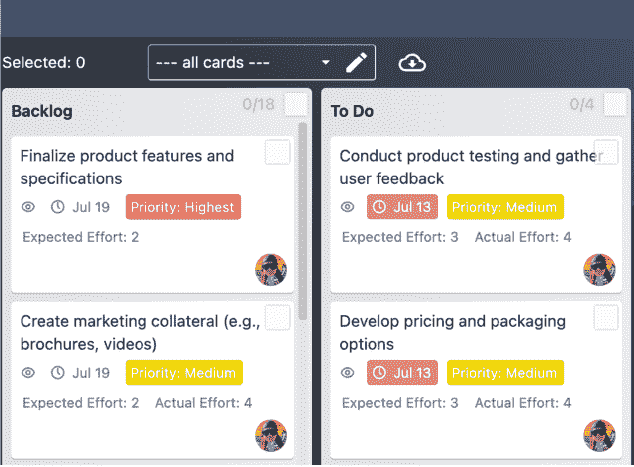

图 12.23 – 批量操作编辑视图

请注意左侧有一个带铅笔的下拉菜单，可用于筛选卡片，并且页面右侧顶部还有一个操作列表。

最后，您会注意到每个卡片和列表右上角都有一个复选框。这就是您选择要更改的卡片的方式！

### 选择多个卡片进行编辑

在准备对卡片进行更改之前，您需要选择要编辑的卡片。您可以通过手动勾选每个卡片上的复选框来完成此操作，但这仍然需要大量点击，因此我只有在没有更清晰的方法可以快速获取所有卡片时才会这样做。

如果您想选择列表中的所有卡片，请单击列表顶部的复选框。如果您想选择看板上的所有卡片，只需单击每个列表上的复选框。

请记住，您一次最多只能选择 80 张卡片。如果列表中有很多卡片，这可能会很困难，但有一个方便的方法仍然可以快速选择大量卡片。将鼠标悬停在任何卡片上，您就明白我的意思了：

图 12.24 – 在卡片之间选择卡片的图标

您会看到卡片左侧出现绿色和灰色框，允许您选择当前卡片上方或下方的所有卡片。这样您可以选择顶部的卡片，然后向下滚动以快速获取中间的所有卡片。您可以在看板左上角查看已选择的卡片数量。

快速获取多个卡片的另一种方法是使用筛选器。单击看板顶部铅笔图标旁边显示 --- all cards --- 的下拉菜单：

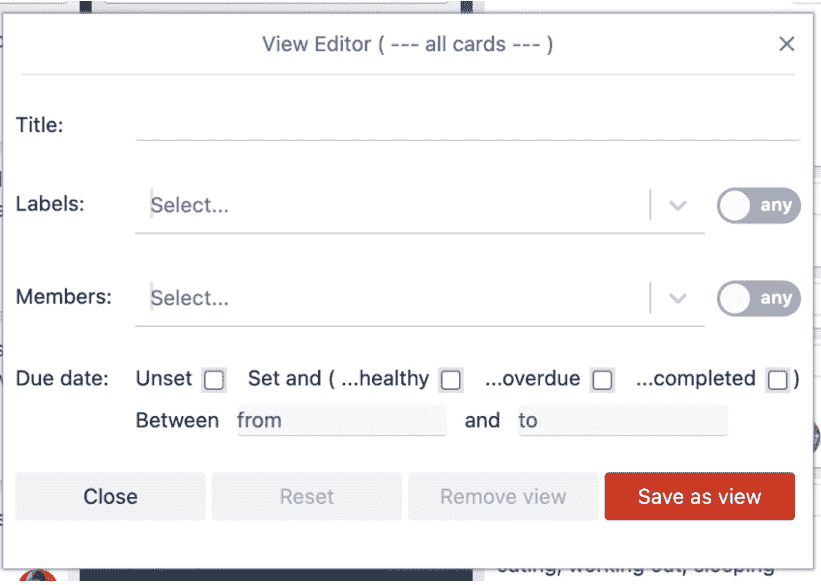

图 12.25 – 批量操作筛选器选项

这将打开一个模态框，用于筛选在 **批量操作** 模态框中显示的卡片。您可以按标签、成员、关键字或到期日期进行筛选。您可以离开页面，筛选器将自动保存为草稿。但是，您也可以选择 **保存为视图** 来命名它并访问多个筛选视图。这会显示看板的筛选版本，以便您可以快速检查列表并选择所有卡片。

如果您知道要将分配给某个队友的所有卡片更改为另一个队友，这将很有帮助。

### 对多个卡片进行更改

现在您知道如何选择多个卡片，您已准备好对这些卡片应用编辑！一旦您选择了要更改的卡片，请从看板顶部选择要更改的字段：

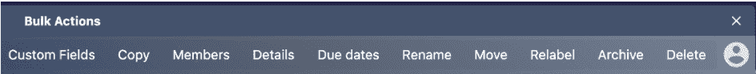

图 12.26 – 批量操作导航栏

我们将从更改标签开始，因此我们将单击 **重新标记**。将出现一个模态框，显示看板上的所有标签。我们现在可以勾选要在卡片上保留的标签，并取消勾选要删除的标签。如果您不想对这些卡片进行更多更改，请单击 **重新标记**。我将调整到期日期，因此我将单击 **重新标记并保持选择**：

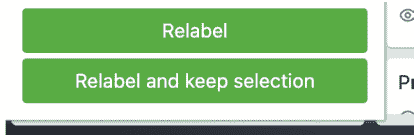

图 12.27 – 批量操作保存更改选项

现在，您的卡片有了新标签！您可以在 **批量操作** 覆盖层中看到这一点。接下来，让我们移动到期日期。当您在进行项目且最终到期日期推迟 10 天时，这真是一件麻烦事，因为现在您必须找到所有依赖任务，并为每个任务点击 10 天后。我一直认为应该有更好的方法，果然，借助批量操作，确实有。

我选择了保持选择，因此相同的卡片仍然被选中，但如果您不想使用这些卡片，请继续选择与项目相关的卡片。您可能会想——等等，它们都会有不同的日期，所以这真的是批量更改吗？是的，确实如此，因为您可以 _移动_ 日期，这将使所有日期移动相同的数量，而不是移动到相同的日期。单击看板顶部的 **到期日期**。这将打开一个模态框，为您提供更改日期的选项以及这些更改的预览：

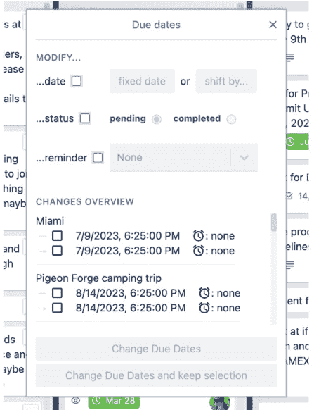

图 12.28 – 到期日期编辑器

勾选 **日期** 框，然后单击 **按...移动** 选项。

您随后将有选项显示每个卡片的日期要移动多少。您可以按年、月、周、天、小时或分钟控制移动，如果需要移动到过去，甚至可以使用负数。

earlier date instead of a later one. Preview the changes and confirm it looks like you’d expect:

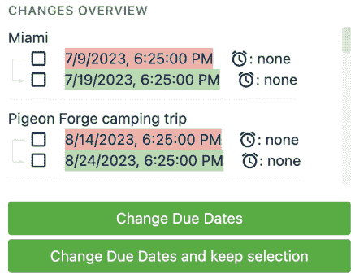

Figure 12.29 – Previewing due date changes

When you’re done, click **Change Due Dates**. You know how to shift due dates like magic! Close out of the **Bulk Actions** overlay by clicking the X button in the top-right corner, and you’ll see your cards on your board have the new due dates.

There are so many other changes you can make to cards with Bulk Actions, including updating custom fields, or archiving or deleting cards. I tend to recommend this Power-Up frequently because it’s so useful, no matter how you use Trello.

## Summary

I’ll say it once more—these are just a couple of the hundreds of Power-Ups that are available. There is no perfect answer to “What are the best Power-Ups for every Trello user?” because everyone uses Trello so differently! But these Power-Ups work well for just about any use case because most involve getting stakeholder approval, adding custom data, and making changes to many cards at once.

Explore the Power-Up directory to learn about Power-Ups for your use case. For instance, if you’re managing contacts in your Trello boards, you’ll want to use Crumble to add contact fields and pipeline reporting to your board automatically. If you want to build your own app on top of Trello, such as a hiring portal or a blog, you can use a Power-Up such as Hipporello to create apps for your users that let you operate in your Trello boards. Even email has Power-Ups in Trello, such as SendBoard and Cardbox that let you manage your inbox from Trello, perfect for support teams or any team with a shared inbox that needs triaging.

And new Power-Ups are being added all the time! Search the Power-Up directory or post in the Atlassian Community to learn about more Power-Ups and get inspiration for which ones might work best for your boards.

No matter how you use Trello, you’ll find these useful to improve your workflows. Now, let’s dive into some more Trello Power-Ups that help you get information into your boards and synced with other tools or even other boards!
