## Syncing Info Between Boards and Tools

Unfortunately, we can’t get everyone to use Trello (don’t worry—I haven’t given up trying), and even for those that we can, we can’t all operate on the same board! Some of the most common questions I’m asked are how to sync between multiple boards and how to quickly get information in Trello.

Although you can get some syncing capabilities with advanced automation, it’s a lot to build and it never works perfectly. But thankfully, there are solutions. In this chapter, we’ll explore two Power-Ups that help you solve this challenge and make it work like a dream.

In this chapter, you’ll learn about the following:

- How Forms by Blue Cat gathers information from team members and clients in a more organized way to create cards
- How Unito connects different sources of data with your Trello boards for a more integrated workflow

Let’s start by talking about how to sync information from info filled out on a web page straight to your Trello board.

## Forms by Blue Cat

While templates work great for creating cards, sometimes folks may still be confused about where to put something when creating a card, or what kinds of information are needed before work can begin on a task.

There are also some cases where you may want others to make requests or create cards on your boards, but you don’t want them to view or edit cards. Maybe you want your users to be able to request a feature that becomes a task on your dev team’s Trello board, but you don’t want to add all of your users to your Trello board. That’s costly, requires your users to have or create a Trello account, and gives them access to sensitive info in the team’s board.

This is where Forms by Blue Cat can help. This Power-Up lets you create a public form that you can embed or share anywhere. On every form submitted, a new card is created with the information from that submission.

This Power-Up is built by Blue Cat, a company that has made many other amazing Power-Ups, including Import to Trello, which allows you to convert a spreadsheet into a Trello board, and perhaps their most famous Power-Up, Blue Cat Reports, which we’ll discuss more in Chapter 14.

Forms by Blue Cat has been added to over 40,000 boards, including many of my own!

Why use Forms by Blue Cat?

If you want to quickly capture the required information to create new cards or tasks, you might want to use Forms by Blue Cat. It’s perfect for defining criteria that need to be answered before adding a task to your board and prevents you from adding something to your board that hasn’t been thought out.

It’s also great for collecting feedback, information, and files from external users, such as people who aren’t part of your board or people who may not even have a Trello account! You can map the form fields to attachments as well as standard and custom Trello fields. I’ve used Forms to collect subscriber feedback for my own Trello newsletter, and I allow my subscribers to ask me questions about Trello in the “Dear Taco” section of my newsletter. Readers submit questions via Blue Cat forms, which are then queued up in my Trello board so I can keep track of which ones I’ve answered.

Like many other Power-Ups, Forms by Blue Cat offers a free version, but to get premium features or more volume, you’ll need to pay. The free version is very powerful and allows up to 10 submissions per account each month.

Let’s go through an example of how I use Forms by Blue Cat to answer my subscribers’ questions about Trello!

## Adding Forms by Blue Cat

Head to the Power-Up directory by clicking **Add Power-Ups** from the **Power-Up** button in the top toolbar of any board. From there, search for `Forms by Blue Cat` in the field on the top left.

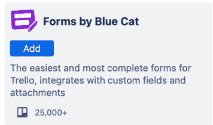

Figure 13.1 – Forms by Blue Cat card in the Power-Up directory

Click the **Add** button on the Forms by Blue Cat card. You’re now ready to create your first form!

## Creating a form

If you’ve just added the Power-Up, you’ll be immediately directed to the home page and should see a button called **Create form**. Click that to get started. If you went back to your board after adding the Power-Up, you’ll need to click the **Blue Cat Forms** button in the top toolbar of your board.

Once you arrive in the form editor, you can customize your form to suit your use case.

## Card Fields 设置

- Due Date
- Start Date
- Labels
- Attachment

## Description Fields 设置

- Text
- Dropdown
- Multi Select

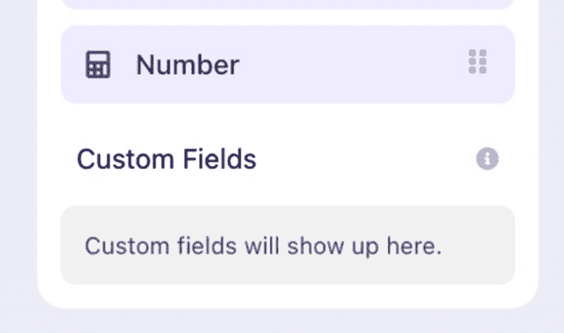

Figure 13.2 – New form options

Start by naming the form something that makes it clear what the form is about. For instance, you might name it **Request a feature** if you’re planning to collect feature requests. In my case, I called mine **Dear Taco** because that’s the name of my newsletter section where I solicit reader questions and answer them (Shameless plug to subscribe if you haven’t already: trello.substack.com/).

## Adding and customizing a field

Next, drag the fields from the left-side panel into the middle of the page to create a field with that type. I’ll drag a text field first since I want to collect a subscriber’s name or nickname to reference in the answer. (It’s fun seeing what people submit for this... my current favorite is **How I Trello’s #1 Fan!**).

Click the newly added field to configure it.

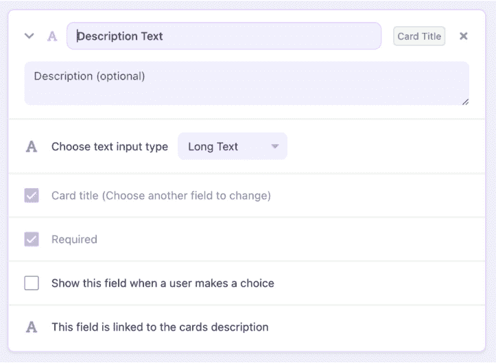

Figure 13.3 – Field options

We’re going to change the field name from **Description Text** to **Name**. I’m also going to update the **Description** field to let folks know that they don’t have to actually provide their real name. Give any additional context you want for your field, such as examples or helper text to clarify what a user should put in the field.

Next, adjust the way the field text works by selecting **Long Text** and changing it to a specific type of text that you’re expecting, such as **Email Address** or **Short Text** if you want to take up less space.

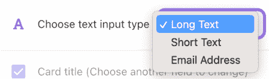

Figure 13.4 – Text input types

By default, the first field added to your form will have the **Card title** field checked since each card must have a name. Once you add more fields, you can select that checkbox in another field to make that field’s value the title

of the card. In my case, I actually do want to keep the subscriber’s moniker as the title, so this is fine.

Next, you’ll decide whether this field is optional or required, and finally, you can choose whether you want to apply conditional logic to a field. This will only show this field if the person filling out the form has provided a specific value in another field. For example, if you use this form to collect shipping info, you might only show a **State** field if someone has chosen **United States** in the **Country** field.

The last section shows where the info from that field will be sent when someone fills out the form. You can’t change this, but if you want to send information to another section of the card, just choose a different field type. For instance, if you want to map the text to a custom field, look on the left-side panel at the field options and you’ll see **Custom Fields** as a field type to drag over. Any responses to that question on the form will be added to that custom field.

## Card Fields 映射

- Due Date
- Start Date
- Attachment

## Description Fields 映射

- Text
- Dropdown
- Multi Select
- Number

## Custom Fields 映射

- Reason

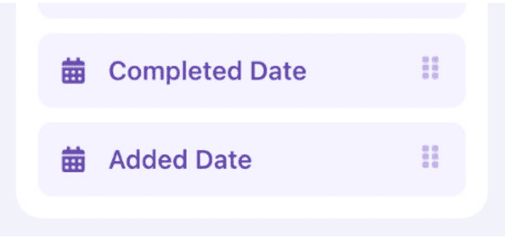

Figure 13.5 – Field types

You can add as many fields as you want to your form. And the best part, you can make those fields map to different parts of the card instead of just the description and custom fields!

## Mapping fields to other parts of a card

I like to give folks the opportunity to share screenshots when they ask their Trello questions in case that helps clarify the question. To do this, I just drag over the **Attachment** field type and update the name and description. Just be aware that attachment fields are a paid feature that is only available on Basic and higher Forms by Blue Cat plans.

You can also map form answers to labels or dates. This is helpful if you want to ask users to respond with a date, which will set the due date of the card, or if you want to sort out what type of request it is and allow users to choose from labels.

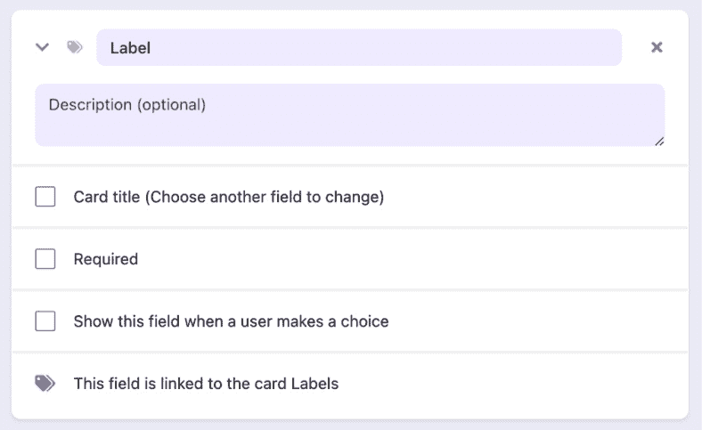

Figure 13.6 – Field options for Forms by Blue Cat

Just keep in mind that if you use labels, this means the options for that question will be all the available labels on the board. You cannot select a subset of labels. If you want to provide a subset, it’s better to just use the **Dropdown** or **Multi Select** field type and then use automation rules to update the label based on text inside the card description.

## Form settings

After you’ve added fields, scroll back to the top of the form and click the **More Settings** button next to the form name.

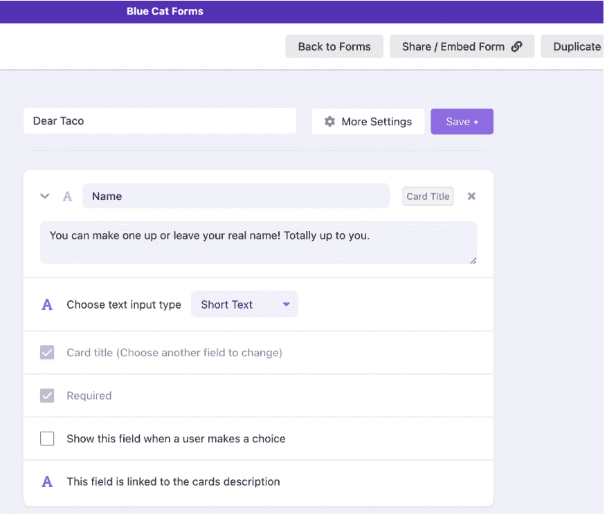

Figure 13.7 – Title and more settings for Blue Cat Forms

This is where you can customize the experience of the entire form, instead of just specific fields. If you want to make your form stand out, you can add custom branding, though this will require you to be part of the Forms by Blue Cat Pro plan.

By default, new responses to the form will create cards in the first list on the board, but if you’d like to change it to another list, just select it from the dropdown.

To make your form extremely clear, set the introduction and thank you messages. Introduction messages will be shown above the form, while thank you messages will appear after the form is submitted.

## Introduction Message

This is the first thing someone sees when viewing your form, you can use this to explain what the form is for. You can use [Markdown](https://www.markdownguide.org/) for styling.

Struggling with something in Trello, or just have a question about how something works? Submit it here and each week I'll pick a question to answer and feature in my newsletter!

## Thank you Message

This is the thank you message someone sees after submitting your form. You can use [Markdown](https://www.markdownguide.org/) for styling.

Thanks! Make sure you're subscribed to the [How I Trello newsletter](https://trello.substack.com/) and be on the lookout for new questions answered each week!

If you need any more immediate or specific Trello help, check out these additional resources:

- [My Trello Help Services](https://www.buymeacoffee.com/brittanyjoiner/extras)
- [Peruse my Trello videos on YouTube](https://www.youtube.com/c/brittanyjoiner)
- [Hire a Trello consultant](https://community.atlassian.com/t5/Trello-articles/Trello-Consultants-Right-Here-In-The-Community/ba-p/1983694#M1677)
- [Atlassian Community](https://community.atlassian.com/t5/Trello/ct-p/trello)

Figure 13.8 – Introduction Message and Thank you Message options

These allow you to give more context to your form so folks can fill it out appropriately. It’s also great for giving more information and actions after filling out the form. I use **Thank you Message** to tell my readers about my YouTube channel and also point them to places to get more help with Trello, such as the Atlassian Community.

Lastly, you can change the submitted text to anything else you’d like. It would probably be more fun to change mine to say **Ask Taco!** rather than **Submit**, so I’ll go ahead and change that.

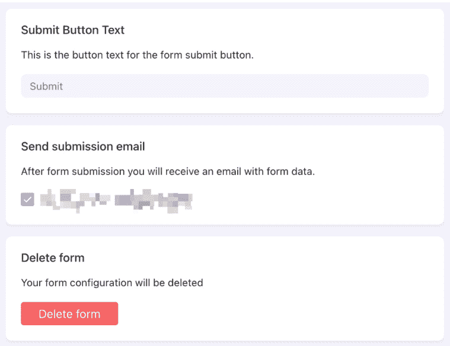

Figure 13.9 – Blue Cat form options

You can also choose to get an email notification when a new response has been submitted. I like to use this as another way to keep track of when requests or submissions have been made.

Once you’ve added your fields and customized your form options, click **Save** at the top of the page, and you’re ready to start sharing your form with the world!

## Sharing a form

Each form lives at a special link that anyone can access. They don’t even need to have a Trello account! To view this link, click the **Open Form** button in the top-right corner of the form you’re viewing or editing.

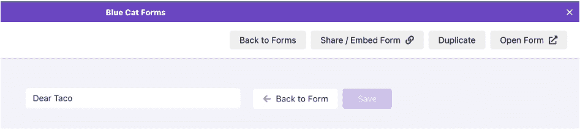

Figure 13.10 – Blue Cat Forms nav bar options

A new tab opens with your form. Double-check that it looks as expected, and if it doesn’t, go back to the other tab with the form and make any changes.

## Dear Taco

Struggling with something in Trello, or just have a question about how something works? Submit it here and each week I'll pick a question to answer and feature in my newsletter!

### Name * 字段

You can make one up or leave your real name! Totally up to you.

### Tell me more about your struggle or question with Trello. * 字段

### Attach any relevant screenshots if needed 字段

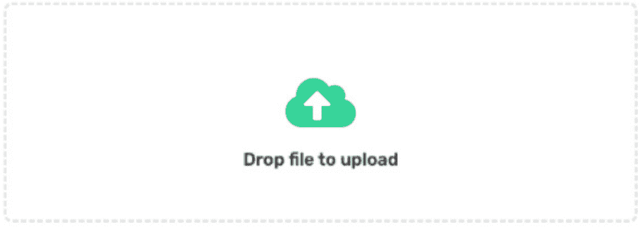

Ask Taco!

Figure 13.11 – Example Blue Cat form

Notice the link in the URL bar. You can copy that link from this page, or you can go back to the form options and select the **Share / Embed Form** button to open a modal with more sharing options, including the link.

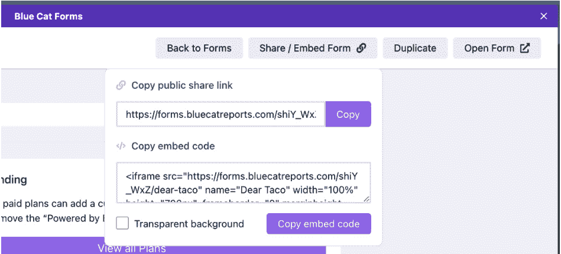

Figure 13.12 – Share options for a Blue Cat form

Copy the link, or use the code snippet to embed the form on your website, or anywhere else that displays iframes.

## Testing a form

There’s one more thing to do before sharing your form with the world! If you’ve read the previous chapters, you’ll know I’m a big proponent of testing as we go. Let’s test out our form.

Go to the share link and fill out the form. After submitting, return to your Trello board and confirm that you have a new card in the list you expected, and that all the information is mapped to the fields you wanted.

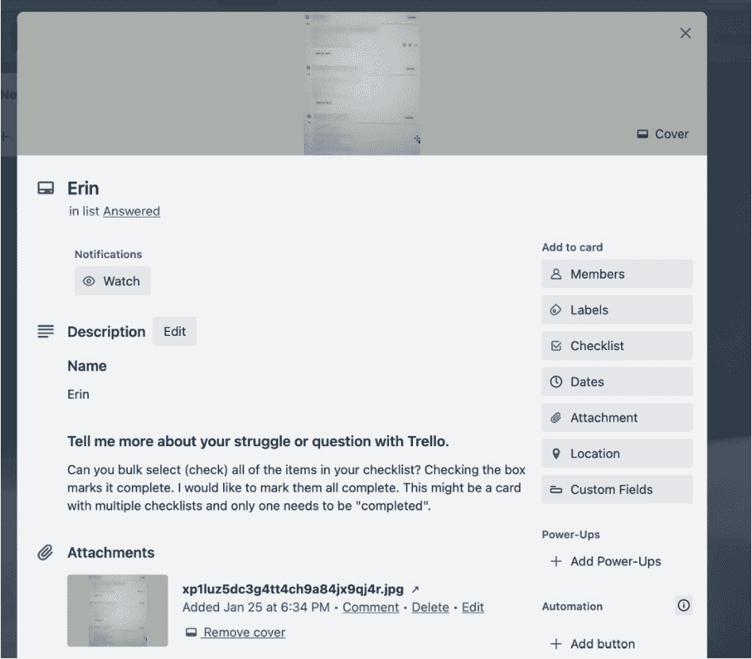

Figure 13.13 – Card created from form submission

If you need to make any changes (now or later), you can always go back to your form by clicking the **Blue Cat Forms** button at the top of your Trello board's toolbar and selecting the edit icon to the right of the form name.

Figure 13.14 – Blue Cat 表单列表

这也是快速获取表单分享链接的好地方。

现在你已准备好将表单分享给全世界，并尽可能快地将信息导入 Trello！

## Unito

尽管我希望每个人都使用 Trello，并且我也尽了最大努力，但我就是无法让全世界的人都接受它（双关语）。所以，你可能也做不到（_虽然如果你做到了，那会让我的生活更轻松，所以提前感谢 🙏_）。即使你能让每个人都使用 Trello，你也永远无法让每个人都使用同一个看板。正因如此，Unito 登场了，旨在让每个人都满意，并字面意义上将所有内容汇集在一起。

Unito 提供许多 Power-Up，但其核心是一家同步公司，可与许多工具集成，例如 Trello、GitHub、Monday.com、Asana、Jira，甚至 Google Sheets，帮助你保持所有任务同步，同时允许每个人在自己的空间中工作。它甚至可以将 Trello 看板彼此集成！

它不是免费的，而且说实话，它甚至不便宜（目前，基础功能和每月同步 150 个项目的计划起价为每月 30 美元）。但你可以获得 14 天免费试用来测试它，并确保它适合你的用例，如果你正在寻找一种快速简便的方法来同步多个工具或 Trello 看板，你将找不到比它更好的工具或替代方案！

## 为什么使用 Unito？

Unito 是一个很棒的工具，因为我们永远不会都在同一个地方工作。Unito 让你将任务保留在 Trello 中，同时你的工程团队在 GitHub 中工作，你的产品团队在他们想要的任何工具中工作；无论更改发生在何处，Unito 都会保持所有内容更新。如果在一个 Trello 看板的卡片上更新了标签，你可以将该更改镜像到另一个看板上的同一张卡片，甚至另一个工具，例如 Notion！

你可以用 Unito 做很多事情，我无法在本章中全部介绍。我们将介绍连接 Trello 和 Notion 的示例，因为这是我最近一直在探索的事情，无论你将 Trello 与什么连接，即使只是另一个 Trello 看板，你都将遵循类似的流程！

要开始使用 Unito，你可以直接访问他们的网站，也可以通过 Power-Up 目录搜索 Unito 或你想同步的工具来找到它们。

Figure 13.15 – Power-Up 目录中的 Unito 卡片

我正在搜索 Notion，因为那是我想与 Trello 同步的工具。添加 Power-Up 后，是时候创建你的 Unito 帐户并设置你的流程了！

我更喜欢从 Unito 的网站而不是通过他们的 Power-Up 来设置流程。你也可以这样做，这样就不需要将 Power-Up 添加到你的看板中。如果你想这样做，请前往 [unito.io/](https://unito.io/) 并创建一个帐户。你甚至可以使用你的 Trello 帐户注册！

## 创建流程

流程连接两个工具以使它们同步。从 Unito 仪表板（登录或创建帐户后到达的主页面），点击 + **创建流程** 按钮。然后，系统会提示你连接你的工具。

## 连接工具

流程是连接你的工具并保持数据同步的东西。创建流程的第一步是连接你想要统一的工具。

**首先选择你想要连接的工具**
你可以连接两个不同的工具，或者连接同一工具中的工作。

Sync work in [Trello] ▼
with the account [Brittany Join...] ▼
of the type Card
in the [Board] [Notion Sync] ▼

+ Sync work in [Notion] ▼
with the account [+ Choose account] ▲
[Connect a new Notion account]
No results

Your data is s
When connecting credentials are er

Figure 13.16 – Unito 帐户配置

这个连接器非常易于使用。只需点击每个下拉菜单来选择工具、连接帐户，并根据工具选择要同步的看板、项目或数据库。

我选择了一个特定的 Trello 看板，我想将其与一个 Notion 数据库保持同步。我从未连接过我的 Notion，所以系统提示我点击下拉菜单中的 **连接新 Notion 帐户** 按钮。

我以 Notion 为例，但你可以从 30 多个集成中选择。查看完整列表请访问 [unito.io/connectors/](https://unito.io/connectors/)。这是一个类似的过程：连接你的帐户、授予权限，并选择确切的空间，例如仓库、看板或项目。

对于我的 Trello 和 Notion 同步，我的设置如下。

## 首先选择你想要连接的工具

你可以连接两个不同的工具，或者连接同一工具中的工作。

Figure 13.17 – Trello 和 Notion 的示例 Unito 流程配置

配置完成后，点击 **确认** 按钮。

## 选择你的流程方向

下一步是配置卡片同步的方向。你可能希望双向同步，这意味着任何空间中的任何更改都会反映在另一个空间中。

下一步是配置流程方向，它控制新项目在哪里创建。在双向流程中，当你在 Notion 中创建新行时，Unito 会自动创建新的 Trello 卡片，反之亦然。

如果你只想将工作项从一个工具推送到另一个工具，你会创建一个单向流程。因此，从 Trello 到 Notion 的单向流程将在你创建新 Trello 卡片时让 Unito 创建新的 Notion 行。即使使用单向流程，你仍然可以在两个工具中获得更新！这是因为此步骤仅控制_新_项目在哪里创建，而现有项目的任何更改仍将双向同步。

如果是这种情况，你只需将箭头指向你_确实_希望更改同步的方向即可。

## 选择你的流程方向

默认情况下，卡片和页面将在你的工具之间双向流动。如果你只希望卡片在 Trello 中创建或页面在 Notion 中创建，你可以在此处更改此流程的方向。无论你在这里选择什么，稍后都可以调整该行为以更好地反映你的工作方式。

Figure 13.18 – 在 Unito 中设置流程方向

我希望 Unito 同时创建 Trello 卡片和 Notion 行，因此我将保留默认的双向箭头。

当你准备好进入下一步时，只需点击 **确认**。这会带你回到流程页面。在配置的下一部分，选择 **继续** 按钮。

## 选择同步的内容

如果这感觉很多，请记住，对于大多数情况，你可以直接点击这些设置，因为默认值通常就是你想要的！我们逐步介绍这些步骤是为了向你展示你可用的选项，以防你想要自定义并做一些特定的事情。

在此步骤中，你可以筛选要同步的卡片（或问题、页面或其他项目，具体取决于你连接的应用程序）。如果你只想将自己的卡片同步到另一个看板或工具，而不是所有卡片，你可能会选择这样做。

为此，你会点击 **添加新规则** 来指定你只想同步来自你拥有的另一个项目的任务。

Figure 13.19 – Unito 中的同步规则

你还可以按其他条件筛选，例如仅同步在特定时间创建或带有特定标签或属性的卡片。

默认情况下，你的流程只会从当前日期开始同步卡片，不会追溯应用于先前创建的卡片。如果你希望它应用于现有卡片，你需要点击垃圾桶图标以删除默认的创建日期筛选器。

Figure 13.20 – 在 Unito 中同步现有卡片

一切就绪后，点击 **确认** 进入下一阶段，然后再次点击 **继续** 以指定源之间流动的信息。

## 指定流动的信息

我们快完成了！我知道看起来有很多选项，但在许多情况下，你将不再需要进入 Unito，你的工具将像魔法一样协同工作。

这是最后要配置的部分，因为我们将在此处指定不同字段如何相互关联。

Unito 为你提供两个选项：你可以使用自动映射功能，或者 **从头开始** 手动映射字段。在大多数情况下，自动映射功能效果很好，并且确切知道哪些字段应该映射，因此我（以及 Unito）建议你首先选择该选项。你随时可以自定义

mapping afterward if anything is incorrect, but this gives you something to start with. Click **Auto map my fields**.

If it doesn’t guess them perfectly, or if you want to change them, you can click the **+ Add mapping** button at the top and create a new map between fields. For instance, I want the title of my Trello card to map to sync to my task name in Notion.

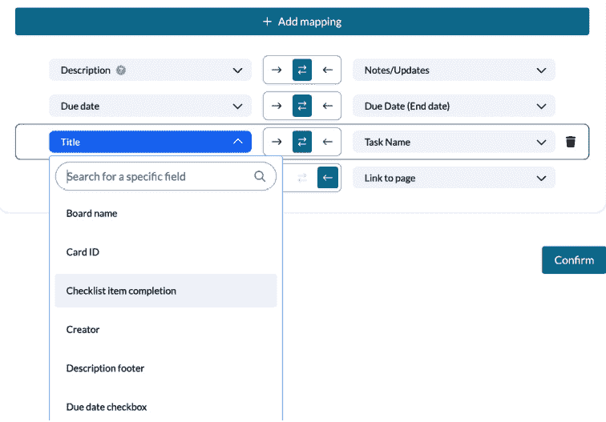

Figure 13.21 – Mapping fields between Trello and Notion with Unito

You can map any other fields you want or remove any mappings by clicking the trash icon at the end of the row. You can also pick the flow direction at the field level here. So, if you only want updates to go in one direction, you can pick a one-way arrow from the source tool to the tool where updates will happen. Usually, you’ll want to keep most field mappings two-way, since this is where Unito really shines. Once you’re done, click **Confirm**. Then, you’re ready to move to the very last step!

## Launching your flow

Now it’s time to launch your flow and watch the magic unfold. Click **Continue** from the flow setup page, then name your flow and confirm you’re ready to start syncing.

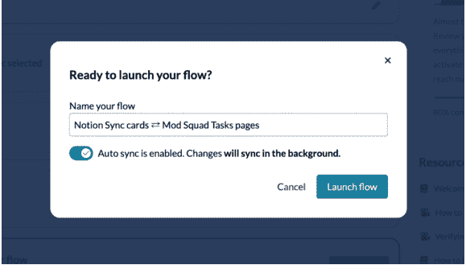

Figure 13.22 – Naming and launching a flow in Unito

Leave auto sync enabled to continuously sync cards. You’d only turn this off if you wanted to do a one-time sync across tools, or manually go into Unito each time you want information to sync.

Click **Launch flow** when you’re ready.

You’ll see a notification that the syncing is happening! It might take a few minutes, but you should see new cards flowing into your board soon.

## Testing a flow

Head to your Trello board and you should see data from your connected source in your board! Now make an update to a card, and check that it’s reflected in the other tool or board.

If anything looks off or you need extra help, reach out to the Unito support team by clicking the chat icon in the bottom-right corner of the Unito dashboard.

Now you can make everyone happy and let them work in the tools they work in!

## Summary

Wow, Trello Power-Ups are the gift that keeps on giving! Who knew you could do so much with them? And we’ve only explored a handful so far! Check out Blue Cat Reports’ Power-Up directory, which is updated every month with any new free Power-Ups: bluecatreports.com/free-trello-powerups/.

Now you can get information into your Trello boards from anywhere, even from people who don’t have a Trello account. You can also sync your board with other boards, or even other tools entirely, such as GitHub, Notion, Monday.com, Jira, and Google Sheets.

Now it’s time to wrap up our Power-Up journey by discussing the next biggest Trello topic I’m asked about: reporting.
