## Reporting in Trello

You’re almost ready to conquer the world with Trello. But I can’t leave you without discussing your options for reporting in Trello. There are multiple Power-Ups and tools that are available. In fact, you might use several together. Maybe my next book will be all about reporting in Trello, because it’s a very deep topic.

But for now, time is limited and we’re coming to the end of this book, so I’m going to touch on the three that I am most familiar with and help you understand how to decide which ones are right for you and your team.

In this chapter, you’ll learn how to do the following:

- Build lists with more advanced filtering options
- Create charts showing the progress of a project over a month
- Estimate when a project will be complete based on your team’s historical performance

You might expect things like that from a spreadsheet, but now you’re about to learn how to do it from Trello, too! Let’s start with the easy-to-use yet powerful option that fits most use cases.

## Blue Cat Reports

Blue Cat Reports is like Trello tables but way more customizable, and it gives you charts. That’s the simplest way to describe it, but it’s very powerful.

Remember when we talked about creating workspace tables in Trello views back in Chapter 4? While that’s pretty cool, it’s a bit limited. You can only include up to 20 boards, which works for many people, but others have a lot of boards that they need to combine. Trello views allow you to filter by lists, labels, and due dates, but you can’t filter by custom fields, and you also can’t even display those fields in the table!

Blue Cat Reports solves this and also gives you the opportunity to make charts to show meaningful trends and information about what’s happening in your Trello boards. The best part is that it’s really easy to get started with and configure. You don’t have to set up any mapping to get started, and you’ll go through a helpful list of options that walk you through setting up the chart you need.

## Who is Blue Cat Reports best for?

Of course this is just an opinion, so make sure to look at multiple tools and do your own research, but I’ve found that Blue Cat Reports is best for teams that need a lightweight and quick-to-configure reporting solution. If you want to see what’s been completed, what’s coming up, create custom tables of cards, and aggregate information about those cards, Blue Cat Reports is going to be great.

For most teams, I actually think Blue Cat Reports is a great fit because it covers most of what you will likely need in terms of reporting, and it’s affordable and incredibly easy to use. Seems like a no-brainer for most teams!

One thing to note: even if you’re the only person using Blue Cat Reports, you’ll be charged for each person in your workspace. Although it might seem strange, if you think about it, it makes sense because Blue Cat Reports is collecting that data from each person’s profile and activities in Trello to aggregate the data for you.

## Adding reports to your board

From any board, head to the Power-Up directory and search for the Reports by Blue Cat Power-Up. It doesn’t matter which board you want to use; you’ll be able to choose any board you have access to from inside the Reports by Blue Cat Power-Up. But for now, feel free to stick with the data board that you just made or copied.

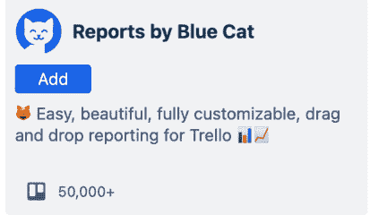

Figure 14.1 – Reports by Blue Cat Power-Up card

Once you’ve added it, head back to your board and click the Blue Cat Reports button in the top toolbar. You’ll be prompted to create an account, and then your 7-day free trial will begin.

Let’s take a look at what we can do.

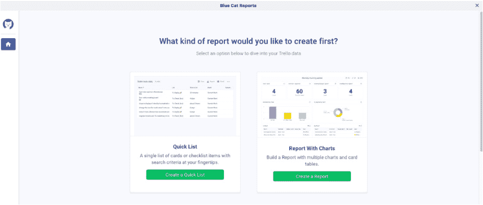

Figure 14.2 – Blue Cat Reports home page

From the home screen, there are two buttons with actions. We can create a quick list or a report.

## Quick lists

Remember when I mentioned super-advanced Trello tables with more fields and filters than you could imagine? That’s what quick lists are! I actually find these to be even more useful than the reports, because I can set a list of criteria and quickly access the specific cards that fit those criteria. It also counts the cards and sums any number fields, such as time spent or expected effort.

You can even look at checklist items across multiple boards and multiple people, which is pretty much impossible to do any other way.

Making a quick list is easy peasy. Click **Create a Quick List**. Blue Cat prompts you to name the list, decide whether you want to show cards or checklist items, and then choose the boards you want to look at. You can select as many as you want.

I’m going to name my list `Product Launch Tasks This Week` and only include that board for now.

## Create a new list

Name of the list

Product Launch Tasks This Week

Show Cards or Checklist Items

- Cards
- Checklist Items

## Boards

Which boards would you like to use data from?

All Boards

1 board selected. 141 hidden

product la

Select all

Save

Figure 14.4 – Modal for creating a new quick list

Click **Save**, and now it’s time to look at the filters we have! At the start, it’s going to pull all the cards from your selected boards. You can see the total number of cards next to the list name.

We want to show tasks that are due this week though, so let’s dig into these filters on the left-hand side.

Figure 14.5 – 带有筛选选项和视图按钮的快速列表（已高亮显示）

前往 **到期日期** 部分，你将看到日期筛选选项，这些选项比 Trello 原生的日期筛选选项更高级。

我将点击 **本周**，然后按 **保存**。这样卡片数量将从 30 张减少到 7 张，并显示我本周需要关注的重点。但我们不必止步于此。我想查看本周的个人待办事项列表，因此现在我将前往成员筛选器，并在我的名字旁边点击。

我将点击 **保存**，并看到我的列表已缩小，仅显示本周的五项任务！我可能还会添加一个标签筛选器，因为我不想看到当前被阻塞的卡片，因为我无法对它们采取行动。

现在，我可以看到有哪些任务，但也许我想了解本周特定任务的更多信息。点击表格上方右上角的 **视图**，你将能够决定每张卡片要显示哪些属性。

Figure 14.5 – 快速列表表格的列选项

请注意，你可以访问 Trello 中的所有核心字段，正如你所期望的那样，例如列表和看板、日期和成员等等。但你还可以查看 **列表停留时间**，以及你设置的任何自定义字段。我喜欢使用我创建的 **预计工作量** 字段，因为我可以查看本周的计划是否现实，或者回顾上周完成的任务，看看我完成了多少。查看 **优先级** 也很有帮助，这样我就能确定从哪里开始并集中精力。

Figure 14.6 – 带有字段总和的筛选快速列表

我现在有了一个方便的表格，显示本周的进展情况，最棒的是，每周它都会更新以检查当周的卡片。我可以按任何一个字段对表格进行排序，例如 **优先级**。我还可以点击任何卡片的名称，在新标签页中打开该卡片。我甚至可以导出看板或通过电子邮件发送，或者前往 https://app.bluecatreports.com/ 并进入列表，获取一个始终直接指向该列表的特定 URL。

这只是使用快速列表的一种方式。你还可以为以下内容创建快速列表：

- 查看过去一个月完成的任务，按团队成员排序
- 创建来自多个看板且正在等待审核的项目列表
- 列出过去一个月创建且标记为功能请求的所有卡片，以及完成它们的预计工作量
- 使用这些列表有很多种方式，但我们开始讨论完成了多少工作，并查看优先级任务的数量，因此是时候前往报告并获取一些可视化内容来回答我们的问题。

## 报告

你将使用报告来显示一个或多个看板中项目的高级概览。它有助于显示诸如完成了多少工作，或者你是否在队友之间均匀分配任务等内容。你还可以查看工作耗时，识别移动缓慢的卡片，并跟踪看板上的其他趋势。只需付出一点努力，你就可以使用它来创建像这样的自定义报告。

Figure 14.7 – 创建自定义报告

让我们通过一个示例，了解如何创建一个简单的报告，显示完成了多少工作，以及我们可以创建哪些不同的图表来查看这些内容。

点击左上角的 **主页** 图标返回 Blue Cat 的主页。点击右侧面板上写着 **创建报告** 的按钮。系统会要求你为报告命名。此时，考虑你将在何时使用该报告，并以此命名会很有帮助，例如 **周一早上站会** 或 **月度看板评审**。所以，如果你能想到一个合适的名称，就选择它；或者，如果你愿意，也可以随意将其命名为 **测试报告**。现在，点击 **保存**。

接下来，你需要点击 **创建图表**。你现在将看到可以选择的各种图表类型。本书并非关于图表和任务报告的整体内容，而是关于如何在 Trello 中完成这些操作，因此我不会在此深入探讨，但如果你需要帮助确定使用哪种图表，随时可以询问 Blue Cat 报告团队或在 Atlassian 社区发帖。

## 图表类型

你想在报告中添加什么类型的图表？

### 列表和计数

**列表**  
在报告中显示卡片或检查清单项目的列表

**计数、求和或平均值**  
项目的简单计数，或自定义字段值的求和/平均值

### 饼图和柱状图

**饼图**  
按成员、标签、列表停留时间等显示数据分解

**柱状图**  
按成员、标签、列表停留时间等显示卡片分组分解

**堆叠柱状图**  
按两个维度分组的柱状图

### 日期图表

**历史图表**  
显示卡片随时间变化的折线图

**日期图表**  
显示卡片与其到期日或其他日期字段的折线图

### 时间图表

**完成时间图表**  
查看卡片完成所需时间、整个流程或单个步骤

Figure 14.8 – 图表类型选项

我将选择 **历史图表**，因为我想显示工作随时间完成的情况。如果你选择了错误的图表，可以点击 **返回** 按钮进行更改，也可以稍后进行编辑。

Figure 14.9 – 显示内容页面

选择图表后，你将经历一系列问题来帮助配置图表。这些问题非常清晰，例如 **你希望图表的大小是多少？** 和 **你希望图表中显示什么？** 副文本提供了更多说明，例如解释哪些卡片符合每个选项。例如，你可以指定 **未完成卡片** 或 **已完成卡片**。然后，你将选择要在哪个看板上查找卡片。

这里我们将选择 **已完成卡片**，因为这是我们想在该图表中显示的内容。接下来，我们选择卡片完成后移动到的列表，Blue Cat Reports 正是通过这种方式知道卡片何时完成以及完成时间，用于你的报告。

## 已完成列表

你的已完成卡片在哪些列表中？

搜索看板...

已选择 1 个列表。

- [ ] 积压
- [ ] 待办
- [ ] 进行中
- [ ] 最终审核
- [x] 完成

Figure 14.10 – 已完成列表

接下来，我们可以选择为历史图表使用单条线来显示按日期完成的所有卡片，或使用多条线显示按成员、标签等完成的卡片。我们这里将选择 **无（单条线）**。

## 数据分解

我们将为分组中的每个选项绘制一条单独的线

- [x] 无（单条线）
- [ ] 成员
- [ ] 标签
- [ ] 列表
- [ ] 优先级

Figure 14.11 – 数据分解

你可以从成员、标签、列表或你创建的大多数自定义字段中进行选择。

你甚至可以选择 _如何_ 衡量已完成的内容。这是我最喜欢的功能，因为我可以实际跟踪完成的工作量，而不仅仅是卡片的数量！并非每张卡片代表相同的工作量！写一篇博客文章比发送一封电子邮件花费的时间长得多，但两者可能都只是一张卡片。通过创建名为 **实际工作量** 的自定义字段，我可以为每张卡片分配一个数字，表示卡片中的工作量级别，然后对给定时间内完成的所有卡片的值求和（或求平均值）。

Figure 14.12 – 计算卡片或自定义字段值

最后，你可以选择是否按另一个属性筛选卡片。我们这里将选择 **显示所有卡片**，因为我们想显示所有已完成的卡片。

## 筛选卡片

你想应用筛选器吗？

显示所有卡片  
在此图表中包含所有卡片

筛选卡片  
仅显示符合你选择条件的卡片

Figure 14.13 – 筛选卡片

如果你显示的是未完成卡片（例如，用于显示团队成员分配了多少张卡片的图表），你可能希望按列表筛选，仅包含你关心的列表。你还可以为 Trello 中的任何数据以及列表停留时间添加筛选器，后者可用于查找在特定列表中停留时间超过预期的卡片。

将图表命名为类似 **已完成卡片** 的名称，然后点击 **保存** 来查看你的图表！最初，你仍将处于编辑模式，点击右上角的 **保存报告** 以查看图表的所有功能。

Figure 14.14 - Blue Cat Reports 已完成卡片的历史图表

你可以使用图表右上角和右下角的控件来选择要显示的日期和时间段，这里我们显示的是每周数据，但可以快速更改为每日、每月等。你可以在报告中构建任意数量的图表，在左上角你将有选项选择期间和精确日期，这些设置将应用于看板上的所有图表，从而无需逐个更新每个图表。

下一步是添加更多图表。如果你对已完成的卡片感兴趣，可以通过类似的过程为以下内容添加图表：

- **按成员划分的已完成卡片**：这是一个条形图，与历史图表的设置相同，按成员细分。
- **按优先级划分的已完成工作量**：这是一个条形图，设置再次相同，按优先级自定义字段细分，但使用工作量字段生成总计，而不是卡片计数。
- **工作完成所需时间**：这是一个**完成时间**图表，与上面的历史图表设置相同。

这里我们看到一个**按优先级划分的已完成工作量**条形图示例：

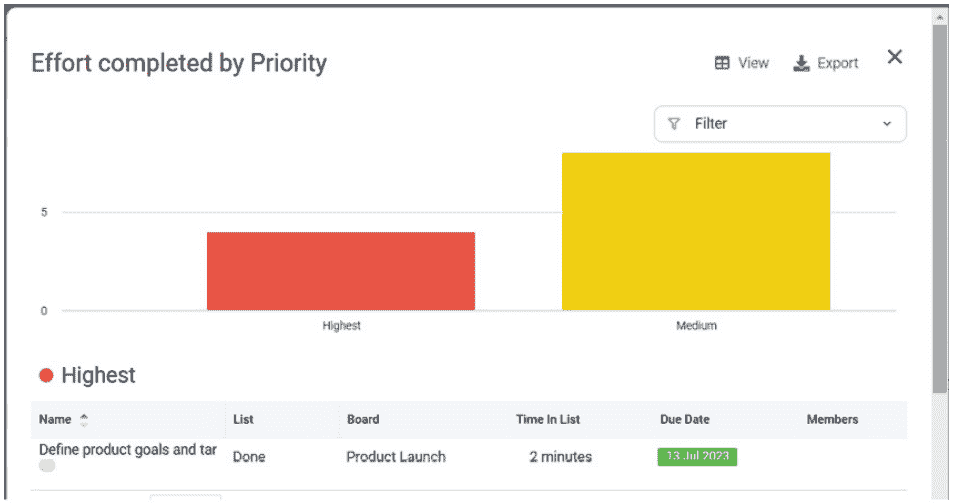

图 14.15 – 按优先级划分的已完成工作量条形图

条形图（以及大多数图表）可以通过点击标题进行钻取以获取更多信息。这里我们看到**按成员划分的已完成**条形图的钻取。我们可以进一步筛选数据，查看实际完成的卡片，并在需要时导出数据。

在报告的右上角，你将有与快速列表中相同的选项，可以**导出**和**发送邮件**报告。你还可以**编辑**报告，这对于添加或删除图表以及通过拖动图表来重新组织页面很有用。

使用报告，你现在可以回答关于工作流程的关键问题，例如：

- 卡片在每个列表中花费的平均时间是多少？
- 我们在高优先级任务上花费的时间足够吗？
- 工作量在队友之间分配均匀吗？
- 未来几周计划了多少工作？
- 哪些卡片在特定列表中停留时间过长？
- 随着时间推移添加了多少卡片？
- 将所有这些发送给你或你团队中的任何人，按照你定义的时间表。

还有更多！现在让我们谈谈另一个你可能用于报告和项目管理的工具。

## Placker

虽然我认为蓝猫报告对于大多数用例已经足够好，但有时你需要更多，或者需要从多个地方获取数据，例如 Jira 看板。为此，你会想要尝试一个更强大的工具，例如 Placker。我说更强大是因为它提供时间跟踪和更多卡片数据等功能，包括预算、工作量和时间的预估与实际字段。

Placker 的其他好处包括更多项目规划工具。如果你在寻找甘特图或更高级的时间线项目，你可能会想要使用 Placker。

如果你无法让团队中的每个人都使用 Trello，Placker 也很有用。喜欢使用 Trello 的队友可以轻松在应用程序中工作，但不喜欢使用 Trello 的其他人可以轻松在 Placker 应用程序中操作，它从 Trello 看板中读取所需的一切，并为卡片提供更多视图。

它还很好，因为如果你的 Trello 看板中有 50 人，但只有一个人需要查看仪表板，你可以只为那一名成员支付 Placker 费用，而不需要为所有 50 名成员付费。这很不错，因为通常对报告感兴趣的人远少于在 Trello 看板中活跃的人。

## Placker 最适合谁？

我建议如果你正在与许多利益相关者和多个项目合作，并且不仅仅是寻求对 Trello 卡片的报告，而且还在寻找更强大的项目规划工具，那么使用 Placker。特别是如果你有多个项目或不同的团队正在进行中，你会欣赏可以设置的不同视图和组，同时允许需要的人将所有内容集中在一个地方。如果你是大型企业公司的一部分，希望在团队之间使用标准化（和定制）的仪表板，你可能也会对 Placker 感兴趣。Placker 允许这些团队创建显示所需内容的仪表板，然后在不同的看板和看板组之间重复使用这些仪表板。

如果你是一个单人团队，你可能会发现 Placker 超出了你的需求，不值得花费配置时间。

虽然 Placker 提供了一些惊人的功能，但权衡是它不会像设置蓝猫报告那样快速和容易。还有更多按钮和需要点击的东西，这在最好的情况下会分散注意力，在最坏的情况下会令人困惑。但不用担心，它仍然很轻松，你有一个向导（就是我！）来带你四处走走，帮助你熟悉环境。

此外，你可以获得免费的 15 天试用期，团队非常乐于助人并愿意提供帮助，所以没有理由不试一试！

## 开始使用

要开始使用 Placker，将 Placker 项目 Power-Up 添加到你的看板。你可以通过在 Power-Up 目录中搜索 Placker 来找到它。

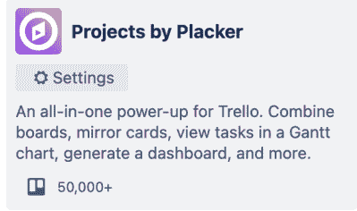

图 14.16 – Placker 项目 Power-Up 卡片

添加 Power-Up 后，**Placker 注册**按钮将在看板上可见：

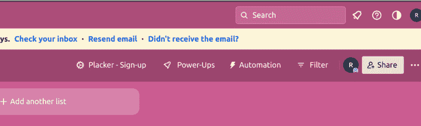

图 14.17 – 工具栏中的 Placker 按钮

从工具栏点击 **Placker - 注册**，你将被提示接受隐私条款并完成注册。注册后，你需要导入要使用的看板。

当看板导入 Placker 后，Power-Up 设置页面将自动可用，以便你可以进行看板设置的下一步：映射你的看板。

## 映射看板

一旦连接看板，你需要配置一些关于看板的设置，以帮助 Placker 发挥最佳功能。

你可以通过点击工具栏中的 **Placker 项目**按钮并选择 **编辑 Power-Up** 设置来完成此操作。

这将直接打开相关的 Power-Up 设置，并帮助你设置跟踪、日历和其他相关设置。你也可以从另一个看板复制这些设置，所以一旦设置好，你就不需要再做一次！

## Placker 设置

### 进度跟踪

通过自动跟踪进度，了解卡片完成情况。在此看板中，进度是**手动**跟踪的。点击更改设置以按列表或标签设置跟踪并自动跟踪进度。

### 镜像规则

使用镜像规则在看板之间自动移动、复制或镜像卡片和检查清单项目。此看板有 **0** 条规则。

### 日历

日历设置决定卡片的计划方式。此看板使用 **欧洲/阿姆斯特丹** 时区。此看板的工作日是 **星期一、星期二、星期三、星期四和星期五**，时间为 **上午 9 点到下午 4 点**。已设置 **0** 个。

### Trello 看板/卡片设置

#### Trello 看板功能

显示看板按钮以优化与 Placker 的工作流程。**甘特图、跟踪、看板**可见。镜像规则按钮是**可见**的。设置按钮是**不可见**的。

#### Trello 卡片功能

显示卡片按钮和其他属性，以有效地计划、跟踪和报告你的卡片。**镜像、依赖项、Placker 属性和在 Placker 中打开**已**启用**。

### 从另一个看板或模板复制设置

通过从另一个看板或 Placker 模板复制设置到此看板，使你的工作方式在看板之间保持一致。

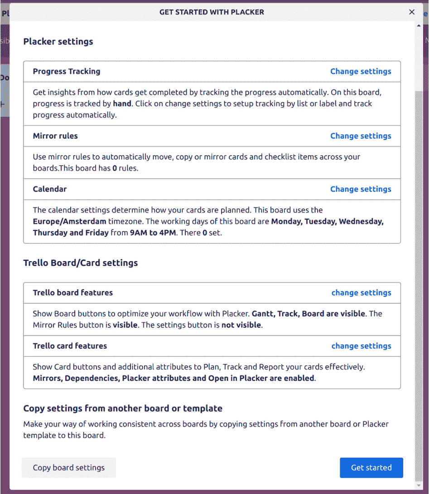

图 14.18 – Placker 配置设置

最重要的设置之一是进度跟踪，它帮助 Placker 了解你如何在看板中跟踪任务状态。

点击任何设置旁边的 **打开**，或选择左侧面板上的另一个部分以调整更多设置。最重要的设置是 **进度跟踪** 部分。

### 进度跟踪

当你告诉我们如何在看板上跟踪进度时，我们将自动跟踪实际开始和结束日期，以帮助你满足时间表。

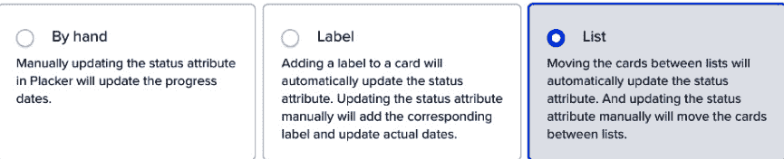

### 进度状态

| 状态 | 选项 |
|--------|---------|
| 未更新 | 过去已完成 |
| 无范围 | 下一个积压 |
| 打开 | 本冲刺待办 |
| 已开始 | 进行中 |
| 已暂停 | |
| 已阻塞 | QA 阻塞 |
| 已完成 | 已完成 |
| 已取消 | |

### 进度跟踪

从状态更改跟踪工作量

图 14.19 – Placker 中的状态映射

这就是你在看板中定义任务状态的方式，并且，嗯，展示项目进度！我喜欢你可以以多种方式定义任务状态。虽然列表是更传统的看板风格的方法，但许多团队会使用标签来标记某事是否正在进行中。

或已完成。Placker 允许你选择任一方式，并填充以下选项，帮助你将每个列表（或标签）映射到工作流的正确阶段。

我可以在这里写很多页来介绍这些设置，但你随便点击一下就会发现所有选项。如果你需要澄清或设置帮助，随时可以点击右下角的聊天图标。

现在让我们合并看板，开始看到奇迹！

## 一起查看多个看板

转到你想添加到 Placker 的任何其他看板，并按照前面的步骤操作。现在，当你想要访问 Placker 功能时，你也可以访问那些看板！

从任何已添加 Placker 的看板中，点击工具栏中的一个查看选项。我现在选择 **Board**。

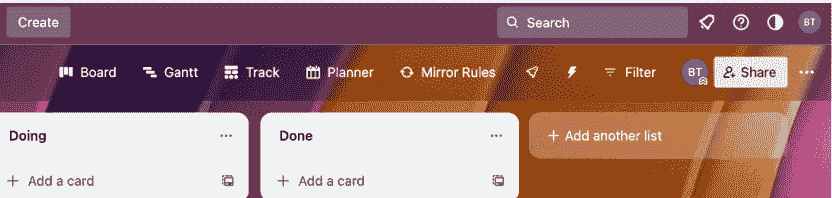

图 14.20 – Placker 查看按钮

你会看到一个新的模态框出现，带有另一个视图；顶部的 **Scope** 显示当前看板。

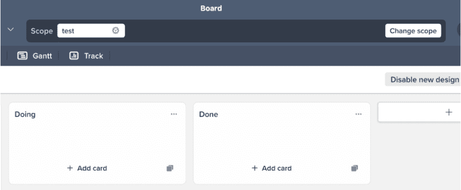

图 14.21 – 设置 Placker 视图的范围

要向项目添加更多看板，请点击 **Scope** 栏，你将能够选择更多看板，如果你愿意，还会看到导入更多看板的选项。如果你计划经常一起引用它们，也可以点击左上角的 **Add view** 来创建一个看板组。

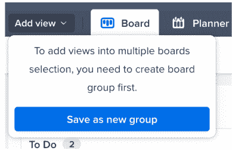

图 14.22 – 在 Placker 中保存一组看板

你现在可以以多种方式将卡片分组查看。例如，查看这个视图，它结合了我在 PixieBrix 使用的所有看板，用于跟踪我的任务。

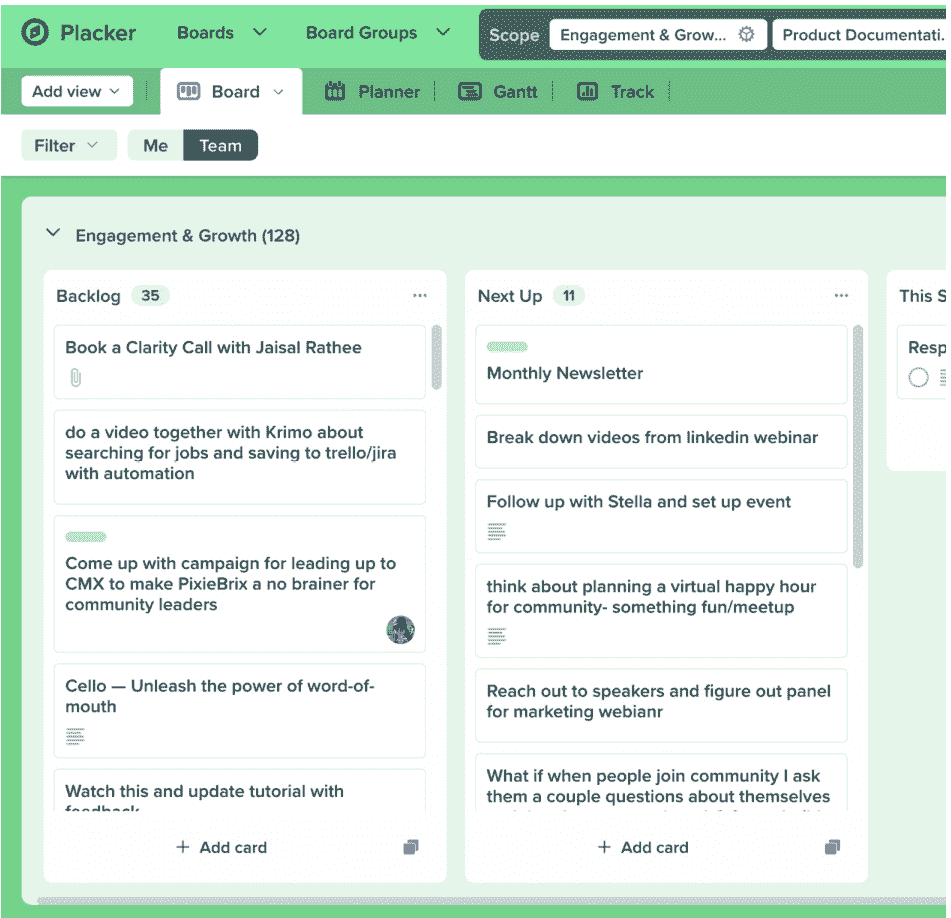

图 14.23 – Placker 中分组看板的视图

如果我不想看某个看板，我可以点击名称旁边的箭头将其最小化。真正的魔力来自这个顶部导航栏，它提供了多种查看内容的选项。

如果我想将所有这些任务放在一个看板上一起查看，我会从左上角点击 **Combined**。

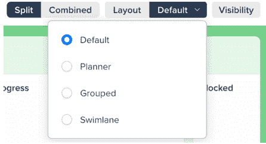

图 14.24 – Placker 视图的布局选项

这将把所有看板的列表添加到一个大看板中（而且它甚至足够智能，如果列表名称相同，例如 **In Progress**，可以合并列表）。

我还可以根据我正在优先处理的内容来更改视图，例如规划项目和查看本周概览，或者垂直地按成员或优先级等标准对每个列表进行分组。最后，我可以创建泳道，以水平分组显示卡片。在这些布局中的每一个中，都有额外的设置，用于自定义视图，以便以对你最有帮助的方式显示卡片。

你还可以在顶部栏的左侧添加筛选器，以缩小显示的卡片范围。这些筛选器比 Trello 的原生筛选器要先进得多。

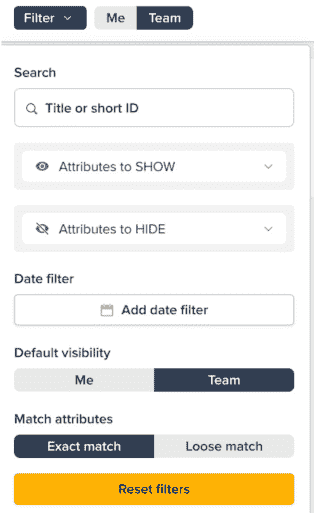

图 14.25 – Placker 视图中的筛选选项

你不仅可以选择符合某些标准的卡片，还可以隐藏符合某些标准的卡片。例如，我可以显示所有卡片，除了到期日超过一周的卡片，或者除了没有任何标签的卡片。只需开始输入，你就能找到想要的属性并创建筛选器。你还可以快速筛选出只查看自己的卡片（在点击筛选器之前，看板顶部甚至有一个用于此的按钮）。

## 报告的默认属性

当你从 Placker 模态框中打开一张卡片时，你会看到比 Trello 中更多的字段。当你需要更高级的报告时，这很有帮助，因为你可以为卡片分配许多属性，例如计划和实际日期、预估预算、卡片进度、优先级等！

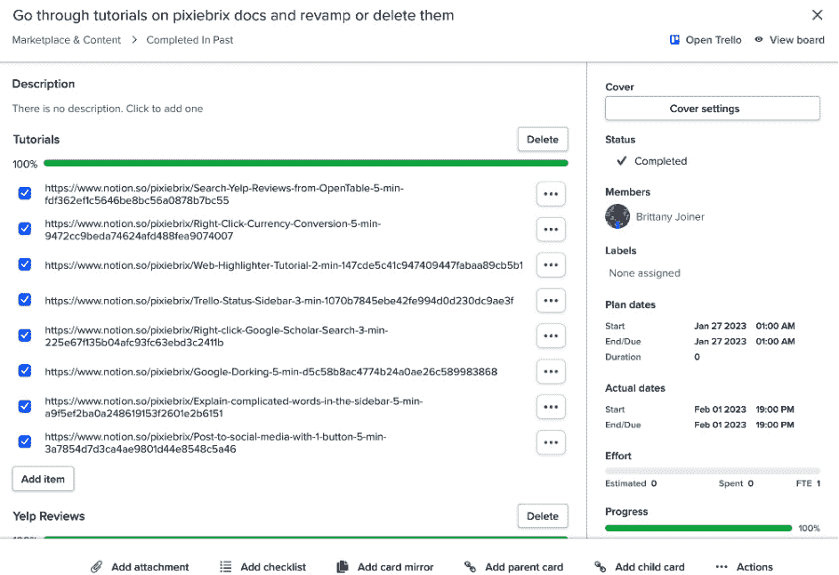

图 14.26 – 在 Placker 中查看 Trello 卡片

当然，你也可以在这里访问自定义 Trello 字段，并且可以创建仅在 Placker 中显示的自定义属性，如果你想在这里显示某些内容，但不想在 Trello 的看板中显示。

可以在 Trello 中为所有这些项目创建自定义字段，但使用 Placker，它们开箱即用。此外，无需创建任何特殊自动化，你就可以在卡片上设置特殊效果，例如与其他卡片的关系或镜像其他卡片。

你甚至有机会从检查清单项目中一键创建子卡片，从而轻松建立任务和子任务之间的关系。

## 添加小部件和报告

现在是时候将你在这里看到的所有数据和组织结合起来，生成一个关于你项目的漂亮图表。要访问报告选项，请点击 Trello 看板顶部的 **Track** 按钮，或者从 Placker，只需点击 **Add view** 并选择 **Track**。

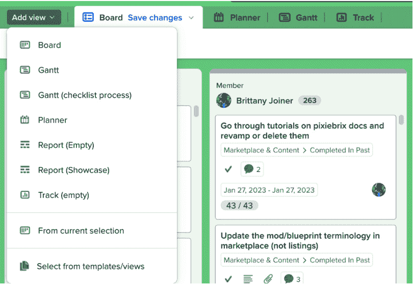

图 14.27 – Placker 视图选项

默认情况下，你已经拥有一个带有一些关于看板中发生情况的图表的报告，无需任何配置！

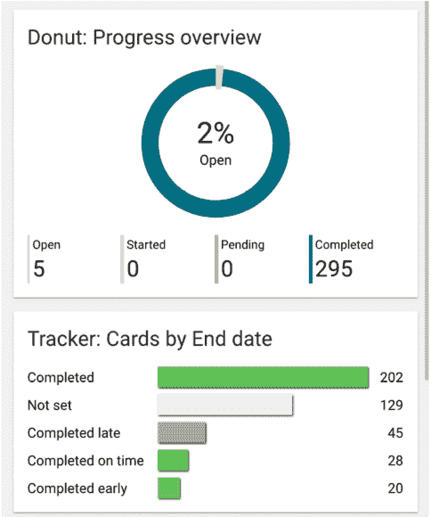

图 14.28 – Placker 中默认构建的示例图表

你可以查看卡片的状态，甚至可以根据结束日期检查其进度！这可以快速显示你的团队完成任务（并按时完成）的效率如何，或者你是否开始了很多事情但只完成了少数事情。

甚至有一个透视表，显示每个成员的卡片按多个看板的状态汇总，这有助于快速了解团队在该期间内处理任务的进度。

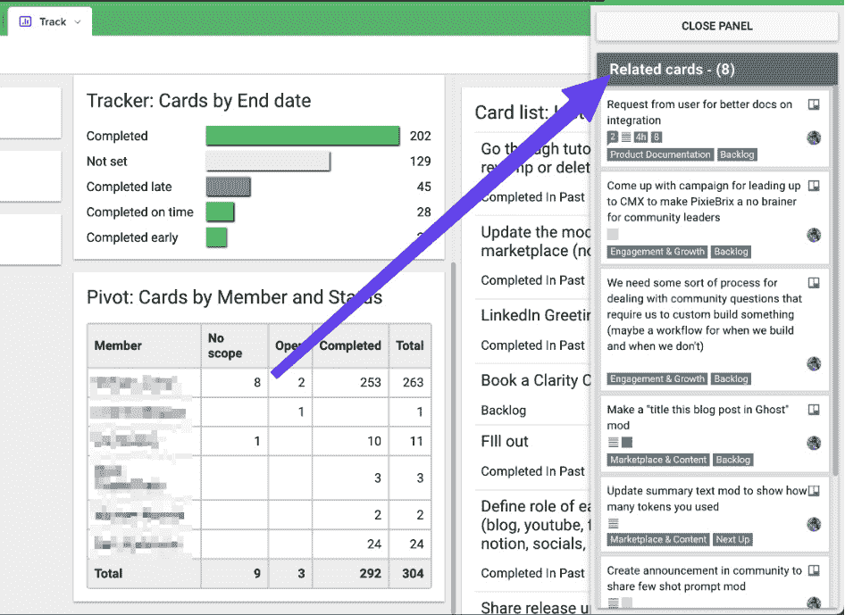

图 14.29 – 侧边面板显示 Placker 中图表的卡片

更棒的是，你可以点击表格中的任何数字，打开一个侧边面板，显示与该指标相关的卡片，让你能够快速深入了解团队的任务。

虽然所有这些都很有帮助，但让我们假设你想在此视图中添加自己的图表。点击右上角的 **EDIT** 以显示选项菜单。你可以从这里复制或删除页面，或更改布局并添加小部件。我们就这么做，所以点击 **Edit layout & widgets**。

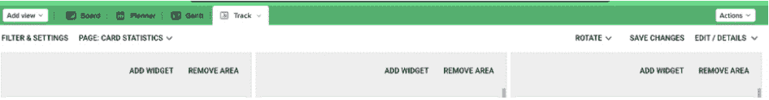

图 14.30 – Placker Track 视图上的导航栏

目前，此报告显示在三个面板中，但如果你只想要两个，可以通过点击 **REMOVE AREA** 来清理它。我将删除第一个面板，因为它主要是说明，现在中间面板占据了页面的 2/3，并有更多空间。

现在，点击 **ADD WIDGET** 来添加更多数据。配置小部件可能有点棘手。说得对吗？能力越大，责任越大。

## 添加小部件

小部件类型  
Tracker (by any attribute)

属性  
List

显示空值  
显示未分配值  
排序  
反转排序顺序  

按以下排序小部件：  
属性顺序  

计量单位  
从仪表板复制  

显示值为  
计数  

小部件标题  
List (%unitOfMeasure%)

CANCEL  
CREATE

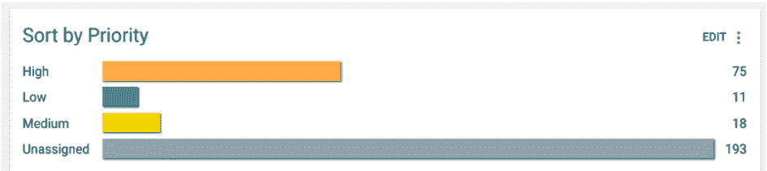

图 14.31 – Placker 中图表的小部件选项

你需要一些时间才能熟悉不同的选项。浏览 **Widget type** 选项以查看有哪些可用，但在许多情况下，你可能会坚持使用第一个，**Tracker (by any attribute)**。

接下来，你可以选择要观察的属性（卡片的一部分）。假设我们想跟踪自定义 **Priority** 字段，并检查我们是否主要完成了高优先级的卡片。就像其他报告工具一样，我可以定义我们想要计算的内容，无论是卡片数量还是涉及的工作量总和。

我现在回到左上角，选择 **FILTER & SETTINGS**，这将打开我们在看板视图中看到的相同筛选器。从这里，我将选择已完成的卡片，然后 🎉 底部的图表现在显示了按优先级完成的卡片！

图 14.32 – Placker 中按优先级排序的任务图表

看来，在已分配优先级的卡片中，我们正在完成高优先级的卡片！但我们仍然需要努力确保实际为卡片分配优先级。

在 Placker 中还有很多东西可以发现，所以在你进行 15 天试用期间，请务必花时间点击探索并与他们的团队联系。

## Screenful

是时候再评估一个团队报告工具了。这个工具叫做 Screenful，在我看来，它与其他工具不同的地方在于，它将高级报告选项与易用性很好地结合在了一起。

你会看到许多在其他工具中见过的相同报告功能。Screenful 也允许你创建图表并汇总数据，然后按其他属性（如成员或标签）进行分组。但 Screenful 的出色之处在于，它开箱即用，提供了大量图表、报告和洞察，无需配置任何内容。而且它们非常漂亮！

一旦连接你的看板，你就能查看图表，显示有多少张未完成卡片，每周完成多少张卡片，甚至预测的项目完成日期！只需连接看板并确认列表即可！

## Screenful 最适合谁？

没有一个完美的工具适合所有人，这真的取决于你需要报告工具提供什么。如果你需要快速回答关于工作流程的问题，或者你有不太懂技术的用户，他们没有时间或技能去配置报告，那么 Screenful 是一个完美的选择，因为你开箱即可获得大部分所需内容，或者只需很少的自定义。

如果你关心共享图表和报告的精美视觉效果，你也可能更喜欢 Screenful。虽然我使用过的其他工具也还可以，看起来足够不错，但我更喜欢 Screenful 图表的外观。

当然，凡事都有取舍，Screenful 的取舍是价格。虽然他们不按用户收费，但最低计划每月起价 49 美元，而且仅包含两个自定义报告，不包括所有功能，例如自定义品牌或定时报告。如果你使用标签而不是列表来跟踪任务状态，这个工具也不适合你。我不认为在 Screenful 中按标签跟踪状态是不可能的，但可能需要更多配置。

## 开始使用

Screenful 是另一个可以通过 Power-Up 添加的工具，但你也可以直接访问他们的网站 https://screenful.com/。到达那里后，创建一个账户，然后系统会提示你连接一个账户（例如 Trello 账户！），然后选择要连接的看板。

我将连接我的 Trello 账户并选择几个相关的看板，然后单击 **Next**。如果我想，以后随时可以返回并添加更多。Screenful 会猜测哪些列表对应哪些状态。

## STEP 2/2 :: LET'S CAPTURE YOUR WORKFLOW

这些是我们从所选数据源中检测到的工作流程状态：

| NOT STARTED 🛈 | IN PROGRESS 🛈 | DONE 🛈 |
|---|---|---|
| Backlog | In Progress | Done |
| Next Up | Blocked | Completed In Past |
| This Sprint To Do | QA | Completed In Past |
| | Ready to Publish | |

我们猜对了吗？如果你想排除某些状态，或者更改建议的映射，可以 [调整映射](https://screenful.com/)。这些设置有助于我们计算前置时间和周期时间，并帮助你跟踪目标（[了解更多](https://screenful.com/)）

返回 调整映射 看起来不错 跳过，我稍后再做

图 14.33 – 在 Screenful 中映射工作流程阶段

它猜得相当准！但如果你需要调整，可以单击 **Adjust mapping**。但这只能让你排除列表或将它们在阶段之间移动。

## Insights

连接看板后，你将进入 **Insights** 选项卡，你可以立即开始分析卡片数据，只需滚动页面即可。

你首先会看到所有看板中未完成卡片的摘要。这些是你的未完成任务。这很有帮助，因为它实际上就是你待办事项列表的数量。它永远不会为零，但未完成卡片数量过多会让项目感觉不可能完成。

接下来，你会看到这些未完成（未完成）卡片按标签分解。这可以帮助你识别是否有特定类型的任务尚未完成。例如，如果你是营销团队，并且看到很多带有“content”标签的卡片，你可能需要再雇佣一名内容撰稿人。

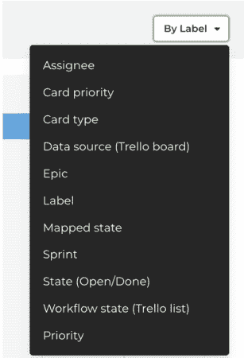

图 14.34 – Screenful Insights 中图表的分组选项

但除了标签之外，你还可以按许多其他内容分组，例如卡片分配给谁、卡片上的自定义字段、其状态等。这些能为你的漏斗的这些方面提供有价值的洞察，因为你可以识别任何差距，并看到你在哪些方面过度或不足索引。

你还可以随时间比较这些信息。

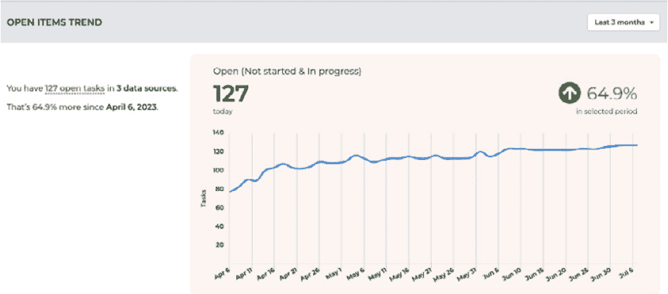

图 14.35 – Screenful 中的 OPEN ITEMS TREND 图表

查看一段时间内的未完成卡片可以帮助你看到你是否一直保持相同数量的未完成卡片，或者它们是否呈下降趋势。对于一次性项目，例如功能发布或产品发布，随着你每周完成更多项目，你应该看到它下降。如果它在上升，你可能添加的任务比你能合理完成的更多，看起来我可能就是这样做的！

默认情况下，此图表显示过去三个月，但你可以从图表右上角的下拉菜单中选择其他时间段。

最后，你可以使用一个图表将趋势与按标签、成员、优先级或其他属性分组结合起来。

如果你想过滤这些数据中的任何内容，只需单击看板右上角的 **Set filter**。你将有选项按任何字段过滤数据，并仅显示带有特定标签的卡片，让你能够微观分析特定类型任务的活动。

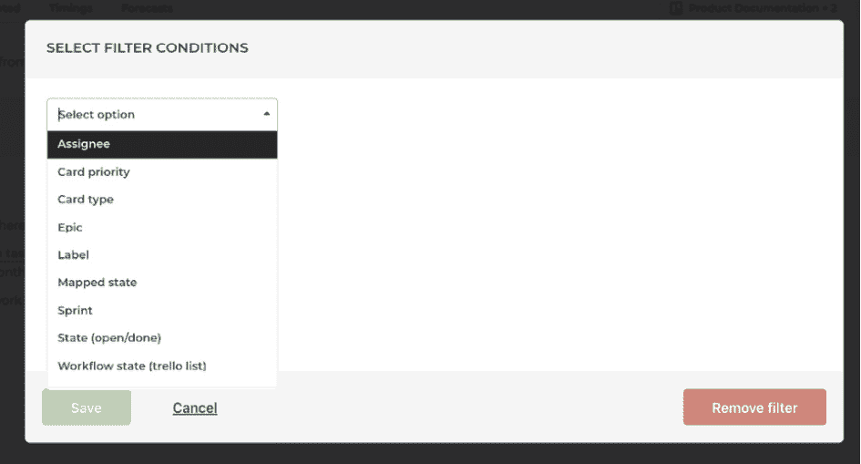

图 14.36 – Screenful 中的过滤选项

我最喜欢 Screenful 的地方在于，所有这些都是开箱即用的。我们已经通过连接看板，无需做更多事情就了解了工作流程的一些情况。

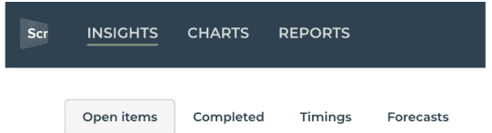

图 14.37 – Screenful 中的导航和部分

查看顶部 **INSIGHTS** 选项卡下方的部分。你会看到更多可以浏览的选项卡，它们都是 **INSIGHTS** 部分的一部分。单击 **Completed**，你会看到与 **Open items** 中类似的图表，但显示的是已完成卡片的数据。

你将首先看到最近完成任务的表格，单击其中一个将直接带你到 Trello 卡片。这是快速回顾团队上周完成的工作的好方法，适用于回顾会议。

接下来，你会看到一个图表，显示一段时间内完成了多少工作。你能看出我休假了吗？

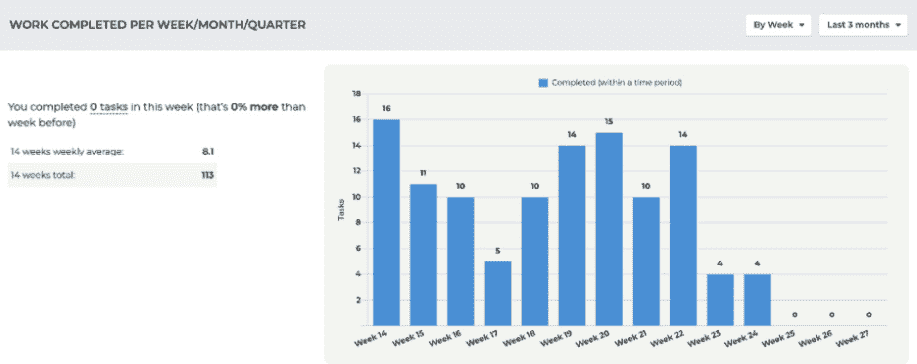

图 14.38 – 显示每周工作完成趋势的图表

你可以更改频率以查看每月、每周或每季度，并可以更改时间段以跨越更长或更短的时间。

下面还有更多图表，用于按成员或标签等属性分组查看这些数据，帮助你看到团队中是否有人工作过度，或者没有尽到职责，可能需要一些指导。

我最喜欢的图表显示卡片创建数量与完成数量。

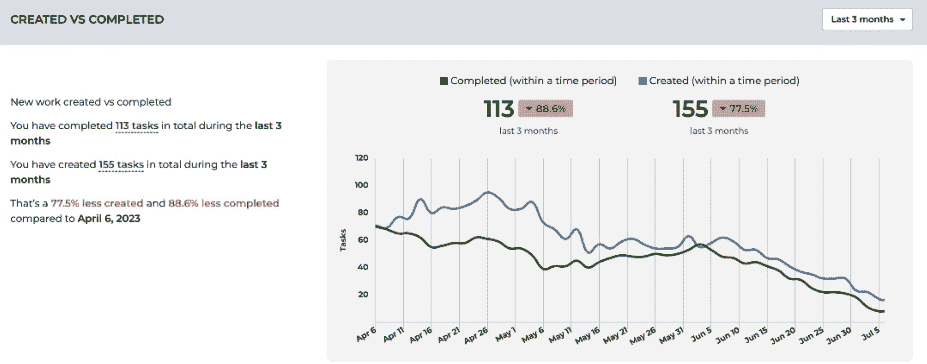

图 14.39 – 显示卡片创建与完成数量的图表

我喜欢这个图表，因为它显示了为什么我似乎永远无法完成我的待办事项列表……每完成一张卡片，我就至少在列表中添加一张新卡片！（这也解释了为什么我有这么多未完成卡片！）

接下来，前往 **Timings** 选项卡，你将了解卡片如何在工作流程中移动。我不会在这里详细介绍，因为大多数图表都有很好的解释，但我最喜欢的是这个图表，它显示卡片在 **In Progress** 状态中停留的时间。

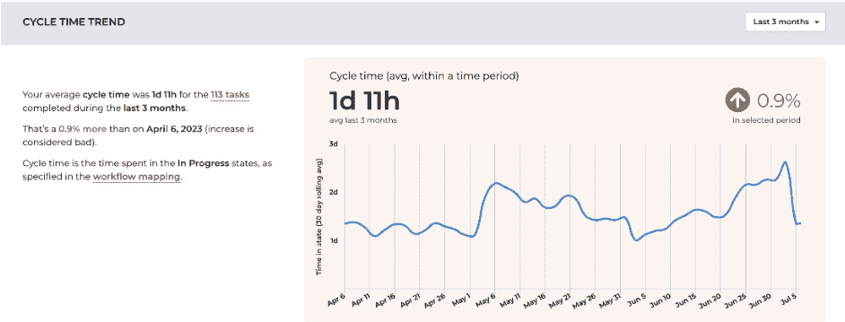

图 14.40 – 显示卡片在进行中花费时间的图表

这取出了你 **In Progress** 列表中卡片的平均时间，以便你可以看到任务完成需要多长时间。如果你看到这里有长周期时间，可能意味着你有一些瓶颈，需要调查是什么导致卡片在工作流程中移动得这么慢。

最后，我们将简要查看 **Forecasts** 选项卡。

此部分帮助你根据过去的工作方式，对项目和任务进行预测和估算。你可以跟踪速度历史，以查看团队每周历史上完成了多少工作。

Figure 14.41 – 显示每周速度趋势的图表

确保你计划的工作量不超过团队能够实际处理的范围，否则你只是在让自己永远无法完成任务，并不断推迟事情。

如果你继续向下滚动，你会看到更多图表，这些图表能预测项目完成的日期。有两种估算方式——一种假设没有新工作添加，另一种假设会添加新工作。你还可以将速度调整为乐观或悲观，以便获得一个范围。我喜欢这些图表，因为它们非常适合展示给那些不断扩大项目范围的烦人管理团队。现在你有了实际的图表，可以向他们展示边做边添加更多任务会显著推迟完成日期。

现在，以防你想了解更多信息，让我们前往 **CHARTS** 看看能构建什么。

## CHARTS

**INSIGHTS** 部分显示带有图表的预构建报告，但对于那些有特定愿景，或者想要深入挖掘的人来说，**CHARTS** 选项卡让你能进一步探索，以获取所需的信息。

点击右上角的 **+ADD NEW CHART**。就像我们展示的其他工具一样，你会得到几种可用的图表类型。但这些图表不仅仅是标准类型，例如柱状图、饼图等，还有一些已经配置好的预构建图表。

Figure 14.42 – Screenful 中的预构建图表选项

在创建空白图表之前，先浏览一下列表，因为你要找的数据可能已经是一个现有图表，你可以添加它并进行自定义！如果比较接近，点击该图表，然后点击右上角的 **Configure Chart**，以便对其进行任何更改，以显示你要找的数据。

Figure 14.43 – Screenful 图表中工作量的单位选项

例如，也许我的卡片大小不一，我实际上想跟踪卡片大小，而不仅仅是卡片数量。我可以更改单位，使其更准确地符合我的数据模型。

一旦准备就绪，我可以点击右下角的 **Create chart** 并查看我的数据。仅仅查看图表很有用，但我可以从图表右侧上方的工具栏中做更多事情。

Figure 14.44 – Screenful 中的图表设置和选项

我可以更改图表反映的时间，以使报告更加动态并服务于多种目的。如果我想让其他人查看此图表，我可以使用 **Share** 选项将其嵌入到另一个页面，或者发送链接（甚至可以将其设为任何人都可以访问的公共链接，无需 Screenful 或 Trello 账户！）

使用 **Chart settings** 来设置图表样式，如果你需要对数据或其组织方式进行任何更改，只需点击 **Edit chart**。三个点提供更多选项，例如更改筛选器、复制图表、导出、删除或添加到报告，这感觉是完美的过渡，前往下一个 Screenful 部分，即 **REPORTS**。

## REPORTS

图表是单个的、嗯，图表，它们为你的数据展示特定的可视化。但你需要将多个图表拼凑起来才能讲述一个完整的故事，这就是报告的用武之地。点击顶部导航栏中的 **REPORTS**。

默认情况下，Screenful 已经为你创建了一个名为 **Weekly velocity** 的报告。点击名称进行探索。你会看到一系列拼凑在一起的图表，为你提供每周摘要，并帮助你了解随时间的变化趋势。

Figure 14.45 – 按看板拆分的每周速度图表

你可以点击右上角的三个点来编辑任何图表。你会有编辑或设置图表样式的选项，并且可以应用筛选器。

如果你想编辑报告的布局，请点击右上角的 **Edit Report** 来移动事物或添加更多图表或元素。

Figure 14.46 – Screenful 中的报告设置和选项

你还会看到类似 **CHARTS** 的选项，你可以共享整个报告，或者通过点击 **Settings** 来设置报告样式。如果你愿意，甚至可以将你的徽标添加到报告中！

但还有一个重要的操作我想指出……你可以安排此报告。这意味着你可以让任何报告按固定间隔保存数据，允许你在想要比较周与周时访问以前的版本，例如。

Figure 14.47 – Screenful 中的报告调度选项

它不仅保存这些以前的版本，你还可以让 Screenful 将它们发送给特定用户，或在 Slack 中发布消息。

再次点击 **REPORTS** 返回报告主页，你会在右上角看到 + **ADD NEW REPORT** 按钮。

Figure 14.48 – Screenful 中的预构建报告

就像图表一样，你可以为报告选择预构建模板，然后自定义特定元素和图表，这绝对是最简单的方法。但如果你找不到符合你想要的东西，你可以选择 **New blank report** 从头开始构建你想要的内容。

点击现有报告上的 + 按钮或新报告上的 **ADD CHART** 将打开一个模态窗口，以选择你构建的任何图表，或构建一个新图表。

我喜欢将图表视为拼图碎片，而报告是最终产品，只有当所有碎片排列在一起时才能看到。然后，insights 将其转化为可操作的信息，以改善你的工作流程。

如果你需要更高级且可定制的东西，Screenful 是一个很棒的报告工具，但它也为你提供了开箱即用的东西。它不太涉及任务管理和规划，但它擅长提供一个易于上手的报告界面，并快速获取关于项目的宝贵信息。

## Summary

我们来到了本章的结尾，希望你已经阅读了所有这些选项，并了解哪种工具可能适合你。如果你想要一个涵盖大多数用例且易于使用和负担得起的工具，你可能会选择 Blue Cat Reports！

如果你需要一个包含自定义属性和规划工具以及高级报告的工具，你可能会想使用 Placker。如果你想要高级报告，既美观又易于配置，你可能会选择 Screenful。

关于哪个是 _best_，没有正确答案，但它们都提供免费试用，所以全部试用一下，看看哪些最适合你的工作流程。如果你有任何问题，请联系他们的支持团队。

哇，写这本书的最后几句话感觉几乎不真实。我们一起经历了一段相当长的旅程。想想我们开始的时候，你了解 Trello 的组件，一直到学习如何自动化并让 Trello 为你工作，最后添加集成，使 Trello 更加强大，基本上成为处理任务管理和报告的独立应用程序。

你已经走得很远了，我希望你对自己的 Trello 设置感到满意，并且足够自信，可以随时对其进行调整。如果你需要帮助，你知道去哪里找我，如果我还没有说得足够多，我再说一次……前往 Atlassian Community 的 Trello 部分，与其他 Trello 爱好者见面，获得灵感，并学习如何用 Trello 做更多酷的事情。

