## 欢迎
当我们推出上一本《官方项目书》时，我们很高兴树莓派的销量已达七百万台。此后，树莓派又取得了两项里程碑：销量达到一千万台，并成为有史以来最畅销的英国电脑。按我们的计算，这意味着树莓派社区里多了不少新成员！

如果你就是这些新成员之一，那么我们衷心欢迎你阅读最新一本《树莓派官方项目书》。书中200页的优秀指南、灵感十足的项目和信息丰富的评测，将让你忙于学习用树莓派能做的一切精彩事物。我们甚至还提供入门指南，帮助你确定起点。对于树莓派老手来说，这里也有一些真正具有挑战性的制作项目可供尝试。

希望大家喜欢这本书！
Rob Zwetsloot

在线查找 raspberrypi.org/magpi 联系我们 magpi@raspberrypi.org

## 开始使用树莓派

使用树莓派创建令人惊叹的项目很容易，但首先你需要将其插入并设置 Raspbian，即默认操作系统。本指南将帮助你迅速上手。

树莓派是一款充满潜力的出色微型计算机。有了树莓派，你可以制作机器人、学习编程，并创造各种奇特而美妙的项目。黑客和爱好者们已将树莓派板改造成全自动气象站、联网蜂箱、电动滑板等等。唯一的限制就是你的想象力。但首先，你需要从头开始。第一次拿起树莓派时，你会面对一块布满芯片和插槽的小绿板，可能完全不知道该如何使用它。在开始构建梦想项目之前，你需要先搞定基础配置：键盘、鼠标、显示器和操作系统。一旦掌握了基础知识，用树莓派创建项目就很有趣了。所以在本指南中，我们将带你从零新手成长为树莓派高手。拿起你的树莓派，让我们开始吧。

## 树莓派 3

树莓派 3 是最新型号，也是大多数新手推荐的版本。

### SD 卡

在树莓派 3 板的底部是 SD 卡槽。你需要将操作系统预先加载到 micro SD 卡上，然后用它来启动树莓派。

### 无线网络

Pi 3 是首款配备内置无线局域网和蓝牙的树莓派。这使你能够连接到无线路由器并在不使用 WiFi 适配器的情况下上网。

### 1.2GHz ARM CPU

配备最新的 1.2GHz 四核 ARM CPU（中央处理器），树莓派 3 比许多智能手机更快，性能足以用作台式电脑。

这些引脚被称为 GPIO（通用输入/输出）。GPIO 引脚用于连接硬件和电子项目。

树莓派使用 micro USB 电缆供电，与许多智能手机使用的类型相同。

操作系统 'Raspbian' 被加载到 micro SD 卡上并插入树莓派。

键盘和鼠标通过 USB 连接。网线可以直接插入路由器以提供网络访问。

HDMI 接口使你能够将树莓派连接到显示器或现代电视机。

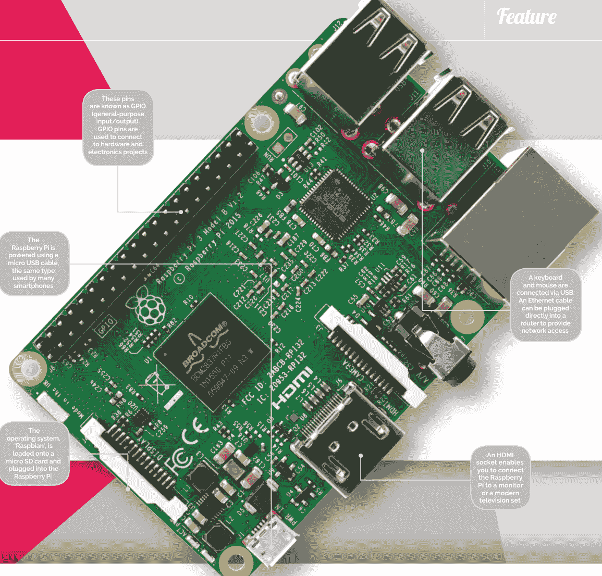

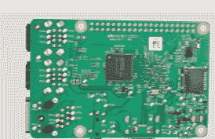

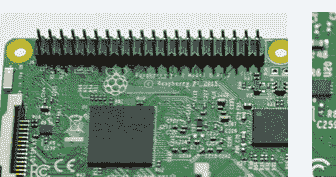

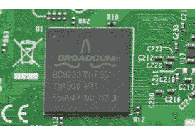

## 树莓派 Zero

超低成本、超迷你且功能强大，Pi Zero 是最小的树莓派电脑。

Pi Zero 是一款超低成本且极其小巧的微型计算机，集成在一块板上。它的尺寸大约是树莓派 3 的三分之一，价格也非常便宜（5 美元，或约 4 英镑）。

尽管如此，Pi Zero 仍拥有足够的性能来处理 demanding 的计算机项目。尽管体型娇小，Pi Zero 并非玩具。Pi Zero 是一款功能齐全的微型计算机，配备 1GHz ARM CPU 和 512MB RAM。它拥有足够的科技来运行完整的 Raspbian 版本，与树莓派 3 相同。

更小的板子比其他树莓派单元更简约，这使得设置更具挑战性。但它是一款理想的设备，非常适合创建物联网、可穿戴和嵌入式项目。

为了保持尺寸小巧，Pi Zero 采用了比正常更小的迷你 HDMI 接口。你几乎肯定需要一个迷你 HDMI 到 HDMI 适配器或线缆来将树莓派连接到电视或显示器。

或者，黑客可以直接将 RCA 线缆连接到板上的视频排针上。RCA 线缆就是你在老式电视上找到的红、白、黄插头。此功能使 Pi Zero 成为复古游戏爱好者的理想选择。

## Pi Zero

### 强大的处理器

Pi Zero 搭载了令人惊艳的 1GHz 单核 ARM 11 CPU 和 512MB RAM。尽管尺寸娇小，其性能比原版树莓派快 40%。

### 迷你外形

Pi Zero 提供完整的计算机体验，配备 Raspbian 操作系统，尺寸仅为原版树莓派的三分之一。

### 随身 GPIO

完整的 GPIO 排针位于 Pi Zero 板的一侧。这些孔洞使创客能够将硬件连接到 Pi Zero，并可尝试电子项目。

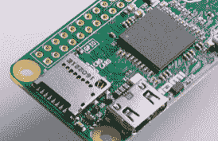

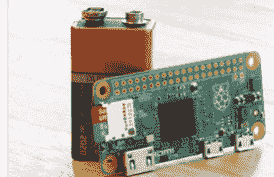

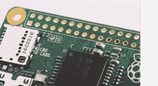

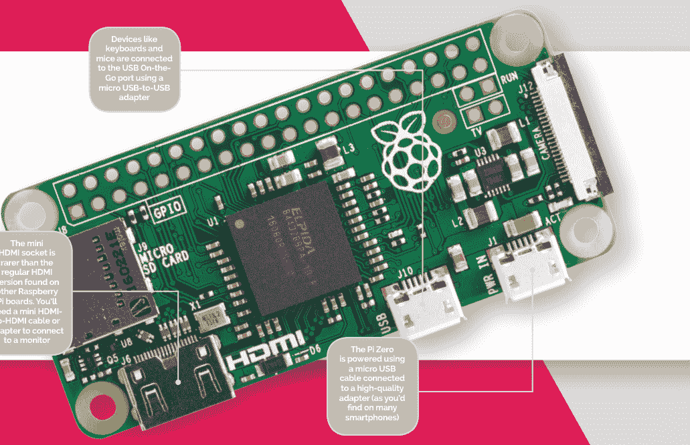

键盘和鼠标等设备通过 micro USB 转 USB 适配器连接到 USB On-the-Go 端口。

迷你 HDMI 接口比其他树莓派板上常见的标准 HDMI 版本更稀有。你需要一根迷你 HDMI 到 HDMI 线缆或适配器才能连接到显示器。

Pi Zero 使用连接到高质量适配器的 micro USB 电缆供电（与许多智能手机上找到的相同）。

Pi Zero 板使用与其他树莓派设备相同的 micro USB 电源输入，你可以使用官方适配器或从手机上拆下高质量的电源（推荐 2A 输出）。

Pi Zero 上的端口非常有限，仅有一个比普通端口更小的 USB 端口。你需要一个 micro USB 转 USB 适配器来连接键盘。你可能还想要一个 USB 集线器来连接鼠标和其他设备，如 USB 摄像头。

最近的版本更新 Pi Zero v1.3 具有内置摄像头连接器。与其他树莓派设备一样，你可以直接将 Raspberry Pi 摄像头模块或 NoIR 摄像头模块连接到 Pi Zero。这使你能够将 Pi Zero 变成一台超低成本的相机，用于拍照和录制视频。

将 Pi Zero 连接到互联网需要 USB 转以太网适配器，或更常见的是 WiFi 适配器。

得益于 Pi Zero 的低功耗，这非常适合延时摄影。你只需设置好它，让它自行运行即可。

令人惊讶的是，Pi Zero 甚至拥有与其他树莓派型号相同的完整 40 针 GPIO 排针，但你不会在板上预装引脚。相反，你需要将两个 20 针公头排针焊接到 GPIO 孔上。

设置 Pi Zero 比树莓派 3 稍微棘手一些，但也非常有趣。最终结果是一台超便宜、超强大的计算机，运行完整的操作系统。

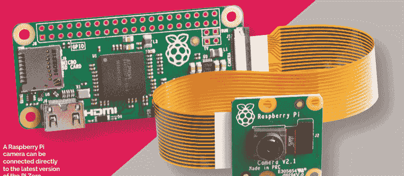

Raspberry Pi 摄像头可以直接连接到最新版本的 Pi Zero。

## 你需要准备的设备

### 所有让树莓派首次启动所需的套件

启动你的树莓派并不需要太多东西：一张来自旧相机的 micro SD 卡、一根智能手机充电器、一根回收的 HDMI 线缆，以及键盘和鼠标就足够了。

大多数物品都可以从家里的电脑硬件中获取，或向朋友和家人借用。如果你追求终极低成本计算；树莓派就是它。

你应该能够从现有的设备中获取、回收和搜集启动树莓派所需的大部分设备。

不过，为了长期充分发挥树莓派的潜力，你应该使用高质量的组件。

来自知名品牌的优质 micro SD 卡速度更快、更可靠。并非所有 USB 电源适配器都一样出色。可靠的品牌适配器即使连接多个设备也能提供稳定的电力供应。

树莓派板本身并不娇气，裸板也能正常工作，但一个好的外壳能让板子更安全，也更易于存放。有大量外壳可供选择，其中许多提供防水、可堆叠或墙面安装等独特功能。

官方树莓派外壳是一款精致的套件，非常适合任何 Pi 用户。它由五部分组成，卡扣组合，可快速打开外壳并访问板子和 GPIO 引脚。

任何无法回收的设备都可以从 Raspberry Pi 商店（magpi.cc/2bnamFF）或 Element14（element14.com）、Allied Electronics（alliedelec.com）和 RS Components（magpi.cc/2bnapBI）等分销商处购买。

## Micro SD 卡

micro SD 卡充当树莓派的硬盘。你将 Raspbian 操作系统安装到卡上，然后在工作时所有文档、文件和项目都会保存在其中。

Raspberry Pi 粉丝 Jeff Geerling 通过购买十多种不同的 micro SD 卡并对每张进行基准测试，为社区做了一件好事。结果相当惊人，有些卡的速度比其他卡快四倍。Samsung Evo+ 和 SanDisk Extreme 是两个值得关注的热门品牌，而且价格都相当便宜。你可以在 magpi.cc/2bncFs3 阅读更多内容

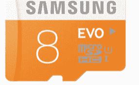

The parts of the official Raspberry Pi case can be individually unclipped, offering fast access to the GPIO pins on the board inside

The case was designed by Kinneir Dufort (magpi.cc/2brbXLu). It's an award-winning design team that has done a great job

The official case provides easy access to all of the ports on the Raspberry Pi, and the micro SD card can be removed without dismantling the case

## HDMI cable
An HDMI cable is the easiest way to connect your Raspberry Pi to a computer monitor or television. You don't need an expensive one, and most people recycle one from an old games console or DVD player.

## USB power
A good 2A or 2.5A power supply provides you with enough power to run a Raspberry Pi with all kinds of peripherals connected. You can buy an official Universal Power Supply (magpi.cc/2a14pye).

## Keyboard
Any standard USB keyboard can be used to enter commands to your Raspberry Pi. You can use a Bluetooth keyboard with the Raspberry Pi 3, or any other Pi with a Bluetooth dongle attached. A wired keyboard is easier to use when setting up your Raspberry Pi.

## Mouse
Any standard mouse will work with the Raspberry Pi, although ones with two buttons (non-Apple mice) work better. Like keyboards, a Bluetooth mouse will work once it's paired, but a wired mouse works as soon as you plug it in.

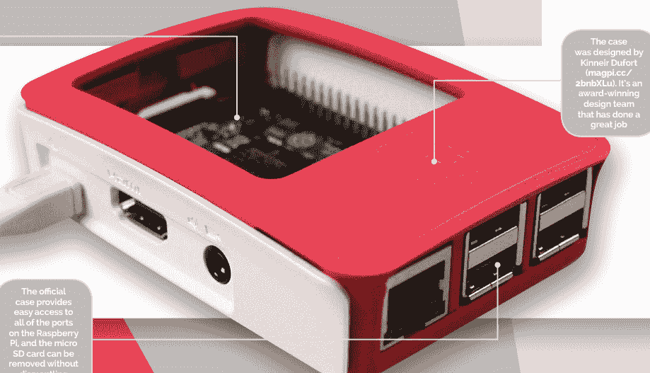

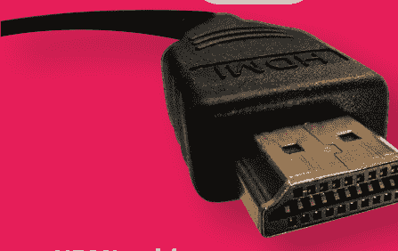

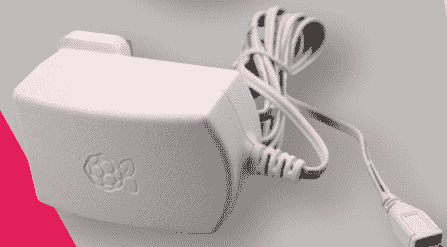

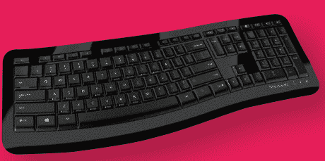

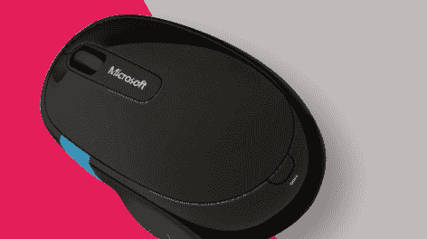

## INSTALLING RASPBPIAN
### Discover how to use NOOBS to quickly set up the Raspbian operating system on your Raspberry Pi
Before you start using your Raspberry Pi, it needs to have an operating system (OS). This is the software used to start the hardware, and open and close programs.

Many computers use a specific operating system tied to the hardware. You’ll probably be used to Windows on a PC and OS X on a Mac computer.

Most Raspberry Pi owners use an open-source operating system called Raspbian, which is based on Linux. The current version is based on a version of Linux called Debian Jessie, hence the name Raspbian (sometimes you’ll hear it called ‘Raspbian Jessie’).

Linux is like Windows and Mac OS X, but more fun because it’s open-source, so anybody can view the source code and improve it.

You can install a range of different OSes on a Raspberry Pi, some based on other versions of Linux, others based on Windows, and even completely unique environments like RISC OS.

Raspbian is the official OS and the one most beginners should start with. It’s the simplest to install, easiest to use, and most projects and tutorials use Raspbian as their base.

### Start with NOOBS
There are two approaches to installing Raspbian and other operating systems. Beginners should start with NOOBS (New Out Of Box Software). More advanced users may copy an image file containing a whole operating system directly to the SD card.

First, you must format your micro SD card to use the Windows FAT 32 format. The easiest way to do this on a Mac or Windows PC is to use a program called SD Card Formatter (magpi.cc/2bncvkm).

Connect your micro SD card to a Mac or Windows PC, typically using a micro SD-to-SD card adapter or a USB card reader, and use SD Card Formatter to erase the card.

Next, download the NOOBS ZIP file from magpi.cc/2bnf5XF. Extract the contents of the file and open the NOOBS folder. Copy the contents across to the root of the SD card. See the ‘Setting up NOOBS’ steps for more information.

## AVAILABLE OSes
### Raspbian
The official operating system is the easiest to use, and the one beginners should start with. It works a lot like other popular operating systems.

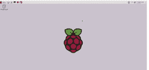

### Windows 10 IoT Core
Not the full version of Windows, sadly, but Windows 10 IoT Core enables programmers to run Internet of Things and embedded projects.

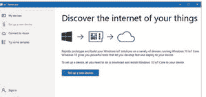

### Ubuntu MATE
Ubuntu is one of the world’s most popular Linux operating systems, and Ubuntu MATE is a lightweight version that runs just fine on the Raspberry Pi.

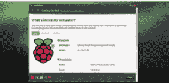

NOOBS automates the process of installing Raspbian. Select the Raspbian option and click on Install to run it

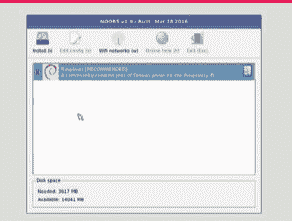

With the NOOBS files copied across, remove the micro SD card from your computer and slot it into your Raspberry Pi. Now connect the keyboard, mouse, and HDMI cable. Finally, attach the USB power to boot up the Raspberry Pi.

The Raspberry Pi will boot, displaying the NOOBS installer. By default it has one option, ‘Raspbian [RECOMMENDED]’. Place a tick next to Raspbian and click Install. Click Yes in the Confirm alert to begin installing Raspbian.

Now you just need to wait while the Raspbian file system is extracted. When it’s finished, you’ll see the Raspbian desktop and the message ‘OS(es) Installed Successfully’. Click OK to start using your Raspberry Pi.

### Installing image files
Installing an operating system from an image file is a slightly more complex procedure, but one that more advanced (and Pi Zero) users should learn. Image files are copied differently in Windows, compared to Linux and Mac computers.

In both systems, you format the micro SD card to FAT 32 as usual,

NOOBS automatically copies all the files needed to run Raspbian onto your SD card

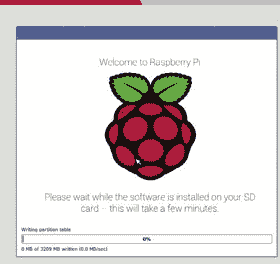

then you download the operating system as an image file, a large file ending in ‘.img’. This file is then copied bit by bit as an exact replica to the micro SD card.

On a Windows PC, you will copy the image file using an app called Win32DiskImager (magpi.cc/2bndEsr). On Mac and Linux machines, most users copy the file using a command called ‘dd’ in the terminal.

Full instructions for copying image files for Windows, Mac, and Linux can be found on the Raspberry Pi website (magpi.cc/1V5Oj8E).

A good alternative for Mac owners is a program called Apple Pi Baker (magpi.cc/2bcD53z). This program enables you to pick the image file and the SD card, and then handles the copying automatically.

Learning how to copy image files is essential if you want to use operating systems other than Raspbian. Beginners should stick with NOOBS to install Raspbian to start with. It’s much easier and is the best operating system for beginners.

## SETTING UP NOOBS
### Download NOOBS
In a browser, visit magpi.cc/2bnf5XF. Click Download ZIP to get all the files. Open your downloads folder and locate the NOOBS file: currently it’s ‘NOOBS_v1_9_2’. Right-click on a Windows PC and choose Extract All, then Extract. Just double-click the file on a Mac to extract it.

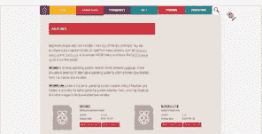

### Format SD card
Open SD Card Formatter and you’ll see the card in the Drive letter. Change the Volume Label to BOOT so you can identify it later. Now click Option and change Format Type to Full (Erase). Ensure Format Size Adjustment is set to Off and click OK. Click Format, then OK. Click Exit to close SD Card Formatter when it’s finished.

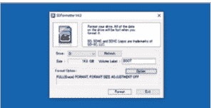

### Copy NOOBS files
Open the freshly extracted folder so you can view all the files. It should have folders called defaults, os, and overlays, and files including bootcode.bin and recovery. Select all of the files and drag them onto the BOOT icon in the sidebar. This copies all of the files inside the NOOBS folder to the root of the SD card. It’s important to copy the files inside NOOBS, and not the NOOBS folder itself.

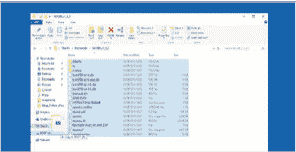

### OSMC
OSMC (Open Source Media Centre) is an easy way to transform your Raspberry Pi into a video and audio player.

### RISC OS
RISC OS is an operating system originally designed by Acorn Computers for ARM-based systems. It’s very light and completely different.

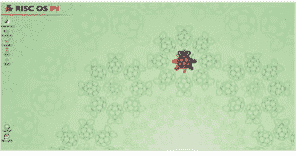

## 使用 Raspbian

了解 Raspberry Pi 的官方操作系统

Raspberry Pi 可以运行许多操作系统（OSes），但 Raspbian 是官方操作系统，也是大多数新手会首先使用的。

Raspbian 是一个基于流行的 Debian 发行版的 Linux 操作系统。完全针对 Raspberry Pi 硬件进行了定制，使用 Raspberry Pi 加上 Raspbian 通常是无忧的体验。

对 Windows 和 Mac 用户来说，Linux 的一个新特点是可以从不同的图形界面中选择。Raspbian 包含一个名为 LXDE 的界面，其全称是‘Lightweight X11 Desktop Environment’（轻量级 X11 桌面环境）。

这个经过大量修改的 LXDE 版本让你可以像使用另一台电脑一样使用 Raspberry Pi。你有一个菜单按钮，可访问大多数已安装的程序和应用。程序在窗口中打开，你可以使用按钮在它们之间切换、最小化、最大化和关闭。许多用户可能会想知道这有什么特别之处。好吧，计算机并不总是拥有窗口；相反，大多数用户使用命令行界面并输入文本命令来启动程序。

### 终端速度

在 Raspbian 中，你可能会花一些时间在命令行环境下操作桌面底层。菜单按钮旁边是终端，一个允许你输入 Linux 文本命令的程序。学习 Linux 的工作原理以及如何创建从命令行运行的程序，是拥有 Raspberry Pi 的乐趣之一。这是对经典计算的回归，你需要学习事物实际的工作原理。

Raspbian 是学习编程的绝佳环境。除了轻松访问命令行外，你还内置了各种编程环境：从 MIT 的 Scratch 到 Python 和 Java 应有尽有。

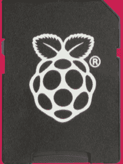

可以购买预格式化了 Raspbian 软件的 SD 卡。这可以免去你安装操作系统的麻烦

你甚至还能获得一个完整的 Mathematica 工作版本，这是一个很酷的数学环境，通常购买价格为 £190，并且可以访问真实世界数据。

### 办公人员

不过不仅仅是编程。你可以将 Raspberry Pi 用作台式电脑，操作系统内置了 LibreOffice。这是一个完整的办公套件程序，类似于 Microsoft Office。其程序包括 Writer（文字处理）、Calc（电子表格）

你将学习如何使用终端并通过文本命令控制你的 Raspberry Pi 电脑

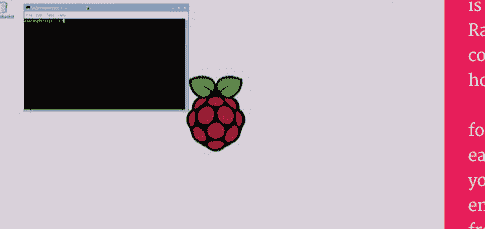

## 使用 Raspbian 界面

### 编程工具

Raspbian 附带了一系列编程工具，可在 Menu > Programming 下找到。Scratch 使学习编程概念变得简单，而像 Python 和 Java 这样的流行语言开箱即用。

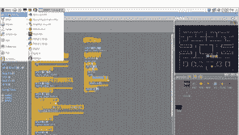

### 网页软件

Raspbian 内置了一个名为 Epiphany 的网页浏览器，以及一个名为 Claws Mail 的邮件程序。在 Menu > Internet 下有指向 Raspberry Pi Resources 和 The MagPi 的链接。

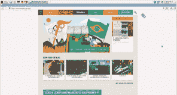

### 办公套件

Raspbian 配备了功能强大的 LibreOffice 程序，如 Writer 和 Impress。它们相当于 Microsoft Office 应用，可让你在 Raspberry Pi 上创建文档。

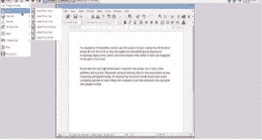

Impress（演示文稿）、Draw（矢量图形和流程图）、Base（数据库）和 Math（公式编辑）。

Raspbian 可连接互联网，并内置了一个名为 'Epiphany' 的网页浏览器。你还获得了一个名为 'Claws Mail' 的邮件客户端。两者都可在 Menu > Internet 下访问。

Raspberry Pi 使用以太网（从 Raspberry Pi 到调制解调器/路由器的电缆）或 WiFi 连接到互联网。连接 WiFi 网络很容易，我们接下来将介绍如何设置 WiFi 和蓝牙。

### 设置和软件

你可以通过两种方式调整 Raspberry Pi 的设置：使用桌面界面或名为 Raspi Config 的终端程序。

选择 Menu > Preferences 可找到各种系统设置。Add / Remove Software 可用于查找和删除 Raspberry Pi 系统中的软件包。

Appearance Settings、Audio Device Settings、Main Menu Editor 和 Mouse & Keyboard Settings 都会调整 Raspbian 的外观和交互。大多数选项都是自解释的。

Raspberry Pi Configuration 选项提供更深入的选项。在这里你可以更改密码（默认为 raspberry）和 Pi 在网络上的主机名（默认为 raspberrypi）。你可以选择启动到桌面或命令行界面（CLI），并启用和禁用各种硬件接口选项。

Raspi Config 提供更详细的选项。打开一个终端窗口然后输入 sudo raspi-config。会出现一个蓝色屏幕，选项显示在灰色框中。使用上下箭头键在选项之间移动；按左右箭头键进入选项（并返回主菜单）。有关这些选项的更多信息可在 magpi.cc/2bnfuJF 找到。

关于 Raspbian 的重要一点是不要担心尝试不同的选项和设置。随意探索菜单、命令行和配置设置。你始终可以用 NOOBS 重置 micro SD 卡并重新开始。

菜单按钮的作用类似于 Windows 中的开始按钮。它用于访问内置于 Raspbian 操作系统中的所有程序

程序在窗口中打开，每个程序在任务栏中都会出现一个条。点击窗口右上角的关闭（X）图标即可退出程序

这些面板项目用于连接 WiFi、设置蓝牙设备以及控制音量等设置。还有一个 CPU 监视器显示 Raspberry Pi 的使用情况

## 设置互联网

### 无线快速上网，使用本指南在 Raspberry Pi 上设置无线局域网

Raspberry Pi 在连接到互联网时效果最佳。你可以用它浏览网页、播放在线视频以及发送和接收电子邮件。更重要的是，你可以获取最新更新并安装任何项目所需的软件包。

为此，你需要上网。有了 Raspberry Pi 3，这比以往任何时候都更容易，因为它现在板载了无线天线。

其他型号的 Raspberry Pi，包括 Pi Zero，需要连接一个 WiFi 适配器到空闲的 USB 端口。

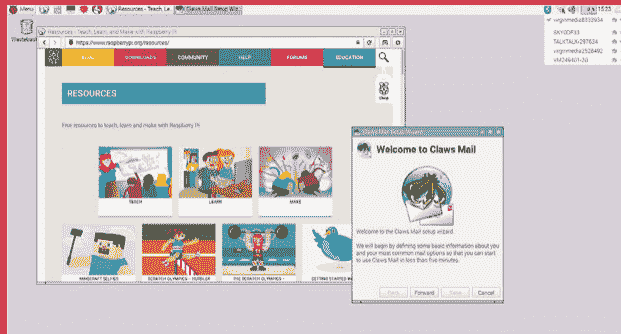

无线互联网连接使你能够在线获取帮助并设置像 Claws Mail 这样的应用

为 Raspberry Pi 添加无线后，上网变得很容易。启动到 Raspbian 桌面并在面板中查找 WiFi Networks 图标（显示在右上角）。

点击 WiFi Networks，你将看到所有本地无线网络的列表。选择你的网络并（如果有）输入密码，也称为‘Pre-Shared Key’。Raspberry Pi 连接到无线网络，使你能够上网。在这方面它与任何其他连接 WiFi 的电脑几乎一样；它甚至会记住下次的密码。

一旦在线，你可以使用 Epiphany 浏览器获取网页。点击启动栏中的 Web Browser。

### 连接到无线网络

### 检查网络

点击面板中的 Wireless Networks 图标。Raspbian 将显示本地区域内所有可用的无线网络。点击属于你的那个。

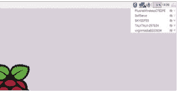

### 输入密码

在 Pre Shared Key 字段中输入你的 WiFi 密码并点击 OK。网络符号将切换为无线符号，你将连接成功。

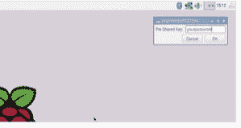

### 测试连接

通过打开网页来测试你的互联网连接。点击启动栏中的 Web Browser 并在 URL 字段中输入 www.raspberrypi.org。按 RETURN 加载页面。

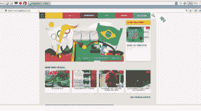

## 设置蓝牙

通过蓝牙技术无线连接到附近的设备

通过蓝牙连接的设备可与您的树莓派无线工作

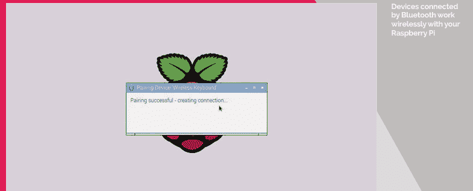

蓝牙是添加到树莓派 3 板上的另一项技术。有了蓝牙，您可以将无线设备，例如鼠标和键盘，直接连接到您的树莓派。

与无线局域网一样，如果您拥有较旧的树莓派型号或 Pi Zero，您需要连接一个 USB 适配器才能使用蓝牙设备。

在树莓派板上配备蓝牙硬件后，很容易无线连接到设备，这一过程称为‘配对’。

您可以配对无线游戏控制器，例如 PlayStation 手柄，或 Android 智能手机。许多树莓派项目都使用蓝牙，使树莓派能够与附近的电子元件和设备通信。

测试蓝牙最简单的方法是设置无线鼠标或键盘，这两种设备都很容易获得。

在某些方面，该过程类似于连接到 WiFi 网络，但您想要连接的蓝牙设备必须先设置为配对模式。这也称为使设备‘可发现’。将设备置于配对模式因设备而异；按住电源按钮直到 LED 闪烁是比较常见的做法，但请查看您设备的说明。

然后您可以使用 Raspbian 桌面面板中的蓝牙图标连接到设备：选择 蓝牙 > 添加设备。

可以通过选择面板中的 蓝牙 > 使可发现 来将树莓派置于配对模式。然后您就可以从其他蓝牙设备（如手机）连接到树莓派。

## 设置蓝牙设备

### 配对模式

首先将蓝牙设备置于配对/可发现模式。我们使用的是 Apple 无线键盘。按住电源按钮直到 LED 闪烁。点击面板中的蓝牙并选择添加设备。

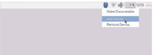

### 添加新设备

添加新设备窗口打开并会扫描附近的蓝牙设备。有些会有名称，有些只有识别号码（请查看设备）。从列表中选择一个设备并点击配对。

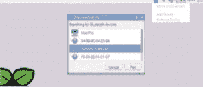

### 输入代码

Pi 现在尝试与蓝牙设备配对。您将被要求在键盘上输入代码；按下按钮并按 RETURN。现在您就可以开始使用蓝牙设备与树莓派了。

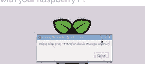

## 了解 GPIO

通过将组件、导线和硬件连接到树莓派板上的引脚，发现电子的乐趣

树莓派最强大且有趣的功能之一是顶部的引脚排。称为‘GPIO’（通用输入/输出），这些引脚使您能够将树莓派连接到额外的硬件和电子设备。树莓派有很多可直接连接到 GPIO 引脚的硬件附件。许多被称为 HAT（置于顶部的硬件）。它们直接连接到 GPIO 并坐在树莓派顶部。更重要的是，HAT 设计为一旦连接到树莓派即可工作，因此[content]
## 设置蓝牙

通过蓝牙技术无线连接到附近的设备

通过蓝牙连接的设备可与您的树莓派无线工作

蓝牙是添加到树莓派 3 板上的另一项技术。有了蓝牙，您可以将无线设备，例如鼠标和键盘，直接连接到您的树莓派。

与无线局域网一样，如果您拥有较旧的树莓派型号或 Pi Zero，您需要连接一个 USB 适配器才能使用蓝牙设备。

在树莓派板上配备蓝牙硬件后，很容易无线连接到设备，这一过程称为‘配对’。

您可以配对无线游戏控制器，例如 PlayStation 手柄，或 Android 智能手机。许多树莓派项目都使用蓝牙，使树莓派能够与附近的电子元件和设备通信。

测试蓝牙最简单的方法是设置无线鼠标或键盘，这两种设备都很容易获得。

在某些方面，该过程类似于连接到 WiFi 网络，但您想要连接的蓝牙设备必须先设置为配对模式。这也称为使设备‘可发现’。将设备置于配对模式因设备而异；按住电源按钮直到 LED 闪烁是比较常见的做法，但请查看您设备的说明。

然后您可以使用 Raspbian 桌面面板中的蓝牙图标连接到设备：选择 蓝牙 > 添加设备。

可以通过选择面板中的 蓝牙 > 使可发现 来将树莓派置于配对模式。然后您就可以从其他蓝牙设备（如手机）连接到树莓派。

## 设置蓝牙设备

### 配对模式

首先将蓝牙设备置于配对/可发现模式。我们使用的是 Apple 无线键盘。按住电源按钮直到 LED 闪烁。点击面板中的蓝牙并选择添加设备。

### 添加新设备

添加新设备窗口打开并会扫描附近的蓝牙设备。有些会有名称，有些只有识别号码（请查看设备）。从列表中选择一个设备并点击配对。

### 输入代码

Pi 现在尝试与蓝牙设备配对。您将被要求在键盘上输入代码；按下按钮并按 RETURN。现在您就可以开始使用蓝牙设备与树莓派了。

## 了解 GPIO

通过将组件、导线和硬件连接到树莓派板上的引脚，发现电子的乐趣

树莓派最强大且有趣的功能之一是顶部的引脚排。称为‘GPIO’（通用输入/输出），这些引脚使您能够将树莓派连接到额外的硬件和电子设备。树莓派有很多可直接连接到 GPIO 引脚的硬件附件。许多被称为 HAT（置于顶部的硬件）。它们直接连接到 GPIO 并坐在树莓派顶部。更重要的是，HAT 设计为一旦连接到树莓派即可工作，因此硬件品牌为 HAT 的设备更容易设置。GPIO 的真正乐趣不在于使用现成硬件，而在于构建自己的电子项目。您可以将 GPIO 引脚连接到各种电子电路和按钮、传感器、蜂鸣器以及各种电子小玩意和部件。这些用于学习所有关于电子硬件和电路构建的知识。虽然可以将部件直接连接到 GPIO 引脚，但大多数 tinkerer 会将电子元件放在面包板上并将其连接到树莓派。

您可以将 GPIO 引脚连接到各种电子电路并使用树莓派控制它。有了合适的电缆，您可以将 GPIO 引脚连接到开关。

## 面包板和转接板

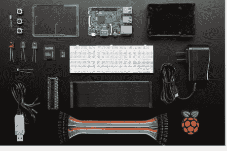

电子元件插入面包板上的孔中，相邻孔中的元件是相连的。这样，您就可以在不必实际焊接元件的情况下搭建测试电路。如果按照说明操作，直接连接到树莓派 GPIO 引脚是安全的，但随机将电线和电源连接到树莓派可能会导致不好的事情发生，尤其是在连接使用大量电力的设备（如电机）时。因此，许多电子爱好者在树莓派和面包板之间使用一种称为‘转接线’的设备。转接线插入 GPIO 引脚，并插入面包板。还有像 Explorer HAT 这样的设备，它结合了转接板和面包板，使您能够创建原型电路。

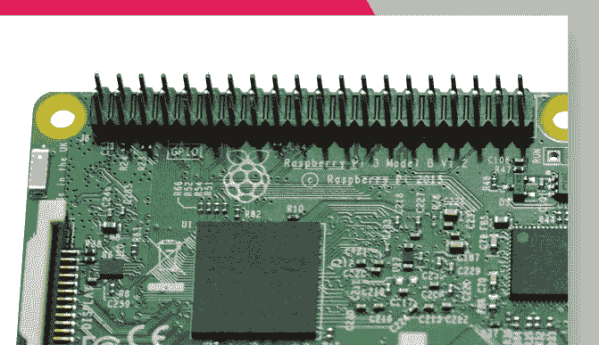

与切面包用的类型不同，电子面包板是一个带有许多孔的塑料板。

只要避免带外部电源的电路，将面包板（或电路）直接连接到 GPIO 引脚通常是安全的。大多数 tinkerer 会为面包板投资一个转接线（见‘面包板和转接板’）。

电路设置好后，您就可以在 Python 或 Scratch 等编程环境中控制 GPIO 引脚。GPIO 引脚设置为输入或输出模式。GPIO 输出很容易，因为引脚是打开或关闭（在计算术语中称为 HIGH 或 LOW）。当 GPIO 引脚为 HIGH 时，电压流经 GPIO 引脚，点亮 LED 或使蜂鸣器发出声音。将引脚设置为 LOW，LED 熄灭，或蜂鸣器安静下来。

GPIO 输入稍微复杂一些。在这种情况下，GPIO 引脚设置为 HIGH 或 LOW 并响应电路的变化。按钮（或其他电子元件）可以将电路从 LOW 改变为 HIGH，或从 HIGH 改变为 LOW，树莓派被编码为相应地响应。

这通常被称为‘上拉’或‘下拉’。别担心：如果这听起来很复杂，您可以使用 GPIO Zero 让编程变得更简单。

## GPIO ZERO 基础

学习使用 GPIO 引脚是真正享受树莓派乐趣的途径。这是一个很大的主题，有很多技巧和 tinkering 可供发现。我们的 GPIO Zero Essentials 书籍教你使用 GPIO Zero Python 库使用 GPIO 端口的基础知识（以及更高级的内容）。请访问 magpi.cc/GPIOZero-book 了解更多信息。

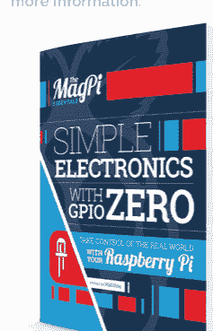

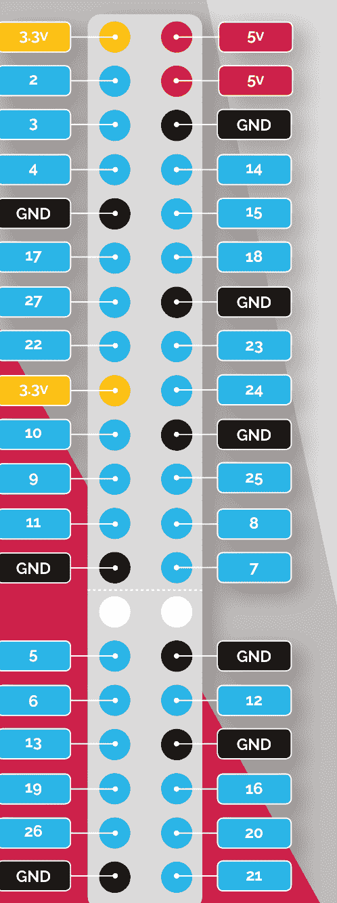

有 40 个 GPIO 引脚，每个都有特定功能。使用此图像作为编程电子产品时的便捷指南

## 项目展示

来自世界各地的灵感项目，来自树莓派社区的令人难以置信的人们

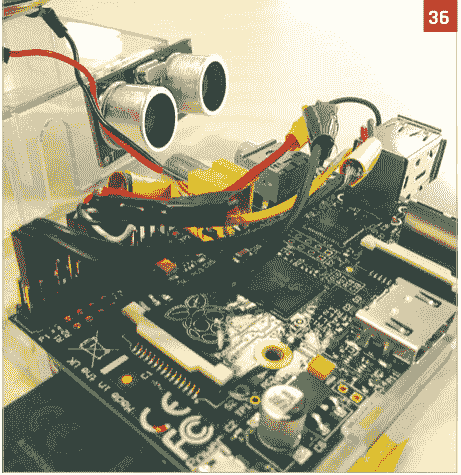

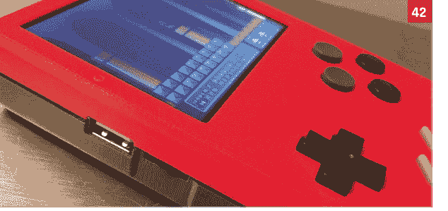

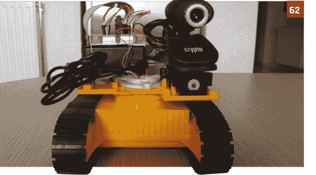

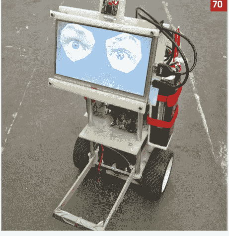

## 项目

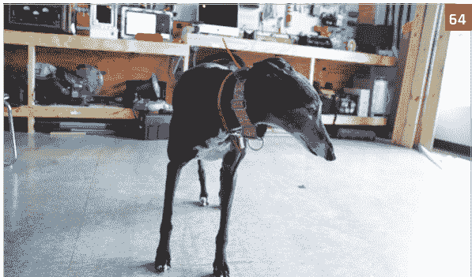

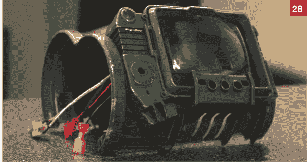

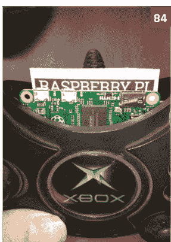

- **22 新年新你**
  用这些由 Pi 驱动的新年项目来实现你的新年决心
- **28 PIP-BOY 3000A**
  《辐射》的腕上电脑，现在在现实世界中可用
- **30 眼控轮椅**
  使用 3D 打印零件和挡风玻璃雨刷电机改装轮椅
- **32 SPACEHACK PI**
  一款模拟 Starship Guppy 号上灾难的游戏
- **34 FABSCAN PI**
  一款使用 Pi 制作的小型开源 DIY 3D 扫描仪
- **36 超声波 Theremin**
  使用距离传感器和你的手创造令人毛骨悚然的 50 年代科幻效果
- **38 SPARK 集群**
  六台树莓派连接在一起组成一台适度的超级计算机
- **40 RAFTBERRY**
  在湖上驾驶电动筏悠闲游荡，配上一些啤酒
- **42 玻璃罐保存**
  用这个装在罐子里的 Pi 保存你的回忆
- **44 超级 Game Girl**
  一件 3D 打印的 RetroPie 精品，提升了朴素的 Game Boy
- **46 MINI MACPI**
  你见过的最小的 Mac，而且它还能工作
- **48 CNC 机器**
  木工制作，外加一点 Pi 驱动的 CNC
- **52 SEEMORE**
  一部分雕塑，一部分超级计算机集群，SeeMore 是一件艺术品
- **56 神奇魔镜**
  一面高科技镜子，让你查看天气等更多信息
- **58 RPI KIDS**
  一位爸爸如何为他的孩子们创建了一个聪明的媒体中心
- **60 RASPIMOWER DALEK**
  与其说是消灭草坪，不如说是给它好好修剪一下
- **62 间谍漫游车**
  将旧玩具升级为遥控间谍
- **64 SNIFFUR**
  用一些蓝牙信标追踪办公室的狗狗
- **66 乞力马扎罗**
  一座山脉复制品，让家人追踪攀登者的上升情况
- **70 平衡机器人**
  一台在两轮上行驶的机器人，还能对人们的情绪做出反应
- **72 EYE PI 相机**
  使用 Pi Noir 拍摄美丽而超现实的红外照片
- **74 PI 桌子**
  一张值得任何星际飞船或儿童卧室拥有的太空时代书桌
- **76 万圣节项目**
  准备好迎接一些令人毛骨悚然的 Pi 项目吧
- **84 PI ZERO 项目**
  一些令人惊叹的项目，充分利用了迷你的 Pi Zero

