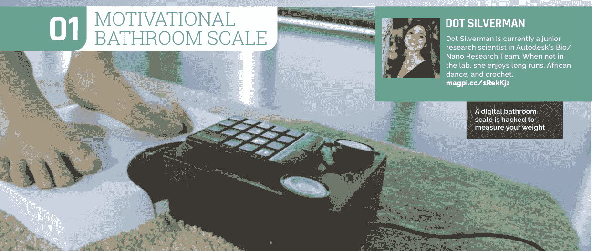
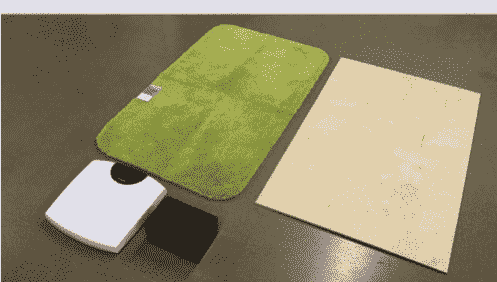
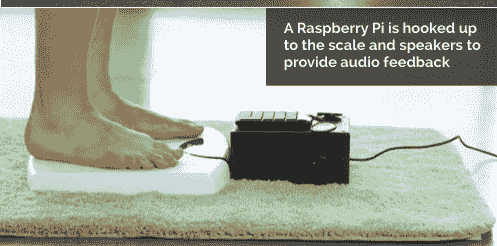
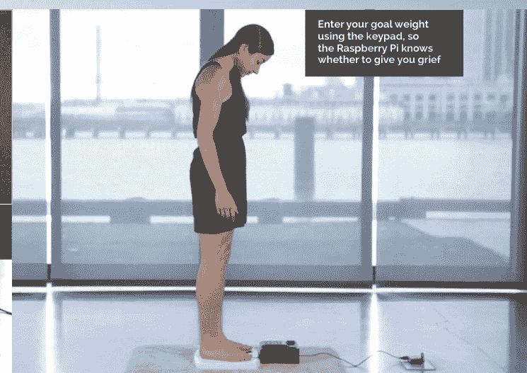

## 01 激励浴室秤

### DOT SILVERMAN

Dot Silverman 目前是 Autodesk 生物/纳米研究团队的初级研究科学家。实验室之外，她喜欢长跑、非洲舞蹈和钩针编织。
magpi.cc/1RekKjz

数字浴室秤被改装用来测量你的体重

## 10 个令人惊叹的新年项目

新年伊始，（希望也是）新我的开始。
以这些令人惊叹的项目开启 2016，让它如你所愿地进行下去…

我们都喜欢制定新年决心。坚持下去是另一回事，你也只能在三次之后放弃蛋糕的承诺并失败那么多次。

因此，与其立志不做有趣的事，我们认为找一些具有健康、令人愉悦氛围的 Raspberry Pi 驱动科技项目是个好主意。这些项目的创作者让我们感到骄傲。这里有一些世界上最酷的项目，助你迎接新年。

这些科技项目将帮助你更健康地生活，成为更好的公民，还能省钱。也不错吧？更重要的是，你可以在享受乐趣的同时做到这一切。

从更健康的生活开始是个不错的选择，所以我们的第一个项目是 Dot Silverman 的激励浴室秤。“你使用键盘在秤上输入目标体重，”Dot 解释道，“设备会将你的体重与目标体重进行比较。

“如果你的体重达标，它会给你一个讨好的赞美。否则，它会讽刺你回健身房去。记住，无论秤说什么，你都是美丽的。”

使用键盘输入目标体重，以便 Raspberry Pi 知道是否要给你找麻烦

Raspberry Pi 连接到秤和扬声器以提供音频反馈
