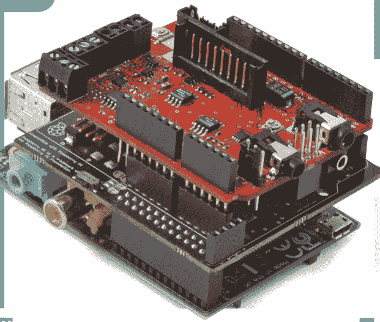

## 02 电子轮椅

### PHIL CASE

Phil Case 是一位英国创客，因事故受伤导致颈椎 C 段受损而致残。
magpi.cc/1lU6z6f

E-Wheelchair 整合了 Cooking Hacks E-Health v2 传感器来监测重要身体参数（cooking-hacks.com）。E-Health v2 和传感器附件使 Raspberry Pi 能够监测身体指标，例如血糖。

一位使用 E-Health 传感器的 Raspberry Pi 项目创作者是来自普雷斯顿的 Phil Case，他的终身目标是打造一辆价格实惠的智能轮椅。Phil 的‘E-wheelchair’由大脑控制，使用 Neurosky MindWave Mobile 和 Mindflex EEG 产品来测量使用者的脑电活动。E-Health 系统用于监测心电图水平和血糖，他计划实现身体位置传感器。
Phil 正在为他的智能轮椅项目筹集资金，2016 年想做慈善的人可以在 GoFundMe 上找到相关页面（gofundme.com/hfymdo）。

> 这里有一些世界上最酷的项目，助你迎接新年

如果你想更认真地监测健康，Cooking Hacks 的 E-Health v2 传感器值得研究。它使你能够将九个传感器连接到 Pi 上，以测量血压、氧气水平、气流、体温和血糖水平，以及心电图和肌电图结果。
