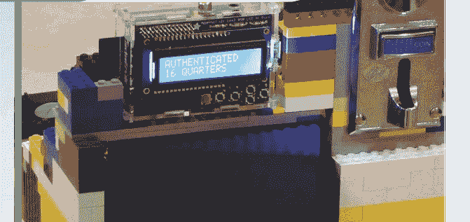
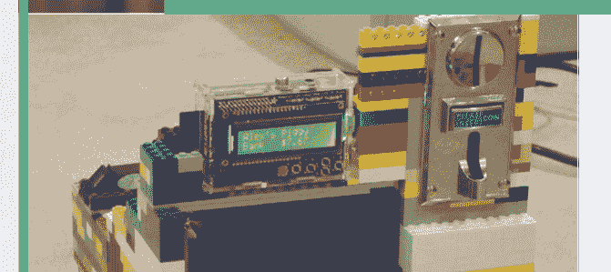

## 04 Raspberry Pi 存钱罐

### ALEX STRANDBERG

Alex Strandberg 是康奈尔大学工程学院的学生。
youtu.be/XanRVZgY6ow

Raspberry Pi 存钱罐使用硬币分拣机制将硬币放入正确的槽位。它使用每次硬币旋转的乐高机制来计数、分拣和储存硬币。指纹传感器用于提供对银行的访问。

从内部取出硬币，我将手指放在传感器上解锁银行。”

另一个值得研究的基于 Lego Mindstorms 的项目是由 Dexter Industries 创始人 John Cole 建造的精彩 BrickPi Bookreader。这台机器人手动翻页，拍摄每一页，然后大声读出。

> “我们想打造一个能大声读出书籍的数字化设备，”John 告诉我们。“我们对 Google Books 项目着迷，想着‘为什么不能在家建造这个？’”你需要一个 Dexter Industries BrickPi 设备和 Lego Mindstorms 设备。BrickPi 将 Raspberry Pi 变为 Lego Mindstorms 机器人的大脑。它控制两个 Lego EV3 马达：一个将页面推起，另一个充当手臂并将其翻转。Pi Camera Module 拍摄页面的图像，OCR 软件将其转换
