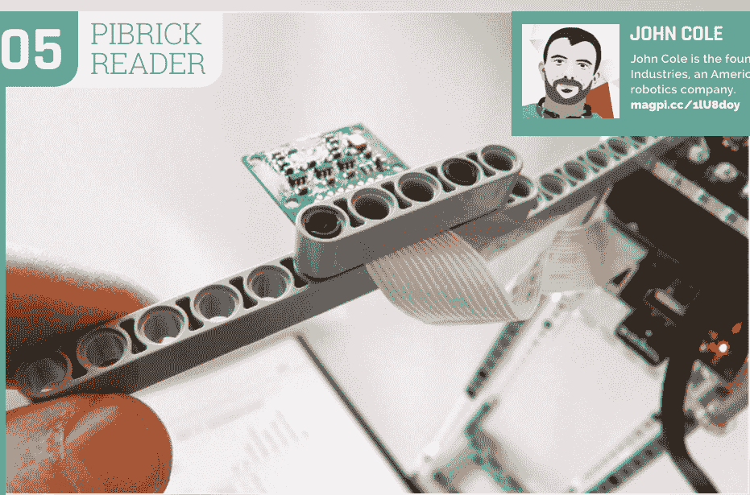
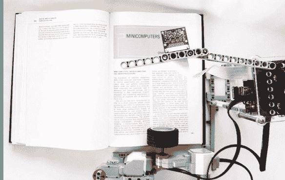

## 05 PiBrick 阅读器

### JOHN COLE

John Cole 是 Dexter Industries 的创始人，这是一家美国教育机器人公司。
magpi.cc/1IU8doy

该项目使用 PiBrick 和 Lego Mindstorms 套件重现 Google 为 Google Books 项目建造的机器人。它翻页、扫描它们，并使用语音阅读软件读出每一页。

成文本。“只是为了好玩，我们使用了一些免费的文本转语音软件，让 Raspberry Pi 大声读出书籍，”John 说。

## 自然召唤

如果你新年的决心是更亲近自然，那么你应该看看 Sam Webster 的 Tweety Pi 鸟箱（magpi.cc/1IU7cN9）。公平地说，野外有很多 Raspberry Pi 鸟箱项目。我们真的很喜欢 Sam 的，因为它比大多数都更进一步。Sam 为他的鸟箱配备了

一个 PIR 传感器，并将其连接到 Twitter。每当鸟飞进箱子时，它会自动开始向 @tweety pibirdbox 分享更新。我们在 The MagPi 很喜欢生态项目，在即将到来的年份学习如何在你的 Pi 项目中使用太阳能是个高尚的目标。太阳能板大约 20 英镑就能买到，可用于直接供电或为附带的电池充电。资深创客 Koff 在 Instructables 上有一个很棒的教程（magpi.cc/1IU7fZh）。
