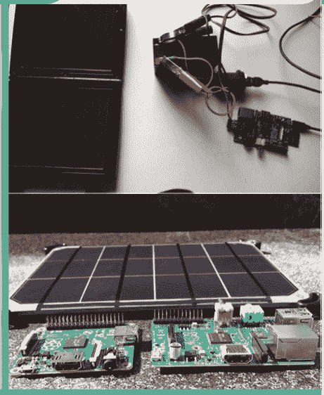
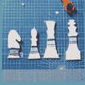

## 07 太阳能供电 Raspberry Pi

### KOFF

Koff 是一个国际神秘人物，但他从 1980 年代就开始制作东西，他的 YouTube 和 Instructables 页面上有一些很棒的项目。 magpi.cc/1IU7fZh

用太阳能为 Raspberry Pi 供电是个很棒的项目。你可以学习太阳能的工作原理，并可以创建在户外自行运行的设备。

## 有条理

如果你新年的决心之一是更有条理（我们通常也是），那么我们有三个很棒的项目供你查看。第一个是 Alex Pine（magpi.cc/1Y94RtZ）制作的精美的壁挂式 Google 日历。你可以用它为自己和家人创建一个共享日历，这样每个人都能清楚地看到正在发生的事情。

我们的第二个生产力项目是 Michael Mitchell 的 Inbox Zero 嘲讽者（magpi.cc/1Y953cF）。电子邮件是现代的诅咒，但实践收件箱零可以带来很多缓解
